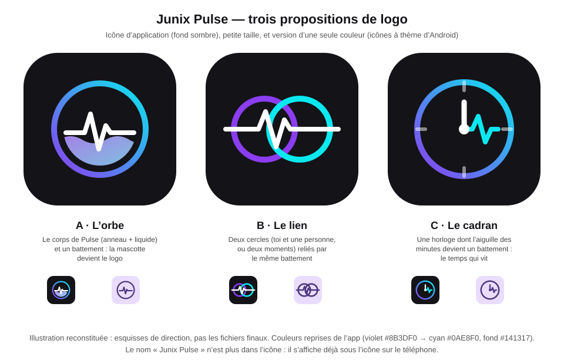
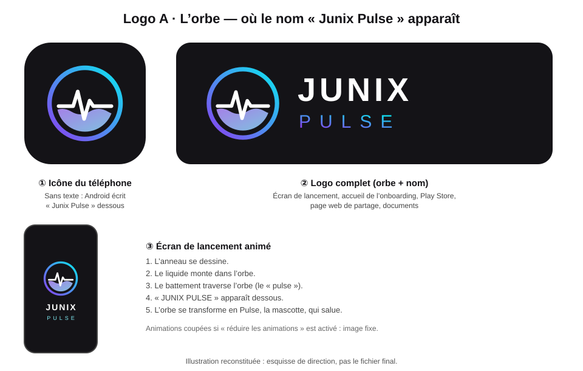

# ÉTUDE 001 — Clarifier, organiser et faire évoluer Junix Pulse

Date : 22 novembre 2026 · Statut : **décisions arrêtées : voir la section 12, qui fait référence**

Cette étude reprend tous les points de ton message, dit ce que le code fait **aujourd'hui**, propose **plusieurs approches** pour chacun, et une **hiérarchie** à valider. Le principe que tu as mis en avant (tout doit pouvoir évoluer sans casser) passe en premier, parce qu'il conditionne tout le reste.

---

## 0. Le principe qui guide tout : ajouter et retirer sans casser

Ce que le projet fait déjà bien :
- les migrations de base de données **ajoutent** sans jamais effacer (règle testée) ;
- les sauvegardes acceptent les anciennes versions (valeurs par défaut) ;
- les couches sont séparées : règles pures (`domain/rules`), base (`repositories`), actions (`use-cases`), écrans (`app/`).

Ce qui manque pour que les évolutions futures se branchent sans risque :

| Brique | Rôle | Exemple concret |
|---|---|---|
| **Registre des types d'éléments** | Un seul endroit qui décrit chaque type (rappel, tâche, événement… et demain d'autres) : son nom, son icône, ses champs, s'il sonne, s'il se coche, s'il se déplace dans le planning | Ajouter un type « Rendez-vous médical » = ajouter une entrée au registre, pas modifier 15 écrans |
| **Interrupteurs de fonctions** (« modules ») | Chaque grande fonction peut être activée ou retirée d'un endroit : gestes, dictée, partage, alarme plein écran… | Une fonction qui déplaît aux utilisateurs se coupe sans toucher au reste |
| **Champs optionnels décrits, pas codés en dur** | Les formulaires sont fabriqués à partir de la description du type (registre) | Ajouter un champ « Lieu » à la tâche = une ligne dans le registre |
| **Événements internes** (déjà amorcés avec le bus de la mascotte) | « Élément créé », « élément fait », « personne contactée »… diffusés à qui veut les écouter | Les notifications, la mascotte, le widget et demain le partage écoutent sans se connaître |
| **Préparation au cloud** | Identifiants uniques (déjà fait), date de modification (déjà fait), **propriétaire** et **version** de chaque élément (à ajouter) | Le jour du partage, rien n'est à refaire dans la base |

**Approches**
- **0-A, progressive** (recommandée) : on crée le registre et les interrupteurs **en même temps** que la première fonction qui en a besoin (clarification des types, point 1), puis chaque nouveauté s'y branche.
- **0-B, d'abord le socle** : on construit tout le socle avant toute nouveauté. Plus propre sur le papier, mais plusieurs semaines sans rien de visible.
- **0-C, rien de spécial** : on continue comme avant. Rapide au début, coûteux à chaque ajout ensuite. Déconseillé, vu ta demande.

---

## 1. Rappel, tâche, événement : qu'est-ce qui les différencie ?

**Ce que le code fait aujourd'hui**

| | Rappel | Tâche | Événement |
|---|---|---|---|
| Définition dans le code | Une **heure précise** où l'appli te **notifie** | Une chose **à faire**, qui se **coche**, avec ou sans jour, échéance possible | Un **moment** avec **début et fin**, lieu, personnes |
| Sonne ? | Oui | Non | **Non** (aucune notification n'est programmée pour un événement) |
| Se coche ? | Oui (« Terminer ») | Oui | Non |
| Personnes, étiquettes | Oui | Oui | Oui |
| Particularités | Action (appeler, message…), répétition, rappel à confirmer | Sous-tâches, durée estimée, échéance, objectif | Lieu, temps de trajet, « libre / occupé » |

Ce qui crée la confusion : un rappel peut avoir l'action « Faire » (donc ressembler à une tâche), une tâche peut avoir un jour (donc ressembler à un rappel), et l'événement, qui est le cœur de l'appli, **ne prévient jamais**. Tu ne te trompes pas : la frontière n'est pas claire, même dans le code.

**Approches**

- **1-A, garder les trois, mieux les expliquer**
  - Un seul bouton « Nouveau » qui demande d'abord « C'est quoi ? » avec un exemple sous chaque choix : *Me faire penser à… (rappel)* · *Une chose à faire (tâche)* · *Un moment avec une heure de début et de fin (événement)*.
  - Les événements prennent enfin des **alertes** (voir point 6).
  - Impact : faible, aucune donnée ne change.
- **1-B, deux familles seulement** : « **À faire** » (une tâche, qui peut avoir une alerte à une heure : le rappel devient une option) et « **Moment** » (l'événement, avec ses alertes).
  - C'est ce que font Google Agenda / Tasks et Apple Rappels.
  - Plus simple pour l'utilisateur, mais il faut fusionner rappels et tâches dans la base (migration, sauvegardes, notifications à reprendre).
  - Impact : fort.
- **1-C, un seul « élément » à options** (heure ? durée ? à cocher ? qui sonne ?) : le plus souple, le plus abstrait pour l'utilisateur, et le plus lourd à faire.

**Recommandation** : **1-A maintenant**, construit sur le registre (0-A), qui prépare **1-B plus tard** si les utilisateurs le demandent. Avec le registre, le passage à 1-B devient une évolution et non une réécriture.

---

## 2. Les formulaires : trop de champs, des champs mal placés, et la dictée partout

**Ce que le code fait aujourd'hui**
- Trois formulaires construits séparément (rappel, tâche, événement), avec un ordre et des styles différents.
- Événement : le champ **« temps de trajet »** est toujours proposé, même sans lieu. Il ne sert qu'à une ligne dans le planning et à un message de Pulse **si l'appli est ouverte** : il ne prévient pas de partir. Ta remarque est juste.
- La dictée n'existe que dans la capture rapide.

**Approches**
- **2-A, nettoyer les trois formulaires**
  - Même ordre partout : *Quoi* (titre, avec micro) → *Quand* → *Avec qui* → *Plus d'options* (repliées).
  - « Temps de trajet » n'apparaît **qu'une fois un lieu saisi**, renommé « **Partir … min avant** », et il **déclenche une alerte de départ** (« Pars maintenant pour arriver à 15 h »).
  - Le micro est ajouté dans le titre et les notes de chaque formulaire, avec le même outil que la capture rapide.
- **2-B, un seul formulaire fabriqué par le registre** (0-A) : chaque type déclare ses champs, et un seul composant les dessine. Même résultat visible que 2-A, mais les ajouts futurs se font sans toucher aux écrans.
- **2-C, tout passer par la capture rapide** (une phrase, l'appli remplit) et garder les formulaires pour corriger. Pratique, mais ne remplace pas des formulaires clairs.

**Recommandation** : **2-B**, en commençant par le formulaire d'événement, puis tâche, puis rappel.

---

## 3. Les gestes cachés (glisser une carte pour modifier ou supprimer)

**Aujourd'hui** : glisser vers la gauche ou la droite ouvre des actions, mais rien ne l'indique. On le découvre par hasard.

**Approches** (elles se combinent)
- **3-A, Pulse le montre une fois** : la première fois qu'une liste a des cartes, Pulse dit « Glisse une carte pour la modifier ou la supprimer », et la première carte **s'entrouvre seule** une seconde pour montrer les boutons. Une seule fois (le guide de Pulse sait déjà ne montrer qu'une fois).
- **3-B, un bouton visible** « ⋯ » sur chaque carte, qui ouvre les mêmes actions. Indispensable pour l'accessibilité (TalkBack ne glisse pas).
- **3-C, appui long** = menu des actions. C'est un réflexe courant sur Android.

**Recommandation** : **3-A + 3-B**. 3-C entre en conflit avec le glisser-déposer du planning (point 4) : à réserver au planning.

---

## 4. Déplacer une activité dans le planning, sans passer par le formulaire

**Aujourd'hui** : le planning a trois affichages, *Agenda* (liste), *Emploi du temps* (journée en grille) et *Semaine*. Il n'y a **pas de vue Mois**. Changer l'heure d'un élément oblige à ouvrir son formulaire.

**Ce que tu demandes** : appui long sur une carte → elle se soulève → on la fait glisser à une autre heure ou un autre jour → elle se pose. Dans toutes les vues.

**Approches**
- **4-A, toutes les vues d'un coup** : semaine, jour, mois (à créer) et agenda. C'est long, risqué, et tout arrive en même temps.
- **4-B, par étapes** (recommandée) :
  1. vue **Jour** (grille horaire), avec pas de 15 min ;
  2. vue **Semaine** (jour + heure) ;
  3. nouvelle vue **Mois** (déplacer vers un autre jour, l'heure est gardée).

  À chaque dépôt : vibration légère et message « Déplacé à 15:30 · Annuler ». Pour un élément **qui se répète** : « Seulement celui-ci ou tous ? ».
- **4-C, sans glisser** : appui long → « Déplacer » → choisir l'heure dans une petite roue. Plus simple et plus accessible, mais moins direct.

Les bibliothèques nécessaires (gestes et animations) sont **déjà installées**. Il faut décider quels éléments se déplacent : événements et tâches planifiées, et les rappels (cela change leur heure de notification, qu'il faut reprogrammer).

---

## 5. Partager, faire participer, travailler à plusieurs (organisations)

C'est le plus gros chantier, et il change la nature de l'appli : aujourd'hui **tout reste sur le téléphone** (« aucune donnée n'est envoyée à des serveurs tiers », c'est écrit dans les Paramètres).

**Ce que ça demande, quelle que soit l'approche** :
- **comptes** (identifier chaque utilisateur) ;
- **un serveur** (cloud) qui fait le relais ;
- la **synchronisation** (et les conflits quand deux personnes modifient en même temps) ;
- le **consentement** (la personne accepte ou refuse) ;
- la **confidentialité**, avec idéalement un chiffrement de bout en bout ;
- un **coût** de serveur et des **règles légales** (RGPD, données personnelles).

**Approches**, de la plus légère à la plus complète :
- **5-A, partager sans compte** : envoyer un événement ou une tâche par WhatsApp, SMS ou mail sous forme d'invitation (fichier d'agenda standard `.ics`, ou lien qui l'ajoute dans Junix chez l'autre). Pas de serveur, pas de synchronisation : la copie de l'autre ne bouge plus ensuite. **Faisable maintenant**, utile tout de suite.
- **5-B, éléments partagés avec comptes** : j'invite une personne qui a l'appli. Elle **accepte** et l'élément apparaît chez elle. Les modifications se synchronisent dans les deux sens. Il faut le cloud.
- **5-C, espaces de travail (organisations)** : sur 5-B, un « espace » (famille, association, entreprise) avec des **rôles** (responsable, membre, invité), des projets, et l'attribution des tâches, événements et rappels à des membres depuis le formulaire. C'est un produit à part entière.

**Recommandation**
- **5-A bientôt.**
- **Préparer 5-B dès maintenant** dans la base (point 0 : propriétaire, version) sans rien activer.
- Décider ensemble du **cloud** (fournisseur, coût, chiffrement) **avant** 5-B.
- 5-C ensuite, comme extension de 5-B, pas avant.

**À trancher ensemble** : l'appli reste-t-elle utilisable **sans compte** (recommandé, fidèle à « local d'abord »), le compte ne servant qu'au partage ?

---

## 6. Les notifications : le vrai point faible

**Ce que le code fait aujourd'hui**
- Les **rappels** notifient : titre, son, vibration, boutons Terminer / Plus tard.
- Les **événements ne notifient pas du tout**. C'est le manque le plus important, vu le but de Junix.
- Les canaux Android existent (rappels avec son, silencieux, récapitulatif du jour), mais tous les rappels ont **la même importance** et **le même son**.

**Ce que tu demandes**
- être prévenu d'un événement (le sien, ou celui d'une personne) avec **quand, où, avec qui**, sans ouvrir l'appli ;
- une **alerte façon réveil** : plein écran, sonnerie qui continue jusqu'à un geste ;
- une **hiérarchie** sonore et visuelle ;
- des **types d'événements** avec leur ton (un enterrement n'est pas une fête) ;
- la **gestion des sons** dans les Paramètres : sons de l'appli, sonneries du téléphone, musiques téléchargées.

**Approches**, par couches qui s'ajoutent :
- **6-A, les événements notifient** (indispensable) : « Dans 30 min · Dîner chez Paul · 12 rue X · avec Paul, Léa », avec boutons *Itinéraire* et *Appeler*. L'alerte de départ vient du « Partir … min avant » (point 2). Notification « étendue » qui montre tout sans ouvrir l'appli.
- **6-B, trois niveaux d'alerte**, choisis par élément (avec une valeur par défaut par type) :

  | Niveau | Son | Visuel | Exemple |
  |---|---|---|---|
  | **Discret** | aucun ou léger | notification simple | « Acheter du pain » |
  | **Normal** | son de Junix | notification étendue | « Réunion à 15 h » |
  | **Alarme** | sonnerie **qui continue** | **plein écran**, même téléphone verrouillé, geste pour arrêter | « Médicament », « Départ pour l'aéroport » |

- **6-C, types d'événements**, chacun avec couleur, icône, ton de Pulse et son par défaut : *Anniversaire* (festif), *Rendez-vous* (neutre), *Travail*, *Santé*, *Religieux / cérémonie*, *Deuil* (sobre : pas de couleurs vives, Pulse calme et discret, son doux), *Fête*, *Voyage*, *Autre*. La liste vit dans le registre (point 0), donc on en ajoute ou retire sans casser.
- **6-D, les sons dans les Paramètres** :
  - *Sons de Junix* (un petit ensemble fourni avec l'appli) : simple ;
  - *Sonneries du téléphone* : demande un module natif Android (la bibliothèque actuelle ne sait pas lister les sonneries) ;
  - *Musique du téléphone* : choisir un fichier, l'appli en garde une copie. Faisable, avec une contrainte Android : le son d'une catégorie de notification est fixé à sa création, donc changer de son demande de recréer la catégorie (géré par l'appli, invisible pour l'utilisateur).

**Contraintes honnêtes** :
- l'**alarme plein écran** demande une autorisation spéciale ; depuis Android 14, Google la réserve aux applis de **réveil et d'appel**, ce qui comptera si l'appli va sur le Play Store ;
- la **sonnerie continue** et le **plein écran** demandent probablement une bibliothèque de notifications plus puissante (par exemple Notifee) à la place d'une partie d'expo-notifications. C'est un changement d'architecture que je t'expliquerai avant de le faire.

**Recommandation** : **6-A** d'abord, puis **6-B** et **6-C** ensemble, puis **6-D** (sons de Junix d'abord, sonneries et musiques ensuite). L'alarme plein écran est le dernier étage de 6-B.

---

## 7. Le logo

**Aujourd'hui** : un P avec une ligne de pouls dans un cercle, et le nom **écrit dans l'icône**. Le nom se lit mal en petit, le P ressemble à un R, et le lien avec la mascotte n'apparaît pas.

| | Idée | Points forts | Points faibles |
|---|---|---|---|
| **A · L'orbe** | Le corps de Pulse (anneau + liquide) traversé par un battement | Le logo **et** la mascotte racontent la même chose ; reconnaissable en tout petit ; s'anime facilement au lancement (le liquide monte, le battement passe) | Proche de la mascotte : moins de « signe » abstrait |
| **B · Le lien** | Deux cercles qui se chevauchent (toi et l'autre) reliés par un battement | Dit « relations » d'un coup d'œil | Dit moins « temps » ; deux cercles fins en tout petit |
| **C · Le cadran** | Une horloge dont l'aiguille devient un battement | Dit « temps » tout de suite | Dit moins « relations » ; ressemble à beaucoup d'icônes d'horloge |

Dans les trois : plus de texte dans l'icône, une version d'une seule couleur pour les icônes à thème d'Android 13+, et l'animation de lancement redessinée à partir du logo choisi.

**Ma recommandation : A · L'orbe.** C'est la seule qui relie le logo, la mascotte et le nom « Pulse ».

---

## 8. Hiérarchie proposée (à valider ou modifier)

| Niveau | Sens | Points |
|---|---|---|
| **N1 — tout de suite** | Ce qui manque au but même de l'appli, ou gêne tous les jours | **0-A** socle (registre, interrupteurs) · **6-A** les événements notifient · **1-A** clarifier les trois types · **2** formulaires (en commençant par l'événement et son « Partir … min avant ») · **7** logo |
| **N2 — ensuite** | Ce qui rend l'appli nettement meilleure | **6-B + 6-C** niveaux d'alerte et types d'événements · **3-A + 3-B** gestes expliqués · **2** micro dans tous les formulaires · **5-A** partager sans compte |
| **N3 — plus tard** | Gros chantiers, à faire par étapes | **4-B** glisser-déposer dans le planning (jour, puis semaine, puis mois) · **6-D** sons et sonneries · alarme plein écran |
| **N4 — après une décision sur le cloud** | Change la nature de l'appli | **5-B** éléments partagés avec comptes · **5-C** espaces de travail et rôles |

## 9. Ce que j'ai besoin que tu tranches

1. **La hiérarchie** ci-dessus : la valides-tu, ou veux-tu déplacer des points ?
2. **Types (point 1)** : 1-A (trois types mieux expliqués) ou tu veux déjà aller vers 1-B (deux familles) ?
3. **Logo** : A, B ou C ?
4. **Partage (point 5)** : l'appli doit-elle rester utilisable **sans compte** ?
5. **Alarme plein écran** : prête à accepter qu'elle soit peut-être limitée sur le Play Store, ou on la garde pour une version installée à la main ?

Rien ne sera réalisé avant tes réponses. Ensuite, chaque point validé aura sa fiche opératoire avant d'être fait.

---

## 10. Tes réponses (22 novembre) et ce qu'elles changent

### 10.1 Hiérarchie : validée

On suit N1 → N2 → N3 → N4 (section 8).

### 10.2 Types : trois types, chacun avec une identité nette (1-A renforcé)

Tu as raison : expliquer ne suffit pas, il faut que chaque type **se reconnaisse d'un coup d'œil, partout de la même façon** (listes, planning, accueil, notifications, widget).

| | Rappel | Tâche | Événement |
|---|---|---|---|
| **Phrase-clé** (sous le choix « Nouveau ») | « Me faire penser à quelque chose, à une heure » | « Une chose à faire, que je coche quand c'est fait » | « Un moment qui a lieu : début, fin, souvent un lieu et des gens » |
| **Icône** | Cloche | Case à cocher | Calendrier |
| **Couleur du type** | Violet (couleur principale) | Cyan | Ambre (déjà utilisé pour l'agenda sur l'accueil) |
| **Forme de carte** | Heure en grand à gauche | Case à cocher à gauche | Barre verticale de couleur à gauche (la couleur de son **type d'événement** : anniversaire, deuil… voir 6-C), plage horaire « 14:00 – 16:00 » |
| **Geste principal** | Terminer / Plus tard | Cocher | Ouvrir (il n'y a rien à cocher) |
| **Notification** | Sonne à l'heure | Seulement si une alerte est ajoutée | Alerte avant le début (et alerte de départ s'il y a un lieu) |

Les couleurs restent celles de la palette, avec des contrastes vérifiés dans les deux thèmes. L'identité vit dans le **registre des types** (section 0) : chaque écran la lit au même endroit.

### 10.3 Logo : A · L'orbe, avec le nom là où il compte

- **Icône du téléphone** : sans texte. Android écrit déjà « Junix Pulse » sous l'icône ; un texte dans l'icône devient illisible en petit (le défaut du logo actuel).
- **Logo complet** (orbe + « JUNIX » + « PULSE ») : écran de lancement, onboarding, Play Store, page web de partage, documents.
- **Animation de lancement** : l'anneau se dessine, le liquide monte, le battement passe, le nom apparaît, puis l'orbe devient Pulse, qui salue.

### 10.4 Planning : faut-il garder trois vues, et faut-il une vue Mois ?

**Constat confirmé dans le code** : « Agenda » et « Journée » montrent **exactement le même jour** (même bandeau de 7 jours en haut), l'un en liste, l'autre en grille horaire. Deux vues pour un seul contenu, c'est un choix de plus à faire sans rien apprendre de plus, donc une charge pour la mémoire (loi de Hick : plus il y a de choix équivalents, plus on hésite).

**Approches**
- **P-A, trois échelles de temps : Jour · Semaine · Mois** (recommandée)
  - **Jour** fusionne Agenda et Journée : la grille horaire, avec en haut une bande « Sans heure » (tâches du jour, anniversaires). C'est là que se fera le glisser-déposer.
  - **Semaine** : comme aujourd'hui.
  - **Mois** : volontairement léger. Chaque jour montre des petits points de la couleur de chaque type, sans texte ; toucher un jour ouvre la vue Jour.
  - Pourquoi : ce sont les trois vues que tout le monde connaît (Google Agenda, Samsung Calendrier), donc rien à apprendre. Chaque vue a un rôle distinct (le détail, l'organisation, l'anticipation).
- **P-B, Jour · Semaine · À venir** : pas de Mois, mais une liste des 30 prochains jours (anniversaires, voyages, rendez-vous lointains). Plus simple, mais on perd la vision d'ensemble d'un mois.
- **P-C, garder les vues actuelles** : déconseillé, la redondance demeure.

**La vue Mois est-elle nécessaire ?** Pas pour la journée de tous les jours. Elle sert pour ce que Junix suit au-delà de la semaine : anniversaires, cérémonies, voyages, échéances. Gardée minimale (des points), elle ne charge pas l'écran. Sans elle, il faut faire défiler semaine après semaine pour voir le 15 du mois prochain.

### 10.5 Partager, gratuitement et sans serveur payant

Contraintes posées : **pas d'argent**, gratuit, léger, simple à présenter, et peut-être un **compte Junix Pulse** plus tard.

**Le transport, déjà gratuit et déjà dans le téléphone** : un seul bouton **« Partager »** ouvre la feuille de partage d'Android. Elle propose déjà **WhatsApp, SMS, Gmail, e-mail, Bluetooth et Quick Share** (l'équivalent d'AirDrop sur Android, par Wi-Fi à proximité). Aucun code de transport à écrire, aucun coût.

**Ce qui est partagé : une invitation**
- Un **lien** vers une petite page web **gratuite** (hébergée sur GitHub Pages).
- Les informations de l'élément (titre, date, lieu, personnes) sont **dans le lien lui-même**, après un `#`. Ce morceau du lien n'est **jamais envoyé au serveur** : rien n'est stocké ailleurs que dans le message.
- La page affiche l'invitation et trois boutons :
  - **Ouvrir dans Junix** (si l'appli est installée) ;
  - **Installer Junix** (lien vers l'APK, puis le Play Store un jour) ;
  - **Ajouter à mon agenda** (pour ceux qui n'ont pas Junix : fichier d'agenda standard).
- **Le QR code** : le même lien, affiché en QR à l'écran. L'autre le scanne avec l'appareil photo de **son** téléphone (tous les Android récents lisent les QR) : pas besoin d'ajouter un module caméra à Junix.

**Participer, avec consentement**
1. Paul partage « Dîner samedi 20 h » avec Léa.
2. Léa ouvre le lien : Junix affiche « Paul t'invite : Dîner samedi 20 h · **Accepter** / **Refuser** ».
3. Si elle accepte, l'élément est ajouté chez elle, et Junix lui propose de répondre à Paul par le même moyen (message prérempli « J'ai accepté : Dîner samedi 20 h »).
4. Si Paul ouvre cette réponse, Junix marque Léa « participe ».

**Limite honnête** : sans serveur, **pas de synchronisation automatique**. Si Paul change l'heure, il repartage ; Junix reconnaît la même invitation (même identifiant, version plus récente) et la met à jour au lieu d'en créer une deuxième.

**Coût** : zéro. Ce qu'il faut ajouter : une petite bibliothèque de QR code (elle s'appuie sur le dessin SVG déjà utilisé par l'appli) et une page web statique.

**Plus tard (N4) : le compte Junix Pulse**, pour la synchronisation automatique et les espaces de travail. Les offres gratuites existent (Firebase « Spark » de Google, Supabase « Free »), avec des quotas : suffisants pour commencer, mais Supabase met en pause un projet inactif une semaine. Le compte reste **facultatif** : l'appli marche sans.

### 10.6 Question 5 expliquée : l'alarme plein écran et le Play Store

**Ce que c'est** : comme le réveil du téléphone. Si le téléphone est verrouillé, l'écran s'allume avec une **grande page** (titre, heure, boutons « Arrêter » et « Plus tard »), et la sonnerie continue jusqu'à ce que tu touches l'écran.

**Ce que ça sous-entend**
- Android exige une **autorisation spéciale** pour ouvrir un écran par-dessus tout, même verrouillé (« notifications plein écran »).
- Depuis **Android 14**, Google ne la donne automatiquement **qu'aux applis de réveil et d'appel**. Pour les autres :
  - **APK installé à la main** (comme maintenant) : l'utilisateur peut l'activer lui-même dans les réglages d'Android, et l'alarme marche ;
  - **Play Store** : Google peut **refuser** l'appli si elle demande cette autorisation sans être une appli de réveil ou d'appel, ou demander une justification.

**Proposition** : construire l'alarme avec une **solution de repli automatique**.
- Autorisation accordée : **plein écran** + sonnerie continue.
- Autorisation absente : **notification prioritaire** (bandeau en haut de l'écran, ou écran de verrouillage) avec sonnerie **qui continue** jusqu'à un geste.

Tu n'as rien à trancher maintenant ; la question reviendra seulement le jour d'une publication sur le Play Store.

### 10.7 Ordre proposé pour démarrer N1

1. **Registre des types + identité visuelle des trois types** (socle 0-A et 10.2) : tout le reste s'appuie dessus.
2. **Les événements notifient** (6-A), avec l'alerte de départ.
3. **Formulaire d'événement** remis à plat (2), avec « Partir … min avant » seulement si un lieu est saisi.
4. **Logo A** (icône, logo complet, animation de lancement).
5. **Formulaires de tâche et de rappel**, puis le choix « Nouveau » avec les phrases-clés.

Chaque étape : une fiche opératoire, puis la réalisation, puis tes tests sur le téléphone avant l'étape suivante.

---

## 11. Précisions du 22 novembre (suite)

### 11.1 Glisser-déposer : dans les trois vues, pour les trois types

Ta demande, reformulée pour qu'on parle de la même chose :

| Vue | Ce qu'on attrape | Où on le pose | Ce qui change dans l'élément |
|---|---|---|---|
| **Jour** (grille des heures) | n'importe quelle carte : tâche, rappel, événement | plus haut ou plus bas | **l'heure** (ex. 7 h → 19 h), par pas de 15 min ; un événement garde sa durée |
| **Semaine** (colonnes des jours) | n'importe quelle carte | dans une autre colonne, et à une autre hauteur | **le jour et l'heure** |
| **Mois** (grille des jours) | un point ou une carte du jour | sur une autre case | **le jour** ; l'heure est gardée |

Dans les trois cas :
- **appui long** : la carte se soulève avec une vibration légère ;
- pendant le glisser, l'heure ou le jour visé s'affiche en direct (« 19:00 ») ;
- au lâcher, l'élément est **enregistré tout de suite**, avec un message « Déplacé à 19:00 · Annuler » ;
- **les alertes suivent** : un rappel ou un événement déplacé sonne à sa nouvelle heure ;
- un élément **qui se répète** demande « Seulement celui-ci ou tous ? ».

La section 4 recommandait de le faire « par étapes » : l'objectif reste les trois vues, mais elles seront construites l'une après l'autre (Jour, puis Semaine, puis Mois) et testées entre deux. Ça reste au niveau **N3**, après la refonte des vues en Jour · Semaine · Mois (10.4).

### 11.2 1-A ou 1-B : mon avis

Ma recommandation de la section 1 était « **1-A maintenant, qui prépare 1-B plus tard** ». Ton message, lui, montre que la confusion vient du **chevauchement** entre rappel et tâche, pas d'un manque d'explication. Le code le confirme : un rappel peut avoir l'action « **Faire** » (c'est alors une tâche avec une heure), et une tâche peut avoir un jour.

**Pourquoi 1-B est le bon choix pour Junix**
- **Deux familles qui ne se chevauchent plus** :
  - **À faire** : ce qui se coche, avec ou sans alerte à une heure ;
  - **Moment** : ce qui a lieu, avec début et fin.

  La question « rappel ou tâche ? » disparaît, parce qu'un rappel devient **une chose à faire avec une alerte**.
- C'est le modèle que les gens connaissent déjà : Google (Tasks + Agenda), Apple (Rappels + Calendrier), TickTick. Rien à apprendre.
- Ça sert le but de Junix : « Appeler Paul à 18 h » reste une chose à faire, avec une alerte et l'action Appeler. Les personnes, les étiquettes, l'échéance et la confirmation restent.

**Ce qui le rend risqué si on le fait d'un bloc** : rappels et tâches sont stockés dans deux tables différentes, avec leurs notifications, sauvegardes, statistiques, widget et mascotte. Tout fusionner d'un coup, c'est des semaines de travail et un gros risque de casser.

**Donc : 1-B, en deux temps, sans casser** (c'est le principe de la section 0)
1. **L'interface passe à deux familles.** L'utilisateur ne voit plus que « À faire » et « Moment ». Dans la base, rien ne bouge : un « À faire » avec une alerte est enregistré comme un rappel, un « À faire » sans alerte comme une tâche. Le **registre des types** fait le lien.
2. **Les données fusionnent plus tard**, seulement si c'est utile, par une migration qui ajoute sans effacer.

**Ce que tu verras changer** (à confirmer avant de commencer)

| Aujourd'hui | Après 1-B (étape 1) |
|---|---|
| Onglets : Accueil · **Rappels** · **Tâches** · Planning · Proches | Accueil · **À faire** · Planning · Proches (un onglet de moins) |
| « Nouveau » : rappel, tâche ou événement | « Nouveau » : **À faire** (« une chose à faire, avec ou sans alerte ») ou **Moment** (« quelque chose qui a lieu ») |
| Deux formulaires (rappel, tâche) | Un formulaire « À faire » : *Quoi* → *Quand* (jour, heure facultative) → **Alerte** (interrupteur : sonner à cette heure, rappel à confirmer) → *Avec qui* → *Plus d'options* (sous-tâches, échéance, durée, étiquettes) |
| Liste des rappels et liste des tâches séparées | Une liste « À faire » avec des filtres : *Aujourd'hui* · *Avec alerte* · *Sans date* · *Tout* |
| Carte rappel et carte tâche différentes | Une seule carte « À faire » (case à cocher), avec une **petite cloche et l'heure** quand elle a une alerte |
| Rappels et tâches déjà enregistrés | **Gardés tels quels**, affichés comme des « À faire » (avec cloche pour les anciens rappels) : rien n'est perdu |

**L'identité visuelle de 10.2 devient** : **À faire** = case à cocher, cyan (cloche ajoutée s'il y a une alerte) ; **Moment** = calendrier, ambre, avec la barre de couleur de son type d'événement.

### 11.3 Ordre de N1 avec 1-B

1. **Registre des types** (À faire / Moment) et identité visuelle.
2. **Les Moments (événements) notifient**, avec l'alerte de départ.
3. **Formulaire Moment** remis à plat (« Partir … min avant » seulement avec un lieu).
4. **Formulaire À faire** unique, et le choix « Nouveau » à deux familles.
5. **Onglet À faire** (fusion des onglets Rappels et Tâches) et cartes unifiées.
6. **Logo A**.

---

## 12. Décisions du 22 novembre (soir) : ce qui est retenu, point par point

Cette section **remplace** les recommandations des sections précédentes là où elles diffèrent. C'est la référence pour la suite.

### 12.1 Types (point 1) : 1-B, fait en partie

Deux familles à l'écran, **À faire** et **Moment** ; les données gardent leurs trois types. Étape 1 réalisée : [fiche 008](../fiches/FICHE-008-deux-familles.md).

### 12.2 Formulaires (point 2) : 2-B, avec deux formulaires bien différenciés

- **2-B** : les formulaires sont fabriqués à partir du **registre** (chaque famille déclare ses champs, un seul jeu de briques les dessine). Un champ ajouté ou retiré demain se fait dans le registre, sans toucher aux écrans.
- **Mais deux formulaires distincts à l'œil**, pas un formulaire unique qui change de forme :
  - **À faire** : couleur cyan, case à cocher dans l'en-tête, champs *Quoi* → *Quand* (jour, heure facultative) → **Alerte** (interrupteur, rappel à confirmer) → *Avec qui* → *Plus d'options* (sous-tâches, échéance, durée, étiquettes) ;
  - **Moment** : couleur ambre, calendrier dans l'en-tête, champs *Quoi* → *Début et fin* → *Où* → **Partir … min avant** (seulement si un lieu est saisi) → *Avec qui* → *Type de moment* (anniversaire, deuil…) → *Plus d'options*.
- La **dictée** (micro) dans le titre et les notes des deux formulaires.
- **Précisions du 23 novembre 2026** (avant la fiche 012) :
  - **étendue** : la fiche 012 fait les deux formulaires de **création** ; les écrans de modification suivent dans la fiche d'après, avec les mêmes briques ;
  - **la priorité** se place **sous l'Alerte** (c'est là qu'elle change quelque chose : Urgente = Alarme), et dans Plus d'options quand il n'y a pas d'alerte ;
  - **les options des rappels** (répétition, rappel à confirmer, action comme « Appeler ») n'apparaissent que **sous l'interrupteur Alerte** ;
  - **la voix pour tout remplir** (décidé le 23 novembre, avant l'APK de test) : un bouton **« Dicter tout »** en haut des deux formulaires ; une phrase remplit les champs (titre, jour, heure, personne, priorité, répétition ; pour un Moment, aussi le **lieu** et la **fin**). Fiche 013 ;
  - **le lieu** : pas de carte dans l'appli (Google Places demande une clé payante) ; sur un moment qui a un lieu, deux boutons gratuits : **« Ouvrir dans Maps »** et **« Y aller »** (itinéraire Google Maps). Fiche 013 ;
  - **la durée** (« combien de temps pour y arriver ») : elle ne servait à rien (seulement une étiquette « 30 min » sur les cartes), d'où l'incompréhension. Elle devient **« Temps pour le faire »**, cachée dans Plus d'options, avec une phrase qui dit à quoi elle sert : **lancer une session Focus depuis la tâche règle le minuteur sur ce temps**. Tout doit rester cohérent avec ce qui existe déjà (cartes, Planning, Focus, anciennes tâches qui ont déjà une durée).

### 12.3 Gestes (point 3) : 3-A + 3-B + 3-C, et les faire découvrir sans submerger

- **3-A** la carte s'entrouvre une fois pour montrer qu'on peut la glisser ; **3-B** un bouton « ⋯ » visible sur chaque carte ; **3-C** l'appui long.
- **Conflit résolu** : l'appui long ouvre le **menu** dans les listes, et **soulève la carte** pour la déplacer dans le planning. Ce sont deux écrans différents, donc chaque geste a un seul sens à un endroit donné.
- **Découverte progressive** (ta demande) : **jamais tout à l'arrivée**. Chaque astuce apparaît **une seule fois**, **au moment où elle sert**, présentée par Pulse dans une petite bulle :

  | Quand | Astuce |
  |---|---|
  | La première fois qu'une liste a au moins deux cartes | « Glisse une carte pour la modifier ou la supprimer » (la carte s'entrouvre) |
  | La première fois qu'on ouvre le planning avec au moins un élément | « Appuie longtemps sur une carte puis fais-la glisser pour changer son heure » |
  | La première fois que la vue Mois s'affiche | « Fais glisser un élément sur un autre jour » |
  | La première fois qu'on ajoute une personne à un élément | « Tu peux lui envoyer l'invitation » (voir 12.5) |

  Jamais deux astuces le même jour ; une astuce fermée ne revient pas. Dans les Paramètres, **« Revoir les astuces »** les remet à zéro. Le guide de Pulse sait déjà ne montrer qu'une fois : on s'appuie dessus.

### 12.4 Planning (point 4 et 10.4) : Jour · Semaine · Mois, glisser-déposer partout

- Trois vues : **Jour** (grille des heures, bande « Sans heure » en haut), **Semaine**, **Mois** (points de couleur, toucher un jour ouvre la vue Jour).
- **Glisser-déposer dans les trois vues** (11.1) : dans la vue Jour, l'heure bouge par **pas de 15 minutes** (on lâche à 19:00 ou 19:15, pas à 19:07) ; dans Semaine, le jour et l'heure ; dans Mois, le jour.
- **Léger** : pas de nouvelle bibliothèque (gestes et animations sont déjà installés et tournent hors du fil principal, donc sans ralentir l'appli) ; seule la carte qui bouge est redessinée.
- Découverte : astuce de 12.3.
- **Fait le 24 novembre 2026 (fiche 026)** : **4 vues** (Agenda gardée · Journée · Semaine · Mois) ; un rappel répétitif glissé déplace **toute la série** après une question ; le déplacement est enregistré tout de suite avec un bandeau **« Annuler »** ; le Mois montre **des points de couleur**, toucher un jour montre ses choses en dessous (« Voir la journée » ouvre la Journée) et on les glisse sur une autre case. Les rendez-vous du téléphone ne bougent pas ; les tâches changent de jour dans le Mois. Même gestes en actions TalkBack. Astuce de Pulse `planDrag`.
- **Revu le 25 novembre 2026 (fiche 027)**, après l'APK : la Journée reprend **le design de l'ancienne vue** (résumé et légende, tâches du jour, créneaux libres, MAINTENANT, « Options » sur les rappels) avec les **GlowCards et leurs couleurs** (moment `info` et couleur de son type, rappel `primary` ou `urgent`, tâche `success`), mais **à l'échelle** : hauteur selon la durée, cartes qui se chevauchent côte à côte. Le Mois a un **bandeau des mois**, ses choses en GlowCards, et pendant un glisser **le bord de la grille tourne une page** (une fois par entrée au bord).

### 12.5 Partage (point 5 et 10.5) : hybride, par étapes, le plus léger possible

- **Ordre** : 5-A (sans compte, gratuit) d'abord, 5-B (compte facultatif, synchronisation) ensuite, 5-C (espaces de travail, rôles) en dernier. Chaque étape réutilise la précédente.
- **Ajouter une personne n'envoie rien tout seul.** C'est toi qui décides :
  - après avoir ajouté une personne qui a un numéro ou un e-mail, l'élément propose un bouton **« Envoyer à Paul »** (SMS, WhatsApp, e-mail, QR, Bluetooth, Quick Share) ;
  - un réglage, **désactivé au départ**, permet à ceux qui le veulent de se voir proposer l'envoi **dès** qu'ils ajoutent quelqu'un.
- **Les deux côtés se relient automatiquement**, une fois l'invitation acceptée :
  - **chez l'envoyeur** : la personne à qui tu envoies est déjà dans l'élément (tu l'as ajoutée), et passe à « invitée » puis « participe » quand elle accepte ;
  - **chez le destinataire** : l'élément arrive avec **l'envoyeur comme personne liée**. Junix le reconnaît dans ses proches par son **numéro** ou son **e-mail** ; s'il ne le trouve pas, il propose « Ajouter Paul à tes proches ? ». Les autres personnes de l'élément sont proposées de la même façon, jamais ajoutées sans accord.
- Les **réglages du partage** (nom affiché, envoi proposé, QR) iront dans les Paramètres (12.8).
- **Fait le 24 novembre 2026 (5-A, fiche 025)** : texte lisible et lien Junix, pour les moments, les tâches et les rappels ; QR plus tard ; « Invitation envoyée » à l'envoi, « Participe » à la main. Les notes ne sont pas envoyées. L'envoyeur est reconnu par son **nom** (sans compte, ni numéro ni e-mail ne voyagent). Limite : WhatsApp et la plupart des SMS ne rendent cliquables que les liens `https://` ; un lien toujours cliquable attend 5-B (une petite page web). Restent pour plus tard : le réglage « proposer l'envoi dès qu'on ajoute quelqu'un » et l'astuce de Pulse « Tu peux lui envoyer l'invitation ».

### 12.6 Notifications (point 6 et 10.6) : 6-A à 6-D, pour les trois types

- **Les trois types notifient**, chacun avec ce qui lui est propre :
  - **À faire avec alerte** : à l'heure, rappel à confirmer possible ;
  - **À faire avec une échéance** : la veille et le jour même ;
  - **Moment** : avant le début, et alerte de départ s'il y a un lieu.
- **Hiérarchie** (6-B) : *Discret* · *Normal* · *Alarme*. Elle se règle selon plusieurs critères (ta demande) :
  - **le type** et **le type de moment** (deuil sobre, anniversaire festif) ;
  - **la priorité** (urgent monte d'un niveau) ;
  - **le moment de la journée** (la nuit, tout descend d'un niveau sauf l'Alarme) ;
  - **dans l'appli ou hors de l'appli** : appli ouverte, un petit son et un bandeau dans l'appli ; appli fermée, la notification Android avec son niveau.
- **L'alarme** se fait **dans la notification**, comme l'appli Réveil du téléphone : notification qui reste, sonnerie qui continue, gros boutons **Arrêter** / **Plus tard**, et plein écran **seulement si** Android l'autorise (sinon la même chose en notification prioritaire).
- **Les sons** (6-D) : sons de Junix d'abord, puis sonneries et musiques du téléphone, avec un son par niveau et par type de moment, réglables dans les Paramètres.
- **Précisions du 23 novembre 2026** (avant la fiche 011) :
  - **la nuit** : de 22 h à 7 h par défaut, **réglable dans les Paramètres** ;
  - **les échéances** d'une chose « À faire » : la **veille à 18 h** et le **jour même à 9 h** ;
  - **les Moments** : **15 min avant** le début, en plus de l'alerte de départ (« Partir … min avant ») s'il y a un lieu ;
  - **découpage** : la fiche 011 fait la règle des niveaux, les canaux Android et les notifications des trois types ; les sons et l'alarme qui sonne en continu viennent au chantier n° 9. Le critère « type de moment » attend le chantier n° 5 (les types de moments n'existent pas encore).
- **Précisions du 24 novembre 2026** (chantier n° 5, fiche 023 ; à changer dans les registres si besoin) :
  - les **neuf types** de 6-C, devinés du titre jusqu'à ce qu'on en choisisse un ; « Autre » par défaut ;
  - **ordre de la règle** : niveau choisi pour l'élément (Auto = aucun), sinon niveau par défaut de sa famille (Paramètres), veille d'échéance un cran en dessous, type (deuil un cran en dessous, départ d'un voyage un cran au-dessus), urgent un cran au-dessus ; **la nuit** baisse tout d'un cran sauf l'Alarme, même un niveau choisi ;
  - un niveau se **choisit** sur un rappel et sur un moment ; l'échéance d'une tâche suit le réglage « Échéances des tâches » ;
  - le **ton** de chaque type est noté dans le registre ; Pulse et les sons s'en serviront au chantier n° 9.

### 12.7 Logo (point 7 et 10.3) : A · L'orbe, et la question du « J »

- Retenu : **A · L'orbe** (anneau, liquide, battement, lien avec la mascotte).
- Remarque de ton entourage : on ne voit pas le **J** de Junix dans l'icône. Deux possibilités, que je dessinerai au moment du logo pour que tu compares :
  - **A1**, l'orbe telle quelle : le nom est sous l'icône, le J n'est pas nécessaire ;
  - **A2**, l'orbe où **le battement se termine en crochet de J** (la ligne descend et se recourbe vers la gauche, comme un J). Le J apparaît sans ajouter de lettre.

### 12.8 Les Paramètres à prévoir

Tout ce qui se règle doit avoir sa place, **sans alourdir la page** (même principe que le sommaire actuel : une ligne par sujet) :

| Sujet | Réglages |
|---|---|
| Notifications et sons | Niveau par défaut de chaque type, son de chaque niveau, sons par type de moment, heures calmes la nuit, alarme plein écran (si Android l'autorise) |
| Astuces | « Revoir les astuces » |
| Partage | Nom affiché dans les invitations, « Proposer l'envoi quand j'ajoute quelqu'un », lien d'installation |
| Planning | Vue d'ouverture (Jour, Semaine ou Mois), premier jour de la semaine, pas du glisser (15 min par défaut) |
| Types de moment | Liste des types (anniversaire, deuil…), avec leur couleur et leur son |

Ces réglages arrivent **avec** la fonction qu'ils règlent, pas avant.

### 12.9 L'exigence de qualité

- **Devant l'utilisateur** : chaque ajout respecte le design existant (verre, palette, un seul dégradé par écran, pas d'emoji, cibles de 44 px, TalkBack, réduire les animations), en clair **et** en sombre, avec des sons cohérents.
- **Derrière** : chaque ajout passe par le registre ; les migrations ajoutent sans effacer ; chaque règle a ses tests ; les sauvegardes restent compatibles. Ainsi, rien ne casse quand on ajoute, modifie ou retire une fonction.

### 12.10 Nouvel ordre des priorités

Ta remarque : ce que l'utilisateur voit **en premier**, c'est le lancement et le logo. On commence donc par là.

| Ordre | Chantier | Niveau |
|---|---|---|
| 1 | **Logo A** (A1 ou A2 à choisir), icône Android, logo complet, **nouvelle animation de lancement** | N1 |
| 2 | **Les Moments et les À faire notifient** (6-A), avec l'alerte de départ | N1 |
| 3 | **Formulaires 2-B** : Moment puis À faire, dictée comprise | N1 |
| 4 | **Onglet À faire** (fusion Rappels + Tâches), cartes unifiées, bouton « + À faire ou moment » | N1 |
| 5 | **Hiérarchie des alertes et types de moment** (6-B, 6-C), et leurs réglages | N2 |
| 6 | **Gestes découvrables** (12.3) | N2 |
| 7 | **Partage 5-A** (12.5) | N2 |
| 8 | **Planning Jour · Semaine · Mois** et glisser-déposer (12.4) | N3 |
| 9 | **Sons et sonneries** (6-D), **alarme** (12.6) | N3 |
| 10 | **Compte facultatif et synchronisation** (5-B), puis **espaces de travail** (5-C) | N4 |

## 13. Idées pour la version 2.0 (l'application est en 1.1.0)

Notées pour plus tard, **rien à coder maintenant** (décision du 23 novembre 2026).

### 13.1 Aller à un moment en course (Uber, Yango, inDrive…)

L'idée : depuis un moment qui a un lieu, ouvrir une appli de course avec la destination déjà remplie, pour qui n'a pas de voiture.

| Appli | Faisable ? | Comment |
|---|---|---|
| **Google Maps** | **oui** (fait en 1.x, fiche 013) | « Y aller » ouvre l'itinéraire ; Maps propose déjà transports, marche et taxis |
| **Uber** | **oui** | Un lien public (`m.uber.com/ul/?action=setPickup&dropoff[formatted_address]=…`) ouvre Uber avec la destination remplie |
| **Yango** | **à vérifier** | Semble demander les coordonnées GPS (latitude, longitude), pas l'adresse : il faudrait d'abord transformer l'adresse en coordonnées |
| **inDrive** | **non connu** | Pas de lien public connu pour préremplir la destination |

Règles si on le fait : l'appli **ne commande jamais** la course elle-même (la personne confirme et paie dans l'appli de course) ; aucune donnée envoyée à ces services en dehors de l'adresse de destination, au moment où la personne touche le bouton.

### 13.2 Choisir le lieu sur une carte

Choisir un lieu sur une carte dans l'appli, ou avec des suggestions d'adresses, demande Google Places (clé payante) ou un service équivalent. Alternative gratuite à étudier : **partager un lieu depuis Google Maps vers Junix Pulse** (bouton Partager de Maps), qui demande une configuration Android de « partage entrant ».

## 14. Retours après l'APK du 23 novembre (fiches 011 à 013) et décisions

Ce que tu as vu sur le téléphone, et ce qui est décidé (tout validé le 23 novembre) :

| Problème vu | Décision | Fiche |
|---|---|---|
| Le bouton **« Ajouter »** des formulaires est caché par le long sous-titre | L'en-tête ne laisse jamais un texte pousser les boutons (corrigé dans le style commun, pour tous les écrans) | 014 |
| « À faire » ouvre un petit menu (Sans alerte / Avec une alerte) qui mène au **même** formulaire | « À faire » ouvre **directement** le formulaire ; l'interrupteur Alerte décide ; l'en-tête **change** avec l'alerte (case à cocher sans alerte, **cloche** et « Avec alerte » avec) | 014 |
| Le micro des notes est aussi gros que celui du titre | Micro **plus petit** pour les notes, partout | 014 |
| « Dicter tout » doit comprendre **tout** ce qui est dit et toucher tous les bons choix | Comprend aussi : la **priorité** (« priorité max », « très urgent », « pas pressé »…), l'**échéance** (« à rendre avant vendredi »), le **temps pour le faire** (« ça prend 30 min »), le **rappel à confirmer** (« insiste », « à confirmer »), les **notes** (« note : … ») ; le titre est nettoyé de ce qui a été compris ; une ligne **« Compris : … »** montre ce qui a été rempli. La personne vérifie, complète, puis touche Ajouter. Les personnes dites sont reconnues si leur nom est celui de la fiche (sinon on l'ajoute à la main) | 014 |
| Le formulaire d'ajout d'une **personne** n'a pas de voix | Micro sur le **nom** et les **notes** ; pas de « Dicter tout » (un nom et un numéro dictés se trompent trop souvent) | 014 |
| Deux onglets **Rappels** et **Tâches** pour la même chose | **Un seul onglet « À faire »**, filtre en haut **Tout · Avec alerte · Sans alerte**, liste rangée **par moment** (En retard, Aujourd'hui, Demain, Plus tard, Sans date, Fait), cloche sur celles qui sonnent ; les étiquettes restent en filtre (chantier n° 4) | 015 |
| L'ordre de la barre du bas | **Accueil · À faire · Planning · Proches** : d'abord la vue d'ensemble, puis quoi faire, puis quand (le calendrier), puis avec qui | 015 |
| « Et bien d'autres » problèmes d'affichage | **Revue de tous les écrans** à la largeur d'un téléphone (360 px), correction de ce qui déborde | 016 |

Rappel des règles de base, toujours en vigueur : registres et briques pour qu'un autre développeur ajoute ou retire sans casser ; migrations additives ; deux langues ; accessibilité (44 px, libellés) ; clair et sombre ; une fiche par changement, testée, avant l'APK.

## 15. Comprendre l'application, et relier habitudes, objectifs, tâches et rappels (23 novembre 2026)

### 15.1 Les 5 choses, une phrase chacune (le vocabulaire de référence)

| Chose | Ce que c'est | Exemple | Comment ça finit |
|---|---|---|---|
| **Tâche** | Une chose à faire, **sans heure** (au plus un jour ou une échéance). Peut avoir des sous-tâches | « Préparer le dossier » | On la coche |
| **Rappel** | Une chose à faire **à une heure précise** : le téléphone sonne | « Prendre mon médicament à 8 h » | On le coche |
| **Moment** | Quelque chose qui **a lieu**, avec un début et une fin ; occupe le Planning | « Dîner chez Léa samedi 19 h-21 h » | Il ne se coche pas : il se passe |
| **Habitude** | Une chose qu'on **refait régulièrement** (tous les jours, 3 fois par semaine) | « Sport 3 fois par semaine » | On la coche à chaque fois ; l'appli compte la série |
| **Objectif** | Un **but avec une date** | « Déménager avant mars » | Il avance avec ses tâches et ses habitudes |

Tâche et Rappel forment la famille **« À faire »** (l'onglet, la couleur cyan) ; **leur seule différence est l'heure qui sonne**. On garde les mots **Tâche** et **Rappel** partout (filtre de l'onglet, en-tête du formulaire, Accueil).

### 15.2 Décisions

| Sujet | Décision |
|---|---|
| Objectif ← habitudes | Un objectif avance avec ses **tâches et ses habitudes** (nouveau lien) |
| Habitude qui sonne | Une habitude peut avoir une **heure** ; sa notification a **« Fait »**, qui coche l'habitude du jour |
| Pulse propose | Un rappel répété, ou une tâche faite souvent, fait proposer **« En faire une habitude ? »** (on peut refuser) |
| Accès | Une **carte « Habitudes et objectifs »** sur l'Accueil ouvre une page **« Progrès »** (filtre Habitudes · Objectifs) ; la barre du bas reste à 4 onglets |
| Liste à cocher d'un rappel | Les sous-tâches sont **seulement pour les tâches** : la liste n'apparaît plus sur un rappel (les données restent) |
| Paramètres | Le **même bouton** (engrenage, en haut à droite, même taille) sur Accueil, À faire, Planning et Proches |
| Comprendre l'appli | L'appli doit **s'expliquer d'elle-même** : refaire l'**onboarding** (plus simple, à jour, l'essentiel pour bien démarrer), puis la **visite de l'Accueil** et les **astuces de première visite** des autres écrans, au design actuel. Une page « Comprendre » (15.1 en images) peut exister en plus, dans les Réglages |

### 15.3 Ordre de travail

1. **Fiche 017 — Cohérence** : bouton Paramètres commun sur les 4 onglets ; mots Tâche et Rappel (filtre « Tout · Rappels · Tâches », en-tête du formulaire) ; plus de liste à cocher sur un rappel ; bouton de l'Accueil « + À faire ou moment ».
2. **Fiche 018 — Progrès** : carte de l'Accueil et page Progrès ; lien objectif ← habitudes.
3. **Fiche 019 — Habitude qui sonne**.
4. **Fiche 020 — Pulse propose « En faire une habitude ? »**.
5. **Fiche 021 — Onboarding, visite de l'Accueil et astuces**, refaits au design actuel (en dernier, pour qu'ils décrivent l'appli terminée) ; page « Comprendre » dans les Réglages.

Puis la suite de la feuille de route 12.10 (types de moments, gestes, partage, planning, sons).

## 16. Décisions du 25 novembre 2026 : la suite, et la personnalisation du design

Après la fiche 027, ta liste (avec les remarques d'un ami qui a vu l'appli) : les fonctions sont jugées suffisantes pour l'instant ; ce qui manque est surtout du **design au choix de chacun**, et un **onboarding** plus clair.

### 16.1 Nouvel ordre de travail

| Ordre | Chantier | Contenu |
|---|---|---|
| 1 | **Finitions** (fiche 028) | vue Semaine en GlowCards ; astuces du Mois et de l'invitation (12.3) ; réglages du Planning (12.8) ; badge « Friend » traduit ; **thème clair par défaut pour un nouvel utilisateur** (16.3) |
| 2 | **n° 9 — Sons et alarme** | voir 12.6 et 6-D |
| 3 | **n° 10 — Compte facultatif et synchronisation**, puis espaces de travail | voir 5-B et 5-C ; demande un choix d'hébergement |
| 4 | **n° 11 — Personnaliser le design** | voir 16.2 |
| 5 | **n° 12 — Refaire l'onboarding** | voir 16.4 ; d'abord une **étude des onboardings connus** et une **maquette** |

### 16.2 Le n° 11 : personnaliser le design

- **Au départ, rien ne change** : un nouvel utilisateur a les GlowCards et leurs couleurs actuelles (sens des tons, couleurs des familles et des types de moment). Tout ce qui suit est **au choix**, dans les **Paramètres**.
- **Choisir les couleurs des GlowCards** dans les Paramètres, appliquées **partout** (toutes les pages), et suivies par :
  - les **notifications** (leur couleur d'accent) ;
  - les **widgets** de l'écran d'accueil du téléphone.
- **Choisir la couleur d'un élément** dans les **formulaires** (une tâche, un rappel, un moment) : les couleurs de base restent proposées en premier.
- **Un mode « neutre »** (la demande de l'ami, qui n'aime pas le mode sombre actuel) : des couleurs **simples**, ni sombres ni ternes ; fond, barre du bas et pages en couleurs unies.
- **Désactiver le fond d'ambiance** (les halos violet et cyan, qui ne bougent pas).
- **Désactiver le verre (liquid glass)** : à brancher sur ce qui existe déjà (« Réduire la transparence » rend déjà les cartes opaques) et à proposer dans les Paramètres.
- À la conception : garder l'accessibilité (contraste 4,5:1 vérifié pour chaque couleur choisie), et le registre unique des couleurs (`item-kinds.ts`, `moment-kinds.ts`, `planning-look.ts`) comme point de départ.

### 16.3 Le thème d'un nouvel utilisateur

Un nouvel utilisateur arrive en **thème clair** (aujourd'hui : sombre). Il peut passer en sombre ou en automatique dans les Paramètres. Ceux qui ont déjà choisi gardent leur choix (le réglage enregistré ne change pas).

### 16.4 Le n° 12 : refaire l'onboarding

- Ressenti actuel : **trop d'informations**, et une impression d'« évasif » ; le bouton pour avancer **change de place** (en bas, puis en haut).
- Avant de dessiner : **étudier des onboardings connus** (combien de pages, où est le bouton, ce qu'on montre ou demande), puis une **maquette** à valider.
- Après l'onboarding, sur l'Accueil : les **tuiles** (« les petits carrés ») doivent pouvoir **s'expliquer** (ce que chacune montre et ce qu'on peut y faire).

### 16.5 Plus tard, après la mise en production (noté, rien à faire maintenant)

- **Thèmes de saison** : icônes et couleurs qui suivent les fêtes (Noël, Halloween, Thanksgiving…), fond et mode qui s'adaptent.
- **Plusieurs thèmes de couleurs**, comme Telegram ou WhatsApp, et la possibilité de **créer les siens** ; peut-être une **communauté** qui en partage.

### 16.6 Corrections du 25 novembre 2026 (fiche 029)

Après l'APK de la fiche 028 : les réglages du Planning sont jugés **vagues**. On garde seulement **« Une carte glisse par »** et **« Agenda du téléphone »**, sur la **première page** des Paramètres. **Le premier jour de la semaine** suit la langue, et le Planning **rouvre sur la dernière vue utilisée** : l'appli s'en occupe, l'utilisateur n'a rien à choisir. La grille du Mois, décalée sur Android, est refaite en 6 lignes de 7.

### 16.7 Le n° 9, sons et alarme : décisions du 25 novembre 2026

- **Découpage** : **9-A** les sons de Junix (un par niveau et par ton de moment), leur réglage, et un son quand l'appli est ouverte ; **9-B** l'alarme (sonnerie continue jusqu'à « Arrêter » ou « Plus tard », plein écran si Android l'autorise, sinon notification prioritaire : 10.6) ; **9-C** sonneries et musiques du téléphone. Un APK à essayer à chaque étape.
- **Le natif** : un **module Android à nous** (Kotlin, avec l'outil officiel d'Expo pour les modules), sans bibliothèque ajoutée, expliqué dans les fiches. Il sert à 9-B et 9-C.
- **Les sons** : **composés pour Junix** (fabriqués par programme, originaux, libres de droits), dans l'esprit du son de lancement ; **écoutés et validés** avant d'entrer dans l'appli.
- **9-A fait (fiche 031)** : 10 sons (Pulse, Léger, Festif, Sobre, Alarme, Réveil de 8 s, Cristal, Goutte, Aube, Marche). Défauts : Léger pour les discrètes, Pulse pour les normales, Alarme pour les alarmes, « Sons des moments » allumé (Festif pour anniversaire et fête au niveau normal, Sobre pour deuil et cérémonie ; une alarme garde toujours son son). Réglage dans **Notifications et vibrations → Sons**, avec écoute ▶ ; un canal Android par couple (niveau, son). Choisir « Alarme » propose les alarmes exactes ; un réveil marque les cartes en Alarme. Les 5 premiers sons et Réveil sont validés à l'écoute ; Cristal, Goutte, Aube et Marche **restent à valider**.

### 16.8 La priorité choisit le son, et le temps pour le faire : décisions du 25 novembre 2026 (soir)

Après l'APK de la fiche 031, tu as relevé un malentendu : le son devait suivre **la priorité**, sans réglage de son dans les formulaires. Proposition et maquette validées le 25 novembre (« Oui, on valide »).

- **A. Un seul choix dans les formulaires : la priorité** (À faire, rappel, moment). « Comment il te prévient » disparaît des formulaires ; un élément enregistré avec un niveau le garde jusqu'à sa prochaine modification. Correspondance : **Basse** → discrète (Léger) ; **Normale** → normale (Pulse) ; **Haute** → normale, vibration plus longue ; **Urgente** → **toujours une alarme**. Sous la priorité, une ligne dit ce qui va sonner, avec ▶. Les règles gardées : la nuit baisse d'un cran sauf l'Alarme, le type de moment (deuil, voyage, anniversaire festif), le niveau par défaut de chaque famille pour « Normale ». Les moments reçoivent la priorité (nouvelle colonne, migration additive).
- **E. L'échéance** : la veille reste discrète (un cran sous le jour) ; le jour suit la priorité, donc une tâche urgente sonne en alarme le jour de son échéance.
- **B. Paramètres → Sons : une liste courte**, comme les sonneries du téléphone : « Basse », « Normale et haute », « Urgente », chacune avec son son et ›, qui ouvre une fenêtre en verre (un rond à cocher et ▶ par son). Plus de pastilles ici.
- **C. Temps pour le faire libre** : raccourcis 30 min, 1 h, 2 h, 4 h et « Autre » (heures et minutes, jusqu'à 12 h ; au-delà, des sous-tâches). Une chose À faire **avec une heure** occupe ce temps dans les vues Journée et Semaine ; sans heure, elle reste dans la bande « À faire » du jour.
- **D. Focus depuis la tâche, hors du formulaire** : un bouton Focus sur la carte et dans « ⋯ » ; une longue tâche se fait en séances de 50 min avec pause (« 1 h 40 sur 5 h ») ; à la fin, la question **« Tâche terminée ? »** [Oui, cocher] [Pas encore]. La tâche n'est jamais cochée toute seule.
- **Découpage** : fiche 032 pour A, B et E (la priorité et les sons) ; fiche 033 pour C et D (le temps pour le faire, le Planning, Focus).
- **Fait le 25 novembre 2026** : fiches 032 (migration 41) et 033 (migration 42), testées et vues sur le web ; à essayer sur le téléphone.

### 16.9 Le n° 9-B, l'alarme continue : décisions du 26 novembre 2026

Proposition et maquette validées (« Oui, on valide »), après vérification de la documentation d'Android et d'Expo.

- **Ce qui sonne en continu** : tout ce qui est au **niveau Alarme** (Urgente, départ d'un voyage, famille réglée sur Alarme). Discret et normal ne changent pas.
- **L'écran d'alarme** : une page pleine qui allume l'écran même verrouillé : l'heure en grand, le titre, le type ; deux gros boutons **Arrêter** et **Plus tard · 10 min** ; un lien « Ouvrir dans Junix ». Appli ouverte : la même page.
- **Sans l'autorisation « notifications plein écran »** (Android 14 la réserve aux applis de réveil et d'appel ; avec l'APK installé à la main, on peut l'activer soi-même) : une **notification prioritaire** qui sonne en continu, avec les mêmes boutons.
- **Le son** : le son d'alarme choisi (Alarme, Réveil, Aube, Marche), en boucle, **volume qui monte doucement** sur 20 s, sur le volume « alarme » du téléphone : **il sonne même en mode silencieux**, comme le réveil ; vibration en même temps.
- **Sans geste** : la sonnerie s'arrête après **5 minutes** et laisse une notification « Alarme manquée ». **Plus tard** : 10 minutes, même appli fermée. Durées fixes.
- **Après un redémarrage** du téléphone, les alarmes sont replanifiées sans ouvrir Junix.
- **Paramètres → Notifications et vibrations** : une ligne « Alarmes en plein écran » (Autorisé, ou À autoriser › vers la page d'Android).
- **Construction** : un module local `modules/junix-alarm` en Kotlin (outil officiel d'Expo), sans bibliothèque ajoutée ; un service Android qui joue le son (type « lecture multimédia »), lancé par l'alarme exacte ; la synchronisation confie les notifications de niveau Alarme à ce module.
- **Découpage** : fiche 034 (le module, la sonnerie continue en notification prioritaire, Plus tard, le redémarrage, branché à la synchronisation) ; fiche 035 (la page plein écran, la ligne des Paramètres). Un APK après chaque fiche ; le vrai test se fait sur le téléphone.
- **Fait** : fiche 034 (27 novembre 2026 : essayée sur le téléphone, « ça fonctionne » ; le logo manquait dans le cercle de la notification) et fiche 035 (la page plein écran, la ligne des Paramètres, le logo corrigé), à essayer sur le téléphone.

