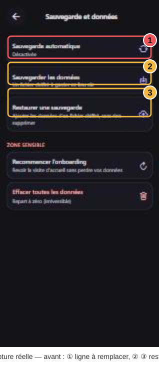
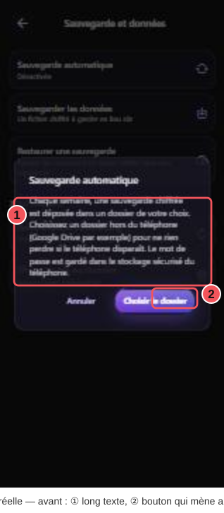
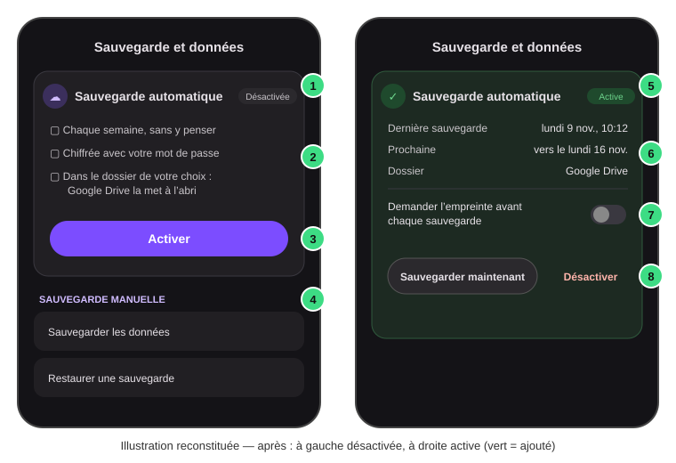
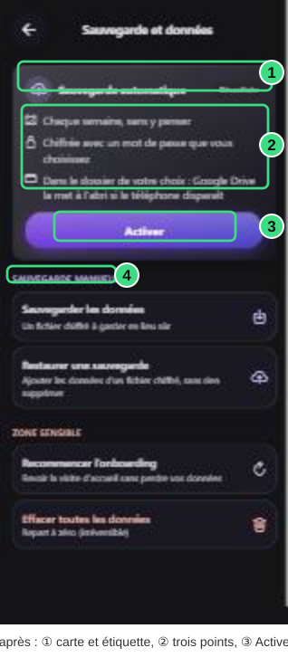

# FICHE OPÉRATOIRE N° 001 — Nouveau design de la sauvegarde automatique

Projet : **Junix Pulse** (application mobile Expo / React Native) · Date : 11 novembre 2026 · Suite de : aucune (première fiche)

---

## 1. Objectif

À la fin, la page **Paramètres › Sauvegarde et données** commence par une **carte « Sauvegarde automatique »** au lieu d'une simple ligne :

- **Désactivée**, la carte explique en trois lignes ce que fait la sauvegarde automatique, avec un bouton **Activer** qui ouvre directement le choix du dossier (plus de long message à lire avant).
- **Active**, la carte montre la **date de la dernière sauvegarde**, la **date de la prochaine**, le **dossier** utilisé, un **avertissement orange** si le dernier essai a échoué, l'interrupteur « empreinte », et deux actions visibles : **Sauvegarder maintenant** et **Désactiver** (qui demande confirmation).
- La sauvegarde manuelle (Sauvegarder / Restaurer) passe sous un petit titre **« Sauvegarde manuelle »**.

On le reconnaît en ouvrant Paramètres › Sauvegarde et données : la première chose visible est une carte avec un rond d'icône, un titre, une étiquette « Désactivée » ou « Active », et des boutons.



Légende — ① la ligne « Sauvegarde automatique / Désactivée » : c'est elle qui est remplacée par la carte. ② « Sauvegarder les données » et ③ « Restaurer une sauvegarde » restent, sous un nouveau titre.



Légende — ① le long paragraphe qu'il fallait lire avant d'activer ; ② le bouton « Choisir le dossier ». Après la fiche, ce message n'apparaît plus depuis les Paramètres (il reste seulement à la fin de l'onboarding).



Légende — ① carte avec son étiquette d'état ; ② les trois points qui expliquent ; ③ bouton Activer ; ④ titre « Sauvegarde manuelle » ; ⑤ carte verte une fois active ; ⑥ dernière / prochaine sauvegarde et dossier ; ⑦ interrupteur empreinte ; ⑧ actions visibles.



Légende — capture réelle de l'aperçu web après l'intervention (état « Désactivée ») : ① la carte et son étiquette, ② les trois points, ③ le bouton Activer, ④ le nouveau titre « Sauvegarde manuelle ». L'état « Active » ne peut pas s'afficher sur le web (pas de dossier Android) : il est vérifié par les tests de l'étape 7.

## 2. État de départ

| À vérifier | Comment | Résultat attendu |
|---|---|---|
| Le projet est à jour | Terminal dans le dossier du projet : `git log --oneline -1` | `c3e008c fix(stats): figures that follow what the user does…` |
| Rien d'autre en cours | `git status --short` | Seulement `?? docs/motion/` (et cette fiche) |
| L'aperçu web marche | `npx expo start --web --port 8099` puis ouvrir `http://localhost:8099/settings?section=data` | La page « Sauvegarde et données » s'affiche |

## 3. Matériel

| Outil | Preuve qu'il est installé | Sinon |
|---|---|---|
| Node.js 20 ou plus | `node --version` affiche `v20…` ou plus | Installer depuis nodejs.org (version LTS) |
| Les dépendances du projet | Le dossier `node_modules` existe | `npm install` dans le dossier du projet |
| Un éditeur (VS Code) | Il s'ouvre | Installer depuis code.visualstudio.com |
| Git | `git --version` | Installer depuis git-scm.com |

## 4. Hypothèses

- Ordinateur **Windows 11**, terminal **Git Bash** ou **PowerShell**, éditeur **VS Code**.
- Dossier du projet : `C:\Users\simon\Desktop\Projets\junix-pulse-glowcard`.
- Le bouton **Activer** ouvre le sélecteur de dossier d'**Android** : sur l'aperçu web il ne fait rien (c'est normal, le web n'a pas ce sélecteur).
- Les textes de l'application sont en français et en anglais : chaque texte ajouté l'est dans les deux fichiers.

## 5. Carte de l'intervention

| Fichier | Action | Raison |
|---|---|---|
| `src/domain/rules/auto-backup-rules.ts` | modifié | Deux calculs : date de la prochaine sauvegarde, nom lisible du dossier |
| `src/components/settings/AutoBackupCard.tsx` | **créé** | La nouvelle carte (désactivée / active) |
| `src/features/backup/use-auto-backup-setup.tsx` | modifié | Ouvrir le choix du dossier sans le long message |
| `src/app/settings/index.tsx` | modifié | Afficher la carte, confirmer la désactivation, état « en cours » |
| `src/styles/settings/settings-styles.ts` | modifié | Espace au-dessus du titre « Sauvegarde manuelle » |
| `src/i18n/messages-rest-fr.ts` | modifié | Textes français de la carte |
| `src/i18n/messages-rest-en.ts` | modifié | Les mêmes textes en anglais |
| `src/__tests__/auto-backup-card.test.tsx` | **créé** | Tests automatiques des calculs et de la carte |

## 6. Sauvegarde (retour arrière)

Avant de toucher à quoi que ce soit, notez le commit de départ :

```bash
# Dossier : C:\Users\simon\Desktop\Projets\junix-pulse-glowcard
git log --oneline -1   # affiche le commit actuel : notez son code (c3e008c)
```

Pour tout annuler plus tard (tant que rien n'est commité) :

```bash
# Remet les fichiers suivis comme au dernier commit (efface vos modifications de ces fichiers)
git restore src/domain/rules/auto-backup-rules.ts src/features/backup/use-auto-backup-setup.tsx src/app/settings/index.tsx src/styles/settings/settings-styles.ts src/i18n/messages-rest-fr.ts src/i18n/messages-rest-en.ts
```

Puis supprimez à la main les deux fichiers créés : `src/components/settings/AutoBackupCard.tsx` et `src/__tests__/auto-backup-card.test.tsx`.

> ⚠ **Point de non-retour** : `git restore` efface définitivement les modifications non commitées des fichiers listés. Ne le lancez que si vous voulez vraiment revenir au départ.

## 7. Étapes

### Étape 1 — Deux calculs dans les règles de sauvegarde

- **Où** : VS Code › `src/domain/rules/auto-backup-rules.ts` › tout en bas du fichier, après la fonction `autoBackupFilesToDelete`.
- **Geste** : placez le curseur après la dernière accolade `}` du fichier, appuyez sur Entrée, collez le bloc APRÈS ci-dessous (seules les lignes nouvelles changent).

AVANT (fin du fichier) :

```ts
export function autoBackupFilesToDelete(names: readonly string[]): string[] {
  return names
    .filter(name => name.startsWith(AUTO_BACKUP_FILE_PREFIX))
    .sort()
    .reverse()
    .slice(AUTO_BACKUP_KEPT_FILES);
}
```

APRÈS (fin du fichier) :

```ts
export function autoBackupFilesToDelete(names: readonly string[]): string[] {
  return names
    .filter(name => name.startsWith(AUTO_BACKUP_FILE_PREFIX))
    .sort()
    .reverse()
    .slice(AUTO_BACKUP_KEPT_FILES);
}

/** When the next automatic backup is expected: a week after the last one, unknown before the first. */
export function nextAutoBackupAt(lastSuccessAt: number | null): number | null {
  return lastSuccessAt === null ? null : lastSuccessAt + AUTO_BACKUP_INTERVAL_MS;
}

/**
 * A readable name for the folder chosen through the system: "Documents/Junix" for a folder of
 * the phone, "Google Drive" for Drive, whose links hide the folder name; null when unknown.
 */
export function autoBackupFolderLabel(uri: string): string | null {
  let text = uri;
  try {
    text = decodeURIComponent(uri);
  } catch {
    // An odd link stays as it is
  }
  if (text.includes('com.google.android.apps.docs')) return 'Google Drive';
  const tree = text.split('/tree/')[1];
  if (!tree) return null;
  const path = tree.slice(tree.indexOf(':') + 1).split('/document/')[0].replace(/\/+$/, '');
  return path.length > 0 ? path : null;
}
```

Explication ligne par ligne :

| Ligne | Ce qu'elle fait |
|---|---|
| `export function nextAutoBackupAt(lastSuccessAt: number \| null)` | Déclare une fonction réutilisable ailleurs (`export`) qui reçoit la date de la dernière sauvegarde réussie, en millisecondes, ou `null` s'il n'y en a jamais eu. |
| `return lastSuccessAt === null ? null : lastSuccessAt + AUTO_BACKUP_INTERVAL_MS;` | Si aucune sauvegarde : pas de date (`null`). Sinon : dernière + 7 jours (`AUTO_BACKUP_INTERVAL_MS`, déjà défini en haut du fichier). |
| `export function autoBackupFolderLabel(uri: string): string \| null` | Reçoit le lien du dossier donné par Android, rend un nom lisible ou `null`. |
| `let text = uri;` | Copie le lien dans une variable modifiable. |
| `try { text = decodeURIComponent(uri); } catch { … }` | Android écrit `%3A` pour `:` et `%2F` pour `/` : on remet les vrais caractères. Si le lien est bizarre, on garde l'original au lieu de planter. |
| `if (text.includes('com.google.android.apps.docs')) return 'Google Drive';` | Les liens Google Drive cachent le nom du dossier : on affiche « Google Drive ». |
| `const tree = text.split('/tree/')[1];` | Coupe le lien au mot `/tree/` et garde ce qui suit, par exemple `primary:Documents/Junix`. |
| `if (!tree) return null;` | Pas de `/tree/` : lien inconnu, pas de nom. |
| `tree.slice(tree.indexOf(':') + 1)` | Enlève le début `primary:` (le nom du stockage). |
| `.split('/document/')[0]` | Enlève une éventuelle fin `/document/…`. |
| `.replace(/\/+$/, '')` | Enlève les `/` en trop à la fin. |
| `return path.length > 0 ? path : null;` | Rend le chemin, ou `null` s'il est vide (racine du téléphone). |

- **Pourquoi** : la carte doit dire « Prochaine : vers le lundi 16 nov. » et « Dossier : Documents/Junix » ; ces calculs sont séparés de l'écran pour pouvoir les tester.
- **Contrôle** : le fichier n'affiche aucun soulignement rouge dans VS Code.
- **Si ça rate** : `Cannot find name 'AUTO_BACKUP_INTERVAL_MS'` → vous avez collé le bloc dans un autre fichier ; il doit être dans `auto-backup-rules.ts`, où cette constante est définie ligne 5.

### Étape 2 — Créer la carte `AutoBackupCard`

- **Où** : VS Code › explorateur à gauche › dossier `src/components/settings`.
- **Geste** : clic droit sur `settings` › **Nouveau fichier** › tapez `AutoBackupCard.tsx` › Entrée. Collez le fichier entier ci-dessous, puis Ctrl+S.

```tsx
/**
 * The automatic backup, in one card at the top of "Sauvegarde et données". Off, it says in
 * three lines what it does and turns on in one tap. On, it shows when the last backup was made,
 * when the next one comes and in which folder, warns when the last try failed, and keeps its
 * actions in view: back up now, ask for the fingerprint, turn off.
 */

import { Ionicons } from '@expo/vector-icons';
import { format } from 'date-fns';
import { useState } from 'react';
import { StyleSheet, Switch, Text, TouchableOpacity, View } from 'react-native';

import { Button } from '@/components/ui/Button';
import { GlowCard } from '@/components/ui/GlowCard';
import { Radius, Spacing, Typography } from '@/constants/theme';
import type { ThemePalette } from '@/constants/palettes';
import { autoBackupFolderLabel, nextAutoBackupAt } from '@/domain/rules/auto-backup-rules';
import { useTheme } from '@/hooks/use-theme';
import { useThemedStyles } from '@/hooks/use-themed-styles';
import { useDateLocale, useT, type MessageKey } from '@/i18n';
import type { AutoBackupConfig } from '@/services/auto-backup-service';
import { hexToRgba } from '@/utils/color';

interface AutoBackupCardProps {
  /** null while the automatic backup is off. */
  config: AutoBackupConfig | null;
  /** A backup is being made right now. */
  running: boolean;
  onEnable: () => void;
  onRunNow: () => void;
  onDisable: () => void;
  onToggleBiometric: (value: boolean) => void;
}

/** What the automatic backup does, said before it is turned on. */
const POINTS: readonly { icon: keyof typeof Ionicons.glyphMap; key: MessageKey }[] = [
  { icon: 'calendar-outline', key: 'autoBackup.pointWeekly' },
  { icon: 'lock-closed-outline', key: 'autoBackup.pointEncrypted' },
  { icon: 'folder-open-outline', key: 'autoBackup.pointFolder' },
];

export function AutoBackupCard({ config, running, onEnable, onRunNow, onDisable, onToggleBiometric }: AutoBackupCardProps) {
  const t = useT();
  const locale = useDateLocale();
  const { palette } = useTheme();
  const styles = useThemedStyles(makeAutoBackupCardStyles);
  // The moment the card appeared: a drawing never reads the clock itself
  const [shownAt] = useState(Date.now);

  // ─── Off: what it does, and one button to turn it on ─────────────────────
  if (!config) {
    return (
      <GlowCard tone="neutral" testID="auto-backup-card">
        <View style={styles.header}>
          <View style={[styles.icon, { backgroundColor: hexToRgba(palette.primary.default, 0.16) }]}>
            <Ionicons name="cloud-upload-outline" size={20} color={palette.primary.default} />
          </View>
          <Text style={styles.title} accessibilityRole="header">
            {t('autoBackup.title')}
          </Text>
          <Text style={[styles.badge, { color: palette.onSurface.variant, backgroundColor: palette.surface.high }]}>
            {t('autoBackup.badgeOff')}
          </Text>
        </View>

        <View style={styles.points}>
          {POINTS.map(point => (
            <View key={point.key} style={styles.point}>
              <Ionicons name={point.icon} size={16} color={palette.onSurface.variant} />
              <Text style={styles.pointText}>{t(point.key)}</Text>
            </View>
          ))}
        </View>

        <Button label={t('autoBackup.turnOn')} onPress={onEnable} size="md" testID="auto-backup-enable" />
      </GlowCard>
    );
  }

  // ─── On: where it stands, and its actions in view ────────────────────────
  const failed = config.lastFailedAt !== null && (config.lastSuccessAt ?? 0) < config.lastFailedAt;
  const accent = failed ? palette.priority.HIGH : palette.success.default;
  const next = nextAutoBackupAt(config.lastSuccessAt);
  const details: readonly { label: MessageKey; value: string }[] = [
    {
      label: 'autoBackup.last',
      value: config.lastSuccessAt
        ? format(config.lastSuccessAt, 'EEEE d MMMM, HH:mm', { locale })
        : t('autoBackup.lastNone'),
    },
    {
      label: 'autoBackup.next',
      value:
        next === null || next <= shownAt
          ? t('autoBackup.nextSoon')
          : t('autoBackup.nextAround', { date: format(next, 'EEEE d MMMM', { locale }) }),
    },
    { label: 'autoBackup.folder', value: autoBackupFolderLabel(config.directoryUri) ?? t('autoBackup.folderUnknown') },
  ];

  return (
    <GlowCard tone={failed ? 'attention' : 'success'} testID="auto-backup-card">
      <View style={styles.header}>
        <View style={[styles.icon, { backgroundColor: hexToRgba(accent, 0.16) }]}>
          <Ionicons name={failed ? 'alert-circle-outline' : 'shield-checkmark-outline'} size={20} color={accent} />
        </View>
        <Text style={styles.title} accessibilityRole="header">
          {t('autoBackup.title')}
        </Text>
        <Text style={[styles.badge, { color: accent, backgroundColor: hexToRgba(accent, 0.16) }]}>
          {t(failed ? 'autoBackup.badgeCheck' : 'autoBackup.badgeOn')}
        </Text>
      </View>

      <View style={styles.details}>
        {details.map(detail => (
          <View key={detail.label} style={styles.detail}>
            <Text style={styles.detailLabel}>{t(detail.label)}</Text>
            <Text style={styles.detailValue} numberOfLines={1}>
              {detail.value}
            </Text>
          </View>
        ))}
      </View>

      {failed && (
        <View style={[styles.warning, { backgroundColor: hexToRgba(accent, 0.12) }]} accessibilityLiveRegion="polite">
          <Ionicons name="warning-outline" size={16} color={accent} />
          <Text style={styles.warningText}>{t('autoBackup.failedBanner')}</Text>
        </View>
      )}

      <View style={styles.switchRow}>
        <View style={styles.switchText}>
          <Text style={styles.switchLabel}>{t('autoBackup.biometricLabel')}</Text>
          <Text style={styles.switchHint}>{t('autoBackup.biometricHint')}</Text>
        </View>
        <Switch
          value={!!config.requireBiometric}
          onValueChange={onToggleBiometric}
          trackColor={{ false: palette.outline.variant, true: palette.primary.container }}
          thumbColor={config.requireBiometric ? palette.primary.default : palette.onSurface.disabled}
          accessibilityLabel={t('autoBackup.biometricLabel')}
        />
      </View>

      <View style={styles.actions}>
        <Button
          label={t('autoBackup.now')}
          onPress={onRunNow}
          variant="secondary"
          size="sm"
          loading={running}
          testID="auto-backup-run"
        />
        <TouchableOpacity
          style={styles.disable}
          onPress={onDisable}
          accessibilityRole="button"
          accessibilityLabel={t('autoBackup.disable')}
          testID="auto-backup-disable"
        >
          <Text style={[styles.disableText, { color: palette.error.default }]}>{t('autoBackup.disable')}</Text>
        </TouchableOpacity>
      </View>
    </GlowCard>
  );
}

const makeAutoBackupCardStyles = (theme: ThemePalette) =>
  StyleSheet.create({
    header: {
      flexDirection: 'row',
      alignItems: 'center',
      gap: Spacing.sm,
    },
    icon: {
      width: 36,
      height: 36,
      borderRadius: 18,
      alignItems: 'center',
      justifyContent: 'center',
    },
    title: {
      ...Typography.titleMedium,
      color: theme.onSurface.primary,
      fontWeight: '700',
      flex: 1,
    },
    badge: {
      ...Typography.labelSmall,
      fontWeight: '700',
      paddingHorizontal: Spacing.sm,
      paddingVertical: 3,
      borderRadius: Radius.full,
      overflow: 'hidden',
    },
    points: {
      gap: Spacing.sm,
      marginVertical: Spacing.md,
    },
    point: {
      flexDirection: 'row',
      alignItems: 'flex-start',
      gap: Spacing.sm,
    },
    pointText: {
      ...Typography.bodyMedium,
      color: theme.onSurface.variant,
      flex: 1,
    },
    details: {
      gap: Spacing.xs,
      marginTop: Spacing.md,
    },
    detail: {
      flexDirection: 'row',
      justifyContent: 'space-between',
      gap: Spacing.md,
    },
    detailLabel: {
      ...Typography.bodySmall,
      color: theme.onSurface.variant,
    },
    detailValue: {
      ...Typography.labelMedium,
      color: theme.onSurface.primary,
      flexShrink: 1,
      textAlign: 'right',
    },
    warning: {
      flexDirection: 'row',
      alignItems: 'flex-start',
      gap: Spacing.sm,
      padding: Spacing.sm,
      borderRadius: Radius.md,
      marginTop: Spacing.md,
    },
    warningText: {
      ...Typography.bodySmall,
      color: theme.onSurface.primary,
      flex: 1,
    },
    switchRow: {
      flexDirection: 'row',
      alignItems: 'center',
      gap: Spacing.md,
      marginTop: Spacing.md,
      paddingTop: Spacing.md,
      borderTopWidth: StyleSheet.hairlineWidth,
      borderTopColor: theme.glass.control.borderColor,
    },
    switchText: {
      flex: 1,
    },
    switchLabel: {
      ...Typography.labelLarge,
      color: theme.onSurface.primary,
    },
    switchHint: {
      ...Typography.bodySmall,
      color: theme.onSurface.variant,
    },
    actions: {
      flexDirection: 'row',
      alignItems: 'center',
      justifyContent: 'space-between',
      marginTop: Spacing.md,
    },
    disable: {
      minHeight: 44,
      justifyContent: 'center',
      paddingHorizontal: Spacing.sm,
    },
    disableText: {
      ...Typography.labelLarge,
      fontWeight: '600',
    },
  });
```

Explication par blocs :

| Lignes (repère) | Ce qu'elles font |
|---|---|
| `/** The automatic backup… */` | Commentaire d'en-tête : à quoi sert le fichier. |
| `import { Ionicons } …` | Les icônes (nuage, bouclier, cadenas…). |
| `import { format } from 'date-fns';` | Écrit une date en texte (« lundi 9 novembre, 10:12 »). |
| `import { useState } from 'react';` | Garde une valeur d'un dessin à l'autre (ici l'heure d'affichage de la carte). |
| `import { StyleSheet, Switch, Text, TouchableOpacity, View } …` | Les briques d'écran de React Native : styles, interrupteur, texte, zone touchable, boîte. |
| `import { Button } …` / `import { GlowCard } …` | Le bouton et la carte en verre déjà utilisés partout dans l'appli. |
| `import { Radius, Spacing, Typography } …` | Les tailles d'arrondi, d'espacement et de texte communes (le « design system »). |
| `import type { ThemePalette } …` | Le type des couleurs du thème (sombre ou clair). |
| `import { autoBackupFolderLabel, nextAutoBackupAt } …` | Les deux calculs de l'étape 1. |
| `import { useTheme } …` / `import { useThemedStyles } …` | Donnent les couleurs du thème actuel et les styles calculés avec. |
| `import { useDateLocale, useT, type MessageKey } …` | `useT` traduit une clé de texte en français ou en anglais ; `useDateLocale` écrit les dates dans la bonne langue. |
| `import type { AutoBackupConfig } …` | La forme des réglages de sauvegarde (dossier, dates…). |
| `import { hexToRgba } …` | Rend une couleur plus transparente (fond des pastilles). |
| `interface AutoBackupCardProps { … }` | Ce que la carte reçoit : les réglages (`config`), si une sauvegarde tourne (`running`), et les quatre actions à appeler. |
| `const POINTS = [ … ]` | Les trois lignes d'explication : une icône et une clé de texte chacune. |
| `export function AutoBackupCard({ … })` | La carte elle-même. |
| `const t = useT(); … const styles = useThemedStyles(…)` | Prépare traduction, langue des dates, couleurs et styles. |
| `const [shownAt] = useState(Date.now);` | Lit l'heure **une seule fois**, quand la carte apparaît. React interdit de lire l'horloge pendant le dessin (le dessin doit donner le même résultat à chaque fois) ; la prochaine sauvegarde est ensuite comparée à `shownAt`. |
| `if (!config) { return ( … ) }` | **Cas désactivé** : en-tête (icône, titre, étiquette « Désactivée »), les trois points, le bouton **Activer** qui appelle `onEnable`. |
| `const failed = …` | Vrai si le dernier essai raté est plus récent que la dernière réussite. |
| `const accent = failed ? … : …` | Orange si échec, vert sinon. |
| `const next = nextAutoBackupAt(…)` | Date de la prochaine sauvegarde (étape 1). |
| `const details = [ … ]` | Les trois lignes « Dernière sauvegarde / Prochaine / Dossier » et leurs valeurs. |
| `return ( <GlowCard tone={failed ? 'attention' : 'success'} …` | **Cas active** : carte verte, ou orange en cas d'échec. |
| `details.map(detail => …)` | Affiche chaque ligne : intitulé à gauche, valeur à droite. |
| `{failed && ( … )}` | Le bandeau d'avertissement n'apparaît que si le dernier essai a échoué. |
| `<Switch value={!!config.requireBiometric} …` | L'interrupteur « empreinte » ; `!!` transforme « vide » en `false`. |
| `<Button … loading={running} />` | « Sauvegarder maintenant » montre une roue tant que la sauvegarde tourne. |
| `<TouchableOpacity … onPress={onDisable}>` | Le texte rouge « Désactiver », touchable sur 44 px de haut (taille minimale pour un doigt). |
| `const makeAutoBackupCardStyles = (theme) => StyleSheet.create({ … })` | Tous les styles : alignements en ligne (`flexDirection: 'row'`), espacements, couleurs du thème. |

- **Pourquoi** : une carte rend l'état visible d'un coup d'œil et met les actions à portée, au lieu de les cacher dans une fenêtre.
- **Contrôle** : VS Code ne souligne rien en rouge, sauf `autoBackup.pointWeekly` et les autres textes nouveaux : c'est normal tant que l'étape 6 n'est pas faite.
- **Si ça rate** : `Cannot find module '@/components/ui/Button'` → le fichier n'est pas dans `src/components/settings/` ; déplacez-le.

### Étape 3 — Ouvrir le choix du dossier sans le long message

- **Où** : VS Code › `src/features/backup/use-auto-backup-setup.tsx` › Ctrl+F `const startSetup`.
- **Geste** : remplacez le bloc AVANT par le bloc APRÈS, puis la ligne `return` de la fin du fichier.

AVANT :

```tsx
  const t = useT();
  const [directoryUri, setDirectoryUri] = useState<string | null>(null);

  const startSetup = () => {
    GlassAlert.alert(t('autoBackup.setupTitle'), t('autoBackup.setupBody'), [
      { text: t('common.cancel'), style: 'cancel' },
      {
        text: t('autoBackup.pickFolder'),
        onPress: async () => {
          try {
            expectAppLockReturn();
            const directory = await Directory.pickDirectoryAsync();
            if (directory?.uri) setDirectoryUri(directory.uri);
          } catch {
            // Picker closed without a folder
          }
        },
      },
    ]);
  };

  const handleEnable = async (password: string) => {
```

APRÈS :

```tsx
  const t = useT();
  const [directoryUri, setDirectoryUri] = useState<string | null>(null);

  /** The folder, picked through the system; the password is asked next. */
  const pickFolder = async () => {
    try {
      expectAppLockReturn();
      const directory = await Directory.pickDirectoryAsync();
      if (directory?.uri) setDirectoryUri(directory.uri);
    } catch {
      // Picker closed without a folder
    }
  };

  /** From the onboarding: a word on what it does first, then the folder. */
  const startSetup = () => {
    GlassAlert.alert(t('autoBackup.setupTitle'), t('autoBackup.setupBody'), [
      { text: t('common.cancel'), style: 'cancel' },
      { text: t('autoBackup.pickFolder'), onPress: pickFolder },
    ]);
  };

  const handleEnable = async (password: string) => {
```

Puis, tout en bas du même fichier :

AVANT :

```tsx
      onSubmit={handleEnable}
    />
  );

  return { startSetup, setupModal };
}
```

APRÈS :

```tsx
      onSubmit={handleEnable}
    />
  );

  return { startSetup, pickFolder, setupModal };
}
```

| Ligne | Ce qu'elle fait |
|---|---|
| `const pickFolder = async () => {` | Nouvelle fonction qui ouvre directement le sélecteur de dossier d'Android (`async` : elle attend la réponse). |
| `expectAppLockReturn();` | Prévient le verrou de l'appli qu'on part dans une fenêtre système et qu'on revient : pas de demande d'empreinte au retour. |
| `await Directory.pickDirectoryAsync();` | Ouvre le sélecteur et attend le dossier choisi. |
| `if (directory?.uri) setDirectoryUri(directory.uri);` | Si un dossier est choisi, on le garde : cela ouvre la fenêtre du mot de passe. |
| `catch { … }` | Fenêtre fermée sans choix : on ne fait rien. |
| `startSetup` | Garde l'ancien message (utilisé à la fin de l'onboarding), mais son bouton appelle maintenant `pickFolder`. |
| `return { startSetup, pickFolder, setupModal };` | Rend les deux façons de commencer, plus la fenêtre du mot de passe. |

- **Pourquoi** : la carte explique déjà tout ; le message était un doublon à lire avant d'agir.
- **Contrôle** : aucun soulignement rouge.
- **Si ça rate** : `pickFolder is not defined` → la ligne `return` a été changée mais pas le bloc du haut.

### Étape 4 — Afficher la carte dans les Paramètres

- **Où** : VS Code › `src/app/settings/index.tsx`. Quatre endroits, chacun trouvé avec Ctrl+F.

**4a — l'import.** Ctrl+F `use-auto-backup-setup`.

AVANT :

```tsx
} from '@/services/auto-backup-service';
import { useAutoBackupSetup } from '@/features/backup/use-auto-backup-setup';
import { canUseAppLock, expectAppLockReturn, setAppLockConfig } from '@/services/app-lock-service';
```

APRÈS :

```tsx
} from '@/services/auto-backup-service';
import { useAutoBackupSetup } from '@/features/backup/use-auto-backup-setup';
import { AutoBackupCard } from '@/components/settings/AutoBackupCard';
import { canUseAppLock, expectAppLockReturn, setAppLockConfig } from '@/services/app-lock-service';
```

**4b — l'état « sauvegarde en cours ».** Ctrl+F `const [autoBackup, setAutoBackup]`.

AVANT :

```tsx
  const [autoBackup, setAutoBackup] = useState<AutoBackupConfig | null>(null);
```

APRÈS :

```tsx
  const [autoBackup, setAutoBackup] = useState<AutoBackupConfig | null>(null);
  // A backup made from the card: its button turns while it runs
  const [backupRunning, setBackupRunning] = useState(false);
```

(Les lignes juste au-dessus et au-dessous ne changent pas : gardez-les telles quelles.)

**4c — lancer la sauvegarde et ouvrir le dossier.** Ctrl+F `const runAutoBackupNow`.

AVANT :

```tsx
  const refreshAutoBackup = async () => setAutoBackup(await getAutoBackupConfig());

  const runAutoBackupNow = async () => {
    const result = await runAutoBackup({ force: true });
    await refreshAutoBackup();
    showSnackbar(result === 'done' ? t('autoBackup.done') : t('autoBackup.failed'));
  };

  // Before the early return below: a hook must run on every render
  const { startSetup: startAutoBackupSetup, setupModal: autoBackupSetupModal } = useAutoBackupSetup(runAutoBackupNow);
```

APRÈS :

```tsx
  const refreshAutoBackup = async () => setAutoBackup(await getAutoBackupConfig());

  const runAutoBackupNow = async () => {
    setBackupRunning(true);
    try {
      const result = await runAutoBackup({ force: true });
      await refreshAutoBackup();
      showSnackbar(result === 'done' ? t('autoBackup.done') : t('autoBackup.failed'));
    } finally {
      setBackupRunning(false);
    }
  };

  // Before the early return below: a hook must run on every render
  const { pickFolder: pickAutoBackupFolder, setupModal: autoBackupSetupModal } = useAutoBackupSetup(runAutoBackupNow);
```

| Ligne | Ce qu'elle fait |
|---|---|
| `setBackupRunning(true);` | Le bouton se met à tourner. |
| `try { … } finally { setBackupRunning(false); }` | Quoi qu'il arrive (réussite ou erreur), le bouton s'arrête de tourner à la fin. |
| `pickFolder: pickAutoBackupFolder` | On prend la nouvelle fonction de l'étape 3, renommée pour ce fichier. |

**4d — confirmer avant de désactiver.** Ctrl+F `const handleAutoBackup`.

AVANT :

```tsx
  const handleAutoBackup = () => {
    if (!autoBackup) {
      startAutoBackupSetup();
      return;
    }
    GlassAlert.alert(t('autoBackup.title'), autoBackupStatus, [
      { text: t('common.cancel'), style: 'cancel' },
      {
        text: t('autoBackup.disable'),
        style: 'destructive',
        onPress: async () => {
          await disableAutoBackup();
          await refreshAutoBackup();
        },
      },
      { text: t('autoBackup.now'), onPress: runAutoBackupNow },
    ]);
  };
```

APRÈS :

```tsx
  // Turning off asks first; the backups already made stay in their folder
  const handleDisableAutoBackup = () => {
    GlassAlert.alert(t('autoBackup.disableTitle'), t('autoBackup.disableBody'), [
      { text: t('common.cancel'), style: 'cancel' },
      {
        text: t('autoBackup.disable'),
        style: 'destructive',
        onPress: async () => {
          await disableAutoBackup();
          await refreshAutoBackup();
        },
      },
    ]);
  };
```

**4e — la carte à la place de l'ancienne ligne.** Ctrl+F `Sauvegarde automatique d'abord`.

AVANT :

```tsx
  const renderData = () => (
    <View style={styles.section}>
      {/* Sauvegarde automatique d'abord : c'est celle qui protège sans y penser */}
      <TouchableOpacity style={styles.row} onPress={handleAutoBackup} accessibilityRole="button">
        <View style={styles.rowTextFill}>
          <Text style={styles.rowLabel}>{t('autoBackup.title')}</Text>
          <Text style={styles.rowSub}>{autoBackupStatus}</Text>
        </View>
        <Ionicons name="sync-outline" size={20} color={palette.primary.default} />
      </TouchableOpacity>
      {autoBackup && (
        <View style={styles.row}>
          <View style={styles.rowTextFill}>
            <Text style={styles.rowLabel}>{t('autoBackup.biometricLabel')}</Text>
            <Text style={styles.rowSub}>{t('autoBackup.biometricHint')}</Text>
          </View>
          <Switch
            value={!!autoBackup.requireBiometric}
            onValueChange={handleToggleAutoBackupBiometric}
            {...switchColors(!!autoBackup.requireBiometric)}
            accessibilityLabel={t('autoBackup.biometricLabel')}
          />
        </View>
      )}

      <TouchableOpacity style={styles.row} onPress={handleExportData} accessibilityRole="button">
```

APRÈS :

```tsx
  const renderData = () => (
    <View style={styles.section}>
      {/* Sauvegarde automatique d'abord : c'est celle qui protège sans y penser */}
      <AutoBackupCard
        config={autoBackup}
        running={backupRunning}
        onEnable={() => void pickAutoBackupFolder()}
        onRunNow={() => void runAutoBackupNow()}
        onDisable={handleDisableAutoBackup}
        onToggleBiometric={value => void handleToggleAutoBackupBiometric(value)}
      />

      {/* Puis la sauvegarde à la main, quand on veut un fichier tout de suite */}
      <Text style={[styles.sectionLabel, styles.manualLabel]}>{t('autoBackup.manualLabel')}</Text>

      <TouchableOpacity style={styles.row} onPress={handleExportData} accessibilityRole="button">
```

| Ligne | Ce qu'elle fait |
|---|---|
| `<AutoBackupCard config={autoBackup} …` | Affiche la carte avec les réglages actuels (ou `null` si désactivée). |
| `onEnable={() => void pickAutoBackupFolder()}` | « Activer » ouvre le sélecteur de dossier. `void` dit : on ne garde pas le résultat. |
| `onRunNow`, `onDisable`, `onToggleBiometric` | Relient les boutons de la carte aux fonctions de la page. |
| `<Text style={[styles.sectionLabel, styles.manualLabel]}>` | Le petit titre « Sauvegarde manuelle », avec le style des autres titres plus un espace au-dessus. |

- **Pourquoi** : la page montre la carte ; la désactivation demande confirmation au lieu d'être un bouton parmi trois dans une fenêtre.
- **Contrôle** : aucun soulignement rouge sauf `manualLabel` (étape 5) et les nouveaux textes (étape 6).
- **Si ça rate** : `handleAutoBackup is not defined` → il reste une ancienne utilisation ; Ctrl+F `handleAutoBackup` et supprimez-la (elle était seulement dans le bloc remplacé en 4e).

### Étape 5 — L'espace au-dessus de « Sauvegarde manuelle »

- **Où** : VS Code › `src/styles/settings/settings-styles.ts` › Ctrl+F `dangerLabel: {`.

AVANT :

```ts
    dangerLabel: {
      color: t.error.default,
      marginTop: Spacing.lg,
    },
    lockDelayLabel: {
```

APRÈS :

```ts
    dangerLabel: {
      color: t.error.default,
      marginTop: Spacing.lg,
    },
    manualLabel: {
      marginTop: Spacing.lg,
    },
    lockDelayLabel: {
```

- **Pourquoi** : sépare visuellement la carte du reste.
- **Contrôle** : le soulignement rouge de `manualLabel` disparaît dans `index.tsx`.
- **Si ça rate** : erreur de virgule → chaque bloc `nom: { … },` se termine par une virgule.

### Étape 6 — Les textes (français et anglais)

- **Où** : `src/i18n/messages-rest-fr.ts` puis `src/i18n/messages-rest-en.ts` › Ctrl+F `'autoBackup.failed':`.
- **Geste** : collez les lignes nouvelles juste après cette ligne, dans chaque fichier.

Français — APRÈS :

```ts
  'autoBackup.done': "Sauvegarde automatique effectuée",
  'autoBackup.failed': "La sauvegarde automatique a échoué",
  'autoBackup.badgeOff': "Désactivée",
  'autoBackup.badgeOn': "Active",
  'autoBackup.badgeCheck': "À vérifier",
  'autoBackup.pointWeekly': "Chaque semaine, sans y penser",
  'autoBackup.pointEncrypted': "Chiffrée avec un mot de passe que vous choisissez",
  'autoBackup.pointFolder': "Dans le dossier de votre choix : Google Drive la met à l’abri si le téléphone disparaît",
  'autoBackup.turnOn': "Activer",
  'autoBackup.last': "Dernière sauvegarde",
  'autoBackup.lastNone': "Pas encore faite",
  'autoBackup.next': "Prochaine",
  'autoBackup.nextSoon': "Dès que possible",
  'autoBackup.nextAround': "Vers le {date}",
  'autoBackup.folder': "Dossier",
  'autoBackup.folderUnknown': "Dossier choisi",
  'autoBackup.failedBanner': "Le dernier essai a échoué : le dossier n’est peut-être plus accessible. Réessayez, ou désactivez puis choisissez un autre dossier.",
  'autoBackup.disableTitle': "Désactiver la sauvegarde automatique ?",
  'autoBackup.disableBody': "Les sauvegardes déjà faites restent dans leur dossier.",
  'autoBackup.manualLabel': "Sauvegarde manuelle",
```

Anglais — APRÈS :

```ts
  'autoBackup.done': "Automatic backup done",
  'autoBackup.failed': "The automatic backup failed",
  'autoBackup.badgeOff': "Off",
  'autoBackup.badgeOn': "On",
  'autoBackup.badgeCheck': "Check it",
  'autoBackup.pointWeekly': "Every week, without thinking about it",
  'autoBackup.pointEncrypted': "Encrypted with a password you choose",
  'autoBackup.pointFolder': "In the folder of your choice: Google Drive keeps it safe if the phone is lost",
  'autoBackup.turnOn': "Turn on",
  'autoBackup.last': "Last backup",
  'autoBackup.lastNone': "Not made yet",
  'autoBackup.next': "Next",
  'autoBackup.nextSoon': "As soon as possible",
  'autoBackup.nextAround': "Around {date}",
  'autoBackup.folder': "Folder",
  'autoBackup.folderUnknown': "Chosen folder",
  'autoBackup.failedBanner': "The last try failed: the folder may not be reachable any more. Try again, or turn off and choose another folder.",
  'autoBackup.disableTitle': "Turn off the automatic backup?",
  'autoBackup.disableBody': "The backups already made stay in their folder.",
  'autoBackup.manualLabel': "Manual backup",
```

(Les deux premières lignes de chaque bloc existent déjà : ne les dupliquez pas, elles servent de repère.)

- **Pourquoi** : l'appli affiche ses textes par clé ; une clé manquante casse la vérification des types.
- **Contrôle** : plus aucun soulignement rouge dans le projet.
- **Si ça rate** : `Property 'autoBackup.badgeOff' is missing` → la clé est dans le fichier français mais pas l'anglais (ou l'inverse) ; les deux fichiers doivent avoir exactement les mêmes clés.

### Étape 7 — Les tests automatiques

- **Où** : `src/__tests__` › clic droit › Nouveau fichier › `auto-backup-card.test.tsx`.

```tsx
/**
 * The automatic backup card: what it says off and on, the warning after a failed try, and the
 * two calculations it shows (next backup, readable folder name).
 */

import React from 'react';
import { Text } from 'react-native';
import ReactTestRenderer, { act } from 'react-test-renderer';

import { AutoBackupCard } from '@/components/settings/AutoBackupCard';
import { AUTO_BACKUP_INTERVAL_MS, autoBackupFolderLabel, nextAutoBackupAt } from '@/domain/rules/auto-backup-rules';
import type { AutoBackupConfig } from '@/services/auto-backup-service';

jest.mock('@/services/auto-backup-service', () => ({}));

const noop = () => {};

function render(config: AutoBackupConfig | null) {
  let renderer!: ReactTestRenderer.ReactTestRenderer;
  act(() => {
    renderer = ReactTestRenderer.create(
      <AutoBackupCard config={config} running={false} onEnable={noop} onRunNow={noop} onDisable={noop} onToggleBiometric={noop} />
    );
  });
  return renderer.root
    .findAllByType(Text)
    .map(node => (Array.isArray(node.props.children) ? node.props.children.join('') : String(node.props.children)));
}

describe('readable folder and next backup', () => {
  it('names a folder of the phone, Google Drive, or nothing', () => {
    expect(autoBackupFolderLabel('content://com.android.externalstorage.documents/tree/primary%3ADocuments%2FJunix')).toBe('Documents/Junix');
    expect(autoBackupFolderLabel('content://com.google.android.apps.docs.storage/tree/acc%3D1%3Bdoc%3Dabc')).toBe('Google Drive');
    expect(autoBackupFolderLabel('content://com.android.externalstorage.documents/tree/primary%3A')).toBeNull();
    expect(autoBackupFolderLabel('file:///nothing')).toBeNull();
  });

  it('comes a week after the last one, unknown before the first', () => {
    expect(nextAutoBackupAt(null)).toBeNull();
    expect(nextAutoBackupAt(1000)).toBe(1000 + AUTO_BACKUP_INTERVAL_MS);
  });
});

describe('automatic backup card', () => {
  const on: AutoBackupConfig = {
    directoryUri: 'content://com.android.externalstorage.documents/tree/primary%3ADocuments%2FJunix',
    password: 'secret',
    lastSuccessAt: Date.now() - 60_000,
    lastFailedAt: null,
  };

  it('off: says what it does and offers to turn it on', () => {
    const texts = render(null);
    expect(texts).toEqual(expect.arrayContaining(['Désactivée', 'Chaque semaine, sans y penser', 'Activer']));
  });

  it('on: shows it is active, the next backup and the folder, without the password', () => {
    const texts = render(on);
    expect(texts).toEqual(expect.arrayContaining(['Active', 'Dernière sauvegarde', 'Documents/Junix', 'Désactiver']));
    expect(texts.some(text => text.startsWith('Vers le '))).toBe(true);
    expect(texts.join(' ')).not.toContain('secret');
  });

  it('warns when the last try failed after the last success', () => {
    const texts = render({ ...on, lastFailedAt: Date.now() });
    expect(texts).toEqual(expect.arrayContaining(['À vérifier']));
    expect(texts.some(text => text.startsWith('Le dernier essai a échoué'))).toBe(true);
  });
});
```

| Bloc | Ce qu'il fait |
|---|---|
| `jest.mock('@/services/auto-backup-service', () => ({}));` | Remplace le vrai service (qui touche au stockage du téléphone) par un faux vide : on ne teste que l'affichage. |
| `function render(config)` | Dessine la carte en mémoire et rend la liste de ses textes. |
| `describe('readable folder…')` | Vérifie les deux calculs de l'étape 1. |
| `it('off: …')` | Carte désactivée : « Désactivée », un point d'explication, « Activer ». |
| `it('on: …')` | Carte active : « Active », la date, le dossier lisible, et **jamais** le mot de passe. |
| `it('warns…')` | Avec un échec récent : « À vérifier » et le bandeau d'avertissement. |

- **Pourquoi** : les tests repèrent tout seuls une erreur future, sans téléphone.
- **Contrôle** : voir le test final.

## 8. Test final

1. Terminal dans le dossier du projet :

```bash
npx jest src/__tests__/auto-backup-card.test.tsx
```

Résultat attendu : `Tests: 5 passed, 5 total`.

2. Vérification des types et du style :

```bash
npx tsc --noEmit
npx eslint src
```

Résultat attendu : aucune ligne d'erreur (les deux commandes se terminent sans rien afficher d'autre que les lignes `npm notice`).

3. À l'écran (aperçu web) : `npx expo start --web --port 8099`, puis ouvrez `http://localhost:8099/settings?section=data`. Vous voyez la carte « Sauvegarde automatique » avec l'étiquette « Désactivée », trois lignes d'explication et un bouton violet **Activer**, puis le titre **SAUVEGARDE MANUELLE** au-dessus de « Sauvegarder les données ».

4. Sur un téléphone Android (après un build) : **Activer** → le sélecteur de dossier s'ouvre → choisissez un dossier → mot de passe deux fois → la carte devient verte avec « Active », la date de la dernière sauvegarde et le nom du dossier.

## 9. Dépannage

| Message | Cause | Remède |
|---|---|---|
| `Property 'autoBackup.xxx' is missing in type` | Une clé de texte n'est que dans une langue | Ajoutez-la dans `messages-rest-fr.ts` **et** `messages-rest-en.ts` |
| `Cannot find name 'pickAutoBackupFolder'` | L'étape 4c n'est pas faite | Refaites 4c |
| `'Switch' is declared but its value is never read` (eslint) | Après 4e, un import n'est plus utilisé | Ce n'est pas le cas ici : `Switch` sert encore aux notifications ; si l'avertissement apparaît, retirez `Switch` de l'import en haut de `index.tsx` |
| Le bouton Activer ne fait rien sur le web | Le web n'a pas de sélecteur de dossier | Normal : testez sur Android |
| Tests : `Unable to find node` | Le texte attendu a changé | Comparez le texte du test avec la ligne de l'étape 6 |
| eslint : `Cannot call impure function … react-hooks/purity` sur `Date.now()` | L'horloge est lue pendant le dessin de la carte | Mettez `const [shownAt] = useState(Date.now);` en haut du composant et comparez à `shownAt` (c'est ce que fait le code de l'étape 2) |
| Aperçu web : « Impossible de démarrer — Invalid VFS state » | Deux onglets de l'aperçu ouvrent la même base de données | Fermez les autres onglets de `localhost:8099` et rechargez |

## 10. Lexique

- **Composant** : un morceau d'écran réutilisable (ici la carte), écrit comme une fonction qui rend des éléments visuels.
- **Props** : les informations qu'on donne à un composant (ici `config`, `running`, les actions).
- **Hook** (`useState`, `useT`…) : une fonction de React qui garde un état ou donne un outil au composant ; toujours appelée en haut du composant.
- **État** (`useState`) : une valeur qui, quand elle change, redessine l'écran (ici `backupRunning`).
- **URI** : l'adresse d'un fichier ou dossier, comme `content://…`.
- **SAF** (Storage Access Framework) : le système d'Android qui laisse l'utilisateur choisir un dossier pour une appli.
- **i18n** : « internationalisation », les textes rangés par clé dans chaque langue.
- **Test automatique** : un petit programme qui vérifie que le code fait ce qu'on attend, lancé avec `npx jest`.
- **tsc** : le vérificateur de types de TypeScript ; il repère les fautes avant de lancer l'appli.
- **eslint** : un relecteur de style de code.
- **GlowCard** : la carte en verre de Junix Pulse, avec une lueur de couleur selon le ton (`neutral`, `success`, `attention`…).

## 11. Et après

1. **Tester sur le téléphone de test** (après le prochain build) : Activer, choisir un dossier Google Drive, entrer un mot de passe, vérifier la carte verte ; puis « Sauvegarder maintenant » (la roue tourne puis le message « Sauvegarde automatique effectuée ») ; puis « Désactiver » (une confirmation s'affiche).
2. **Lancer un build Android** : `npx eas-cli build --platform android --profile preview --non-interactive --no-wait` depuis le dossier du projet ; le lien de l'APK apparaît sur expo.dev, compte `2k_junior`, projet `junix-pulse`.
3. **Même traitement pour la fin de l'onboarding** (fichier `src/app/(onboarding)/permissions.tsx`) : remplacer l'appel `startAutoBackupSetup` par une petite version de la carte, pour un design identique partout.
4. **Choix en attente — dictée vocale en ligne** : décider si la capture vocale peut utiliser la reconnaissance de Google quand le téléphone ne sait pas le faire hors ligne (la voix passerait alors par Google).
5. **Copier le skill `guide-operatoire` dans le projet** (`.claude/skills/guide-operatoire/SKILL.md`) pour qu'il s'applique aussi sur un autre ordinateur.
