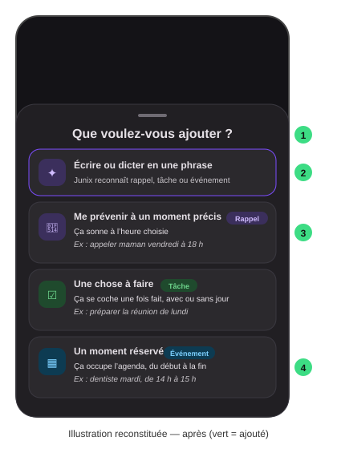

# FICHE OPÉRATOIRE N° 005 — Rendre claire la différence entre rappel, tâche et événement

Projet : **Junix Pulse** · Date : 22 novembre 2026 · Suite de : [FICHE 004](FICHE-004-construire-junix-pulse-de-zero.html)

Première étape du plan décidé le 22 novembre 2026 (sujet 1, approches A puis B).

---

## 1. Objectif

À la fin, l'utilisateur sait **sans réfléchir** quoi créer :

- **Une règle en une ligne, partout** : un **rappel** sonne, une **tâche** se coche, un **événement** occupe l'agenda. Elle remplace les sous-titres « Intention & Moment », « Action & Projet » et « Agenda & Calendrier » des formulaires.
- **Un seul écran de choix**, le même depuis l'accueil et depuis le Planning. On y choisit par **intention** : « Me prévenir à un moment précis », « Une chose à faire », « Un moment réservé ». Chaque choix montre son type, sa règle et un exemple. Depuis l'accueil, un premier choix « Écrire ou dicter en une phrase » laisse Junix décider (capture rapide).
- La barre de l'accueil et la visite guidée de Pulse disent « rappel, tâche ou événement » au lieu de parler d'une « note » qui n'existe pas.



Légende — ① le titre ; ② « Écrire ou dicter en une phrase » (accueil seulement) ; ③ chaque choix : l'intention en gros, le type en étiquette de couleur, la règle et un exemple ; ④ les couleurs de la palette (violet rappel, vert tâche, bleu événement).

## 2. État de départ

| À vérifier | Commande (dossier du projet) | Résultat attendu |
|---|---|---|
| Le code est enregistré | `git log --oneline -1` | `132bd3d docs(fiches): build the APK on the PC…` |
| Rien d'autre en cours | `git status --short` | Seulement `?? docs/motion/` |
| Les tests passent | `npx jest` | Aucun `failed` |

## 3. Matériel

Le même que la [fiche 001](FICHE-001-sauvegarde-auto.md) : Node.js, les dépendances (`node_modules`), VS Code, Git.

## 4. Hypothèses

- Windows, Git Bash, VS Code, dossier `C:\Users\simon\Desktop\Projets\junix-pulse-glowcard`.
- Les onglets Tâches et Rappels gardent leur bouton « + » qui ouvre directement leur formulaire : là, le type est déjà évident.
- La fiche de la personne (raccourcis + Rappel / + Tâche / + Événement) ne change pas.

## 5. Carte de l'intervention

| Fichier | Action | Raison |
|---|---|---|
| `src/features/create/new-item-route.ts` | **créé** | Où ouvrir chaque choix, avec le jour et l'heure du Planning |
| `src/components/create/NewItemChooser.tsx` | **créé** | L'écran de choix |
| `src/app/(tabs)/calendar.tsx` | modifié | Le Planning utilise le nouvel écran |
| `src/app/(tabs)/index.tsx` | modifié | L'accueil ouvre le nouvel écran |
| `src/components/calendar/CalendarActionModal.tsx` | **supprimé** | Remplacé par `NewItemChooser` |
| `src/i18n/messages-rest-fr.ts` / `messages-rest-en.ts` | modifiés | Textes du choix ; sous-titre du formulaire d'événement |
| `src/i18n/messages.ts` | modifié | Sous-titres des formulaires de tâche et de rappel ; barre de l'accueil |
| `src/domain/rules/mascot-message-catalog.ts` / `-en.ts` | modifiés | Visite guidée : « événement » au lieu de « note » |
| `src/__tests__/new-item-chooser.test.tsx` | **créé** | Tests |

## 6. Sauvegarde

```bash
git log --oneline -1   # notez le commit de départ : 132bd3d
```

Pour tout annuler tant que rien n'est commité :

```bash
git restore src/app/(tabs)/calendar.tsx src/app/(tabs)/index.tsx src/components/calendar/CalendarActionModal.tsx src/i18n/messages-rest-fr.ts src/i18n/messages-rest-en.ts src/i18n/messages.ts src/domain/rules/mascot-message-catalog.ts src/domain/rules/mascot-message-catalog-en.ts
```

Puis supprimez à la main les trois fichiers créés (`new-item-route.ts`, `NewItemChooser.tsx`, `new-item-chooser.test.tsx`). `git restore` remet aussi `CalendarActionModal.tsx` s'il a été supprimé.

> ⚠ **Point de non-retour** : `git restore` efface les modifications non commitées des fichiers listés.

## 7. Étapes

### Étape 1 — Où ouvrir chaque choix

- **Où** : VS Code › `src/features` › clic droit › Nouveau dossier `create` › clic droit sur `create` › Nouveau fichier `new-item-route.ts`.

```ts
/**
 * Where each kind of new item opens, with the day and hour the user came from (a slot of the
 * Planning). Quick capture reads one sentence and picks the kind itself.
 */

import { format } from 'date-fns';

export type NewItemKind = 'capture' | 'reminder' | 'task' | 'event';

export interface NewItemRoute {
  pathname: '/capture' | '/reminders/new' | '/tasks/new' | '/events/new';
  params: Record<string, string>;
}

const PATHS: Record<NewItemKind, NewItemRoute['pathname']> = {
  capture: '/capture',
  reminder: '/reminders/new',
  task: '/tasks/new',
  event: '/events/new',
};

export function newItemRoute(kind: NewItemKind, date?: Date | null, hour?: number | null): NewItemRoute {
  const params: Record<string, string> = {};
  if (kind !== 'capture' && date) params.defaultDate = format(date, 'yyyy-MM-dd');
  // A task takes a day, never an hour
  if ((kind === 'reminder' || kind === 'event') && date && hour !== undefined && hour !== null) {
    params.defaultHour = String(hour);
  }
  return { pathname: PATHS[kind], params };
}
```

| Ligne | Ce qu'elle fait |
|---|---|
| `import { format } from 'date-fns';` | Écrit une date au format `2026-11-22`, celui que les formulaires attendent. |
| `export type NewItemKind = …` | Les quatre choix possibles : capture, rappel, tâche, événement. |
| `export interface NewItemRoute { … }` | Ce que rend la fonction : l'écran à ouvrir (`pathname`) et ses réglages (`params`). |
| `const PATHS = { … }` | La correspondance choix → écran. |
| `export function newItemRoute(kind, date, hour)` | Calcule l'écran à ouvrir. |
| `const params = {};` | Commence sans réglage. |
| `if (kind !== 'capture' && date) params.defaultDate = …` | Si on vient d'un jour du Planning, le formulaire s'ouvre sur ce jour (la capture rapide lit la date dans la phrase). |
| `if ((kind === 'reminder' \|\| kind === 'event') && …)` | L'heure du créneau touché ne sert qu'au rappel et à l'événement : une tâche a un jour, jamais une heure. |
| `return { pathname: PATHS[kind], params };` | Rend l'écran et ses réglages. |

- **Pourquoi** : la logique de navigation est séparée de l'écran, pour être testée sans rien afficher.
- **Contrôle** : aucun soulignement rouge.
- **Si ça rate** : `Cannot find module 'date-fns'` → lancez `npm install`.

### Étape 2 — L'écran de choix

- **Où** : `src/components` › Nouveau dossier `create` › Nouveau fichier `NewItemChooser.tsx`.

```tsx
/**
 * "Que voulez-vous ajouter ?": one sheet, the same from the home screen and from the Planning,
 * where the user chooses by what they mean rather than by a type name. Each choice says its rule
 * in one line (a reminder rings, a task is ticked, an event holds time) with an example. From the
 * home screen, a first choice lets Junix pick the kind from one sentence (quick capture).
 */

import { Ionicons } from '@expo/vector-icons';
import { format } from 'date-fns';
import { router } from 'expo-router';
import { Modal, StyleSheet, Text, TouchableOpacity, View } from 'react-native';
import { useSafeAreaInsets } from 'react-native-safe-area-context';

import { Radius, Spacing, Typography } from '@/constants/theme';
import type { ThemePalette } from '@/constants/palettes';
import { newItemRoute, type NewItemKind } from '@/features/create/new-item-route';
import { useTheme } from '@/hooks/use-theme';
import { useThemedStyles } from '@/hooks/use-themed-styles';
import { useDateLocale, useT, type MessageKey } from '@/i18n';
import { hexToRgba } from '@/utils/color';

interface NewItemChooserProps {
  visible: boolean;
  onClose: () => void;
  /** The day chosen in the Planning; none from the home screen. */
  date?: Date | null;
  /** The hour of the slot touched in the Planning. */
  hour?: number | null;
  /** Offers first to write or dictate one sentence (home screen). */
  withCapture?: boolean;
}

interface Choice {
  kind: Exclude<NewItemKind, 'capture'>;
  icon: keyof typeof Ionicons.glyphMap;
  color: 'primary' | 'success' | 'tertiary';
  question: MessageKey;
  type: MessageKey;
  rule: MessageKey;
  example: MessageKey;
}

/** The three kinds, said by what the user means, each with its rule and an example. */
const CHOICES: readonly Choice[] = [
  {
    kind: 'reminder',
    icon: 'notifications-outline',
    color: 'primary',
    question: 'create.reminder.question',
    type: 'create.reminder.type',
    rule: 'create.reminder.rule',
    example: 'create.reminder.example',
  },
  {
    kind: 'task',
    icon: 'checkbox-outline',
    color: 'success',
    question: 'create.task.question',
    type: 'create.task.type',
    rule: 'create.task.rule',
    example: 'create.task.example',
  },
  {
    kind: 'event',
    icon: 'calendar-outline',
    color: 'tertiary',
    question: 'create.event.question',
    type: 'create.event.type',
    rule: 'create.event.rule',
    example: 'create.event.example',
  },
];

export function NewItemChooser({ visible, onClose, date = null, hour = null, withCapture = false }: NewItemChooserProps) {
  const t = useT();
  const locale = useDateLocale();
  const insets = useSafeAreaInsets();
  const { palette } = useTheme();
  const styles = useThemedStyles(makeNewItemChooserStyles);

  const open = (kind: NewItemKind) => {
    onClose();
    router.push(newItemRoute(kind, date, hour));
  };

  // From a slot of the Planning, the sheet says which day and hour it adds to
  const title = !date
    ? t('create.title')
    : hour !== null
      ? t('calendarAction.slotOf', { hour: String(hour).padStart(2, '0') })
      : t('calendarAction.addToPlanning');

  return (
    <Modal visible={visible} transparent animationType="slide" statusBarTranslucent onRequestClose={onClose}>
      <View style={styles.overlay}>
        <TouchableOpacity
          style={StyleSheet.absoluteFill}
          onPress={onClose}
          accessibilityRole="button"
          accessibilityLabel={t('common.close')}
        />
        <View
          style={[styles.sheet, { paddingBottom: insets.bottom + Spacing.lg }]}
          accessibilityViewIsModal
          testID="new-item-chooser"
        >
          <View style={styles.handle} />
          <Text style={styles.title} accessibilityRole="header">
            {title}
          </Text>
          {date && <Text style={styles.date}>{format(date, 'EEEE d MMMM', { locale })}</Text>}

          {withCapture && (
            <TouchableOpacity
              style={[styles.choice, styles.captureChoice]}
              onPress={() => open('capture')}
              accessibilityRole="button"
              accessibilityLabel={`${t('create.capture.title')}. ${t('create.capture.desc')}`}
              testID="new-item-capture"
            >
              <View style={[styles.icon, { backgroundColor: hexToRgba(palette.primary.default, 0.16) }]}>
                <Ionicons name="sparkles-outline" size={20} color={palette.primary.default} />
              </View>
              <View style={styles.choiceText}>
                <Text style={styles.question}>{t('create.capture.title')}</Text>
                <Text style={styles.rule}>{t('create.capture.desc')}</Text>
              </View>
              <Ionicons name="chevron-forward" size={18} color={palette.onSurface.variant} />
            </TouchableOpacity>
          )}

          {CHOICES.map(choice => {
            const color = palette[choice.color].default;
            return (
              <TouchableOpacity
                key={choice.kind}
                style={styles.choice}
                onPress={() => open(choice.kind)}
                accessibilityRole="button"
                accessibilityLabel={`${t(choice.question)}, ${t(choice.type)}. ${t(choice.rule)}`}
                testID={`new-item-${choice.kind}`}
              >
                <View style={[styles.icon, { backgroundColor: hexToRgba(color, 0.16) }]}>
                  <Ionicons name={choice.icon} size={20} color={color} />
                </View>
                <View style={styles.choiceText}>
                  <View style={styles.questionRow}>
                    <Text style={styles.question}>{t(choice.question)}</Text>
                    <Text style={[styles.type, { color, backgroundColor: hexToRgba(color, 0.14) }]}>{t(choice.type)}</Text>
                  </View>
                  <Text style={styles.rule}>{t(choice.rule)}</Text>
                  <Text style={styles.example}>{t(choice.example)}</Text>
                </View>
              </TouchableOpacity>
            );
          })}
        </View>
      </View>
    </Modal>
  );
}

const makeNewItemChooserStyles = (theme: ThemePalette) =>
  StyleSheet.create({
    overlay: {
      flex: 1,
      justifyContent: 'flex-end',
      backgroundColor: 'rgba(0, 0, 0, 0.65)',
    },
    sheet: {
      // Opaque, like the other sheets: nothing behind shows through the text
      backgroundColor: theme.surface.container,
      borderTopLeftRadius: 28,
      borderTopRightRadius: 28,
      borderWidth: 1,
      borderColor: theme.glass.nav.borderColor,
      paddingHorizontal: Spacing.lg,
      paddingTop: Spacing.md,
      gap: Spacing.sm,
    },
    handle: {
      width: 36,
      height: 4,
      borderRadius: 2,
      backgroundColor: theme.onSurface.disabled,
      alignSelf: 'center',
      marginBottom: Spacing.xs,
    },
    title: {
      ...Typography.titleLarge,
      color: theme.onSurface.primary,
      fontWeight: '700',
      textAlign: 'center',
    },
    date: {
      ...Typography.labelMedium,
      color: theme.primary.default,
      textAlign: 'center',
      textTransform: 'capitalize',
      marginTop: -Spacing.xs,
    },
    choice: {
      flexDirection: 'row',
      alignItems: 'center',
      gap: Spacing.md,
      minHeight: 64,
      padding: Spacing.md,
      borderRadius: Radius.lg,
      backgroundColor: theme.glass.control.backgroundColor,
      borderWidth: 1,
      borderColor: theme.glass.control.borderColor,
    },
    captureChoice: {
      borderColor: hexToRgba(theme.primary.default, 0.45),
    },
    icon: {
      width: 40,
      height: 40,
      borderRadius: Radius.md,
      alignItems: 'center',
      justifyContent: 'center',
    },
    choiceText: {
      flex: 1,
      gap: 2,
    },
    questionRow: {
      flexDirection: 'row',
      alignItems: 'center',
      flexWrap: 'wrap',
      gap: Spacing.xs,
    },
    question: {
      ...Typography.titleMedium,
      color: theme.onSurface.primary,
      fontWeight: '700',
    },
    type: {
      ...Typography.labelSmall,
      fontWeight: '700',
      paddingHorizontal: Spacing.sm,
      paddingVertical: 2,
      borderRadius: Radius.full,
      overflow: 'hidden',
    },
    rule: {
      ...Typography.bodySmall,
      color: theme.onSurface.primary,
    },
    example: {
      ...Typography.bodySmall,
      color: theme.onSurface.variant,
      fontStyle: 'italic',
    },
  });
```

Explication par blocs :

| Lignes (repère) | Ce qu'elles font |
|---|---|
| `import { router } from 'expo-router';` | Le système de navigation : ouvre un autre écran. |
| `import { Modal, … } from 'react-native';` | `Modal` affiche une fenêtre par-dessus l'écran, ici une feuille qui monte du bas. |
| `import { useSafeAreaInsets } …` | Connaît la hauteur de la barre de navigation du téléphone, pour ne pas cacher le bas de la feuille. |
| `interface NewItemChooserProps { … }` | Ce que l'écran reçoit : s'il est visible, comment se fermer, le jour et l'heure du Planning, et s'il propose la capture rapide. |
| `interface Choice { … }` / `const CHOICES = [ … ]` | Les trois choix : leur écran, leur icône, leur couleur de palette et leurs quatre textes (intention, type, règle, exemple). |
| `const open = (kind) => { onClose(); router.push(newItemRoute(kind, date, hour)); }` | Ferme la feuille et ouvre le bon formulaire avec le jour et l'heure (étape 1). |
| `const title = !date ? … : …` | Titre « Que voulez-vous ajouter ? » depuis l'accueil, ou « Créneau de 14:00 » / « Ajouter au planning » depuis le Planning. |
| `<Modal … animationType="slide" …>` | La feuille glisse depuis le bas. |
| `<TouchableOpacity style={StyleSheet.absoluteFill} onPress={onClose} …/>` | Toucher le fond sombre ferme la feuille. |
| `{withCapture && ( … )}` | Le choix « Écrire ou dicter » n'apparaît que si l'écran le demande (accueil). |
| `CHOICES.map(choice => …)` | Dessine chaque choix : l'icône sur un fond teinté, l'intention, l'étiquette du type, la règle, l'exemple en italique. |
| `palette[choice.color].default` | La couleur vient de la palette du thème : violet (rappel), vert (tâche), bleu (événement), lisibles en sombre et en clair. |
| `accessibilityLabel={…}` | Ce que lit le lecteur d'écran : l'intention, le type et la règle. |
| `makeNewItemChooserStyles` | Les styles : feuille opaque aux coins arrondis, choix d'au moins 64 px de haut (zone tactile confortable). |

- **Contrôle** : seules les clés `create.…` sont soulignées en rouge (elles arrivent à l'étape 5).

### Étape 3 — Le Planning utilise le nouvel écran

- **Où** : `src/app/(tabs)/calendar.tsx`.

**3a — l'import.** Ctrl+F `CalendarActionModal }`.

AVANT :

```tsx
import { CalendarTimetable } from '@/components/calendar/CalendarTimetable';
import { CalendarActionModal } from '@/components/calendar/CalendarActionModal';
import { WeeklyTimetableGrid } from '@/components/schedule/WeeklyTimetableGrid';
```

APRÈS :

```tsx
import { CalendarTimetable } from '@/components/calendar/CalendarTimetable';
import { NewItemChooser } from '@/components/create/NewItemChooser';
import { WeeklyTimetableGrid } from '@/components/schedule/WeeklyTimetableGrid';
```

**3b — l'écran affiché.** Ctrl+F `<CalendarActionModal`.

AVANT :

```tsx
      {/* Modal / Action Sheet de sélection du type d'action */}
      <CalendarActionModal
        visible={showActionModal}
        onClose={() => {
          setShowActionModal(false);
          setSelectedSlotHour(null);
        }}
        selectedDate={selectedDate}
        slotHour={selectedSlotHour}
      />
```

APRÈS :

```tsx
      {/* Que voulez-vous ajouter ? Le même choix qu'à l'accueil, sur le jour et le créneau touchés */}
      <NewItemChooser
        visible={showActionModal}
        onClose={() => {
          setShowActionModal(false);
          setSelectedSlotHour(null);
        }}
        date={selectedDate}
        hour={selectedSlotHour}
      />
```

- **Pourquoi** : un seul écran de choix dans toute l'appli.
- **Contrôle** : plus de soulignement sur `CalendarActionModal` dans ce fichier.

### Étape 4 — L'accueil ouvre le nouvel écran

- **Où** : `src/app/(tabs)/index.tsx`.

**4a — l'import.** Ctrl+F `use-mascot-day-mood`.

AVANT :

```tsx
import { useMascotDayMood } from '@/features/mascot/use-mascot-day-mood';
import { NowCard } from '@/components/today/NowCard';
```

APRÈS :

```tsx
import { useMascotDayMood } from '@/features/mascot/use-mascot-day-mood';
import { NowCard } from '@/components/today/NowCard';
import { NewItemChooser } from '@/components/create/NewItemChooser';
```

**4b — l'état « feuille ouverte ».** Ctrl+F `const [refreshing, setRefreshing]`.

AVANT :

```tsx
  const [refreshing, setRefreshing] = useState(false);
```

APRÈS :

```tsx
  const [refreshing, setRefreshing] = useState(false);
  // "Que voulez-vous ajouter ?", opened by the add bar
  const [chooserOpen, setChooserOpen] = useState(false);
```

**4c — la barre d'ajout.** Ctrl+F `style={styles.quickAddBar}`.

AVANT :

```tsx
        <TouchableOpacity
          style={styles.quickAddBar}
          onPress={() => router.push('/capture')}
```

APRÈS :

```tsx
        <TouchableOpacity
          style={styles.quickAddBar}
          onPress={() => setChooserOpen(true)}
```

**4d — le lien « planifier » du fil vide.** Ctrl+F `home.timeline.plan`.

AVANT :

```tsx
                <TouchableOpacity onPress={() => router.push('/capture')}>
                  <Text style={styles.emptyAction}>{t('home.timeline.plan')}</Text>
```

APRÈS :

```tsx
                <TouchableOpacity onPress={() => setChooserOpen(true)}>
                  <Text style={styles.emptyAction}>{t('home.timeline.plan')}</Text>
```

**4e — afficher la feuille.** Ctrl+F `function getGreetingKey` puis remontez de quelques lignes.

AVANT :

```tsx
      </View>
    </ScrollView>
  );
}

function getGreetingKey(hour: number): MessageKey {
```

APRÈS :

```tsx
      </View>

      <NewItemChooser visible={chooserOpen} onClose={() => setChooserOpen(false)} withCapture />
    </ScrollView>
  );
}

function getGreetingKey(hour: number): MessageKey {
```

- **Pourquoi** : la barre « + » de l'accueil propose maintenant les quatre choix, avec la capture rapide en premier.
- **Contrôle** : aucun soulignement rouge sauf les clés `create.…`.

### Étape 5 — Les textes du choix

- **Où** : `src/i18n/messages-rest-fr.ts` › Ctrl+F `'calendarAction.taskDesc'` › collez les lignes nouvelles juste après.

Français — APRÈS :

```ts
  'calendarAction.taskDesc': 'Action concrète avec durée estimée',
  'create.title': "Que voulez-vous ajouter ?",
  'create.capture.title': "Écrire ou dicter en une phrase",
  'create.capture.desc': "Junix reconnaît s’il s’agit d’un rappel, d’une tâche ou d’un événement",
  'create.reminder.question': "Me prévenir à un moment précis",
  'create.reminder.type': "Rappel",
  'create.reminder.rule': "Ça sonne à l’heure choisie",
  'create.reminder.example': "Ex : appeler maman vendredi à 18 h",
  'create.task.question': "Une chose à faire",
  'create.task.type': "Tâche",
  'create.task.rule': "Ça se coche une fois fait, avec ou sans jour",
  'create.task.example': "Ex : préparer la réunion de lundi",
  'create.event.question': "Un moment réservé",
  'create.event.type': "Événement",
  'create.event.rule': "Ça occupe l’agenda, du début à la fin",
  'create.event.example': "Ex : dentiste mardi, de 14 h à 15 h",
```

Anglais (`messages-rest-en.ts`, après `'calendarAction.taskDesc'`) — APRÈS :

```ts
  'calendarAction.taskDesc': 'Concrete action with an estimated duration',
  'create.title': "What do you want to add?",
  'create.capture.title': "Write or dictate one sentence",
  'create.capture.desc': "Junix tells whether it is a reminder, a task or an event",
  'create.reminder.question': "Warn me at a precise moment",
  'create.reminder.type': "Reminder",
  'create.reminder.rule': "It rings at the chosen time",
  'create.reminder.example': "E.g. call mum on Friday at 6 pm",
  'create.task.question': "Something to do",
  'create.task.type': "Task",
  'create.task.rule': "Ticked off once done, with or without a day",
  'create.task.example': "E.g. prepare Monday's meeting",
  'create.event.question': "A moment set aside",
  'create.event.type': "Event",
  'create.event.rule': "It holds your calendar, from start to end",
  'create.event.example': "E.g. dentist on Tuesday, 2 to 3 pm",
```

(La première ligne de chaque bloc existe déjà : c'est le repère.)

### Étape 6 — La règle dans les formulaires et sur l'accueil

Chaque ligne AVANT est remplacée par la ligne APRÈS correspondante (Ctrl+F sur le début de la ligne).

`src/i18n/messages-rest-fr.ts` :

```ts
  'eventNew.subtitle': 'Agenda & Calendrier',
```

```ts
  'eventNew.subtitle': 'Ça réserve un moment dans l’agenda',
```

`src/i18n/messages-rest-en.ts` :

```ts
  'eventNew.subtitle': 'Agenda & Calendar',
```

```ts
  'eventNew.subtitle': 'Holds a moment in your calendar',
```

`src/i18n/messages.ts` (partie française, en haut du fichier) :

```ts
  'home.quickAddA11y': 'Créer un rappel ou une tâche',
  'home.quickAdd': '+ Nouveau rappel, tâche ou note',
```

```ts
  'home.quickAddA11y': 'Ajouter un rappel, une tâche ou un événement',
  'home.quickAdd': '+ Rappel, tâche ou événement',
```

```ts
  'taskNew.subtitle': 'Action & Projet',
```

```ts
  'taskNew.subtitle': 'Ça se coche une fois fait',
```

Attention : `'remNew.subtitle': 'Intention & Moment'` existe **deux fois** (français et anglais, même texte). Remplacez la ligne **française** (vers la ligne 473, juste après `'remNew.title': 'Nouveau rappel',`) :

```ts
  'remNew.title': 'Nouveau rappel',
  'remNew.subtitle': 'Intention & Moment',
```

```ts
  'remNew.title': 'Nouveau rappel',
  'remNew.subtitle': 'Ça sonne à l’heure choisie',
```

Puis la ligne **anglaise** (vers la ligne 979, juste après `'remNew.title': 'New reminder',`) :

```ts
  'remNew.title': 'New reminder',
  'remNew.subtitle': 'Intention & Moment',
```

```ts
  'remNew.title': 'New reminder',
  'remNew.subtitle': 'It rings at the chosen time',
```

`src/i18n/messages.ts` (partie anglaise) :

```ts
  'home.quickAddA11y': 'Create a reminder or a task',
  'home.quickAdd': '+ New reminder, task or note',
```

```ts
  'home.quickAddA11y': 'Add a reminder, a task or an event',
  'home.quickAdd': '+ Reminder, task or event',
```

```ts
  'taskNew.subtitle': 'Action & Project',
```

```ts
  'taskNew.subtitle': 'Ticked off once done',
```

- **Pourquoi** : les sous-titres jargonneux deviennent la règle à retenir ; la barre de l'accueil ne parle plus de « note ».

### Étape 7 — La visite guidée de Pulse

- **Où** : `src/domain/rules/mascot-message-catalog.ts` › Ctrl+F `TOUR_QUICK_ADD`. Dans les quatre lignes de ce bloc seulement, remplacez `une note` par `un événement`.
- **Où** : `src/domain/rules/mascot-message-catalog-en.ts` › Ctrl+F `TOUR_QUICK_ADD`. Dans ses deux lignes, remplacez `a note` par `an event`.

Exemple (première ligne française) — AVANT : `"Ici, tu ajoutes un rappel, une tâche ou une note en quelques secondes."` APRÈS : `"Ici, tu ajoutes un rappel, une tâche ou un événement en quelques secondes."`

- **Contrôle** : Ctrl+F `ou une note` ne trouve plus rien dans le fichier français ; `or a note` plus rien dans l'anglais.

### Étape 8 — Supprimer l'ancien écran de choix

```bash
rm src/components/calendar/CalendarActionModal.tsx
```

Ce qui part : le fichier entier (286 lignes), l'ancien choix du Planning. Pour relire son contenu exact à tout moment : `git show 132bd3d:src/components/calendar/CalendarActionModal.tsx`.

- **Contrôle** : `grep -rn "CalendarActionModal" src` ne trouve plus que des commentaires, ou rien.

### Étape 9 — Les tests

- **Où** : `src/__tests__` › Nouveau fichier `new-item-chooser.test.tsx`.

```tsx
/**
 * The chooser of a new item: where each choice opens (with the day and hour of the Planning),
 * and what it says (intention, kind, rule) so the difference is clear before creating.
 */

import React from 'react';
import { Text, TouchableOpacity } from 'react-native';
import ReactTestRenderer, { act } from 'react-test-renderer';

import { NewItemChooser } from '@/components/create/NewItemChooser';
import { newItemRoute } from '@/features/create/new-item-route';

const mockPush = jest.fn();
jest.mock('expo-router', () => ({ router: { push: (route: unknown) => mockPush(route) } }));

const day = new Date(2026, 10, 24, 9, 0);

function render(props: Partial<React.ComponentProps<typeof NewItemChooser>>) {
  let renderer!: ReactTestRenderer.ReactTestRenderer;
  act(() => {
    renderer = ReactTestRenderer.create(<NewItemChooser visible onClose={() => {}} {...props} />);
  });
  return renderer;
}

const texts = (renderer: ReactTestRenderer.ReactTestRenderer) =>
  renderer.root.findAllByType(Text).map(node => String(node.props.children));

describe('where each choice opens', () => {
  it('passes the day to every form, and the hour only to a reminder or an event', () => {
    expect(newItemRoute('reminder', day, 14)).toEqual({ pathname: '/reminders/new', params: { defaultDate: '2026-11-24', defaultHour: '14' } });
    expect(newItemRoute('event', day, 9)).toEqual({ pathname: '/events/new', params: { defaultDate: '2026-11-24', defaultHour: '9' } });
    expect(newItemRoute('task', day, 14)).toEqual({ pathname: '/tasks/new', params: { defaultDate: '2026-11-24' } });
  });

  it('opens plain forms from the home screen, and the quick capture without any day', () => {
    expect(newItemRoute('task')).toEqual({ pathname: '/tasks/new', params: {} });
    expect(newItemRoute('capture', day, 14)).toEqual({ pathname: '/capture', params: {} });
  });
});

describe('the chooser', () => {
  beforeEach(() => mockPush.mockClear());

  it('says each choice by intention, with its kind and its rule', () => {
    const shown = texts(render({}));
    expect(shown).toEqual(
      expect.arrayContaining([
        'Que voulez-vous ajouter ?',
        'Me prévenir à un moment précis',
        'Rappel',
        'Ça sonne à l’heure choisie',
        'Une chose à faire',
        'Tâche',
        'Un moment réservé',
        'Événement',
      ])
    );
    expect(shown).not.toContain('Écrire ou dicter en une phrase');
  });

  it('offers the quick capture first from the home screen', () => {
    const renderer = render({ withCapture: true });
    expect(texts(renderer)[1]).toBe('Écrire ou dicter en une phrase');
    act(() => renderer.root.findByProps({ testID: 'new-item-capture' }).props.onPress());
    expect(mockPush).toHaveBeenCalledWith({ pathname: '/capture', params: {} });
  });

  it('opens the chosen form on the slot touched in the Planning, and closes itself', () => {
    const onClose = jest.fn();
    const renderer = render({ date: day, hour: 14, onClose });
    expect(texts(renderer)).toContain('Créneau de 14:00');
    const event = renderer.root.findAllByType(TouchableOpacity).find(node => node.props.testID === 'new-item-event');
    act(() => event?.props.onPress());
    expect(onClose).toHaveBeenCalled();
    expect(mockPush).toHaveBeenCalledWith({ pathname: '/events/new', params: { defaultDate: '2026-11-24', defaultHour: '14' } });
  });
});
```

| Bloc | Ce qu'il fait |
|---|---|
| `jest.mock('expo-router', …)` | Remplace la navigation par un faux qui note où l'on voulait aller (`mockPush`). |
| `describe('where each choice opens')` | Vérifie la fonction de l'étape 1 : jour pour tous, heure pour rappel et événement seulement. |
| `it('says each choice by intention…')` | Vérifie que l'écran affiche intentions, types et règles, et pas la capture sans la demander. |
| `it('offers the quick capture first…')` | Depuis l'accueil, la capture est le premier choix et ouvre `/capture`. |
| `it('opens the chosen form on the slot…')` | Depuis un créneau du Planning : le titre dit l'heure, le choix ouvre le bon formulaire avec jour et heure, et la feuille se ferme. |

## 8. Test final

1. `npx jest src/__tests__/new-item-chooser.test.tsx` → `Tests: 5 passed, 5 total`.
2. `npx tsc --noEmit` et `npx eslint src` → aucune erreur.
3. `npx jest` → aucun `failed`.
4. À l'écran (aperçu web `http://localhost:8099`) : sur l'accueil, touchez « + Rappel, tâche ou événement ». La feuille « Que voulez-vous ajouter ? » monte avec les quatre choix. Touchez « Une chose à faire » : le formulaire « Nouvelle tâche » s'ouvre avec le sous-titre « Ça se coche une fois fait ».
5. Dans l'onglet Planning, touchez le bouton « + » : la même feuille, titrée « Ajouter au planning » avec la date, sans le choix « Écrire ou dicter ».

## 9. Dépannage

| Message | Cause | Remède |
|---|---|---|
| `Property 'create.…' is missing` | Une clé n'existe que dans une langue | Ajoutez-la dans les deux fichiers `messages-rest-fr.ts` et `messages-rest-en.ts` |
| `Cannot find module '@/components/calendar/CalendarActionModal'` | Un fichier l'utilise encore | Refaites l'étape 3 ; `grep -rn "CalendarActionModal" src` montre où |
| Type error sur `router.push(newItemRoute(…))` | Les routes typées d'Expo n'acceptent que des écrans existants | Vérifiez l'orthographe des chemins dans `PATHS` (étape 1) |
| La feuille ne s'ouvre pas sur l'accueil | L'étape 4e manque | Vérifiez la ligne `<NewItemChooser … withCapture />` avant `</ScrollView>` |

## 10. Lexique

- **Modal** : une fenêtre affichée par-dessus l'écran ; ici une « feuille » qui monte du bas.
- **Route** : l'adresse d'un écran de l'appli (`/tasks/new`), avec ses réglages (`params`).
- **Intention** : ce que l'utilisateur veut obtenir (« me prévenir »), par opposition au nom technique (« rappel »).
- **Clé de texte** (i18n) : le nom d'un texte (`create.title`), traduit dans chaque langue.
- **Mock** : une fausse version d'un module, utilisée dans les tests.

## 11. Et après

Le plan décidé le 22 novembre 2026, dans l'ordre :

1. **Formulaires progressifs** (sujet 2B) : dans chaque formulaire, seul l'essentiel visible (titre, quand) ; le reste derrière « + Ajouter : personne, étiquette, lieu, échéance… ». « Trajet » n'apparaît que si un lieu est rempli. Retirer le jargon (« Disponibilité Libre/Occupé », « Buffer »).
2. **Gestes visibles** (sujet 3, A + B) : la première carte d'une liste glisse un peu toute seule une fois, avec « Glissez pour modifier ou supprimer » ; et un bouton « ⋯ » ou un appui long ouvre un menu (Modifier, Supprimer, Reporter).
3. **Dictée dans les formulaires** (sujet 2, D3) : on dicte une phrase, le formulaire se remplit (titre, date, heure, personne) avec l'analyseur de la capture rapide.
4. **Déplacer dans le Planning** (sujet 4A) : d'abord retirer la suppression par appui long de l'emploi du temps (`src/components/schedule/WeeklyTimetableGrid.tsx`, `onLongPress={() => onDeleteBlock(…)}`), puis le glisser-déposer en vue Jour et Semaine.
5. **Partage** (sujet 5) : L1 (envoyer une copie, fichier .ics) ; puis la phase cloud ; puis L2 (invitations synchronisées) ; L3 (espaces de travail) à décider plus tard.

Nettoyage possible : les textes `calendarAction.closeBox`, `.question`, `.eventA11y`, `.eventDesc`, `.reminderA11y`, `.reminderDesc`, `.taskA11y`, `.taskTitle`, `.taskDesc` ne servent plus après l'étape 8 ; ils peuvent être retirés des deux fichiers `messages-rest`.
