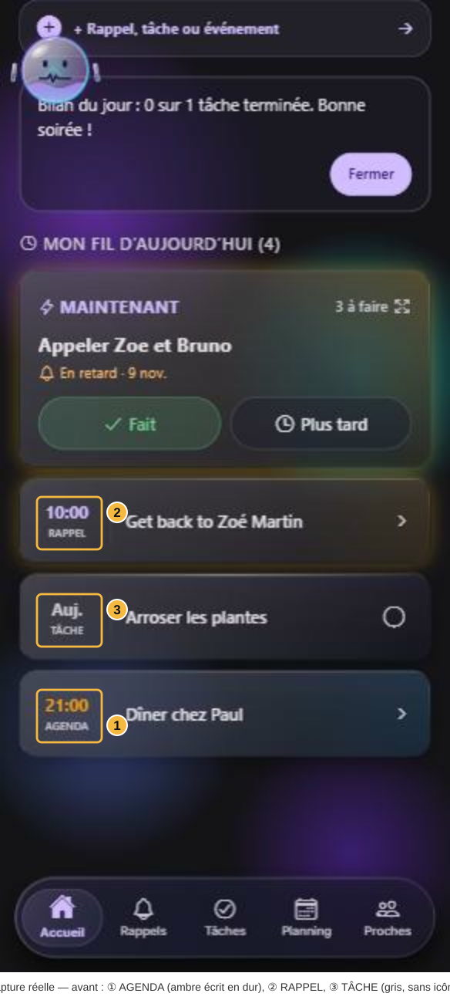
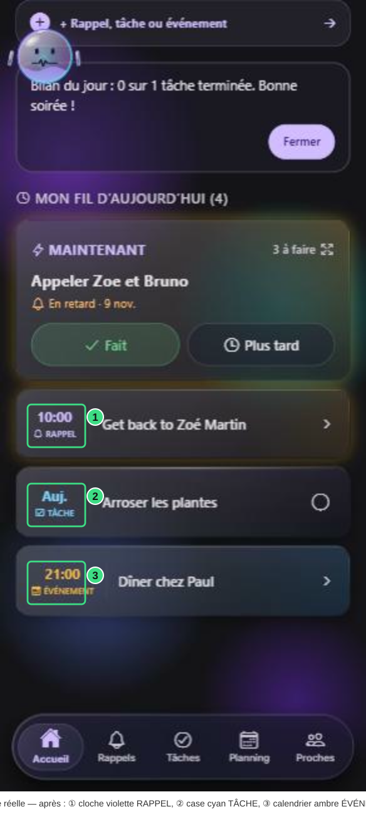

# FICHE OPÉRATOIRE N° 006 — Le registre des types : une identité nette pour rappel, tâche et événement

Projet : **Junix Pulse** · Date : 22 novembre 2026 · Suite de : [FICHE 005](FICHE-005-choisir-rappel-tache-evenement.md) · Étude : [ÉTUDE 001](../etudes/ETUDE-001-clarifier-et-faire-evoluer.md), sections 0, 1 et 10.2 (N1, étape 1)

---

## 1. Objectif

Créer **un seul endroit** qui décrit les trois types d'éléments (rappel, tâche, événement) : leur **nom**, la **phrase qui dit à quoi ils servent**, leur **icône**, leur **couleur** (thème sombre et clair) et ce qu'ils savent faire (se cocher, sonner, avoir un début et une fin). Puis l'utiliser sur l'accueil :

- dans le **fil d'aujourd'hui**, chaque carte montre l'icône, la couleur et le nom de son type (« Événement » remplace l'ancien « Agenda », qui prêtait à confusion) ;
- la carte **« Maintenant »** et l'écran **« Maintenant »** prennent l'icône et la couleur du type.

On le reconnaît : sur l'accueil, un rappel est violet avec une cloche, une tâche cyan avec une case, un événement ambre avec un calendrier.

Ce registre est la **base** des étapes suivantes (notifications d'événements, formulaires, choix « Nouveau », planning) : chacune lira le type au même endroit au lieu de le redécrire.



Légende — capture réelle, avant : ① « AGENDA » pour un événement, couleur ambre écrite en dur ; ② « RAPPEL » en violet ; ③ « TÂCHE » en gris, sans icône. Rien ne relie ces couleurs entre elles ni aux autres écrans.

## 2. État de départ

| À vérifier | Commande (dossier du projet) | Résultat attendu |
|---|---|---|
| Le code est à jour | `git log --oneline -1` | `132bd3d docs(fiches): build the APK on the PC…` ou plus récent |
| Les tests passent | `npx jest` | aucun `failed` |

## 3. Matériel

Le même que la fiche 001 : Node.js, les dépendances (`node_modules`), VS Code, Git. Aucune nouvelle bibliothèque.

## 4. Hypothèses

- Windows, Git Bash, VS Code, dossier `C:\Users\simon\Desktop\Projets\junix-pulse-glowcard`.
- Les couleurs choisies restent dans la famille de la palette : violet (couleur principale), cyan (couleur tertiaire), ambre (déjà utilisé pour l'agenda de l'accueil). Elles sont vérifiées par un test : au moins 3 fois plus contrastées que les fonds de leur thème.

## 5. Carte de l'intervention

| Fichier | Action | Raison |
|---|---|---|
| `src/constants/item-kinds.ts` | **créé** | Le registre des types et leurs couleurs |
| `src/app/(tabs)/index.tsx` | modifié | Le fil d'aujourd'hui lit le registre |
| `src/styles/tabs/today-styles.ts` | modifié | Ligne « icône + nom du type » |
| `src/components/today/NowCard.tsx` | modifié | Icône et couleur du type |
| `src/app/now.tsx` | modifié | Icône et couleur du type |
| `src/i18n/messages-rest-fr.ts` | modifié | Noms et phrases des types en français |
| `src/i18n/messages-rest-en.ts` | modifié | Les mêmes en anglais |
| `src/__tests__/item-kinds.test.ts` | **créé** | Tests du registre |

## 6. Sauvegarde

```bash
git log --oneline -1   # notez le commit de départ
```

Pour tout annuler avant un commit :

```bash
git restore "src/app/(tabs)/index.tsx" src/styles/tabs/today-styles.ts src/components/today/NowCard.tsx src/app/now.tsx src/i18n/messages-rest-fr.ts src/i18n/messages-rest-en.ts
```

puis supprimez `src/constants/item-kinds.ts` et `src/__tests__/item-kinds.test.ts`.

> ⚠ **Point de non-retour** : `git restore` efface les modifications non commitées de ces fichiers.

## 7. Étapes

### Étape 1 — Créer le registre

- **Où** : VS Code › dossier `src/constants` › clic droit › Nouveau fichier › `item-kinds.ts`.

```ts
/**
 * The kinds of item Junix Pulse knows (reminder, task, event), described in one place: their
 * name, the sentence that says what each one is for, their icon, their colour and what they
 * can do. Every screen reads them here, so a kind looks the same everywhere, and a new kind is
 * added here rather than in every screen.
 */

import type { Ionicons } from '@expo/vector-icons';

import type { ThemePalette } from '@/constants/palettes';
import type { MessageKey } from '@/i18n';

export const ITEM_KINDS = ['reminder', 'task', 'event'] as const;
export type ItemKind = (typeof ITEM_KINDS)[number];

export interface ItemKindDefinition {
  kind: ItemKind;
  /** The same icon on every screen. */
  icon: keyof typeof Ionicons.glyphMap;
  /** Its name, and the sentence that says what it is for. */
  labelKey: MessageKey;
  taglineKey: MessageKey;
  /** Ticked off once done. */
  checkable: boolean;
  /** Notifies at its time with nothing to add. */
  ringsByDefault: boolean;
  /** Has a start and an end. */
  hasTimeRange: boolean;
}

export const ITEM_KIND_DEFINITIONS: Readonly<Record<ItemKind, ItemKindDefinition>> = {
  reminder: {
    kind: 'reminder',
    icon: 'notifications-outline',
    labelKey: 'itemKind.reminder',
    taglineKey: 'itemKind.reminder.tagline',
    checkable: true,
    ringsByDefault: true,
    hasTimeRange: false,
  },
  task: {
    kind: 'task',
    icon: 'checkbox-outline',
    labelKey: 'itemKind.task',
    taglineKey: 'itemKind.task.tagline',
    checkable: true,
    ringsByDefault: false,
    hasTimeRange: false,
  },
  event: {
    kind: 'event',
    icon: 'calendar-outline',
    labelKey: 'itemKind.event',
    taglineKey: 'itemKind.event.tagline',
    checkable: false,
    ringsByDefault: false,
    hasTimeRange: true,
  },
};

/** The colour of each kind in each theme: violet, cyan and amber, readable on every surface. */
export const ITEM_KIND_COLORS: Readonly<Record<'dark' | 'light', Readonly<Record<ItemKind, string>>>> = {
  dark: { reminder: '#D0BCFF', task: '#7BD0FF', event: '#F5B942' },
  light: { reminder: '#6B46C1', task: '#0E7490', event: '#B45309' },
};

export function itemKindColor(palette: Pick<ThemePalette, 'mode'>, kind: ItemKind): string {
  return ITEM_KIND_COLORS[palette.mode === 'light' ? 'light' : 'dark'][kind];
}
```

| Lignes | Ce qu'elles font |
|---|---|
| `import type { Ionicons } …` | Le type des noms d'icônes, pour que VS Code refuse une icône qui n'existe pas. `import type` n'ajoute rien à l'application : il ne sert qu'à la vérification. |
| `import type { ThemePalette } …` / `import type { MessageKey } …` | Le type des couleurs du thème, et celui des clés de texte (une clé inexistante est refusée). |
| `export const ITEM_KINDS = ['reminder', 'task', 'event'] as const;` | La liste des types. `as const` dit à TypeScript que la liste ne change pas, pour en tirer le type `ItemKind`. |
| `export type ItemKind = (typeof ITEM_KINDS)[number];` | « Un des éléments de la liste » : `'reminder'`, `'task'` ou `'event'`. |
| `export interface ItemKindDefinition { … }` | Ce que l'on sait de chaque type : icône, nom, phrase, se coche, sonne, a un début et une fin. |
| `export const ITEM_KIND_DEFINITIONS = { reminder: {…}, task: {…}, event: {…} }` | La fiche d'identité de chaque type. `Readonly<Record<ItemKind, …>>` oblige à décrire **tous** les types, et interdit de les modifier ailleurs. |
| `export const ITEM_KIND_COLORS = { dark: {…}, light: {…} }` | Les couleurs : plus claires sur le thème sombre, plus foncées sur le thème clair, pour rester lisibles. |
| `export function itemKindColor(palette, kind)` | Rend la couleur d'un type pour le thème affiché. |

- **Pourquoi** : un seul endroit à changer pour modifier un type ou en ajouter un.
- **Contrôle** : VS Code souligne en rouge `'itemKind.reminder'` et les autres clés : c'est normal jusqu'à l'étape 5.
- **Si ça rate** : `Cannot find module '@/i18n'` → le fichier n'est pas dans `src/constants`.

### Étape 2 — Le fil d'aujourd'hui lit le registre

- **Où** : `src/app/(tabs)/index.tsx`. Deux endroits.

**2a — les imports.** Ctrl+F `import { NowCard }`.

AVANT :

```tsx
import { useMascotDayMood } from '@/features/mascot/use-mascot-day-mood';
import { NowCard } from '@/components/today/NowCard';
```

APRÈS :

```tsx
import { useMascotDayMood } from '@/features/mascot/use-mascot-day-mood';
import { NowCard } from '@/components/today/NowCard';
import { ITEM_KIND_DEFINITIONS, itemKindColor } from '@/constants/item-kinds';
```

**2b — la colonne de gauche des cartes du fil.** Ctrl+F `timelineTimeCol}>`.

AVANT :

```tsx
                  <View style={styles.timelineTimeCol}>
                    <Text
                      style={[
                        styles.timelineTimeText,
                        {
                          color:
                            item.type === 'event'
                              ? '#F59E0B'
                              : item.type === 'reminder'
                              ? palette.primary.default
                              : palette.onSurface.variant,
                        },
                      ]}
                    >
                      {item.time || t('home.timeline.today')}
                    </Text>
                    <Text style={styles.timelineTypeTag}>
                      {item.type === 'reminder'
                        ? t('home.timeline.reminder')
                        : item.type === 'event'
                        ? t('home.timeline.event')
                        : t('home.timeline.task')}
                    </Text>
                  </View>
```

APRÈS :

```tsx
                  <View style={styles.timelineTimeCol}>
                    <Text style={[styles.timelineTimeText, { color: itemKindColor(palette, item.type) }]}>
                      {item.time || t('home.timeline.today')}
                    </Text>
                    {/* Le type, reconnaissable partout : son icône, sa couleur et son nom */}
                    <View style={styles.timelineKind}>
                      <Ionicons
                        name={ITEM_KIND_DEFINITIONS[item.type].icon}
                        size={10}
                        color={itemKindColor(palette, item.type)}
                      />
                      <Text style={[styles.timelineTypeTag, { color: itemKindColor(palette, item.type) }]}>
                        {t(ITEM_KIND_DEFINITIONS[item.type].labelKey)}
                      </Text>
                    </View>
                  </View>
```

| Ligne | Ce qu'elle fait |
|---|---|
| `color: itemKindColor(palette, item.type)` | L'heure prend la couleur du type (au lieu d'un `#F59E0B` écrit en dur et d'un gris pour les tâches). |
| `<View style={styles.timelineKind}>` | Une petite ligne : icône + nom. |
| `ITEM_KIND_DEFINITIONS[item.type].icon` | L'icône du type, lue dans le registre. |
| `t(ITEM_KIND_DEFINITIONS[item.type].labelKey)` | Le nom du type, traduit : « Événement » au lieu de « Agenda ». |

- **Contrôle** : soulignement rouge sur `timelineKind` jusqu'à l'étape 3.

### Étape 3 — Le style de la ligne « icône + nom »

- **Où** : `src/styles/tabs/today-styles.ts` › Ctrl+F `timelineTypeTag: {`.

AVANT :

```ts
    timelineTypeTag: {
      ...Typography.labelSmall,
      color: theme.onSurface.variant,
      fontSize: 9,
      textTransform: 'uppercase',
      marginTop: 1,
    },
```

APRÈS :

```ts
    timelineKind: {
      flexDirection: 'row',
      alignItems: 'center',
      gap: 3,
      marginTop: 1,
    },
    timelineTypeTag: {
      ...Typography.labelSmall,
      color: theme.onSurface.variant,
      fontSize: 9,
      textTransform: 'uppercase',
    },
```

| Ligne | Ce qu'elle fait |
|---|---|
| `flexDirection: 'row'` | Icône et nom côte à côte. |
| `gap: 3` | 3 pixels entre l'icône et le nom. |
| `marginTop: 1` | L'espace au-dessus passe du texte à la ligne entière. |

### Étape 4 — La carte et l'écran « Maintenant »

**4a — `src/components/today/NowCard.tsx`.** Ctrl+F `notifications-outline`.

AVANT :

```tsx
          <Ionicons
            name={item.kind === 'reminder' ? 'notifications-outline' : 'checkbox-outline'}
            size={14}
            color={late ? palette.priority.HIGH : palette.onSurface.variant}
          />
```

APRÈS :

```tsx
          <Ionicons
            name={ITEM_KIND_DEFINITIONS[item.kind].icon}
            size={14}
            color={late ? palette.priority.HIGH : itemKindColor(palette, item.kind)}
          />
```

Et l'import, Ctrl+F `import { useNowSubtitle }`.

AVANT :

```tsx
import type { NowItem } from '@/domain/rules/now-rules';
import { useNowSubtitle } from '@/features/now/use-now-actions';
```

APRÈS :

```tsx
import type { NowItem } from '@/domain/rules/now-rules';
import { useNowSubtitle } from '@/features/now/use-now-actions';
import { ITEM_KIND_DEFINITIONS, itemKindColor } from '@/constants/item-kinds';
```

**4b — `src/app/now.tsx`.** Ctrl+F `notifications-outline`.

AVANT :

```tsx
                  <Ionicons
                    name={current.kind === 'reminder' ? 'notifications-outline' : 'checkbox-outline'}
                    size={16}
                    color={late ? palette.priority.HIGH : palette.primary.default}
                  />
```

APRÈS :

```tsx
                  <Ionicons
                    name={ITEM_KIND_DEFINITIONS[current.kind].icon}
                    size={16}
                    color={late ? palette.priority.HIGH : itemKindColor(palette, current.kind)}
                  />
```

Et l'import, Ctrl+F `import { useNowActions, useNowSubtitle }`.

AVANT :

```tsx
import { PulseMascot } from '@/features/mascot/PulseMascot';
import { useNowActions, useNowSubtitle } from '@/features/now/use-now-actions';
```

APRÈS :

```tsx
import { PulseMascot } from '@/features/mascot/PulseMascot';
import { useNowActions, useNowSubtitle } from '@/features/now/use-now-actions';
import { ITEM_KIND_DEFINITIONS, itemKindColor } from '@/constants/item-kinds';
```

- **Pourquoi** : l'icône reste rouge-orangé si l'élément est **en retard** (l'alerte passe avant le type) ; sinon elle prend la couleur de son type.

### Étape 5 — Les textes

- **Où** : `src/i18n/messages-rest-fr.ts` puis `messages-rest-en.ts` › Ctrl+F `'widget.locked':` › collez les lignes **après** cette ligne.

Français :

```ts
  'itemKind.reminder': "Rappel",
  'itemKind.reminder.tagline': "Me faire penser à quelque chose, à une heure",
  'itemKind.task': "Tâche",
  'itemKind.task.tagline': "Une chose à faire, que je coche quand c’est fait",
  'itemKind.event': "Événement",
  'itemKind.event.tagline': "Un moment qui a lieu : un début, une fin, souvent un lieu et des gens",
```

Anglais :

```ts
  'itemKind.reminder': "Reminder",
  'itemKind.reminder.tagline': "Something to think of, at a set time",
  'itemKind.task': "Task",
  'itemKind.task.tagline': "Something to do, ticked off once done",
  'itemKind.event': "Event",
  'itemKind.event.tagline': "A moment that happens: a start, an end, often a place and people",
```

- **Contrôle** : plus aucun soulignement rouge.
- **Si ça rate** : `Property 'itemKind.task' is missing` → la clé n'est que dans une des deux langues.

### Étape 6 — Les tests

- **Où** : `src/__tests__` › Nouveau fichier › `item-kinds.test.ts`.

```ts
/**
 * The registry of item kinds: every kind described, named in both languages, with a colour
 * readable on every surface of its theme and different from the other kinds.
 */

import { darkPalette, lightPalette } from '@/constants/palettes';
import { ITEM_KIND_COLORS, ITEM_KIND_DEFINITIONS, ITEM_KINDS, itemKindColor } from '@/constants/item-kinds';
import { translate } from '@/i18n/translate';
import { contrastRatio } from '@/utils/color';

describe('registry of item kinds', () => {
  it('describes every kind, under its own name', () => {
    for (const kind of ITEM_KINDS) {
      expect(ITEM_KIND_DEFINITIONS[kind].kind).toBe(kind);
    }
  });

  it('names each kind and says what it is for, in French and English', () => {
    for (const kind of ITEM_KINDS) {
      const { labelKey, taglineKey } = ITEM_KIND_DEFINITIONS[kind];
      for (const language of ['fr', 'en'] as const) {
        expect(translate(language, labelKey)).not.toBe(labelKey);
        expect(translate(language, taglineKey)).not.toBe(taglineKey);
      }
    }
    expect(translate('fr', ITEM_KIND_DEFINITIONS.event.labelKey)).toBe('Événement');
  });

  it('knows what each kind can do', () => {
    expect(ITEM_KIND_DEFINITIONS.reminder).toMatchObject({ checkable: true, ringsByDefault: true, hasTimeRange: false });
    expect(ITEM_KIND_DEFINITIONS.task).toMatchObject({ checkable: true, ringsByDefault: false, hasTimeRange: false });
    expect(ITEM_KIND_DEFINITIONS.event).toMatchObject({ checkable: false, hasTimeRange: true });
  });

  it.each([
    ['dark', darkPalette],
    ['light', lightPalette],
  ] as const)('gives each kind a colour readable on every %s surface, different from the others', (mode, palette) => {
    const colors = ITEM_KINDS.map(kind => itemKindColor(palette, kind));
    expect(new Set(colors).size).toBe(ITEM_KINDS.length);
    for (const kind of ITEM_KINDS) {
      for (const surface of [palette.surface.base, palette.surface.container, palette.surface.high]) {
        expect(contrastRatio(ITEM_KIND_COLORS[mode][kind], surface)).toBeGreaterThanOrEqual(3);
      }
    }
  });
});
```

| Bloc | Ce qu'il vérifie |
|---|---|
| `describes every kind…` | Chaque type a sa fiche, au bon nom. |
| `names each kind…` | Chaque clé de texte existe en français et en anglais (`translate` rend la clé elle-même quand le texte manque) ; « Événement » en français. |
| `knows what each kind can do` | Rappel : se coche et sonne ; tâche : se coche ; événement : a un début et une fin, ne se coche pas. |
| `gives each kind a colour…` | Trois couleurs différentes par thème, chacune au moins 3 fois plus contrastée que les fonds (seuil des éléments graphiques, règles d'accessibilité WCAG). |

## 8. Test final

```bash
npx jest src/__tests__/item-kinds.test.ts
```

Résultat attendu : `Tests: 5 passed, 5 total`.

```bash
npx tsc --noEmit
npx eslint src
```

Résultat attendu : aucune erreur.

À l'écran (aperçu web, `http://localhost:8099/`) : dans « Mon fil d'aujourd'hui », un événement affiche une petite icône de calendrier et « ÉVÉNEMENT » en ambre, un rappel une cloche et « RAPPEL » en violet, une tâche une case et « TÂCHE » en cyan.



## 9. Dépannage

| Message | Cause | Remède |
|---|---|---|
| `Type '"xxx"' is not assignable to type … glyphMap` | Nom d'icône inexistant | Choisissez un nom sur icons.expo.fyi (famille Ionicons) |
| `Property 'itemKind.xxx' is missing` | Texte présent dans une seule langue | Ajoutez-le dans les deux fichiers de l'étape 5 |
| Test de contraste en échec | Couleur trop pâle (thème clair) ou trop sombre (thème sombre) | Foncez-la (clair) ou éclaircissez-la (sombre) dans `ITEM_KIND_COLORS` |

## 10. Lexique

- **Registre** : un fichier qui décrit des choses à un seul endroit, que tous les écrans lisent.
- **Type d'élément** : rappel, tâche ou événement.
- **`as const`** : dit à TypeScript qu'une liste ne changera pas, pour pouvoir en déduire des types précis.
- **Contraste** : rapport de luminosité entre une couleur et son fond ; au moins 3 pour un élément graphique, 4,5 pour du texte courant (règles WCAG).
- **Clé de texte** : le nom d'un texte (`itemKind.event`) que l'application traduit selon la langue.

## 11. Et après

N1, dans l'ordre (étude 001, section 10.7) :
1. ✔ Registre des types (cette fiche).
2. **Les événements notifient** (fiche suivante) : utiliser `ringsByDefault` du registre, passer l'événement à `true`, programmer une alerte avant le début (et une alerte de départ s'il y a un lieu et un temps de trajet). Fichiers concernés : `src/domain/rules/reminder-notification-rules.ts` (le planificateur), `src/services/reminder-notification-service.ts`, `src/use-cases/event-use-cases.ts`.
3. Formulaire d'événement remis à plat (le temps de trajet seulement si un lieu est saisi).
4. Logo A.
5. Formulaires de tâche et de rappel, et le choix « Nouveau » qui affiche les phrases `itemKind.*.tagline` de ce registre.

## Compte rendu d'exécution (22 novembre 2026)

- Étapes 1 à 6 appliquées **à partir des blocs de code de cette fiche** (aucune différence entre la fiche et le projet).
- Test final : `item-kinds.test.ts` 5/5 ; projet complet 1 892 tests réussis ; `tsc` et `eslint` sans erreur.
- À l'écran (aperçu web) : le fil d'aujourd'hui affiche « RAPPEL » (cloche violette), « TÂCHE » (case cyan) et « ÉVÉNEMENT » (calendrier ambre, au lieu de « AGENDA »).
- Numéro : cette fiche devait être la 004 ; une autre conversation avait déjà créé les fiches 004 (« Construire Junix Pulse de zéro ») et 005 (« Choisir rappel, tâche, événement »). Elle a été renumérotée **006**.
- **Point ouvert** : la fiche 005 (autre conversation, pas encore enregistrée dans Git) a ajouté un écran « Que voulez-vous ajouter ? » (`src/components/create/NewItemChooser.tsx`) avec **ses propres couleurs** : tâche **verte**, événement **cyan**. Ce registre (et l'étude, section 10.2) donne tâche **cyan**, événement **ambre**. Tant que les deux coexistent, un même type n'a pas la même couleur partout. Correction proposée : faire lire le registre à `NewItemChooser` (icône, couleur, nom), en gardant ses textes (question, règle, exemple). À faire seulement avec l'accord de l'utilisateur.
