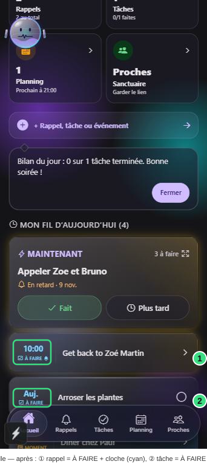
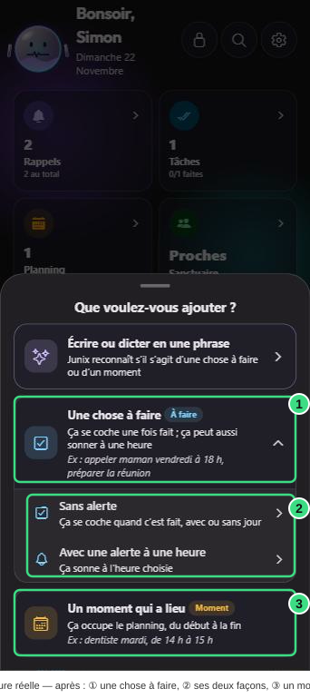

# FICHE OPÉRATOIRE N° 008 — Deux familles : « À faire » et « Moment » (1-B, étape 1)

Projet : **Junix Pulse** · Date : 22 novembre 2026 · Suite de : [FICHE 006](FICHE-006-registre-des-types.md) (registre des types, session précédente) · Étude : [ÉTUDE 001](../etudes/ETUDE-001-clarifier-et-faire-evoluer.md), sections 11.2 et 11.3

---

## 1. Objectif

L'utilisateur ne voit plus trois types qui se chevauchent, mais **deux familles** :

- **À faire** : une chose qui se coche, avec ou sans alerte à une heure (case à cocher, **cyan**). Une petite **cloche** s'ajoute quand elle sonne : c'est le cas des anciens « rappels ».
- **Moment** : quelque chose qui a lieu, avec un début et une fin (calendrier, **ambre**). Ce sont les anciens « événements ».

À la fin de cette fiche :
1. le **registre** (`src/constants/item-kinds.ts`) connaît les deux familles et range chaque type dans la sienne ;
2. le **fil d'aujourd'hui** de l'accueil montre « À FAIRE » (cyan, avec cloche si ça sonne) ou « MOMENT » (ambre) ;
3. le choix **« Nouveau »** propose **deux** choix. « Une chose à faire » s'ouvre sur deux boutons, **Sans alerte** (formulaire de tâche) ou **Avec une alerte à une heure** (formulaire de rappel), en attendant le formulaire unique de l'étape 4.

**Rien ne change dans la base de données** : un « À faire » avec alerte est toujours enregistré comme un rappel, un « À faire » sans alerte comme une tâche.

## 2. État de départ

| À vérifier | Comment | Résultat attendu |
|---|---|---|
| Le travail de la session précédente est là | Explorateur › `src/constants/item-kinds.ts` et `src/components/create/NewItemChooser.tsx` | Les deux fichiers existent |
| Il compile et ses tests passent | `npx tsc --noEmit` puis `npx jest src/__tests__/item-kinds.test.ts src/__tests__/new-item-chooser.test.tsx` | Pas d'erreur ; `Tests: 10 passed` |

## 3. Matériel

Node.js et les dépendances du projet (`node --version`, dossier `node_modules`). Rien de nouveau à installer.

## 4. Hypothèses

- Windows, Git Bash, VS Code, dossier `C:\Users\simon\Desktop\Projets\junix-pulse-glowcard`.
- Les onglets « Rappels » et « Tâches » et les formulaires restent **tels quels** dans cette étape : ils changent aux étapes 4 et 5 (étude, section 11.3). Pendant la transition, le fil d'aujourd'hui dit déjà « À faire » alors que l'onglet dit encore « Rappels ».

## 5. Carte de l'intervention

| Fichier | Action | Raison |
|---|---|---|
| `src/constants/item-kinds.ts` | **remplacé** (fichier entier) | Ajout des familles ; la couleur et l'icône viennent de la famille |
| `src/app/(tabs)/index.tsx` | modifié | Le fil montre la famille, et la cloche pour ce qui sonne |
| `src/components/create/NewItemChooser.tsx` | **remplacé** (fichier entier) | Deux choix ; « À faire » s'ouvre sur « sans / avec alerte » |
| `src/i18n/messages-rest-fr.ts` | modifié | Textes français des familles et du choix |
| `src/i18n/messages-rest-en.ts` | modifié | Les mêmes en anglais |
| `src/__tests__/item-kinds.test.ts` | **remplacé** | Tests du registre à deux familles |
| `src/__tests__/new-item-chooser.test.tsx` | **remplacé** | Tests du choix à deux familles |

## 6. Sauvegarde

Le travail de la session précédente n'est **pas commité** : avant de toucher à quoi que ce soit, gardez-en une copie.

```bash
mkdir -p /c/Users/simon/Desktop/sauvegarde-fiche-008
cp "src/constants/item-kinds.ts" "src/components/create/NewItemChooser.tsx" "src/__tests__/item-kinds.test.ts" "src/__tests__/new-item-chooser.test.tsx" /c/Users/simon/Desktop/sauvegarde-fiche-008/
```

| Morceau | Sens |
|---|---|
| `mkdir -p …` | Crée le dossier de sauvegarde sur le Bureau (`-p` : sans erreur s'il existe déjà) |
| `cp … dossier/` | Copie les quatre fichiers qui seront remplacés |

Retour arrière : recopiez ces fichiers à leur place. Pour `index.tsx` et les deux fichiers de textes, refaites les blocs AVANT de cette fiche.

## 7. Étapes

### Étape 1 — Le registre connaît les deux familles

- **Où** : `src/constants/item-kinds.ts`.
- **Geste** : Ctrl+A (tout sélectionner), puis collez le fichier entier ci-dessous, puis Ctrl+S.

<!-- bloc: registre -->
```ts
/**
 * The kinds of item Junix Pulse knows (reminder, task, event), described in one place: their
 * name, the sentence that says what each one is for, their icon, their colour and what they
 * can do. Every screen reads them here, so a kind looks the same everywhere, and a new kind is
 * added here rather than in every screen.
 *
 * The user sees two families rather than three kinds (study 001, 1-B): "À faire", something
 * ticked off once done, with or without an alert (reminders and tasks), and "Moment",
 * something that takes place (events). The data keeps its three kinds; only the screens speak
 * of families.
 */

import type { Ionicons } from '@expo/vector-icons';

import type { ThemePalette } from '@/constants/palettes';
import type { MessageKey } from '@/i18n';

export const ITEM_FAMILIES = ['todo', 'moment'] as const;
export type ItemFamily = (typeof ITEM_FAMILIES)[number];

export interface ItemFamilyDefinition {
  family: ItemFamily;
  /** The same icon on every screen. */
  icon: keyof typeof Ionicons.glyphMap;
  /** Its name, and the sentence that says what it is for. */
  labelKey: MessageKey;
  taglineKey: MessageKey;
}

export const ITEM_FAMILY_DEFINITIONS: Readonly<Record<ItemFamily, ItemFamilyDefinition>> = {
  todo: {
    family: 'todo',
    icon: 'checkbox-outline',
    labelKey: 'itemFamily.todo',
    taglineKey: 'itemFamily.todo.tagline',
  },
  moment: {
    family: 'moment',
    icon: 'calendar-outline',
    labelKey: 'itemFamily.moment',
    taglineKey: 'itemFamily.moment.tagline',
  },
};

/** The colour of each family in each theme: cyan and amber, readable on every surface. */
export const ITEM_FAMILY_COLORS: Readonly<Record<'dark' | 'light', Readonly<Record<ItemFamily, string>>>> = {
  dark: { todo: '#7BD0FF', moment: '#F5B942' },
  light: { todo: '#0E7490', moment: '#B45309' },
};

export const ITEM_KINDS = ['reminder', 'task', 'event'] as const;
export type ItemKind = (typeof ITEM_KINDS)[number];

export interface ItemKindDefinition {
  kind: ItemKind;
  /** The family the user sees it in. */
  family: ItemFamily;
  /** Its own name, for the places that still need it. */
  labelKey: MessageKey;
  taglineKey: MessageKey;
  /** Ticked off once done. */
  checkable: boolean;
  /** Notifies at its time with nothing to add: shown with a bell. */
  ringsByDefault: boolean;
  /** Has a start and an end. */
  hasTimeRange: boolean;
}

export const ITEM_KIND_DEFINITIONS: Readonly<Record<ItemKind, ItemKindDefinition>> = {
  reminder: {
    kind: 'reminder',
    family: 'todo',
    labelKey: 'itemKind.reminder',
    taglineKey: 'itemKind.reminder.tagline',
    checkable: true,
    ringsByDefault: true,
    hasTimeRange: false,
  },
  task: {
    kind: 'task',
    family: 'todo',
    labelKey: 'itemKind.task',
    taglineKey: 'itemKind.task.tagline',
    checkable: true,
    ringsByDefault: false,
    hasTimeRange: false,
  },
  event: {
    kind: 'event',
    family: 'moment',
    labelKey: 'itemKind.event',
    taglineKey: 'itemKind.event.tagline',
    checkable: false,
    ringsByDefault: false,
    hasTimeRange: true,
  },
};

export function itemFamilyColor(palette: Pick<ThemePalette, 'mode'>, family: ItemFamily): string {
  return ITEM_FAMILY_COLORS[palette.mode === 'light' ? 'light' : 'dark'][family];
}

/** The colour of a kind is the colour of its family. */
export function itemKindColor(palette: Pick<ThemePalette, 'mode'>, kind: ItemKind): string {
  return itemFamilyColor(palette, ITEM_KIND_DEFINITIONS[kind].family);
}

/** How a kind shows on a card: the icon and the name of its family, and a bell if it rings. */
export function itemKindLook(kind: ItemKind): { icon: ItemFamilyDefinition['icon']; labelKey: MessageKey; withAlert: boolean } {
  const definition = ITEM_KIND_DEFINITIONS[kind];
  const family = ITEM_FAMILY_DEFINITIONS[definition.family];
  return { icon: family.icon, labelKey: family.labelKey, withAlert: definition.ringsByDefault };
}
```

| Bloc | Ce qu'il fait |
|---|---|
| Commentaire d'en-tête | Explique le rôle du fichier et la décision 1-B : deux familles à l'écran, trois types dans les données |
| `ITEM_FAMILIES` et `ItemFamily` | La liste des familles (`'todo'` = À faire, `'moment'` = Moment) et le type TypeScript qui n'accepte que ces deux mots |
| `ItemFamilyDefinition` | Ce qu'on sait d'une famille : icône, clé du nom, clé de la phrase |
| `ITEM_FAMILY_DEFINITIONS` | Les deux familles : case à cocher pour À faire, calendrier pour Moment |
| `ITEM_FAMILY_COLORS` | Les couleurs : cyan et ambre, une valeur pour le thème sombre, une pour le clair. Le cyan est celui de l'ancienne « tâche », l'ambre celui de l'ancien « événement » : leurs contrastes étaient déjà vérifiés |
| `ItemKindDefinition` | Ce qu'on sait d'un type : sa **famille** (nouveau), ses textes, et ce qu'il sait faire. L'icône n'est plus ici : elle vient de la famille |
| `ITEM_KIND_DEFINITIONS` | Rappel et tâche rangés dans `todo`, événement dans `moment` |
| `itemFamilyColor` | Donne la couleur d'une famille selon le thème (clair ou sombre) |
| `itemKindColor` | Garde le même nom qu'avant (les écrans qui l'utilisent n'ont pas à changer) mais rend la couleur de la **famille** |
| `itemKindLook` | Ce qu'une carte affiche : l'icône et le nom de la famille, et `withAlert` vrai pour ce qui sonne (le rappel), pour ajouter la cloche |

- **Pourquoi** : tous les écrans liront ici « à quoi ressemble un élément » ; passer de trois à deux familles se fait à un seul endroit.
- **Contrôle** : aucun soulignement rouge dans ce fichier. Il en apparaît dans `index.tsx` et le choix « Nouveau » : c'est normal jusqu'aux étapes 2 et 3.

### Étape 2 — Le fil d'aujourd'hui montre la famille

- **Où** : `src/app/(tabs)/index.tsx`, deux endroits.

**2a — l'import.** Ctrl+F `constants/item-kinds`.

AVANT :

<!-- bloc: feed-import-avant -->
```tsx
import { NowCard } from '@/components/today/NowCard';
import { ITEM_KIND_DEFINITIONS, itemKindColor } from '@/constants/item-kinds';
import { NewItemChooser } from '@/components/create/NewItemChooser';
```

APRÈS :

<!-- bloc: feed-import-apres -->
```tsx
import { NowCard } from '@/components/today/NowCard';
import { itemKindColor, itemKindLook } from '@/constants/item-kinds';
import { NewItemChooser } from '@/components/create/NewItemChooser';
```

**2b — la carte du fil.** Ctrl+F `accessibilityLabel={\`${item.title}, ${item.type}\`}`.

AVANT :

<!-- bloc: feed-carte-avant -->
```tsx
                accessibilityLabel={`${item.title}, ${item.type}`}
              >
                <View style={styles.timelineCard}>
                  <View style={styles.timelineTimeCol}>
                    <Text style={[styles.timelineTimeText, { color: itemKindColor(palette, item.type) }]}>
                      {item.time || t('home.timeline.today')}
                    </Text>
                    {/* Le type, reconnaissable partout : son icône, sa couleur et son nom */}
                    <View style={styles.timelineKind}>
                      <Ionicons
                        name={ITEM_KIND_DEFINITIONS[item.type].icon}
                        size={10}
                        color={itemKindColor(palette, item.type)}
                      />
                      <Text style={[styles.timelineTypeTag, { color: itemKindColor(palette, item.type) }]}>
                        {t(ITEM_KIND_DEFINITIONS[item.type].labelKey)}
                      </Text>
                    </View>
                  </View>
```

APRÈS :

<!-- bloc: feed-carte-apres -->
```tsx
                accessibilityLabel={`${item.title}, ${t(itemKindLook(item.type).labelKey)}${itemKindLook(item.type).withAlert ? `, ${t('itemFamily.withAlert')}` : ''}`}
              >
                <View style={styles.timelineCard}>
                  <View style={styles.timelineTimeCol}>
                    <Text style={[styles.timelineTimeText, { color: itemKindColor(palette, item.type) }]}>
                      {item.time || t('home.timeline.today')}
                    </Text>
                    {/* La famille, reconnaissable partout : son icône, sa couleur et son nom, et la cloche si ça sonne */}
                    <View style={styles.timelineKind}>
                      <Ionicons
                        name={itemKindLook(item.type).icon}
                        size={10}
                        color={itemKindColor(palette, item.type)}
                      />
                      <Text style={[styles.timelineTypeTag, { color: itemKindColor(palette, item.type) }]}>
                        {t(itemKindLook(item.type).labelKey)}
                      </Text>
                      {itemKindLook(item.type).withAlert && (
                        <Ionicons name="notifications" size={9} color={itemKindColor(palette, item.type)} />
                      )}
                    </View>
                  </View>
```

| Ligne | Ce qu'elle fait |
|---|---|
| `accessibilityLabel={…}` | Ce que lit TalkBack : le titre, puis « À faire » ou « Moment », puis « avec alerte » si ça sonne. Avant, il lisait le mot technique `reminder` |
| `name={itemKindLook(item.type).icon}` | L'icône de la famille (case ou calendrier) |
| `{t(itemKindLook(item.type).labelKey)}` | Le nom de la famille, traduit |
| `{itemKindLook(item.type).withAlert && ( … )}` | La petite cloche, seulement pour ce qui sonne |

- **Contrôle** : plus de soulignement rouge dans `index.tsx` (sauf `itemFamily.withAlert` tant que l'étape 4 n'est pas faite).

### Étape 3 — Le choix « Nouveau » à deux familles

- **Où** : `src/components/create/NewItemChooser.tsx` › Ctrl+A › collez le fichier entier › Ctrl+S.

<!-- bloc: choix -->
```tsx
/**
 * "Que voulez-vous ajouter ?": one sheet, the same from the home screen and from the Planning.
 * Two families rather than three kinds (study 001, 1-B): something to do, ticked off once done,
 * or a moment that takes place. "Something to do" opens on its two forms, without or with an
 * alert at a time, until the single form arrives. From the home screen, a first choice lets
 * Junix read one sentence (quick capture).
 */

import { Ionicons } from '@expo/vector-icons';
import { format } from 'date-fns';
import { router } from 'expo-router';
import { useState } from 'react';
import { Modal, StyleSheet, Text, TouchableOpacity, View } from 'react-native';
import { useSafeAreaInsets } from 'react-native-safe-area-context';

import { Radius, Spacing, Typography } from '@/constants/theme';
import type { ThemePalette } from '@/constants/palettes';
import { ITEM_FAMILY_DEFINITIONS, itemFamilyColor, type ItemFamily } from '@/constants/item-kinds';
import { newItemRoute, type NewItemKind } from '@/features/create/new-item-route';
import { useTheme } from '@/hooks/use-theme';
import { useThemedStyles } from '@/hooks/use-themed-styles';
import { useDateLocale, useT, type MessageKey } from '@/i18n';
import { hexToRgba } from '@/utils/color';

interface NewItemChooserProps {
  visible: boolean;
  onClose: () => void;
  /** The day chosen in the Planning; none from the home screen. */
  date?: Date | null;
  /** The hour of the slot touched in the Planning. */
  hour?: number | null;
  /** Offers first to write or dictate one sentence (home screen). */
  withCapture?: boolean;
}

/** What the chooser says of a family; its icon, colour and name come from the registry. */
interface Choice {
  family: ItemFamily;
  question: MessageKey;
  rule: MessageKey;
  example: MessageKey;
}

const CHOICES: readonly Choice[] = [
  { family: 'todo', question: 'create.todo.question', rule: 'create.todo.rule', example: 'create.todo.example' },
  { family: 'moment', question: 'create.moment.question', rule: 'create.moment.rule', example: 'create.moment.example' },
];

/** The two ways of something to do, each opening its form. */
const TODO_WAYS: readonly { kind: 'task' | 'reminder'; icon: keyof typeof Ionicons.glyphMap; title: MessageKey; desc: MessageKey }[] = [
  { kind: 'task', icon: 'checkbox-outline', title: 'create.todo.noAlert', desc: 'create.todo.noAlertDesc' },
  { kind: 'reminder', icon: 'notifications-outline', title: 'create.todo.withAlert', desc: 'create.todo.withAlertDesc' },
];

export function NewItemChooser({ visible, onClose, date = null, hour = null, withCapture = false }: NewItemChooserProps) {
  const t = useT();
  const locale = useDateLocale();
  const insets = useSafeAreaInsets();
  const { palette } = useTheme();
  const styles = useThemedStyles(makeNewItemChooserStyles);
  // "Something to do" opened on its two ways
  const [todoOpen, setTodoOpen] = useState(false);

  const close = () => {
    setTodoOpen(false);
    onClose();
  };

  const open = (kind: NewItemKind) => {
    close();
    router.push(newItemRoute(kind, date, hour));
  };

  // From a slot of the Planning, the sheet says which day and hour it adds to
  const title = !date
    ? t('create.title')
    : hour !== null
      ? t('calendarAction.slotOf', { hour: String(hour).padStart(2, '0') })
      : t('calendarAction.addToPlanning');

  const todoColor = itemFamilyColor(palette, 'todo');

  return (
    <Modal visible={visible} transparent animationType="slide" statusBarTranslucent onRequestClose={close}>
      <View style={styles.overlay}>
        <TouchableOpacity
          style={StyleSheet.absoluteFill}
          onPress={close}
          accessibilityRole="button"
          accessibilityLabel={t('common.close')}
        />
        <View
          style={[styles.sheet, { paddingBottom: insets.bottom + Spacing.lg }]}
          accessibilityViewIsModal
          testID="new-item-chooser"
        >
          <View style={styles.handle} />
          <Text style={styles.title} accessibilityRole="header">
            {title}
          </Text>
          {date && <Text style={styles.date}>{format(date, 'EEEE d MMMM', { locale })}</Text>}

          {withCapture && (
            <TouchableOpacity
              style={[styles.choice, styles.captureChoice]}
              onPress={() => open('capture')}
              accessibilityRole="button"
              accessibilityLabel={`${t('create.capture.title')}. ${t('create.capture.desc')}`}
              testID="new-item-capture"
            >
              <View style={[styles.icon, { backgroundColor: hexToRgba(palette.primary.default, 0.16) }]}>
                <Ionicons name="sparkles-outline" size={20} color={palette.primary.default} />
              </View>
              <View style={styles.choiceText}>
                <Text style={styles.question}>{t('create.capture.title')}</Text>
                <Text style={styles.rule}>{t('create.capture.desc')}</Text>
              </View>
              <Ionicons name="chevron-forward" size={18} color={palette.onSurface.variant} />
            </TouchableOpacity>
          )}

          {CHOICES.map(choice => {
            // Icon, colour and name of the family: the same as everywhere else in the app
            const family = ITEM_FAMILY_DEFINITIONS[choice.family];
            const color = itemFamilyColor(palette, choice.family);
            const isTodo = choice.family === 'todo';
            return (
              <View key={choice.family}>
                <TouchableOpacity
                  style={[styles.choice, isTodo && todoOpen && styles.choiceOpen]}
                  onPress={() => (isTodo ? setTodoOpen(current => !current) : open('event'))}
                  accessibilityRole="button"
                  accessibilityState={isTodo ? { expanded: todoOpen } : undefined}
                  accessibilityLabel={`${t(choice.question)}, ${t(family.labelKey)}. ${t(choice.rule)}`}
                  testID={`new-item-${choice.family}`}
                >
                  <View style={[styles.icon, { backgroundColor: hexToRgba(color, 0.16) }]}>
                    <Ionicons name={family.icon} size={20} color={color} />
                  </View>
                  <View style={styles.choiceText}>
                    <View style={styles.questionRow}>
                      <Text style={styles.question}>{t(choice.question)}</Text>
                      <Text style={[styles.type, { color, backgroundColor: hexToRgba(color, 0.14) }]}>{t(family.labelKey)}</Text>
                    </View>
                    <Text style={styles.rule}>{t(choice.rule)}</Text>
                    <Text style={styles.example}>{t(choice.example)}</Text>
                  </View>
                  {isTodo && (
                    <Ionicons name={todoOpen ? 'chevron-up' : 'chevron-down'} size={18} color={palette.onSurface.variant} />
                  )}
                </TouchableOpacity>

                {/* Something to do: without or with an alert, each opening its form */}
                {isTodo && todoOpen && (
                  <View style={styles.ways}>
                    {TODO_WAYS.map(way => (
                      <TouchableOpacity
                        key={way.kind}
                        style={styles.way}
                        onPress={() => open(way.kind)}
                        accessibilityRole="button"
                        accessibilityLabel={`${t(way.title)}. ${t(way.desc)}`}
                        testID={`new-item-${way.kind}`}
                      >
                        <Ionicons name={way.icon} size={18} color={todoColor} />
                        <View style={styles.choiceText}>
                          <Text style={styles.wayTitle}>{t(way.title)}</Text>
                          <Text style={styles.rule}>{t(way.desc)}</Text>
                        </View>
                        <Ionicons name="chevron-forward" size={16} color={palette.onSurface.variant} />
                      </TouchableOpacity>
                    ))}
                  </View>
                )}
              </View>
            );
          })}
        </View>
      </View>
    </Modal>
  );
}

const makeNewItemChooserStyles = (theme: ThemePalette) =>
  StyleSheet.create({
    overlay: {
      flex: 1,
      justifyContent: 'flex-end',
      backgroundColor: 'rgba(0, 0, 0, 0.65)',
    },
    sheet: {
      // Opaque, like the other sheets: nothing behind shows through the text
      backgroundColor: theme.surface.container,
      borderTopLeftRadius: 28,
      borderTopRightRadius: 28,
      borderWidth: 1,
      borderColor: theme.glass.nav.borderColor,
      paddingHorizontal: Spacing.lg,
      paddingTop: Spacing.md,
      gap: Spacing.sm,
    },
    handle: {
      width: 36,
      height: 4,
      borderRadius: 2,
      backgroundColor: theme.onSurface.disabled,
      alignSelf: 'center',
      marginBottom: Spacing.xs,
    },
    title: {
      ...Typography.titleLarge,
      color: theme.onSurface.primary,
      fontWeight: '700',
      textAlign: 'center',
    },
    date: {
      ...Typography.labelMedium,
      color: theme.primary.default,
      textAlign: 'center',
      textTransform: 'capitalize',
      marginTop: -Spacing.xs,
    },
    choice: {
      flexDirection: 'row',
      alignItems: 'center',
      gap: Spacing.md,
      minHeight: 64,
      padding: Spacing.md,
      borderRadius: Radius.lg,
      backgroundColor: theme.glass.control.backgroundColor,
      borderWidth: 1,
      borderColor: theme.glass.control.borderColor,
    },
    choiceOpen: {
      borderBottomLeftRadius: 0,
      borderBottomRightRadius: 0,
    },
    captureChoice: {
      borderColor: hexToRgba(theme.primary.default, 0.45),
    },
    icon: {
      width: 40,
      height: 40,
      borderRadius: Radius.md,
      alignItems: 'center',
      justifyContent: 'center',
    },
    choiceText: {
      flex: 1,
      gap: 2,
    },
    questionRow: {
      flexDirection: 'row',
      alignItems: 'center',
      flexWrap: 'wrap',
      gap: Spacing.xs,
    },
    question: {
      ...Typography.titleMedium,
      color: theme.onSurface.primary,
      fontWeight: '700',
    },
    type: {
      ...Typography.labelSmall,
      fontWeight: '700',
      paddingHorizontal: Spacing.sm,
      paddingVertical: 2,
      borderRadius: Radius.full,
      overflow: 'hidden',
    },
    rule: {
      ...Typography.bodySmall,
      color: theme.onSurface.primary,
    },
    example: {
      ...Typography.bodySmall,
      color: theme.onSurface.variant,
      fontStyle: 'italic',
    },
    ways: {
      borderWidth: 1,
      borderTopWidth: 0,
      borderColor: theme.glass.control.borderColor,
      borderBottomLeftRadius: Radius.lg,
      borderBottomRightRadius: Radius.lg,
      backgroundColor: theme.surface.high,
      paddingHorizontal: Spacing.md,
    },
    way: {
      flexDirection: 'row',
      alignItems: 'center',
      gap: Spacing.md,
      minHeight: 56,
      paddingLeft: Spacing.md,
    },
    wayTitle: {
      ...Typography.labelLarge,
      color: theme.onSurface.primary,
      fontWeight: '600',
    },
  });
```

| Bloc | Ce qu'il fait |
|---|---|
| `import { useState } from 'react';` | Pour retenir si « Une chose à faire » est ouverte |
| `CHOICES` | Deux choix au lieu de trois : `todo` et `moment`, chacun avec sa question, sa règle et un exemple |
| `TODO_WAYS` | Les deux façons d'une chose à faire : **sans alerte** (ouvre le formulaire de tâche) et **avec alerte** (ouvre le formulaire de rappel) |
| `const [todoOpen, setTodoOpen] = useState(false);` | `false` au départ : les deux façons sont cachées |
| `close` | Referme les deux façons **et** la fenêtre ; on rouvre donc toujours sur l'état de départ |
| `onPress={() => (isTodo ? setTodoOpen(…) : open('event'))}` | Toucher « Une chose à faire » ouvre ou ferme ses deux façons ; toucher « Un moment » ouvre directement le formulaire d'événement |
| `accessibilityState={… { expanded: todoOpen } …}` | TalkBack annonce « développé » ou « réduit » |
| `{isTodo && todoOpen && ( … )}` | Les deux boutons, juste sous le choix, dans un bloc collé à lui (`choiceOpen` aplatit le bas du choix, `ways` arrondit le bas du bloc) |
| `testID=…` | Des noms pour les tests automatiques : `new-item-todo`, `new-item-moment`, `new-item-task`, `new-item-reminder` |
| Styles `ways`, `way`, `wayTitle` | Le bloc des deux façons : fond légèrement plus clair, lignes de 56 px de haut (assez grand pour un doigt) |

- **Contrôle** : aucun soulignement rouge sauf les nouvelles clés de texte (étape 4).

### Étape 4 — Les textes

- **Où** : `src/i18n/messages-rest-fr.ts`, puis `src/i18n/messages-rest-en.ts`.

**4a — le choix « Nouveau »** (Ctrl+F `'create.capture.desc'`). Remplacez le bloc AVANT (de `'create.capture.desc'` à `'create.event.example'` inclus) par le bloc APRÈS.

Français, AVANT :

<!-- bloc: fr-create-avant -->
```ts
  'create.capture.desc': "Junix reconnaît s’il s’agit d’un rappel, d’une tâche ou d’un événement",
  'create.reminder.question': "Me prévenir à un moment précis",
  'create.reminder.type': "Rappel",
  'create.reminder.rule': "Ça sonne à l’heure choisie",
  'create.reminder.example': "Ex : appeler maman vendredi à 18 h",
  'create.task.question': "Une chose à faire",
  'create.task.type': "Tâche",
  'create.task.rule': "Ça se coche une fois fait, avec ou sans jour",
  'create.task.example': "Ex : préparer la réunion de lundi",
  'create.event.question': "Un moment réservé",
  'create.event.type': "Événement",
  'create.event.rule': "Ça occupe l’agenda, du début à la fin",
  'create.event.example': "Ex : dentiste mardi, de 14 h à 15 h",
```

Français, APRÈS :

<!-- bloc: fr-create-apres -->
```ts
  'create.capture.desc': "Junix reconnaît s’il s’agit d’une chose à faire ou d’un moment",
  'create.todo.question': "Une chose à faire",
  'create.todo.rule': "Ça se coche une fois fait ; ça peut aussi sonner à une heure",
  'create.todo.example': "Ex : appeler maman vendredi à 18 h, préparer la réunion",
  'create.todo.noAlert': "Sans alerte",
  'create.todo.noAlertDesc': "Ça se coche quand c’est fait, avec ou sans jour",
  'create.todo.withAlert': "Avec une alerte à une heure",
  'create.todo.withAlertDesc': "Ça sonne à l’heure choisie",
  'create.moment.question': "Un moment qui a lieu",
  'create.moment.rule': "Ça occupe le planning, du début à la fin",
  'create.moment.example': "Ex : dentiste mardi, de 14 h à 15 h",
```

Anglais, AVANT :

<!-- bloc: en-create-avant -->
```ts
  'create.capture.desc': "Junix tells whether it is a reminder, a task or an event",
  'create.reminder.question': "Warn me at a precise moment",
  'create.reminder.type': "Reminder",
  'create.reminder.rule': "It rings at the chosen time",
  'create.reminder.example': "E.g. call mum on Friday at 6 pm",
  'create.task.question': "Something to do",
  'create.task.type': "Task",
  'create.task.rule': "Ticked off once done, with or without a day",
  'create.task.example': "E.g. prepare Monday's meeting",
  'create.event.question': "A moment set aside",
  'create.event.type': "Event",
  'create.event.rule': "It holds your calendar, from start to end",
  'create.event.example': "E.g. dentist on Tuesday, 2 to 3 pm",
```

Anglais, APRÈS :

<!-- bloc: en-create-apres -->
```ts
  'create.capture.desc': "Junix tells whether it is something to do or a moment",
  'create.todo.question': "Something to do",
  'create.todo.rule': "Ticked off once done; it can also ring at a time",
  'create.todo.example': "E.g. call mum on Friday at 6 pm, prepare the meeting",
  'create.todo.noAlert': "No alert",
  'create.todo.noAlertDesc': "Ticked off once done, with or without a day",
  'create.todo.withAlert': "With an alert at a time",
  'create.todo.withAlertDesc': "It rings at the chosen time",
  'create.moment.question': "A moment that takes place",
  'create.moment.rule': "It holds your planning, from start to end",
  'create.moment.example': "E.g. dentist on Tuesday, 2 to 3 pm",
```

**4b — les noms des familles** (Ctrl+F `'itemKind.reminder':`). Ajoutez ces lignes **juste avant** cette ligne.

Français :

<!-- bloc: fr-familles -->
```ts
  'itemFamily.todo': "À faire",
  'itemFamily.todo.tagline': "Une chose à faire, que je coche, avec ou sans alerte",
  'itemFamily.moment': "Moment",
  'itemFamily.moment.tagline': "Quelque chose qui a lieu : un début, une fin, souvent un lieu et des gens",
  'itemFamily.withAlert': "avec alerte",
```

Anglais :

<!-- bloc: en-familles -->
```ts
  'itemFamily.todo': "To do",
  'itemFamily.todo.tagline': "Something to do, that I tick off, with or without an alert",
  'itemFamily.moment': "Moment",
  'itemFamily.moment.tagline': "Something that takes place: a start, an end, often a place and people",
  'itemFamily.withAlert': "with an alert",
```

- **Pourquoi** : chaque texte affiché vient d'une clé, dans les deux langues ; les anciennes clés du choix à trois types ne servent plus et sont retirées.
- **Contrôle** : plus aucun soulignement rouge dans le projet.
- **Si ça rate** : `Property 'create.todo.question' is missing` → la clé n'est que dans une langue.

### Étape 5 — Les tests du registre

- **Où** : `src/__tests__/item-kinds.test.ts` › Ctrl+A › collez :

<!-- bloc: test-registre -->
```ts
/**
 * The registry of item kinds and families: every kind in its family, every family named in
 * both languages, with a colour readable on every surface of its theme and different from the
 * other family; a kind shows with its family's look, and a bell when it rings.
 */

import { darkPalette, lightPalette } from '@/constants/palettes';
import {
  ITEM_FAMILIES,
  ITEM_FAMILY_COLORS,
  ITEM_FAMILY_DEFINITIONS,
  ITEM_KIND_DEFINITIONS,
  ITEM_KINDS,
  itemFamilyColor,
  itemKindColor,
  itemKindLook,
} from '@/constants/item-kinds';
import { translate } from '@/i18n/translate';
import { contrastRatio } from '@/utils/color';

describe('registry of item kinds', () => {
  it('describes every kind under its own name, in its family', () => {
    for (const kind of ITEM_KINDS) {
      expect(ITEM_KIND_DEFINITIONS[kind].kind).toBe(kind);
    }
    expect(ITEM_KIND_DEFINITIONS.reminder.family).toBe('todo');
    expect(ITEM_KIND_DEFINITIONS.task.family).toBe('todo');
    expect(ITEM_KIND_DEFINITIONS.event.family).toBe('moment');
  });

  it('names each family and says what it is for, in French and English', () => {
    for (const family of ITEM_FAMILIES) {
      const { labelKey, taglineKey } = ITEM_FAMILY_DEFINITIONS[family];
      for (const language of ['fr', 'en'] as const) {
        expect(translate(language, labelKey)).not.toBe(labelKey);
        expect(translate(language, taglineKey)).not.toBe(taglineKey);
      }
    }
    expect(translate('fr', ITEM_FAMILY_DEFINITIONS.todo.labelKey)).toBe('À faire');
    expect(translate('fr', ITEM_FAMILY_DEFINITIONS.moment.labelKey)).toBe('Moment');
  });

  it('knows what each kind can do', () => {
    expect(ITEM_KIND_DEFINITIONS.reminder).toMatchObject({ checkable: true, ringsByDefault: true, hasTimeRange: false });
    expect(ITEM_KIND_DEFINITIONS.task).toMatchObject({ checkable: true, ringsByDefault: false, hasTimeRange: false });
    expect(ITEM_KIND_DEFINITIONS.event).toMatchObject({ checkable: false, hasTimeRange: true });
  });

  it('shows a reminder as something to do with a bell, a task without, an event as a moment', () => {
    expect(itemKindLook('reminder')).toEqual({ icon: 'checkbox-outline', labelKey: 'itemFamily.todo', withAlert: true });
    expect(itemKindLook('task')).toEqual({ icon: 'checkbox-outline', labelKey: 'itemFamily.todo', withAlert: false });
    expect(itemKindLook('event')).toEqual({ icon: 'calendar-outline', labelKey: 'itemFamily.moment', withAlert: false });
  });

  it.each([
    ['dark', darkPalette],
    ['light', lightPalette],
  ] as const)('gives each family a colour readable on every %s surface, different from the other', (mode, palette) => {
    const colors = ITEM_FAMILIES.map(family => itemFamilyColor(palette, family));
    expect(new Set(colors).size).toBe(ITEM_FAMILIES.length);
    for (const family of ITEM_FAMILIES) {
      for (const surface of [palette.surface.base, palette.surface.container, palette.surface.high]) {
        expect(contrastRatio(ITEM_FAMILY_COLORS[mode][family], surface)).toBeGreaterThanOrEqual(3);
      }
    }
    // Reminders and tasks share the colour of their family
    expect(itemKindColor(palette, 'reminder')).toBe(itemKindColor(palette, 'task'));
  });
});
```

### Étape 6 — Les tests du choix « Nouveau »

- **Où** : `src/__tests__/new-item-chooser.test.tsx` › Ctrl+A › collez :

<!-- bloc: test-choix -->
```tsx
/**
 * The chooser of a new item: where each choice opens (with the day and hour of the Planning),
 * and what it says. Two families: "something to do" opens on its two ways (without or with an
 * alert), "a moment" opens the event form.
 */

import React from 'react';
import { Text, TouchableOpacity } from 'react-native';
import ReactTestRenderer, { act } from 'react-test-renderer';

import { NewItemChooser } from '@/components/create/NewItemChooser';
import { newItemRoute } from '@/features/create/new-item-route';

const mockPush = jest.fn();
jest.mock('expo-router', () => ({ router: { push: (route: unknown) => mockPush(route) } }));
jest.mock('react-native-safe-area-context', () => ({ useSafeAreaInsets: () => ({ top: 0, bottom: 0, left: 0, right: 0 }) }));

const day = new Date(2026, 10, 24, 9, 0);

function render(props: Partial<React.ComponentProps<typeof NewItemChooser>>) {
  let renderer!: ReactTestRenderer.ReactTestRenderer;
  act(() => {
    renderer = ReactTestRenderer.create(<NewItemChooser visible onClose={() => {}} {...props} />);
  });
  return renderer;
}

const texts = (renderer: ReactTestRenderer.ReactTestRenderer) =>
  renderer.root.findAllByType(Text).map(node => String(node.props.children));

const press = (renderer: ReactTestRenderer.ReactTestRenderer, testID: string) => {
  const target = renderer.root.findAllByType(TouchableOpacity).find(node => node.props.testID === testID);
  act(() => target?.props.onPress());
};

describe('where each choice opens', () => {
  it('passes the day to every form, and the hour only to a reminder or an event', () => {
    expect(newItemRoute('reminder', day, 14)).toEqual({ pathname: '/reminders/new', params: { defaultDate: '2026-11-24', defaultHour: '14' } });
    expect(newItemRoute('event', day, 9)).toEqual({ pathname: '/events/new', params: { defaultDate: '2026-11-24', defaultHour: '9' } });
    expect(newItemRoute('task', day, 14)).toEqual({ pathname: '/tasks/new', params: { defaultDate: '2026-11-24' } });
  });

  it('opens plain forms from the home screen, and the quick capture without any day', () => {
    expect(newItemRoute('task')).toEqual({ pathname: '/tasks/new', params: {} });
    expect(newItemRoute('capture', day, 14)).toEqual({ pathname: '/capture', params: {} });
  });
});

describe('the chooser', () => {
  beforeEach(() => mockPush.mockClear());

  it('offers two families, each with its name and its rule', () => {
    const shown = texts(render({}));
    expect(shown).toEqual(
      expect.arrayContaining([
        'Que voulez-vous ajouter ?',
        'Une chose à faire',
        'À faire',
        'Un moment qui a lieu',
        'Moment',
        'Ça occupe le planning, du début à la fin',
      ])
    );
    expect(shown).not.toContain('Rappel');
    expect(shown).not.toContain('Sans alerte');
  });

  it('opens something to do on its two ways, each opening its form', () => {
    const renderer = render({});
    press(renderer, 'new-item-todo');
    expect(texts(renderer)).toEqual(expect.arrayContaining(['Sans alerte', 'Avec une alerte à une heure']));
    press(renderer, 'new-item-reminder');
    expect(mockPush).toHaveBeenCalledWith({ pathname: '/reminders/new', params: {} });
  });

  it('offers the quick capture first from the home screen', () => {
    const renderer = render({ withCapture: true });
    expect(texts(renderer)[1]).toBe('Écrire ou dicter en une phrase');
    press(renderer, 'new-item-capture');
    expect(mockPush).toHaveBeenCalledWith({ pathname: '/capture', params: {} });
  });

  it('opens the chosen form on the slot touched in the Planning, and closes itself', () => {
    const onClose = jest.fn();
    const renderer = render({ date: day, hour: 14, onClose });
    expect(texts(renderer)).toContain('Créneau de 14:00');
    press(renderer, 'new-item-moment');
    expect(onClose).toHaveBeenCalled();
    expect(mockPush).toHaveBeenCalledWith({ pathname: '/events/new', params: { defaultDate: '2026-11-24', defaultHour: '14' } });
  });
});
```

## 8. Test final

```bash
npx tsc --noEmit
npx jest src/__tests__/item-kinds.test.ts src/__tests__/new-item-chooser.test.tsx
npx eslint src
```

Résultat attendu : pas d'erreur de types, `Tests: 12 passed`, pas d'erreur de style.

À l'écran (aperçu web, `npx expo start --web --port 8099`) :
1. **Accueil › Mon fil d'aujourd'hui** : un rappel montre « À FAIRE » en cyan avec une cloche ; une tâche « À FAIRE » sans cloche ; un événement « MOMENT » en ambre.
2. **Accueil › « + Rappel, tâche ou événement »** : deux choix. Toucher « Une chose à faire » fait apparaître « Sans alerte » et « Avec une alerte à une heure ».



Légende (capture réelle, aperçu web) — ① un rappel : « À FAIRE » en cyan avec la cloche ; ② une tâche : « À FAIRE » sans cloche. Plus bas (hors de l'image), l'événement « Dîner chez Paul » montre « MOMENT » en ambre.



Légende (capture réelle, aperçu web) — ① « Une chose à faire » ouverte ; ② ses deux façons, « Sans alerte » et « Avec une alerte à une heure » ; ③ « Un moment qui a lieu ».

## 9. Dépannage

| Message | Cause | Remède |
|---|---|---|
| `Property 'icon' does not exist on type 'ItemKindDefinition'` | Un écran lit encore l'icône d'un type | L'icône est dans la famille : utilisez `itemKindLook(kind).icon` |
| `Module has no exported member 'ITEM_KIND_COLORS'` | Un écran ou un test utilise l'ancien tableau de couleurs | Utilisez `itemKindColor(palette, kind)` ou `ITEM_FAMILY_COLORS` |
| Le test « two families » échoue sur `'Rappel'` | Le choix affiche encore l'ancien nom | Vérifiez que `NewItemChooser.tsx` est bien remplacé en entier (étape 3) |

## 10. Lexique

- **Famille** : ce que l'utilisateur voit (« À faire » ou « Moment ») ; elle regroupe un ou plusieurs **types** enregistrés (rappel, tâche, événement).
- **Registre** : le fichier unique qui décrit types et familles ; les écrans le lisent au lieu de répéter les mêmes informations.
- **Clé de texte** : un nom comme `itemFamily.todo` qui renvoie au texte français ou anglais.
- **`useState`** : retient une valeur dans un composant (ici, si « Une chose à faire » est ouverte).
- **`testID`** : un nom invisible donné à un élément pour que les tests le retrouvent.

## 11. Et après

0. **Écart relevé pendant l'exécution** : le bouton de l'accueil dit encore « + Rappel, tâche ou événement » (texte `home.quickAdd`, changé par la session précédente). À remplacer par « + À faire ou moment » à l'étape 4, avec les autres textes des formulaires.

1. **Étape 2 de N1 : les Moments notifient** (étude 6-A), avec l'alerte de départ. Fiche dédiée.
2. **Étape 3 : le formulaire Moment** remis à plat (« Partir … min avant » seulement avec un lieu).
3. **Étape 4 : le formulaire « À faire » unique** : il remplacera les deux façons de ce choix (« Sans alerte » / « Avec une alerte ») par un interrupteur « Alerte » dans un seul formulaire.
4. **Étape 5 : l'onglet « À faire »** (fusion des onglets Rappels et Tâches) et des cartes identiques partout.
5. **Étape 6 : le logo A**.

## Compte rendu d'exécution (22 novembre 2026)

- Sauvegarde (section 6) : faite, les quatre fichiers sont dans `C:\Users\simon\Desktop\sauvegarde-fiche-008`.
- Étapes 1 à 6 appliquées **à partir des blocs de code de cette fiche** (aucune différence possible entre la fiche et les fichiers).
- Test final : `tsc` sans erreur, `Tests: 12 passed` (la première version de la fiche annonçait 11 : corrigé), `eslint` sans erreur, suite complète du projet relancée.
- Vérifié dans l'aperçu web : le fil (« À FAIRE » cyan avec ou sans cloche, « MOMENT » ambre) et le choix « Nouveau » à deux familles.
- Pas encore vérifié sur téléphone.
