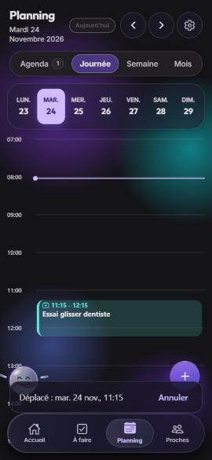
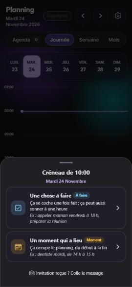
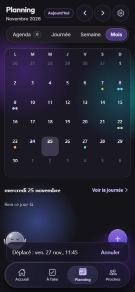
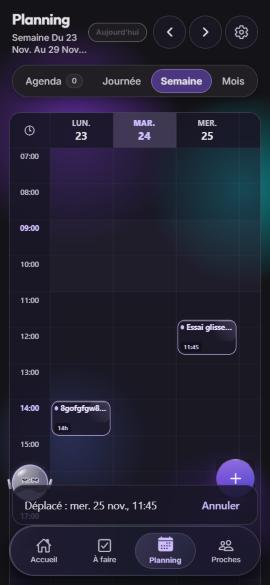

# FICHE OPÉRATOIRE N° 026 — Planning Jour · Semaine · Mois, et glisser-déposer

Projet : **Junix Pulse** · Date : 24 novembre 2026 · Suite de : [FICHE 025](FICHE-025-partager-sans-compte.md) · Étude : [ÉTUDE 001](../etudes/ETUDE-001-clarifier-et-faire-evoluer.md), 12.4 · Chantier n° 8 de la feuille de route (12.10)

---

## 1. Objectif

Le Planning a **quatre vues** : **Agenda** (la liste du jour, gardée), **Journée**, **Semaine** et **Mois**. Dans les trois dernières, on **déplace une carte au doigt** : appui long, elle se soulève, on la glisse, on la lâche. Décisions du 24 novembre 2026 :

| Question | Choix |
|---|---|
| Les vues | **4 vues** : Agenda · Journée · Semaine · Mois (la liste reste la plus lisible d'un coup d'œil) |
| Un rappel qui se répète | on déplace **toute la série**, après la question « Déplacer toutes les répétitions ? » (« chaque lundi » devient « chaque mardi ») |
| Après le lâcher | c'est enregistré tout de suite, et un bandeau **« Déplacé : mer. 25 nov., 11:45 · Annuler »** reste 6 secondes |
| Le Mois | **un point de couleur par chose** (trois au plus, puis « +2 ») ; toucher un jour montre ses choses en dessous ; « Voir la journée » ouvre la vue Journée |

Ce qui bouge, et comment :

| Vue | Ce qu'on déplace | Pas |
|---|---|---|
| Journée | moments et rappels | **quart d'heure** (on lâche à 19:00 ou 19:15, jamais 19:07) |
| Semaine | moments et rappels | quart d'heure, et **un jour** par colonne |
| Mois | moments, rappels et tâches (depuis la liste du jour choisi) | **le jour** (l'heure reste) |

Ce qui ne bouge pas : les rendez-vous de **l'agenda du téléphone** (Junix les lit, ne les change jamais). Les **tâches** n'ont pas d'heure : dans la Journée, elles sont dans la bande **« Sans heure »** en haut ; on change leur jour dans le Mois.

**Avec un lecteur d'écran** (TalkBack), chaque carte a les mêmes gestes en actions : « 15 minutes plus tard », « 15 minutes plus tôt », « Le jour suivant », « Le jour précédent ».

**Pulse** le montre une fois (« Astuce : garde le doigt sur une carte, puis glisse-la… »), avec la règle des astuces de la fiche 024 : une seule astuce par jour.

**Léger, comme demandé dans l'étude** : aucune bibliothèque ajoutée. Les gestes (`react-native-gesture-handler`) et les animations (`react-native-reanimated`) étaient déjà là ; le mouvement tourne hors du fil principal et seule la carte qui bouge est redessinée.

**Pour que rien ne casse demain** :

- toutes les règles (le quart d'heure, la durée gardée, la série qui suit, la grille du mois, la place des cartes côte à côte) sont **pures et testées** (`planning-move-rules.ts`) ;
- un seul composant fait glisser (`DraggableBlock`), réutilisé dans les trois vues ;
- l'enregistrement passe par les **mêmes cas d'usage que les formulaires** : les notifications suivent ;
- aucune migration : rien de nouveau n'est stocké.



*Figure 26-1 — Capture réelle (web, 360 px). Vue Journée après un glisser : le moment est passé de 10:00 à 11:15–12:15 ; en bas, le bandeau « Déplacé · Annuler ».*

## 2. État de départ

| À vérifier | Comment | Résultat attendu |
|---|---|---|
| La fiche 025 est enregistrée | `git log --oneline -3` | on voit `feat(share): …` |
| Tout passe | `npx jest` | `Tests: 2070 passed` (ou plus) |

## 3. Matériel

Rien de nouveau : Node, le projet installé (`npm install` déjà fait), un navigateur pour la version web. Pour le vérifier : `node -v` affiche une version (22 ou plus).

## 4. Hypothèses

- La semaine commence le **lundi** (comme le bandeau de la semaine existant).
- Un rappel répétitif montre **sa prochaine fois** dans le Planning (c'est ce qui est enregistré) ; c'est elle qu'on déplace, et la règle de répétition suit le jour.
- « Annuler » remet l'ancienne heure et l'**ancienne règle elle-même** (une règle remplacée reste dans les données, comme pour les formulaires).
- La vue Journée montre 07:00–22:00 au moins, plus large si une carte est plus tôt ou plus tard.

## 5. Carte de l'intervention

| Fichier | Action |
|---|---|
| `src/domain/rules/planning-move-rules.ts` (+ test) | **nouveau** : quart d'heure, déplacement, série, grille du mois, points, cartes côte à côte |
| `src/use-cases/planning-move-use-cases.ts` | **nouveau** : déplacer un moment, un rappel, une tâche, et rendre de quoi annuler |
| `src/features/planning/use-planning-move.ts` | **nouveau** : la question pour une série, le bandeau « Annuler » |
| `src/components/planning/DraggableBlock.tsx` | **nouveau** : la carte qui se soulève et suit le doigt |
| `src/components/planning/DayTimeGrid.tsx` | **nouveau** : la vue Journée à l'échelle |
| `src/components/planning/MonthView.tsx` | **nouveau** : la vue Mois |
| `src/components/calendar/CalendarTimetable.tsx` | **supprimé** : l'ancienne vue Journée, remplacée |
| `src/components/schedule/WeeklyTimetableGrid.tsx` | modifié : moments et rappels glissables |
| `src/app/(tabs)/calendar.tsx` | modifié : 4 vues, flèches par mois, chargement du mois, branchements |
| `src/domain/rules/gesture-tip-rules.ts`, catalogues de Pulse FR/EN | l'astuce `planDrag` |
| `src/i18n/messages-rest-fr.ts`, `-en.ts` | les textes `planning.*` |

## 6. Sauvegarde

Avant de toucher : `git status` doit montrer un arbre propre (hors `docs/motion/`). Si ce n'est pas le cas, enregistrer d'abord son travail (`git commit`). Pour revenir en arrière, voir la section 10.

## 7. Pas à pas

Chaque étape donne le code exact. L'étape 9 applique **toute la fiche d'un coup** avec un outil qui lit ces blocs : on peut donc lire les étapes 1 à 8 pour comprendre, puis faire l'étape 9.

### Étape 1 — Les règles du Planning

**Où** : VS Code > dossier `src/domain/rules` > clic droit > Nouveau fichier > `planning-move-rules.ts`.

**Pourquoi** : tout ce qui se calcule (où tombe une carte, comment la série suit, quels jours montre un mois) est ici, sans écran : on peut le tester seul.

<!-- bloc: rules -->

```ts
/**
 * The Planning: Day · Week · Month and moving a card with the finger (study 001, 12.4; sheet 026).
 * Pure rules: where a card lands, how a repeat follows it, the month grid and its dots,
 * and how the cards of a day share the width. The screens draw, these rules decide.
 */
import type { RecurrenceRule } from '../entities';

/** A card lands on a quarter of an hour: 19:00 or 19:15, never 19:07. */
export const SNAP_MINUTES = 15;

/** The height of one hour in the Day view, in points (the Week view keeps its own 48). */
export const DAY_HOUR_HEIGHT = 64;

/** The Day view shows at least 07:00 to 22:00, more when something is earlier or later. */
export const DAY_FIRST_HOUR = 7;
export const DAY_LAST_HOUR = 22;

/** The dots of a day in the Month view; beyond, "+2". */
export const MONTH_DOTS_MAX = 3;

/** The nearest quarter of an hour (0 stays 0, -7 becomes -0 and is given as 0). */
export function snapMinutes(minutes: number): number {
  const snapped = Math.round(minutes / SNAP_MINUTES) * SNAP_MINUTES;
  return snapped === 0 ? 0 : snapped;
}

/** How many minutes a vertical move of the finger means, already on a quarter of an hour. */
export function minutesForOffset(offsetY: number, hourHeight: number): number {
  if (hourHeight <= 0) return 0;
  return snapMinutes((offsetY / hourHeight) * 60);
}

/** How many columns (days) a horizontal move means: half a column is enough to change day. */
export function columnsForOffset(offsetX: number, columnWidth: number): number {
  if (columnWidth <= 0) return 0;
  const columns = Math.round(offsetX / columnWidth);
  return columns === 0 ? 0 : columns;
}

/** Keeps a column inside the week (0 to 6, or the number of columns given). */
export function clampColumn(column: number, count = 7): number {
  return Math.min(count - 1, Math.max(0, column));
}

/** A start moved by minutes and days; the time of day is put back on a quarter of an hour. */
export function movedStart(start: Date, minutes: number, days: number): Date {
  const next = new Date(start.getTime());
  next.setDate(next.getDate() + days);
  next.setMinutes(next.getMinutes() + minutes);
  const sinceMidnight = next.getHours() * 60 + next.getMinutes();
  const snapped = snapMinutes(sinceMidnight);
  next.setHours(0, 0, 0, 0);
  next.setMinutes(snapped);
  return next;
}

/** A moment moved: the start moves, the length stays the same. */
export function movedRange(start: Date, end: Date, minutes: number, days: number): { start: Date; end: Date } {
  const nextStart = movedStart(start, minutes, days);
  const length = Math.max(0, end.getTime() - start.getTime());
  return { start: nextStart, end: new Date(nextStart.getTime() + length) };
}

/** True when nothing changes (dropped where it was). */
export function isSamePlace(before: Date, after: Date): boolean {
  return before.getTime() === after.getTime();
}

/** The day of a date, as YYYY-MM-DD on the phone's clock. */
export function dayKey(date: Date): string {
  const pad = (value: number) => String(value).padStart(2, '0');
  return `${date.getFullYear()}-${pad(date.getMonth() + 1)}-${pad(date.getDate())}`;
}

/** A YYYY-MM-DD day as a local date at midnight. */
export function dayFromKey(key: string): Date {
  const [year, month, day] = key.split('-').map(Number);
  return new Date(year, (month || 1) - 1, day || 1);
}

/** The number of whole days from one day to another (the clock change does not count). */
export function daysBetween(from: Date, to: Date): number {
  const a = Date.UTC(from.getFullYear(), from.getMonth(), from.getDate());
  const b = Date.UTC(to.getFullYear(), to.getMonth(), to.getDate());
  return Math.round((b - a) / 86400000);
}

/**
 * A repeat follows the card that moves to another day (the whole series, study 12.4):
 * "every Monday" moved to Tuesday becomes "every Tuesday"; "the 5th of each month" moved to
 * the 8th becomes "the 8th". Null when the repeat does not need to change (same day, daily).
 */
export function shiftedRecurrence(
  saved: RecurrenceRule | Omit<RecurrenceRule, 'id'>,
  from: Date,
  to: Date
): Omit<RecurrenceRule, 'id'> | null {
  // The new repeat is a new rule: it never takes the id of the old one
  const { id: _oldId, ...rule } = saved as RecurrenceRule;
  const days = daysBetween(from, to);
  if (days === 0) return null;
  if (rule.type === 'WEEKLY' && rule.daysOfWeek && rule.daysOfWeek.length > 0) {
    const shift = ((days % 7) + 7) % 7;
    if (shift === 0) return null;
    const moved = rule.daysOfWeek.map(day => (day + shift) % 7).sort((a, b) => a - b);
    return { ...rule, daysOfWeek: moved };
  }
  if (rule.type === 'MONTHLY' && rule.dayOfMonth !== undefined && !rule.weekPosition) {
    if (rule.dayOfMonth === to.getDate()) return null;
    return { ...rule, dayOfMonth: to.getDate() };
  }
  return null;
}

/** The 42 days (6 weeks, Monday first) that show a month, with the days of the months around. */
export function monthGrid(anyDayOfMonth: Date): Date[] {
  const first = new Date(anyDayOfMonth.getFullYear(), anyDayOfMonth.getMonth(), 1);
  const back = (first.getDay() + 6) % 7; // Monday = 0
  const start = new Date(first.getFullYear(), first.getMonth(), 1 - back);
  return Array.from({ length: 42 }, (_, i) => new Date(start.getFullYear(), start.getMonth(), start.getDate() + i));
}

/** The first and last day shown by a month grid, as YYYY-MM-DD. */
export function monthGridRange(anyDayOfMonth: Date): { from: string; to: string } {
  const days = monthGrid(anyDayOfMonth);
  return { from: dayKey(days[0]), to: dayKey(days[days.length - 1]) };
}

/** The dots of a day: the first colours, and how many more. */
export function dayDots(colors: readonly string[], max = MONTH_DOTS_MAX): { dots: string[]; more: number } {
  return { dots: colors.slice(0, max), more: Math.max(0, colors.length - max) };
}

/** The hours a day shows: 07:00 to 22:00 at least, more for an earlier or a later card. */
export function dayHours(items: readonly { startMin: number; endMin: number }[]): { first: number; last: number } {
  let first = DAY_FIRST_HOUR;
  let last = DAY_LAST_HOUR;
  for (const item of items) {
    first = Math.min(first, Math.floor(item.startMin / 60));
    last = Math.max(last, Math.min(24, Math.ceil(item.endMin / 60)));
  }
  return { first: Math.max(0, first), last };
}

export interface DayLayoutItem {
  id: string;
  /** Minutes since midnight. */
  startMin: number;
  endMin: number;
}

export interface DayLayoutBox {
  id: string;
  top: number;
  height: number;
  /** Its column among the cards at the same time, and how many columns there are. */
  column: number;
  columns: number;
}

/**
 * Where each card of a day goes: its height follows its length (at least a quarter of an hour),
 * and cards at the same time share the width side by side (at most 3 columns on a phone).
 */
export function layoutDay(items: readonly DayLayoutItem[], firstHour: number, hourHeight: number): DayLayoutBox[] {
  const sorted = [...items]
    .map(item => ({ ...item, endMin: Math.max(item.endMin, item.startMin + SNAP_MINUTES) }))
    .sort((a, b) => a.startMin - b.startMin || b.endMin - a.endMin);
  const boxes: DayLayoutBox[] = [];
  let group: { item: (typeof sorted)[number]; column: number }[] = [];
  let groupEnd = -1;
  let columnEnds: number[] = [];

  const close = () => {
    const columns = Math.min(3, Math.max(1, columnEnds.length));
    for (const { item, column } of group) {
      boxes.push({
        id: item.id,
        top: ((item.startMin - firstHour * 60) / 60) * hourHeight,
        height: Math.max(28, ((item.endMin - item.startMin) / 60) * hourHeight - 2),
        column: Math.min(column, columns - 1),
        columns,
      });
    }
    group = [];
    columnEnds = [];
  };

  for (const item of sorted) {
    if (group.length > 0 && item.startMin >= groupEnd) close();
    let column = columnEnds.findIndex(end => end <= item.startMin);
    if (column === -1) {
      column = columnEnds.length;
      columnEnds.push(item.endMin);
    } else {
      columnEnds[column] = item.endMin;
    }
    group.push({ item, column });
    groupEnd = group.length === 1 ? item.endMin : Math.max(groupEnd, item.endMin);
  }
  if (group.length > 0) close();
  return boxes;
}

/** Minutes since midnight of a date. */
export function minutesOfDay(date: Date): number {
  return date.getHours() * 60 + date.getMinutes();
}
```

| Morceau | Ce qu'il fait |
|---|---|
| `snapMinutes` | arrondit au quart d'heure le plus proche (7 → 0, 8 → 15) |
| `minutesForOffset` | transforme les points parcourus par le doigt en minutes (une heure = `hourHeight` points) |
| `movedRange` | déplace le début et garde la durée |
| `shiftedRecurrence` | décale « chaque lundi » vers « chaque mardi », ou « le 5 » vers « le 8 » ; ne garde **jamais** l'identifiant de l'ancienne règle |
| `monthGrid` | les 42 jours (6 semaines, lundi d'abord) qui montrent un mois |
| `layoutDay` | met côte à côte les cartes à la même heure (3 colonnes au plus) |

Puis le test, dans `src/domain/rules/__tests__/planning-move-rules.test.ts` (nouveau) :

<!-- bloc: rules-test -->

```ts
import {
  clampColumn,
  columnsForOffset,
  dayDots,
  dayFromKey,
  dayHours,
  dayKey,
  daysBetween,
  layoutDay,
  minutesForOffset,
  monthGrid,
  monthGridRange,
  movedRange,
  movedStart,
  shiftedRecurrence,
  snapMinutes,
} from '../planning-move-rules';

describe('planning-move-rules (sheet 026)', () => {
  it('lands on a quarter of an hour', () => {
    expect(snapMinutes(7)).toBe(0);
    expect(snapMinutes(8)).toBe(15);
    expect(snapMinutes(-7)).toBe(0);
    expect(snapMinutes(-8)).toBe(-15);
    expect(snapMinutes(52)).toBe(45);
  });

  it('turns a finger move into minutes and columns', () => {
    expect(minutesForOffset(64, 64)).toBe(60);
    expect(minutesForOffset(20, 64)).toBe(15);
    expect(minutesForOffset(-33, 64)).toBe(-30);
    expect(minutesForOffset(10, 0)).toBe(0);
    expect(columnsForOffset(40, 84)).toBe(0);
    expect(columnsForOffset(43, 84)).toBe(1);
    expect(columnsForOffset(-170, 84)).toBe(-2);
    expect(clampColumn(9)).toBe(6);
    expect(clampColumn(-1)).toBe(0);
  });

  it('moves a start and keeps the length of a moment', () => {
    const start = new Date(2026, 10, 24, 18, 50);
    expect(movedStart(start, 15, 0)).toEqual(new Date(2026, 10, 24, 19, 0));
    expect(movedStart(new Date(2026, 10, 24, 19, 0), 15, 2)).toEqual(new Date(2026, 10, 26, 19, 15));
    const range = movedRange(new Date(2026, 10, 24, 9, 0), new Date(2026, 10, 24, 10, 30), 60, -1);
    expect(range.start).toEqual(new Date(2026, 10, 23, 10, 0));
    expect(range.end).toEqual(new Date(2026, 10, 23, 11, 30));
  });

  it('reads and writes days', () => {
    expect(dayKey(new Date(2026, 0, 5, 23, 59))).toBe('2026-01-05');
    expect(dayFromKey('2026-01-05')).toEqual(new Date(2026, 0, 5));
    expect(daysBetween(new Date(2026, 2, 28, 22), new Date(2026, 2, 30, 1))).toBe(2);
  });

  it('makes a repeat follow its card to another day', () => {
    const monday = new Date(2026, 10, 23, 9);
    const tuesday = new Date(2026, 10, 24, 9);
    expect(shiftedRecurrence({ type: 'WEEKLY', interval: 1, daysOfWeek: [1] }, monday, tuesday)).toEqual({
      type: 'WEEKLY',
      interval: 1,
      daysOfWeek: [2],
    });
    expect(shiftedRecurrence({ type: 'WEEKLY', interval: 1, daysOfWeek: [1, 6] }, monday, tuesday)?.daysOfWeek).toEqual([0, 2]);
    expect(shiftedRecurrence({ type: 'WEEKLY', interval: 1, daysOfWeek: [1] }, monday, new Date(2026, 10, 30))).toBeNull();
    expect(shiftedRecurrence({ type: 'MONTHLY', interval: 1, dayOfMonth: 23 }, monday, tuesday)).toEqual({
      type: 'MONTHLY',
      interval: 1,
      dayOfMonth: 24,
    });
    expect(shiftedRecurrence({ type: 'DAILY', interval: 1 }, monday, tuesday)).toBeNull();
    // A new rule never keeps the id of the old one (it would replace the new id when saved)
    expect(shiftedRecurrence({ id: 'old', type: 'WEEKLY', interval: 1, daysOfWeek: [1] }, monday, tuesday)).not.toHaveProperty('id');
    expect(shiftedRecurrence({ type: 'WEEKLY', interval: 1, daysOfWeek: [1] }, monday, monday)).toBeNull();
  });

  it('draws a month on six weeks, Monday first', () => {
    const days = monthGrid(new Date(2026, 10, 24)); // November 2026 starts on a Sunday
    expect(days).toHaveLength(42);
    expect(days[0]).toEqual(new Date(2026, 9, 26));
    expect(days[6]).toEqual(new Date(2026, 10, 1));
    expect(monthGridRange(new Date(2026, 10, 1))).toEqual({ from: '2026-10-26', to: '2026-12-06' });
  });

  it('gives three dots and the rest as a number', () => {
    expect(dayDots(['a', 'b', 'c', 'd', 'e'])).toEqual({ dots: ['a', 'b', 'c'], more: 2 });
    expect(dayDots(['a'])).toEqual({ dots: ['a'], more: 0 });
  });

  it('widens the day for an early or a late card', () => {
    expect(dayHours([])).toEqual({ first: 7, last: 22 });
    expect(dayHours([{ startMin: 6 * 60 + 30, endMin: 23 * 60 + 10 }])).toEqual({ first: 6, last: 24 });
  });

  it('places the cards of a day side by side when they meet', () => {
    const boxes = layoutDay(
      [
        { id: 'a', startMin: 9 * 60, endMin: 10 * 60 },
        { id: 'b', startMin: 9 * 60 + 30, endMin: 11 * 60 },
        { id: 'c', startMin: 12 * 60, endMin: 12 * 60 },
      ],
      7,
      64
    );
    const byId = Object.fromEntries(boxes.map(box => [box.id, box]));
    expect(byId.a).toMatchObject({ top: 128, column: 0, columns: 2 });
    expect(byId.b).toMatchObject({ column: 1, columns: 2 });
    expect(byId.c).toMatchObject({ top: 320, column: 0, columns: 1, height: 28 });
  });
});
```

**Contrôle** : `npx jest src/domain/rules/__tests__/planning-move-rules.test.ts` affiche `Tests: 9 passed`.

**Si ça rate** : « Cannot find module '../planning-move-rules' » : le fichier n'est pas dans `src/domain/rules` ou son nom a une faute.

### Étape 2 — Déplacer, et pouvoir annuler

**Où** : `src/use-cases/planning-move-use-cases.ts` (nouveau).

**Pourquoi** : chaque déplacement passe par les cas d'usage des formulaires (`updateEvent`, `updateReminder`), donc les notifications sont recalculées ; chacun rend une fonction `undo` pour le bouton « Annuler ».

<!-- bloc: use-cases -->

```ts
/**
 * Moving a card in the Planning (study 001, 12.4; sheet 026). Each move is saved at once and
 * gives back a way to undo it, for the "Annuler" of the banner. The notifications follow, through
 * the same use-cases as the forms. The phone's own calendar is never changed.
 */
import type { Event, Reminder, RecurrenceRule, Task } from '@/domain/entities';
import { dayKey, movedRange, movedStart, shiftedRecurrence } from '@/domain/rules/planning-move-rules';
import { ReminderRepository } from '@/repositories/reminder-repository';
import { TaskRepository } from '@/repositories/task-repository';

import { EventUseCases } from './event-use-cases';
import { updateReminder } from './reminder-use-cases';

export type Undo = () => Promise<void>;

/** A moment moves: the start by minutes and days, the length stays. */
export async function moveEvent(event: Event, minutes: number, days: number): Promise<{ undo: Undo; start: Date } | null> {
  const start = new Date(event.startAt);
  const end = new Date(event.endAt);
  const next = movedRange(start, end, minutes, days);
  if (next.start.getTime() === start.getTime()) return null;
  await EventUseCases.updateEvent({ id: event.id, startAt: next.start, endAt: next.end });
  return {
    start: next.start,
    undo: () => EventUseCases.updateEvent({ id: event.id, startAt: start, endAt: end }),
  };
}

/** The repeat of a reminder, or null when it has none. */
export async function repeatOf(reminder: Reminder): Promise<RecurrenceRule | null> {
  if (!reminder.recurrenceRuleId) return null;
  return ReminderRepository.findRecurrenceRule(reminder.recurrenceRuleId);
}

/**
 * A reminder moves; a repeating one moves with its whole series (the caller asked first):
 * "every Monday" dropped on a Tuesday becomes "every Tuesday".
 */
export async function moveReminder(
  reminder: Reminder,
  minutes: number,
  days: number,
  repeat: RecurrenceRule | null
): Promise<{ undo: Undo; start: Date } | null> {
  const before = new Date(reminder.scheduledAt);
  const after = movedStart(before, minutes, days);
  if (after.getTime() === before.getTime()) return null;
  const newRule = repeat ? shiftedRecurrence(repeat, before, after) : null;
  await updateReminder({ id: reminder.id, scheduledAt: after, ...(newRule ? { recurrenceRule: newRule } : {}) });
  return {
    start: after,
    undo: async () => {
      // Back to the old rule itself: it stays in the data when a new one is made
      if (newRule && repeat) await ReminderRepository.update({ id: reminder.id, recurrenceRuleId: repeat.id, updatedAt: new Date().toISOString() });
      await updateReminder({ id: reminder.id, scheduledAt: before });
    },
  };
}

/** A task changes day (it has no time); its state comes back too on undo. */
export async function moveTask(task: Task, toDay: Date): Promise<{ undo: Undo; start: Date } | null> {
  const day = dayKey(toDay);
  if (task.scheduledDate === day) return null;
  const now = () => new Date().toISOString();
  await TaskRepository.update({ id: task.id, scheduledDate: day, updatedAt: now() });
  return {
    start: toDay,
    undo: () => TaskRepository.update({ id: task.id, scheduledDate: task.scheduledDate ?? null, status: task.status, updatedAt: now() }),
  };
}
```

Puis `src/features/planning/use-planning-move.ts` (nouveau) : la question pour une série et le bandeau.

<!-- bloc: move-hook -->

```ts
/**
 * What happens when a card is let go in the Planning (study 001, 12.4; sheet 026):
 * a repeating reminder asks first ("Déplacer toutes les répétitions ?"), then the move is saved
 * at once and a banner "Déplacé à 19:15 · Annuler" stays a few seconds. Nothing is lost.
 */
import { format } from 'date-fns';
import { useCallback } from 'react';

import { GlassAlert } from '@/components/feedback/GlassAlert';
import type { Event, Reminder, Task } from '@/domain/entities';
import { useDateLocale, useT } from '@/i18n';
import { useAppStore } from '@/store/app-store';
import { moveEvent, moveReminder, moveTask, repeatOf, type Undo } from '@/use-cases/planning-move-use-cases';

/** How long the banner with "Annuler" stays. */
export const MOVE_UNDO_MS = 6000;

export function usePlanningMove(reload: () => void | Promise<void>) {
  const t = useT();
  const dateLocale = useDateLocale();
  const { showSnackbar } = useAppStore();

  const done = useCallback(
    async (result: { undo: Undo; start: Date } | null, withTime: boolean) => {
      if (!result) return;
      await reload();
      const when = withTime
        ? format(result.start, 'EEE d MMM, HH:mm', { locale: dateLocale })
        : format(result.start, 'EEEE d MMMM', { locale: dateLocale });
      showSnackbar(t('planning.moved', { when }), {
        actionLabel: t('planning.undo'),
        durationMs: MOVE_UNDO_MS,
        onAction: () => {
          void result
            .undo()
            .then(() => reload())
            .catch(() => showSnackbar(t('common.genericError')));
        },
      });
    },
    [reload, showSnackbar, t, dateLocale]
  );

  const failed = useCallback(() => {
    showSnackbar(t('common.genericError'));
    void reload();
  }, [reload, showSnackbar, t]);

  const moveEventBy = useCallback(
    (event: Event, minutes: number, days: number) => {
      moveEvent(event, minutes, days).then(result => done(result, true), failed);
    },
    [done, failed]
  );

  const moveReminderBy = useCallback(
    (reminder: Reminder, minutes: number, days: number) => {
      void repeatOf(reminder)
        .then(repeat => {
          const go = () => moveReminder(reminder, minutes, days, repeat).then(result => done(result, true), failed);
          if (!repeat) return go();
          GlassAlert.alert(t('planning.seriesTitle'), t('planning.seriesBody'), [
            { text: t('common.cancel'), style: 'cancel' },
            { text: t('planning.seriesMove'), onPress: () => void go() },
          ]);
        })
        .catch(failed);
    },
    [done, failed, t]
  );

  const moveTaskTo = useCallback(
    (task: Task, day: Date) => {
      moveTask(task, day).then(result => done(result, false), failed);
    },
    [done, failed]
  );

  return { moveEventBy, moveReminderBy, moveTaskTo };
}
```

**Contrôle** : `npx tsc --noEmit` ne signale rien sur ces deux fichiers.

**Si ça rate** : « Property 'findRecurrenceRule' does not exist » : le dépôt n'est pas à jour (fiche 022 nécessaire).

### Étape 3 — La carte qui glisse

**Où** : `src/components/planning/DraggableBlock.tsx` (nouveau ; créer le dossier `planning`).

**Pourquoi** : un seul composant pour les trois vues. Un toucher ouvre la carte ; un appui long de 350 ms la soulève (un peu plus grande), elle suit le doigt **par quarts d'heure** : ce qu'on voit est l'endroit où elle tombera.

<!-- bloc: draggable -->

```tsx
/**
 * A card of the Planning that moves with the finger (study 001, 12.4; sheet 026).
 * A touch opens it; a long press lifts it, then it follows the finger by quarters of an hour
 * (and by days when the columns are given) and is put down where the finger leaves it.
 * Only this card moves and is drawn again; the movement runs off the main thread.
 * With a screen reader, the same moves are actions of the card ("15 minutes plus tard"…).
 */
import React, { useCallback } from 'react';
import type { StyleProp, ViewStyle } from 'react-native';
import { GestureDetector, useExclusiveGestures, usePanGesture, useTapGesture } from 'react-native-gesture-handler';
import Animated, { runOnJS, useAnimatedStyle, useSharedValue, withTiming } from 'react-native-reanimated';

import { useT } from '@/i18n';

/** How long the finger stays before the card lifts. */
export const LIFT_DELAY_MS = 350;

export interface DropPoint {
  /** How far the finger went, in points. */
  dx: number;
  dy: number;
  /** Where the finger was let go, on the screen. */
  x: number;
  y: number;
}

export interface DraggableBlockProps {
  children: React.ReactNode;
  style?: StyleProp<ViewStyle>;
  onPress: () => void;
  /** Where the finger left the card; not called for a card that cannot move. */
  onDrop?: (drop: DropPoint) => void;
  /** The same moves for a screen reader: minutes and days. */
  onMoveBy?: (minutes: number, days: number) => void;
  /** The card follows the finger by steps of this height (a quarter of an hour), 0 for free. */
  stepY?: number;
  /** And by columns of this width (a day), 0 for free. */
  stepX?: number;
  /** False for a card that cannot move (the phone's own calendar). */
  movable?: boolean;
  accessibilityLabel: string;
  /** Lets the parent know a card is lifted (for the scroll). */
  onLift?: (lifted: boolean) => void;
}

export function DraggableBlock({
  children,
  style,
  onPress,
  onDrop,
  onMoveBy,
  stepY = 0,
  stepX = 0,
  movable = true,
  accessibilityLabel,
  onLift,
}: DraggableBlockProps) {
  const t = useT();
  const offsetX = useSharedValue(0);
  const offsetY = useSharedValue(0);
  const lifted = useSharedValue(0);

  const drop = useCallback((point: DropPoint) => onDrop?.(point), [onDrop]);
  const lift = useCallback((value: boolean) => onLift?.(value), [onLift]);

  const pan = usePanGesture({
    enabled: movable && !!onDrop,
    activateAfterLongPress: LIFT_DELAY_MS,
    onActivate: () => {
      'worklet';
      lifted.value = withTiming(1, { duration: 120 });
      runOnJS(lift)(true);
    },
    onUpdate: event => {
      'worklet';
      // The card jumps from quarter to quarter: what you see is where it will land
      offsetY.value = stepY > 0 ? Math.round(event.translationY / stepY) * stepY : event.translationY;
      offsetX.value = stepX > 0 ? Math.round(event.translationX / stepX) * stepX : event.translationX;
    },
    onDeactivate: event => {
      'worklet';
      if (!event.canceled) {
        runOnJS(drop)({ dx: event.translationX, dy: event.translationY, x: event.absoluteX, y: event.absoluteY });
      }
    },
    onFinalize: () => {
      'worklet';
      offsetX.value = withTiming(0, { duration: 160 });
      offsetY.value = withTiming(0, { duration: 160 });
      lifted.value = withTiming(0, { duration: 160 });
      runOnJS(lift)(false);
    },
  });

  const tap = useTapGesture({
    onActivate: () => {
      'worklet';
      runOnJS(onPress)();
    },
  });

  // The long press wins; a short touch opens the card
  const gesture = useExclusiveGestures(pan, tap);

  const animated = useAnimatedStyle(() => ({
    transform: [
      { translateX: offsetX.value },
      { translateY: offsetY.value },
      { scale: 1 + lifted.value * 0.04 },
    ],
    opacity: 1 - lifted.value * 0.08,
    zIndex: lifted.value > 0 ? 50 : 1,
    elevation: lifted.value > 0 ? 8 : 0,
  }));

  const actions = movable && onMoveBy
    ? [
        { name: 'activate' },
        { name: 'later', label: t('planning.a11y.later') },
        { name: 'earlier', label: t('planning.a11y.earlier') },
        { name: 'nextDay', label: t('planning.a11y.nextDay') },
        { name: 'previousDay', label: t('planning.a11y.previousDay') },
      ]
    : [{ name: 'activate' }];

  return (
    <GestureDetector gesture={gesture}>
      <Animated.View
        style={[style, animated]}
        accessible
        accessibilityRole="button"
        accessibilityLabel={accessibilityLabel}
        accessibilityHint={movable && onDrop ? t('planning.a11y.hint') : undefined}
        accessibilityActions={actions}
        onAccessibilityAction={event => {
          const name = event.nativeEvent.actionName;
          if (name === 'activate') onPress();
          else if (name === 'later') onMoveBy?.(15, 0);
          else if (name === 'earlier') onMoveBy?.(-15, 0);
          else if (name === 'nextDay') onMoveBy?.(0, 1);
          else if (name === 'previousDay') onMoveBy?.(0, -1);
        }}
      >
        {children}
      </Animated.View>
    </GestureDetector>
  );
}
```

| Morceau | Ce qu'il fait |
|---|---|
| `usePanGesture({ activateAfterLongPress })` | le glisser ne démarre qu'après l'appui long, sinon la page défile normalement |
| `useTapGesture` | le toucher court qui ouvre la carte |
| `useExclusiveGestures(pan, tap)` | l'appui long gagne ; s'il n'a pas lieu, c'est un toucher |
| `'worklet'` | ce code tourne sur le fil des animations, pas sur celui de l'appli |
| `runOnJS(...)` | revient au fil de l'appli pour enregistrer |
| `accessibilityActions` | les mêmes déplacements pour TalkBack |

**Contrôle** : `npx tsc --noEmit` sans erreur.

### Étape 4 — La vue Journée, à l'échelle

**Où** : `src/components/planning/DayTimeGrid.tsx` (nouveau).

**Pourquoi** : l'ancienne vue Journée empilait les cartes par heure, sans échelle : impossible d'y viser 19:15. Ici, une heure fait toujours 64 points ; une carte est à sa vraie place et a sa vraie hauteur.

<!-- bloc: day-grid -->

```tsx
/**
 * The Day view of the Planning (study 001, 12.4; sheet 026): a grid of hours at a fixed scale,
 * the things without a time in a band at the top, and each card at its exact time and length.
 * A long press on a moment or a reminder lifts it; it moves by quarters of an hour.
 * Touching a free place offers to add something at that hour.
 */
import { Ionicons } from '@expo/vector-icons';
import { format, isToday } from 'date-fns';
import { memo, useMemo, useState } from 'react';
import { Pressable, ScrollView, StyleSheet, Text, TouchableOpacity, View } from 'react-native';

import { TAB_BAR_TOTAL_HEIGHT, Radius, Spacing, Typography } from '@/constants/theme';
import type { ThemePalette } from '@/constants/palettes';
import { momentKindColor, momentKindLook } from '@/constants/moment-kinds';
import type { Event, Reminder, Task } from '@/domain/entities';
import type { DeviceEvent } from '@/domain/rules/device-calendar-rules';
import { DAY_HOUR_HEIGHT, dayHours, layoutDay, minutesForOffset, minutesOfDay, SNAP_MINUTES } from '@/domain/rules/planning-move-rules';
import { useTheme } from '@/hooks/use-theme';
import { useThemedStyles } from '@/hooks/use-themed-styles';
import { useT } from '@/i18n';

import { DraggableBlock } from './DraggableBlock';

const HOURS_WIDTH = 48;

export interface DayTimeGridProps {
  date: Date;
  events: Event[];
  reminders: Reminder[];
  tasks: Task[];
  deviceEvents: DeviceEvent[];
  onOpenEvent: (event: Event) => void;
  onOpenReminder: (reminder: Reminder) => void;
  onOpenTask: (task: Task) => void;
  onMoveEvent: (event: Event, minutes: number, days: number) => void;
  onMoveReminder: (reminder: Reminder, minutes: number, days: number) => void;
  onAddAt: (hour: number) => void;
  onDeviceTouched: (title: string) => void;
}

type DayCard =
  | { key: string; kind: 'event'; event: Event; startMin: number; endMin: number }
  | { key: string; kind: 'reminder'; reminder: Reminder; startMin: number; endMin: number }
  | { key: string; kind: 'device'; device: DeviceEvent; startMin: number; endMin: number };

/** Minutes since the start of the day shown, kept inside the day for a card that starts or ends on another. */
function minutesWithin(date: Date, day: Date): number {
  const startOfDay = new Date(day.getFullYear(), day.getMonth(), day.getDate());
  const diff = Math.round((date.getTime() - startOfDay.getTime()) / 60000);
  return Math.min(24 * 60, Math.max(0, diff));
}

export const DayTimeGrid = memo(function DayTimeGrid({
  date,
  events,
  reminders,
  tasks,
  deviceEvents,
  onOpenEvent,
  onOpenReminder,
  onOpenTask,
  onMoveEvent,
  onMoveReminder,
  onAddAt,
  onDeviceTouched,
}: DayTimeGridProps) {
  const t = useT();
  const { theme } = useTheme();
  const styles = useThemedStyles(makeDayGridStyles);
  const [width, setWidth] = useState(0);
  const [lifted, setLifted] = useState(false);

  const cards = useMemo<DayCard[]>(() => {
    const list: DayCard[] = [];
    for (const event of events) {
      const startMin = minutesWithin(new Date(event.startAt), date);
      list.push({ key: `e-${event.id}`, kind: 'event', event, startMin, endMin: minutesWithin(new Date(event.endAt), date) });
    }
    for (const reminder of reminders) {
      const startMin = minutesOfDay(new Date(reminder.scheduledAt));
      list.push({ key: `r-${reminder.id}`, kind: 'reminder', reminder, startMin, endMin: startMin + 30 });
    }
    for (const device of deviceEvents.filter(d => !d.allDay)) {
      list.push({
        key: `d-${device.id}`,
        kind: 'device',
        device,
        startMin: minutesWithin(device.startAt, date),
        endMin: minutesWithin(device.endAt, date),
      });
    }
    return list;
  }, [events, reminders, deviceEvents, date]);

  const { first, last } = dayHours(cards);
  const hours = Array.from({ length: last - first }, (_, i) => first + i);
  const boxes = useMemo(
    () => new Map(layoutDay(cards.map(c => ({ id: c.key, startMin: c.startMin, endMin: c.endMin })), first, DAY_HOUR_HEIGHT).map(b => [b.id, b])),
    [cards, first]
  );
  const allDay = deviceEvents.filter(d => d.allDay);
  const now = new Date();
  const nowTop = isToday(date) ? ((minutesOfDay(now) - first * 60) / 60) * DAY_HOUR_HEIGHT : null;
  const quarter = (DAY_HOUR_HEIGHT * SNAP_MINUTES) / 60;

  const colorOf = (card: DayCard) =>
    card.kind === 'event'
      ? momentKindColor(theme, card.event.momentKind)
      : card.kind === 'reminder'
        ? card.reminder.priority === 'URGENT' ? theme.error.default : theme.primary.default
        : theme.success.default;

  return (
    <ScrollView
      scrollEnabled={!lifted}
      contentContainerStyle={[styles.content, { paddingBottom: TAB_BAR_TOTAL_HEIGHT + 110 }]}
      showsVerticalScrollIndicator={false}
    >
      {/* Without a time: the tasks of the day and the whole-day events of the phone */}
      {(tasks.length > 0 || allDay.length > 0) && (
        <View style={styles.band}>
          <Text style={styles.bandTitle}>{t('planning.noTime')}</Text>
          <View style={styles.bandRow}>
            {tasks.map(task => (
              <TouchableOpacity
                key={task.id}
                style={[styles.chip, { borderColor: theme.tertiary.default }]}
                onPress={() => onOpenTask(task)}
                accessibilityRole="button"
                accessibilityLabel={task.title}
              >
                <Ionicons name={task.status === 'COMPLETED' ? 'checkmark-circle' : 'ellipse-outline'} size={14} color={theme.tertiary.default} />
                <Text style={styles.chipText} numberOfLines={1}>{task.title}</Text>
              </TouchableOpacity>
            ))}
            {allDay.map(device => (
              <TouchableOpacity
                key={device.id}
                style={[styles.chip, { borderColor: theme.success.default }]}
                onPress={() => onDeviceTouched(device.title)}
                accessibilityRole="button"
                accessibilityLabel={device.title}
              >
                <Ionicons name="phone-portrait-outline" size={14} color={theme.success.default} />
                <Text style={styles.chipText} numberOfLines={1}>{device.title}</Text>
              </TouchableOpacity>
            ))}
          </View>
        </View>
      )}

      <View style={styles.grid}>
        <View style={{ width: HOURS_WIDTH }}>
          {hours.map(hour => (
            <View key={hour} style={{ height: DAY_HOUR_HEIGHT }}>
              <Text style={styles.hourText}>{String(hour).padStart(2, '0')}:00</Text>
            </View>
          ))}
        </View>

        <View
          style={[styles.area, { height: hours.length * DAY_HOUR_HEIGHT }]}
          onLayout={event => setWidth(event.nativeEvent.layout.width)}
        >
          {hours.map((hour, index) => (
            <View key={hour} pointerEvents="none" style={[styles.hourLine, { top: index * DAY_HOUR_HEIGHT }]} />
          ))}

          {/* A free place: add something at that hour */}
          <Pressable
            style={StyleSheet.absoluteFill}
            onPress={event => {
              // The phone gives locationY; a web browser gives offsetY instead
              const native = event.nativeEvent as { locationY?: number; offsetY?: number };
              const y = Number.isFinite(native.locationY) ? Number(native.locationY) : Number(native.offsetY ?? 0);
              onAddAt(Math.min(23, first + Math.max(0, Math.floor(y / DAY_HOUR_HEIGHT))));
            }}
            accessibilityRole="button"
            accessibilityLabel={t('planning.addHere')}
          />

          {nowTop !== null && nowTop >= 0 && (
            <View pointerEvents="none" style={[styles.nowLine, { top: nowTop }]}>
              <View style={styles.nowDot} />
            </View>
          )}

          {width > 0 &&
            cards.map(card => {
              const box = boxes.get(card.key);
              if (!box) return null;
              const columnWidth = (width - 4) / box.columns;
              const color = colorOf(card);
              const title = card.kind === 'event' ? card.event.title : card.kind === 'reminder' ? card.reminder.title : card.device.title;
              const time =
                card.kind === 'event'
                  ? `${format(new Date(card.event.startAt), 'HH:mm')} – ${format(new Date(card.event.endAt), 'HH:mm')}`
                  : card.kind === 'reminder'
                    ? format(new Date(card.reminder.scheduledAt), 'HH:mm')
                    : `${format(card.device.startAt, 'HH:mm')} – ${format(card.device.endAt, 'HH:mm')}`;
              const icon =
                card.kind === 'event'
                  ? momentKindLook(card.event.momentKind).icon
                  : card.kind === 'reminder' ? 'notifications' : 'phone-portrait-outline';
              return (
                <DraggableBlock
                  key={card.key}
                  style={[
                    styles.card,
                    {
                      top: box.top + 1,
                      height: box.height,
                      left: 2 + box.column * columnWidth,
                      width: columnWidth - 3,
                      borderLeftColor: color,
                      backgroundColor: color + (theme.mode === 'light' ? '1F' : '2E'),
                    },
                  ]}
                  stepY={quarter}
                  movable={card.kind !== 'device'}
                  onLift={setLifted}
                  accessibilityLabel={t('planning.cardA11y', { title, time })}
                  onPress={() => {
                    if (card.kind === 'event') onOpenEvent(card.event);
                    else if (card.kind === 'reminder') onOpenReminder(card.reminder);
                    else onDeviceTouched(card.device.title);
                  }}
                  onDrop={drop => {
                    const minutes = minutesForOffset(drop.dy, DAY_HOUR_HEIGHT);
                    if (minutes === 0) return;
                    if (card.kind === 'event') onMoveEvent(card.event, minutes, 0);
                    else if (card.kind === 'reminder') onMoveReminder(card.reminder, minutes, 0);
                  }}
                  onMoveBy={(minutes, days) => {
                    if (card.kind === 'event') onMoveEvent(card.event, minutes, days);
                    else if (card.kind === 'reminder') onMoveReminder(card.reminder, minutes, days);
                  }}
                >
                  <View style={styles.cardHead}>
                    <Ionicons name={icon as keyof typeof Ionicons.glyphMap} size={11} color={color} />
                    <Text style={[styles.cardTime, { color }]} numberOfLines={1}>{time}</Text>
                  </View>
                  <Text style={styles.cardTitle} numberOfLines={box.height > 52 ? 2 : 1}>{title}</Text>
                </DraggableBlock>
              );
            })}
        </View>
      </View>
      <Text style={styles.hint}>{t('planning.dragHint')}</Text>
    </ScrollView>
  );
});

function makeDayGridStyles(theme: ThemePalette) {
  const light = theme.mode === 'light';
  const line = light ? 'rgba(76, 52, 120, 0.12)' : 'rgba(255, 255, 255, 0.08)';
  return StyleSheet.create({
    content: { paddingHorizontal: Spacing.md, paddingTop: Spacing.xs },
    band: {
      backgroundColor: theme.glass.card.backgroundColor,
      borderColor: theme.glass.card.borderColor,
      borderWidth: 1,
      borderRadius: Radius.lg,
      padding: Spacing.sm,
      marginBottom: Spacing.md,
      gap: Spacing.xs,
    },
    bandTitle: { ...Typography.labelMedium, color: theme.onSurface.variant, fontWeight: '700', textTransform: 'uppercase', letterSpacing: 0.5 },
    bandRow: { flexDirection: 'row', flexWrap: 'wrap', gap: Spacing.xs },
    chip: {
      flexDirection: 'row',
      alignItems: 'center',
      gap: 6,
      minHeight: 44,
      maxWidth: '100%',
      paddingHorizontal: Spacing.sm,
      borderRadius: Radius.full,
      borderWidth: 1,
      backgroundColor: theme.glass.control.backgroundColor,
    },
    chipText: { ...Typography.bodySmall, color: theme.onSurface.primary, fontWeight: '600', flexShrink: 1 },
    grid: { flexDirection: 'row' },
    hourText: { ...Typography.labelSmall, color: theme.onSurface.variant, fontVariant: ['tabular-nums'], marginTop: -6 },
    area: { flex: 1, position: 'relative' },
    hourLine: { position: 'absolute', left: 0, right: 0, height: 1, backgroundColor: line },
    nowLine: { position: 'absolute', left: 0, right: 0, height: 2, backgroundColor: theme.primary.default, zIndex: 20 },
    nowDot: { position: 'absolute', left: -4, top: -3, width: 8, height: 8, borderRadius: 4, backgroundColor: theme.primary.default },
    card: {
      position: 'absolute',
      borderRadius: Radius.md,
      borderLeftWidth: 4,
      paddingHorizontal: 6,
      paddingVertical: 3,
      overflow: 'hidden',
    },
    cardHead: { flexDirection: 'row', alignItems: 'center', gap: 4 },
    cardTime: { fontSize: 10, fontWeight: '700', fontVariant: ['tabular-nums'], flexShrink: 1 },
    cardTitle: { ...Typography.bodySmall, color: theme.onSurface.primary, fontWeight: '700' },
    hint: { ...Typography.labelSmall, color: theme.onSurface.variant, textAlign: 'center', marginTop: Spacing.md },
  });
}
```

**À retenir** : sur le téléphone, la position du toucher s'appelle `locationY` ; dans un navigateur, `offsetY`. Le code lit l'une ou l'autre (sinon le web affichait « Créneau de NaN:00 »).



*Figure 26-2 — Capture réelle (web, 360 px). Toucher la ligne de 10:00 ouvre « Créneau de 10:00 ».*

Puis **supprimer** l'ancienne vue : VS Code > `src/components/calendar/CalendarTimetable.tsx` > clic droit > Supprimer. Tout le fichier part (712 lignes, de `/**` à la dernière `}`) ; il n'est plus utilisé nulle part après l'étape 7.

### Étape 5 — La vue Mois

**Où** : `src/components/planning/MonthView.tsx` (nouveau).

**Pourquoi** : six semaines d'un coup d'œil, un point par chose. On glisse une chose de la liste du jour choisi **jusque sur une case** : la case visée est calculée à partir de la position du doigt et de celle de la grille (`measureInWindow`).

<!-- bloc: month-view -->

```tsx
/**
 * The Month view of the Planning (study 001, 12.4; sheet 026): six weeks, Monday first, a dot of
 * colour per thing (three at most, then "+2"). Touching a day shows its things below the grid;
 * "Voir la journée" opens the Day view. A long press on one of them lifts it: let it go on
 * another day of the grid and it moves to that day, at the same time.
 */
import { Ionicons } from '@expo/vector-icons';
import { format, isSameDay, isSameMonth, isToday } from 'date-fns';
import React, { memo, useMemo, useRef, useState } from 'react';
import { ScrollView, StyleSheet, Text, TouchableOpacity, View } from 'react-native';

import { TAB_BAR_TOTAL_HEIGHT, Radius, Spacing, Typography } from '@/constants/theme';
import type { ThemePalette } from '@/constants/palettes';
import { dayDots, dayKey, monthGrid } from '@/domain/rules/planning-move-rules';
import { useTheme } from '@/hooks/use-theme';
import { useThemedStyles } from '@/hooks/use-themed-styles';
import { useDateLocale, useT } from '@/i18n';

import { DraggableBlock, type DropPoint } from './DraggableBlock';

export interface MonthItem {
  key: string;
  kind: 'event' | 'reminder' | 'task' | 'device';
  title: string;
  /** HH:mm, or null for a thing without a time. */
  time: string | null;
  color: string;
  /** Its day, YYYY-MM-DD. */
  day: string;
}

export interface MonthViewProps {
  month: Date;
  selected: Date;
  items: MonthItem[];
  onSelectDay: (day: Date) => void;
  onOpenDay: (day: Date) => void;
  onOpenItem: (item: MonthItem) => void;
  onMoveItem: (item: MonthItem, toDay: Date) => void;
  onDeviceTouched: (title: string) => void;
}

const CELL_HEIGHT = 52;

export const MonthView = memo(function MonthView({
  month,
  selected,
  items,
  onSelectDay,
  onOpenDay,
  onOpenItem,
  onMoveItem,
  onDeviceTouched,
}: MonthViewProps) {
  const t = useT();
  const dateLocale = useDateLocale();
  const { theme } = useTheme();
  const styles = useThemedStyles(makeMonthStyles);
  const gridRef = useRef<React.ComponentRef<typeof View>>(null);
  const [lifted, setLifted] = useState(false);

  const days = useMemo(() => monthGrid(month), [month]);
  const byDay = useMemo(() => {
    const map = new Map<string, MonthItem[]>();
    for (const item of items) map.set(item.day, [...(map.get(item.day) ?? []), item]);
    return map;
  }, [items]);
  const ofSelected = byDay.get(dayKey(selected)) ?? [];
  const weekdayNames = days.slice(0, 7).map(d => format(d, 'EEEEE', { locale: dateLocale }).toUpperCase());

  /** The day under the finger when it lets go, or null outside the grid. */
  const dropOn = (item: MonthItem, drop: DropPoint) => {
    gridRef.current?.measureInWindow((x, y, width, height) => {
      const column = Math.floor(((drop.x - x) / width) * 7);
      const row = Math.floor(((drop.y - y) / height) * 6);
      if (column < 0 || column > 6 || row < 0 || row > 5) return;
      const target = days[row * 7 + column];
      if (dayKey(target) !== item.day) onMoveItem(item, target);
    });
  };

  return (
    <ScrollView
      scrollEnabled={!lifted}
      contentContainerStyle={[styles.content, { paddingBottom: TAB_BAR_TOTAL_HEIGHT + 110 }]}
      showsVerticalScrollIndicator={false}
    >
      <View style={styles.card}>
        <View style={styles.weekRow}>
          {weekdayNames.map((name, index) => (
            <Text key={index} style={styles.weekday}>{name}</Text>
          ))}
        </View>
        <View ref={gridRef} collapsable={false} style={styles.grid}>
          {days.map(day => {
            const key = dayKey(day);
            const things = byDay.get(key) ?? [];
            const { dots, more } = dayDots(things.map(thing => thing.color));
            const inMonth = isSameMonth(day, month);
            const isSelected = isSameDay(day, selected);
            return (
              <TouchableOpacity
                key={key}
                style={[styles.cell, isSelected && styles.cellSelected]}
                onPress={() => (isSelected ? onOpenDay(day) : onSelectDay(day))}
                accessibilityRole="button"
                accessibilityState={{ selected: isSelected }}
                accessibilityLabel={t('planning.monthDayA11y', {
                  day: format(day, 'EEEE d MMMM', { locale: dateLocale }),
                  count: things.length,
                })}
              >
                <Text
                  style={[
                    styles.dayNumber,
                    !inMonth && styles.dayOutside,
                    isToday(day) && styles.dayToday,
                    isSelected && styles.daySelectedText,
                  ]}
                >
                  {format(day, 'd')}
                </Text>
                <View style={styles.dots}>
                  {dots.map((color, index) => (
                    <View key={index} style={[styles.dot, { backgroundColor: color }]} />
                  ))}
                  {more > 0 && <Text style={styles.more}>+{more}</Text>}
                </View>
              </TouchableOpacity>
            );
          })}
        </View>
      </View>

      <View style={styles.dayHeader}>
        <Text style={styles.dayTitle} numberOfLines={1}>
          {format(selected, 'EEEE d MMMM', { locale: dateLocale })}
        </Text>
        <TouchableOpacity
          style={styles.openDay}
          onPress={() => onOpenDay(selected)}
          accessibilityRole="button"
          accessibilityLabel={t('planning.openDay')}
        >
          <Text style={styles.openDayText}>{t('planning.openDay')}</Text>
          <Ionicons name="chevron-forward" size={14} color={theme.primary.default} />
        </TouchableOpacity>
      </View>

      {ofSelected.length === 0 ? (
        <Text style={styles.empty}>{t('planning.monthEmptyDay')}</Text>
      ) : (
        <View style={styles.list}>
          {ofSelected.map(item => (
            <DraggableBlock
              key={item.key}
              style={[styles.item, { borderLeftColor: item.color }]}
              movable={item.kind !== 'device'}
              onLift={setLifted}
              accessibilityLabel={t('planning.cardA11y', { title: item.title, time: item.time ?? t('planning.noTime') })}
              onPress={() => (item.kind === 'device' ? onDeviceTouched(item.title) : onOpenItem(item))}
              onDrop={drop => dropOn(item, drop)}
              onMoveBy={(_minutes, days) => {
                if (days === 0) return;
                const target = new Date(selected.getFullYear(), selected.getMonth(), selected.getDate() + days);
                onMoveItem(item, target);
              }}
            >
              <Text style={[styles.itemTime, { color: item.color }]}>{item.time ?? '—'}</Text>
              <Text style={styles.itemTitle} numberOfLines={1}>{item.title}</Text>
            </DraggableBlock>
          ))}
          <Text style={styles.hint}>{t('planning.monthHint')}</Text>
        </View>
      )}
    </ScrollView>
  );
});

function makeMonthStyles(theme: ThemePalette) {
  return StyleSheet.create({
    content: { paddingHorizontal: Spacing.md, paddingTop: Spacing.xs },
    card: {
      backgroundColor: theme.glass.card.backgroundColor,
      borderColor: theme.glass.card.borderColor,
      borderWidth: 1,
      borderRadius: Radius.lg,
      padding: Spacing.xs,
    },
    weekRow: { flexDirection: 'row' },
    weekday: { flex: 1, textAlign: 'center', ...Typography.labelSmall, color: theme.onSurface.variant, fontWeight: '700', paddingVertical: 4 },
    grid: { flexDirection: 'row', flexWrap: 'wrap' },
    cell: {
      width: `${100 / 7}%`,
      height: CELL_HEIGHT,
      alignItems: 'center',
      paddingTop: 4,
      borderRadius: Radius.md,
    },
    cellSelected: { backgroundColor: theme.glass.controlActive },
    dayNumber: { ...Typography.bodySmall, color: theme.onSurface.primary, fontWeight: '600', fontVariant: ['tabular-nums'] },
    dayOutside: { color: theme.onSurface.disabled },
    dayToday: { color: theme.primary.default, fontWeight: '800' },
    daySelectedText: { fontWeight: '800' },
    dots: { flexDirection: 'row', alignItems: 'center', gap: 2, marginTop: 4, height: 10 },
    dot: { width: 6, height: 6, borderRadius: 3 },
    more: { fontSize: 8, fontWeight: '700', color: theme.onSurface.variant },
    dayHeader: { flexDirection: 'row', alignItems: 'center', justifyContent: 'space-between', marginTop: Spacing.md, gap: Spacing.sm },
    dayTitle: { ...Typography.titleMedium, color: theme.onSurface.primary, fontWeight: '700', flexShrink: 1 },
    openDay: { flexDirection: 'row', alignItems: 'center', gap: 2, minHeight: 44, paddingHorizontal: Spacing.xs },
    openDayText: { ...Typography.labelMedium, color: theme.primary.default, fontWeight: '700' },
    empty: { ...Typography.bodySmall, color: theme.onSurface.variant, marginTop: Spacing.sm },
    list: { gap: Spacing.xs, marginTop: Spacing.xs },
    item: {
      flexDirection: 'row',
      alignItems: 'center',
      gap: Spacing.sm,
      minHeight: 48,
      paddingHorizontal: Spacing.sm,
      borderRadius: Radius.md,
      borderLeftWidth: 4,
      backgroundColor: theme.glass.card.backgroundColor,
      borderColor: theme.glass.card.borderColor,
    },
    itemTime: { fontSize: 12, fontWeight: '700', fontVariant: ['tabular-nums'], width: 44 },
    itemTitle: { ...Typography.bodyMedium, color: theme.onSurface.primary, fontWeight: '600', flex: 1 },
    hint: { ...Typography.labelSmall, color: theme.onSurface.variant, textAlign: 'center', marginTop: Spacing.sm },
  });
}
```



*Figure 26-3 — Capture réelle (web, 360 px). Le point vert est passé du mercredi 25 au vendredi 27.*

### Étape 6 — La Semaine devient glissable

**Où** : `src/components/schedule/WeeklyTimetableGrid.tsx`. Pour chaque passage, chercher la première ligne du bloc « avant » avec Ctrl+F, remplacer tout le bloc « avant » par le bloc « après ».

**Pourquoi** : les moments et les rappels deviennent des `DraggableBlock` : un pas vertical = un quart d'heure (12 points), un pas horizontal = un jour (84 points). Pendant le glisser, la grille ne défile plus de côté.

Passage 1 sur 10 — repère à chercher (Ctrl+F) : la première ligne du bloc « avant ».

<!-- bloc: wk-1-avant -->

```tsx
 * - Carte IA "Junix Pulse IA" avec score de rythme et zones tampons.
 */

import { useMemo } from 'react';
import {
  View,
  Text,
```

devient :

<!-- bloc: wk-1-apres -->

```tsx
 * - Carte IA "Junix Pulse IA" avec score de rythme et zones tampons.
 */

import { useMemo, useState } from 'react';
import {
  View,
  Text,
```

Passage 2 sur 10 — repère à chercher (Ctrl+F) : la première ligne du bloc « avant ».

<!-- bloc: wk-2-avant -->

```tsx
import { useTheme } from '@/hooks/use-theme';
import { useThemedStyles } from '@/hooks/use-themed-styles';
import { Spacing, Radius } from '@/constants/theme';

export interface WeeklyTimetableGridProps {
  blocks: PlanningBlock[];
```

devient :

<!-- bloc: wk-2-apres -->

```tsx
import { useTheme } from '@/hooks/use-theme';
import { useThemedStyles } from '@/hooks/use-themed-styles';
import { Spacing, Radius } from '@/constants/theme';
import { DraggableBlock } from '@/components/planning/DraggableBlock';
import { columnsForOffset, minutesForOffset, SNAP_MINUTES } from '@/domain/rules/planning-move-rules';

export interface WeeklyTimetableGridProps {
  blocks: PlanningBlock[];
```

Passage 3 sur 10 — repère à chercher (Ctrl+F) : la première ligne du bloc « avant ».

<!-- bloc: wk-3-avant -->

```tsx
  weekDays?: Date[];
  tasksCountByDay?: Record<number, number>;
  onPressTasksDay?: (dayNum: number) => void;
}

const DEFAULT_START_HOUR = 7;   // 07:00 par défaut
```

devient :

<!-- bloc: wk-3-apres -->

```tsx
  weekDays?: Date[];
  tasksCountByDay?: Record<number, number>;
  onPressTasksDay?: (dayNum: number) => void;
  /** A moment or a reminder let go elsewhere (sheet 026): minutes and days; the others do not move. */
  onMoveBlock?: (block: PlanningBlock, minutes: number, days: number) => void;
  /** A card is lifted: the page stops scrolling meanwhile. */
  onLift?: (lifted: boolean) => void;
}

const DEFAULT_START_HOUR = 7;   // 07:00 par défaut
```

Passage 4 sur 10 — repère à chercher (Ctrl+F) : la première ligne du bloc « avant ».

<!-- bloc: wk-4-avant -->

```tsx
  weekDays,
  tasksCountByDay,
  onPressTasksDay,
}: WeeklyTimetableGridProps) {
  const { palette, isDark } = useTheme();
  const styles = useThemedStyles(makeTimetableStyles);
  const t = useT();
  const dateLocale = useDateLocale();

  // Détection s'il y a des tâches réparties sur la semaine
  const hasAnyTasks = useMemo(() => {
```

devient :

<!-- bloc: wk-4-apres -->

```tsx
  weekDays,
  tasksCountByDay,
  onPressTasksDay,
  onMoveBlock,
  onLift,
}: WeeklyTimetableGridProps) {
  const { palette, isDark } = useTheme();
  const styles = useThemedStyles(makeTimetableStyles);
  const t = useT();
  const dateLocale = useDateLocale();
  // While a card is lifted (sheet 026), the grid does not scroll sideways
  const [lifted, setLifted] = useState(false);
  const lift = (value: boolean) => {
    setLifted(value);
    onLift?.(value);
  };

  // Détection s'il y a des tâches réparties sur la semaine
  const hasAnyTasks = useMemo(() => {
```

Passage 5 sur 10 — repère à chercher (Ctrl+F) : la première ligne du bloc « avant ».

<!-- bloc: wk-5-avant -->

```tsx
      <View style={styles.gridCard}>
        <ScrollView
          horizontal
          showsHorizontalScrollIndicator={false}
          contentContainerStyle={{ minWidth: gridContentWidth }}
        >
```

devient :

<!-- bloc: wk-5-apres -->

```tsx
      <View style={styles.gridCard}>
        <ScrollView
          horizontal
          scrollEnabled={!lifted}
          showsHorizontalScrollIndicator={false}
          contentContainerStyle={{ minWidth: gridContentWidth }}
        >
```

Passage 6 sur 10 — repère à chercher (Ctrl+F) : la première ligne du bloc « avant ».

<!-- bloc: wk-6-avant -->

```tsx
                          const config = getBlockStyleConfig(block.type);

                          return (
                            <TouchableOpacity
                              key={`fg-${block.id}-${d.num}-${item.colIndex}-${itemIdx}`}
                              style={[
                                styles.blockCard,
```

devient :

<!-- bloc: wk-6-apres -->

```tsx
                          const config = getBlockStyleConfig(block.type);

                          return (
                            <DraggableBlock
                              key={`fg-${block.id}-${d.num}-${item.colIndex}-${itemIdx}`}
                              style={[
                                styles.blockCard,
```

Passage 7 sur 10 — repère à chercher (Ctrl+F) : la première ligne du bloc « avant ».

<!-- bloc: wk-7-avant -->

```tsx
                                  borderColor: config.border,
                                },
                              ]}
                              activeOpacity={0.85}
                              onPress={() => onSelectBlock ? onSelectBlock(block) : onAddBlock(d.num)}
                              onLongPress={() => onDeleteBlock(block.id, block.label)}
                              accessibilityRole="button"
                              accessibilityLabel={t('weekGrid.blockA11y', { label: block.label, start: block.startTime, end: block.endTime })}
                            >
                              <LinearGradient
```

devient :

<!-- bloc: wk-7-apres -->

```tsx
                                  borderColor: config.border,
                                },
                              ]}
                              onPress={() => onSelectBlock ? onSelectBlock(block) : onAddBlock(d.num)}
                              movable={!!onMoveBlock && block.scheduleId === 'event'}
                              stepY={(HOUR_HEIGHT * SNAP_MINUTES) / 60}
                              stepX={DAY_COL_WIDTH}
                              onLift={lift}
                              onDrop={drop => onMoveBlock?.(block, minutesForOffset(drop.dy, HOUR_HEIGHT), columnsForOffset(drop.dx, DAY_COL_WIDTH))}
                              onMoveBy={(minutes, days) => onMoveBlock?.(block, minutes, days)}
                              accessibilityLabel={t('weekGrid.blockA11y', { label: block.label, start: block.startTime, end: block.endTime })}
                            >
                              <LinearGradient
```

Passage 8 sur 10 — repère à chercher (Ctrl+F) : la première ligne du bloc « avant ».

<!-- bloc: wk-8-avant -->

```tsx
                                  </Text>
                                </View>
                              )}
                            </TouchableOpacity>
                          );
                        })}

```

devient :

<!-- bloc: wk-8-apres -->

```tsx
                                  </Text>
                                </View>
                              )}
                            </DraggableBlock>
                          );
                        })}

```

Passage 9 sur 10 — repère à chercher (Ctrl+F) : la première ligne du bloc « avant ».

<!-- bloc: wk-9-avant -->

```tsx
                          const clampedTop = Math.max(0, topPx);

                          return (
                            <TouchableOpacity
                              key={`rem-${block.id}-${d.num}-${rIdx}`}
                              style={[
                                styles.reminderPillMarker,
```

devient :

<!-- bloc: wk-9-apres -->

```tsx
                          const clampedTop = Math.max(0, topPx);

                          return (
                            <DraggableBlock
                              key={`rem-${block.id}-${d.num}-${rIdx}`}
                              style={[
                                styles.reminderPillMarker,
```

Passage 10 sur 10 — repère à chercher (Ctrl+F) : la première ligne du bloc « avant ».

<!-- bloc: wk-10-avant -->

```tsx
                                  borderColor: '#F59E0B',
                                },
                              ]}
                              activeOpacity={0.85}
                              onPress={() => onSelectBlock ? onSelectBlock(block) : onAddBlock(d.num)}
                              onLongPress={() => onDeleteBlock(block.id, block.label)}
                              accessibilityRole="button"
                              accessibilityLabel={t('weekGrid.reminderA11y', { label: block.label, time: block.startTime })}
                            >
                              <Ionicons name="notifications" size={10} color="#F59E0B" />
                              <Text style={styles.reminderPillText} numberOfLines={1}>
                                {block.startTime} {block.label}
                              </Text>
                            </TouchableOpacity>
                          );
                        })}
                      </View>
```

devient :

<!-- bloc: wk-10-apres -->

```tsx
                                  borderColor: '#F59E0B',
                                },
                              ]}
                              onPress={() => onSelectBlock ? onSelectBlock(block) : onAddBlock(d.num)}
                              movable={!!onMoveBlock}
                              stepY={(HOUR_HEIGHT * SNAP_MINUTES) / 60}
                              stepX={DAY_COL_WIDTH}
                              onLift={lift}
                              onDrop={drop => onMoveBlock?.(block, minutesForOffset(drop.dy, HOUR_HEIGHT), columnsForOffset(drop.dx, DAY_COL_WIDTH))}
                              onMoveBy={(minutes, days) => onMoveBlock?.(block, minutes, days)}
                              accessibilityLabel={t('weekGrid.reminderA11y', { label: block.label, time: block.startTime })}
                            >
                              <Ionicons name="notifications" size={10} color="#F59E0B" />
                              <Text style={styles.reminderPillText} numberOfLines={1}>
                                {block.startTime} {block.label}
                              </Text>
                            </DraggableBlock>
                          );
                        })}
                      </View>
```



*Figure 26-4 — Capture réelle (web, 360 px). Glissé d'une colonne et d'une heure : mardi 10:45 devient mercredi 11:45.*

### Étape 7 — L'onglet Planning

**Où** : `src/app/(tabs)/calendar.tsx`, même méthode qu'à l'étape 6.

**Pourquoi** : l'onglet gagne la vue **Mois** ; les flèches avancent d'un mois en vue Mois (d'une semaine sinon) ; le mois n'est chargé **que quand on le regarde** ; les vues reçoivent les fonctions de déplacement ; l'astuce de Pulse s'affiche.

Passage 1 sur 15 — repère à chercher (Ctrl+F) : la première ligne du bloc « avant ».

<!-- bloc: cal-1-avant -->

```tsx
  addDays,
  subDays,
  addMinutes,
  startOfWeek,
  isSameDay,
  isToday,
```

devient :

<!-- bloc: cal-1-apres -->

```tsx
  addDays,
  subDays,
  addMinutes,
  addMonths,
  subMonths,
  startOfWeek,
  isSameDay,
  isToday,
```

Passage 2 sur 15 — repère à chercher (Ctrl+F) : la première ligne du bloc « avant ».

<!-- bloc: cal-2-avant -->

```tsx
import { GlassFloatingActionButton } from '@/components/ui/GlassFloatingActionButton';
import { GlowCard } from '@/components/ui/GlowCard';
import { PillTopBar } from '@/components/ui/PillTopBar';
import { CalendarTimetable } from '@/components/calendar/CalendarTimetable';
import { NewItemChooser } from '@/components/create/NewItemChooser';
import { WeeklyTimetableGrid } from '@/components/schedule/WeeklyTimetableGrid';
import { makeCalendarStyles } from '@/styles/tabs/calendar-styles';
```

devient :

<!-- bloc: cal-2-apres -->

```tsx
import { GlassFloatingActionButton } from '@/components/ui/GlassFloatingActionButton';
import { GlowCard } from '@/components/ui/GlowCard';
import { PillTopBar } from '@/components/ui/PillTopBar';
import { DayTimeGrid } from '@/components/planning/DayTimeGrid';
import { MonthView, type MonthItem } from '@/components/planning/MonthView';
import { usePlanningMove } from '@/features/planning/use-planning-move';
import { useGestureTip } from '@/features/mascot/GestureTip';
import { dayFromKey, dayKey, monthGridRange } from '@/domain/rules/planning-move-rules';
import { NewItemChooser } from '@/components/create/NewItemChooser';
import { WeeklyTimetableGrid } from '@/components/schedule/WeeklyTimetableGrid';
import { makeCalendarStyles } from '@/styles/tabs/calendar-styles';
```

Passage 3 sur 15 — repère à chercher (Ctrl+F) : la première ligne du bloc « avant ».

<!-- bloc: cal-3-avant -->

```tsx
import { useDateLocale, useT } from '@/i18n';

type ScreenState = 'loading' | 'content' | 'error';
type CalendarViewMode = 'agenda' | 'timetable' | 'week';

export default function CalendarScreen() {
  const t = useT();
```

devient :

<!-- bloc: cal-3-apres -->

```tsx
import { useDateLocale, useT } from '@/i18n';

type ScreenState = 'loading' | 'content' | 'error';
type CalendarViewMode = 'agenda' | 'timetable' | 'week' | 'month';

/** The things of the month, kept to move them (sheet 026). */
interface MonthThings {
  items: MonthItem[];
  events: Map<string, Event>;
  reminders: Map<string, Reminder>;
  tasks: Map<string, Task>;
}

const NO_MONTH: MonthThings = { items: [], events: new Map(), reminders: new Map(), tasks: new Map() };

export default function CalendarScreen() {
  const t = useT();
```

Passage 4 sur 15 — repère à chercher (Ctrl+F) : la première ligne du bloc « avant ».

<!-- bloc: cal-4-avant -->

```tsx
  const [tasksCountByDay, setTasksCountByDay] = useState<Record<number, number>>({});
  const [error, setError] = useState('');
  const [refreshing, setRefreshing] = useState(false);

  // Semaine courante basée sur la date sélectionnée
  const weekStart = startOfWeek(selectedDate, { weekStartsOn: 1 });
```

devient :

<!-- bloc: cal-4-apres -->

```tsx
  const [tasksCountByDay, setTasksCountByDay] = useState<Record<number, number>>({});
  const [error, setError] = useState('');
  const [refreshing, setRefreshing] = useState(false);
  // The moments and reminders of the week, to move them from the Week view (sheet 026)
  const [weekEventsById, setWeekEventsById] = useState<Map<string, Event>>(new Map());
  const [weekRemindersById, setWeekRemindersById] = useState<Map<string, Reminder>>(new Map());
  const [month, setMonth] = useState<MonthThings>(NO_MONTH);
  const [weekLifted, setWeekLifted] = useState(false);

  // Semaine courante basée sur la date sélectionnée
  const weekStart = startOfWeek(selectedDate, { weekStartsOn: 1 });
```

Passage 5 sur 15 — repère à chercher (Ctrl+F) : la première ligne du bloc « avant ».

<!-- bloc: cal-5-avant -->

```tsx
      ]);

      setEvents(evts);
      setDeviceEvents(deviceEventsForDay(weekDeviceEvts, selectedDate));
      setReminders(rems);
      setTasks(tsks);
```

devient :

<!-- bloc: cal-5-apres -->

```tsx
      ]);

      setEvents(evts);
      setWeekEventsById(new Map(weekEvts.flat().map(e => [e.id, e])));
      setWeekRemindersById(new Map(weekRems.flat().map(r => [r.id, r])));
      setDeviceEvents(deviceEventsForDay(weekDeviceEvts, selectedDate));
      setReminders(rems);
      setTasks(tsks);
```

Passage 6 sur 15 — repère à chercher (Ctrl+F) : la première ligne du bloc « avant ».

<!-- bloc: cal-6-avant -->

```tsx

      // 100% vraies données : uniquement les événements réels et rappels de la semaine
      setAllWeeklyBlocks([...eventBlocks, ...reminderBlocks, ...deviceBlocks]);
      setScreenState('content');
    } catch (e) {
      setError(e instanceof Error ? e.message : t('common.loadError'));
      setScreenState('error');
    }
  }, [dateYmd, theme, weekDays, t, selectedDate]);

  useFocusEffect(
    useCallback(() => {
```

devient :

<!-- bloc: cal-6-apres -->

```tsx

      // 100% vraies données : uniquement les événements réels et rappels de la semaine
      setAllWeeklyBlocks([...eventBlocks, ...reminderBlocks, ...deviceBlocks]);

      // The month, only when it is shown: its moments, reminders and tasks (sheet 026)
      if (viewMode === 'month') {
        const range = monthGridRange(selectedDate);
        const from = dayFromKey(range.from);
        const to = addDays(dayFromKey(range.to), 1);
        const inRange = (at: Date) => at >= from && at < to;
        const [monthEvents, allReminders, activeTasks, monthDevice] = await Promise.all([
          EventRepository.findForRange(subDays(from, 1).toISOString(), addDays(to, 1).toISOString()),
          ReminderRepository.findAll(),
          TaskRepository.findAllActive(),
          SettingsRepository.get().then(settings => (settings.deviceCalendarEnabled ? loadDeviceEvents(from, to) : [])),
        ]);
        const things: MonthThings = { items: [], events: new Map(), reminders: new Map(), tasks: new Map() };
        for (const e of monthEvents) {
          const at = new Date(e.startAt);
          if (!inRange(at)) continue;
          things.events.set(e.id, e);
          things.items.push({ key: `e-${e.id}`, kind: 'event', title: e.title, time: format(at, 'HH:mm'), color: momentKindColor(theme, e.momentKind), day: dayKey(at) });
        }
        for (const r of allReminders) {
          const at = new Date(r.scheduledAt);
          if (r.status === 'COMPLETED' || r.status === 'DELETED' || !inRange(at)) continue;
          things.reminders.set(r.id, r);
          things.items.push({ key: `r-${r.id}`, kind: 'reminder', title: r.title, time: format(at, 'HH:mm'), color: r.priority === 'URGENT' ? theme.error.default : theme.primary.default, day: dayKey(at) });
        }
        for (const task of activeTasks) {
          if (!task.scheduledDate || task.status === 'COMPLETED' || task.scheduledDate < range.from || task.scheduledDate > range.to) continue;
          things.tasks.set(task.id, task);
          things.items.push({ key: `t-${task.id}`, kind: 'task', title: task.title, time: null, color: theme.tertiary.default, day: task.scheduledDate });
        }
        for (const d of monthDevice) {
          things.items.push({ key: `d-${d.id}`, kind: 'device', title: d.title, time: d.allDay ? null : format(d.startAt, 'HH:mm'), color: theme.success.default, day: dayKey(d.startAt) });
        }
        things.items.sort((a, b) => a.day.localeCompare(b.day) || (a.time ?? '').localeCompare(b.time ?? ''));
        setMonth(things);
      }
      setScreenState('content');
    } catch (e) {
      setError(e instanceof Error ? e.message : t('common.loadError'));
      setScreenState('error');
    }
  }, [dateYmd, theme, weekDays, t, selectedDate, viewMode]);

  useFocusEffect(
    useCallback(() => {
```

Passage 7 sur 15 — repère à chercher (Ctrl+F) : la première ligne du bloc « avant ».

<!-- bloc: cal-7-avant -->

```tsx
    setRefreshing(false);
  }, [load]);

  const handlePrevWeek = () => {
    setSelectedDate(prev => subDays(prev, 7));
  };

  const handleNextWeek = () => {
    setSelectedDate(prev => addDays(prev, 7));
  };

  const handleGoToday = () => {
```

devient :

<!-- bloc: cal-7-apres -->

```tsx
    setRefreshing(false);
  }, [load]);

  // The arrows go a month at a time in the Month view, a week otherwise
  const handlePrevWeek = () => {
    setSelectedDate(prev => (viewMode === 'month' ? subMonths(prev, 1) : subDays(prev, 7)));
  };

  const handleNextWeek = () => {
    setSelectedDate(prev => (viewMode === 'month' ? addMonths(prev, 1) : addDays(prev, 7)));
  };

  // Moving a card (sheet 026): saved at once, "Annuler" in the banner
  const { moveEventBy, moveReminderBy, moveTaskTo } = usePlanningMove(load);
  const movableCount = viewMode === 'timetable' ? events.length + reminders.length : viewMode === 'week' ? weekEventsById.size + weekRemindersById.size : viewMode === 'month' ? month.items.filter(i => i.kind !== 'device').length : 0;
  const dragTip = useGestureTip('planDrag', movableCount);

  const openMonthItem = (item: MonthItem) => {
    const id = item.key.slice(2);
    if (item.kind === 'event') router.push({ pathname: '/events/[id]', params: { id } });
    else if (item.kind === 'reminder') router.push({ pathname: '/reminders/[id]', params: { id } });
    else if (item.kind === 'task') router.push({ pathname: '/tasks/[id]', params: { id } });
  };

  const moveMonthItem = (item: MonthItem, toDay: Date) => {
    const id = item.key.slice(2);
    const days = Math.round((toDay.getTime() - dayFromKey(item.day).getTime()) / 86400000);
    const event = month.events.get(id);
    const reminder = month.reminders.get(id);
    const task = month.tasks.get(id);
    if (item.kind === 'event' && event) moveEventBy(event, 0, days);
    else if (item.kind === 'reminder' && reminder) moveReminderBy(reminder, 0, days);
    else if (item.kind === 'task' && task) moveTaskTo(task, toDay);
  };

  const handleGoToday = () => {
```

Passage 8 sur 15 — repère à chercher (Ctrl+F) : la première ligne du bloc « avant ».

<!-- bloc: cal-8-avant -->

```tsx
          <Text style={styles.subtitle} numberOfLines={2}>
            {viewMode === 'week'
              ? weekLabel
              : format(selectedDate, 'EEEE d MMMM yyyy', { locale: dateLocale })}
          </Text>
        </View>

```

devient :

<!-- bloc: cal-8-apres -->

```tsx
          <Text style={styles.subtitle} numberOfLines={2}>
            {viewMode === 'week'
              ? weekLabel
              : viewMode === 'month'
                ? format(selectedDate, 'MMMM yyyy', { locale: dateLocale })
                : format(selectedDate, 'EEEE d MMMM yyyy', { locale: dateLocale })}
          </Text>
        </View>

```

Passage 9 sur 15 — repère à chercher (Ctrl+F) : la première ligne du bloc « avant ».

<!-- bloc: cal-9-avant -->

```tsx
            style={styles.navArrowBtn}
            onPress={handlePrevWeek}
            accessibilityRole="button"
            accessibilityLabel={t('calendar.prevWeekA11y')}
          >
            <Ionicons name="chevron-back" size={18} color={theme.onSurface.primary} />
          </TouchableOpacity>
```

devient :

<!-- bloc: cal-9-apres -->

```tsx
            style={styles.navArrowBtn}
            onPress={handlePrevWeek}
            accessibilityRole="button"
            accessibilityLabel={t(viewMode === 'month' ? 'planning.prevMonthA11y' : 'calendar.prevWeekA11y')}
          >
            <Ionicons name="chevron-back" size={18} color={theme.onSurface.primary} />
          </TouchableOpacity>
```

Passage 10 sur 15 — repère à chercher (Ctrl+F) : la première ligne du bloc « avant ».

<!-- bloc: cal-10-avant -->

```tsx
            style={styles.navArrowBtn}
            onPress={handleNextWeek}
            accessibilityRole="button"
            accessibilityLabel={t('calendar.nextWeekA11y')}
          >
            <Ionicons name="chevron-forward" size={18} color={theme.onSurface.primary} />
          </TouchableOpacity>
```

devient :

<!-- bloc: cal-10-apres -->

```tsx
            style={styles.navArrowBtn}
            onPress={handleNextWeek}
            accessibilityRole="button"
            accessibilityLabel={t(viewMode === 'month' ? 'planning.nextMonthA11y' : 'calendar.nextWeekA11y')}
          >
            <Ionicons name="chevron-forward" size={18} color={theme.onSurface.primary} />
          </TouchableOpacity>
```

Passage 11 sur 15 — repère à chercher (Ctrl+F) : la première ligne du bloc « avant ».

<!-- bloc: cal-11-avant -->

```tsx
            key: 'week',
            label: t('calendar.view.week'),
          },
        ]}
        activeTab={viewMode}
        onTabChange={(tab) => setViewMode(tab as CalendarViewMode)}
      />

      {/* Bandeau des 7 jours (affiché pour les vues quotidiennes) */}
      {viewMode !== 'week' && (
        <View style={styles.weekStrip}>
          {weekDays.map((d, index) => {
            const isSelected = isSameDay(d, selectedDate);
```

devient :

<!-- bloc: cal-11-apres -->

```tsx
            key: 'week',
            label: t('calendar.view.week'),
          },
          {
            key: 'month',
            label: t('planning.view.month'),
          },
        ]}
        activeTab={viewMode}
        onTabChange={(tab) => setViewMode(tab as CalendarViewMode)}
      />

      {/* Bandeau des 7 jours (affiché pour les vues quotidiennes) */}
      {viewMode !== 'week' && viewMode !== 'month' && (
        <View style={styles.weekStrip}>
          {weekDays.map((d, index) => {
            const isSelected = isSameDay(d, selectedDate);
```

Passage 12 sur 15 — repère à chercher (Ctrl+F) : la première ligne du bloc « avant ».

<!-- bloc: cal-12-avant -->

```tsx
      {/* Rendu conditionnel selon le mode choisi */}
      {viewMode === 'week' ? (
        <ScrollView
          contentContainerStyle={{ paddingBottom: TAB_BAR_TOTAL_HEIGHT + 104 }}
          refreshControl={
            <RefreshControl refreshing={refreshing} onRefresh={onRefresh} tintColor={theme.primary.default} />
```

devient :

<!-- bloc: cal-12-apres -->

```tsx
      {/* Rendu conditionnel selon le mode choisi */}
      {viewMode === 'week' ? (
        <ScrollView
          scrollEnabled={!weekLifted}
          contentContainerStyle={{ paddingBottom: TAB_BAR_TOTAL_HEIGHT + 104 }}
          refreshControl={
            <RefreshControl refreshing={refreshing} onRefresh={onRefresh} tintColor={theme.primary.default} />
```

Passage 13 sur 15 — repère à chercher (Ctrl+F) : la première ligne du bloc « avant ».

<!-- bloc: cal-13-avant -->

```tsx
              setShowActionModal(true);
            }}
            onDeleteBlock={(id, label) => handleDeleteWeeklyBlock(id, label)}
            onSelectBlock={(block) => {
              if (block.scheduleId === 'event') {
                router.push({ pathname: '/events/[id]', params: { id: block.id } });
```

devient :

<!-- bloc: cal-13-apres -->

```tsx
              setShowActionModal(true);
            }}
            onDeleteBlock={(id, label) => handleDeleteWeeklyBlock(id, label)}
            onLift={setWeekLifted}
            onMoveBlock={(block, minutes, days) => {
              const event = weekEventsById.get(block.id);
              const reminder = weekRemindersById.get(block.id);
              if (block.scheduleId === 'event' && event) moveEventBy(event, minutes, days);
              else if (block.scheduleId === 'reminder' && reminder) moveReminderBy(reminder, minutes, days);
            }}
            onSelectBlock={(block) => {
              if (block.scheduleId === 'event') {
                router.push({ pathname: '/events/[id]', params: { id: block.id } });
```

Passage 14 sur 15 — repère à chercher (Ctrl+F) : la première ligne du bloc « avant ».

<!-- bloc: cal-14-avant -->

```tsx
            }}
          />
        </ScrollView>
      ) : viewMode === 'timetable' ? (
        <CalendarTimetable
          selectedDate={selectedDate}
          events={events}
          reminders={reminders}
          tasks={tasks}
          onRefresh={load}
        />
      ) : (
        /* Agenda synthétique */
```

devient :

<!-- bloc: cal-14-apres -->

```tsx
            }}
          />
        </ScrollView>
      ) : viewMode === 'month' ? (
        <MonthView
          month={selectedDate}
          selected={selectedDate}
          items={month.items}
          onSelectDay={setSelectedDate}
          onOpenDay={day => {
            setSelectedDate(day);
            setViewMode('timetable');
          }}
          onOpenItem={openMonthItem}
          onMoveItem={moveMonthItem}
          onDeviceTouched={title => handleDeleteWeeklyBlock('', title)}
        />
      ) : viewMode === 'timetable' ? (
        <DayTimeGrid
          date={selectedDate}
          events={events}
          reminders={reminders}
          tasks={tasks}
          deviceEvents={deviceEvents}
          onOpenEvent={e => router.push({ pathname: '/events/[id]', params: { id: e.id } })}
          onOpenReminder={r => router.push({ pathname: '/reminders/[id]', params: { id: r.id } })}
          onOpenTask={task => router.push({ pathname: '/tasks/[id]', params: { id: task.id } })}
          onMoveEvent={moveEventBy}
          onMoveReminder={moveReminderBy}
          onAddAt={hour => {
            setSelectedSlotHour(hour);
            setShowActionModal(true);
          }}
          onDeviceTouched={title => handleDeleteWeeklyBlock('', title)}
        />
      ) : (
        /* Agenda synthétique */
```

Passage 15 sur 15 — repère à chercher (Ctrl+F) : la première ligne du bloc « avant ».

<!-- bloc: cal-15-avant -->

```tsx
        date={selectedDate}
        hour={selectedSlotHour}
      />
    </View>
  );
}
```

devient :

<!-- bloc: cal-15-apres -->

```tsx
        date={selectedDate}
        hour={selectedSlotHour}
      />

      {/* Pulse shows the long press once (sheet 026) */}
      {dragTip.element}
    </View>
  );
}
```

### Étape 8 — L'astuce de Pulse et les mots

**Où** : `src/domain/rules/gesture-tip-rules.ts`, `src/domain/rules/mascot-message-catalog.ts`, `src/domain/rules/mascot-message-catalog-en.ts`, `src/i18n/messages-rest-fr.ts`, `src/i18n/messages-rest-en.ts`.

**Pourquoi** : une nouvelle astuce (`planDrag`, dès qu'une carte peut bouger), ses phrases en tutoiement et vouvoiement, et tous les textes en français et en anglais.

Dans `src/domain/rules/gesture-tip-rules.ts` :

Passage 1 sur 2 — repère à chercher (Ctrl+F) : la première ligne du bloc « avant ».

<!-- bloc: tip-1-avant -->

```ts

import type { MascotMessageId } from './mascot-message-catalog';

export type GestureTipId = 'swipe';

export interface GestureTip {
  id: GestureTipId;
```

devient :

<!-- bloc: tip-1-apres -->

```ts

import type { MascotMessageId } from './mascot-message-catalog';

export type GestureTipId = 'swipe' | 'planDrag';

export interface GestureTip {
  id: GestureTipId;
```

Passage 2 sur 2 — repère à chercher (Ctrl+F) : la première ligne du bloc « avant ».

<!-- bloc: tip-2-avant -->

```ts

export const GESTURE_TIPS: Readonly<Record<GestureTipId, GestureTip>> = {
  swipe: { id: 'swipe', message: 'TIP_SWIPE', minCards: 2 },
};

/** Where the day of the last tip is kept, with the tips seen ("Oublier les astuces vues" clears it too). */
```

devient :

<!-- bloc: tip-2-apres -->

```ts

export const GESTURE_TIPS: Readonly<Record<GestureTipId, GestureTip>> = {
  swipe: { id: 'swipe', message: 'TIP_SWIPE', minCards: 2 },
  // The Planning (sheet 026): as soon as one card can move
  planDrag: { id: 'planDrag', message: 'TIP_PLAN_DRAG', minCards: 1 },
};

/** Where the day of the last tip is kept, with the tips seen ("Oublier les astuces vues" clears it too). */
```

Dans `src/domain/rules/mascot-message-catalog.ts` :

Passage 1 sur 1 — repère à chercher (Ctrl+F) : la première ligne du bloc « avant ».

<!-- bloc: cat-fr-1-avant -->

```ts
    ["Astuce : faites glisser une carte pour la modifier ou la supprimer. Le bouton ⋯ fait pareil.", "{name}, astuce : faites glisser une carte pour la modifier ou la supprimer. Le bouton ⋯ fait pareil."],
    ["Faites glisser une carte, ou touchez ⋯, pour la modifier ou la supprimer.", "{name}, faites glisser une carte, ou touchez ⋯, pour la modifier ou la supprimer."],
  ),

  // ─── Proposals P1 to P12 ──────────────────────────────────────────────────
  FORGOTTEN_CONTACT: entry(
```

devient :

<!-- bloc: cat-fr-1-apres -->

```ts
    ["Astuce : faites glisser une carte pour la modifier ou la supprimer. Le bouton ⋯ fait pareil.", "{name}, astuce : faites glisser une carte pour la modifier ou la supprimer. Le bouton ⋯ fait pareil."],
    ["Faites glisser une carte, ou touchez ⋯, pour la modifier ou la supprimer.", "{name}, faites glisser une carte, ou touchez ⋯, pour la modifier ou la supprimer."],
  ),
  // The tip of the Planning (sheet 026), once, when a card can move
  TIP_PLAN_DRAG: entry(
    ["Astuce : garde le doigt sur une carte, puis glisse-la pour changer son heure ou son jour.", "{name}, astuce : garde le doigt sur une carte, puis glisse-la pour changer son heure ou son jour."],
    ["Un appui long sur une carte, et tu peux la déplacer.", "{name}, un appui long sur une carte, et tu peux la déplacer."],
    ["Astuce : gardez le doigt sur une carte, puis faites-la glisser pour changer son heure ou son jour.", "{name}, astuce : gardez le doigt sur une carte, puis faites-la glisser pour changer son heure ou son jour."],
    ["Un appui long sur une carte, et vous pouvez la déplacer.", "{name}, un appui long sur une carte, et vous pouvez la déplacer."],
  ),

  // ─── Proposals P1 to P12 ──────────────────────────────────────────────────
  FORGOTTEN_CONTACT: entry(
```

Dans `src/domain/rules/mascot-message-catalog-en.ts` :

Passage 1 sur 1 — repère à chercher (Ctrl+F) : la première ligne du bloc « avant ».

<!-- bloc: cat-en-1-avant -->

```ts
    ["Tip: swipe a card to edit or delete it. The ⋯ button does the same.", "{name}, tip: swipe a card to edit or delete it. The ⋯ button does the same."],
    ["Swipe a card, or tap ⋯, to edit or delete it.", "{name}, swipe a card, or tap ⋯, to edit or delete it."],
  ),

  // ─── Proposals P1 to P12 ──────────────────────────────────────────────────
  FORGOTTEN_CONTACT: entry(
```

devient :

<!-- bloc: cat-en-1-apres -->

```ts
    ["Tip: swipe a card to edit or delete it. The ⋯ button does the same.", "{name}, tip: swipe a card to edit or delete it. The ⋯ button does the same."],
    ["Swipe a card, or tap ⋯, to edit or delete it.", "{name}, swipe a card, or tap ⋯, to edit or delete it."],
  ),
  TIP_PLAN_DRAG: entry(
    ["Tip: keep your finger on a card, then drag it to change its time or its day.", "{name}, tip: keep your finger on a card, then drag it to change its time or its day."],
    ["Long press a card and you can move it.", "{name}, long press a card and you can move it."],
  ),

  // ─── Proposals P1 to P12 ──────────────────────────────────────────────────
  FORGOTTEN_CONTACT: entry(
```

Dans `src/i18n/messages-rest-fr.ts` :

Passage 1 sur 1 — repère à chercher (Ctrl+F) : la première ligne du bloc « avant ».

<!-- bloc: fr-1-avant -->

```ts
  'weekGrid.freeWeek': 'Semaine libre',
  'weekGrid.reminderA11y': 'Rappel : {label} à {time}.',
  'weekGrid.blockA11y': '{label}, de {start} à {end}.',
  'step.a11y': 'Étape {current} sur {total}',
  'step.label': 'ÉTAPE {current} SUR {total}',
  'states.retry': 'Réessayer',
```

devient :

<!-- bloc: fr-1-apres -->

```ts
  'weekGrid.freeWeek': 'Semaine libre',
  'weekGrid.reminderA11y': 'Rappel : {label} à {time}.',
  'weekGrid.blockA11y': '{label}, de {start} à {end}.',
  // The Planning: Day · Week · Month and moving a card (sheet 026)
  'planning.view.month': 'Mois',
  'planning.prevMonthA11y': 'Mois précédent',
  'planning.nextMonthA11y': 'Mois suivant',
  'planning.noTime': 'Sans heure',
  'planning.addHere': 'Ajouter quelque chose à cette heure',
  'planning.cardA11y': '{title}, {time}',
  'planning.dragHint': 'Appui long sur une carte, puis glisse-la : elle avance par quarts d’heure.',
  'planning.monthHint': 'Appui long sur une ligne, puis lâche-la sur un autre jour du mois.',
  'planning.monthDayA11y': '{day}, {count} élément(s)',
  'planning.monthEmptyDay': 'Rien ce jour-là.',
  'planning.openDay': 'Voir la journée',
  'planning.moved': 'Déplacé : {when}',
  'planning.undo': 'Annuler',
  'planning.seriesTitle': 'Ce rappel se répète',
  'planning.seriesBody': 'Déplacer toutes les répétitions ? Par exemple, « chaque lundi » deviendra « chaque mardi ».',
  'planning.seriesMove': 'Tout déplacer',
  'planning.a11y.hint': 'Appui long puis glisser pour le déplacer.',
  'planning.a11y.later': '15 minutes plus tard',
  'planning.a11y.earlier': '15 minutes plus tôt',
  'planning.a11y.nextDay': 'Le jour suivant',
  'planning.a11y.previousDay': 'Le jour précédent',
  'step.a11y': 'Étape {current} sur {total}',
  'step.label': 'ÉTAPE {current} SUR {total}',
  'states.retry': 'Réessayer',
```

Dans `src/i18n/messages-rest-en.ts` :

Passage 1 sur 1 — repère à chercher (Ctrl+F) : la première ligne du bloc « avant ».

<!-- bloc: en-1-avant -->

```ts
  'weekGrid.freeWeek': 'Free week',
  'weekGrid.reminderA11y': 'Reminder: {label} at {time}.',
  'weekGrid.blockA11y': '{label}, from {start} to {end}.',
  'step.a11y': 'Step {current} of {total}',
  'step.label': 'STEP {current} OF {total}',
  'states.retry': 'Try again',
```

devient :

<!-- bloc: en-1-apres -->

```ts
  'weekGrid.freeWeek': 'Free week',
  'weekGrid.reminderA11y': 'Reminder: {label} at {time}.',
  'weekGrid.blockA11y': '{label}, from {start} to {end}.',
  // The Planning: Day · Week · Month and moving a card (sheet 026)
  'planning.view.month': 'Month',
  'planning.prevMonthA11y': 'Previous month',
  'planning.nextMonthA11y': 'Next month',
  'planning.noTime': 'No time',
  'planning.addHere': 'Add something at this hour',
  'planning.cardA11y': '{title}, {time}',
  'planning.dragHint': 'Long press a card, then drag it: it moves by quarters of an hour.',
  'planning.monthHint': 'Long press a line, then drop it on another day of the month.',
  'planning.monthDayA11y': '{day}, {count} item(s)',
  'planning.monthEmptyDay': 'Nothing that day.',
  'planning.openDay': 'See the day',
  'planning.moved': 'Moved: {when}',
  'planning.undo': 'Undo',
  'planning.seriesTitle': 'This reminder repeats',
  'planning.seriesBody': 'Move all the repeats? For example, "every Monday" will become "every Tuesday".',
  'planning.seriesMove': 'Move them all',
  'planning.a11y.hint': 'Long press, then drag to move it.',
  'planning.a11y.later': '15 minutes later',
  'planning.a11y.earlier': '15 minutes earlier',
  'planning.a11y.nextDay': 'The next day',
  'planning.a11y.previousDay': 'The previous day',
  'step.a11y': 'Step {current} of {total}',
  'step.label': 'STEP {current} OF {total}',
  'states.retry': 'Try again',
```

**Contrôle** : `npx jest` passe (les tests de cohérence vérifient que chaque phrase existe dans les deux langues).

### Étape 9 — Appliquer d'un coup, puis vérifier

Depuis le dossier du projet, dans PowerShell :

```powershell
node docs/fiches/outils/appliquer-fiche-026.js .
```

Sortie attendue : `applied`. Si un passage n'est pas trouvé exactement une fois, **rien n'est écrit** et l'outil dit lequel.

```powershell
npx tsc --noEmit
```

```powershell
npx jest
```

```powershell
npx eslint src
```

## 8. Test final

| Contrôle | Résultat attendu |
|---|---|
| `npx jest` | tout passe, dont `planning-move-rules` (9 tests) |
| Planning → **Journée** → toucher une heure libre | « Créneau de 10:00 » (pas « NaN ») |
| Appui long sur un moment, glisser vers le bas, lâcher | il tombe sur un quart d'heure, garde sa durée ; bandeau « Déplacé : … · Annuler » |
| « Annuler » dans les 6 secondes | il revient à son heure |
| **Semaine** : glisser une carte d'une colonne à droite | elle passe au jour suivant |
| **Mois** : toucher un jour, glisser une ligne sur un autre jour | le point change de case |
| Un rappel « chaque lundi » glissé au mardi | question « Déplacer toutes les répétitions ? » ; après « Tout déplacer », il devient « chaque mardi » |
| Un rendez-vous de l'agenda du téléphone | il s'ouvre en message, ne se soulève pas |

## 9. Dépannage

| Message ou symptôme | Cause | Remède |
|---|---|---|
| `count 0 for …` ou `found 0 times` à l'étape 9 | le fichier a déjà été modifié (fiche déjà appliquée) ou diffère | `git diff` sur ce fichier ; repartir du commit de la fiche 025 |
| La carte ne se soulève pas | le doigt a bougé avant 350 ms (la page défile) | garder le doigt immobile un instant, puis glisser |
| « Créneau de NaN:00 » sur le web | ancienne version de `DayTimeGrid` | reprendre le bloc de l'étape 4 (lecture de `offsetY`) |
| `Property 'measureInWindow' does not exist` | la référence de la grille est mal typée | `useRef<React.ComponentRef<typeof View>>(null)` |
| Un rappel répété garde « chaque lundi » | la règle n'a pas de jours (`daysOfWeek` vide) ou est quotidienne | normal : elle n'a pas besoin de changer |

## 10. Retour en arrière

`git checkout -- src/app/(tabs)/calendar.tsx src/components/schedule/WeeklyTimetableGrid.tsx src/domain/rules/gesture-tip-rules.ts src/domain/rules/mascot-message-catalog.ts src/domain/rules/mascot-message-catalog-en.ts src/i18n/messages-rest-fr.ts src/i18n/messages-rest-en.ts src/components/calendar/CalendarTimetable.tsx`, puis supprimer les fichiers nouveaux (section 5). Aucune donnée n'est touchée : pas de migration.

## 11. Lexique

| Mot | En une phrase |
|---|---|
| Glisser-déposer | prendre une carte au doigt et la lâcher ailleurs |
| Appui long | garder le doigt posé un instant sans bouger |
| Pas (quart d'heure) | la carte avance par sauts de 15 minutes, jamais entre deux |
| Worklet | petite fonction qui tourne sur le fil des animations, pour rester fluide |
| Série | toutes les fois d'un rappel qui se répète |
| Cas d'usage | la fonction qui fait une action complète de l'appli (enregistrer, puis recalculer les notifications) |
| `measureInWindow` | demande à l'écran où se trouve une vue, en points |

## 12. Et après

1. **Essayer sur le téléphone** (APK) : la sensation de l'appui long, le défilement qui s'arrête pendant le glisser, TalkBack.
2. **Chantier n° 9 — sons et alarme** (étude 6-D et 12.6) : sons de Junix, puis sonneries du téléphone ; un son par niveau et par type de moment ; l'alarme qui sonne jusqu'à « Arrêter / Plus tard ». Commencer par relire 12.6 et la fiche 023 (niveaux).
3. **Chantier n° 10 — compte facultatif** (5-B) : il apportera aussi les liens de partage toujours cliquables.
4. **Tutoriel illustré** (édition « à la manière d'un livre ») : d'abord le gabarit (figures numérotées comme ici, encadrés « Astuce », ouverture d'épisode), puis le reste.

## Compte rendu d'exécution (24 novembre 2026)

- Lu avant d'écrire : l'étude (12.4, 12.3, 12.10), l'onglet Planning, l'ancienne vue Journée, la grille de la Semaine, les cas d'usage des moments, rappels et tâches, la règle de répétition, le bandeau `Snackbar`, les astuces de la fiche 024.
- Quatre décisions prises avec toi (section 1). Aucune dépendance ajoutée, aucune migration.
- Appliquée **à partir des blocs de cette fiche** (`appliquer-fiche-026.js`), puis rejouée sur une copie propre du code enregistré : résultat identique fichier par fichier.
- Écart corrigé pendant le travail, et reporté dans la fiche : sur le web, toucher un créneau libre affichait « Créneau de NaN:00 » (le navigateur donne `offsetY`, pas `locationY`).
- Tests : `Test Suites: 102 passed`, `Tests: 2091 passed` (dont `planning-move-rules` : quart d'heure, durée gardée, série « lundi → mardi » et « le 23 → le 24 », nouvelle règle sans l'ancien identifiant, grille de novembre 2026, cartes côte à côte) ; `tsc` et `eslint` sans erreur.
- **Vérifié à l'écran** (web, 360 px, doigt simulé par des événements de pointeur) :
  - Journée : créneau libre → « Créneau de 10:00 » ; un moment créé à 10:00 (deviné « Santé ») glissé vers le bas → 11:15–12:15, bandeau « Déplacé : mar. 24 nov., 11:15 » ; glissé vers le haut → 10:45 ; glissé à 12:45 puis « Annuler » → revenu à 10:45 ;
  - Semaine : glissé d'une colonne et d'une heure → mercredi 25, 11:45 ;
  - Mois : le 25 touché, sa ligne glissée sur le 27 → le point change de case ; toucher la ligne ouvre le moment ;
  - le moment d'essai a été supprimé ensuite.
- **Pas vérifié** : la question « Déplacer toutes les répétitions ? » à l'écran (la règle est testée, pas l'écran), les actions TalkBack, l'astuce de Pulse, le thème clair, et tout sur le téléphone (sensation de l'appui long, défilement). Rien n'est encore enregistré dans git.
