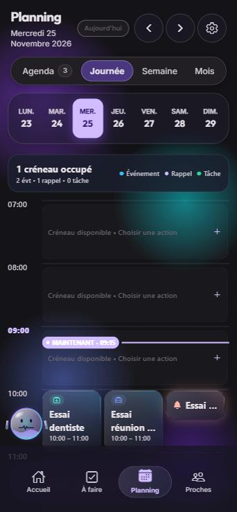
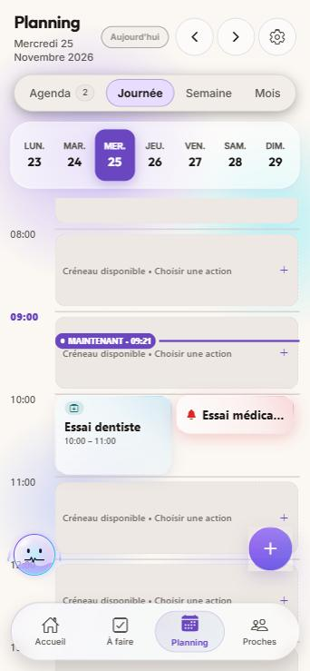
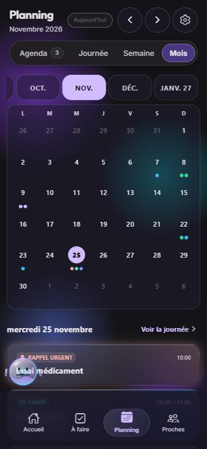
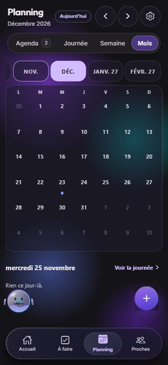
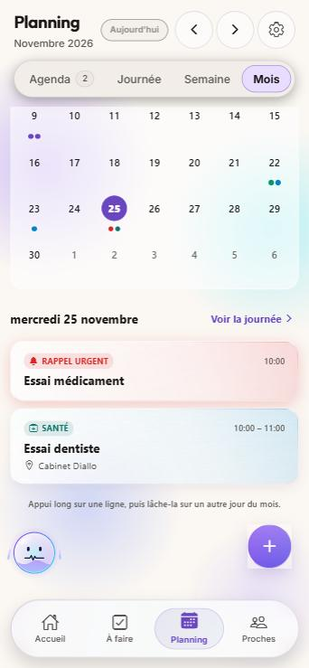

# FICHE OPÉRATOIRE N° 027 — Le Planning en GlowCards, et le Mois qu'on parcourt

Projet : **Junix Pulse** · Date : 25 novembre 2026 · Suite de : [FICHE 026](FICHE-026-planning-jour-semaine-mois.md) · Étude : [ÉTUDE 001](../etudes/ETUDE-001-clarifier-et-faire-evoluer.md), 12.4

---

## 1. Objectif

Après l'APK de la fiche 026, ta remarque : la vue **Journée** était trop simple (des rectangles de couleur). Elle doit reprendre **le design de l'ancienne Journée**, avec les GlowCards et les couleurs déjà fixées, mais **à l'échelle du temps**. Le **Mois** doit avoir le même niveau de design, et permettre d'aller dans les autres mois. Décisions du 25 novembre 2026, après une maquette :

| Question | Choix |
|---|---|
| L'ancien haut de la Journée (résumé « X créneaux occupés », légende) et « Options » sur les rappels | **remis tous les deux** |
| Aller dans un autre mois | **les deux** : un **bandeau des mois** en haut du Mois, et **passer au mois voisin** en amenant une carte au bord de la grille pendant un glisser |
| Les couleurs | celles **déjà fixées**, sans en inventer |

**Les couleurs, reprises de l'ancienne Journée** (et rangées à un seul endroit, `planning-look.ts`) :

| Chose | Ton de la GlowCard | Badge et icône |
|---|---|---|
| Moment | `info` | la couleur et l'icône de son **type** (fiche 023) ; bleu « ÉVÉNEMENT » pour « Autre » |
| Rappel | `primary` (violet) ; `urgent` (rouge) s'il est urgent | « RAPPEL » ou « RAPPEL URGENT », cloche |
| Tâche | `success` (vert) | « TÂCHE », case à cocher |
| Agenda du téléphone | `neutral` | vert de l'agenda, téléphone |

**Journée** : le résumé et sa légende en haut, puis les tâches du jour en petites GlowCards (bande « Sans heure »), puis la grille. Chaque moment ou rappel est une **GlowCard à son heure**, dont la **hauteur suit la durée** (une heure = 96 points, un quart d'heure = 24). Une carte n'est jamais plus petite qu'un doigt (44 points). Les choses qui **se chevauchent à l'écran**, qu'elles commencent en même temps ou non, se mettent **côte à côte**, trois au plus. Une carte étroite (moins de 150 points) garde l'icône de son badge et met l'heure sous le titre. Une carte basse (moins de 60 points) tient sur une ligne. Les heures vides montrent **« Créneau disponible • Choisir une action »** en pointillés, et le badge **« MAINTENANT »** passe au-dessus des cartes.

**Mois** : le **bandeau des mois** (OCT. · **NOV.** · DÉC. · JANV. 27…), le mois du jour entouré, celui affiché rempli. La grille : le jour du jour entouré, le jour choisi rempli, et des points aux couleurs de la Journée. Dessous, les choses du jour choisi en **GlowCards**. Pendant un glisser, deux bords en pointillés apparaissent : y garder le doigt un instant **tourne une page** (une seule fois ; pour aller plus loin, sortir puis revenir), puis on lâche la carte sur un jour du nouveau mois. Changer de mois par le bandeau ou les flèches garde le même jour (le 25 → le 25). Après un déplacement, le jour d'arrivée devient le jour choisi.



*Figure 27-1 — Capture réelle (web, 360 px, thème sombre). En haut, « 1 créneau occupé », la légende. À 10:00, trois choses côte à côte : un moment Santé, un moment Travail, un rappel urgent en rouge sur une ligne.*

## 2. État de départ

| À vérifier | Comment | Résultat attendu |
|---|---|---|
| La fiche 026 est enregistrée | `git log --oneline -3` | on voit `feat(planning): …` |
| Tout passe | `npx jest` | `Tests: 2091 passed` |

## 3. Matériel

Rien de nouveau : aucune bibliothèque ajoutée, aucune migration.

## 4. Hypothèses

- Les couleurs de référence sont celles de l'**ancienne vue Journée** (fichier `CalendarTimetable.tsx` d'avant la fiche 026, lisible avec `git show f4300f1~1:src/components/calendar/CalendarTimetable.tsx`).
- Le bouton « Options · Plus tard » d'un rappel ouvre la page du rappel, comme avant ; dans le Planning c'est **toute la carte** qui l'ouvre (le bouton est un repère visuel), pour ne pas se battre avec le glisser.
- La GlowCard garde son comportement partout ailleurs : ses deux nouveaux réglages sont facultatifs.

## 5. Carte de l'intervention

| Fichier | Action |
|---|---|
| `src/constants/planning-look.ts` | **nouveau** : ton, couleur, icône et badge de chaque chose du Planning |
| `src/components/planning/PlanningCard.tsx` | **nouveau** : la GlowCard d'une chose, en trois tailles (une ligne, badge, détails) et étroite |
| `src/components/planning/DayTimeGrid.tsx` | **réécrit** : le design de l'ancienne Journée, à l'échelle |
| `src/components/planning/MonthView.tsx` | **réécrit** : bandeau des mois, grille soignée, GlowCards, bords qui tournent la page |
| `src/components/ui/GlowCard.tsx` | deux réglages facultatifs : `contentStyle` et `fill` |
| `src/domain/rules/planning-move-rules.ts` (+ test) | 96 points par heure, 44 au moins par carte, heures libres, bandeau des mois, même jour dans un autre mois |
| `src/components/planning/DraggableBlock.tsx` | suit le doigt pendant le glisser ; fonctions stables pendant un geste |
| `src/app/(tabs)/calendar.tsx` | le mois affiché séparé du jour choisi ; les choses du mois gardent leur apparence et elles-mêmes |
| `messages-rest-fr.ts`, `-en.ts` | 4 textes |

## 6. Sauvegarde

`git status` doit être propre (hors `docs/motion/`). Pour revenir en arrière : section 10.

## 7. Pas à pas

L'étape 8 applique toute la fiche d'un coup avec l'outil qui lit ces blocs. Les étapes 1 à 7 expliquent chaque morceau.

### Étape 1 — Les couleurs à un seul endroit

**Où** : `src/constants/planning-look.ts` (nouveau).

**Pourquoi** : la Journée, la liste du Mois et les points de la grille lisent tous ici. Changer une couleur se fait une fois.

<!-- bloc: look -->

```ts
/**
 * How each thing looks in the Planning (sheet 027): the GlowCard tone, the colour of its badge and
 * its icon, taken from the earlier Day view and kept in one place for the Day and Month views.
 *  - a moment: tone "info", the colour and icon of its type (sheet 023), blue for "Autre";
 *  - a reminder: tone "primary", violet; "urgent" and red when it is urgent;
 *  - a task: tone "success", green;
 *  - the phone's own calendar: no glow, green of the agenda.
 */
import type { Ionicons } from '@expo/vector-icons';

import type { GlowTone } from '@/constants/theme';
import type { ThemePalette } from '@/constants/palettes';
import { momentKindColor, momentKindLook } from '@/constants/moment-kinds';
import type { MomentKind, ReminderPriority } from '@/domain/entities';
import type { MessageKey } from '@/i18n';

export type PlanningKind = 'event' | 'reminder' | 'task' | 'device';

export interface PlanningLook {
  tone: GlowTone;
  color: string;
  icon: keyof typeof Ionicons.glyphMap;
  /** The badge, in capitals on the card. */
  labelKey: MessageKey;
}

/** The blue of a moment without a type, as on the earlier Day view. */
export function eventAccent(palette: Pick<ThemePalette, 'mode'>): string {
  return palette.mode === 'light' ? '#0284C7' : '#38BDF8';
}

/** The green of the tasks, as on the earlier Day view. */
export function taskAccent(palette: Pick<ThemePalette, 'mode'>): string {
  return palette.mode === 'light' ? '#059669' : '#34D399';
}

export function planningLook(
  palette: ThemePalette,
  kind: PlanningKind,
  details: { momentKind?: MomentKind; priority?: ReminderPriority } = {}
): PlanningLook {
  if (kind === 'event') {
    const typed = !!details.momentKind && details.momentKind !== 'other';
    return {
      tone: 'info',
      color: typed ? momentKindColor(palette, details.momentKind) : eventAccent(palette),
      icon: typed ? momentKindLook(details.momentKind).icon : 'calendar',
      labelKey: typed ? momentKindLook(details.momentKind).labelKey : 'timetable.eventBadge',
    };
  }
  if (kind === 'reminder') {
    const urgent = details.priority === 'URGENT';
    return {
      tone: urgent ? 'urgent' : 'primary',
      color: urgent ? palette.error.default : palette.primary.default,
      icon: 'notifications',
      labelKey: urgent ? 'timetable.reminderUrgent' : 'timetable.reminderBadge',
    };
  }
  if (kind === 'task') {
    return { tone: 'success', color: taskAccent(palette), icon: 'checkbox-outline', labelKey: 'planning.taskBadge' };
  }
  return { tone: 'neutral', color: palette.success.default, icon: 'phone-portrait-outline', labelKey: 'planning.deviceBadge' };
}
```

**Contrôle** : `npx tsc --noEmit` sans erreur.

### Étape 2 — Deux réglages facultatifs pour la GlowCard

**Où** : `src/components/ui/GlowCard.tsx`.

**Pourquoi** : une carte de 30 minutes fait 46 points ; avec son rembourrage habituel (15 × 14), le texte ne tiendrait pas. `contentStyle` change le rembourrage, `fill` fait prendre à la carte toute la hauteur donnée. Sans eux, la GlowCard reste exactement la même.

Passage 1 sur 5 — repère à chercher (Ctrl+F) : la première ligne du bloc « avant ».

<!-- bloc: glow-1-avant -->

```tsx
  footer?: ReactNode;
  style?: StyleProp<ViewStyle>;
  testID?: string;
  accessibilityLabel?: string;
  /** Index de la carte dans une liste pour orchestrer la cascade (stagger) */
  index?: number;
```

devient :

<!-- bloc: glow-1-apres -->

```tsx
  footer?: ReactNode;
  style?: StyleProp<ViewStyle>;
  testID?: string;
  /** The inside padding, for a small card at its time in the Planning (sheet 027); default 15 x 14. */
  contentStyle?: StyleProp<ViewStyle>;
  /** The card takes the whole height it is given (a card sized by its length, sheet 027). */
  fill?: boolean;
  accessibilityLabel?: string;
  /** Index de la carte dans une liste pour orchestrer la cascade (stagger) */
  index?: number;
```

Passage 2 sur 5 — repère à chercher (Ctrl+F) : la première ligne du bloc « avant ».

<!-- bloc: glow-2-avant -->

```tsx
  footer,
  style,
  testID,
  accessibilityLabel,
  index,
  delay,
```

devient :

<!-- bloc: glow-2-apres -->

```tsx
  footer,
  style,
  testID,
  contentStyle,
  fill = false,
  accessibilityLabel,
  index,
  delay,
```

Passage 3 sur 5 — repère à chercher (Ctrl+F) : la première ligne du bloc « avant ».

<!-- bloc: glow-3-avant -->

```tsx
      }) as ViewStyle);

  const content = (
    <View style={[styles.outerWrapper, shadowStyle, { borderRadius: radius }, haloStyle]}>
      <View style={[styles.inner, borderStyle, { backgroundColor: innerBg, borderRadius: radius }]}>
        {showBlur && (
          <BlurView
            intensity={GlowCardTokens.glass.blurIntensity}
```

devient :

<!-- bloc: glow-3-apres -->

```tsx
      }) as ViewStyle);

  const content = (
    <View style={[styles.outerWrapper, shadowStyle, { borderRadius: radius }, haloStyle, fill && styles.fill]}>
      <View style={[styles.inner, borderStyle, { backgroundColor: innerBg, borderRadius: radius }, fill && styles.fill]}>
        {showBlur && (
          <BlurView
            intensity={GlowCardTokens.glass.blurIntensity}
```

Passage 4 sur 5 — repère à chercher (Ctrl+F) : la première ligne du bloc « avant ».

<!-- bloc: glow-4-avant -->

```tsx
          />
        )}

        <View style={styles.content}>{children}</View>

        {footer ? (
          <View style={styles.footer}>
```

devient :

<!-- bloc: glow-4-apres -->

```tsx
          />
        )}

        <View style={[styles.content, contentStyle]}>{children}</View>

        {footer ? (
          <View style={styles.footer}>
```

Passage 5 sur 5 — repère à chercher (Ctrl+F) : la première ligne du bloc « avant ».

<!-- bloc: glow-5-avant -->

```tsx
    height: '60%',
    zIndex: 2,
  },
  content: {
    paddingHorizontal: 15,
    paddingVertical: 14,
```

devient :

<!-- bloc: glow-5-apres -->

```tsx
    height: '60%',
    zIndex: 2,
  },
  fill: {
    flex: 1,
    minHeight: 0,
  },
  content: {
    paddingHorizontal: 15,
    paddingVertical: 14,
```

**Si ça rate** : une carte « coupée » en bas : vérifier que `fill` est passé et que le parent a une hauteur.

### Étape 3 — Les règles : échelle, heures libres, mois

**Où** : `src/domain/rules/planning-move-rules.ts` et son test.

**Pourquoi** : une heure passe à **96 points** (un quart d'heure = 24, assez pour une GlowCard). Une carte compte au moins 30 minutes à l'écran pour le côte à côte : deux rappels à 10:00 et 10:15 se mettent l'un à côté de l'autre au lieu de se cacher.

Passage 1 sur 4 — repère à chercher (Ctrl+F) : la première ligne du bloc « avant ».

<!-- bloc: rules-1-avant -->

```ts
/** A card lands on a quarter of an hour: 19:00 or 19:15, never 19:07. */
export const SNAP_MINUTES = 15;

/** The height of one hour in the Day view, in points (the Week view keeps its own 48). */
export const DAY_HOUR_HEIGHT = 64;

/** The Day view shows at least 07:00 to 22:00, more when something is earlier or later. */
export const DAY_FIRST_HOUR = 7;
```

devient :

<!-- bloc: rules-1-apres -->

```ts
/** A card lands on a quarter of an hour: 19:00 or 19:15, never 19:07. */
export const SNAP_MINUTES = 15;

/**
 * The height of one hour in the Day view, in points (the Week view keeps its own 48): 96 gives a
 * quarter of an hour 24 points, and room for the GlowCards (sheet 027).
 */
export const DAY_HOUR_HEIGHT = 96;

/** A card is never shorter than a finger (44 points), even for a reminder or a short moment. */
export const MIN_CARD_HEIGHT = 44;

/** The minutes a card takes at least on the screen, on a quarter of an hour (44 points at 96 an hour: 30 min). */
export function minCardMinutes(hourHeight: number): number {
  if (hourHeight <= 0) return SNAP_MINUTES;
  return Math.ceil(((MIN_CARD_HEIGHT / hourHeight) * 60) / SNAP_MINUTES) * SNAP_MINUTES;
}

/** The Day view shows at least 07:00 to 22:00, more when something is earlier or later. */
export const DAY_FIRST_HOUR = 7;
```

Passage 2 sur 4 — repère à chercher (Ctrl+F) : la première ligne du bloc « avant ».

<!-- bloc: rules-2-avant -->

```ts
}

/**
 * Where each card of a day goes: its height follows its length (at least a quarter of an hour),
 * and cards at the same time share the width side by side (at most 3 columns on a phone).
 */
export function layoutDay(items: readonly DayLayoutItem[], firstHour: number, hourHeight: number): DayLayoutBox[] {
  const sorted = [...items]
    .map(item => ({ ...item, endMin: Math.max(item.endMin, item.startMin + SNAP_MINUTES) }))
    .sort((a, b) => a.startMin - b.startMin || b.endMin - a.endMin);
  const boxes: DayLayoutBox[] = [];
  let group: { item: (typeof sorted)[number]; column: number }[] = [];
```

devient :

<!-- bloc: rules-2-apres -->

```ts
}

/**
 * Where each card of a day goes: its height follows its length (at least a finger, 44 points),
 * and cards that meet on the screen, at the same start or not, share the width side by side
 * (at most 3 columns on a phone).
 */
export function layoutDay(items: readonly DayLayoutItem[], firstHour: number, hourHeight: number): DayLayoutBox[] {
  const shortest = minCardMinutes(hourHeight);
  const sorted = [...items]
    .map(item => ({ ...item, endMin: Math.max(item.endMin, item.startMin + shortest) }))
    .sort((a, b) => a.startMin - b.startMin || b.endMin - a.endMin);
  const boxes: DayLayoutBox[] = [];
  let group: { item: (typeof sorted)[number]; column: number }[] = [];
```

Passage 3 sur 4 — repère à chercher (Ctrl+F) : la première ligne du bloc « avant ».

<!-- bloc: rules-3-avant -->

```ts
      boxes.push({
        id: item.id,
        top: ((item.startMin - firstHour * 60) / 60) * hourHeight,
        height: Math.max(28, ((item.endMin - item.startMin) / 60) * hourHeight - 2),
        column: Math.min(column, columns - 1),
        columns,
      });
```

devient :

<!-- bloc: rules-3-apres -->

```ts
      boxes.push({
        id: item.id,
        top: ((item.startMin - firstHour * 60) / 60) * hourHeight,
        height: Math.max(MIN_CARD_HEIGHT, ((item.endMin - item.startMin) / 60) * hourHeight - 2),
        column: Math.min(column, columns - 1),
        columns,
      });
```

Passage 4 sur 4 — repère à chercher (Ctrl+F) : la première ligne du bloc « avant ».

<!-- bloc: rules-4-avant -->

```ts
export function minutesOfDay(date: Date): number {
  return date.getHours() * 60 + date.getMinutes();
}
```

devient :

<!-- bloc: rules-4-apres -->

```ts
export function minutesOfDay(date: Date): number {
  return date.getHours() * 60 + date.getMinutes();
}

/**
 * The hours with nothing in them, between the first and the last hour shown: each one shows
 * "Créneau disponible" and adds something at that hour when touched (as on the earlier Day view).
 */
export function freeHours(
  items: readonly { startMin: number; endMin: number }[],
  first: number,
  last: number,
  hourHeight: number
): number[] {
  const shortest = minCardMinutes(hourHeight);
  const hours: number[] = [];
  for (let hour = first; hour < last; hour += 1) {
    const from = hour * 60;
    const to = from + 60;
    const busy = items.some(item => item.startMin < to && Math.max(item.endMin, item.startMin + shortest) > from);
    if (!busy) hours.push(hour);
  }
  return hours;
}

/** The months of the strip of the Month view: some before and after the one shown, first days. */
export function monthStrip(shown: Date, before = 6, after = 12): Date[] {
  return Array.from({ length: before + after + 1 }, (_, i) => new Date(shown.getFullYear(), shown.getMonth() - before + i, 1));
}

/** The same day in another month, kept inside that month (31 January plus one month: 28 February). */
export function sameDayInMonth(day: Date, month: Date): Date {
  const last = new Date(month.getFullYear(), month.getMonth() + 1, 0).getDate();
  return new Date(month.getFullYear(), month.getMonth(), Math.min(day.getDate(), last));
}
```

Le test :

Passage 1 sur 2 — repère à chercher (Ctrl+F) : la première ligne du bloc « avant ».

<!-- bloc: test-1-avant -->

```ts
  dayHours,
  dayKey,
  daysBetween,
  layoutDay,
  minutesForOffset,
  monthGrid,
  monthGridRange,
  movedRange,
  movedStart,
  shiftedRecurrence,
  snapMinutes,
} from '../planning-move-rules';
```

devient :

<!-- bloc: test-1-apres -->

```ts
  dayHours,
  dayKey,
  daysBetween,
  freeHours,
  layoutDay,
  minCardMinutes,
  minutesForOffset,
  monthGrid,
  monthGridRange,
  monthStrip,
  movedRange,
  movedStart,
  sameDayInMonth,
  shiftedRecurrence,
  snapMinutes,
} from '../planning-move-rules';
```

Passage 2 sur 2 — repère à chercher (Ctrl+F) : la première ligne du bloc « avant ».

<!-- bloc: test-2-avant -->

```ts
    const byId = Object.fromEntries(boxes.map(box => [box.id, box]));
    expect(byId.a).toMatchObject({ top: 128, column: 0, columns: 2 });
    expect(byId.b).toMatchObject({ column: 1, columns: 2 });
    expect(byId.c).toMatchObject({ top: 320, column: 0, columns: 1, height: 28 });
  });
});
```

devient :

<!-- bloc: test-2-apres -->

```ts
    const byId = Object.fromEntries(boxes.map(box => [box.id, box]));
    expect(byId.a).toMatchObject({ top: 128, column: 0, columns: 2 });
    expect(byId.b).toMatchObject({ column: 1, columns: 2 });
    expect(byId.c).toMatchObject({ top: 320, column: 0, columns: 1, height: 46 });
  });

  it('keeps every card as tall as a finger, and finds the free hours (sheet 027)', () => {
    expect(minCardMinutes(96)).toBe(30);
    expect(minCardMinutes(64)).toBe(45);
    // Two reminders 15 minutes apart meet on the screen: side by side
    const boxes = layoutDay([{ id: 'a', startMin: 600, endMin: 600 }, { id: 'b', startMin: 615, endMin: 615 }], 7, 96);
    expect(boxes.map(b => b.columns)).toEqual([2, 2]);
    expect(boxes[0].height).toBe(46);
    expect(freeHours([{ startMin: 9 * 60 + 45, endMin: 9 * 60 + 45 }], 8, 12, 96)).toEqual([8, 11]);
  });

  it('lists the months around and keeps a day inside a shorter month', () => {
    const strip = monthStrip(new Date(2026, 10, 24), 1, 2);
    expect(strip).toEqual([new Date(2026, 9, 1), new Date(2026, 10, 1), new Date(2026, 11, 1), new Date(2027, 0, 1)]);
    expect(sameDayInMonth(new Date(2027, 0, 31), new Date(2027, 1, 1))).toEqual(new Date(2027, 1, 28));
  });
});
```

**Contrôle** : `npx jest src/domain/rules/__tests__/planning-move-rules.test.ts` → `Tests: 11 passed`.

### Étape 4 — La carte du Planning

**Où** : `src/components/planning/PlanningCard.tsx` (nouveau).

**Pourquoi** : la même GlowCard pour la Journée (hauteur donnée) et la liste du Mois (hauteur libre). Elle **dessine seulement** : le toucher et le glisser appartiennent à `DraggableBlock` autour d'elle. Une GlowCard sans `onPress` n'a ni toucher ni menu à elle (fiche 024).

<!-- bloc: card -->

```tsx
/**
 * A thing of the Planning drawn as a GlowCard (sheet 027), with the look of the earlier Day view:
 * the badge of its kind (type of moment, RAPPEL, TÂCHE) in its colour, its time, its title, then
 * its place or note, and "Options · Plus tard" on a reminder when there is room.
 * In the Day view its height follows its length: under 60 points it is a single line (time and
 * title), then the badge comes, then the details. In a list (Month view) it takes its own height.
 * The card only draws: touching, the long press and the move belong to DraggableBlock around it.
 */
import { Ionicons } from '@expo/vector-icons';
import { memo } from 'react';
import { StyleSheet, Text, View } from 'react-native';

import { GlowCard } from '@/components/ui/GlowCard';
import type { PlanningLook } from '@/constants/planning-look';
import type { ThemePalette } from '@/constants/palettes';
import { Radius, Typography } from '@/constants/theme';
import { useTheme } from '@/hooks/use-theme';
import { useThemedStyles } from '@/hooks/use-themed-styles';
import { useT } from '@/i18n';

/** Below this height the card is one line; from the second, it shows its details. */
export const ONE_LINE_HEIGHT = 60;
export const DETAILS_HEIGHT = 104;

export interface PlanningCardProps {
  look: PlanningLook;
  title: string;
  time: string;
  place?: string | null;
  note?: string | null;
  /** Its height in the Day view; undefined in a list. */
  height?: number;
  /** A task done is shown lighter, with its tick. */
  done?: boolean;
  /** "Options · Plus tard" on a reminder: a touch on the card opens them, as on the earlier Day view. */
  showOptions?: boolean;
  /** Its place in the list, for the arrival of the cards one after the other. */
  index?: number;
  /**
   * A narrow card (three side by side on a phone): the badge keeps its icon only, the title takes
   * two lines and the time goes under it; a one-line card shows its icon and title (its place on
   * the grid already says the time).
   */
  narrow?: boolean;
}

export const PlanningCard = memo(function PlanningCard({
  look,
  title,
  time,
  place,
  note,
  height,
  done = false,
  showOptions = false,
  index,
  narrow = false,
}: PlanningCardProps) {
  const t = useT();
  const { theme } = useTheme();
  const styles = useThemedStyles(makePlanningCardStyles);
  const sized = height !== undefined;
  const oneLine = sized && height < ONE_LINE_HEIGHT;
  const details = !sized || height >= DETAILS_HEIGHT;
  const badge = (
    <View style={[styles.badge, { backgroundColor: look.color + (theme.mode === 'light' ? '1F' : '26') }]}>
      <Ionicons name={look.icon} size={11} color={look.color} />
      {!narrow && (
        <Text style={[styles.badgeText, { color: look.color }]} numberOfLines={1}>
          {t(look.labelKey).toUpperCase()}
        </Text>
      )}
    </View>
  );

  return (
    <GlowCard
      tone={look.tone}
      intensity={done ? 'soft' : 'default'}
      index={index}
      fill={sized}
      style={sized ? styles.fill : undefined}
      contentStyle={oneLine ? styles.oneLine : sized ? styles.sized : undefined}
    >
      {oneLine ? (
        <View style={styles.row}>
          <Ionicons name={done ? 'checkmark-circle' : look.icon} size={13} color={look.color} />
          {!narrow && <Text style={[styles.time, { color: look.color }]}>{time}</Text>}
          <Text style={[styles.title, done && styles.done]} numberOfLines={1}>{title}</Text>
        </View>
      ) : (
        <>
          <View style={styles.head}>
            {badge}
            {!narrow && <Text style={styles.headTime} numberOfLines={1}>{time}</Text>}
          </View>
          <Text style={[styles.title, done && styles.done]} numberOfLines={narrow || !sized || height >= DETAILS_HEIGHT ? 2 : 1}>
            {title}
          </Text>
          {narrow && <Text style={styles.headTime} numberOfLines={1}>{time}</Text>}
          {details && !!place && (
            <View style={styles.meta}>
              <Ionicons name="location-outline" size={13} color={theme.onSurface.variant} />
              <Text style={styles.metaText} numberOfLines={1}>{place}</Text>
            </View>
          )}
          {details && !place && !!note && <Text style={styles.metaText} numberOfLines={1}>{note}</Text>}
          {details && showOptions && (
            <View style={styles.footer} importantForAccessibility="no-hide-descendants">
              <View style={[styles.options, { backgroundColor: look.color + '1A' }]}>
                <Ionicons name="timer-outline" size={12} color={look.color} />
                <Text style={[styles.optionsText, { color: look.color }]}>{t('planning.options')}</Text>
              </View>
            </View>
          )}
        </>
      )}
    </GlowCard>
  );
});

function makePlanningCardStyles(theme: ThemePalette) {
  return StyleSheet.create({
    fill: { flex: 1 },
    sized: { paddingHorizontal: 10, paddingVertical: 7, flex: 1 },
    oneLine: { paddingHorizontal: 10, paddingVertical: 0, flex: 1, justifyContent: 'center' },
    row: { flexDirection: 'row', alignItems: 'center', gap: 6 },
    head: { flexDirection: 'row', alignItems: 'center', justifyContent: 'space-between', gap: 6, marginBottom: 3 },
    badge: { flexDirection: 'row', alignItems: 'center', gap: 4, borderRadius: Radius.sm, paddingHorizontal: 6, paddingVertical: 2, flexShrink: 1 },
    badgeText: { ...Typography.labelSmall, fontSize: 9, fontWeight: '700', letterSpacing: 0.5 },
    headTime: { ...Typography.labelSmall, fontSize: 10, color: theme.onSurface.variant, fontVariant: ['tabular-nums'] },
    time: { fontSize: 11, fontWeight: '700', fontVariant: ['tabular-nums'] },
    title: { ...Typography.titleMedium, fontSize: 14, color: theme.onSurface.primary, fontWeight: '700', flexShrink: 1 },
    done: { textDecorationLine: 'line-through', color: theme.onSurface.variant },
    meta: { flexDirection: 'row', alignItems: 'center', gap: 4, marginTop: 3 },
    metaText: { ...Typography.bodySmall, fontSize: 11, color: theme.onSurface.variant, flexShrink: 1 },
    footer: { flexDirection: 'row', justifyContent: 'flex-end', marginTop: 'auto', paddingTop: 4 },
    options: { flexDirection: 'row', alignItems: 'center', gap: 4, borderRadius: Radius.full, paddingHorizontal: 8, paddingVertical: 3, minHeight: 24 },
    optionsText: { ...Typography.labelSmall, fontSize: 10, fontWeight: '600' },
  });
}
```

| Taille | Ce qu'on voit |
|---|---|
| moins de 60 points | une ligne : icône, heure, titre (icône et titre si étroite) |
| 60 à 103 points | badge et heure, titre sur une ligne |
| 104 points et plus | en plus : le lieu, ou la note, et « Options · Plus tard » sur un rappel |

### Étape 5 — La Journée, au design d'avant

**Où** : `src/components/planning/DayTimeGrid.tsx` : remplacer **tout le fichier**.

<!-- bloc: day-grid -->

```tsx
/**
 * The Day view of the Planning (study 001, 12.4; sheets 026 and 027), with the design of the
 * earlier Day view: the summary and its legend, the tasks of the day in small GlowCards, the free
 * hours in dashed lines ("Créneau disponible"), the "MAINTENANT" badge, and every moment and
 * reminder as a GlowCard in the colours of its kind. What is new is the scale: each card is at
 * its exact time, its height follows its length, and cards that meet share the width side by side.
 * A long press on a moment or a reminder lifts it; it moves by quarters of an hour.
 */
import { Ionicons } from '@expo/vector-icons';
import { format, isToday } from 'date-fns';
import { memo, useMemo, useState } from 'react';
import { ScrollView, StyleSheet, Text, TouchableOpacity, View } from 'react-native';

import { GlowCard } from '@/components/ui/GlowCard';
import { planningLook, taskAccent, eventAccent } from '@/constants/planning-look';
import type { ThemePalette } from '@/constants/palettes';
import { Radius, Spacing, TAB_BAR_TOTAL_HEIGHT, Typography } from '@/constants/theme';
import type { Event, Reminder, Task } from '@/domain/entities';
import type { DeviceEvent } from '@/domain/rules/device-calendar-rules';
import {
  DAY_HOUR_HEIGHT,
  dayHours,
  freeHours,
  layoutDay,
  minutesForOffset,
  minutesOfDay,
  SNAP_MINUTES,
} from '@/domain/rules/planning-move-rules';
import { useTheme } from '@/hooks/use-theme';
import { useThemedStyles } from '@/hooks/use-themed-styles';
import { useT } from '@/i18n';

import { DraggableBlock } from './DraggableBlock';
import { PlanningCard } from './PlanningCard';

const HOURS_WIDTH = 52;
/** Under this width a card shows its badge as an icon and its time under the title. */
const NARROW_CARD_WIDTH = 150;

export interface DayTimeGridProps {
  date: Date;
  events: Event[];
  reminders: Reminder[];
  tasks: Task[];
  deviceEvents: DeviceEvent[];
  onOpenEvent: (event: Event) => void;
  onOpenReminder: (reminder: Reminder) => void;
  onOpenTask: (task: Task) => void;
  onMoveEvent: (event: Event, minutes: number, days: number) => void;
  onMoveReminder: (reminder: Reminder, minutes: number, days: number) => void;
  onAddAt: (hour: number) => void;
  onDeviceTouched: (title: string) => void;
}

type DayCard =
  | { key: string; kind: 'event'; event: Event; startMin: number; endMin: number }
  | { key: string; kind: 'reminder'; reminder: Reminder; startMin: number; endMin: number }
  | { key: string; kind: 'device'; device: DeviceEvent; startMin: number; endMin: number };

/** Minutes since the start of the day shown, kept inside the day for a card that starts or ends on another. */
function minutesWithin(date: Date, day: Date): number {
  const startOfDay = new Date(day.getFullYear(), day.getMonth(), day.getDate());
  const diff = Math.round((date.getTime() - startOfDay.getTime()) / 60000);
  return Math.min(24 * 60, Math.max(0, diff));
}

export const DayTimeGrid = memo(function DayTimeGrid({
  date,
  events,
  reminders,
  tasks,
  deviceEvents,
  onOpenEvent,
  onOpenReminder,
  onOpenTask,
  onMoveEvent,
  onMoveReminder,
  onAddAt,
  onDeviceTouched,
}: DayTimeGridProps) {
  const t = useT();
  const { theme } = useTheme();
  const styles = useThemedStyles(makeDayGridStyles);
  const [width, setWidth] = useState(0);
  const [lifted, setLifted] = useState(false);

  const cards = useMemo<DayCard[]>(() => {
    const list: DayCard[] = [];
    for (const event of events) {
      list.push({
        key: `e-${event.id}`,
        kind: 'event',
        event,
        startMin: minutesWithin(new Date(event.startAt), date),
        endMin: minutesWithin(new Date(event.endAt), date),
      });
    }
    for (const reminder of reminders) {
      const startMin = minutesOfDay(new Date(reminder.scheduledAt));
      list.push({ key: `r-${reminder.id}`, kind: 'reminder', reminder, startMin, endMin: startMin });
    }
    for (const device of deviceEvents.filter(d => !d.allDay)) {
      list.push({
        key: `d-${device.id}`,
        kind: 'device',
        device,
        startMin: minutesWithin(device.startAt, date),
        endMin: minutesWithin(device.endAt, date),
      });
    }
    return list;
  }, [events, reminders, deviceEvents, date]);

  const { first, last } = dayHours(cards);
  const hours = Array.from({ length: last - first }, (_, i) => first + i);
  const boxes = useMemo(
    () => new Map(layoutDay(cards.map(c => ({ id: c.key, startMin: c.startMin, endMin: c.endMin })), first, DAY_HOUR_HEIGHT).map(b => [b.id, b])),
    [cards, first]
  );
  const free = freeHours(cards, first, last, DAY_HOUR_HEIGHT);
  const occupied = hours.length - free.length;
  const allDay = deviceEvents.filter(d => d.allDay);
  const now = new Date();
  const nowTop = isToday(date) ? ((minutesOfDay(now) - first * 60) / 60) * DAY_HOUR_HEIGHT : null;
  const quarter = (DAY_HOUR_HEIGHT * SNAP_MINUTES) / 60;
  const taskColor = taskAccent(theme);

  return (
    <ScrollView
      scrollEnabled={!lifted}
      contentContainerStyle={[styles.content, { paddingBottom: TAB_BAR_TOTAL_HEIGHT + 110 }]}
      showsVerticalScrollIndicator={false}
    >
      {/* The summary and the legend, as on the earlier Day view */}
      <View style={styles.summaryBar}>
        <View style={styles.summaryInfo}>
          <Text style={styles.summaryTitle}>
            {t(occupied > 1 ? 'timetable.occupiedMany' : 'timetable.occupiedOne', { count: occupied })}
          </Text>
          <Text style={styles.summarySub}>
            {t('timetable.counts', { events: events.length, reminders: reminders.length, tasks: tasks.length })}
          </Text>
        </View>
        <View style={styles.legendRow}>
          <View style={styles.legendItem}>
            <View style={[styles.legendDot, { backgroundColor: eventAccent(theme) }]} />
            <Text style={styles.legendText}>{t('search.type.event')}</Text>
          </View>
          <View style={styles.legendItem}>
            <View style={[styles.legendDot, { backgroundColor: theme.primary.default }]} />
            <Text style={styles.legendText}>{t('search.type.reminder')}</Text>
          </View>
          <View style={styles.legendItem}>
            <View style={[styles.legendDot, { backgroundColor: taskColor }]} />
            <Text style={styles.legendText}>{t('search.type.task')}</Text>
          </View>
        </View>
      </View>

      {/* Without a time: the tasks of the day, and the whole-day events of the phone */}
      {(tasks.length > 0 || allDay.length > 0) && (
        <View style={styles.tasksSection}>
          <View style={styles.tasksHeader}>
            <Ionicons name="checkbox-outline" size={16} color={taskColor} />
            <Text style={[styles.tasksTitle, { color: taskColor }]}>{t('planning.noTimeCount', { count: tasks.length + allDay.length })}</Text>
          </View>
          <ScrollView horizontal showsHorizontalScrollIndicator={false} contentContainerStyle={styles.tasksRow}>
            {tasks.map((task, index) => (
              <GlowCard
                key={task.id}
                index={index}
                tone="success"
                intensity="soft"
                style={styles.taskMiniCard}
                contentStyle={styles.taskMiniInner}
                onPress={() => onOpenTask(task)}
                accessibilityLabel={t('timetable.taskA11y', { title: task.title, done: task.status === 'COMPLETED' ? t('timetable.doneSuffix') : '' })}
              >
                <View style={styles.taskMiniContent}>
                  <Ionicons name={task.status === 'COMPLETED' ? 'checkmark-circle' : 'ellipse-outline'} size={16} color={taskColor} />
                  <Text style={styles.taskMiniTitle} numberOfLines={1}>{task.title}</Text>
                  {task.estimatedMinutes ? (
                    <Text style={[styles.taskMiniDuration, { color: taskColor }]}>{task.estimatedMinutes}m</Text>
                  ) : null}
                </View>
              </GlowCard>
            ))}
            {allDay.map(device => (
              <GlowCard
                key={device.id}
                tone="neutral"
                style={styles.taskMiniCard}
                contentStyle={styles.taskMiniInner}
                onPress={() => onDeviceTouched(device.title)}
                accessibilityLabel={device.title}
              >
                <View style={styles.taskMiniContent}>
                  <Ionicons name="phone-portrait-outline" size={16} color={theme.success.default} />
                  <Text style={styles.taskMiniTitle} numberOfLines={1}>{device.title}</Text>
                </View>
              </GlowCard>
            ))}
          </ScrollView>
        </View>
      )}

      <View style={styles.grid}>
        <View style={{ width: HOURS_WIDTH }}>
          {hours.map(hour => {
            const current = isToday(date) && now.getHours() === hour;
            return (
              <View key={hour} style={{ height: DAY_HOUR_HEIGHT }}>
                <Text style={[styles.hourText, current && styles.hourTextCurrent]}>{String(hour).padStart(2, '0')}:00</Text>
              </View>
            );
          })}
        </View>

        <View style={[styles.area, { height: hours.length * DAY_HOUR_HEIGHT }]} onLayout={event => setWidth(event.nativeEvent.layout.width)}>
          {hours.map((hour, index) => (
            <View key={hour} pointerEvents="none" style={[styles.hourLine, { top: index * DAY_HOUR_HEIGHT }]} />
          ))}

          {/* A free hour: "Créneau disponible", touch it to add something at that hour */}
          {free.map(hour => (
            <TouchableOpacity
              key={`free-${hour}`}
              style={[styles.freeSlot, { top: (hour - first) * DAY_HOUR_HEIGHT + 6 }]}
              onPress={() => onAddAt(hour)}
              activeOpacity={0.65}
              accessibilityRole="button"
              accessibilityLabel={t('timetable.freeA11y', { hour })}
            >
              <Text style={styles.freeSlotText} numberOfLines={1}>{t('timetable.free')}</Text>
              <Ionicons name="add" size={14} color={theme.primary.default} />
            </TouchableOpacity>
          ))}

          {width > 0 &&
            cards.map((card, index) => {
              const box = boxes.get(card.key);
              if (!box) return null;
              const columnWidth = (width - 2) / box.columns;
              const look =
                card.kind === 'event'
                  ? planningLook(theme, 'event', { momentKind: card.event.momentKind })
                  : card.kind === 'reminder'
                    ? planningLook(theme, 'reminder', { priority: card.reminder.priority })
                    : planningLook(theme, 'device');
              const title = card.kind === 'event' ? card.event.title : card.kind === 'reminder' ? card.reminder.title : card.device.title;
              const time =
                card.kind === 'event'
                  ? `${format(new Date(card.event.startAt), 'HH:mm')} – ${format(new Date(card.event.endAt), 'HH:mm')}`
                  : card.kind === 'reminder'
                    ? format(new Date(card.reminder.scheduledAt), 'HH:mm')
                    : `${format(card.device.startAt, 'HH:mm')} – ${format(card.device.endAt, 'HH:mm')}`;
              return (
                <DraggableBlock
                  key={card.key}
                  style={[
                    styles.cardBox,
                    { top: box.top + 1, height: box.height, left: box.column * columnWidth, width: columnWidth - 4 },
                  ]}
                  stepY={quarter}
                  movable={card.kind !== 'device'}
                  onLift={setLifted}
                  accessibilityLabel={t('planning.cardA11y', { title, time })}
                  onPress={() => {
                    if (card.kind === 'event') onOpenEvent(card.event);
                    else if (card.kind === 'reminder') onOpenReminder(card.reminder);
                    else onDeviceTouched(card.device.title);
                  }}
                  onDrop={drop => {
                    const minutes = minutesForOffset(drop.dy, DAY_HOUR_HEIGHT);
                    if (minutes === 0) return;
                    if (card.kind === 'event') onMoveEvent(card.event, minutes, 0);
                    else if (card.kind === 'reminder') onMoveReminder(card.reminder, minutes, 0);
                  }}
                  onMoveBy={(minutes, days) => {
                    if (card.kind === 'event') onMoveEvent(card.event, minutes, days);
                    else if (card.kind === 'reminder') onMoveReminder(card.reminder, minutes, days);
                  }}
                >
                  <PlanningCard
                    look={look}
                    title={title}
                    time={time}
                    index={index}
                    height={box.height}
                    place={card.kind === 'event' ? card.event.location : card.kind === 'device' ? card.device.location : null}
                    note={card.kind === 'reminder' ? card.reminder.notes : null}
                    showOptions={card.kind === 'reminder' && box.columns <= 2}
                    narrow={columnWidth < NARROW_CARD_WIDTH}
                  />
                </DraggableBlock>
              );
            })}

          {/* "MAINTENANT", over the cards */}
          {nowTop !== null && nowTop >= 0 && (
            <View pointerEvents="none" style={[styles.nowLineContainer, { top: nowTop - 8 }]}>
              <View style={styles.nowBadge}>
                <View style={styles.nowPulseDot} />
                <Text style={styles.nowBadgeText}>{t('timetable.now', { time: format(now, 'HH:mm') })}</Text>
              </View>
              <View style={styles.nowLine} />
            </View>
          )}
        </View>
      </View>
      <Text style={styles.hint}>{t('planning.dragHint')}</Text>
    </ScrollView>
  );
});

function makeDayGridStyles(theme: ThemePalette) {
  const isLight = theme.mode === 'light';
  return StyleSheet.create({
    content: { paddingHorizontal: Spacing.md, paddingTop: Spacing.xs },
    summaryBar: {
      flexDirection: 'row',
      alignItems: 'center',
      justifyContent: 'space-between',
      flexWrap: 'wrap',
      gap: Spacing.xs,
      backgroundColor: isLight ? theme.surface.container : 'rgba(26, 30, 46, 0.85)',
      borderRadius: Radius.lg,
      paddingHorizontal: Spacing.md,
      paddingVertical: Spacing.sm + 2,
      borderWidth: 1,
      borderColor: isLight ? theme.outline.variant : 'rgba(208, 188, 255, 0.16)',
      marginBottom: Spacing.md,
    },
    summaryInfo: { gap: 2 },
    summaryTitle: { ...Typography.titleMedium, color: theme.onSurface.primary, fontWeight: '700' },
    summarySub: { ...Typography.labelSmall, color: theme.onSurface.variant, fontSize: 10 },
    legendRow: { flexDirection: 'row', alignItems: 'center', gap: Spacing.sm },
    legendItem: { flexDirection: 'row', alignItems: 'center', gap: 4 },
    legendDot: { width: 6, height: 6, borderRadius: 3 },
    legendText: { ...Typography.labelSmall, color: theme.onSurface.variant, fontSize: 10 },
    tasksSection: { marginBottom: Spacing.md, gap: Spacing.xs },
    tasksHeader: { flexDirection: 'row', alignItems: 'center', gap: 6, paddingHorizontal: 4 },
    tasksTitle: { ...Typography.labelMedium, fontWeight: '600', textTransform: 'uppercase', letterSpacing: 0.5 },
    tasksRow: { paddingVertical: 4, gap: Spacing.sm },
    taskMiniCard: { minWidth: 140, maxWidth: 220 },
    taskMiniInner: { paddingHorizontal: Spacing.md, paddingVertical: Spacing.sm },
    taskMiniContent: { flexDirection: 'row', alignItems: 'center', gap: 6 },
    taskMiniTitle: { ...Typography.bodySmall, color: theme.onSurface.primary, fontWeight: '600', flexShrink: 1 },
    taskMiniDuration: { ...Typography.labelSmall, fontSize: 10, fontWeight: '600' },
    grid: { flexDirection: 'row' },
    hourText: { ...Typography.labelMedium, color: theme.onSurface.variant, fontWeight: '600', fontVariant: ['tabular-nums'], marginTop: -2 },
    hourTextCurrent: { color: theme.primary.default, fontWeight: '800' },
    area: { flex: 1, position: 'relative' },
    hourLine: {
      position: 'absolute',
      left: 0,
      right: 0,
      height: 1,
      backgroundColor: isLight ? theme.outline.variant : 'rgba(255, 255, 255, 0.08)',
    },
    freeSlot: {
      position: 'absolute',
      left: 0,
      right: 2,
      height: DAY_HOUR_HEIGHT - 12,
      flexDirection: 'row',
      alignItems: 'center',
      justifyContent: 'space-between',
      paddingHorizontal: Spacing.sm,
      borderRadius: Radius.md,
      borderWidth: 1,
      borderStyle: 'dashed',
      borderColor: isLight ? theme.outline.variant : 'rgba(255, 255, 255, 0.08)',
      backgroundColor: isLight ? theme.surface.high : 'rgba(255, 255, 255, 0.015)',
    },
    freeSlotText: { ...Typography.labelSmall, color: theme.onSurface.disabled, fontSize: 11, flexShrink: 1 },
    cardBox: { position: 'absolute' },
    nowLineContainer: { position: 'absolute', left: 0, right: 0, zIndex: 60, flexDirection: 'row', alignItems: 'center' },
    nowBadge: {
      flexDirection: 'row',
      alignItems: 'center',
      gap: 4,
      backgroundColor: theme.primary.default,
      borderRadius: Radius.full,
      paddingHorizontal: 6,
      paddingVertical: 2,
      marginRight: 4,
    },
    nowPulseDot: { width: 5, height: 5, borderRadius: 2.5, backgroundColor: '#FFFFFF' },
    nowBadgeText: { ...Typography.labelSmall, color: '#FFFFFF', fontWeight: '800', fontSize: 9 },
    nowLine: { flex: 1, height: 2, backgroundColor: theme.primary.default },
    hint: { ...Typography.labelSmall, color: theme.onSurface.variant, textAlign: 'center', marginTop: Spacing.md },
  });
}
```



*Figure 27-2 — Capture réelle (web, 360 px, thème clair). Deux choses à 10:00 côte à côte ; la carte de gauche, étroite, met l'heure sous le titre.*

### Étape 6 — Le glisser suit le doigt

**Où** : `src/components/planning/DraggableBlock.tsx`.

**Pourquoi** : le Mois doit savoir où est le doigt pendant le glisser (pour les bords). Et les fonctions appelées par le geste restent **les mêmes** pendant tout le geste : sans cela, quand le Mois se redessinait en tournant une page, le lâcher se perdait (vu pendant les essais : la carte restait soulevée).

Passage 1 sur 5 — repère à chercher (Ctrl+F) : la première ligne du bloc « avant ».

<!-- bloc: drag-1-avant -->

```tsx
 * Only this card moves and is drawn again; the movement runs off the main thread.
 * With a screen reader, the same moves are actions of the card ("15 minutes plus tard"…).
 */
import React, { useCallback } from 'react';
import type { StyleProp, ViewStyle } from 'react-native';
import { GestureDetector, useExclusiveGestures, usePanGesture, useTapGesture } from 'react-native-gesture-handler';
import Animated, { runOnJS, useAnimatedStyle, useSharedValue, withTiming } from 'react-native-reanimated';
```

devient :

<!-- bloc: drag-1-apres -->

```tsx
 * Only this card moves and is drawn again; the movement runs off the main thread.
 * With a screen reader, the same moves are actions of the card ("15 minutes plus tard"…).
 */
import React, { useCallback, useRef } from 'react';
import type { StyleProp, ViewStyle } from 'react-native';
import { GestureDetector, useExclusiveGestures, usePanGesture, useTapGesture } from 'react-native-gesture-handler';
import Animated, { runOnJS, useAnimatedStyle, useSharedValue, withTiming } from 'react-native-reanimated';
```

Passage 2 sur 5 — repère à chercher (Ctrl+F) : la première ligne du bloc « avant ».

<!-- bloc: drag-2-avant -->

```tsx
  accessibilityLabel: string;
  /** Lets the parent know a card is lifted (for the scroll). */
  onLift?: (lifted: boolean) => void;
}

export function DraggableBlock({
```

devient :

<!-- bloc: drag-2-apres -->

```tsx
  accessibilityLabel: string;
  /** Lets the parent know a card is lifted (for the scroll). */
  onLift?: (lifted: boolean) => void;
  /** Where the finger is while the card moves, on the screen (the Month view turns the page at its edges, sheet 027). */
  onDragMove?: (x: number, y: number) => void;
}

export function DraggableBlock({
```

Passage 3 sur 5 — repère à chercher (Ctrl+F) : la première ligne du bloc « avant ».

<!-- bloc: drag-3-avant -->

```tsx
  movable = true,
  accessibilityLabel,
  onLift,
}: DraggableBlockProps) {
  const t = useT();
  const offsetX = useSharedValue(0);
  const offsetY = useSharedValue(0);
  const lifted = useSharedValue(0);

  const drop = useCallback((point: DropPoint) => onDrop?.(point), [onDrop]);
  const lift = useCallback((value: boolean) => onLift?.(value), [onLift]);

  const pan = usePanGesture({
    enabled: movable && !!onDrop,
```

devient :

<!-- bloc: drag-3-apres -->

```tsx
  movable = true,
  accessibilityLabel,
  onLift,
  onDragMove,
}: DraggableBlockProps) {
  const t = useT();
  const offsetX = useSharedValue(0);
  const offsetY = useSharedValue(0);
  const lifted = useSharedValue(0);

  // The gesture always calls the same functions, which read the latest props: a parent drawn again
  // during a move (the Month view turning a page, sheet 027) never changes the gesture under the finger
  const latest = useRef({ onPress, onDrop, onLift, onDragMove });
  latest.current = { onPress, onDrop, onLift, onDragMove };
  const press = useCallback(() => latest.current.onPress(), []);
  const drop = useCallback((point: DropPoint) => latest.current.onDrop?.(point), []);
  const lift = useCallback((value: boolean) => latest.current.onLift?.(value), []);
  const follow = useCallback((x: number, y: number) => latest.current.onDragMove?.(x, y), []);
  const following = !!onDragMove;

  const pan = usePanGesture({
    enabled: movable && !!onDrop,
```

Passage 4 sur 5 — repère à chercher (Ctrl+F) : la première ligne du bloc « avant ».

<!-- bloc: drag-4-avant -->

```tsx
      // The card jumps from quarter to quarter: what you see is where it will land
      offsetY.value = stepY > 0 ? Math.round(event.translationY / stepY) * stepY : event.translationY;
      offsetX.value = stepX > 0 ? Math.round(event.translationX / stepX) * stepX : event.translationX;
    },
    onDeactivate: event => {
      'worklet';
```

devient :

<!-- bloc: drag-4-apres -->

```tsx
      // The card jumps from quarter to quarter: what you see is where it will land
      offsetY.value = stepY > 0 ? Math.round(event.translationY / stepY) * stepY : event.translationY;
      offsetX.value = stepX > 0 ? Math.round(event.translationX / stepX) * stepX : event.translationX;
      if (following) runOnJS(follow)(event.absoluteX, event.absoluteY);
    },
    onDeactivate: event => {
      'worklet';
```

Passage 5 sur 5 — repère à chercher (Ctrl+F) : la première ligne du bloc « avant ».

<!-- bloc: drag-5-avant -->

```tsx
  const tap = useTapGesture({
    onActivate: () => {
      'worklet';
      runOnJS(onPress)();
    },
  });

```

devient :

<!-- bloc: drag-5-apres -->

```tsx
  const tap = useTapGesture({
    onActivate: () => {
      'worklet';
      runOnJS(press)();
    },
  });

```

### Étape 7 — Le Mois, et l'onglet

**Où** : `src/components/planning/MonthView.tsx` (remplacer tout le fichier), puis `src/app/(tabs)/calendar.tsx` et les textes.

<!-- bloc: month-view -->

```tsx
/**
 * The Month view of the Planning (study 001, 12.4; sheets 026 and 027).
 *  - a strip of months at the top, as the strip of days of the Day view: touch one to go there;
 *  - six weeks, Monday first, a dot of colour per thing in the colours of the Day view
 *    (three at most, then "+2"); today circled, the chosen day filled;
 *  - the things of the chosen day below, as GlowCards; "Voir la journée" opens the Day view;
 *  - a long press lifts one: let it go on another day; brought to the left or right edge of the
 *    grid, the page turns to the month before or after (once each time the finger enters the
 *    edge: to go further, leave it and come back), and it can be let go on a day there.
 */
import { Ionicons } from '@expo/vector-icons';
import { format, isSameDay, isSameMonth, isToday } from 'date-fns';
import React, { memo, useEffect, useMemo, useRef, useState } from 'react';
import { ScrollView, StyleSheet, Text, TouchableOpacity, View } from 'react-native';

import type { PlanningKind, PlanningLook } from '@/constants/planning-look';
import type { ThemePalette } from '@/constants/palettes';
import { Radius, Spacing, TAB_BAR_TOTAL_HEIGHT, Typography } from '@/constants/theme';
import type { Event, Reminder, Task } from '@/domain/entities';
import { dayDots, dayKey, monthGrid, monthStrip } from '@/domain/rules/planning-move-rules';
import { useTheme } from '@/hooks/use-theme';
import { useThemedStyles } from '@/hooks/use-themed-styles';
import { useDateLocale, useT } from '@/i18n';

import { DraggableBlock, type DropPoint } from './DraggableBlock';
import { PlanningCard } from './PlanningCard';

export interface MonthItem {
  key: string;
  kind: PlanningKind;
  title: string;
  /** HH:mm (or HH:mm – HH:mm), or null for a thing without a time. */
  time: string | null;
  look: PlanningLook;
  place?: string | null;
  done?: boolean;
  /** Its day, YYYY-MM-DD. */
  day: string;
  /** The thing itself, so it can still be moved once the page has turned to another month. */
  event?: Event;
  reminder?: Reminder;
  task?: Task;
}

export interface MonthViewProps {
  /** The month shown. */
  month: Date;
  /** The chosen day (its things are listed below the grid). */
  selected: Date;
  items: MonthItem[];
  onSelectDay: (day: Date) => void;
  onOpenDay: (day: Date) => void;
  onOpenItem: (item: MonthItem) => void;
  onMoveItem: (item: MonthItem, toDay: Date) => void;
  /** Go to a month: by the strip ('strip'), or by the edge of the grid during a move ('edge'). */
  onShowMonth: (month: Date, by: 'strip' | 'edge') => void;
  onDeviceTouched: (title: string) => void;
}

const CELL_HEIGHT = 54;
/** How close to the edge of the grid the finger turns the page, and how long it waits there. */
const EDGE_WIDTH = 30;
const EDGE_WAIT_MS = 700;

export const MonthView = memo(function MonthView({
  month,
  selected,
  items,
  onSelectDay,
  onOpenDay,
  onOpenItem,
  onMoveItem,
  onShowMonth,
  onDeviceTouched,
}: MonthViewProps) {
  const t = useT();
  const dateLocale = useDateLocale();
  const { theme } = useTheme();
  const styles = useThemedStyles(makeMonthStyles);
  const gridRef = useRef<React.ComponentRef<typeof View>>(null);
  const stripRef = useRef<React.ComponentRef<typeof ScrollView>>(null);
  const gridFrame = useRef<{ x: number; y: number; width: number; height: number } | null>(null);
  const edgeTimer = useRef<ReturnType<typeof setTimeout> | null>(null);
  const shownRef = useRef(month);
  const [lifted, setLifted] = useState(false);
  const [edge, setEdge] = useState<-1 | 0 | 1>(0);
  // Read during the move, where the state of the last drawing may be late
  const edgeRef = useRef<-1 | 0 | 1>(0);
  const [frozen, setFrozen] = useState<MonthItem[] | null>(null);
  shownRef.current = month;

  const days = useMemo(() => monthGrid(month), [month]);
  const strip = useMemo(() => monthStrip(month), [month]);
  const byDay = useMemo(() => {
    const map = new Map<string, MonthItem[]>();
    for (const item of items) map.set(item.day, [...(map.get(item.day) ?? []), item]);
    return map;
  }, [items]);
  const ofSelected = frozen ?? byDay.get(dayKey(selected)) ?? [];
  const weekdayNames = days.slice(0, 7).map(d => format(d, 'EEEEE', { locale: dateLocale }).toUpperCase());

  // The strip keeps the month shown in view (it is the 7th of the strip)
  useEffect(() => {
    stripRef.current?.scrollTo({ x: Math.max(0, 6 * 84 - 120), animated: false });
  }, [month]);

  useEffect(() => () => {
    if (edgeTimer.current) clearTimeout(edgeTimer.current);
  }, []);

  const measureGrid = () =>
    gridRef.current?.measureInWindow((x, y, width, height) => {
      gridFrame.current = { x, y, width, height };
    });

  const stopEdge = () => {
    if (edgeTimer.current) clearTimeout(edgeTimer.current);
    edgeTimer.current = null;
    edgeRef.current = 0;
    setEdge(0);
  };

  /**
   * Held a moment at an edge, the page turns once. It never turns again by itself: a move lost
   * on the way can never leave the months running.
   */
  const turnPage = (side: -1 | 1) => {
    edgeTimer.current = setTimeout(() => {
      edgeTimer.current = null;
      const current = shownRef.current;
      onShowMonth(new Date(current.getFullYear(), current.getMonth() + side, 1), 'edge');
    }, EDGE_WAIT_MS);
  };

  const onLift = (value: boolean, item: MonthItem | null) => {
    setLifted(value);
    if (value) {
      setFrozen(byDay.get(dayKey(selected)) ?? (item ? [item] : []));
      measureGrid();
    } else {
      stopEdge();
      setFrozen(null);
    }
  };

  const onDragMove = (x: number) => {
    const frame = gridFrame.current;
    if (!frame) return;
    const side: -1 | 0 | 1 = x < frame.x + EDGE_WIDTH ? -1 : x > frame.x + frame.width - EDGE_WIDTH ? 1 : 0;
    if (side === edgeRef.current) return;
    stopEdge();
    edgeRef.current = side;
    setEdge(side);
    if (side !== 0) turnPage(side);
  };

  /** The day under the finger when it lets go, in the month shown at that moment, or nothing outside the grid. */
  const dropOn = (item: MonthItem, drop: DropPoint) => {
    stopEdge();
    gridRef.current?.measureInWindow((x, y, width, height) => {
      const column = Math.floor(((drop.x - x) / width) * 7);
      const row = Math.floor(((drop.y - y) / height) * 6);
      if (column < 0 || column > 6 || row < 0 || row > 5) return;
      const target = monthGrid(shownRef.current)[row * 7 + column];
      if (dayKey(target) !== item.day) onMoveItem(item, target);
    });
  };

  return (
    <ScrollView
      scrollEnabled={!lifted}
      contentContainerStyle={[styles.content, { paddingBottom: TAB_BAR_TOTAL_HEIGHT + 110 }]}
      showsVerticalScrollIndicator={false}
    >
      {/* The strip of months, as the strip of days of the Day view */}
      <ScrollView ref={stripRef} horizontal showsHorizontalScrollIndicator={false} contentContainerStyle={styles.strip}>
        {strip.map(m => {
          const current = isSameMonth(m, month);
          const label = format(m, m.getFullYear() === new Date().getFullYear() ? 'MMM' : 'MMM yy', { locale: dateLocale }).toUpperCase();
          return (
            <TouchableOpacity
              key={dayKey(m)}
              style={[styles.monthPill, current && styles.monthPillActive, isSameMonth(m, new Date()) && !current && styles.monthPillToday]}
              onPress={() => onShowMonth(m, 'strip')}
              accessibilityRole="button"
              accessibilityState={{ selected: current }}
              accessibilityLabel={format(m, 'MMMM yyyy', { locale: dateLocale })}
            >
              <Text style={[styles.monthPillText, current && styles.monthPillTextActive]}>{label}</Text>
            </TouchableOpacity>
          );
        })}
      </ScrollView>

      <View style={styles.card}>
        <View style={styles.weekRow}>
          {weekdayNames.map((name, index) => (
            <Text key={index} style={styles.weekday}>{name}</Text>
          ))}
        </View>
        <View ref={gridRef} collapsable={false} style={styles.grid}>
          {days.map(day => {
            const key = dayKey(day);
            const things = byDay.get(key) ?? [];
            const { dots, more } = dayDots(things.map(thing => thing.look.color));
            const inMonth = isSameMonth(day, month);
            const isSelected = isSameDay(day, selected);
            const today = isToday(day);
            return (
              <TouchableOpacity
                key={key}
                style={styles.cell}
                onPress={() => (isSelected ? onOpenDay(day) : onSelectDay(day))}
                accessibilityRole="button"
                accessibilityState={{ selected: isSelected }}
                accessibilityLabel={t('planning.monthDayA11y', { day: format(day, 'EEEE d MMMM', { locale: dateLocale }), count: things.length })}
              >
                <View style={[styles.dayCircle, today && styles.dayCircleToday, isSelected && styles.dayCircleSelected]}>
                  <Text style={[styles.dayNumber, !inMonth && styles.dayOutside, today && styles.dayToday, isSelected && styles.daySelectedText]}>
                    {format(day, 'd')}
                  </Text>
                </View>
                <View style={styles.dots}>
                  {dots.map((color, index) => (
                    <View key={index} style={[styles.dot, { backgroundColor: color }, !inMonth && styles.dotOutside]} />
                  ))}
                  {more > 0 && <Text style={styles.more}>+{more}</Text>}
                </View>
              </TouchableOpacity>
            );
          })}

          {/* While a card is lifted: the two edges that turn the page */}
          {lifted && (
            <>
              <View pointerEvents="none" style={[styles.edge, styles.edgeLeft, edge === -1 && styles.edgeActive]}>
                <Ionicons name="chevron-back" size={16} color={edge === -1 ? theme.primary.default : theme.onSurface.variant} />
              </View>
              <View pointerEvents="none" style={[styles.edge, styles.edgeRight, edge === 1 && styles.edgeActive]}>
                <Ionicons name="chevron-forward" size={16} color={edge === 1 ? theme.primary.default : theme.onSurface.variant} />
              </View>
            </>
          )}
        </View>
      </View>

      <View style={styles.dayHeader}>
        <Text style={styles.dayTitle} numberOfLines={1}>{format(selected, 'EEEE d MMMM', { locale: dateLocale })}</Text>
        <TouchableOpacity style={styles.openDay} onPress={() => onOpenDay(selected)} accessibilityRole="button" accessibilityLabel={t('planning.openDay')}>
          <Text style={styles.openDayText}>{t('planning.openDay')}</Text>
          <Ionicons name="chevron-forward" size={14} color={theme.primary.default} />
        </TouchableOpacity>
      </View>

      {ofSelected.length === 0 ? (
        <Text style={styles.empty}>{t('planning.monthEmptyDay')}</Text>
      ) : (
        <View style={styles.list}>
          {ofSelected.map((item, index) => (
            <DraggableBlock
              key={item.key}
              movable={item.kind !== 'device'}
              onLift={value => onLift(value, item)}
              onDragMove={onDragMove}
              accessibilityLabel={t('planning.cardA11y', { title: item.title, time: item.time ?? t('planning.noTime') })}
              onPress={() => (item.kind === 'device' ? onDeviceTouched(item.title) : onOpenItem(item))}
              onDrop={drop => dropOn(item, drop)}
              onMoveBy={(_minutes, shift) => {
                if (shift === 0) return;
                onMoveItem(item, new Date(selected.getFullYear(), selected.getMonth(), selected.getDate() + shift));
              }}
            >
              <PlanningCard
                look={item.look}
                title={item.title}
                time={item.time ?? t('planning.noTime')}
                place={item.place}
                done={item.done}
                index={index}
              />
            </DraggableBlock>
          ))}
          <Text style={styles.hint}>{t('planning.monthHint')}</Text>
        </View>
      )}
    </ScrollView>
  );
});

function makeMonthStyles(theme: ThemePalette) {
  const isLight = theme.mode === 'light';
  return StyleSheet.create({
    content: { paddingHorizontal: Spacing.md, paddingTop: Spacing.xs },
    strip: { gap: Spacing.xs, paddingBottom: Spacing.sm },
    monthPill: {
      minWidth: 76,
      minHeight: 44,
      paddingHorizontal: Spacing.sm,
      alignItems: 'center',
      justifyContent: 'center',
      borderRadius: Radius.lg,
      borderWidth: 1,
      borderColor: theme.glass.card.borderColor,
      backgroundColor: theme.glass.card.backgroundColor,
    },
    monthPillActive: { backgroundColor: theme.primary.default, borderColor: theme.primary.default },
    monthPillToday: { borderColor: theme.primary.default },
    monthPillText: { ...Typography.labelMedium, color: theme.onSurface.variant, fontWeight: '700', letterSpacing: 0.5 },
    monthPillTextActive: { color: isLight ? '#FFFFFF' : '#141317' },
    card: {
      backgroundColor: theme.glass.card.backgroundColor,
      borderColor: theme.glass.card.borderColor,
      borderWidth: 1,
      borderRadius: Radius.lg,
      padding: Spacing.xs,
    },
    weekRow: { flexDirection: 'row' },
    weekday: { flex: 1, textAlign: 'center', ...Typography.labelSmall, color: theme.onSurface.variant, fontWeight: '700', paddingVertical: 4 },
    grid: { flexDirection: 'row', flexWrap: 'wrap', position: 'relative' },
    cell: { width: `${100 / 7}%`, height: CELL_HEIGHT, alignItems: 'center', paddingTop: 3 },
    dayCircle: { width: 30, height: 30, borderRadius: 15, alignItems: 'center', justifyContent: 'center' },
    dayCircleToday: { borderWidth: 1.5, borderColor: theme.primary.default },
    dayCircleSelected: { backgroundColor: theme.primary.default, borderColor: theme.primary.default },
    dayNumber: { ...Typography.bodySmall, color: theme.onSurface.primary, fontWeight: '600', fontVariant: ['tabular-nums'] },
    dayOutside: { color: theme.onSurface.disabled },
    dayToday: { color: theme.primary.default, fontWeight: '800' },
    daySelectedText: { color: isLight ? '#FFFFFF' : '#141317', fontWeight: '800' },
    dots: { flexDirection: 'row', alignItems: 'center', gap: 2, marginTop: 4, height: 10 },
    dot: { width: 6, height: 6, borderRadius: 3 },
    dotOutside: { opacity: 0.4 },
    more: { fontSize: 8, fontWeight: '700', color: theme.onSurface.variant },
    edge: {
      position: 'absolute',
      top: 0,
      bottom: 0,
      width: EDGE_WIDTH - 6,
      alignItems: 'center',
      justifyContent: 'center',
      borderRadius: Radius.md,
      borderWidth: 1,
      borderStyle: 'dashed',
      borderColor: theme.outline.variant,
      backgroundColor: theme.glass.control.backgroundColor,
    },
    edgeLeft: { left: 0 },
    edgeRight: { right: 0 },
    edgeActive: { borderColor: theme.primary.default, backgroundColor: theme.glass.controlActive },
    dayHeader: { flexDirection: 'row', alignItems: 'center', justifyContent: 'space-between', marginTop: Spacing.md, gap: Spacing.sm },
    dayTitle: { ...Typography.titleMedium, color: theme.onSurface.primary, fontWeight: '700', flexShrink: 1 },
    openDay: { flexDirection: 'row', alignItems: 'center', gap: 2, minHeight: 44, paddingHorizontal: Spacing.xs },
    openDayText: { ...Typography.labelMedium, color: theme.primary.default, fontWeight: '700' },
    empty: { ...Typography.bodySmall, color: theme.onSurface.variant, marginTop: Spacing.sm },
    list: { gap: Spacing.sm, marginTop: Spacing.xs },
    hint: { ...Typography.labelSmall, color: theme.onSurface.variant, textAlign: 'center', marginTop: Spacing.sm },
  });
}
```

> [attention] Pendant un glisser, la liste du jour choisi est **figée** (`frozen`) : sinon, en tournant la page, elle changerait et la carte sous le doigt disparaîtrait. Chaque chose garde aussi **elle-même** (`event`, `reminder`, `task`) pour pouvoir être déplacée vers un autre mois.

Dans `src/app/(tabs)/calendar.tsx` :

Passage 1 sur 12 — repère à chercher (Ctrl+F) : la première ligne du bloc « avant ».

<!-- bloc: cal-1-avant -->

```tsx
  subMonths,
  startOfWeek,
  isSameDay,
  isToday,
} from 'date-fns';

```

devient :

<!-- bloc: cal-1-apres -->

```tsx
  subMonths,
  startOfWeek,
  isSameDay,
  isSameMonth,
  isToday,
} from 'date-fns';

```

Passage 2 sur 12 — repère à chercher (Ctrl+F) : la première ligne du bloc « avant ».

<!-- bloc: cal-2-avant -->

```tsx
import { MonthView, type MonthItem } from '@/components/planning/MonthView';
import { usePlanningMove } from '@/features/planning/use-planning-move';
import { useGestureTip } from '@/features/mascot/GestureTip';
import { dayFromKey, dayKey, monthGridRange } from '@/domain/rules/planning-move-rules';
import { NewItemChooser } from '@/components/create/NewItemChooser';
import { WeeklyTimetableGrid } from '@/components/schedule/WeeklyTimetableGrid';
import { makeCalendarStyles } from '@/styles/tabs/calendar-styles';
import { momentKindColor } from '@/constants/moment-kinds';
import { useDateLocale, useT } from '@/i18n';

type ScreenState = 'loading' | 'content' | 'error';
type CalendarViewMode = 'agenda' | 'timetable' | 'week' | 'month';

/** The things of the month, kept to move them (sheet 026). */
interface MonthThings {
  items: MonthItem[];
  events: Map<string, Event>;
  reminders: Map<string, Reminder>;
  tasks: Map<string, Task>;
}

const NO_MONTH: MonthThings = { items: [], events: new Map(), reminders: new Map(), tasks: new Map() };

export default function CalendarScreen() {
  const t = useT();
  const dateLocale = useDateLocale();
```

devient :

<!-- bloc: cal-2-apres -->

```tsx
import { MonthView, type MonthItem } from '@/components/planning/MonthView';
import { usePlanningMove } from '@/features/planning/use-planning-move';
import { useGestureTip } from '@/features/mascot/GestureTip';
import { dayFromKey, dayKey, monthGridRange, sameDayInMonth } from '@/domain/rules/planning-move-rules';
import { NewItemChooser } from '@/components/create/NewItemChooser';
import { WeeklyTimetableGrid } from '@/components/schedule/WeeklyTimetableGrid';
import { makeCalendarStyles } from '@/styles/tabs/calendar-styles';
import { momentKindColor } from '@/constants/moment-kinds';
import { planningLook } from '@/constants/planning-look';
import { useDateLocale, useT } from '@/i18n';

type ScreenState = 'loading' | 'content' | 'error';
type CalendarViewMode = 'agenda' | 'timetable' | 'week' | 'month';

export default function CalendarScreen() {
  const t = useT();
  const dateLocale = useDateLocale();
```

Passage 3 sur 12 — repère à chercher (Ctrl+F) : la première ligne du bloc « avant ».

<!-- bloc: cal-3-avant -->

```tsx
  // The moments and reminders of the week, to move them from the Week view (sheet 026)
  const [weekEventsById, setWeekEventsById] = useState<Map<string, Event>>(new Map());
  const [weekRemindersById, setWeekRemindersById] = useState<Map<string, Reminder>>(new Map());
  const [month, setMonth] = useState<MonthThings>(NO_MONTH);
  const [weekLifted, setWeekLifted] = useState(false);

  // Semaine courante basée sur la date sélectionnée
```

devient :

<!-- bloc: cal-3-apres -->

```tsx
  // The moments and reminders of the week, to move them from the Week view (sheet 026)
  const [weekEventsById, setWeekEventsById] = useState<Map<string, Event>>(new Map());
  const [weekRemindersById, setWeekRemindersById] = useState<Map<string, Reminder>>(new Map());
  // The Month view: the things of the month shown, and that month, apart from the chosen day (sheet 027)
  const [monthItems, setMonthItems] = useState<MonthItem[]>([]);
  const [shownMonth, setShownMonth] = useState<Date>(() => new Date());
  const [weekLifted, setWeekLifted] = useState(false);

  // Semaine courante basée sur la date sélectionnée
```

Passage 4 sur 12 — repère à chercher (Ctrl+F) : la première ligne du bloc « avant ».

<!-- bloc: cal-4-avant -->

```tsx
      // 100% vraies données : uniquement les événements réels et rappels de la semaine
      setAllWeeklyBlocks([...eventBlocks, ...reminderBlocks, ...deviceBlocks]);

      // The month, only when it is shown: its moments, reminders and tasks (sheet 026)
      if (viewMode === 'month') {
        const range = monthGridRange(selectedDate);
        const from = dayFromKey(range.from);
        const to = addDays(dayFromKey(range.to), 1);
        const inRange = (at: Date) => at >= from && at < to;
```

devient :

<!-- bloc: cal-4-apres -->

```tsx
      // 100% vraies données : uniquement les événements réels et rappels de la semaine
      setAllWeeklyBlocks([...eventBlocks, ...reminderBlocks, ...deviceBlocks]);

      // The month, only when it is shown: its moments, reminders and tasks (sheets 026 and 027)
      if (viewMode === 'month') {
        const range = monthGridRange(shownMonth);
        const from = dayFromKey(range.from);
        const to = addDays(dayFromKey(range.to), 1);
        const inRange = (at: Date) => at >= from && at < to;
```

Passage 5 sur 12 — repère à chercher (Ctrl+F) : la première ligne du bloc « avant ».

<!-- bloc: cal-5-avant -->

```tsx
          TaskRepository.findAllActive(),
          SettingsRepository.get().then(settings => (settings.deviceCalendarEnabled ? loadDeviceEvents(from, to) : [])),
        ]);
        const things: MonthThings = { items: [], events: new Map(), reminders: new Map(), tasks: new Map() };
        for (const e of monthEvents) {
          const at = new Date(e.startAt);
          if (!inRange(at)) continue;
          things.events.set(e.id, e);
          things.items.push({ key: `e-${e.id}`, kind: 'event', title: e.title, time: format(at, 'HH:mm'), color: momentKindColor(theme, e.momentKind), day: dayKey(at) });
        }
        for (const r of allReminders) {
          const at = new Date(r.scheduledAt);
          if (r.status === 'COMPLETED' || r.status === 'DELETED' || !inRange(at)) continue;
          things.reminders.set(r.id, r);
          things.items.push({ key: `r-${r.id}`, kind: 'reminder', title: r.title, time: format(at, 'HH:mm'), color: r.priority === 'URGENT' ? theme.error.default : theme.primary.default, day: dayKey(at) });
        }
        for (const task of activeTasks) {
          if (!task.scheduledDate || task.status === 'COMPLETED' || task.scheduledDate < range.from || task.scheduledDate > range.to) continue;
          things.tasks.set(task.id, task);
          things.items.push({ key: `t-${task.id}`, kind: 'task', title: task.title, time: null, color: theme.tertiary.default, day: task.scheduledDate });
        }
        for (const d of monthDevice) {
          things.items.push({ key: `d-${d.id}`, kind: 'device', title: d.title, time: d.allDay ? null : format(d.startAt, 'HH:mm'), color: theme.success.default, day: dayKey(d.startAt) });
        }
        things.items.sort((a, b) => a.day.localeCompare(b.day) || (a.time ?? '').localeCompare(b.time ?? ''));
        setMonth(things);
      }
      setScreenState('content');
    } catch (e) {
      setError(e instanceof Error ? e.message : t('common.loadError'));
      setScreenState('error');
    }
  }, [dateYmd, theme, weekDays, t, selectedDate, viewMode]);

  useFocusEffect(
    useCallback(() => {
```

devient :

<!-- bloc: cal-5-apres -->

```tsx
          TaskRepository.findAllActive(),
          SettingsRepository.get().then(settings => (settings.deviceCalendarEnabled ? loadDeviceEvents(from, to) : [])),
        ]);
        // Each thing keeps its look (the colours of the Day view) and itself, to be moved later
        const items: MonthItem[] = [];
        for (const e of monthEvents) {
          const at = new Date(e.startAt);
          if (!inRange(at)) continue;
          items.push({
            key: `e-${e.id}`,
            kind: 'event',
            title: e.title,
            time: `${format(at, 'HH:mm')} – ${format(new Date(e.endAt), 'HH:mm')}`,
            look: planningLook(theme, 'event', { momentKind: e.momentKind }),
            place: e.location,
            day: dayKey(at),
            event: e,
          });
        }
        for (const r of allReminders) {
          const at = new Date(r.scheduledAt);
          if (r.status === 'COMPLETED' || r.status === 'DELETED' || !inRange(at)) continue;
          items.push({
            key: `r-${r.id}`,
            kind: 'reminder',
            title: r.title,
            time: format(at, 'HH:mm'),
            look: planningLook(theme, 'reminder', { priority: r.priority }),
            day: dayKey(at),
            reminder: r,
          });
        }
        for (const task of activeTasks) {
          if (!task.scheduledDate || task.status === 'COMPLETED' || task.scheduledDate < range.from || task.scheduledDate > range.to) continue;
          items.push({ key: `t-${task.id}`, kind: 'task', title: task.title, time: null, look: planningLook(theme, 'task'), day: task.scheduledDate, task });
        }
        for (const d of monthDevice) {
          items.push({
            key: `d-${d.id}`,
            kind: 'device',
            title: d.title,
            time: d.allDay ? null : format(d.startAt, 'HH:mm'),
            look: planningLook(theme, 'device'),
            place: d.location,
            day: dayKey(d.startAt),
          });
        }
        items.sort((a, b) => a.day.localeCompare(b.day) || (a.time ?? '').localeCompare(b.time ?? ''));
        setMonthItems(items);
      }
      setScreenState('content');
    } catch (e) {
      setError(e instanceof Error ? e.message : t('common.loadError'));
      setScreenState('error');
    }
  }, [dateYmd, theme, weekDays, t, selectedDate, viewMode, shownMonth]);

  useFocusEffect(
    useCallback(() => {
```

Passage 6 sur 12 — repère à chercher (Ctrl+F) : la première ligne du bloc « avant ».

<!-- bloc: cal-6-avant -->

```tsx
  }, [load]);

  // The arrows go a month at a time in the Month view, a week otherwise
  const handlePrevWeek = () => {
    setSelectedDate(prev => (viewMode === 'month' ? subMonths(prev, 1) : subDays(prev, 7)));
  };

  const handleNextWeek = () => {
    setSelectedDate(prev => (viewMode === 'month' ? addMonths(prev, 1) : addDays(prev, 7)));
  };

  // Moving a card (sheet 026): saved at once, "Annuler" in the banner
  const { moveEventBy, moveReminderBy, moveTaskTo } = usePlanningMove(load);
  const movableCount = viewMode === 'timetable' ? events.length + reminders.length : viewMode === 'week' ? weekEventsById.size + weekRemindersById.size : viewMode === 'month' ? month.items.filter(i => i.kind !== 'device').length : 0;
  const dragTip = useGestureTip('planDrag', movableCount);

  const openMonthItem = (item: MonthItem) => {
```

devient :

<!-- bloc: cal-6-apres -->

```tsx
  }, [load]);

  // The arrows go a month at a time in the Month view, a week otherwise
  /** Another month by the arrows or the strip: the chosen day follows (the same day in that month). */
  const showMonth = (m: Date) => {
    setShownMonth(m);
    setSelectedDate(prev => sameDayInMonth(prev, m));
  };

  const handlePrevWeek = () => {
    if (viewMode === 'month') showMonth(subMonths(shownMonth, 1));
    else setSelectedDate(prev => subDays(prev, 7));
  };

  const handleNextWeek = () => {
    if (viewMode === 'month') showMonth(addMonths(shownMonth, 1));
    else setSelectedDate(prev => addDays(prev, 7));
  };

  // Moving a card (sheet 026): saved at once, "Annuler" in the banner
  const { moveEventBy, moveReminderBy, moveTaskTo } = usePlanningMove(load);
  const movableCount = viewMode === 'timetable' ? events.length + reminders.length : viewMode === 'week' ? weekEventsById.size + weekRemindersById.size : viewMode === 'month' ? monthItems.filter(i => i.kind !== 'device').length : 0;
  const dragTip = useGestureTip('planDrag', movableCount);

  const openMonthItem = (item: MonthItem) => {
```

Passage 7 sur 12 — repère à chercher (Ctrl+F) : la première ligne du bloc « avant ».

<!-- bloc: cal-7-avant -->

```tsx
    else if (item.kind === 'task') router.push({ pathname: '/tasks/[id]', params: { id } });
  };

  const moveMonthItem = (item: MonthItem, toDay: Date) => {
    const id = item.key.slice(2);
    const days = Math.round((toDay.getTime() - dayFromKey(item.day).getTime()) / 86400000);
    const event = month.events.get(id);
    const reminder = month.reminders.get(id);
    const task = month.tasks.get(id);
    if (item.kind === 'event' && event) moveEventBy(event, 0, days);
    else if (item.kind === 'reminder' && reminder) moveReminderBy(reminder, 0, days);
    else if (item.kind === 'task' && task) moveTaskTo(task, toDay);
  };

  const handleGoToday = () => {
    setSelectedDate(new Date());
  };

  const handleDeleteWeeklyBlock = useCallback((blockId: string, label: string) => {
```

devient :

<!-- bloc: cal-7-apres -->

```tsx
    else if (item.kind === 'task') router.push({ pathname: '/tasks/[id]', params: { id } });
  };

  // The thing travels with its item: it can be let go in another month than the one it came from
  const moveMonthItem = (item: MonthItem, toDay: Date) => {
    const days = Math.round((toDay.getTime() - dayFromKey(item.day).getTime()) / 86400000);
    if (item.event) moveEventBy(item.event, 0, days);
    else if (item.reminder) moveReminderBy(item.reminder, 0, days);
    else if (item.task) moveTaskTo(item.task, toDay);
    // The day it went to becomes the chosen day: the card is seen there at once
    setSelectedDate(toDay);
  };

  const handleGoToday = () => {
    setSelectedDate(new Date());
    setShownMonth(new Date());
  };

  const handleDeleteWeeklyBlock = useCallback((blockId: string, label: string) => {
```

Passage 8 sur 12 — repère à chercher (Ctrl+F) : la première ligne du bloc « avant ».

<!-- bloc: cal-8-avant -->

```tsx
  if (screenState === 'loading') return <LoadingState />;
  if (screenState === 'error') return <ErrorState message={error} onRetry={load} />;

  const hasItems = events.length > 0 || reminders.length > 0 || tasks.length > 0 || deviceEvents.length > 0;
  const weekEnd = addDays(weekStart, 6);
  const weekLabel = t('calendar.weekLabel', {
```

devient :

<!-- bloc: cal-8-apres -->

```tsx
  if (screenState === 'loading') return <LoadingState />;
  if (screenState === 'error') return <ErrorState message={error} onRetry={load} />;

  // "Aujourd'hui" is useful when the day, or in the Month view the month, is not the current one
  const atToday = isToday(selectedDate) && (viewMode !== 'month' || isSameMonth(shownMonth, new Date()));
  const hasItems = events.length > 0 || reminders.length > 0 || tasks.length > 0 || deviceEvents.length > 0;
  const weekEnd = addDays(weekStart, 6);
  const weekLabel = t('calendar.weekLabel', {
```

Passage 9 sur 12 — repère à chercher (Ctrl+F) : la première ligne du bloc « avant ».

<!-- bloc: cal-9-avant -->

```tsx
            {viewMode === 'week'
              ? weekLabel
              : viewMode === 'month'
                ? format(selectedDate, 'MMMM yyyy', { locale: dateLocale })
                : format(selectedDate, 'EEEE d MMMM yyyy', { locale: dateLocale })}
          </Text>
        </View>
```

devient :

<!-- bloc: cal-9-apres -->

```tsx
            {viewMode === 'week'
              ? weekLabel
              : viewMode === 'month'
                ? format(shownMonth, 'MMMM yyyy', { locale: dateLocale })
                : format(selectedDate, 'EEEE d MMMM yyyy', { locale: dateLocale })}
          </Text>
        </View>
```

Passage 10 sur 12 — repère à chercher (Ctrl+F) : la première ligne du bloc « avant ».

<!-- bloc: cal-10-avant -->

```tsx
          <TouchableOpacity
            style={[
              styles.todayBtn,
              isToday(selectedDate) && styles.todayBtnDisabled,
            ]}
            onPress={handleGoToday}
            disabled={isToday(selectedDate)}
            activeOpacity={0.7}
            accessibilityLabel={t('calendar.todayA11y')}
          >
            <Text
              style={[
                styles.todayBtnText,
                isToday(selectedDate) && styles.todayBtnTextDisabled,
              ]}
            >
              {t('common.today')}
```

devient :

<!-- bloc: cal-10-apres -->

```tsx
          <TouchableOpacity
            style={[
              styles.todayBtn,
              atToday && styles.todayBtnDisabled,
            ]}
            onPress={handleGoToday}
            disabled={atToday}
            activeOpacity={0.7}
            accessibilityLabel={t('calendar.todayA11y')}
          >
            <Text
              style={[
                styles.todayBtnText,
                atToday && styles.todayBtnTextDisabled,
              ]}
            >
              {t('common.today')}
```

Passage 11 sur 12 — repère à chercher (Ctrl+F) : la première ligne du bloc « avant ».

<!-- bloc: cal-11-avant -->

```tsx
          },
        ]}
        activeTab={viewMode}
        onTabChange={(tab) => setViewMode(tab as CalendarViewMode)}
      />

      {/* Bandeau des 7 jours (affiché pour les vues quotidiennes) */}
```

devient :

<!-- bloc: cal-11-apres -->

```tsx
          },
        ]}
        activeTab={viewMode}
        onTabChange={(tab) => {
          // The Month view opens on the month of the chosen day
          if (tab === 'month') setShownMonth(selectedDate);
          setViewMode(tab as CalendarViewMode);
        }}
      />

      {/* Bandeau des 7 jours (affiché pour les vues quotidiennes) */}
```

Passage 12 sur 12 — repère à chercher (Ctrl+F) : la première ligne du bloc « avant ».

<!-- bloc: cal-12-avant -->

```tsx
        </ScrollView>
      ) : viewMode === 'month' ? (
        <MonthView
          month={selectedDate}
          selected={selectedDate}
          items={month.items}
          onSelectDay={setSelectedDate}
          onOpenDay={day => {
            setSelectedDate(day);
            setViewMode('timetable');
```

devient :

<!-- bloc: cal-12-apres -->

```tsx
        </ScrollView>
      ) : viewMode === 'month' ? (
        <MonthView
          month={shownMonth}
          selected={selectedDate}
          items={monthItems}
          onSelectDay={day => {
            setSelectedDate(day);
            if (!isSameMonth(day, shownMonth)) setShownMonth(day);
          }}
          onShowMonth={(m, by) => (by === 'edge' ? setShownMonth(m) : showMonth(m))}
          onOpenDay={day => {
            setSelectedDate(day);
            setViewMode('timetable');
```

Dans `src/i18n/messages-rest-fr.ts` :

Passage 1 sur 1 — repère à chercher (Ctrl+F) : la première ligne du bloc « avant ».

<!-- bloc: fr-1-avant -->

```ts
  'planning.a11y.earlier': '15 minutes plus tôt',
  'planning.a11y.nextDay': 'Le jour suivant',
  'planning.a11y.previousDay': 'Le jour précédent',
  'step.a11y': 'Étape {current} sur {total}',
  'step.label': 'ÉTAPE {current} SUR {total}',
  'states.retry': 'Réessayer',
```

devient :

<!-- bloc: fr-1-apres -->

```ts
  'planning.a11y.earlier': '15 minutes plus tôt',
  'planning.a11y.nextDay': 'Le jour suivant',
  'planning.a11y.previousDay': 'Le jour précédent',
  // The Day and Month views with the GlowCards of the earlier Day view (sheet 027)
  'planning.noTimeCount': 'Sans heure ({count})',
  'planning.options': 'Options · Plus tard',
  'planning.taskBadge': 'Tâche',
  'planning.deviceBadge': 'Agenda du téléphone',
  'step.a11y': 'Étape {current} sur {total}',
  'step.label': 'ÉTAPE {current} SUR {total}',
  'states.retry': 'Réessayer',
```

Dans `src/i18n/messages-rest-en.ts` :

Passage 1 sur 1 — repère à chercher (Ctrl+F) : la première ligne du bloc « avant ».

<!-- bloc: en-1-avant -->

```ts
  'planning.a11y.earlier': '15 minutes earlier',
  'planning.a11y.nextDay': 'The next day',
  'planning.a11y.previousDay': 'The previous day',
  'step.a11y': 'Step {current} of {total}',
  'step.label': 'STEP {current} OF {total}',
  'states.retry': 'Try again',
```

devient :

<!-- bloc: en-1-apres -->

```ts
  'planning.a11y.earlier': '15 minutes earlier',
  'planning.a11y.nextDay': 'The next day',
  'planning.a11y.previousDay': 'The previous day',
  // The Day and Month views with the GlowCards of the earlier Day view (sheet 027)
  'planning.noTimeCount': 'No time ({count})',
  'planning.options': 'Options · Later',
  'planning.taskBadge': 'Task',
  'planning.deviceBadge': 'Phone calendar',
  'step.a11y': 'Step {current} of {total}',
  'step.label': 'STEP {current} OF {total}',
  'states.retry': 'Try again',
```



*Figure 27-3 — Capture réelle (web, 360 px, thème sombre). Le bandeau des mois, la grille avec ses points, et les choses du 25 en GlowCards.*



*Figure 27-4 — Capture réelle (web, 360 px). Le moment « Travail » amené au bord droit : la page passe à décembre, il est lâché sur le 23 (point bleu).*



*Figure 27-5 — Capture réelle (web, 360 px, thème clair). Les GlowCards gardent leur lueur : rouge pour le rappel urgent, bleue pour le moment.*

### Étape 8 — Appliquer d'un coup, puis vérifier

```powershell
node docs/fiches/outils/appliquer-fiche-027.js .
```

Sortie attendue : `applied`.

```powershell
npx tsc --noEmit
```

```powershell
npx jest
```

```powershell
npx eslint src
```

## 8. Test final

| Contrôle | Résultat attendu |
|---|---|
| `npx jest` | tout passe, dont `planning-move-rules` (11 tests) |
| Journée : un moment de 10:00 à 11:00 avec un lieu | une GlowCard bleue (ou de la couleur de son type) haute d'une heure, avec badge, heure, titre ; le lieu si la carte est assez haute |
| Deux choses à 10:00 | côte à côte, chacune la moitié de la largeur |
| Un rappel urgent | GlowCard à lueur rouge, « RAPPEL URGENT » |
| Une heure vide | « Créneau disponible • Choisir une action » ; la toucher propose d'ajouter à cette heure |
| Mois : toucher « DÉC. » dans le bandeau | décembre, et le jour choisi devient le même jour de décembre |
| Glisser une carte au bord droit, attendre, lâcher sur un jour | la page tourne **une fois**, la carte part ce jour-là, bandeau « Déplacé … · Annuler » |
| Thème clair | mêmes cartes, mêmes couleurs, lisibles |

## 9. Dépannage

| Symptôme | Cause | Remède |
|---|---|---|
| La carte reste soulevée et les mois défilent | ancienne version : la page tournait en boucle et le geste se perdait | reprendre les blocs des étapes 6 et 7 (une page par entrée au bord, fonctions stables) |
| Badges coupés (« S », « T ») | trois cartes côte à côte, version sans le mode étroit | `narrow` est passé à `PlanningCard` sous 150 points (étape 5) |
| Une carte de 15 minutes recouvre la suivante | la règle d'avant comptait 15 minutes | `minCardMinutes` (étape 3) |
| `Property 'scrollTo' does not exist` | la référence du bandeau est mal typée | `useRef<React.ComponentRef<typeof ScrollView>>(null)` |

## 10. Retour en arrière

`git checkout -- src/app/(tabs)/calendar.tsx src/components/planning/DayTimeGrid.tsx src/components/planning/DraggableBlock.tsx src/components/planning/MonthView.tsx src/components/ui/GlowCard.tsx src/domain/rules/planning-move-rules.ts src/domain/rules/__tests__/planning-move-rules.test.ts src/i18n/messages-rest-fr.ts src/i18n/messages-rest-en.ts`, puis supprimer `src/constants/planning-look.ts` et `src/components/planning/PlanningCard.tsx`. Aucune donnée n'est touchée.

## 11. Lexique

| Mot | En une phrase |
|---|---|
| GlowCard | la carte en verre de Junix Pulse, dont la lueur (le « ton ») dit le sens : info, rappel, urgent, fait |
| Ton | la couleur de lueur d'une GlowCard, qui suit le sens et jamais la décoration |
| À l'échelle | la place et la hauteur d'une carte suivent l'heure et la durée |
| Côte à côte | des cartes qui se chevauchent à l'écran partagent la largeur |
| Bandeau des mois | la rangée de mois qu'on fait défiler et qu'on touche pour changer de mois |
| Figer | garder une liste telle quelle pendant un geste, pour que rien ne disparaisse sous le doigt |

## 12. Et après

1. **APK** puis essai sur le téléphone : la sensation du bord qui tourne la page, la lisibilité des cartes étroites.
2. **Tutoriel illustré** : réécrire le reste au format de l'épisode modèle (chapitre 26), en commençant par « Préparer son poste ».
3. **Chantier n° 9 — sons et alarme** (étude 6-D et 12.6).

## Compte rendu d'exécution (25 novembre 2026)

- Lu avant d'écrire : l'ancienne vue Journée (`git show f4300f1~1:src/components/calendar/CalendarTimetable.tsx`), la GlowCard (tons, rembourrage, toucher), le registre des familles (`item-kinds.ts`), les couleurs des types de moment (fiche 023), la liste Agenda.
- Une maquette montrée avant le code ; deux décisions prises avec toi (section 1). Dans la maquette, les rappels étaient violets et les tâches vertes au hasard : la fiche reprend à la place les couleurs **réelles** de l'ancienne Journée.
- Appliquée à partir des blocs de cette fiche (`appliquer-fiche-027.js`), puis rejouée sur une copie propre du code enregistré : résultat identique fichier par fichier. Le dossier vide `src/components/calendar`, resté après la fiche 026, a été retiré.
- Deux défauts trouvés pendant les essais et corrigés dans la fiche :
  - à trois cartes côte à côte, les badges étaient coupés (« S », « T ») : mode **étroit** ;
  - au bord du Mois, la page tournait en boucle et le lâcher se perdait (la carte restait soulevée, jusqu'en 2029) : **une page par entrée au bord**, et fonctions **stables** pendant le geste.
- Tests : `Test Suites: 102 passed`, `Tests: 2093 passed` ; `tsc` et `eslint` sans erreur.
- **Vérifié à l'écran** (web, 360 px, thèmes sombre et clair, doigt simulé) :
  - Journée : résumé « 1 créneau occupé » et légende, créneaux libres en pointillés, « MAINTENANT », trois choses de 10:00 côte à côte (Santé, Travail, rappel urgent rouge sur une ligne) ;
  - Mois : bandeau OCT. · NOV. · DÉC. · JANV. 27, toucher NOV. puis DÉC. (le 25 suit), points de couleur, liste en GlowCards ;
  - glisser le moment Travail au bord droit : une seule page tournée (décembre), lâché sur le 23 → « Déplacé : mer. 23 déc., 10:00 » ;
  - toucher une carte de la liste ouvre l'élément ;
  - les trois éléments d'essai ont été supprimés et le thème remis en Sombre.
- **Pas vérifié** : la Semaine (inchangée), le bord gauche, TalkBack, et tout sur le téléphone. Rien n'est encore enregistré dans git.
- **Revérifié après le commit** (25 novembre 2026) : le serveur web, lancé avant les dernières retouches, servait encore un ancien `DraggableBlock` (`useRef is not defined` dans la console : il n'avait pas vu une modification faite par `sed`). Le code commité, lui, était juste. Après un redémarrage avec `--clear`, le glisser au bord a été refait avec le code actuel : une seule page tournée (décembre), lâché le 16 → « Déplacé : mer. 16 déc., 14:00 », le mois reste stable ensuite ; le moment d'essai a été supprimé. À retenir (dépannage) : après des modifications faites hors de l'éditeur, relancer le serveur web avec `npx expo start --web --clear`.
