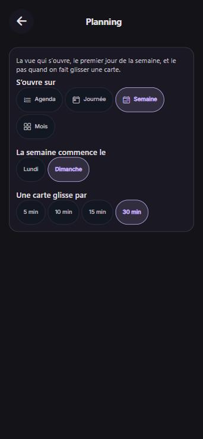
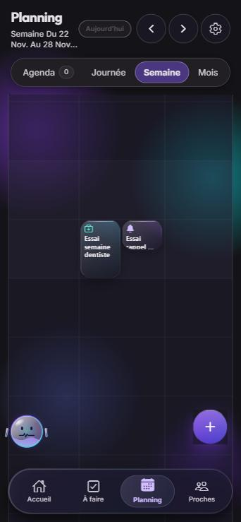
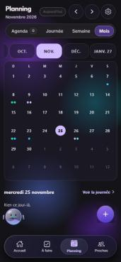

# FICHE OPÉRATOIRE N° 028 — Finitions : le Planning réglable, la Semaine en GlowCards, deux astuces, « Ami·e », et le thème clair pour les nouveaux

Projet : **Junix Pulse** · Date : 25 novembre 2026 · Suite de : [FICHE 027](FICHE-027-planning-glowcards-et-mois.md) · Étude : [ÉTUDE 001](../etudes/ETUDE-001-clarifier-et-faire-evoluer.md), 12.3, 12.8, 16.1 et 16.3

---

## 1. Objectif

Terminer ce qui était commencé avant le n° 9 (étude 16.1, « Finitions ») :

| Finition | Ce qui change |
|---|---|
| **Réglages du Planning** (12.8) | une page **Planning** dans les Paramètres : **s'ouvre sur** Agenda · Journée · Semaine · Mois ; **la semaine commence le** lundi ou le dimanche ; **une carte glisse par** 5, 10, 15 ou 30 min. L'agenda du téléphone y est rangé aussi |
| **La Semaine en GlowCards** | moments et rappels deviennent les mêmes GlowCards que la Journée, aux mêmes couleurs ; les rappels se mettent **côte à côte** avec les moments au lieu de flotter en pastilles ; un jour fait 128 points de large, une heure 88 |
| **Deux astuces** (12.3) | « Touche un jour, puis fais glisser… » la première fois que le **Mois** montre quelque chose ; « Tu peux lui envoyer l'invitation » la première fois qu'un élément **a quelqu'un** |
| **« Friend »** | une relation enregistrée dans une autre langue (« Friend ») s'affiche dans celle du jour (« Ami·e ») ; un texte libre (« Maman ») reste tel quel ; les données ne changent pas |
| **Thème clair pour les nouveaux** (16.3) | un appareil **neuf** commence en clair ; ceux qui ont déjà l'appli gardent leur thème |

Rien ne change pour qui ne touche à rien : les valeurs par défaut sont celles d'avant (Agenda, lundi, 15 min).



*Figure 28-1 — Capture réelle (web, 360 px). La page Planning : « S'ouvre sur », « La semaine commence le », « Une carte glisse par » (ici réglés sur Semaine, Dimanche, 30 min pour l'essai).*

## 2. État de départ

| À vérifier | Comment | Résultat attendu |
|---|---|---|
| La fiche 027 est enregistrée | `git log --oneline -3` | on voit `feat(planning): Day and Month views in GlowCards…` |
| Tout passe | `npx jest` | `Tests: 2093 passed` (ou plus) |

## 3. Matériel

Rien de nouveau : aucune bibliothèque ajoutée.

## 4. Hypothèses

- **Le thème clair** : la migration 39 passe en clair seulement les appareils dont la présentation (onboarding) **n'est pas terminée**. C'est le cas d'un appareil neuf au moment où les migrations tournent ; un utilisateur qui a déjà l'appli a terminé sa présentation, il garde donc son thème.
- **« Friend »** : la relation est rangée comme le texte choisi au moment de la création (fiche ancienne). On la retraduit à l'affichage, sans réécrire les données (règle « Préserver les données »).
- **Les astuces** suivent la règle de la fiche 024 : une fois chacune, et jamais deux le même jour.

## 5. Carte de l'intervention

| Fichier | Action |
|---|---|
| `src/domain/rules/planning-settings-rules.ts` (+ test) | **nouveau** : les réglages du Planning, lus strictement |
| `src/domain/rules/planning-move-rules.ts` | le pas et le premier jour de la semaine en paramètres |
| `src/domain/rules/person-rules.ts` | `knownRelationKey` : reconnaître une relation connue dans toutes les langues |
| `src/features/people/relation-label.ts` | **nouveau** : la relation affichée dans la langue du jour |
| `src/database/migrations.ts` | migration 39 : thème clair des nouveaux, colonne `planning_prefs` |
| entité, dépôt et sauvegarde des réglages | `planningPrefs` lu, écrit, sauvegardé |
| `src/components/settings/PlanningSetting.tsx` | **nouveau** : les trois choix |
| `src/app/settings/index.tsx` | la page Planning dans le sommaire, l'agenda du téléphone y passe |
| `src/app/(tabs)/calendar.tsx` et les vues | lisent et suivent les réglages |
| `src/components/schedule/WeeklyTimetableGrid.tsx`, `PlanningCard.tsx` | la Semaine en GlowCards, taille « minuscule » de carte |
| astuces : règles, catalogues, `ShareItemCard` | `monthDrag` et `invite` |
| `people.tsx`, `people/[id].tsx` | la relation traduite |
| textes FR et EN | `planningSettings.*`, « Le mode clair est le réglage par défaut » |

## 6. Sauvegarde

`git status` doit être propre (hors `docs/motion/`). La migration 39 **ajoute** une colonne et ne change le thème que d'un appareil neuf : rien n'est perdu. Retour en arrière : section 10.

## 7. Pas à pas

L'étape 9 applique toute la fiche d'un coup. Les étapes 1 à 8 expliquent chaque morceau.

### Étape 1 — Le pas et le premier jour deviennent des réglages

**Pourquoi** : jusque-là, 15 minutes et le lundi étaient écrits en dur. Ils deviennent des paramètres, avec ces mêmes valeurs par défaut : tout code qui ne passe rien garde le comportement d'avant.

Dans `src/domain/rules/planning-settings-rules.ts` (nouveau) :

<!-- bloc: prefs-rules -->

```ts
/**
 * The Planning settings (study 001, 12.8; sheet 028): the view it opens on, the first day of the
 * week and the step of a move. Kept as one short text in the settings row, read strictly: a value
 * missing, old or damaged falls back to the default, so nothing breaks.
 */
import type { WeekStart } from './planning-move-rules';

export const PLANNING_VIEWS = ['agenda', 'timetable', 'week', 'month'] as const;
export type PlanningView = (typeof PLANNING_VIEWS)[number];

/** The steps a card can move by, in minutes. */
export const DRAG_STEPS = [5, 10, 15, 30] as const;
export type DragStep = (typeof DRAG_STEPS)[number];

export interface PlanningPrefs {
  openView: PlanningView;
  weekStart: WeekStart;
  dragStep: DragStep;
}

/** What the Planning did before these settings existed: the list, Monday, a quarter of an hour. */
export const DEFAULT_PLANNING_PREFS: Readonly<PlanningPrefs> = { openView: 'agenda', weekStart: 1, dragStep: 15 };

/** The settings read from their text; each value checked on its own. */
export function planningPrefsOf(text: string | null | undefined): PlanningPrefs {
  let raw: Record<string, unknown> = {};
  if (text) {
    try {
      const parsed: unknown = JSON.parse(text);
      if (parsed && typeof parsed === 'object' && !Array.isArray(parsed)) raw = parsed as Record<string, unknown>;
    } catch {
      raw = {};
    }
  }
  const openView = (PLANNING_VIEWS as readonly unknown[]).includes(raw.openView) ? (raw.openView as PlanningView) : DEFAULT_PLANNING_PREFS.openView;
  const weekStart = raw.weekStart === 0 || raw.weekStart === 1 ? raw.weekStart : DEFAULT_PLANNING_PREFS.weekStart;
  const dragStep = (DRAG_STEPS as readonly unknown[]).includes(raw.dragStep) ? (raw.dragStep as DragStep) : DEFAULT_PLANNING_PREFS.dragStep;
  return { openView, weekStart, dragStep };
}

/** The settings as the text kept in the settings row. */
export function planningPrefsText(prefs: PlanningPrefs): string {
  return JSON.stringify({ openView: prefs.openView, weekStart: prefs.weekStart, dragStep: prefs.dragStep });
}
```

Dans `src/domain/rules/planning-move-rules.ts` :

Passage 1 sur 4 — repère (Ctrl+F) : la première ligne du bloc « avant ».

<!-- bloc: move-1-avant -->

```ts
 */
import type { RecurrenceRule } from '../entities';

/** A card lands on a quarter of an hour: 19:00 or 19:15, never 19:07. */
export const SNAP_MINUTES = 15;

/**
 * The height of one hour in the Day view, in points (the Week view keeps its own 48): 96 gives a
 * quarter of an hour 24 points, and room for the GlowCards (sheet 027).
```

devient :

<!-- bloc: move-1-apres -->

```ts
 */
import type { RecurrenceRule } from '../entities';

/** A card lands on a quarter of an hour: 19:00 or 19:15, never 19:07 (the default step). */
export const SNAP_MINUTES = 15;

/** The first day of the week: Monday (1) or Sunday (0), as in Date.getDay(). */
export type WeekStart = 0 | 1;

/**
 * The height of one hour in the Day view, in points (the Week view keeps its own 48): 96 gives a
 * quarter of an hour 24 points, and room for the GlowCards (sheet 027).
```

Passage 2 sur 4 — repère (Ctrl+F) : la première ligne du bloc « avant ».

<!-- bloc: move-2-avant -->

```ts
/** The dots of a day in the Month view; beyond, "+2". */
export const MONTH_DOTS_MAX = 3;

/** The nearest quarter of an hour (0 stays 0, -7 becomes -0 and is given as 0). */
export function snapMinutes(minutes: number): number {
  const snapped = Math.round(minutes / SNAP_MINUTES) * SNAP_MINUTES;
  return snapped === 0 ? 0 : snapped;
}

/** How many minutes a vertical move of the finger means, already on a quarter of an hour. */
export function minutesForOffset(offsetY: number, hourHeight: number): number {
  if (hourHeight <= 0) return 0;
  return snapMinutes((offsetY / hourHeight) * 60);
}

/** How many columns (days) a horizontal move means: half a column is enough to change day. */
```

devient :

<!-- bloc: move-2-apres -->

```ts
/** The dots of a day in the Month view; beyond, "+2". */
export const MONTH_DOTS_MAX = 3;

/**
 * The nearest step (a quarter of an hour unless the Planning settings say 5, 10 or 30 minutes,
 * sheet 028). 0 stays 0, -7 becomes -0 and is given as 0.
 */
export function snapMinutes(minutes: number, step: number = SNAP_MINUTES): number {
  const size = step > 0 ? step : SNAP_MINUTES;
  const snapped = Math.round(minutes / size) * size;
  return snapped === 0 ? 0 : snapped;
}

/** How many minutes a vertical move of the finger means, already on a step. */
export function minutesForOffset(offsetY: number, hourHeight: number, step: number = SNAP_MINUTES): number {
  if (hourHeight <= 0) return 0;
  return snapMinutes((offsetY / hourHeight) * 60, step);
}

/** How many columns (days) a horizontal move means: half a column is enough to change day. */
```

Passage 3 sur 4 — repère (Ctrl+F) : la première ligne du bloc « avant ».

<!-- bloc: move-3-avant -->

```ts
  return Math.min(count - 1, Math.max(0, column));
}

/** A start moved by minutes and days; the time of day is put back on a quarter of an hour. */
export function movedStart(start: Date, minutes: number, days: number): Date {
  const next = new Date(start.getTime());
  next.setDate(next.getDate() + days);
  next.setMinutes(next.getMinutes() + minutes);
  const sinceMidnight = next.getHours() * 60 + next.getMinutes();
  const snapped = snapMinutes(sinceMidnight);
  next.setHours(0, 0, 0, 0);
  next.setMinutes(snapped);
  return next;
}

/** A moment moved: the start moves, the length stays the same. */
export function movedRange(start: Date, end: Date, minutes: number, days: number): { start: Date; end: Date } {
  const nextStart = movedStart(start, minutes, days);
  const length = Math.max(0, end.getTime() - start.getTime());
  return { start: nextStart, end: new Date(nextStart.getTime() + length) };
}
```

devient :

<!-- bloc: move-3-apres -->

```ts
  return Math.min(count - 1, Math.max(0, column));
}

/** A start moved by minutes and days; the time of day is put back on a step (a quarter of an hour by default). */
export function movedStart(start: Date, minutes: number, days: number, step: number = SNAP_MINUTES): Date {
  const next = new Date(start.getTime());
  next.setDate(next.getDate() + days);
  next.setMinutes(next.getMinutes() + minutes);
  const sinceMidnight = next.getHours() * 60 + next.getMinutes();
  const snapped = snapMinutes(sinceMidnight, step);
  next.setHours(0, 0, 0, 0);
  next.setMinutes(snapped);
  return next;
}

/** A moment moved: the start moves, the length stays the same. */
export function movedRange(
  start: Date,
  end: Date,
  minutes: number,
  days: number,
  step: number = SNAP_MINUTES
): { start: Date; end: Date } {
  const nextStart = movedStart(start, minutes, days, step);
  const length = Math.max(0, end.getTime() - start.getTime());
  return { start: nextStart, end: new Date(nextStart.getTime() + length) };
}
```

Passage 4 sur 4 — repère (Ctrl+F) : la première ligne du bloc « avant ».

<!-- bloc: move-4-avant -->

```ts
  return null;
}

/** The 42 days (6 weeks, Monday first) that show a month, with the days of the months around. */
export function monthGrid(anyDayOfMonth: Date): Date[] {
  const first = new Date(anyDayOfMonth.getFullYear(), anyDayOfMonth.getMonth(), 1);
  const back = (first.getDay() + 6) % 7; // Monday = 0
  const start = new Date(first.getFullYear(), first.getMonth(), 1 - back);
  return Array.from({ length: 42 }, (_, i) => new Date(start.getFullYear(), start.getMonth(), start.getDate() + i));
}

/** The first and last day shown by a month grid, as YYYY-MM-DD. */
export function monthGridRange(anyDayOfMonth: Date): { from: string; to: string } {
  const days = monthGrid(anyDayOfMonth);
  return { from: dayKey(days[0]), to: dayKey(days[days.length - 1]) };
}

```

devient :

<!-- bloc: move-4-apres -->

```ts
  return null;
}

/**
 * The 42 days (6 weeks) that show a month, with the days of the months around. The week starts on
 * Monday (1) unless the Planning settings say Sunday (0), sheet 028.
 */
export function monthGrid(anyDayOfMonth: Date, weekStart: WeekStart = 1): Date[] {
  const first = new Date(anyDayOfMonth.getFullYear(), anyDayOfMonth.getMonth(), 1);
  const back = (first.getDay() - weekStart + 7) % 7;
  const start = new Date(first.getFullYear(), first.getMonth(), 1 - back);
  return Array.from({ length: 42 }, (_, i) => new Date(start.getFullYear(), start.getMonth(), start.getDate() + i));
}

/** The first and last day shown by a month grid, as YYYY-MM-DD. */
export function monthGridRange(anyDayOfMonth: Date, weekStart: WeekStart = 1): { from: string; to: string } {
  const days = monthGrid(anyDayOfMonth, weekStart);
  return { from: dayKey(days[0]), to: dayKey(days[days.length - 1]) };
}

```

Dans `src/domain/rules/person-rules.ts` :

Passage 1 sur 1 — repère (Ctrl+F) : la première ligne du bloc « avant ».

<!-- bloc: person-1-avant -->

```ts

  return diffNextYear >= 0 && diffNextYear <= withinDays;
}
```

devient :

<!-- bloc: person-1-apres -->

```ts

  return diffNextYear >= 0 && diffNextYear <= withinDays;
}

/** A label written without case, accents, spaces or the middle dot of « Ami·e ». */
function normalizedLabel(text: string): string {
  return text
    .normalize('NFD')
    .replace(/[̀-ͯ]/g, '')
    .toLowerCase()
    .replace(/[·.\s]/g, '');
}

/**
 * The known relation a stored text names, in any language of the app (sheet 028). A relation is
 * kept as the words chosen at the time (« Friend » if the app was in English then); shown again,
 * a known one is translated into the language of today. A free text (« Maman ») gives null and
 * stays as written. « Ami·e » is also recognised as « Ami » and « Amie ».
 */
export function knownRelationKey<K extends string>(stored: string | null | undefined, labels: Readonly<Record<K, readonly string[]>>): K | null {
  if (!stored) return null;
  const wanted = normalizedLabel(stored);
  if (!wanted) return null;
  for (const key of Object.keys(labels) as K[]) {
    for (const label of labels[key]) {
      const variants = [label, label.replace(/·e\b/g, ''), label.replace(/·/g, '')];
      if (variants.some(variant => normalizedLabel(variant) === wanted)) return key;
    }
  }
  return null;
}
```

Dans `src/domain/rules/__tests__/planning-settings-rules.test.ts` (nouveau) :

<!-- bloc: prefs-test -->

```ts
import { knownRelationKey } from '../person-rules';
import { monthGrid, movedStart, snapMinutes } from '../planning-move-rules';
import { DEFAULT_PLANNING_PREFS, planningPrefsOf, planningPrefsText } from '../planning-settings-rules';

describe('planning settings (sheet 028)', () => {
  it('reads the settings strictly and falls back on each value', () => {
    expect(planningPrefsOf(null)).toEqual(DEFAULT_PLANNING_PREFS);
    expect(planningPrefsOf('not json')).toEqual(DEFAULT_PLANNING_PREFS);
    expect(planningPrefsOf('{"openView":"month","weekStart":0,"dragStep":30}')).toEqual({ openView: 'month', weekStart: 0, dragStep: 30 });
    expect(planningPrefsOf('{"openView":"year","weekStart":3,"dragStep":7}')).toEqual(DEFAULT_PLANNING_PREFS);
    const prefs = { openView: 'week', weekStart: 0, dragStep: 5 } as const;
    expect(planningPrefsOf(planningPrefsText(prefs))).toEqual(prefs);
  });

  it('moves by the chosen step', () => {
    expect(snapMinutes(7, 5)).toBe(5);
    expect(snapMinutes(14, 30)).toBe(0);
    expect(snapMinutes(16, 30)).toBe(30);
    expect(movedStart(new Date(2026, 10, 25, 9, 0), 22, 0, 10)).toEqual(new Date(2026, 10, 25, 9, 20));
  });

  it('starts the month on Sunday when asked', () => {
    // November 2026 starts on a Sunday
    expect(monthGrid(new Date(2026, 10, 25), 0)[0]).toEqual(new Date(2026, 10, 1));
    expect(monthGrid(new Date(2026, 10, 25), 1)[0]).toEqual(new Date(2026, 9, 26));
  });
});

describe('knownRelationKey (sheet 028)', () => {
  const labels = {
    'rel.friend': ['Ami·e', 'Friend'],
    'rel.family': ['Famille', 'Family'],
    'rel.client': ['Client·e', 'Client'],
  } as const;

  it('finds a known relation in any language and any writing', () => {
    expect(knownRelationKey('Friend', labels)).toBe('rel.friend');
    expect(knownRelationKey('ami', labels)).toBe('rel.friend');
    expect(knownRelationKey('Amie', labels)).toBe('rel.friend');
    expect(knownRelationKey('  FAMILLE ', labels)).toBe('rel.family');
    expect(knownRelationKey('cliente', labels)).toBe('rel.client');
  });

  it('leaves a free text as it is', () => {
    expect(knownRelationKey('Maman', labels)).toBeNull();
    expect(knownRelationKey('', labels)).toBeNull();
    expect(knownRelationKey(undefined, labels)).toBeNull();
  });
});
```

**Contrôle** : `npx jest src/domain/rules/__tests__/planning-settings-rules.test.ts` → `Tests: 5 passed`.

### Étape 2 — Les données : migration 39

> [danger] Une migration ne se défait pas sur un téléphone déjà mis à jour. Celle-ci **ajoute** une colonne et ne touche le thème que d'un appareil dont la présentation n'est pas finie : aucune donnée n'est perdue.

Dans `src/database/migrations.ts` :

Passage 1 sur 1 — repère (Ctrl+F) : la première ligne du bloc « avant ».

<!-- bloc: mig-1-avant -->

```ts
      );
    `,
  },
];

```

devient :

<!-- bloc: mig-1-apres -->

```ts
      );
    `,
  },
  {
    version: 39,
    name: 'light_theme_for_new_devices_and_planning_prefs',
    sql: `
      -- Un appareil neuf commence en theme clair (fiche 028, etude 16.3).
      -- Seul un appareil dont la presentation n est pas terminee change :
      -- celui qui utilise deja l appli garde son theme.
      UPDATE settings SET appearance_mode = 'light' WHERE onboarding_completed = 0;
      -- Les reglages du Planning (fiche 028, etude 12.8) : vue d ouverture,
      -- premier jour de la semaine, pas du glisser. Vide : les valeurs d avant.
      ALTER TABLE settings ADD COLUMN planning_prefs TEXT;
    `,
  },
];

```

Dans `src/domain/entities/index.ts` :

Passage 1 sur 2 — repère (Ctrl+F) : la première ligne du bloc « avant ».

<!-- bloc: ent-1-avant -->

```ts
} from '../enums';
import type { LanguageSetting } from '../rules/language-rules';
import type { AlertDefaults } from '../rules/notification-level-rules';
import type { TagColor } from '../rules/tag-rules';

export * from '../enums';
```

devient :

<!-- bloc: ent-1-apres -->

```ts
} from '../enums';
import type { LanguageSetting } from '../rules/language-rules';
import type { AlertDefaults } from '../rules/notification-level-rules';
import type { PlanningPrefs } from '../rules/planning-settings-rules';
import type { TagColor } from '../rules/tag-rules';

export * from '../enums';
```

Passage 2 sur 2 — repère (Ctrl+F) : la première ligne du bloc « avant ».

<!-- bloc: ent-2-avant -->

```ts
  quietHoursEnd?: number;
  /** The default level of reminders, deadlines, moments and habits (sheet 023); all normal at first. */
  alertLevels?: AlertDefaults;
  /**
   * Mode d'apparence choisi : suit le système, clair, ou sombre.
   * Valeur par défaut : 'dark'.
   */
  appearanceMode: AppearanceMode;
  /** Cards and bars on a plain background instead of glass. False by default. */
```

devient :

<!-- bloc: ent-2-apres -->

```ts
  quietHoursEnd?: number;
  /** The default level of reminders, deadlines, moments and habits (sheet 023); all normal at first. */
  alertLevels?: AlertDefaults;
  /** The view the Planning opens on, the first day of the week and the step of a move (sheet 028). */
  planningPrefs?: PlanningPrefs;
  /**
   * Mode d'apparence choisi : suit le système, clair, ou sombre.
   * Valeur par défaut : 'light' pour un appareil neuf depuis la fiche 028 ('dark' avant).
   */
  appearanceMode: AppearanceMode;
  /** Cards and bars on a plain background instead of glass. False by default. */
```

Dans `src/repositories/settings-repository.ts` :

Passage 1 sur 3 — repère (Ctrl+F) : la première ligne du bloc « avant ».

<!-- bloc: repo-1-avant -->

```ts
import { DEFAULT_LANGUAGE_SETTING, isLanguageSetting } from '../domain/rules/language-rules';
import { isAppLockDelay } from '../domain/rules/app-lock-rules';
import { alertDefaultsOf, alertDefaultsText } from '../domain/rules/notification-level-rules';

const VALID_APPEARANCE_MODES: ReadonlySet<AppearanceMode> = new Set(['system', 'light', 'dark']);
const VALID_MASCOT_PRESENCE: ReadonlySet<string> = new Set<MascotPresence>(['full', 'discreet', 'off']);
```

devient :

<!-- bloc: repo-1-apres -->

```ts
import { DEFAULT_LANGUAGE_SETTING, isLanguageSetting } from '../domain/rules/language-rules';
import { isAppLockDelay } from '../domain/rules/app-lock-rules';
import { alertDefaultsOf, alertDefaultsText } from '../domain/rules/notification-level-rules';
import { planningPrefsOf, planningPrefsText } from '../domain/rules/planning-settings-rules';

const VALID_APPEARANCE_MODES: ReadonlySet<AppearanceMode> = new Set(['system', 'light', 'dark']);
const VALID_MASCOT_PRESENCE: ReadonlySet<string> = new Set<MascotPresence>(['full', 'discreet', 'off']);
```

Passage 2 sur 3 — repère (Ctrl+F) : la première ligne du bloc « avant ».

<!-- bloc: repo-2-avant -->

```ts
    quietHoursStart: (row.quiet_hours_start as number | undefined) ?? 22,
    quietHoursEnd: (row.quiet_hours_end as number | undefined) ?? 7,
    alertLevels: alertDefaultsOf(row.alert_levels as string | null | undefined),
    appearanceMode,
    reduceTransparency: (row.reduce_transparency as number) === 1,
    appearanceDark: row.appearance_dark !== undefined ? (row.appearance_dark as number) === 1 : true,
```

devient :

<!-- bloc: repo-2-apres -->

```ts
    quietHoursStart: (row.quiet_hours_start as number | undefined) ?? 22,
    quietHoursEnd: (row.quiet_hours_end as number | undefined) ?? 7,
    alertLevels: alertDefaultsOf(row.alert_levels as string | null | undefined),
    planningPrefs: planningPrefsOf(row.planning_prefs as string | null | undefined),
    appearanceMode,
    reduceTransparency: (row.reduce_transparency as number) === 1,
    appearanceDark: row.appearance_dark !== undefined ? (row.appearance_dark as number) === 1 : true,
```

Passage 3 sur 3 — repère (Ctrl+F) : la première ligne du bloc « avant ».

<!-- bloc: repo-3-avant -->

```ts
      setClauses.push('alert_levels = ?');
      values.push(alertDefaultsText(params.alertLevels));
    }

    if (params.mascotPresence !== undefined && VALID_MASCOT_PRESENCE.has(params.mascotPresence)) {
      setClauses.push('mascot_presence = ?');
```

devient :

<!-- bloc: repo-3-apres -->

```ts
      setClauses.push('alert_levels = ?');
      values.push(alertDefaultsText(params.alertLevels));
    }
    if (params.planningPrefs !== undefined) {
      setClauses.push('planning_prefs = ?');
      values.push(planningPrefsText(params.planningPrefs));
    }

    if (params.mascotPresence !== undefined && VALID_MASCOT_PRESENCE.has(params.mascotPresence)) {
      setClauses.push('mascot_presence = ?');
```

Dans `src/services/backup-service.ts` :

Passage 1 sur 1 — repère (Ctrl+F) : la première ligne du bloc « avant ».

<!-- bloc: bk-1-avant -->

```ts
  planning_blocks: ['id', 'schedule_id', 'label', 'type', 'day_of_week', 'start_time', 'end_time', 'color', 'created_at', 'updated_at'],
  interactions: ['id', 'person_id', 'type', 'occurred_at', 'notes', 'reminder_id', 'task_id', 'event_id', 'created_at'],
  suggestions: ['id', 'type', 'status', 'title', 'explanation', 'target_id', 'target_type', 'proposed_data', 'generated_at', 'expires_at', 'decided_at', 'created_at'],
  settings: ['id', 'display_name', 'timezone', 'onboarding_completed', 'notifications_enabled', 'forgotten_contact_threshold_days', 'end_of_day_hour', 'morning_briefing_hour', 'appearance_dark', 'appearance_mode', 'mascot_presence', 'mascot_address', 'mascot_proposals', 'mascot_briefings', 'language', 'notification_sound_enabled', 'haptics_enabled', 'quiet_hours_start', 'quiet_hours_end', 'alert_levels', 'created_at', 'updated_at'],
  sanctum_notes: ['id', 'title', 'content', 'folder', 'created_at', 'updated_at'],
};

```

devient :

<!-- bloc: bk-1-apres -->

```ts
  planning_blocks: ['id', 'schedule_id', 'label', 'type', 'day_of_week', 'start_time', 'end_time', 'color', 'created_at', 'updated_at'],
  interactions: ['id', 'person_id', 'type', 'occurred_at', 'notes', 'reminder_id', 'task_id', 'event_id', 'created_at'],
  suggestions: ['id', 'type', 'status', 'title', 'explanation', 'target_id', 'target_type', 'proposed_data', 'generated_at', 'expires_at', 'decided_at', 'created_at'],
  settings: ['id', 'display_name', 'timezone', 'onboarding_completed', 'notifications_enabled', 'forgotten_contact_threshold_days', 'end_of_day_hour', 'morning_briefing_hour', 'appearance_dark', 'appearance_mode', 'mascot_presence', 'mascot_address', 'mascot_proposals', 'mascot_briefings', 'language', 'notification_sound_enabled', 'haptics_enabled', 'quiet_hours_start', 'quiet_hours_end', 'alert_levels', 'planning_prefs', 'created_at', 'updated_at'],
  sanctum_notes: ['id', 'title', 'content', 'folder', 'created_at', 'updated_at'],
};

```

**Contrôle** : `npx jest src/database src/services` passe.

### Étape 3 — La page Planning des Paramètres

Dans `src/components/settings/PlanningSetting.tsx` (nouveau) :

<!-- bloc: prefs-card -->

```tsx
/**
 * The Planning settings (study 001, 12.8; sheet 028): the view it opens on, the first day of the
 * week, and the step a card moves by. Each choice is saved at once; the Planning reads them the
 * next time it is shown.
 */
import React from 'react';
import { View } from 'react-native';

import { ChoiceChips, FieldLabel, type Choice } from '@/components/create/form/FormBricks';
import { Spacing } from '@/constants/theme';
import { DRAG_STEPS, type DragStep, type PlanningPrefs, type PlanningView } from '@/domain/rules/planning-settings-rules';
import { useTheme } from '@/hooks/use-theme';
import { useT } from '@/i18n';

export function PlanningSetting({ value, onChange }: { value: PlanningPrefs; onChange: (next: PlanningPrefs) => void }) {
  const t = useT();
  const { palette } = useTheme();
  const views: Choice<PlanningView>[] = [
    { value: 'agenda', label: t('calendar.view.agenda'), icon: 'list-outline' },
    { value: 'timetable', label: t('calendar.view.day'), icon: 'today-outline' },
    { value: 'week', label: t('calendar.view.week'), icon: 'calendar-outline' },
    { value: 'month', label: t('planning.view.month'), icon: 'grid-outline' },
  ];
  const starts: Choice<'1' | '0'>[] = [
    { value: '1', label: t('planningSettings.monday') },
    { value: '0', label: t('planningSettings.sunday') },
  ];
  const steps: Choice<`${DragStep}`>[] = DRAG_STEPS.map(step => ({
    value: `${step}` as `${DragStep}`,
    label: t('planningSettings.minutes', { minutes: step }),
  }));
  return (
    <View style={{ gap: Spacing.sm }}>
      <View>
        <FieldLabel label={t('planningSettings.openView')} />
        <ChoiceChips
          options={views}
          value={value.openView}
          onChange={openView => onChange({ ...value, openView })}
          accent={palette.primary.default}
          testIDPrefix="planning-open-view"
        />
      </View>
      <View>
        <FieldLabel label={t('planningSettings.weekStart')} />
        <ChoiceChips
          options={starts}
          value={`${value.weekStart}` as '1' | '0'}
          onChange={start => onChange({ ...value, weekStart: start === '0' ? 0 : 1 })}
          accent={palette.primary.default}
          testIDPrefix="planning-week-start"
        />
      </View>
      <View>
        <FieldLabel label={t('planningSettings.dragStep')} />
        <ChoiceChips
          options={steps}
          value={`${value.dragStep}` as `${DragStep}`}
          onChange={step => onChange({ ...value, dragStep: Number(step) as DragStep })}
          accent={palette.primary.default}
          testIDPrefix="planning-drag-step"
        />
      </View>
    </View>
  );
}
```

Dans `src/app/settings/index.tsx` :

Passage 1 sur 9 — repère (Ctrl+F) : la première ligne du bloc « avant ».

<!-- bloc: set-1-avant -->

```tsx
import { useDateLocale, useLanguage, useT, type MessageKey } from '@/i18n';
import { LanguagePicker } from '@/components/settings/LanguagePicker';
import { AlertDefaultsSetting } from '@/components/settings/AlertDefaultsSetting';
import { DEFAULT_ALERT_DEFAULTS, type AlertFamily } from '@/domain/rules/notification-level-rules';
import type { AlertLevel } from '@/domain/entities';
import { makeSettingsStyles } from '@/styles/settings/settings-styles';

```

devient :

<!-- bloc: set-1-apres -->

```tsx
import { useDateLocale, useLanguage, useT, type MessageKey } from '@/i18n';
import { LanguagePicker } from '@/components/settings/LanguagePicker';
import { AlertDefaultsSetting } from '@/components/settings/AlertDefaultsSetting';
import { PlanningSetting } from '@/components/settings/PlanningSetting';
import { DEFAULT_ALERT_DEFAULTS, type AlertFamily } from '@/domain/rules/notification-level-rules';
import { DEFAULT_PLANNING_PREFS, type PlanningPrefs } from '@/domain/rules/planning-settings-rules';
import type { AlertLevel } from '@/domain/entities';
import { makeSettingsStyles } from '@/styles/settings/settings-styles';

```

Passage 2 sur 9 — repère (Ctrl+F) : la première ligne du bloc « avant ».

<!-- bloc: set-2-avant -->

```tsx
];

/** The pages of the settings: the summary lists them, each opens on its own. */
type SettingsSection = 'notifications' | 'mascot' | 'security' | 'data';
type SettingsPage = SettingsSection;

const HUB_SECTIONS: readonly {
```

devient :

<!-- bloc: set-2-apres -->

```tsx
];

/** The pages of the settings: the summary lists them, each opens on its own. */
type SettingsSection = 'notifications' | 'planning' | 'mascot' | 'security' | 'data';
type SettingsPage = SettingsSection;

const HUB_SECTIONS: readonly {
```

Passage 3 sur 9 — repère (Ctrl+F) : la première ligne du bloc « avant ».

<!-- bloc: set-3-avant -->

```tsx
  color: 'primary' | 'tertiary' | 'success' | 'error';
}[] = [
  { id: 'notifications', titleKey: 'settingsHub.notifications', icon: 'notifications-outline', color: 'tertiary' },
  { id: 'mascot', titleKey: 'mascotSettings.title', icon: 'happy-outline', color: 'primary' },
  { id: 'security', titleKey: 'settingsHub.security', icon: 'shield-checkmark-outline', color: 'success' },
  { id: 'data', titleKey: 'settingsHub.data', icon: 'cloud-outline', color: 'tertiary' },
```

devient :

<!-- bloc: set-3-apres -->

```tsx
  color: 'primary' | 'tertiary' | 'success' | 'error';
}[] = [
  { id: 'notifications', titleKey: 'settingsHub.notifications', icon: 'notifications-outline', color: 'tertiary' },
  // The Planning (sheet 028): its view, the week, the step, and the phone's calendar
  { id: 'planning', titleKey: 'tab.calendar', icon: 'calendar-outline', color: 'primary' },
  { id: 'mascot', titleKey: 'mascotSettings.title', icon: 'happy-outline', color: 'primary' },
  { id: 'security', titleKey: 'settingsHub.security', icon: 'shield-checkmark-outline', color: 'success' },
  { id: 'data', titleKey: 'settingsHub.data', icon: 'cloud-outline', color: 'tertiary' },
```

Passage 4 sur 9 — repère (Ctrl+F) : la première ligne du bloc « avant ».

<!-- bloc: set-4-avant -->

```tsx
    }
  };

  // The default level of each family (sheet 023): the planned notifications follow at once
  const handleUpdateAlertDefault = async (family: AlertFamily, level: AlertLevel) => {
    if (!settings) return;
```

devient :

<!-- bloc: set-4-apres -->

```tsx
    }
  };

  // The Planning settings (sheet 028): saved at once, read by the Planning when it is shown again
  const handleUpdatePlanning = async (planningPrefs: PlanningPrefs) => {
    try {
      await SettingsRepository.update({ planningPrefs, updatedAt: new Date().toISOString() });
      setSettings(s => (s ? { ...s, planningPrefs } : s));
    } catch (e) {
      GlassAlert.alert(t('common.error'), e instanceof Error ? e.message : t('common.genericError'));
    }
  };

  // The default level of each family (sheet 023): the planned notifications follow at once
  const handleUpdateAlertDefault = async (family: AlertFamily, level: AlertLevel) => {
    if (!settings) return;
```

Passage 5 sur 9 — repère (Ctrl+F) : la première ligne du bloc « avant ».

<!-- bloc: set-5-avant -->

```tsx
  });


  const summaries: Record<SettingsSection, string> = {
    notifications: settings.notificationsEnabled
      ? [
```

devient :

<!-- bloc: set-5-apres -->

```tsx
  });


  // The Planning in one line, for the summary
  const planningPrefs = settings.planningPrefs ?? DEFAULT_PLANNING_PREFS;
  const planningViewKeys = { agenda: 'calendar.view.agenda', timetable: 'calendar.view.day', week: 'calendar.view.week', month: 'planning.view.month' } as const;
  const planningSummary = [
    t(planningViewKeys[planningPrefs.openView]),
    t(planningPrefs.weekStart === 0 ? 'planningSettings.sunday' : 'planningSettings.monday'),
    t('planningSettings.minutes', { minutes: planningPrefs.dragStep }),
  ].join(' · ');

  const summaries: Record<SettingsSection, string> = {
    notifications: settings.notificationsEnabled
      ? [
```

Passage 6 sur 9 — repère (Ctrl+F) : la première ligne du bloc « avant ».

<!-- bloc: set-6-avant -->

```tsx
      isSanctumPinConfigured ? t('settingsHub.sanctumOn') : t('settingsHub.sanctumOff'),
    ].join(' · '),
    data: autoBackup ? autoBackupStatus : t('settingsHub.backupOff'),
  };

  const renderHub = () => (
```

devient :

<!-- bloc: set-6-apres -->

```tsx
      isSanctumPinConfigured ? t('settingsHub.sanctumOn') : t('settingsHub.sanctumOff'),
    ].join(' · '),
    data: autoBackup ? autoBackupStatus : t('settingsHub.backupOff'),
    planning: planningSummary,
  };

  const renderHub = () => (
```

Passage 7 sur 9 — repère (Ctrl+F) : la première ligne du bloc « avant ».

<!-- bloc: set-7-avant -->

```tsx
    </View>
  );

  const renderData = () => (
    <View style={styles.section}>
      {/* Sauvegarde automatique d'abord : c'est celle qui protège sans y penser */}
```

devient :

<!-- bloc: set-7-apres -->

```tsx
    </View>
  );

  // The Planning page (sheet 028): how it opens, the week, the step of a move, the phone's calendar
  const renderPlanning = () => (
    <View>
      <View style={styles.rowCol}>
        <Text style={styles.rowSub}>{t('planningSettings.hint')}</Text>
        <PlanningSetting value={planningPrefs} onChange={handleUpdatePlanning} />
      </View>
      {Platform.OS !== 'web' && (
        <View style={styles.row}>
          <View style={styles.rowTextFill}>
            <Text style={styles.rowLabel}>{t('deviceCalendar.label')}</Text>
            <Text style={styles.rowSub}>{t('deviceCalendar.hint')}</Text>
          </View>
          <Switch
            value={settings.deviceCalendarEnabled}
            onValueChange={handleToggleDeviceCalendar}
            {...switchColors(settings.deviceCalendarEnabled)}
            accessibilityLabel={t('deviceCalendar.label')}
            testID="settings-device-calendar"
          />
        </View>
      )}
    </View>
  );

  const renderData = () => (
    <View style={styles.section}>
      {/* Sauvegarde automatique d'abord : c'est celle qui protège sans y penser */}
```

Passage 8 sur 9 — repère (Ctrl+F) : la première ligne du bloc « avant ».

<!-- bloc: set-8-avant -->

```tsx
        <Ionicons name="cloud-upload-outline" size={20} color={palette.primary.default} />
      </TouchableOpacity>

      {Platform.OS !== 'web' && (
        <View style={styles.row}>
          <View style={styles.rowTextFill}>
            <Text style={styles.rowLabel}>{t('deviceCalendar.label')}</Text>
            <Text style={styles.rowSub}>{t('deviceCalendar.hint')}</Text>
          </View>
          <Switch
            value={settings.deviceCalendarEnabled}
            onValueChange={handleToggleDeviceCalendar}
            {...switchColors(settings.deviceCalendarEnabled)}
            accessibilityLabel={t('deviceCalendar.label')}
            testID="settings-device-calendar"
          />
        </View>
      )}

      {/* Zone sensible : tout en bas, et en rouge pour ce qui efface */}
      <Text style={[styles.sectionLabel, styles.dangerLabel]}>{t('settingsHub.dangerZone')}</Text>
      <TouchableOpacity style={styles.row} onPress={handleResetApp} accessibilityRole="button">
```

devient :

<!-- bloc: set-8-apres -->

```tsx
        <Ionicons name="cloud-upload-outline" size={20} color={palette.primary.default} />
      </TouchableOpacity>

      {/* Zone sensible : tout en bas, et en rouge pour ce qui efface */}
      <Text style={[styles.sectionLabel, styles.dangerLabel]}>{t('settingsHub.dangerZone')}</Text>
      <TouchableOpacity style={styles.row} onPress={handleResetApp} accessibilityRole="button">
```

Passage 9 sur 9 — repère (Ctrl+F) : la première ligne du bloc « avant ».

<!-- bloc: set-9-avant -->

```tsx

  const PAGES: Record<SettingsPage, () => ReactElement> = {
    notifications: renderNotifications,
    mascot: renderMascot,
    security: renderSecurity,
    data: renderData,
```

devient :

<!-- bloc: set-9-apres -->

```tsx

  const PAGES: Record<SettingsPage, () => ReactElement> = {
    notifications: renderNotifications,
    planning: renderPlanning,
    mascot: renderMascot,
    security: renderSecurity,
    data: renderData,
```

**Contrôle** : Paramètres → la ligne **Planning** dit « Agenda · Lundi · 15 min » ; la toucher ouvre les trois choix.

### Étape 4 — Le Planning suit ses réglages

**Pourquoi** : la vue d'ouverture n'est appliquée **qu'une fois** par visite de l'appli (changer d'onglet à la main reste libre) ; le premier jour de la semaine vaut pour le bandeau des jours, la Semaine et le Mois ; le pas vaut pour la Journée, la Semaine et l'enregistrement.

Dans `src/app/(tabs)/calendar.tsx` :

Passage 1 sur 12 — repère (Ctrl+F) : la première ligne du bloc « avant ».

<!-- bloc: cal-1-avant -->

```tsx
 * Respect strict du design system Junix Pulse, zéro emoji, dégradé unique sur le FAB.
 */

import { useState, useCallback } from 'react';
import {
  View,
  Text,
```

devient :

<!-- bloc: cal-1-apres -->

```tsx
 * Respect strict du design system Junix Pulse, zéro emoji, dégradé unique sur le FAB.
 */

import { useState, useCallback, useMemo, useRef } from 'react';
import {
  View,
  Text,
```

Passage 2 sur 12 — repère (Ctrl+F) : la première ligne du bloc « avant ».

<!-- bloc: cal-2-avant -->

```tsx
import { MonthView, type MonthItem } from '@/components/planning/MonthView';
import { usePlanningMove } from '@/features/planning/use-planning-move';
import { useGestureTip } from '@/features/mascot/GestureTip';
import { dayFromKey, dayKey, monthGridRange, sameDayInMonth } from '@/domain/rules/planning-move-rules';
import { NewItemChooser } from '@/components/create/NewItemChooser';
import { WeeklyTimetableGrid } from '@/components/schedule/WeeklyTimetableGrid';
```

devient :

<!-- bloc: cal-2-apres -->

```tsx
import { MonthView, type MonthItem } from '@/components/planning/MonthView';
import { usePlanningMove } from '@/features/planning/use-planning-move';
import { useGestureTip } from '@/features/mascot/GestureTip';
import { DEFAULT_PLANNING_PREFS, type PlanningPrefs } from '@/domain/rules/planning-settings-rules';
import { dayFromKey, dayKey, monthGridRange, sameDayInMonth } from '@/domain/rules/planning-move-rules';
import { NewItemChooser } from '@/components/create/NewItemChooser';
import { WeeklyTimetableGrid } from '@/components/schedule/WeeklyTimetableGrid';
```

Passage 3 sur 12 — repère (Ctrl+F) : la première ligne du bloc « avant ».

<!-- bloc: cal-3-avant -->

```tsx

  const [screenState, setScreenState] = useState<ScreenState>('loading');
  const [viewMode, setViewMode] = useState<CalendarViewMode>('agenda');
  const [selectedDate, setSelectedDate] = useState<Date>(new Date());
  const [selectedSlotHour, setSelectedSlotHour] = useState<number | null>(null);
  const [showActionModal, setShowActionModal] = useState(false);
```

devient :

<!-- bloc: cal-3-apres -->

```tsx

  const [screenState, setScreenState] = useState<ScreenState>('loading');
  const [viewMode, setViewMode] = useState<CalendarViewMode>('agenda');
  // The Planning settings (sheet 028): the view it opens on (once per visit of the app), the
  // first day of the week, the step of a move
  const [prefs, setPrefs] = useState<PlanningPrefs>(DEFAULT_PLANNING_PREFS);
  const openedOnRef = useRef(false);
  const [selectedDate, setSelectedDate] = useState<Date>(new Date());
  const [selectedSlotHour, setSelectedSlotHour] = useState<number | null>(null);
  const [showActionModal, setShowActionModal] = useState(false);
```

Passage 4 sur 12 — repère (Ctrl+F) : la première ligne du bloc « avant ».

<!-- bloc: cal-4-avant -->

```tsx
  const [weekLifted, setWeekLifted] = useState(false);

  // Semaine courante basée sur la date sélectionnée
  const weekStart = startOfWeek(selectedDate, { weekStartsOn: 1 });
  const weekDays = Array.from({ length: 7 }, (_, i) => addDays(weekStart, i));

  const dateYmd = format(selectedDate, 'yyyy-MM-dd');
```

devient :

<!-- bloc: cal-4-apres -->

```tsx
  const [weekLifted, setWeekLifted] = useState(false);

  // Semaine courante basée sur la date sélectionnée
  const weekStart = startOfWeek(selectedDate, { weekStartsOn: prefs.weekStart });
  const weekDays = Array.from({ length: 7 }, (_, i) => addDays(weekStart, i));

  const dateYmd = format(selectedDate, 'yyyy-MM-dd');
```

Passage 5 sur 12 — repère (Ctrl+F) : la première ligne du bloc « avant ».

<!-- bloc: cal-5-avant -->

```tsx

      // The month, only when it is shown: its moments, reminders and tasks (sheets 026 and 027)
      if (viewMode === 'month') {
        const range = monthGridRange(shownMonth);
        const from = dayFromKey(range.from);
        const to = addDays(dayFromKey(range.to), 1);
        const inRange = (at: Date) => at >= from && at < to;
```

devient :

<!-- bloc: cal-5-apres -->

```tsx

      // The month, only when it is shown: its moments, reminders and tasks (sheets 026 and 027)
      if (viewMode === 'month') {
        const range = monthGridRange(shownMonth, prefs.weekStart);
        const from = dayFromKey(range.from);
        const to = addDays(dayFromKey(range.to), 1);
        const inRange = (at: Date) => at >= from && at < to;
```

Passage 6 sur 12 — repère (Ctrl+F) : la première ligne du bloc « avant ».

<!-- bloc: cal-6-avant -->

```tsx
      setError(e instanceof Error ? e.message : t('common.loadError'));
      setScreenState('error');
    }
  }, [dateYmd, theme, weekDays, t, selectedDate, viewMode, shownMonth]);

  useFocusEffect(
    useCallback(() => {
```

devient :

<!-- bloc: cal-6-apres -->

```tsx
      setError(e instanceof Error ? e.message : t('common.loadError'));
      setScreenState('error');
    }
  }, [dateYmd, theme, weekDays, t, selectedDate, viewMode, shownMonth, prefs.weekStart]);

  useFocusEffect(
    useCallback(() => {
```

Passage 7 sur 12 — repère (Ctrl+F) : la première ligne du bloc « avant ».

<!-- bloc: cal-7-avant -->

```tsx
    }, [load])
  );

  const onRefresh = useCallback(async () => {
    setRefreshing(true);
    await load();
```

devient :

<!-- bloc: cal-7-apres -->

```tsx
    }, [load])
  );

  // The settings are read each time the Planning is shown: a change in the Paramètres follows
  useFocusEffect(
    useCallback(() => {
      let active = true;
      void SettingsRepository.get()
        .then(settings => {
          if (!active) return;
          const next = settings.planningPrefs ?? DEFAULT_PLANNING_PREFS;
          setPrefs(next);
          if (!openedOnRef.current) {
            openedOnRef.current = true;
            setViewMode(next.openView);
          }
        })
        .catch(() => undefined);
      return () => {
        active = false;
      };
    }, [])
  );

  const onRefresh = useCallback(async () => {
    setRefreshing(true);
    await load();
```

Passage 8 sur 12 — repère (Ctrl+F) : la première ligne du bloc « avant ».

<!-- bloc: cal-8-avant -->

```tsx
  };

  // Moving a card (sheet 026): saved at once, "Annuler" in the banner
  const { moveEventBy, moveReminderBy, moveTaskTo } = usePlanningMove(load);
  const movableCount = viewMode === 'timetable' ? events.length + reminders.length : viewMode === 'week' ? weekEventsById.size + weekRemindersById.size : viewMode === 'month' ? monthItems.filter(i => i.kind !== 'device').length : 0;
  const dragTip = useGestureTip('planDrag', movableCount);

  const openMonthItem = (item: MonthItem) => {
    const id = item.key.slice(2);
```

devient :

<!-- bloc: cal-8-apres -->

```tsx
  };

  // Moving a card (sheet 026): saved at once, "Annuler" in the banner
  const { moveEventBy, moveReminderBy, moveTaskTo } = usePlanningMove(load, prefs.dragStep);
  const movableCount = viewMode === 'timetable' ? events.length + reminders.length : viewMode === 'week' ? weekEventsById.size + weekRemindersById.size : viewMode === 'month' ? monthItems.filter(i => i.kind !== 'device').length : 0;
  const dragTip = useGestureTip('planDrag', movableCount);
  // The Week view draws its moments and reminders as the Day view does (sheet 028)
  const weekLooks = useMemo(() => {
    const looks: Record<string, ReturnType<typeof planningLook>> = {};
    weekEventsById.forEach((e, id) => (looks[id] = planningLook(theme, 'event', { momentKind: e.momentKind })));
    weekRemindersById.forEach((r, id) => (looks[id] = planningLook(theme, 'reminder', { priority: r.priority })));
    return looks;
  }, [weekEventsById, weekRemindersById, theme]);
  // The Month view has its own tip, the first time it shows something to move (sheet 028)
  const monthTip = useGestureTip('monthDrag', viewMode === 'month' ? movableCount : 0);

  const openMonthItem = (item: MonthItem) => {
    const id = item.key.slice(2);
```

Passage 9 sur 12 — repère (Ctrl+F) : la première ligne du bloc « avant ».

<!-- bloc: cal-9-avant -->

```tsx
          showsVerticalScrollIndicator={false}
        >
          <WeeklyTimetableGrid
            blocks={allWeeklyBlocks}
            weekDays={weekDays}
            tasksCountByDay={tasksCountByDay}
```

devient :

<!-- bloc: cal-9-apres -->

```tsx
          showsVerticalScrollIndicator={false}
        >
          <WeeklyTimetableGrid
            step={prefs.dragStep}
            looks={weekLooks}
            blocks={allWeeklyBlocks}
            weekDays={weekDays}
            tasksCountByDay={tasksCountByDay}
```

Passage 10 sur 12 — repère (Ctrl+F) : la première ligne du bloc « avant ».

<!-- bloc: cal-10-avant -->

```tsx
        </ScrollView>
      ) : viewMode === 'month' ? (
        <MonthView
          month={shownMonth}
          selected={selectedDate}
          items={monthItems}
```

devient :

<!-- bloc: cal-10-apres -->

```tsx
        </ScrollView>
      ) : viewMode === 'month' ? (
        <MonthView
          weekStart={prefs.weekStart}
          month={shownMonth}
          selected={selectedDate}
          items={monthItems}
```

Passage 11 sur 12 — repère (Ctrl+F) : la première ligne du bloc « avant ».

<!-- bloc: cal-11-avant -->

```tsx
        />
      ) : viewMode === 'timetable' ? (
        <DayTimeGrid
          date={selectedDate}
          events={events}
          reminders={reminders}
```

devient :

<!-- bloc: cal-11-apres -->

```tsx
        />
      ) : viewMode === 'timetable' ? (
        <DayTimeGrid
          step={prefs.dragStep}
          date={selectedDate}
          events={events}
          reminders={reminders}
```

Passage 12 sur 12 — repère (Ctrl+F) : la première ligne du bloc « avant ».

<!-- bloc: cal-12-avant -->

```tsx

      {/* Pulse shows the long press once (sheet 026) */}
      {dragTip.element}
    </View>
  );
}
```

devient :

<!-- bloc: cal-12-apres -->

```tsx

      {/* Pulse shows the long press once (sheet 026) */}
      {dragTip.element}
      {monthTip.element}
    </View>
  );
}
```

Dans `src/features/planning/use-planning-move.ts` :

Passage 1 sur 3 — repère (Ctrl+F) : la première ligne du bloc « avant ».

<!-- bloc: hook-1-avant -->

```ts
/** How long the banner with "Annuler" stays. */
export const MOVE_UNDO_MS = 6000;

export function usePlanningMove(reload: () => void | Promise<void>) {
  const t = useT();
  const dateLocale = useDateLocale();
  const { showSnackbar } = useAppStore();
```

devient :

<!-- bloc: hook-1-apres -->

```ts
/** How long the banner with "Annuler" stays. */
export const MOVE_UNDO_MS = 6000;

export function usePlanningMove(reload: () => void | Promise<void>, step?: number) {
  const t = useT();
  const dateLocale = useDateLocale();
  const { showSnackbar } = useAppStore();
```

Passage 2 sur 3 — repère (Ctrl+F) : la première ligne du bloc « avant ».

<!-- bloc: hook-2-avant -->

```ts

  const moveEventBy = useCallback(
    (event: Event, minutes: number, days: number) => {
      moveEvent(event, minutes, days).then(result => done(result, true), failed);
    },
    [done, failed]
  );

  const moveReminderBy = useCallback(
    (reminder: Reminder, minutes: number, days: number) => {
      void repeatOf(reminder)
        .then(repeat => {
          const go = () => moveReminder(reminder, minutes, days, repeat).then(result => done(result, true), failed);
          if (!repeat) return go();
          GlassAlert.alert(t('planning.seriesTitle'), t('planning.seriesBody'), [
            { text: t('common.cancel'), style: 'cancel' },
```

devient :

<!-- bloc: hook-2-apres -->

```ts

  const moveEventBy = useCallback(
    (event: Event, minutes: number, days: number) => {
      moveEvent(event, minutes, days, step).then(result => done(result, true), failed);
    },
    [done, failed, step]
  );

  const moveReminderBy = useCallback(
    (reminder: Reminder, minutes: number, days: number) => {
      void repeatOf(reminder)
        .then(repeat => {
          const go = () => moveReminder(reminder, minutes, days, repeat, step).then(result => done(result, true), failed);
          if (!repeat) return go();
          GlassAlert.alert(t('planning.seriesTitle'), t('planning.seriesBody'), [
            { text: t('common.cancel'), style: 'cancel' },
```

Passage 3 sur 3 — repère (Ctrl+F) : la première ligne du bloc « avant ».

<!-- bloc: hook-3-avant -->

```ts
        })
        .catch(failed);
    },
    [done, failed, t]
  );

  const moveTaskTo = useCallback(
```

devient :

<!-- bloc: hook-3-apres -->

```ts
        })
        .catch(failed);
    },
    [done, failed, t, step]
  );

  const moveTaskTo = useCallback(
```

Dans `src/use-cases/planning-move-use-cases.ts` :

Passage 1 sur 2 — repère (Ctrl+F) : la première ligne du bloc « avant ».

<!-- bloc: uc-1-avant -->

```ts
export type Undo = () => Promise<void>;

/** A moment moves: the start by minutes and days, the length stays. */
export async function moveEvent(event: Event, minutes: number, days: number): Promise<{ undo: Undo; start: Date } | null> {
  const start = new Date(event.startAt);
  const end = new Date(event.endAt);
  const next = movedRange(start, end, minutes, days);
  if (next.start.getTime() === start.getTime()) return null;
  await EventUseCases.updateEvent({ id: event.id, startAt: next.start, endAt: next.end });
  return {
```

devient :

<!-- bloc: uc-1-apres -->

```ts
export type Undo = () => Promise<void>;

/** A moment moves: the start by minutes and days, the length stays. */
export async function moveEvent(
  event: Event,
  minutes: number,
  days: number,
  step?: number
): Promise<{ undo: Undo; start: Date } | null> {
  const start = new Date(event.startAt);
  const end = new Date(event.endAt);
  const next = movedRange(start, end, minutes, days, step);
  if (next.start.getTime() === start.getTime()) return null;
  await EventUseCases.updateEvent({ id: event.id, startAt: next.start, endAt: next.end });
  return {
```

Passage 2 sur 2 — repère (Ctrl+F) : la première ligne du bloc « avant ».

<!-- bloc: uc-2-avant -->

```ts
  reminder: Reminder,
  minutes: number,
  days: number,
  repeat: RecurrenceRule | null
): Promise<{ undo: Undo; start: Date } | null> {
  const before = new Date(reminder.scheduledAt);
  const after = movedStart(before, minutes, days);
  if (after.getTime() === before.getTime()) return null;
  const newRule = repeat ? shiftedRecurrence(repeat, before, after) : null;
  await updateReminder({ id: reminder.id, scheduledAt: after, ...(newRule ? { recurrenceRule: newRule } : {}) });
```

devient :

<!-- bloc: uc-2-apres -->

```ts
  reminder: Reminder,
  minutes: number,
  days: number,
  repeat: RecurrenceRule | null,
  step?: number
): Promise<{ undo: Undo; start: Date } | null> {
  const before = new Date(reminder.scheduledAt);
  const after = movedStart(before, minutes, days, step);
  if (after.getTime() === before.getTime()) return null;
  const newRule = repeat ? shiftedRecurrence(repeat, before, after) : null;
  await updateReminder({ id: reminder.id, scheduledAt: after, ...(newRule ? { recurrenceRule: newRule } : {}) });
```

Dans `src/components/planning/DayTimeGrid.tsx` :

Passage 1 sur 4 — repère (Ctrl+F) : la première ligne du bloc « avant ».

<!-- bloc: day-1-avant -->

```tsx
  onMoveReminder: (reminder: Reminder, minutes: number, days: number) => void;
  onAddAt: (hour: number) => void;
  onDeviceTouched: (title: string) => void;
}

type DayCard =
```

devient :

<!-- bloc: day-1-apres -->

```tsx
  onMoveReminder: (reminder: Reminder, minutes: number, days: number) => void;
  onAddAt: (hour: number) => void;
  onDeviceTouched: (title: string) => void;
  /** The step of a move, in minutes (Planning settings, sheet 028); a quarter of an hour by default. */
  step?: number;
}

type DayCard =
```

Passage 2 sur 4 — repère (Ctrl+F) : la première ligne du bloc « avant ».

<!-- bloc: day-2-avant -->

```tsx
  onMoveReminder,
  onAddAt,
  onDeviceTouched,
}: DayTimeGridProps) {
  const t = useT();
  const { theme } = useTheme();
```

devient :

<!-- bloc: day-2-apres -->

```tsx
  onMoveReminder,
  onAddAt,
  onDeviceTouched,
  step = SNAP_MINUTES,
}: DayTimeGridProps) {
  const t = useT();
  const { theme } = useTheme();
```

Passage 3 sur 4 — repère (Ctrl+F) : la première ligne du bloc « avant ».

<!-- bloc: day-3-avant -->

```tsx
  const allDay = deviceEvents.filter(d => d.allDay);
  const now = new Date();
  const nowTop = isToday(date) ? ((minutesOfDay(now) - first * 60) / 60) * DAY_HOUR_HEIGHT : null;
  const quarter = (DAY_HOUR_HEIGHT * SNAP_MINUTES) / 60;
  const taskColor = taskAccent(theme);

  return (
```

devient :

<!-- bloc: day-3-apres -->

```tsx
  const allDay = deviceEvents.filter(d => d.allDay);
  const now = new Date();
  const nowTop = isToday(date) ? ((minutesOfDay(now) - first * 60) / 60) * DAY_HOUR_HEIGHT : null;
  const quarter = (DAY_HOUR_HEIGHT * step) / 60;
  const taskColor = taskAccent(theme);

  return (
```

Passage 4 sur 4 — repère (Ctrl+F) : la première ligne du bloc « avant ».

<!-- bloc: day-4-avant -->

```tsx
                    else onDeviceTouched(card.device.title);
                  }}
                  onDrop={drop => {
                    const minutes = minutesForOffset(drop.dy, DAY_HOUR_HEIGHT);
                    if (minutes === 0) return;
                    if (card.kind === 'event') onMoveEvent(card.event, minutes, 0);
                    else if (card.kind === 'reminder') onMoveReminder(card.reminder, minutes, 0);
                  }}
                  onMoveBy={(minutes, days) => {
                    if (card.kind === 'event') onMoveEvent(card.event, minutes, days);
                    else if (card.kind === 'reminder') onMoveReminder(card.reminder, minutes, days);
                  }}
                >
                  <PlanningCard
```

devient :

<!-- bloc: day-4-apres -->

```tsx
                    else onDeviceTouched(card.device.title);
                  }}
                  onDrop={drop => {
                    const minutes = minutesForOffset(drop.dy, DAY_HOUR_HEIGHT, step);
                    if (minutes === 0) return;
                    if (card.kind === 'event') onMoveEvent(card.event, minutes, 0);
                    else if (card.kind === 'reminder') onMoveReminder(card.reminder, minutes, 0);
                  }}
                  onMoveBy={(minutes, days) => {
                    // With a screen reader, a move is one step
                    const by = Math.sign(minutes) * step;
                    if (card.kind === 'event') onMoveEvent(card.event, by, days);
                    else if (card.kind === 'reminder') onMoveReminder(card.reminder, by, days);
                  }}
                >
                  <PlanningCard
```

Dans `src/components/planning/MonthView.tsx` :

Passage 1 sur 5 — repère (Ctrl+F) : la première ligne du bloc « avant ».

<!-- bloc: month-1-avant -->

```tsx
import type { ThemePalette } from '@/constants/palettes';
import { Radius, Spacing, TAB_BAR_TOTAL_HEIGHT, Typography } from '@/constants/theme';
import type { Event, Reminder, Task } from '@/domain/entities';
import { dayDots, dayKey, monthGrid, monthStrip } from '@/domain/rules/planning-move-rules';
import { useTheme } from '@/hooks/use-theme';
import { useThemedStyles } from '@/hooks/use-themed-styles';
import { useDateLocale, useT } from '@/i18n';
```

devient :

<!-- bloc: month-1-apres -->

```tsx
import type { ThemePalette } from '@/constants/palettes';
import { Radius, Spacing, TAB_BAR_TOTAL_HEIGHT, Typography } from '@/constants/theme';
import type { Event, Reminder, Task } from '@/domain/entities';
import { dayDots, dayKey, monthGrid, monthStrip, type WeekStart } from '@/domain/rules/planning-move-rules';
import { useTheme } from '@/hooks/use-theme';
import { useThemedStyles } from '@/hooks/use-themed-styles';
import { useDateLocale, useT } from '@/i18n';
```

Passage 2 sur 5 — repère (Ctrl+F) : la première ligne du bloc « avant ».

<!-- bloc: month-2-avant -->

```tsx
  /** Go to a month: by the strip ('strip'), or by the edge of the grid during a move ('edge'). */
  onShowMonth: (month: Date, by: 'strip' | 'edge') => void;
  onDeviceTouched: (title: string) => void;
}

const CELL_HEIGHT = 54;
```

devient :

<!-- bloc: month-2-apres -->

```tsx
  /** Go to a month: by the strip ('strip'), or by the edge of the grid during a move ('edge'). */
  onShowMonth: (month: Date, by: 'strip' | 'edge') => void;
  onDeviceTouched: (title: string) => void;
  /** Monday (1) or Sunday (0), from the Planning settings (sheet 028). */
  weekStart?: WeekStart;
}

const CELL_HEIGHT = 54;
```

Passage 3 sur 5 — repère (Ctrl+F) : la première ligne du bloc « avant ».

<!-- bloc: month-3-avant -->

```tsx
  onMoveItem,
  onShowMonth,
  onDeviceTouched,
}: MonthViewProps) {
  const t = useT();
  const dateLocale = useDateLocale();
```

devient :

<!-- bloc: month-3-apres -->

```tsx
  onMoveItem,
  onShowMonth,
  onDeviceTouched,
  weekStart = 1,
}: MonthViewProps) {
  const t = useT();
  const dateLocale = useDateLocale();
```

Passage 4 sur 5 — repère (Ctrl+F) : la première ligne du bloc « avant ».

<!-- bloc: month-4-avant -->

```tsx
  const [frozen, setFrozen] = useState<MonthItem[] | null>(null);
  shownRef.current = month;

  const days = useMemo(() => monthGrid(month), [month]);
  const strip = useMemo(() => monthStrip(month), [month]);
  const byDay = useMemo(() => {
    const map = new Map<string, MonthItem[]>();
```

devient :

<!-- bloc: month-4-apres -->

```tsx
  const [frozen, setFrozen] = useState<MonthItem[] | null>(null);
  shownRef.current = month;

  const days = useMemo(() => monthGrid(month, weekStart), [month, weekStart]);
  const strip = useMemo(() => monthStrip(month), [month]);
  const byDay = useMemo(() => {
    const map = new Map<string, MonthItem[]>();
```

Passage 5 sur 5 — repère (Ctrl+F) : la première ligne du bloc « avant ».

<!-- bloc: month-5-avant -->

```tsx
      const column = Math.floor(((drop.x - x) / width) * 7);
      const row = Math.floor(((drop.y - y) / height) * 6);
      if (column < 0 || column > 6 || row < 0 || row > 5) return;
      const target = monthGrid(shownRef.current)[row * 7 + column];
      if (dayKey(target) !== item.day) onMoveItem(item, target);
    });
  };
```

devient :

<!-- bloc: month-5-apres -->

```tsx
      const column = Math.floor(((drop.x - x) / width) * 7);
      const row = Math.floor(((drop.y - y) / height) * 6);
      if (column < 0 || column > 6 || row < 0 || row > 5) return;
      const target = monthGrid(shownRef.current, weekStart)[row * 7 + column];
      if (dayKey(target) !== item.day) onMoveItem(item, target);
    });
  };
```

### Étape 5 — La Semaine en GlowCards

**Pourquoi** : la Semaine gardait l'ancien dessin (rectangles, pastilles ambre pour les rappels). Elle reprend la carte de la Journée. Avec 84 points par jour, deux cartes côte à côte ne faisaient que 38 points chacune (vu pendant les essais) : un jour passe à 128 points, et une carte de moins de 72 points montre son icône et son titre seulement.

Dans `src/components/schedule/WeeklyTimetableGrid.tsx` :

Passage 1 sur 10 — repère (Ctrl+F) : la première ligne du bloc « avant ».

<!-- bloc: wk-1-avant -->

```tsx
  StyleSheet,
} from 'react-native';
import { Ionicons } from '@expo/vector-icons';
import { LinearGradient } from 'expo-linear-gradient';
import { format, isToday } from 'date-fns';
import { useDateLocale, useT } from '@/i18n';

```

devient :

<!-- bloc: wk-1-apres -->

```tsx
  StyleSheet,
} from 'react-native';
import { Ionicons } from '@expo/vector-icons';
import { format, isToday } from 'date-fns';
import { useDateLocale, useT } from '@/i18n';

```

Passage 2 sur 10 — repère (Ctrl+F) : la première ligne du bloc « avant ».

<!-- bloc: wk-2-avant -->

```tsx
import { useThemedStyles } from '@/hooks/use-themed-styles';
import { Spacing, Radius } from '@/constants/theme';
import { DraggableBlock } from '@/components/planning/DraggableBlock';
import { columnsForOffset, minutesForOffset, SNAP_MINUTES } from '@/domain/rules/planning-move-rules';

export interface WeeklyTimetableGridProps {
  blocks: PlanningBlock[];
```

devient :

<!-- bloc: wk-2-apres -->

```tsx
import { useThemedStyles } from '@/hooks/use-themed-styles';
import { Spacing, Radius } from '@/constants/theme';
import { DraggableBlock } from '@/components/planning/DraggableBlock';
import { PlanningCard } from '@/components/planning/PlanningCard';
import { eventAccent, planningLook, taskAccent, type PlanningLook } from '@/constants/planning-look';
import { columnsForOffset, MIN_CARD_HEIGHT, minutesForOffset, SNAP_MINUTES } from '@/domain/rules/planning-move-rules';

export interface WeeklyTimetableGridProps {
  blocks: PlanningBlock[];
```

Passage 3 sur 10 — repère (Ctrl+F) : la première ligne du bloc « avant ».

<!-- bloc: wk-3-avant -->

```tsx
  onMoveBlock?: (block: PlanningBlock, minutes: number, days: number) => void;
  /** A card is lifted: the page stops scrolling meanwhile. */
  onLift?: (lifted: boolean) => void;
}

const DEFAULT_START_HOUR = 7;   // 07:00 par défaut
const DEFAULT_END_HOUR = 22;    // 22:00 par défaut
const HOUR_HEIGHT = 48; // 48px par tranche de 60 minutes (exactement comme dans Stitch)
const TIME_COL_WIDTH = 54;
const DAY_COL_WIDTH = 84;

const DAYS_DEFINITION = [
  { num: 1, label: 'LUN', full: 'Lundi', dateNum: '01' },
```

devient :

<!-- bloc: wk-3-apres -->

```tsx
  onMoveBlock?: (block: PlanningBlock, minutes: number, days: number) => void;
  /** A card is lifted: the page stops scrolling meanwhile. */
  onLift?: (lifted: boolean) => void;
  /** The step of a move, in minutes (Planning settings, sheet 028). */
  step?: number;
  /** The look of each moment and reminder, by id: the GlowCard and the colours of the Day view (sheet 028). */
  looks?: Readonly<Record<string, PlanningLook>>;
}

const DEFAULT_START_HOUR = 7;   // 07:00 par défaut
const DEFAULT_END_HOUR = 22;    // 22:00 par défaut
// 88 points an hour (sheet 028): a card of 30 minutes is as tall as a finger, as a GlowCard needs
const HOUR_HEIGHT = 88;
const TIME_COL_WIDTH = 54;
/** Under this width (three cards in a day) a card keeps its icon and its title only. */
const TINY_CARD_WIDTH = 72;
// 128 points a day (sheet 028): two GlowCards side by side stay readable; the grid scrolls sideways
const DAY_COL_WIDTH = 128;

const DAYS_DEFINITION = [
  { num: 1, label: 'LUN', full: 'Lundi', dateNum: '01' },
```

Passage 4 sur 10 — repère (Ctrl+F) : la première ligne du bloc « avant ».

<!-- bloc: wk-4-avant -->

```tsx
    .map(block => {
      const startMin = timeToMinutes(block.startTime);
      const endMin = timeToMinutes(block.endTime);
      const durationMin = Math.max(15, endMin - startMin);
      return {
        block,
        startMin,
        endMin,
        durationMin,
      };
    })
```

devient :

<!-- bloc: wk-4-apres -->

```tsx
    .map(block => {
      const startMin = timeToMinutes(block.startTime);
      const endMin = timeToMinutes(block.endTime);
      // At least 30 minutes on the screen (a finger), as in the Day view (sheet 028)
      const durationMin = Math.max(30, endMin - startMin);
      return {
        block,
        startMin,
        endMin: startMin + Math.max(30, endMin - startMin),
        durationMin,
      };
    })
```

Passage 5 sur 10 — repère (Ctrl+F) : la première ligne du bloc « avant ».

<!-- bloc: wk-5-avant -->

```tsx
      const topPx = ((a.item.startMin - startHour * 60) / 60) * HOUR_HEIGHT;
      const heightPx = (a.item.durationMin / 60) * HOUR_HEIGHT;
      const clampedTop = Math.max(0, topPx);
      const clampedHeight = Math.max(24, heightPx - 2);

      result.push({
        block: a.item.block,
```

devient :

<!-- bloc: wk-5-apres -->

```tsx
      const topPx = ((a.item.startMin - startHour * 60) / 60) * HOUR_HEIGHT;
      const heightPx = (a.item.durationMin / 60) * HOUR_HEIGHT;
      const clampedTop = Math.max(0, topPx);
      const clampedHeight = Math.max(MIN_CARD_HEIGHT, heightPx - 2);

      result.push({
        block: a.item.block,
```

Passage 6 sur 10 — repère (Ctrl+F) : la première ligne du bloc « avant ».

<!-- bloc: wk-6-avant -->

```tsx
  onPressTasksDay,
  onMoveBlock,
  onLift,
}: WeeklyTimetableGridProps) {
  const { palette, isDark } = useTheme();
  const styles = useThemedStyles(makeTimetableStyles);
```

devient :

<!-- bloc: wk-6-apres -->

```tsx
  onPressTasksDay,
  onMoveBlock,
  onLift,
  step = SNAP_MINUTES,
  looks,
}: WeeklyTimetableGridProps) {
  const { palette, isDark } = useTheme();
  const styles = useThemedStyles(makeTimetableStyles);
```

Passage 7 sur 10 — repère (Ctrl+F) : la première ligne du bloc « avant ».

<!-- bloc: wk-7-avant -->

```tsx
                    const backgroundBlocks = dayBlocks.filter(
                      b => b.scheduleId !== 'event' && b.scheduleId !== 'reminder' && b.scheduleId !== 'task'
                    );
                    const foregroundBlocks = dayBlocks.filter(
                      b => b.scheduleId === 'event' || b.scheduleId === 'task'
                    );
                    const reminderBlocks = dayBlocks.filter(
                      b => b.scheduleId === 'reminder'
                    );
                    const positionedForeground = layoutForegroundBlocks(foregroundBlocks, DAY_COL_WIDTH, startHour);

```

devient :

<!-- bloc: wk-7-apres -->

```tsx
                    const backgroundBlocks = dayBlocks.filter(
                      b => b.scheduleId !== 'event' && b.scheduleId !== 'reminder' && b.scheduleId !== 'task'
                    );
                    // Moments and reminders together, side by side when they meet (sheet 028)
                    const foregroundBlocks = dayBlocks.filter(
                      b => b.scheduleId === 'event' || b.scheduleId === 'task' || b.scheduleId === 'reminder'
                    );
                    const positionedForeground = layoutForegroundBlocks(foregroundBlocks, DAY_COL_WIDTH, startHour);

```

Passage 8 sur 10 — repère (Ctrl+F) : la première ligne du bloc « avant ».

<!-- bloc: wk-8-avant -->

```tsx
                          );
                        })}

                        {/* 2. LAYER 1 : Événements réels avec Column Splitting côte-à-côte */}
                        {positionedForeground.map((item, itemIdx) => {
                          const { block } = item;
                          const config = getBlockStyleConfig(block.type);

                          return (
                            <DraggableBlock
                              key={`fg-${block.id}-${d.num}-${item.colIndex}-${itemIdx}`}
                              style={[
                                styles.blockCard,
                                {
                                  top: item.topPx + 1,
                                  height: item.heightPx,
                                  left: item.leftPx,
                                  width: item.widthPx,
                                  backgroundColor: isDark ? 'rgba(28, 24, 40, 0.72)' : 'rgba(255, 255, 255, 0.72)',
                                  borderColor: config.border,
                                },
                              ]}
                              onPress={() => onSelectBlock ? onSelectBlock(block) : onAddBlock(d.num)}
                              movable={!!onMoveBlock && block.scheduleId === 'event'}
                              stepY={(HOUR_HEIGHT * SNAP_MINUTES) / 60}
                              stepX={DAY_COL_WIDTH}
                              onLift={lift}
                              onDrop={drop => onMoveBlock?.(block, minutesForOffset(drop.dy, HOUR_HEIGHT), columnsForOffset(drop.dx, DAY_COL_WIDTH))}
                              onMoveBy={(minutes, days) => onMoveBlock?.(block, minutes, days)}
                              accessibilityLabel={t('weekGrid.blockA11y', { label: block.label, start: block.startTime, end: block.endTime })}
                            >
                              <LinearGradient
                                colors={[config.accent + '33', 'transparent']}
                                start={{ x: 1, y: 0 }}
                                end={{ x: 0, y: 1 }}
                                style={styles.cardCornerGlow}
                                pointerEvents="none"
                              />

                              {isDark && (
                                <View style={styles.topSpecularHighlight} pointerEvents="none" />
                              )}

                              <View style={styles.blockCardHeader}>
                                {item.hasConflict ? (
                                  <View style={styles.conflictDot} />
                                ) : (
                                  <View style={[styles.workPulseDot, { backgroundColor: config.accent }]} />
                                )}
                                <Text
                                  style={[styles.blockTitle, { color: config.text }]}
                                  numberOfLines={item.heightPx > 50 ? 2 : 1}
                                >
                                  {block.label}
                                </Text>
                              </View>

                              {item.heightPx >= 36 && item.totalCols <= 2 && (
                                <View style={[styles.timeBadge, { backgroundColor: config.badgeBg }]}>
                                  <Text style={[styles.timeBadgeText, { color: config.accent }]}>
                                    {block.startTime.replace(':00', 'h')}
                                  </Text>
                                </View>
                              )}
                            </DraggableBlock>
                          );
                        })}

                        {/* 3. LAYER 2 : Rappels ponctuels (Pastilles compactes sans durée artificielle) */}
                        {reminderBlocks.map((block, rIdx) => {
                          const startMin = timeToMinutes(block.startTime);
                          const topPx = ((startMin - startHour * 60) / 60) * HOUR_HEIGHT;
                          const clampedTop = Math.max(0, topPx);

                          return (
                            <DraggableBlock
                              key={`rem-${block.id}-${d.num}-${rIdx}`}
                              style={[
                                styles.reminderPillMarker,
                                {
                                  top: clampedTop - 9,
                                  backgroundColor: isDark ? 'rgba(245, 158, 11, 0.25)' : 'rgba(254, 243, 199, 0.95)',
                                  borderColor: '#F59E0B',
                                },
                              ]}
                              onPress={() => onSelectBlock ? onSelectBlock(block) : onAddBlock(d.num)}
                              movable={!!onMoveBlock}
                              stepY={(HOUR_HEIGHT * SNAP_MINUTES) / 60}
                              stepX={DAY_COL_WIDTH}
                              onLift={lift}
                              onDrop={drop => onMoveBlock?.(block, minutesForOffset(drop.dy, HOUR_HEIGHT), columnsForOffset(drop.dx, DAY_COL_WIDTH))}
                              onMoveBy={(minutes, days) => onMoveBlock?.(block, minutes, days)}
                              accessibilityLabel={t('weekGrid.reminderA11y', { label: block.label, time: block.startTime })}
                            >
                              <Ionicons name="notifications" size={10} color="#F59E0B" />
                              <Text style={styles.reminderPillText} numberOfLines={1}>
                                {block.startTime} {block.label}
                              </Text>
                            </DraggableBlock>
                          );
                        })}
```

devient :

<!-- bloc: wk-8-apres -->

```tsx
                          );
                        })}

                        {/* 2. LAYER 1 : moments and reminders as GlowCards, side by side (sheet 028) */}
                        {positionedForeground.map((item, itemIdx) => {
                          const { block } = item;
                          const isReminder = block.scheduleId === 'reminder';
                          const look = looks?.[block.id] ?? planningLook(palette, isReminder ? 'reminder' : 'event');
                          return (
                            <DraggableBlock
                              key={`fg-${block.id}-${d.num}-${item.colIndex}-${itemIdx}`}
                              style={[styles.blockBox, { top: item.topPx + 1, height: item.heightPx, left: item.leftPx, width: item.widthPx }]}
                              onPress={() => onSelectBlock ? onSelectBlock(block) : onAddBlock(d.num)}
                              movable={!!onMoveBlock && (block.scheduleId === 'event' || isReminder)}
                              stepY={(HOUR_HEIGHT * step) / 60}
                              stepX={DAY_COL_WIDTH}
                              onLift={lift}
                              onDrop={drop => onMoveBlock?.(block, minutesForOffset(drop.dy, HOUR_HEIGHT, step), columnsForOffset(drop.dx, DAY_COL_WIDTH))}
                              onMoveBy={(minutes, days) => onMoveBlock?.(block, Math.sign(minutes) * step, days)}
                              accessibilityLabel={
                                isReminder
                                  ? t('weekGrid.reminderA11y', { label: block.label, time: block.startTime })
                                  : t('weekGrid.blockA11y', { label: block.label, start: block.startTime, end: block.endTime })
                              }
                            >
                              <PlanningCard
                                look={look}
                                title={block.label}
                                time={isReminder ? block.startTime : `${block.startTime} – ${block.endTime}`}
                                height={item.heightPx}
                                narrow
                                tiny={item.widthPx < TINY_CARD_WIDTH}
                                index={itemIdx}
                              />
                            </DraggableBlock>
                          );
                        })}
```

Passage 9 sur 10 — repère (Ctrl+F) : la première ligne du bloc « avant ».

<!-- bloc: wk-9-avant -->

```tsx
      {/* ─── Synthèse hebdomadaire compacte & sobre ─────────────────────────── */}
      <View style={styles.summaryBar}>
        <View style={styles.summaryItem}>
          <View style={[styles.summaryDot, { backgroundColor: palette.primary.default }]} />
          <Text style={[styles.summaryText, { color: palette.onSurface.variant }]}>{t('search.filter.events')}</Text>
        </View>
        <View style={styles.summaryItem}>
          <View style={[styles.summaryDot, { backgroundColor: '#F59E0B' }]} />
          <Text style={[styles.summaryText, { color: palette.onSurface.variant }]}>{t('tab.reminders')}</Text>
        </View>
        <View style={styles.summaryItem}>
          <View style={[styles.summaryDot, { backgroundColor: palette.tertiary.default }]} />
          <Text style={[styles.summaryText, { color: palette.onSurface.variant }]}>{t('tab.tasks')}</Text>
        </View>
        <Text style={[styles.summaryTotalText, { color: palette.primary.default }]}>
```

devient :

<!-- bloc: wk-9-apres -->

```tsx
      {/* ─── Synthèse hebdomadaire compacte & sobre ─────────────────────────── */}
      <View style={styles.summaryBar}>
        <View style={styles.summaryItem}>
          <View style={[styles.summaryDot, { backgroundColor: eventAccent(palette) }]} />
          <Text style={[styles.summaryText, { color: palette.onSurface.variant }]}>{t('search.filter.events')}</Text>
        </View>
        <View style={styles.summaryItem}>
          <View style={[styles.summaryDot, { backgroundColor: palette.primary.default }]} />
          <Text style={[styles.summaryText, { color: palette.onSurface.variant }]}>{t('tab.reminders')}</Text>
        </View>
        <View style={styles.summaryItem}>
          <View style={[styles.summaryDot, { backgroundColor: taskAccent(palette) }]} />
          <Text style={[styles.summaryText, { color: palette.onSurface.variant }]}>{t('tab.tasks')}</Text>
        </View>
        <Text style={[styles.summaryTotalText, { color: palette.primary.default }]}>
```

Passage 10 sur 10 — repère (Ctrl+F) : la première ligne du bloc « avant ».

<!-- bloc: wk-10-avant -->

```tsx
      paddingTop: Spacing.sm,
      paddingBottom: 40,
    },
    summaryBar: {
      flexDirection: 'row',
      alignItems: 'center',
```

devient :

<!-- bloc: wk-10-apres -->

```tsx
      paddingTop: Spacing.sm,
      paddingBottom: 40,
    },
    blockBox: {
      position: 'absolute',
    },
    summaryBar: {
      flexDirection: 'row',
      alignItems: 'center',
```

Dans `src/components/planning/PlanningCard.tsx` :

Passage 1 sur 4 — repère (Ctrl+F) : la première ligne du bloc « avant ».

<!-- bloc: card-1-avant -->

```tsx
   * the grid already says the time).
   */
  narrow?: boolean;
}

export const PlanningCard = memo(function PlanningCard({
```

devient :

<!-- bloc: card-1-apres -->

```tsx
   * the grid already says the time).
   */
  narrow?: boolean;
  /** A very narrow card (three side by side in a day of the Week view): its icon and its title only. */
  tiny?: boolean;
}

export const PlanningCard = memo(function PlanningCard({
```

Passage 2 sur 4 — repère (Ctrl+F) : la première ligne du bloc « avant ».

<!-- bloc: card-2-avant -->

```tsx
  showOptions = false,
  index,
  narrow = false,
}: PlanningCardProps) {
  const t = useT();
  const { theme } = useTheme();
```

devient :

<!-- bloc: card-2-apres -->

```tsx
  showOptions = false,
  index,
  narrow = false,
  tiny = false,
}: PlanningCardProps) {
  const t = useT();
  const { theme } = useTheme();
```

Passage 3 sur 4 — repère (Ctrl+F) : la première ligne du bloc « avant ».

<!-- bloc: card-3-avant -->

```tsx
      index={index}
      fill={sized}
      style={sized ? styles.fill : undefined}
      contentStyle={oneLine ? styles.oneLine : sized ? styles.sized : undefined}
    >
      {oneLine ? (
        <View style={styles.row}>
          <Ionicons name={done ? 'checkmark-circle' : look.icon} size={13} color={look.color} />
          {!narrow && <Text style={[styles.time, { color: look.color }]}>{time}</Text>}
```

devient :

<!-- bloc: card-3-apres -->

```tsx
      index={index}
      fill={sized}
      style={sized ? styles.fill : undefined}
      contentStyle={tiny ? styles.tiny : oneLine ? styles.oneLine : sized ? styles.sized : undefined}
    >
      {tiny ? (
        <View style={styles.tinyContent}>
          <Ionicons name={done ? 'checkmark-circle' : look.icon} size={13} color={look.color} />
          <Text style={[styles.tinyTitle, done && styles.done]} numberOfLines={!sized ? 2 : height > 80 ? 4 : height < ONE_LINE_HEIGHT ? 1 : 2}>
            {title}
          </Text>
        </View>
      ) : oneLine ? (
        <View style={styles.row}>
          <Ionicons name={done ? 'checkmark-circle' : look.icon} size={13} color={look.color} />
          {!narrow && <Text style={[styles.time, { color: look.color }]}>{time}</Text>}
```

Passage 4 sur 4 — repère (Ctrl+F) : la première ligne du bloc « avant ».

<!-- bloc: card-4-avant -->

```tsx
    sized: { paddingHorizontal: 10, paddingVertical: 7, flex: 1 },
    oneLine: { paddingHorizontal: 10, paddingVertical: 0, flex: 1, justifyContent: 'center' },
    row: { flexDirection: 'row', alignItems: 'center', gap: 6 },
    head: { flexDirection: 'row', alignItems: 'center', justifyContent: 'space-between', gap: 6, marginBottom: 3 },
    badge: { flexDirection: 'row', alignItems: 'center', gap: 4, borderRadius: Radius.sm, paddingHorizontal: 6, paddingVertical: 2, flexShrink: 1 },
    badgeText: { ...Typography.labelSmall, fontSize: 9, fontWeight: '700', letterSpacing: 0.5 },
```

devient :

<!-- bloc: card-4-apres -->

```tsx
    sized: { paddingHorizontal: 10, paddingVertical: 7, flex: 1 },
    oneLine: { paddingHorizontal: 10, paddingVertical: 0, flex: 1, justifyContent: 'center' },
    row: { flexDirection: 'row', alignItems: 'center', gap: 6 },
    tiny: { paddingHorizontal: 5, paddingVertical: 5, flex: 1 },
    tinyContent: { gap: 2 },
    tinyTitle: { ...Typography.labelSmall, fontSize: 10, lineHeight: 12, color: theme.onSurface.primary, fontWeight: '700' },
    head: { flexDirection: 'row', alignItems: 'center', justifyContent: 'space-between', gap: 6, marginBottom: 3 },
    badge: { flexDirection: 'row', alignItems: 'center', gap: 4, borderRadius: Radius.sm, paddingHorizontal: 6, paddingVertical: 2, flexShrink: 1 },
    badgeText: { ...Typography.labelSmall, fontSize: 9, fontWeight: '700', letterSpacing: 0.5 },
```



*Figure 28-2 — Capture réelle (web, 360 px). Jeudi 10:00 : un moment Santé et un rappel côte à côte, en GlowCards « minuscules » (icône et titre).*

### Étape 6 — Les deux astuces

Dans `src/domain/rules/gesture-tip-rules.ts` :

Passage 1 sur 2 — repère (Ctrl+F) : la première ligne du bloc « avant ».

<!-- bloc: tip-1-avant -->

```ts

import type { MascotMessageId } from './mascot-message-catalog';

export type GestureTipId = 'swipe' | 'planDrag';

export interface GestureTip {
  id: GestureTipId;
```

devient :

<!-- bloc: tip-1-apres -->

```ts

import type { MascotMessageId } from './mascot-message-catalog';

export type GestureTipId = 'swipe' | 'planDrag' | 'monthDrag' | 'invite';

export interface GestureTip {
  id: GestureTipId;
```

Passage 2 sur 2 — repère (Ctrl+F) : la première ligne du bloc « avant ».

<!-- bloc: tip-2-avant -->

```ts
  swipe: { id: 'swipe', message: 'TIP_SWIPE', minCards: 2 },
  // The Planning (sheet 026): as soon as one card can move
  planDrag: { id: 'planDrag', message: 'TIP_PLAN_DRAG', minCards: 1 },
};

/** Where the day of the last tip is kept, with the tips seen ("Oublier les astuces vues" clears it too). */
```

devient :

<!-- bloc: tip-2-apres -->

```ts
  swipe: { id: 'swipe', message: 'TIP_SWIPE', minCards: 2 },
  // The Planning (sheet 026): as soon as one card can move
  planDrag: { id: 'planDrag', message: 'TIP_PLAN_DRAG', minCards: 1 },
  // The Month view the first time it shows something to move, and the invitation the first time an
  // item has someone in it (study 12.3; sheet 028)
  monthDrag: { id: 'monthDrag', message: 'TIP_MONTH_DRAG', minCards: 1 },
  invite: { id: 'invite', message: 'TIP_INVITE', minCards: 1 },
};

/** Where the day of the last tip is kept, with the tips seen ("Oublier les astuces vues" clears it too). */
```

Dans `src/domain/rules/mascot-message-catalog.ts` :

Passage 1 sur 1 — repère (Ctrl+F) : la première ligne du bloc « avant ».

<!-- bloc: catfr-1-avant -->

```ts
    ["Astuce : faites glisser une carte pour la modifier ou la supprimer. Le bouton ⋯ fait pareil.", "{name}, astuce : faites glisser une carte pour la modifier ou la supprimer. Le bouton ⋯ fait pareil."],
    ["Faites glisser une carte, ou touchez ⋯, pour la modifier ou la supprimer.", "{name}, faites glisser une carte, ou touchez ⋯, pour la modifier ou la supprimer."],
  ),
  // The tip of the Planning (sheet 026), once, when a card can move
  TIP_PLAN_DRAG: entry(
    ["Astuce : garde le doigt sur une carte, puis glisse-la pour changer son heure ou son jour.", "{name}, astuce : garde le doigt sur une carte, puis glisse-la pour changer son heure ou son jour."],
```

devient :

<!-- bloc: catfr-1-apres -->

```ts
    ["Astuce : faites glisser une carte pour la modifier ou la supprimer. Le bouton ⋯ fait pareil.", "{name}, astuce : faites glisser une carte pour la modifier ou la supprimer. Le bouton ⋯ fait pareil."],
    ["Faites glisser une carte, ou touchez ⋯, pour la modifier ou la supprimer.", "{name}, faites glisser une carte, ou touchez ⋯, pour la modifier ou la supprimer."],
  ),
  // The tips of the Month view and of the invitation (sheet 028), once each
  TIP_MONTH_DRAG: entry(
    ["Astuce : touche un jour, puis fais glisser une de ses choses sur un autre jour. Au bord de la grille, le mois tourne.", "{name}, astuce : touche un jour, puis fais glisser une de ses choses sur un autre jour. Au bord de la grille, le mois tourne."],
    ["Fais glisser une chose du jour sur un autre jour du mois.", "{name}, fais glisser une chose du jour sur un autre jour du mois."],
    ["Astuce : touchez un jour, puis faites glisser une de ses choses sur un autre jour. Au bord de la grille, le mois tourne.", "{name}, astuce : touchez un jour, puis faites glisser une de ses choses sur un autre jour. Au bord de la grille, le mois tourne."],
    ["Faites glisser une chose du jour sur un autre jour du mois.", "{name}, faites glisser une chose du jour sur un autre jour du mois."],
  ),
  TIP_INVITE: entry(
    ["Tu peux lui envoyer l'invitation : touche « Envoyer ».", "{name}, tu peux lui envoyer l'invitation : touche « Envoyer »."],
    ["« Envoyer » lui transmet l'invitation.", "{name}, « Envoyer » lui transmet l'invitation."],
    ["Vous pouvez lui envoyer l'invitation : touchez « Envoyer ».", "{name}, vous pouvez lui envoyer l'invitation : touchez « Envoyer »."],
    ["« Envoyer » lui transmet l'invitation.", "{name}, « Envoyer » lui transmet l'invitation."],
  ),
  // The tip of the Planning (sheet 026), once, when a card can move
  TIP_PLAN_DRAG: entry(
    ["Astuce : garde le doigt sur une carte, puis glisse-la pour changer son heure ou son jour.", "{name}, astuce : garde le doigt sur une carte, puis glisse-la pour changer son heure ou son jour."],
```

Dans `src/domain/rules/mascot-message-catalog-en.ts` :

Passage 1 sur 1 — repère (Ctrl+F) : la première ligne du bloc « avant ».

<!-- bloc: caten-1-avant -->

```ts
    ["Tip: swipe a card to edit or delete it. The ⋯ button does the same.", "{name}, tip: swipe a card to edit or delete it. The ⋯ button does the same."],
    ["Swipe a card, or tap ⋯, to edit or delete it.", "{name}, swipe a card, or tap ⋯, to edit or delete it."],
  ),
  TIP_PLAN_DRAG: entry(
    ["Tip: keep your finger on a card, then drag it to change its time or its day.", "{name}, tip: keep your finger on a card, then drag it to change its time or its day."],
    ["Long press a card and you can move it.", "{name}, long press a card and you can move it."],
```

devient :

<!-- bloc: caten-1-apres -->

```ts
    ["Tip: swipe a card to edit or delete it. The ⋯ button does the same.", "{name}, tip: swipe a card to edit or delete it. The ⋯ button does the same."],
    ["Swipe a card, or tap ⋯, to edit or delete it.", "{name}, swipe a card, or tap ⋯, to edit or delete it."],
  ),
  TIP_MONTH_DRAG: entry(
    ["Tip: touch a day, then drag one of its things onto another day. At the edge of the grid, the month turns.", "{name}, tip: touch a day, then drag one of its things onto another day. At the edge of the grid, the month turns."],
    ["Drag a thing of the day onto another day of the month.", "{name}, drag a thing of the day onto another day of the month."],
  ),
  TIP_INVITE: entry(
    ["You can send them the invitation: tap “Send”.", "{name}, you can send them the invitation: tap “Send”."],
    ["“Send” passes the invitation on.", "{name}, “Send” passes the invitation on."],
  ),
  TIP_PLAN_DRAG: entry(
    ["Tip: keep your finger on a card, then drag it to change its time or its day.", "{name}, tip: keep your finger on a card, then drag it to change its time or its day."],
    ["Long press a card and you can move it.", "{name}, long press a card and you can move it."],
```

Dans `src/features/share/ShareItemCard.tsx` :

Passage 1 sur 3 — repère (Ctrl+F) : la première ligne du bloc « avant ».

<!-- bloc: share-1-avant -->

```tsx
import { Share, Text, TouchableOpacity, View } from 'react-native';

import { PersonAvatar } from '@/components/people/PersonAvatar';
import { GlowCard } from '@/components/ui/GlowCard';
import { Radius, Spacing, Typography } from '@/constants/theme';
import { inviteMessage, nextInviteStatus, type InviteKind } from '@/domain/rules/invite-rules';
```

devient :

<!-- bloc: share-1-apres -->

```tsx
import { Share, Text, TouchableOpacity, View } from 'react-native';

import { PersonAvatar } from '@/components/people/PersonAvatar';
import { useGestureTip } from '@/features/mascot/GestureTip';
import { GlowCard } from '@/components/ui/GlowCard';
import { Radius, Spacing, Typography } from '@/constants/theme';
import { inviteMessage, nextInviteStatus, type InviteKind } from '@/domain/rules/invite-rules';
```

Passage 2 sur 3 — repère (Ctrl+F) : la première ligne du bloc « avant ».

<!-- bloc: share-2-avant -->

```tsx
  };

  const sendLabel = people.length === 1 ? t('share.sendTo', { name: people[0].person.displayName }) : t('share.send');

  return (
    <GlowCard tone="neutral">
      <View style={{ gap: Spacing.sm }}>
        <TouchableOpacity
```

devient :

<!-- bloc: share-2-apres -->

```tsx
  };

  const sendLabel = people.length === 1 ? t('share.sendTo', { name: people[0].person.displayName }) : t('share.send');
  // The first time an item has someone in it, Pulse says the invitation can be sent (study 12.3; sheet 028)
  const inviteTip = useGestureTip('invite', people.length);

  return (
    <>
    {inviteTip.element}
    <GlowCard tone="neutral">
      <View style={{ gap: Spacing.sm }}>
        <TouchableOpacity
```

Passage 3 sur 3 — repère (Ctrl+F) : la première ligne du bloc « avant ».

<!-- bloc: share-3-avant -->

```tsx
        })}
      </View>
    </GlowCard>
  );
}
```

devient :

<!-- bloc: share-3-apres -->

```tsx
        })}
      </View>
    </GlowCard>
    </>
  );
}
```

### Étape 7 — « Friend » dans la langue du jour

Dans `src/features/people/relation-label.ts` (nouveau) :

<!-- bloc: relation-label -->

```ts
/**
 * The relation of a person as shown (sheet 028). It is kept as the words chosen at the time:
 * « Friend » if the app was in English then. A known relation (friend, family…) is shown in
 * today's language; a free text (« Maman ») stays as written.
 */
import { knownRelationKey } from '@/domain/rules/person-rules';
import type { MessageKey, TFunction } from '@/i18n';
import { MESSAGES } from '@/i18n/messages';

const RELATION_KEYS = ['rel.friend', 'rel.family', 'rel.colleague', 'rel.partner', 'rel.client', 'rel.other'] as const satisfies readonly MessageKey[];

/** Each known relation, in every language of the app. */
const RELATION_LABELS = Object.fromEntries(
  RELATION_KEYS.map(key => [key, Object.values(MESSAGES).map(catalog => catalog[key])])
) as Record<(typeof RELATION_KEYS)[number], string[]>;

export function relationLabel(stored: string, t: TFunction): string {
  const key = knownRelationKey(stored, RELATION_LABELS);
  return key ? t(key) : stored;
}
```

Dans `src/app/(tabs)/people.tsx` :

Passage 1 sur 2 — repère (Ctrl+F) : la première ligne du bloc « avant ».

<!-- bloc: ppl-1-avant -->

```tsx
import { GlassFloatingActionButton } from '@/components/ui/GlassFloatingActionButton';
import { makePeopleStyles } from '@/styles/tabs/people-styles';
import { useT } from '@/i18n';

type FilterTab = 'all' | 'forgotten';
type ScreenState = 'loading' | 'content' | 'error';
```

devient :

<!-- bloc: ppl-1-apres -->

```tsx
import { GlassFloatingActionButton } from '@/components/ui/GlassFloatingActionButton';
import { makePeopleStyles } from '@/styles/tabs/people-styles';
import { useT } from '@/i18n';
import { relationLabel } from '@/features/people/relation-label';

type FilterTab = 'all' | 'forgotten';
type ScreenState = 'loading' | 'content' | 'error';
```

Passage 2 sur 2 — repère (Ctrl+F) : la première ligne du bloc « avant ».

<!-- bloc: ppl-2-avant -->

```tsx
            <Text style={styles.displayName} numberOfLines={1}>{person.displayName}</Text>
            {!!person.relationship && (
              <View style={styles.relationshipBadge}>
                <Text style={styles.relationshipText}>{person.relationship}</Text>
              </View>
            )}
          </View>
```

devient :

<!-- bloc: ppl-2-apres -->

```tsx
            <Text style={styles.displayName} numberOfLines={1}>{person.displayName}</Text>
            {!!person.relationship && (
              <View style={styles.relationshipBadge}>
                <Text style={styles.relationshipText}>{relationLabel(person.relationship, t)}</Text>
              </View>
            )}
          </View>
```

Dans `src/app/people/[id].tsx` :

Passage 1 sur 2 — repère (Ctrl+F) : la première ligne du bloc « avant ».

<!-- bloc: pid-1-avant -->

```tsx
import { makePersonDetailStyles } from '@/styles/people/person-detail-styles';
import { useDateLocale, useT } from '@/i18n';
import { useContactFollowUp } from '@/features/people/use-contact-follow-up';

type ScreenState = 'loading' | 'content' | 'error';

```

devient :

<!-- bloc: pid-1-apres -->

```tsx
import { makePersonDetailStyles } from '@/styles/people/person-detail-styles';
import { useDateLocale, useT } from '@/i18n';
import { useContactFollowUp } from '@/features/people/use-contact-follow-up';
import { relationLabel } from '@/features/people/relation-label';

type ScreenState = 'loading' | 'content' | 'error';

```

Passage 2 sur 2 — repère (Ctrl+F) : la première ligne du bloc « avant ».

<!-- bloc: pid-2-avant -->

```tsx
              <View style={{ flexDirection: 'row', gap: 6, alignItems: 'center', flexWrap: 'wrap' }}>
                {!!person.relationship && (
                  <View style={styles.relationshipBadge}>
                    <Text style={styles.relationshipText}>{person.relationship}</Text>
                  </View>
                )}
                {person.importedFromContacts && (
```

devient :

<!-- bloc: pid-2-apres -->

```tsx
              <View style={{ flexDirection: 'row', gap: 6, alignItems: 'center', flexWrap: 'wrap' }}>
                {!!person.relationship && (
                  <View style={styles.relationshipBadge}>
                    <Text style={styles.relationshipText}>{relationLabel(person.relationship, t)}</Text>
                  </View>
                )}
                {person.importedFromContacts && (
```


*Figure 28-3 — Capture réelle (web, 360 px). Les deux proches enregistrés avec « Friend » s'affichent « Ami·e ».*

### Étape 8 — Les mots

Dans `src/i18n/messages-rest-fr.ts` :

Passage 1 sur 2 — repère (Ctrl+F) : la première ligne du bloc « avant ».

<!-- bloc: fr-1-avant -->

```ts
  'planning.options': 'Options · Plus tard',
  'planning.taskBadge': 'Tâche',
  'planning.deviceBadge': 'Agenda du téléphone',
  'step.a11y': 'Étape {current} sur {total}',
  'step.label': 'ÉTAPE {current} SUR {total}',
  'states.retry': 'Réessayer',
```

devient :

<!-- bloc: fr-1-apres -->

```ts
  'planning.options': 'Options · Plus tard',
  'planning.taskBadge': 'Tâche',
  'planning.deviceBadge': 'Agenda du téléphone',
  // The Planning settings (sheet 028)
  'planningSettings.hint': 'La vue qui s’ouvre, le premier jour de la semaine, et le pas quand on fait glisser une carte.',
  'planningSettings.openView': 'S’ouvre sur',
  'planningSettings.weekStart': 'La semaine commence le',
  'planningSettings.monday': 'Lundi',
  'planningSettings.sunday': 'Dimanche',
  'planningSettings.dragStep': 'Une carte glisse par',
  'planningSettings.minutes': '{minutes} min',
  'step.a11y': 'Étape {current} sur {total}',
  'step.label': 'ÉTAPE {current} SUR {total}',
  'states.retry': 'Réessayer',
```

Passage 2 sur 2 — repère (Ctrl+F) : la première ligne du bloc « avant ».

<!-- bloc: fr-2-avant -->

```ts
  'settingsScreen.appearance': 'Apparence',
  'settingsScreen.appearanceA11y': 'Sélection du mode d’apparence',
  'settingsScreen.selectedSuffix': ', sélectionné',
  'settingsScreen.appearanceHelp': 'Automatique suit le réglage de votre téléphone. Le mode sombre est le réglage par défaut.',
  'settingsScreen.glass': 'Effet verre',
  'settingsScreen.glassHelp': 'Cartes et barres translucides. Coupé : fond plein, plus lisible.',
  'settingsScreen.briefings': 'Horaires des briefings',
```

devient :

<!-- bloc: fr-2-apres -->

```ts
  'settingsScreen.appearance': 'Apparence',
  'settingsScreen.appearanceA11y': 'Sélection du mode d’apparence',
  'settingsScreen.selectedSuffix': ', sélectionné',
  'settingsScreen.appearanceHelp': 'Automatique suit le réglage de votre téléphone. Le mode clair est le réglage par défaut.',
  'settingsScreen.glass': 'Effet verre',
  'settingsScreen.glassHelp': 'Cartes et barres translucides. Coupé : fond plein, plus lisible.',
  'settingsScreen.briefings': 'Horaires des briefings',
```

Dans `src/i18n/messages-rest-en.ts` :

Passage 1 sur 2 — repère (Ctrl+F) : la première ligne du bloc « avant ».

<!-- bloc: en-1-avant -->

```ts
  'planning.options': 'Options · Later',
  'planning.taskBadge': 'Task',
  'planning.deviceBadge': 'Phone calendar',
  'step.a11y': 'Step {current} of {total}',
  'step.label': 'STEP {current} OF {total}',
  'states.retry': 'Try again',
```

devient :

<!-- bloc: en-1-apres -->

```ts
  'planning.options': 'Options · Later',
  'planning.taskBadge': 'Task',
  'planning.deviceBadge': 'Phone calendar',
  // The Planning settings (sheet 028)
  'planningSettings.hint': 'The view it opens on, the first day of the week, and the step when you drag a card.',
  'planningSettings.openView': 'Opens on',
  'planningSettings.weekStart': 'The week starts on',
  'planningSettings.monday': 'Monday',
  'planningSettings.sunday': 'Sunday',
  'planningSettings.dragStep': 'A card moves by',
  'planningSettings.minutes': '{minutes} min',
  'step.a11y': 'Step {current} of {total}',
  'step.label': 'STEP {current} OF {total}',
  'states.retry': 'Try again',
```

Passage 2 sur 2 — repère (Ctrl+F) : la première ligne du bloc « avant ».

<!-- bloc: en-2-avant -->

```ts
  'settingsScreen.appearance': 'Appearance',
  'settingsScreen.appearanceA11y': 'Appearance mode selection',
  'settingsScreen.selectedSuffix': ', selected',
  'settingsScreen.appearanceHelp': 'Automatic follows your phone setting. Dark mode is the default.',
  'settingsScreen.glass': 'Glass effect',
  'settingsScreen.glassHelp': 'See-through cards and bars. Off: plain background, easier to read.',
  'settingsScreen.briefings': 'Briefing times',
```

devient :

<!-- bloc: en-2-apres -->

```ts
  'settingsScreen.appearance': 'Appearance',
  'settingsScreen.appearanceA11y': 'Appearance mode selection',
  'settingsScreen.selectedSuffix': ', selected',
  'settingsScreen.appearanceHelp': 'Automatic follows your phone setting. Light mode is the default.',
  'settingsScreen.glass': 'Glass effect',
  'settingsScreen.glassHelp': 'See-through cards and bars. Off: plain background, easier to read.',
  'settingsScreen.briefings': 'Briefing times',
```

### Étape 9 — Appliquer d'un coup, puis vérifier

```powershell
node docs/fiches/outils/appliquer-fiche-028.js .
```

Sortie attendue : `applied`.

```powershell
npx tsc --noEmit
```

```powershell
npx jest
```

```powershell
npx eslint src
```

> [attention] Après des modifications faites par un outil (et non dans l'éditeur), relancer le serveur web avec `npx expo start --web --clear` : sinon il peut servir une ancienne version d'un fichier (fiche 027).

## 8. Test final

| Contrôle | Résultat attendu |
|---|---|
| `npx jest` | tout passe, dont `planning-settings-rules` |
| Paramètres → Planning → Semaine, Dimanche, 30 min ; rouvrir l'appli | le Planning s'ouvre sur la Semaine, du dimanche au samedi |
| Mois | colonnes D L M M J V S, le 1er novembre 2026 en premier |
| Glisser une carte en Journée | elle saute de 30 en 30 minutes |
| Semaine avec deux choses à la même heure | deux GlowCards lisibles côte à côte |
| Proches | « Ami·e » au lieu de « Friend » |
| Un appareil neuf (ou après « Recommencer ») | thème clair |



*Figure 28-4 — Capture réelle (web, 360 px). Avec « Dimanche », la grille commence par D et le 1er novembre.*

## 9. Dépannage

| Symptôme | Cause | Remède |
|---|---|---|
| Le Planning ne s'ouvre pas sur la vue choisie | elle n'est appliquée qu'à la première visite de l'onglet | fermer et rouvrir l'appli |
| Une relation reste en anglais | c'est un texte libre, pas une relation connue | la modifier dans la fiche de la personne |
| Le thème d'un utilisateur existant n'est pas passé en clair | normal : seuls les appareils neufs changent | le choisir dans Paramètres → Apparence |

## 10. Retour en arrière

`git checkout -- <fichiers modifiés>` (section 5) et supprimer les fichiers nouveaux. La colonne `planning_prefs` reste dans la base (SQLite) mais n'est plus lue.

## 11. Lexique

| Mot | En une phrase |
|---|---|
| Pas du glisser | le nombre de minutes dont une carte avance à chaque saut quand on la fait glisser |
| Vue d'ouverture | la vue que le Planning montre en premier |
| Migration | un petit script qui fait évoluer la base de données d'une version à la suivante, sans rien perdre |
| Libellé connu | un mot proposé par l'appli (Ami·e, Famille…), qu'on sait traduire, par opposition à un texte libre |

## 12. Et après

1. **APK** puis essai sur le téléphone.
2. **n° 9 — Sons et alarme** (12.6, 6-D).
3. **n° 10 — Compte facultatif** (5-B), **n° 11 — Personnaliser le design** (16.2), **n° 12 — Onboarding** (16.4).

## Compte rendu d'exécution (25 novembre 2026)

- Lu avant d'écrire : l'étude (12.3, 12.8, 16), la page des Paramètres (sommaire et sous-pages), la grille de la Semaine, la façon dont la fiche 023 a ajouté un réglage, la création de la ligne de réglages (thème `dark` par défaut depuis la migration 22), l'enregistrement d'une relation (texte traduit au moment de la création).
- Appliquée à partir des blocs de cette fiche (`appliquer-fiche-028.js`), puis rejouée sur une copie propre du code enregistré : résultat identique fichier par fichier.
- Écarts corrigés pendant le travail, et reportés dans la fiche :
  - le bloc Planning avait d'abord été mis dans la page « Sauvegarde et données » : il a maintenant **sa propre page** dans le sommaire (avec l'agenda du téléphone) ;
  - dans la Semaine, deux cartes côte à côte ne faisaient que 38 points : jour à **128 points** et taille **minuscule** de carte ;
  - le texte « Le mode sombre est le réglage par défaut » dit maintenant « clair ».
- Tests : `Test Suites: 103 passed`, `Tests: 2123 passed` ; `tsc` et `eslint` sans erreur.
- **Vérifié à l'écran** (web, 360 px, serveur relancé avec `--clear`) :
  - Paramètres : ligne « Planning · Agenda · Lundi · 15 min » ; page Planning ; choix Semaine, Dimanche, 30 min enregistrés ;
  - le Planning s'ouvre sur la Semaine, « Semaine du 22 nov. au 28 nov. » (dimanche) ; moment et rappel de jeudi 10:00 en GlowCards côte à côte ;
  - le Mois commence par D et le 1er novembre ;
  - Proches : « Ami·e » au lieu de « Friend » ;
  - éléments d'essai supprimés, réglages remis sur Agenda · Lundi · 15 min.
- **Pas vérifié** : le thème clair d'un appareil neuf (la base du navigateur a déjà fait sa présentation ; la migration est une seule ligne SQL), l'affichage des deux nouvelles astuces (des astuces avaient déjà été montrées dans ce navigateur), le pas de 30 min en glissant, et tout sur le téléphone. Rien n'est encore enregistré dans git.
- **Défaut vu, antérieur à cette fiche** : la page d'un rappel affiche en mode développement « Unexpected text node: . A text node cannot be a child of a <View> » (déjà présent dans la console avant la fiche 028). À corriger dans une prochaine fiche.
