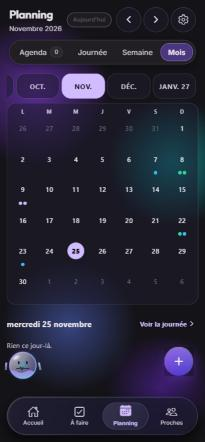

# FICHE OPÉRATOIRE N° 029 — Corrections : la grille du Mois sur Android, et des réglages du Planning plus simples

Projet : **Junix Pulse** · Date : 25 novembre 2026 · Suite de : [FICHE 028](FICHE-028-finitions-planning-et-reglages.md) · Étude : [ÉTUDE 001](../etudes/ETUDE-001-clarifier-et-faire-evoluer.md), 12.8 et 16

---

## 1. Objectif

Tes retours sur l'APK de la fiche 028 :

| Vu sur le téléphone | Cause | Correction |
|---|---|---|
| Dans le Mois, **rien sous le dimanche**, et « mercredi 25 » affiché sous **mardi** | chaque case faisait `100 / 7 %` de la largeur ; sur Android, l'arrondi fait dépasser 7 cases d'un rien : la 7ᵉ passe à la ligne, **chaque ligne n'a plus que 6 cases**, tout se décale d'une colonne (sur le web, rien ne se voit) | la grille devient **6 lignes de 7 cases** qui se partagent leur ligne (`flex: 1`) : aucune case ne peut plus passer à la ligne |
| Les réglages du Planning sont **vagues** : « S'ouvre sur », « La semaine commence le » ne se comprennent pas, et une page entière pour si peu | trop de choix pour peu d'intérêt | on garde **« Une carte glisse par »** et **« Agenda du téléphone »**, sur la **première page** des Paramètres ; le reste devient **automatique** |

Ce qui devient automatique :

- **Le premier jour de la semaine** suit la **langue** de l'appli (lundi en français ; dimanche en anglais américain).
- **La vue d'ouverture** : le Planning rouvre sur la **dernière vue utilisée** (Agenda, Journée, Semaine ou Mois).

**L'agenda du téléphone** : l'interrupteur demandait déjà l'autorisation d'Android **dès qu'on l'active** ; Junix lit alors tous les agendas du téléphone, dont le principal, sans jamais y écrire. Rien ne change, sauf sa place.


*Figure 29-1 — Capture réelle (web, 360 px). Sous l'Apparence, le groupe PLANNING : « Une carte glisse par ». Sur le téléphone, l'interrupteur « Agenda du téléphone » est juste dessous (caché sur le web).*

## 2. État de départ

| À vérifier | Comment | Résultat attendu |
|---|---|---|
| La fiche 028 est enregistrée | `git log --oneline -1` | `feat(planning): finishing touches…` |
| Tout passe | `npx jest` | `Tests: 2123 passed` |

## 3. Matériel

Rien de nouveau. Aucune migration : la colonne `planning_prefs` (fiche 028) garde la vue utilisée et le pas.

## 4. Hypothèses

- La langue donne le premier jour par `date-fns` (`weekStartsOn` : 1 en français, 0 en anglais américain) ; toute autre valeur est prise comme lundi.
- La vue d'ouverture est enregistrée à chaque changement d'onglet du Planning, et appliquée une fois par visite de l'appli.

## 5. Carte de l'intervention

| Fichier | Action |
|---|---|
| `src/components/planning/MonthView.tsx` | grille en 6 lignes de 7 |
| `src/domain/rules/planning-settings-rules.ts` (+ test) | `weekStartOf` : le premier jour selon la langue |
| `src/app/(tabs)/calendar.tsx` | premier jour selon la langue ; la vue utilisée est gardée |
| `src/components/settings/PlanningSetting.tsx` | **réécrit** : le pas seulement |
| `src/app/settings/index.tsx` | plus de page Planning : le groupe Planning sur la première page |
| `messages-rest-fr.ts`, `-en.ts` | textes devenus inutiles retirés |

## 6. Sauvegarde

`git status` propre (hors `docs/motion/`). Retour en arrière : section 10.

## 7. Pas à pas

### Étape 1 — La grille du Mois en lignes

**Pourquoi** : une rangée qui « s'enroule » (`flexWrap`) dépend d'arrondis ; une rangée par semaine, dont chaque case prend un septième (`flex: 1`), ne dépend de rien.

Dans `src/components/planning/MonthView.tsx` :

Passage 1 sur 3 — repère (Ctrl+F) : la première ligne du bloc « avant ».

<!-- bloc: month-1-avant -->

```tsx
          ))}
        </View>
        <View ref={gridRef} collapsable={false} style={styles.grid}>
          {days.map(day => {
            const key = dayKey(day);
            const things = byDay.get(key) ?? [];
            const { dots, more } = dayDots(things.map(thing => thing.look.color));
```

devient :

<!-- bloc: month-1-apres -->

```tsx
          ))}
        </View>
        <View ref={gridRef} collapsable={false} style={styles.grid}>
          {/* Six rows of seven days (sheet 029): each day takes a seventh of its row, so no rounding
              of a percentage can push the seventh day to the next row, as it did on Android */}
          {[0, 1, 2, 3, 4, 5].map(row => (
          <View key={row} style={styles.gridRow}>
          {days.slice(row * 7, row * 7 + 7).map(day => {
            const key = dayKey(day);
            const things = byDay.get(key) ?? [];
            const { dots, more } = dayDots(things.map(thing => thing.look.color));
```

Passage 2 sur 3 — repère (Ctrl+F) : la première ligne du bloc « avant ».

<!-- bloc: month-2-avant -->

```tsx
              </TouchableOpacity>
            );
          })}

          {/* While a card is lifted: the two edges that turn the page */}
          {lifted && (
```

devient :

<!-- bloc: month-2-apres -->

```tsx
              </TouchableOpacity>
            );
          })}
          </View>
          ))}

          {/* While a card is lifted: the two edges that turn the page */}
          {lifted && (
```

Passage 3 sur 3 — repère (Ctrl+F) : la première ligne du bloc « avant ».

<!-- bloc: month-3-avant -->

```tsx
    },
    weekRow: { flexDirection: 'row' },
    weekday: { flex: 1, textAlign: 'center', ...Typography.labelSmall, color: theme.onSurface.variant, fontWeight: '700', paddingVertical: 4 },
    grid: { flexDirection: 'row', flexWrap: 'wrap', position: 'relative' },
    cell: { width: `${100 / 7}%`, height: CELL_HEIGHT, alignItems: 'center', paddingTop: 3 },
    dayCircle: { width: 30, height: 30, borderRadius: 15, alignItems: 'center', justifyContent: 'center' },
    dayCircleToday: { borderWidth: 1.5, borderColor: theme.primary.default },
    dayCircleSelected: { backgroundColor: theme.primary.default, borderColor: theme.primary.default },
```

devient :

<!-- bloc: month-3-apres -->

```tsx
    },
    weekRow: { flexDirection: 'row' },
    weekday: { flex: 1, textAlign: 'center', ...Typography.labelSmall, color: theme.onSurface.variant, fontWeight: '700', paddingVertical: 4 },
    grid: { position: 'relative' },
    gridRow: { flexDirection: 'row' },
    cell: { flex: 1, minWidth: 0, height: CELL_HEIGHT, alignItems: 'center', paddingTop: 3 },
    dayCircle: { width: 30, height: 30, borderRadius: 15, alignItems: 'center', justifyContent: 'center' },
    dayCircleToday: { borderWidth: 1.5, borderColor: theme.primary.default },
    dayCircleSelected: { backgroundColor: theme.primary.default, borderColor: theme.primary.default },
```

### Étape 2 — Le premier jour et la vue d'ouverture, automatiques

Dans `src/domain/rules/planning-settings-rules.ts` :

Passage 1 sur 2 — repère (Ctrl+F) : la première ligne du bloc « avant ».

<!-- bloc: rules-1-avant -->

```ts
/**
 * The Planning settings (study 001, 12.8; sheet 028): the view it opens on, the first day of the
 * week and the step of a move. Kept as one short text in the settings row, read strictly: a value
 * missing, old or damaged falls back to the default, so nothing breaks.
 */
import type { WeekStart } from './planning-move-rules';

```

devient :

<!-- bloc: rules-1-apres -->

```ts
/**
 * The Planning settings (study 001, 12.8; sheets 028 and 029), kept as one short text in the
 * settings row and read strictly: a value missing, old or damaged falls back to the default.
 *  - the step of a move: chosen in the Paramètres;
 *  - the view it opens on: the one used last, kept by the Planning itself;
 *  - the first day of the week: no longer read here; it follows the language (weekStartOf).
 */
import type { WeekStart } from './planning-move-rules';

```

Passage 2 sur 2 — repère (Ctrl+F) : la première ligne du bloc « avant ».

<!-- bloc: rules-2-avant -->

```ts
export function planningPrefsText(prefs: PlanningPrefs): string {
  return JSON.stringify({ openView: prefs.openView, weekStart: prefs.weekStart, dragStep: prefs.dragStep });
}
```

devient :

<!-- bloc: rules-2-apres -->

```ts
export function planningPrefsText(prefs: PlanningPrefs): string {
  return JSON.stringify({ openView: prefs.openView, weekStart: prefs.weekStart, dragStep: prefs.dragStep });
}

/**
 * The first day of the week from the language of the app (sheet 029): the language says it
 * (date-fns: 1 in French, 0 in American English); anything else is taken as Monday.
 */
export function weekStartOf(fromLanguage: number | undefined): WeekStart {
  return fromLanguage === 0 ? 0 : 1;
}
```

Dans `src/domain/rules/__tests__/planning-settings-rules.test.ts` :

Passage 1 sur 2 — repère (Ctrl+F) : la première ligne du bloc « avant ».

<!-- bloc: test-1-avant -->

```ts
import { knownRelationKey } from '../person-rules';
import { monthGrid, movedStart, snapMinutes } from '../planning-move-rules';
import { DEFAULT_PLANNING_PREFS, planningPrefsOf, planningPrefsText } from '../planning-settings-rules';

describe('planning settings (sheet 028)', () => {
  it('reads the settings strictly and falls back on each value', () => {
```

devient :

<!-- bloc: test-1-apres -->

```ts
import { knownRelationKey } from '../person-rules';
import { monthGrid, movedStart, snapMinutes } from '../planning-move-rules';
import { DEFAULT_PLANNING_PREFS, planningPrefsOf, planningPrefsText, weekStartOf } from '../planning-settings-rules';

describe('planning settings (sheet 028)', () => {
  it('reads the settings strictly and falls back on each value', () => {
```

Passage 2 sur 2 — repère (Ctrl+F) : la première ligne du bloc « avant ».

<!-- bloc: test-2-avant -->

```ts
    expect(knownRelationKey(undefined, labels)).toBeNull();
  });
});
```

devient :

<!-- bloc: test-2-apres -->

```ts
    expect(knownRelationKey(undefined, labels)).toBeNull();
  });
});

describe('weekStartOf (sheet 029)', () => {
  it('takes the first day of the week from the language', () => {
    expect(weekStartOf(1)).toBe(1);
    expect(weekStartOf(0)).toBe(0);
    expect(weekStartOf(6)).toBe(1);
    expect(weekStartOf(undefined)).toBe(1);
  });
});
```

Dans `src/app/(tabs)/calendar.tsx` :

Passage 1 sur 7 — repère (Ctrl+F) : la première ligne du bloc « avant ».

<!-- bloc: cal-1-avant -->

```tsx
import { MonthView, type MonthItem } from '@/components/planning/MonthView';
import { usePlanningMove } from '@/features/planning/use-planning-move';
import { useGestureTip } from '@/features/mascot/GestureTip';
import { DEFAULT_PLANNING_PREFS, type PlanningPrefs } from '@/domain/rules/planning-settings-rules';
import { dayFromKey, dayKey, monthGridRange, sameDayInMonth } from '@/domain/rules/planning-move-rules';
import { NewItemChooser } from '@/components/create/NewItemChooser';
import { WeeklyTimetableGrid } from '@/components/schedule/WeeklyTimetableGrid';
```

devient :

<!-- bloc: cal-1-apres -->

```tsx
import { MonthView, type MonthItem } from '@/components/planning/MonthView';
import { usePlanningMove } from '@/features/planning/use-planning-move';
import { useGestureTip } from '@/features/mascot/GestureTip';
import { DEFAULT_PLANNING_PREFS, weekStartOf, type PlanningPrefs } from '@/domain/rules/planning-settings-rules';
import { dayFromKey, dayKey, monthGridRange, sameDayInMonth } from '@/domain/rules/planning-move-rules';
import { NewItemChooser } from '@/components/create/NewItemChooser';
import { WeeklyTimetableGrid } from '@/components/schedule/WeeklyTimetableGrid';
```

Passage 2 sur 7 — repère (Ctrl+F) : la première ligne du bloc « avant ».

<!-- bloc: cal-2-avant -->

```tsx
  // first day of the week, the step of a move
  const [prefs, setPrefs] = useState<PlanningPrefs>(DEFAULT_PLANNING_PREFS);
  const openedOnRef = useRef(false);
  const [selectedDate, setSelectedDate] = useState<Date>(new Date());
  const [selectedSlotHour, setSelectedSlotHour] = useState<number | null>(null);
  const [showActionModal, setShowActionModal] = useState(false);
```

devient :

<!-- bloc: cal-2-apres -->

```tsx
  // first day of the week, the step of a move
  const [prefs, setPrefs] = useState<PlanningPrefs>(DEFAULT_PLANNING_PREFS);
  const openedOnRef = useRef(false);
  // The first day of the week follows the language (Monday in French, Sunday in American English);
  // nothing to choose (sheet 029)
  const weekStartsOn = weekStartOf(dateLocale.options?.weekStartsOn);
  const [selectedDate, setSelectedDate] = useState<Date>(new Date());
  const [selectedSlotHour, setSelectedSlotHour] = useState<number | null>(null);
  const [showActionModal, setShowActionModal] = useState(false);
```

Passage 3 sur 7 — repère (Ctrl+F) : la première ligne du bloc « avant ».

<!-- bloc: cal-3-avant -->

```tsx
  const [weekLifted, setWeekLifted] = useState(false);

  // Semaine courante basée sur la date sélectionnée
  const weekStart = startOfWeek(selectedDate, { weekStartsOn: prefs.weekStart });
  const weekDays = Array.from({ length: 7 }, (_, i) => addDays(weekStart, i));

  const dateYmd = format(selectedDate, 'yyyy-MM-dd');
```

devient :

<!-- bloc: cal-3-apres -->

```tsx
  const [weekLifted, setWeekLifted] = useState(false);

  // Semaine courante basée sur la date sélectionnée
  const weekStart = startOfWeek(selectedDate, { weekStartsOn });
  const weekDays = Array.from({ length: 7 }, (_, i) => addDays(weekStart, i));

  const dateYmd = format(selectedDate, 'yyyy-MM-dd');
```

Passage 4 sur 7 — repère (Ctrl+F) : la première ligne du bloc « avant ».

<!-- bloc: cal-4-avant -->

```tsx

      // The month, only when it is shown: its moments, reminders and tasks (sheets 026 and 027)
      if (viewMode === 'month') {
        const range = monthGridRange(shownMonth, prefs.weekStart);
        const from = dayFromKey(range.from);
        const to = addDays(dayFromKey(range.to), 1);
        const inRange = (at: Date) => at >= from && at < to;
```

devient :

<!-- bloc: cal-4-apres -->

```tsx

      // The month, only when it is shown: its moments, reminders and tasks (sheets 026 and 027)
      if (viewMode === 'month') {
        const range = monthGridRange(shownMonth, weekStartsOn);
        const from = dayFromKey(range.from);
        const to = addDays(dayFromKey(range.to), 1);
        const inRange = (at: Date) => at >= from && at < to;
```

Passage 5 sur 7 — repère (Ctrl+F) : la première ligne du bloc « avant ».

<!-- bloc: cal-5-avant -->

```tsx
      setError(e instanceof Error ? e.message : t('common.loadError'));
      setScreenState('error');
    }
  }, [dateYmd, theme, weekDays, t, selectedDate, viewMode, shownMonth, prefs.weekStart]);

  useFocusEffect(
    useCallback(() => {
```

devient :

<!-- bloc: cal-5-apres -->

```tsx
      setError(e instanceof Error ? e.message : t('common.loadError'));
      setScreenState('error');
    }
  }, [dateYmd, theme, weekDays, t, selectedDate, viewMode, shownMonth, weekStartsOn]);

  useFocusEffect(
    useCallback(() => {
```

Passage 6 sur 7 — repère (Ctrl+F) : la première ligne du bloc « avant ».

<!-- bloc: cal-6-avant -->

```tsx
          // The Month view opens on the month of the chosen day
          if (tab === 'month') setShownMonth(selectedDate);
          setViewMode(tab as CalendarViewMode);
        }}
      />

```

devient :

<!-- bloc: cal-6-apres -->

```tsx
          // The Month view opens on the month of the chosen day
          if (tab === 'month') setShownMonth(selectedDate);
          setViewMode(tab as CalendarViewMode);
          // The view used last is the one the Planning opens on next time (sheet 029)
          const next = { ...prefs, openView: tab as PlanningPrefs['openView'] };
          setPrefs(next);
          void SettingsRepository.update({ planningPrefs: next, updatedAt: new Date().toISOString() }).catch(() => undefined);
        }}
      />

```

Passage 7 sur 7 — repère (Ctrl+F) : la première ligne du bloc « avant ».

<!-- bloc: cal-7-avant -->

```tsx
        </ScrollView>
      ) : viewMode === 'month' ? (
        <MonthView
          weekStart={prefs.weekStart}
          month={shownMonth}
          selected={selectedDate}
          items={monthItems}
```

devient :

<!-- bloc: cal-7-apres -->

```tsx
        </ScrollView>
      ) : viewMode === 'month' ? (
        <MonthView
          weekStart={weekStartsOn}
          month={shownMonth}
          selected={selectedDate}
          items={monthItems}
```

### Étape 3 — Le groupe Planning sur la première page des Paramètres

Dans `src/components/settings/PlanningSetting.tsx` (remplacer tout le fichier) :

<!-- bloc: setting-card -->

```tsx
/**
 * The Planning setting (sheets 028 and 029): the step a card moves by, saved at once.
 * The first day of the week follows the language of the app, and the Planning opens on the view
 * used last: the app takes care of them, nothing to choose.
 */
import React from 'react';
import { View } from 'react-native';

import { ChoiceChips, FieldLabel, type Choice } from '@/components/create/form/FormBricks';
import { DRAG_STEPS, type DragStep, type PlanningPrefs } from '@/domain/rules/planning-settings-rules';
import { useTheme } from '@/hooks/use-theme';
import { useT } from '@/i18n';

export function PlanningSetting({ value, onChange }: { value: PlanningPrefs; onChange: (next: PlanningPrefs) => void }) {
  const t = useT();
  const { palette } = useTheme();
  const steps: Choice<`${DragStep}`>[] = DRAG_STEPS.map(step => ({
    value: `${step}` as `${DragStep}`,
    label: t('planningSettings.minutes', { minutes: step }),
  }));
  return (
    <View>
      <FieldLabel label={t('planningSettings.dragStep')} />
      <ChoiceChips
        options={steps}
        value={`${value.dragStep}` as `${DragStep}`}
        onChange={step => onChange({ ...value, dragStep: Number(step) as DragStep })}
        accent={palette.primary.default}
        testIDPrefix="planning-drag-step"
      />
    </View>
  );
}
```

Dans `src/app/settings/index.tsx` :

Passage 1 sur 7 — repère (Ctrl+F) : la première ligne du bloc « avant ».

<!-- bloc: set-1-avant -->

```tsx
];

/** The pages of the settings: the summary lists them, each opens on its own. */
type SettingsSection = 'notifications' | 'planning' | 'mascot' | 'security' | 'data';
type SettingsPage = SettingsSection;

const HUB_SECTIONS: readonly {
```

devient :

<!-- bloc: set-1-apres -->

```tsx
];

/** The pages of the settings: the summary lists them, each opens on its own. */
type SettingsSection = 'notifications' | 'mascot' | 'security' | 'data';
type SettingsPage = SettingsSection;

const HUB_SECTIONS: readonly {
```

Passage 2 sur 7 — repère (Ctrl+F) : la première ligne du bloc « avant ».

<!-- bloc: set-2-avant -->

```tsx
  color: 'primary' | 'tertiary' | 'success' | 'error';
}[] = [
  { id: 'notifications', titleKey: 'settingsHub.notifications', icon: 'notifications-outline', color: 'tertiary' },
  // The Planning (sheet 028): its view, the week, the step, and the phone's calendar
  { id: 'planning', titleKey: 'tab.calendar', icon: 'calendar-outline', color: 'primary' },
  { id: 'mascot', titleKey: 'mascotSettings.title', icon: 'happy-outline', color: 'primary' },
  { id: 'security', titleKey: 'settingsHub.security', icon: 'shield-checkmark-outline', color: 'success' },
  { id: 'data', titleKey: 'settingsHub.data', icon: 'cloud-outline', color: 'tertiary' },
```

devient :

<!-- bloc: set-2-apres -->

```tsx
  color: 'primary' | 'tertiary' | 'success' | 'error';
}[] = [
  { id: 'notifications', titleKey: 'settingsHub.notifications', icon: 'notifications-outline', color: 'tertiary' },
  { id: 'mascot', titleKey: 'mascotSettings.title', icon: 'happy-outline', color: 'primary' },
  { id: 'security', titleKey: 'settingsHub.security', icon: 'shield-checkmark-outline', color: 'success' },
  { id: 'data', titleKey: 'settingsHub.data', icon: 'cloud-outline', color: 'tertiary' },
```

Passage 3 sur 7 — repère (Ctrl+F) : la première ligne du bloc « avant ».

<!-- bloc: set-3-avant -->

```tsx
  });


  // The Planning in one line, for the summary
  const planningPrefs = settings.planningPrefs ?? DEFAULT_PLANNING_PREFS;
  const planningViewKeys = { agenda: 'calendar.view.agenda', timetable: 'calendar.view.day', week: 'calendar.view.week', month: 'planning.view.month' } as const;
  const planningSummary = [
    t(planningViewKeys[planningPrefs.openView]),
    t(planningPrefs.weekStart === 0 ? 'planningSettings.sunday' : 'planningSettings.monday'),
    t('planningSettings.minutes', { minutes: planningPrefs.dragStep }),
  ].join(' · ');

  const summaries: Record<SettingsSection, string> = {
    notifications: settings.notificationsEnabled
```

devient :

<!-- bloc: set-3-apres -->

```tsx
  });


  // The Planning settings: only the step of a move is chosen here (sheet 029)
  const planningPrefs = settings.planningPrefs ?? DEFAULT_PLANNING_PREFS;

  const summaries: Record<SettingsSection, string> = {
    notifications: settings.notificationsEnabled
```

Passage 4 sur 7 — repère (Ctrl+F) : la première ligne du bloc « avant ».

<!-- bloc: set-4-avant -->

```tsx
      isSanctumPinConfigured ? t('settingsHub.sanctumOn') : t('settingsHub.sanctumOff'),
    ].join(' · '),
    data: autoBackup ? autoBackupStatus : t('settingsHub.backupOff'),
    planning: planningSummary,
  };

  const renderHub = () => (
```

devient :

<!-- bloc: set-4-apres -->

```tsx
      isSanctumPinConfigured ? t('settingsHub.sanctumOn') : t('settingsHub.sanctumOff'),
    ].join(' · '),
    data: autoBackup ? autoBackupStatus : t('settingsHub.backupOff'),
  };

  const renderHub = () => (
```

Passage 5 sur 7 — repère (Ctrl+F) : la première ligne du bloc « avant ».

<!-- bloc: set-5-avant -->

```tsx
      {/* Apparence : choisie ici même, sans page à ouvrir */}
      {renderAppearance()}

      <View style={styles.hubGroup}>
        {HUB_SECTIONS.map((section, index) => (
          <TouchableOpacity
```

devient :

<!-- bloc: set-5-apres -->

```tsx
      {/* Apparence : choisie ici même, sans page à ouvrir */}
      {renderAppearance()}

      {/* The Planning, on this first page (sheet 029): the step of a move and the phone's calendar */}
      {renderPlanning()}

      <View style={styles.hubGroup}>
        {HUB_SECTIONS.map((section, index) => (
          <TouchableOpacity
```

Passage 6 sur 7 — repère (Ctrl+F) : la première ligne du bloc « avant ».

<!-- bloc: set-6-avant -->

```tsx
    </View>
  );

  // The Planning page (sheet 028): how it opens, the week, the step of a move, the phone's calendar
  const renderPlanning = () => (
    <View>
      <View style={styles.rowCol}>
        <Text style={styles.rowSub}>{t('planningSettings.hint')}</Text>
        <PlanningSetting value={planningPrefs} onChange={handleUpdatePlanning} />
      </View>
      {Platform.OS !== 'web' && (
        <View style={styles.row}>
          <View style={styles.rowTextFill}>
```

devient :

<!-- bloc: set-6-apres -->

```tsx
    </View>
  );

  // The Planning (sheets 028 and 029): the step of a move, and the phone's calendar. The first day
  // of the week follows the language, and the Planning opens on the view used last: no choice here
  const renderPlanning = () => (
    <View style={[styles.hubGroup, styles.appearanceGroup]}>
      <Text style={styles.sectionLabel}>{t('tab.calendar')}</Text>
      <PlanningSetting value={planningPrefs} onChange={handleUpdatePlanning} />
      {Platform.OS !== 'web' && (
        <View style={styles.row}>
          <View style={styles.rowTextFill}>
```

Passage 7 sur 7 — repère (Ctrl+F) : la première ligne du bloc « avant ».

<!-- bloc: set-7-avant -->

```tsx

  const PAGES: Record<SettingsPage, () => ReactElement> = {
    notifications: renderNotifications,
    planning: renderPlanning,
    mascot: renderMascot,
    security: renderSecurity,
    data: renderData,
```

devient :

<!-- bloc: set-7-apres -->

```tsx

  const PAGES: Record<SettingsPage, () => ReactElement> = {
    notifications: renderNotifications,
    mascot: renderMascot,
    security: renderSecurity,
    data: renderData,
```

Dans `src/i18n/messages-rest-fr.ts` :

Passage 1 sur 1 — repère (Ctrl+F) : la première ligne du bloc « avant ».

<!-- bloc: fr-1-avant -->

```ts
  'planning.taskBadge': 'Tâche',
  'planning.deviceBadge': 'Agenda du téléphone',
  // The Planning settings (sheet 028)
  'planningSettings.hint': 'La vue qui s’ouvre, le premier jour de la semaine, et le pas quand on fait glisser une carte.',
  'planningSettings.openView': 'S’ouvre sur',
  'planningSettings.weekStart': 'La semaine commence le',
  'planningSettings.monday': 'Lundi',
  'planningSettings.sunday': 'Dimanche',
  'planningSettings.dragStep': 'Une carte glisse par',
  'planningSettings.minutes': '{minutes} min',
  'step.a11y': 'Étape {current} sur {total}',
```

devient :

<!-- bloc: fr-1-apres -->

```ts
  'planning.taskBadge': 'Tâche',
  'planning.deviceBadge': 'Agenda du téléphone',
  // The Planning settings (sheet 028)
  'planningSettings.dragStep': 'Une carte glisse par',
  'planningSettings.minutes': '{minutes} min',
  'step.a11y': 'Étape {current} sur {total}',
```

Dans `src/i18n/messages-rest-en.ts` :

Passage 1 sur 1 — repère (Ctrl+F) : la première ligne du bloc « avant ».

<!-- bloc: en-1-avant -->

```ts
  'planning.taskBadge': 'Task',
  'planning.deviceBadge': 'Phone calendar',
  // The Planning settings (sheet 028)
  'planningSettings.hint': 'The view it opens on, the first day of the week, and the step when you drag a card.',
  'planningSettings.openView': 'Opens on',
  'planningSettings.weekStart': 'The week starts on',
  'planningSettings.monday': 'Monday',
  'planningSettings.sunday': 'Sunday',
  'planningSettings.dragStep': 'A card moves by',
  'planningSettings.minutes': '{minutes} min',
  'step.a11y': 'Step {current} of {total}',
```

devient :

<!-- bloc: en-1-apres -->

```ts
  'planning.taskBadge': 'Task',
  'planning.deviceBadge': 'Phone calendar',
  // The Planning settings (sheet 028)
  'planningSettings.dragStep': 'A card moves by',
  'planningSettings.minutes': '{minutes} min',
  'step.a11y': 'Step {current} of {total}',
```

### Étape 4 — Appliquer d'un coup, puis vérifier

```powershell
node docs/fiches/outils/appliquer-fiche-029.js .
```

```powershell
npx tsc --noEmit
```

```powershell
npx jest
```

```powershell
npx expo start --web --clear
```

## 8. Test final

| Contrôle | Résultat attendu |
|---|---|
| Mois sur le **téléphone** | 7 colonnes remplies, L M M J V S D ; le mercredi 25 sous le 3ᵉ « M », le dimanche 29 sous « D » |
| Paramètres, première page | groupe **Planning** : « Une carte glisse par », et « Agenda du téléphone » (téléphone) |
| Activer « Agenda du téléphone » | Android demande l'autorisation tout de suite |
| Ouvrir le Mois, quitter, rouvrir l'appli | le Planning s'ouvre sur le Mois |



*Figure 29-2 — Capture réelle (web, 360 px). Chaque ligne a ses 7 jours, du lundi au dimanche.*

## 9. Dépannage

| Symptôme | Cause | Remède |
|---|---|---|
| Le Mois est encore décalé sur le téléphone | APK d'avant cette fiche | installer l'APK de la fiche 029 |
| La semaine commence le dimanche | l'appli est en anglais | normal : elle suit la langue (Paramètres → Langue) |

## 10. Retour en arrière

`git checkout -- <fichiers de la section 5>`. Aucune donnée touchée.

## 11. Lexique

| Mot | En une phrase |
|---|---|
| `flexWrap` | laisser les éléments d'une rangée passer à la ligne quand la place manque |
| `flex: 1` | chaque élément d'une rangée prend une part égale de la place |
| Arrondi | une largeur en pourcentage devient un nombre de points avec des décimales, que le téléphone arrondit |

## 12. Et après

1. APK, et vérifier le Mois sur le téléphone.
2. **n° 9 — Sons et alarme**.

## Compte rendu d'exécution (25 novembre 2026)

- Cause du Mois décalé trouvée dans le code (cases en `100 / 7 %` avec `flexWrap`) : le défaut ne se voit pas sur le web, seulement sur le téléphone ; la correction supprime la cause (6 lignes de 7 en `flex: 1`).
- L'interrupteur « Agenda du téléphone » demandait déjà l'autorisation à l'activation (`requestDeviceCalendarAccess`) : seule sa place change.
- Appliquée à partir des blocs de cette fiche (`appliquer-fiche-029.js`), puis rejouée sur une copie propre du code enregistré : résultat identique.
- Tests : `Test Suites: 103 passed`, `Tests: 2124 passed` ; `tsc` et `eslint` sans erreur.
- **Vérifié à l'écran** (web, 360 px, serveur relancé avec `--clear`) : première page des Paramètres avec le groupe Planning (« Une carte glisse par ») ; sous-page Planning disparue ; Mois : en-têtes L M M J V S D alignés sur les jours (mercredi 25 sous le 3ᵉ M, dimanche 29 sous D, lundi 23 sous L) ; le Planning rouvre sur le Mois après rechargement, puis remis sur l'Agenda.
- **Pas vérifié** : le Mois **sur le téléphone** (le défaut n'existait que là), l'interrupteur de l'agenda (caché sur le web). Rien n'est encore enregistré dans git.
