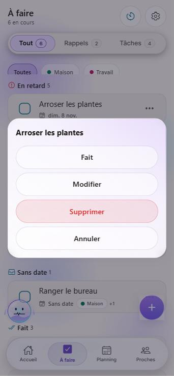
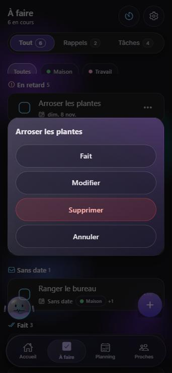

# FICHE OPÉRATOIRE N° 030 — Les fenêtres en verre : même design partout, et toucher à côté pour annuler

Projet : **Junix Pulse** · Date : 25 novembre 2026 · Suite de : [FICHE 029](FICHE-029-corrections-mois-et-reglages.md) · Étude : [ÉTUDE 001](../etudes/ETUDE-001-clarifier-et-faire-evoluer.md), 12.9

---

## 1. Objectif

Ta capture du téléphone (menu « ⋯ » d'une tâche, thème clair) : une fenêtre **grise, plate**, « Annuler » en simple lien à gauche, deux pastilles de largeurs différentes. Et on ne pouvait pas la fermer en touchant **à côté**.

Toutes ces fenêtres passent par **un seul composant**, `GlassAlert` (63 appels dans l'appli). En le refaisant, **toutes** changent d'un coup :

| Avant | Après |
|---|---|
| fond gris plat | une **GlowCard** : verre, liseré lumineux, lueur violette de l'appli, coins de 24 ; fond presque plein dessous, pour que rien ne transparaisse derrière les mots ; opaque si « Effet verre » est coupé |
| « Annuler » en lien, boutons de tailles différentes | **2 boutons** : côte à côte, à parts égales, « Annuler » à gauche ; **3 et plus** : l'un sous l'autre, pleine largeur, les actions, puis « Supprimer » en rouge, puis « Annuler » en bas ; « Annuler » est un vrai bouton (contour) |
| on ne pouvait pas toucher à côté | **toucher à côté** fait comme « Annuler » (le bouton retour d'Android aussi) ; une alerte qui doit rester ouverte le dit avec `cancelable: false` |

Deux autres fenêtres étaient faites à part (« Modifier le prénom » dans les Paramètres, et le mot de passe de sauvegarde) : elles passent par une nouvelle brique commune, **`GlassDialog`**, avec le même verre et la même règle (sauf pendant un enregistrement, où toucher à côté ne ferme pas).

Les panneaux qui montent du bas (le choix « + », les personnes, les étiquettes) se fermaient déjà en touchant à côté : inchangés.



*Figure 30-1 — Capture réelle (web, 360 px, thème clair). Le même menu que sur ta capture : verre blanc et lueur violette, quatre boutons de même largeur, « Supprimer » en rouge au-dessus de « Annuler ».*

## 2. État de départ

| À vérifier | Comment | Résultat attendu |
|---|---|---|
| La fiche 029 est enregistrée | `git log --oneline -1` | `fix(planning): month grid on Android…` |
| Tout passe | `npx jest` | `Tests: 2124 passed` |

## 3. Matériel

Rien de nouveau.

## 4. Hypothèses

- Toucher à côté d'une alerte sans bouton « Annuler » la ferme sans rien faire, comme son bouton « OK » le ferait.
- Aucune alerte de l'appli n'a besoin de rester ouverte de force aujourd'hui ; l'option `cancelable: false` existe pour le jour où il en faudra une.

## 5. Carte de l'intervention

| Fichier | Action |
|---|---|
| `src/components/feedback/GlassAlert.tsx` | la fenêtre en GlowCard, l'ordre des boutons (`alertButtonOrder`), toucher à côté (`dismissGlassAlert`) |
| `src/__tests__/lot5-evolutions.test.tsx` | « Annuler » en bouton à contour ; deux tests nouveaux |
| `src/components/feedback/GlassDialog.tsx` | **nouveau** : la même fenêtre, pour un contenu à soi |
| `src/components/ui/BackupPasswordModal.tsx` | passe par `GlassDialog` |
| `src/app/settings/index.tsx`, `settings-styles.ts` | « Modifier le prénom » passe par `GlassDialog` |

## 6. Sauvegarde

`git status` propre (hors `docs/motion/`). Retour en arrière : section 10.

## 7. Pas à pas

### Étape 1 — La fenêtre commune

**Pourquoi** : une seule brique dessine toutes les alertes : la changer change l'appli entière, et un nouveau développeur n'a rien d'autre à apprendre.

Dans `src/components/feedback/GlassAlert.tsx` :

Passage 1 sur 7 — repère (Ctrl+F) : la première ligne du bloc « avant ».

<!-- bloc: alert-1-avant -->

```tsx
 * Alert windows in the glass style of the app, in place of the native Android and iOS alerts.
 * Same call as React Native: GlassAlert.alert(title, message, buttons). Alerts wait in line, so
 * one opened from a button of another shows once the first is closed.
 */

import { useEffect, useState } from 'react';
import { Modal, ScrollView, StyleSheet, Text, View } from 'react-native';
import Animated, { Easing, useAnimatedStyle, useSharedValue, withTiming } from 'react-native-reanimated';

import { Button, type ButtonVariant } from '@/components/ui/Button';
import { Radius, Spacing, Typography } from '@/constants/theme';
import type { ThemePalette } from '@/constants/palettes';
import { useSafeReducedMotion } from '@/hooks/use-safe-reduced-motion';
```

devient :

<!-- bloc: alert-1-apres -->

```tsx
 * Alert windows in the glass style of the app, in place of the native Android and iOS alerts.
 * Same call as React Native: GlassAlert.alert(title, message, buttons). Alerts wait in line, so
 * one opened from a button of another shows once the first is closed.
 *
 * The window (sheet 030) is a GlowCard: the glass, the lit border and the violet glow of the app
 * (opaque when "Effet verre" is off). Two buttons share their row, "Annuler" on the left; three or
 * more take the whole width one under the other, a destructive one just above "Annuler" at the
 * bottom. Touching outside the window, or the Android back button, acts as "Annuler".
 */

import { useEffect, useState } from 'react';
import { Modal, Pressable, ScrollView, StyleSheet, Text, View } from 'react-native';
import Animated, { Easing, useAnimatedStyle, useSharedValue, withTiming } from 'react-native-reanimated';

import { Button, type ButtonVariant } from '@/components/ui/Button';
import { GlowCard } from '@/components/ui/GlowCard';
import { Radius, Spacing, Typography } from '@/constants/theme';
import type { ThemePalette } from '@/constants/palettes';
import { useSafeReducedMotion } from '@/hooks/use-safe-reduced-motion';
```

Passage 2 sur 7 — repère (Ctrl+F) : la première ligne du bloc « avant ».

<!-- bloc: alert-2-avant -->

```tsx
}

export interface GlassAlertOptions {
  /** Android back button closes the window, as its cancel button would. */
  cancelable?: boolean;
}

```

devient :

<!-- bloc: alert-2-apres -->

```tsx
}

export interface GlassAlertOptions {
  /**
   * Touching outside the window or the Android back button closes it, as its cancel button would
   * (true unless said otherwise, sheet 030). False keeps it open until a button is touched.
   */
  cancelable?: boolean;
}

```

Passage 3 sur 7 — repère (Ctrl+F) : la première ligne du bloc « avant ».

<!-- bloc: alert-3-avant -->

```tsx
  void button.onPress?.();
}

function variantOf(button: GlassAlertButton, isMain: boolean): ButtonVariant {
  if (button.style === 'cancel') return 'ghost';
  if (button.style === 'destructive') return 'destructive';
  return isMain ? 'primary' : 'secondary';
}
```

devient :

<!-- bloc: alert-3-apres -->

```tsx
  void button.onPress?.();
}

/**
 * The order the buttons are drawn in, by their index (sheet 030), and whether they stack. Two
 * buttons share a row, "Annuler" first (on the left). From three, one under the other: the
 * actions as given, then the destructive ones, then "Annuler" at the bottom.
 */
export function alertButtonOrder(buttons: readonly GlassAlertButton[]): { order: number[]; stacked: boolean } {
  const indexes = buttons.map((_, index) => index);
  const cancel = indexes.filter(index => buttons[index].style === 'cancel');
  const destructive = indexes.filter(index => buttons[index].style === 'destructive');
  const others = indexes.filter(index => buttons[index].style !== 'cancel' && buttons[index].style !== 'destructive');
  if (buttons.length <= 2) return { order: [...cancel, ...others, ...destructive], stacked: false };
  return { order: [...others, ...destructive, ...cancel], stacked: true };
}

/** What touching outside does: the cancel button, or closing; nothing when the alert says so. */
export function dismissGlassAlert(id: number, buttons: readonly GlassAlertButton[], options?: GlassAlertOptions): void {
  if (options?.cancelable === false) return;
  const cancel = buttons.find(button => button.style === 'cancel');
  if (cancel) pressGlassAlertButton(id, cancel);
  else close(id);
}

function variantOf(button: GlassAlertButton, isMain: boolean): ButtonVariant {
  if (button.style === 'cancel') return 'secondary';
  if (button.style === 'destructive') return 'destructive';
  return isMain ? 'primary' : 'secondary';
}
```

Passage 4 sur 7 — repère (Ctrl+F) : la première ligne du bloc « avant ».

<!-- bloc: alert-4-avant -->

```tsx
  const shown = current ?? lastShown;
  if (!shown) return null;

  const cancelButton = shown.buttons.find(button => button.style === 'cancel');
  // The last button that is not a cancel one is the main action, as on the native alerts
  const mainIndex = shown.buttons.map(button => button.style !== 'cancel').lastIndexOf(true);
  const stacked = shown.buttons.length > 2;

  return (
    <Modal
```

devient :

<!-- bloc: alert-4-apres -->

```tsx
  const shown = current ?? lastShown;
  if (!shown) return null;

  // The last button that is not a cancel one is the main action, as on the native alerts
  const mainIndex = shown.buttons.map(button => button.style !== 'cancel').lastIndexOf(true);
  const { order, stacked } = alertButtonOrder(shown.buttons);
  const dismiss = () => dismissGlassAlert(shown.id, shown.buttons, shown.options);

  return (
    <Modal
```

Passage 5 sur 7 — repère (Ctrl+F) : la première ligne du bloc « avant ».

<!-- bloc: alert-5-avant -->

```tsx
      transparent
      animationType="fade"
      statusBarTranslucent
      onRequestClose={() => {
        if (cancelButton) pressGlassAlertButton(shown.id, cancelButton);
        else if (shown.options?.cancelable) close(shown.id);
      }}
    >
      <View style={styles.overlay}>
        <Animated.View style={[styles.dialog, dialogMotion]} accessibilityViewIsModal accessibilityRole="alert">
          <Text style={styles.title}>{shown.title}</Text>
          {!!shown.message && (
            <ScrollView style={styles.messageScroll}>
              <Text style={styles.message}>{shown.message}</Text>
            </ScrollView>
          )}
          <View style={[styles.actions, stacked && styles.actionsStacked]}>
            {shown.buttons.map((button, index) => (
              <Button
                key={`${shown.id}-${index}`}
                label={button.text ?? t('common.close')}
                variant={variantOf(button, index === mainIndex)}
                size="sm"
                onPress={() => pressGlassAlertButton(shown.id, button)}
                style={stacked ? styles.actionStacked : styles.action}
                testID={`glass-alert-button-${index}`}
              />
            ))}
          </View>
        </Animated.View>
      </View>
    </Modal>
```

devient :

<!-- bloc: alert-5-apres -->

```tsx
      transparent
      animationType="fade"
      statusBarTranslucent
      onRequestClose={dismiss}
    >
      <View style={styles.overlay}>
        {/* Touching outside the window acts as "Annuler" (sheet 030) */}
        <Pressable
          style={StyleSheet.absoluteFill}
          onPress={dismiss}
          importantForAccessibility="no"
          testID="glass-alert-backdrop"
        />
        <Animated.View style={[styles.dialogBox, dialogMotion]} accessibilityViewIsModal accessibilityRole="alert">
          <GlowCard tone="primary" size="hero" disableEntranceAnimation style={styles.backing} contentStyle={styles.dialogContent}>
            <Text style={styles.title}>{shown.title}</Text>
            {!!shown.message && (
              <ScrollView style={styles.messageScroll}>
                <Text style={styles.message}>{shown.message}</Text>
              </ScrollView>
            )}
            <View style={[styles.actions, stacked && styles.actionsStacked]}>
              {order.map(index => {
                const button = shown.buttons[index];
                return (
                  <Button
                    key={`${shown.id}-${index}`}
                    label={button.text ?? t('common.close')}
                    variant={variantOf(button, index === mainIndex)}
                    size="md"
                    onPress={() => pressGlassAlertButton(shown.id, button)}
                    style={stacked ? styles.actionStacked : styles.action}
                    testID={`glass-alert-button-${index}`}
                  />
                );
              })}
            </View>
          </GlowCard>
        </Animated.View>
      </View>
    </Modal>
```

Passage 6 sur 7 — repère (Ctrl+F) : la première ligne du bloc « avant ».

<!-- bloc: alert-6-avant -->

```tsx
    overlay: {
      flex: 1,
      justifyContent: 'center',
      padding: Spacing.xl,
      backgroundColor: 'rgba(0, 0, 0, 0.6)',
    },
    dialog: {
      // Phone width; on a tablet or the web, a readable window rather than a band
      width: '100%',
      maxWidth: 440,
      alignSelf: 'center',
      gap: Spacing.md,
      padding: Spacing.xl,
      borderRadius: Radius.lg,
      borderWidth: 1,
      borderColor: theme.glass.nav.borderColor,
      backgroundColor: theme.glass.nav.backgroundColor,
      maxHeight: '80%',
    },
    title: {
      ...Typography.titleLarge,
      color: theme.onSurface.primary,
    },
    messageScroll: {
      flexGrow: 0,
```

devient :

<!-- bloc: alert-6-apres -->

```tsx
    overlay: {
      flex: 1,
      justifyContent: 'center',
      padding: Spacing.lg,
      backgroundColor: theme.mode === 'light' ? 'rgba(20, 16, 40, 0.42)' : 'rgba(0, 0, 0, 0.62)',
    },
    dialogBox: {
      // Phone width; on a tablet or the web, a readable window rather than a band
      width: '100%',
      maxWidth: 440,
      alignSelf: 'center',
      maxHeight: '80%',
    },
    // Under the glass, a nearly solid backing: what is behind never shows through the words
    backing: {
      borderRadius: Radius.xl,
      backgroundColor: theme.mode === 'light' ? 'rgba(255, 255, 255, 0.94)' : 'rgba(22, 20, 34, 0.94)',
    },
    dialogContent: {
      gap: Spacing.md,
      paddingHorizontal: Spacing.lg,
      paddingVertical: Spacing.lg,
    },
    title: {
      ...Typography.titleLarge,
      color: theme.onSurface.primary,
      fontWeight: '700',
    },
    messageScroll: {
      flexGrow: 0,
```

Passage 7 sur 7 — repère (Ctrl+F) : la première ligne du bloc « avant ».

<!-- bloc: alert-7-avant -->

```tsx
    },
    actions: {
      flexDirection: 'row',
      justifyContent: 'flex-end',
      flexWrap: 'wrap',
      gap: Spacing.sm,
      marginTop: Spacing.xs,
    },
    actionsStacked: {
      flexDirection: 'column-reverse',
      alignItems: 'stretch',
    },
    action: {
      minWidth: 96,
    },
    actionStacked: {
      alignSelf: 'stretch',
    },
  });
```

devient :

<!-- bloc: alert-7-apres -->

```tsx
    },
    actions: {
      flexDirection: 'row',
      gap: Spacing.sm,
      marginTop: Spacing.xs,
    },
    actionsStacked: {
      flexDirection: 'column',
      alignItems: 'stretch',
    },
    // Two buttons share the row equally
    action: {
      flex: 1,
    },
    // Stacked, each takes the whole width
    actionStacked: {
      width: '100%',
    },
  });
```

Dans `src/__tests__/lot5-evolutions.test.tsx` :

Passage 1 sur 4 — repère (Ctrl+F) : la première ligne du bloc « avant ».

<!-- bloc: test-1-avant -->

```tsx
import ReactTestRenderer, { act } from 'react-test-renderer';
import * as SecureStore from 'expo-secure-store';

import { GlassAlert, GlassAlertHost } from '@/components/feedback/GlassAlert';
import {
  AUTO_BACKUP_INTERVAL_MS,
  AUTO_BACKUP_KEPT_FILES,
```

devient :

<!-- bloc: test-1-apres -->

```tsx
import ReactTestRenderer, { act } from 'react-test-renderer';
import * as SecureStore from 'expo-secure-store';

import { alertButtonOrder, GlassAlert, GlassAlertHost } from '@/components/feedback/GlassAlert';
import {
  AUTO_BACKUP_INTERVAL_MS,
  AUTO_BACKUP_KEPT_FILES,
```

Passage 2 sur 4 — repère (Ctrl+F) : la première ligne du bloc « avant ».

<!-- bloc: test-2-avant -->

```tsx
      ])
    );
    const buttons = renderer.root.findAll(node => typeof node.props.testID === 'string' && node.props.variant);
    expect(buttons.map(button => button.props.variant)).toEqual(['ghost', 'destructive']);

    act(() => renderer.root.findByProps({ testID: 'glass-alert-button-1' }).props.onPress());
    expect(onDelete).toHaveBeenCalledTimes(1);
```

devient :

<!-- bloc: test-2-apres -->

```tsx
      ])
    );
    const buttons = renderer.root.findAll(node => typeof node.props.testID === 'string' && node.props.variant);
    expect(buttons.map(button => button.props.variant)).toEqual(['secondary', 'destructive']);

    act(() => renderer.root.findByProps({ testID: 'glass-alert-button-1' }).props.onPress());
    expect(onDelete).toHaveBeenCalledTimes(1);
```

Passage 3 sur 4 — repère (Ctrl+F) : la première ligne du bloc « avant ».

<!-- bloc: test-3-avant -->

```tsx
    const variants = [0, 1, 2].map(
      index => renderer.root.findByProps({ testID: `glass-alert-button-${index}` }).props.variant
    );
    expect(variants).toEqual(['ghost', 'destructive', 'primary']);

    const modal = renderer.root.findByProps({ statusBarTranslucent: true });
    act(() => modal.props.onRequestClose());
```

devient :

<!-- bloc: test-3-apres -->

```tsx
    const variants = [0, 1, 2].map(
      index => renderer.root.findByProps({ testID: `glass-alert-button-${index}` }).props.variant
    );
    expect(variants).toEqual(['secondary', 'destructive', 'primary']);

    const modal = renderer.root.findByProps({ statusBarTranslucent: true });
    act(() => modal.props.onRequestClose());
```

Passage 4 sur 4 — repère (Ctrl+F) : la première ligne du bloc « avant ».

<!-- bloc: test-4-avant -->

```tsx
    expect(GlassAlert._current()).toBeNull();
    act(() => renderer.unmount());
  });
});

// ─── Automatic backup: rules ──────────────────────────────────────────────
```

devient :

<!-- bloc: test-4-apres -->

```tsx
    expect(GlassAlert._current()).toBeNull();
    act(() => renderer.unmount());
  });

  it('closes as "Annuler" when touched outside, unless it must stay open (sheet 030)', () => {
    const renderer = mountHost();
    const onCancel = jest.fn();
    act(() => GlassAlert.alert('Menu', undefined, [{ text: 'Modifier' }, { text: 'Annuler', style: 'cancel', onPress: onCancel }]));
    act(() => renderer.root.findByProps({ testID: 'glass-alert-backdrop' }).props.onPress());
    expect(onCancel).toHaveBeenCalledTimes(1);
    expect(GlassAlert._current()).toBeNull();

    // An information alert closes too; one that must stay open does not
    act(() => GlassAlert.alert('Info'));
    act(() => renderer.root.findByProps({ testID: 'glass-alert-backdrop' }).props.onPress());
    expect(GlassAlert._current()).toBeNull();
    act(() => GlassAlert.alert('Obligatoire', undefined, [{ text: 'OK' }], { cancelable: false }));
    act(() => renderer.root.findByProps({ testID: 'glass-alert-backdrop' }).props.onPress());
    expect(GlassAlert._current()?.title).toBe('Obligatoire');
    act(() => renderer.unmount());
  });

  it('puts two buttons side by side, Annuler first, and stacks three with Annuler last (sheet 030)', () => {
    expect(alertButtonOrder([{ text: 'Supprimer', style: 'destructive' }, { text: 'Annuler', style: 'cancel' }])).toEqual({ order: [1, 0], stacked: false });
    expect(
      alertButtonOrder([{ text: 'Supprimer', style: 'destructive' }, { text: 'Modifier' }, { text: 'Annuler', style: 'cancel' }])
    ).toEqual({ order: [1, 0, 2], stacked: true });
  });
});

// ─── Automatic backup: rules ──────────────────────────────────────────────
```

> [attention] Sur le web, `accessible={false}` sur la zone « à côté » lui donne `pointer-events: none` : elle ne capte plus le toucher. La zone garde seulement `importantForAccessibility="no"` (vu pendant les essais).

### Étape 2 — La brique `GlassDialog` et les deux fenêtres à part

Dans `src/components/feedback/GlassDialog.tsx` (nouveau) :

<!-- bloc: dialog -->

```tsx
/**
 * A window with its own content (a field, a choice…), in the same style as GlassAlert (sheet 030):
 * a GlowCard (glass, lit border, violet glow; opaque when "Effet verre" is off) over a dimmed
 * screen, lifted above the keyboard. Touching outside it, or the Android back button, acts as
 * "Annuler"; while `busy` (a save in progress) it stays open.
 *
 * Usage: <GlassDialog visible={open} onDismiss={() => setOpen(false)}>…</GlassDialog>
 */
import React from 'react';
import { KeyboardAvoidingView, Modal, Platform, Pressable, StyleSheet } from 'react-native';

import { GlowCard } from '@/components/ui/GlowCard';
import type { ThemePalette } from '@/constants/palettes';
import { Radius, Spacing } from '@/constants/theme';
import { useThemedStyles } from '@/hooks/use-themed-styles';

export interface GlassDialogProps {
  visible: boolean;
  /** Touching outside, or the back button: the same as the window's "Annuler". */
  onDismiss: () => void;
  /** While true, touching outside does nothing (a save is in progress). */
  busy?: boolean;
  children: React.ReactNode;
  testID?: string;
}

export function GlassDialog({ visible, onDismiss, busy = false, children, testID }: GlassDialogProps) {
  const styles = useThemedStyles(makeGlassDialogStyles);
  const dismiss = () => {
    if (!busy) onDismiss();
  };
  return (
    <Modal visible={visible} transparent animationType="fade" statusBarTranslucent onRequestClose={dismiss}>
      <KeyboardAvoidingView style={styles.overlay} behavior={Platform.OS === 'ios' ? 'padding' : 'height'}>
        <Pressable
          style={StyleSheet.absoluteFill}
          onPress={dismiss}
          importantForAccessibility="no"
          testID={testID ? `${testID}-backdrop` : 'glass-dialog-backdrop'}
        />
        <GlowCard tone="primary" size="hero" disableEntranceAnimation style={[styles.box, styles.backing]} contentStyle={styles.content} testID={testID}>
          {children}
        </GlowCard>
      </KeyboardAvoidingView>
    </Modal>
  );
}

const makeGlassDialogStyles = (theme: ThemePalette) =>
  StyleSheet.create({
    overlay: {
      flex: 1,
      justifyContent: 'center',
      padding: Spacing.lg,
      backgroundColor: theme.mode === 'light' ? 'rgba(20, 16, 40, 0.42)' : 'rgba(0, 0, 0, 0.62)',
    },
    // Phone width; on a tablet or the web, a readable window rather than a band
    box: {
      width: '100%',
      maxWidth: 440,
      alignSelf: 'center',
    },
    // Under the glass, a nearly solid backing: what is behind never shows through the words
    backing: {
      borderRadius: Radius.xl,
      backgroundColor: theme.mode === 'light' ? 'rgba(255, 255, 255, 0.94)' : 'rgba(22, 20, 34, 0.94)',
    },
    content: {
      gap: Spacing.md,
      paddingHorizontal: Spacing.lg,
      paddingVertical: Spacing.lg,
    },
  });
```

Dans `src/components/ui/BackupPasswordModal.tsx` :

Passage 1 sur 4 — repère (Ctrl+F) : la première ligne du bloc « avant ».

<!-- bloc: pwd-1-avant -->

```tsx
import { useEffect, useState } from 'react';
import { Ionicons } from '@expo/vector-icons';
import {
  KeyboardAvoidingView,
  Modal,
  Platform,
  StyleSheet,
  Text,
  TextInput,
  TouchableOpacity,
  View,
} from 'react-native';
import { Button } from '@/components/ui/Button';
import { Radius, Spacing, Typography } from '@/constants/theme';
import type { ThemePalette } from '@/constants/palettes';
```

devient :

<!-- bloc: pwd-1-apres -->

```tsx
import { useEffect, useState } from 'react';
import { Ionicons } from '@expo/vector-icons';
import {
  StyleSheet,
  Text,
  TextInput,
  TouchableOpacity,
  View,
} from 'react-native';
import { GlassDialog } from '@/components/feedback/GlassDialog';
import { Button } from '@/components/ui/Button';
import { Radius, Spacing, Typography } from '@/constants/theme';
import type { ThemePalette } from '@/constants/palettes';
```

Passage 2 sur 4 — repère (Ctrl+F) : la première ligne du bloc « avant ».

<!-- bloc: pwd-2-avant -->

```tsx
  };

  return (
    <Modal visible={visible} transparent animationType="fade" onRequestClose={onCancel}>
      <KeyboardAvoidingView
        style={styles.overlay}
        behavior={Platform.OS === 'ios' ? 'padding' : 'height'}
      >
        <View style={styles.dialog}>
          <Text style={styles.title}>{title}</Text>
          <Text style={styles.description}>{t('backupPassword.notice')}</Text>

```

devient :

<!-- bloc: pwd-2-apres -->

```tsx
  };

  return (
    // The window of the app (sheet 030): touching outside cancels, except while it works
    <GlassDialog visible={visible} onDismiss={onCancel} busy={busy}>
          <Text style={styles.title}>{title}</Text>
          <Text style={styles.description}>{t('backupPassword.notice')}</Text>

```

Passage 3 sur 4 — repère (Ctrl+F) : la première ligne du bloc « avant ».

<!-- bloc: pwd-3-avant -->

```tsx
          )}

          <View style={styles.actions}>
            <Button label={t('common.cancel')} variant="ghost" onPress={onCancel} disabled={busy} style={styles.action} />
            <Button
              label={busy ? t('backupPassword.busy') : confirmLabel}
              variant="primary"
```

devient :

<!-- bloc: pwd-3-apres -->

```tsx
          )}

          <View style={styles.actions}>
            <Button label={t('common.cancel')} variant="secondary" onPress={onCancel} disabled={busy} style={styles.action} />
            <Button
              label={busy ? t('backupPassword.busy') : confirmLabel}
              variant="primary"
```

Passage 4 sur 4 — repère (Ctrl+F) : la première ligne du bloc « avant ».

<!-- bloc: pwd-4-avant -->

```tsx
              testID="backup-password-submit"
            />
          </View>
        </View>
      </KeyboardAvoidingView>
    </Modal>
  );
}

```

devient :

<!-- bloc: pwd-4-apres -->

```tsx
              testID="backup-password-submit"
            />
          </View>
    </GlassDialog>
  );
}

```

Dans `src/app/settings/index.tsx` :

Passage 1 sur 4 — repère (Ctrl+F) : la première ligne du bloc « avant ».

<!-- bloc: set-1-avant -->

```tsx
  Switch,
  TouchableOpacity,
  TextInput,
  Modal,
  Platform,
  KeyboardAvoidingView,
} from 'react-native';
import { GlassAlert } from '@/components/feedback/GlassAlert';
import { router, useLocalSearchParams } from 'expo-router';
```

devient :

<!-- bloc: set-1-apres -->

```tsx
  Switch,
  TouchableOpacity,
  TextInput,
  Platform,
} from 'react-native';
import { GlassAlert } from '@/components/feedback/GlassAlert';
import { router, useLocalSearchParams } from 'expo-router';
```

Passage 2 sur 4 — repère (Ctrl+F) : la première ligne du bloc « avant ».

<!-- bloc: set-2-avant -->

```tsx
import { LanguagePicker } from '@/components/settings/LanguagePicker';
import { AlertDefaultsSetting } from '@/components/settings/AlertDefaultsSetting';
import { PlanningSetting } from '@/components/settings/PlanningSetting';
import { DEFAULT_ALERT_DEFAULTS, type AlertFamily } from '@/domain/rules/notification-level-rules';
import { DEFAULT_PLANNING_PREFS, type PlanningPrefs } from '@/domain/rules/planning-settings-rules';
import type { AlertLevel } from '@/domain/entities';
```

devient :

<!-- bloc: set-2-apres -->

```tsx
import { LanguagePicker } from '@/components/settings/LanguagePicker';
import { AlertDefaultsSetting } from '@/components/settings/AlertDefaultsSetting';
import { PlanningSetting } from '@/components/settings/PlanningSetting';
import { GlassDialog } from '@/components/feedback/GlassDialog';
import { DEFAULT_ALERT_DEFAULTS, type AlertFamily } from '@/domain/rules/notification-level-rules';
import { DEFAULT_PLANNING_PREFS, type PlanningPrefs } from '@/domain/rules/planning-settings-rules';
import type { AlertLevel } from '@/domain/entities';
```

Passage 3 sur 4 — repère (Ctrl+F) : la première ligne du bloc « avant ».

<!-- bloc: set-3-avant -->

```tsx
      {section === null ? renderHub() : PAGES[section]()}

      {/* Modal d'édition du prénom */}
      <Modal visible={editingName} animationType="fade" transparent>
        <KeyboardAvoidingView style={styles.modalOverlay} behavior={Platform.OS === 'ios' ? 'padding' : 'height'}>
          <View style={styles.modalCard}>
            <Text style={styles.modalTitle}>{t('settingsScreen.editName')}</Text>
            <TextInput
              style={styles.input}
```

devient :

<!-- bloc: set-3-apres -->

```tsx
      {section === null ? renderHub() : PAGES[section]()}

      {/* Modal d'édition du prénom */}
      {/* The window of the app (sheet 030): touching outside, or back, cancels */}
      <GlassDialog visible={editingName} onDismiss={() => setEditingName(false)} busy={saving}>
            <Text style={styles.modalTitle}>{t('settingsScreen.editName')}</Text>
            <TextInput
              style={styles.input}
```

Passage 4 sur 4 — repère (Ctrl+F) : la première ligne du bloc « avant ».

<!-- bloc: set-4-avant -->

```tsx
              autoFocus
            />
            <View style={styles.modalActions}>
              <Button label={t('common.cancel')} onPress={() => setEditingName(false)} variant="ghost" size="sm" />
              <Button
                label={saving ? t('settingsScreen.saving') : t('settingsScreen.save')}
                onPress={handleSaveName}
                disabled={saving}
                size="sm"
              />
            </View>
          </View>
        </KeyboardAvoidingView>
      </Modal>

      {section === null && <Text style={styles.version}>Junix Pulse v{Constants.expoConfig?.version ?? ''}</Text>}
      {restoreModal}
```

devient :

<!-- bloc: set-4-apres -->

```tsx
              autoFocus
            />
            <View style={styles.modalActions}>
              <Button label={t('common.cancel')} onPress={() => setEditingName(false)} variant="secondary" style={styles.modalAction} />
              <Button
                label={saving ? t('settingsScreen.saving') : t('settingsScreen.save')}
                onPress={handleSaveName}
                disabled={saving}
                style={styles.modalAction}
              />
            </View>
      </GlassDialog>

      {section === null && <Text style={styles.version}>Junix Pulse v{Constants.expoConfig?.version ?? ''}</Text>}
      {restoreModal}
```

Dans `src/styles/settings/settings-styles.ts` :

Passage 1 sur 1 — repère (Ctrl+F) : la première ligne du bloc « avant ».

<!-- bloc: sty-1-avant -->

```ts
      color: t.onSurface.primary,
      marginBottom: Spacing.lg,
    },
    modalActions: {
      flexDirection: 'row',
      justifyContent: 'flex-end',
      gap: Spacing.md,
    },
    segmentedControl: {
      flexDirection: 'row',
```

devient :

<!-- bloc: sty-1-apres -->

```ts
      color: t.onSurface.primary,
      marginBottom: Spacing.lg,
    },
    // Two buttons share the row, as in every window of the app (sheet 030)
    modalActions: {
      flexDirection: 'row',
      gap: Spacing.sm,
    },
    modalAction: {
      flex: 1,
    },
    segmentedControl: {
      flexDirection: 'row',
```

### Étape 3 — Appliquer d'un coup, puis vérifier

```powershell
node docs/fiches/outils/appliquer-fiche-030.js .
```

```powershell
npx tsc --noEmit
```

```powershell
npx jest
```

## 8. Test final

| Contrôle | Résultat attendu |
|---|---|
| `npx jest` | tout passe, dont « closes as Annuler when touched outside » |
| À faire → « ⋯ » d'une carte | fenêtre en verre, 4 boutons pleine largeur, « Supprimer » rouge, « Annuler » en bas |
| Toucher à côté | la fenêtre se ferme, rien n'est supprimé |
| Supprimer un moment | 2 boutons côte à côte : « Annuler » à gauche, « Supprimer » à droite |
| Paramètres → prénom | la même fenêtre en verre ; toucher à côté annule |
| Thème clair et sombre | lisible dans les deux, rien ne transparaît derrière les mots |



*Figure 30-2 — Capture réelle (web, 360 px, thème sombre).*

## 9. Dépannage

| Symptôme | Cause | Remède |
|---|---|---|
| Toucher à côté ne ferme pas, sur le web | `accessible={false}` sur la zone | le retirer (étape 1) |
| Le texte de la page se voit à travers la fenêtre | pas de fond sous le verre | le style `backing` (fond à 94 %) |

## 10. Retour en arrière

`git checkout -- <fichiers de la section 5>` et supprimer `GlassDialog.tsx`. Aucune donnée touchée.

## 11. Lexique

| Mot | En une phrase |
|---|---|
| Fenêtre (alerte, dialogue) | une petite carte qui s'ouvre par-dessus l'écran pour poser une question ou proposer des actions |
| Toucher à côté | toucher la partie assombrie de l'écran, hors de la fenêtre : la ferme comme « Annuler » |
| GlowCard | la carte en verre de l'appli, avec sa lueur de couleur |

## 12. Et après

1. APK et essai sur le téléphone.
2. **n° 9 — Sons et alarme**.

## Compte rendu d'exécution (25 novembre 2026)

- Lu avant d'écrire : `GlassAlert` (le composant des 63 alertes), le menu « ⋯ » (`CardMenu`), le bouton commun, les autres fenêtres de l'appli (deux faites à part ; les panneaux du bas se fermaient déjà en touchant à côté).
- Appliquée à partir des blocs de cette fiche (`appliquer-fiche-030.js`), puis rejouée sur une copie propre du code enregistré : résultat identique.
- Écarts corrigés pendant les essais, et reportés dans la fiche :
  - la zone « à côté » ne captait pas le toucher sur le web (`accessible={false}` donne `pointer-events: none`) ;
  - le verre laissait lire la liste à travers les boutons : un fond presque plein (94 %) est ajouté sous le verre.
- Tests : `Test Suites: 103 passed`, `Tests: 2126 passed` (dont deux nouveaux : toucher à côté, ordre des boutons) ; `tsc` et `eslint` sans erreur.
- **Vérifié à l'écran** (web, 360 px, thèmes sombre et clair) : le menu « ⋯ » d'une tâche (Fait, Modifier, Supprimer, Annuler), toucher à côté le ferme sans rien supprimer ; thème remis en sombre ensuite.
- **Pas vérifié** : « Modifier le prénom » et le mot de passe de sauvegarde à l'écran (vérifiés par TypeScript seulement), le bouton retour d'Android, et tout sur le téléphone. Rien n'est encore enregistré dans git.
- Note : pendant les essais, l'appli web a affiché « Impossible de démarrer (Invalid VFS) » quand deux onglets étaient ouverts sur elle : sur le web, la base ne peut être ouverte que par un onglet à la fois. Ce n'est pas lié à cette fiche, et le téléphone n'est pas concerné.
