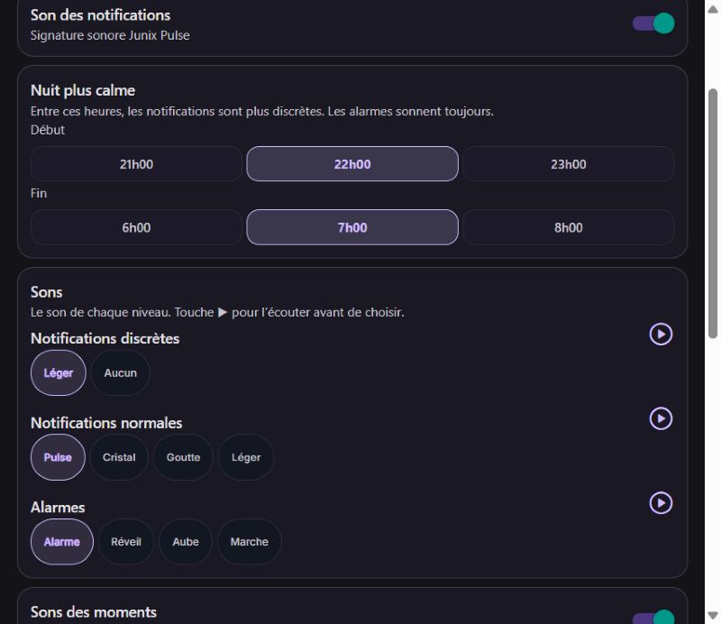

# FICHE OPÉRATOIRE N° 031 — Les sons : un son par niveau, choisi dans les Paramètres, et des alarmes à l'heure

Projet : **Junix Pulse** · Date : 25 novembre 2026 · Suite de : [FICHE 030](FICHE-030-fenetres-en-verre.md) · Étude : [ÉTUDE 001](../etudes/ETUDE-001-clarifier-et-faire-evoluer.md), 16 (n° 9-A)

---

## 1. Objectif

Avant cette fiche, **tout sonnait pareil** : un seul son (le Pulse) pour les rappels, les tâches, les moments et les habitudes, que la notification soit discrète, normale ou une alarme. La vérification demandée a trouvé huit manques ; cette fiche les comble :

| Avant | Après |
|---|---|
| un seul son pour tout | **un son par niveau**, choisi dans Paramètres → Notifications et vibrations → **Sons** |
| peu de choix | **10 sons de Junix** : Pulse, Léger, Festif, Sobre, Alarme, Réveil, Cristal, Goutte, Aube, Marche (et « Aucun » pour les discrètes) |
| un anniversaire sonnait comme un rendez-vous | « **Sons des moments** » : Festif pour un anniversaire ou une fête, Sobre pour un deuil ou une cérémonie (interrupteur) |
| le son d'un canal Android ne peut pas changer | **un canal par son** ; changer un son replanifie les notifications déjà prévues |
| appli ouverte, toujours le même son | le son **de la notification** |
| choisir « Alarme » ne disait rien des alarmes exactes | l'autorisation est **proposée** (une fois, si elle manque) |
| rien ne montrait qu'une carte sonnait en alarme | un petit **réveil** sur la carte (À faire, Journée, Mois) |
| le récap du jour avait le son du système | le son **Léger** |
| en faisant défiler la Semaine, une carte s'ouvrait | un doigt qui bouge n'ouvre plus la carte |
| Paramètres → Planning : « Agenda du téléphone » collé aux puces | un espace et un trait de séparation |

Les sons par défaut : **Léger** pour les discrètes, **Pulse** pour les normales, **Alarme** pour les alarmes, Sons des moments **allumé**. Un utilisateur qui ne touche à rien entend le Pulse comme avant pour ses notifications normales.



*Figure 31-1 — Capture réelle (web, thème sombre). Paramètres → Notifications et vibrations : le groupe « Sons », un ▶ par niveau, puis « Sons des moments ».*

**Pas dans cette fiche** (étude, 16) : l'alarme qui sonne en continu en plein écran (9-B, notre propre module Android) et les sonneries ou musiques du téléphone (9-C).

## 2. État de départ

| À vérifier | Comment | Résultat attendu |
|---|---|---|
| La fiche 030 est enregistrée | `git log --oneline -1` | `feat(ui): every window in glass…` |
| Tout passe | `npx jest` | `Tests: 2126 passed` |

## 3. Matériel

Rien à installer : les sons sont fabriqués par un script Node (`scripts/sons/composer-sons.js`), le son se joue avec `expo-audio` (déjà là), les canaux avec `expo-notifications` (déjà là).

Pour le téléphone : après cette fiche, **refaire le dossier natif** avant l'APK, sinon les nouveaux sons ne sont pas copiés dans `res/raw` :

```powershell
npx expo prebuild --platform android
```

## 4. Hypothèses

- Un son « Aucun » réutilise les canaux silencieux d'avant (pas de nouveau canal sans son).
- Une alarme garde **toujours** son son d'alarme, quel que soit le ton du moment ; un deuil qui descend en discret garde le son Sobre, jamais le Léger.
- Les anciens canaux (`junix-pulse-level-…`, `junix-pulse-reminders-v2`) restent : Android les garde de toute façon, et une notification planifiée avant la mise à jour peut encore s'en servir jusqu'à sa replanification.

## 5. Carte de l'intervention

| Fichier | Action |
|---|---|
| `scripts/sons/composer-sons.js`, `assets/sounds/junix_*.wav` | **nouveaux** : le compositeur et les 9 sons |
| `app.json` | les 10 sons déclarés pour Android (`res/raw`) et iOS |
| `src/domain/rules/sound-rules.ts` (+ test) | **nouveau** : quel son pour quelle notification, les canaux |
| `src/domain/rules/item-notification-rules.ts` | le ton de chaque moment |
| `src/database/migrations.ts` | migration 40 : colonne `sound_prefs` |
| `entities/index.ts`, `settings-repository.ts`, `backup-service.ts` | les choix lus, écrits, sauvegardés |
| `notification-service.ts` | un canal par son ; le son dans les données de la notification |
| `reminder-`, `item-`, `habit-notification-service.ts` | le son de chaque notification ; replanifier si le son change |
| `sound/notification-sound-constants.ts`, `NotificationSoundService.ts`, `_layout.tsx` | le son de la notification, appli ouverte ; l'écoute dans les réglages |
| `components/settings/SoundSetting.tsx`, `app/settings/index.tsx`, i18n | **nouveau** : le groupe « Sons » |
| `offer-exact-alarms.ts`, `AlertLevelField.tsx` | alarmes exactes proposées en choisissant « Alarme » |
| `todo-list-rules.ts`, `TodoRow.tsx`, `PlanningCard.tsx`, `DayTimeGrid.tsx`, `MonthView.tsx` | le réveil sur les cartes en Alarme |
| `DraggableBlock.tsx`, `WeeklyTimetableGrid.tsx`, `DayTimeGrid.tsx`, `MonthView.tsx` | le toucher qui ignore le défilement |
| `settings-styles.ts` | l'espace avant « Agenda du téléphone » |
| `jest.setup.js`, trois tests | les tests suivent |

## 6. Sauvegarde

`git status` propre (hors `docs/motion/`). Les données : la migration **ajoute** une colonne, rien n'est modifié ni effacé. Retour en arrière : section 10.

## 7. Pas à pas

Le plus simple : `node docs/fiches/outils/appliquer-fiche-031.js .` fait toutes les étapes ci-dessous (et compose les sons). Pour comprendre ou refaire à la main, voici chaque étape.

### Étape 1 — Les sons de Junix

**Pourquoi** : Chaque son est **composé par un petit programme** (aucun fichier téléchargé, aucune bibliothèque) : des notes de cloche en ré majeur, posées sur le battement de cœur de Junix. Le même programme refait toujours exactement les mêmes fichiers. Puis `app.json` dit à Android de copier ces fichiers dans l'appli (`res/raw`), car une notification Android ne peut sonner qu'avec un son rangé là.

Repère (Ctrl+F) : la première ligne de chaque bloc « Chercher ». Le script `appliquer-fiche-031.js` fait tous ces changements d'un coup, et refuse d'écrire si un bloc ne se trouve pas exactement une fois.

#### `scripts/sons/composer-sons.js`

Fichier nouveau, en entier :

<!-- bloc: new-composer-sons -->

```js
/**
 * Composes the sounds of Junix Pulse (study 001, 6-D and 16.7; chantier n° 9-A).
 *
 * Every sound is made here, by calculation: no recording, no library, nothing borrowed, so they
 * belong to Junix and are free of rights. They share the family of the sound already in the app:
 * a low beat, like a heart, then a clear bell on D, F sharp and A (the notes of the Junix chime).
 * The same command always gives the same files, to the byte.
 *
 * Usage, from the project folder:
 *   node scripts/sons/composer-sons.js <folder>
 * writes into <folder>: junix_soft.wav, junix_festive.wav, junix_sober.wav, junix_alarm.wav
 * (44 100 Hz, mono, 16 bits, as Android plays them in a notification).
 */
const fs = require('fs');
const path = require('path');

const RATE = 44100;

/** A sound under construction: an array of samples between -1 and 1. */
function blank(seconds) {
  return new Float64Array(Math.round(seconds * RATE));
}

/**
 * A bell: a few partials that ring and fade, the higher ones faster, with an attack of 4 ms so it
 * never clicks. Ratios close to a real bell give it its shine; `bright` keeps more of the high ones.
 */
function bell(out, frequency, at, { length = 1.2, amplitude = 0.5, decay = 3.2, bright = 1 } = {}) {
  const partials = [
    [1, 1],
    [2, 0.45 * bright],
    [2.76, 0.25 * bright],
    [5.4, 0.12 * bright],
  ];
  const start = Math.round(at * RATE);
  const count = Math.round(length * RATE);
  for (let i = 0; i < count && start + i < out.length; i++) {
    const t = i / RATE;
    const attack = Math.min(1, t / 0.004);
    let sample = 0;
    for (const [ratio, weight] of partials) {
      sample += weight * Math.sin(2 * Math.PI * frequency * ratio * t) * Math.exp(-t * decay * (0.7 + ratio * 0.3));
    }
    out[start + i] += amplitude * attack * sample;
  }
}

/** The beat: a low sine whose pitch falls from 110 to 55 Hz in a tenth of a second, like a heart. */
function beat(out, at, { amplitude = 0.7, length = 0.22 } = {}) {
  const start = Math.round(at * RATE);
  const count = Math.round(length * RATE);
  let phase = 0;
  for (let i = 0; i < count && start + i < out.length; i++) {
    const t = i / RATE;
    const frequency = 55 + 55 * Math.exp(-t / 0.04);
    phase += (2 * Math.PI * frequency) / RATE;
    const attack = Math.min(1, t / 0.003);
    out[start + i] += amplitude * attack * Math.sin(phase) * Math.exp(-t / 0.06);
  }
}

/** A little room around the sound: two short echoes, quiet, so it does not sound flat. */
function room(samples, mix = 0.14) {
  const out = Float64Array.from(samples);
  for (const [delay, gain] of [
    [0.043, mix],
    [0.071, mix * 0.7],
    [0.113, mix * 0.45],
  ]) {
    const d = Math.round(delay * RATE);
    for (let i = d; i < out.length; i++) out[i] += samples[i - d] * gain;
  }
  return out;
}

/** Brings the loudest sample to `peak`, and fades the last 30 ms so the end never clicks. */
function finish(samples, peak) {
  const max = samples.reduce((m, s) => Math.max(m, Math.abs(s)), 0) || 1;
  const fade = Math.round(0.03 * RATE);
  return samples.map((s, i) => {
    const tail = i > samples.length - fade ? (samples.length - i) / fade : 1;
    return (s / max) * peak * tail;
  });
}

/** A WAV file: 44 100 Hz, mono, 16 bits. */
function wav(samples) {
  const data = Buffer.alloc(samples.length * 2);
  samples.forEach((s, i) => data.writeInt16LE(Math.round(Math.max(-1, Math.min(1, s)) * 32767), i * 2));
  const header = Buffer.alloc(44);
  header.write('RIFF', 0);
  header.writeUInt32LE(36 + data.length, 4);
  header.write('WAVE', 8);
  header.write('fmt ', 12);
  header.writeUInt32LE(16, 16);
  header.writeUInt16LE(1, 20);
  header.writeUInt16LE(1, 22);
  header.writeUInt32LE(RATE, 24);
  header.writeUInt32LE(RATE * 2, 28);
  header.writeUInt16LE(2, 32);
  header.writeUInt16LE(16, 34);
  header.write('data', 36);
  header.writeUInt32LE(data.length, 40);
  return Buffer.concat([header, data]);
}

// The notes of the Junix chime (Hz)
const D4 = 293.66;
const A4 = 440;
const D5 = 587.33;
const D6 = 1174.66;
const FS6 = 1479.98;
const A6 = 1760;
const D7 = 2349.32;

const SOUNDS = {
  /** Discreet: one soft note, short and quiet. */
  junix_soft: () => {
    const s = blank(0.9);
    bell(s, D6, 0.01, { length: 0.85, amplitude: 0.5, decay: 4.5, bright: 0.5 });
    return finish(room(s, 0.1), 0.42);
  },
  /** Festive (birthday, party): the beat, then the chime climbing D, F sharp, A, D. */
  junix_festive: () => {
    const s = blank(1.6);
    beat(s, 0.0, { amplitude: 0.55 });
    [D6, FS6, A6, D7].forEach((note, i) => bell(s, note, 0.16 + i * 0.09, { length: 1.2, amplitude: 0.42, decay: 3, bright: 1.1 }));
    return finish(room(s), 0.85);
  },
  /** Sober (mourning, ceremony): a soft beat and two low, slow notes, no shine. */
  junix_sober: () => {
    const s = blank(2.0);
    beat(s, 0.0, { amplitude: 0.35, length: 0.3 });
    bell(s, A4, 0.2, { length: 1.6, amplitude: 0.5, decay: 1.8, bright: 0.3 });
    bell(s, D4, 0.75, { length: 1.2, amplitude: 0.5, decay: 1.8, bright: 0.3 });
    return finish(room(s, 0.18), 0.6);
  },
  /**
   * Alarm: two heartbeats and a high call, twice, in exactly 2 seconds, so it can be repeated
   * without a seam (chantier 9-B). Loud and clear, still in the family.
   */
  junix_alarm: () => {
    const s = blank(2.0);
    for (const at of [0, 1.0]) {
      beat(s, at, { amplitude: 0.8 });
      beat(s, at + 0.18, { amplitude: 0.6 });
      bell(s, D6, at + 0.36, { length: 0.5, amplitude: 0.5, decay: 5, bright: 1.2 });
      bell(s, A6, at + 0.5, { length: 0.45, amplitude: 0.5, decay: 5, bright: 1.2 });
    }
    return finish(s, 0.92);
  },
  /**
   * Wake-up: a longer alarm that wakes without harshness. Eight seconds at 120 beats a minute: a
   * heartbeat on each beat, a soft bass on the chord, and a chime melody that climbs through
   * D, E, F sharp, then A, and comes back to D: it loops without a seam until "Arrêter" (9-B).
   */
  junix_wake: () => {
    const beatLength = 0.5; // 120 beats a minute
    const eighth = beatLength / 2;
    const s = blank(8.0);
    const E6 = 1318.51;
    const G6 = 1567.98;
    const B6 = 1975.53;
    const CS7 = 2217.46;
    const FS7 = 2959.96;
    const E7 = 2637.02;
    const bars = [
      { bass: 146.83, melody: [D6, FS6, A6, FS6, D6, FS6, A6, D7] },
      { bass: 164.81, melody: [E6, G6, B6, G6, E6, G6, B6, E7] },
      { bass: 185.0, melody: [FS6, A6, D7, A6, FS6, A6, D7, FS7] },
      { bass: 110.0, melody: [E6, A6, CS7, A6, E6, A6, CS7, A6] },
    ];
    bars.forEach((bar, b) => {
      const barStart = b * 4 * beatLength;
      for (let k = 0; k < 4; k++) {
        const at = barStart + k * beatLength;
        // The heart: stronger on the first beat of the bar, with its echo just after
        beat(s, at, { amplitude: k === 0 ? 0.75 : 0.5 });
        if (k === 0) beat(s, at + 0.16, { amplitude: 0.45 });
        // A soft bass on the chord, to carry the melody
        bell(s, bar.bass, at, { length: 0.45, amplitude: 0.22, decay: 4, bright: 0.2 });
      }
      bar.melody.forEach((note, i) => {
        // The last note of each bar a little louder: it pulls to the next one
        bell(s, note, barStart + i * eighth, { length: 0.4, amplitude: i === 7 ? 0.36 : 0.3, decay: 5.5, bright: 0.9 });
      });
    });
    return finish(room(s, 0.1), 0.9);
  },
  /** Crystal (normal, to choose): two clear notes, A then D, light and bright, no beat. */
  junix_crystal: () => {
    const s = blank(1.3);
    bell(s, A6, 0.01, { length: 1.0, amplitude: 0.5, decay: 3.4, bright: 1.3 });
    bell(s, D7, 0.17, { length: 1.1, amplitude: 0.5, decay: 3.0, bright: 1.3 });
    return finish(room(s, 0.16), 0.8);
  },
  /** Drop (normal, to choose): a round note that falls a little, like a drop of water, short. */
  junix_drop: () => {
    const s = blank(0.7);
    const start = 0;
    let phase = 0;
    for (let i = 0; i < s.length; i++) {
      const t = i / RATE;
      const frequency = 700 + 600 * Math.exp(-t / 0.035);
      phase += (2 * Math.PI * frequency) / RATE;
      const attack = Math.min(1, t / 0.003);
      s[start + i] += 0.7 * attack * Math.sin(phase) * Math.exp(-t / 0.09);
    }
    bell(s, D6, 0.05, { length: 0.6, amplitude: 0.22, decay: 6, bright: 0.6 });
    return finish(room(s, 0.12), 0.75);
  },
  /**
   * Dawn (alarm, to choose): a gentle wake-up. Eight seconds at 80 beats a minute: a slow chime
   * that climbs D, F sharp, A, D and back, over a soft low note and a light heartbeat. Calm, but it
   * does not stop: it loops without a seam until "Arrêter".
   */
  junix_dawn: () => {
    const beatLength = 60 / 80;
    const s = blank(beatLength * 10.666);
    const melody = [D6, FS6, A6, D7, A6, FS6, A6, D7, FS6, A6, D6, A6];
    melody.forEach((note, i) => bell(s, note, i * (beatLength / 1.5), { length: 1.0, amplitude: 0.3, decay: 2.6, bright: 0.7 }));
    for (let k = 0; k < 10; k++) {
      beat(s, k * beatLength, { amplitude: 0.35, length: 0.25 });
      bell(s, k % 4 < 2 ? D4 : A4 / 2, k * beatLength, { length: 0.9, amplitude: 0.18, decay: 2.2, bright: 0.2 });
    }
    return finish(room(s, 0.2), 0.8);
  },
  /**
   * March (alarm, to choose): lively and rhythmic. Four seconds at 140 beats a minute: the
   * heartbeat on each beat, short chime notes in a marching rhythm (two shorts, one long), and a
   * call at the end of each phrase that pulls back to the start.
   */
  junix_march: () => {
    const beatLength = 60 / 140;
    const sixteenth = beatLength / 4;
    const E6 = 1318.51;
    const B6 = 1975.53;
    const s = blank(beatLength * 8 + 0.0);
    const phrase = [
      [D6, 0], [D6, 2], [A6, 4], [FS6, 8], [D6, 10], [A6, 12],
      [E6, 16], [E6, 18], [B6, 20], [A6, 24], [FS6, 26], [D7, 28],
    ];
    for (const [note, step] of phrase) {
      bell(s, note, step * sixteenth, { length: 0.35, amplitude: step % 4 === 0 ? 0.36 : 0.3, decay: 7, bright: 1.1 });
    }
    for (let k = 0; k < 8; k++) beat(s, k * beatLength, { amplitude: k % 2 === 0 ? 0.7 : 0.5, length: 0.18 });
    return finish(room(s, 0.08), 0.92);
  },
};

const folder = path.resolve(process.argv[2] || 'assets/sounds');
fs.mkdirSync(folder, { recursive: true });
for (const [name, make] of Object.entries(SOUNDS)) {
  const file = path.join(folder, `${name}.wav`);
  const samples = make();
  fs.writeFileSync(file, wav(samples));
  console.log(`${name}.wav  ${(samples.length / RATE).toFixed(2)} s`);
}
```

#### `app.json`


Changement 1 sur 1. Chercher :

<!-- bloc: app-1-avant -->

```json
          "icon": "./assets/images/notification-icon.png",
          "color": "#8B5CF6",
          "sounds": [
            "./assets/sounds/junix_pulse_notification.wav"
          ],
          "androidChannels": [
            {
```

Remplacer par :

<!-- bloc: app-1-apres -->

```json
          "icon": "./assets/images/notification-icon.png",
          "color": "#8B5CF6",
          "sounds": [
            "./assets/sounds/junix_pulse_notification.wav",
            "./assets/sounds/junix_soft.wav",
            "./assets/sounds/junix_festive.wav",
            "./assets/sounds/junix_sober.wav",
            "./assets/sounds/junix_alarm.wav",
            "./assets/sounds/junix_wake.wav",
            "./assets/sounds/junix_crystal.wav",
            "./assets/sounds/junix_drop.wav",
            "./assets/sounds/junix_dawn.wav",
            "./assets/sounds/junix_march.wav"
          ],
          "androidChannels": [
            {
```

Lancer le compositeur : `node scripts/sons/composer-sons.js assets/sounds`. Neuf fichiers `junix_*.wav` apparaissent dans `assets/sounds` (le Pulse d'avant, `junix_pulse_notification.wav`, ne change pas).

### Étape 2 — La règle : quel son pour quelle notification

**Pourquoi** : Une seule fonction décide du son (`soundFor`) : le niveau, le ton du moment (Festif pour un anniversaire ou une fête, Sobre pour un deuil ou une cérémonie), les réglages, et le son coupé ou non. Elle est **pure** (pas d'écran, pas de base) : les tests vérifient chaque cas. Le planificateur des tâches et des moments donne maintenant le ton de chaque moment.

Repère (Ctrl+F) : la première ligne de chaque bloc « Chercher ». Le script `appliquer-fiche-031.js` fait tous ces changements d'un coup, et refuse d'écrire si un bloc ne se trouve pas exactement une fois.

#### `src/domain/rules/sound-rules.ts`

Fichier nouveau, en entier :

<!-- bloc: new-sound-rules -->

```ts
/**
 * The sounds of Junix (study 001, 6-D and 16.7; sheet 031): which one rings for a notification.
 *
 * Each level has its sound, chosen in the settings: discreet (Léger, or none), normal (Pulse,
 * Cristal, Goutte, Léger) and alarm (Alarme, Réveil, Aube, Marche). A moment keeps the sound of
 * its tone when the settings say so (on at first): Festif for a birthday or a party at the normal
 * level, Sobre for a mourning or a ceremony, discreet or normal. An alarm always keeps its own.
 * With the sound of the notifications off, nothing rings.
 *
 * Pure: the screens and the services read it, the tests check every case. A new sound is a line
 * in SOUNDS (and its file in assets/sounds, made by scripts/sons/composer-sons.js).
 */
import type { NotificationLevel } from './notification-level-rules';
import type { MomentTone } from './moment-kind-rules';

export const SOUND_IDS = ['pulse', 'soft', 'festive', 'sober', 'alarm', 'wake', 'crystal', 'drop', 'dawn', 'march'] as const;
export type SoundId = (typeof SOUND_IDS)[number];
/** What rings: a sound, or nothing. */
export type SoundChoice = SoundId | 'none';

export interface SoundDefinition {
  id: SoundId;
  /** The file in assets/sounds, and on Android its name in res/raw (no extension). */
  file: string;
  /** Its name in the settings: sound.<id>. */
  labelKey: `sound.${SoundId}`;
  /** It repeats without a seam (the alarms, for the alarm that keeps ringing, 9-B). */
  loops: boolean;
}

export const SOUNDS: Readonly<Record<SoundId, SoundDefinition>> = {
  pulse: { id: 'pulse', file: 'junix_pulse_notification', labelKey: 'sound.pulse', loops: false },
  soft: { id: 'soft', file: 'junix_soft', labelKey: 'sound.soft', loops: false },
  festive: { id: 'festive', file: 'junix_festive', labelKey: 'sound.festive', loops: false },
  sober: { id: 'sober', file: 'junix_sober', labelKey: 'sound.sober', loops: false },
  alarm: { id: 'alarm', file: 'junix_alarm', labelKey: 'sound.alarm', loops: true },
  wake: { id: 'wake', file: 'junix_wake', labelKey: 'sound.wake', loops: true },
  crystal: { id: 'crystal', file: 'junix_crystal', labelKey: 'sound.crystal', loops: false },
  drop: { id: 'drop', file: 'junix_drop', labelKey: 'sound.drop', loops: false },
  dawn: { id: 'dawn', file: 'junix_dawn', labelKey: 'sound.dawn', loops: true },
  march: { id: 'march', file: 'junix_march', labelKey: 'sound.march', loops: true },
};

/** The sounds each level can choose, in the order the settings show them. */
export const SOUND_CHOICES: Readonly<Record<NotificationLevel, readonly SoundChoice[]>> = {
  discreet: ['soft', 'none'],
  normal: ['pulse', 'crystal', 'drop', 'soft'],
  alarm: ['alarm', 'wake', 'dawn', 'march'],
};

export interface SoundPrefs {
  discreet: SoundChoice;
  normal: SoundChoice;
  alarm: SoundChoice;
  /** A festive or sober moment keeps the sound of its tone. */
  momentTones: boolean;
}

export const DEFAULT_SOUND_PREFS: Readonly<SoundPrefs> = { discreet: 'soft', normal: 'pulse', alarm: 'alarm', momentTones: true };

/**
 * The settings read from their text ("discreet=soft;normal=pulse;alarm=wake;tones=1"). A value
 * missing, unknown or not allowed for its level keeps its default: old settings always read.
 */
export function soundPrefsOf(text: string | null | undefined): SoundPrefs {
  const prefs: SoundPrefs = { ...DEFAULT_SOUND_PREFS };
  for (const pair of (text ?? '').split(';')) {
    const [key, value] = pair.split('=').map(part => part.trim());
    if (key === 'tones') prefs.momentTones = value !== '0';
    else if (key === 'discreet' || key === 'normal' || key === 'alarm') {
      if ((SOUND_CHOICES[key] as readonly string[]).includes(value)) prefs[key] = value as SoundChoice;
    }
  }
  return prefs;
}

export function soundPrefsText(prefs: SoundPrefs): string {
  return `discreet=${prefs.discreet};normal=${prefs.normal};alarm=${prefs.alarm};tones=${prefs.momentTones ? 1 : 0}`;
}

/** The sound of one notification: its level, the tone of its moment if any, the settings. */
export function soundFor({
  level,
  tone,
  prefs = DEFAULT_SOUND_PREFS,
  soundOn = true,
}: {
  level: NotificationLevel;
  tone?: MomentTone;
  prefs?: SoundPrefs;
  soundOn?: boolean;
}): SoundChoice {
  if (!soundOn) return 'none';
  if (level === 'alarm') return prefs.alarm;
  if (prefs.momentTones && tone === 'sober') return 'sober';
  if (level === 'normal' && prefs.momentTones && tone === 'festive') return 'festive';
  return prefs[level];
}

/**
 * The Android channel of a level and a sound. A channel's sound cannot change once created
 * (Android): each pair has its own. Without sound, the channels that existed before keep serving.
 */
export function soundChannelId(level: NotificationLevel, sound: SoundChoice): string {
  if (sound === 'none') return level === 'discreet' ? 'junix-pulse-level-discreet-v1' : 'junix-pulse-reminders-silent-v1';
  return `junix-pulse-sound-${level}-${sound}-v1`;
}

/** Every pair of level and sound a notification can use: the channels to create. */
export function soundChannels(): { level: NotificationLevel; sound: SoundId }[] {
  const pairs: { level: NotificationLevel; sound: SoundId }[] = [];
  const add = (level: NotificationLevel, sound: SoundChoice) => {
    if (sound !== 'none' && !pairs.some(pair => pair.level === level && pair.sound === sound)) pairs.push({ level, sound });
  };
  (Object.keys(SOUND_CHOICES) as NotificationLevel[]).forEach(level => SOUND_CHOICES[level].forEach(sound => add(level, sound)));
  // The tones of the moments
  add('discreet', 'sober');
  add('normal', 'sober');
  add('normal', 'festive');
  return pairs;
}
```

#### `src/domain/rules/__tests__/sound-rules.test.ts`

Fichier nouveau, en entier :

<!-- bloc: new-sound-rules-test -->

```ts
import {
  DEFAULT_SOUND_PREFS,
  SOUNDS,
  SOUND_CHOICES,
  soundChannelId,
  soundChannels,
  soundFor,
  soundPrefsOf,
  soundPrefsText,
} from '../sound-rules';

describe('sound-rules (sheet 031)', () => {
  it('gives each level its sound, and nothing when the sound is off', () => {
    expect(soundFor({ level: 'discreet' })).toBe('soft');
    expect(soundFor({ level: 'normal' })).toBe('pulse');
    expect(soundFor({ level: 'alarm' })).toBe('alarm');
    expect(soundFor({ level: 'alarm', soundOn: false })).toBe('none');
  });

  it('keeps the tone of a moment, unless the settings say otherwise', () => {
    expect(soundFor({ level: 'normal', tone: 'festive' })).toBe('festive');
    expect(soundFor({ level: 'normal', tone: 'sober' })).toBe('sober');
    // A mourning goes down to discreet: it keeps its sober sound, never the light one
    expect(soundFor({ level: 'discreet', tone: 'sober' })).toBe('sober');
    // A festive moment at night (discreet) takes the discreet sound
    expect(soundFor({ level: 'discreet', tone: 'festive' })).toBe('soft');
    // An alarm keeps the alarm sound, whatever the tone
    expect(soundFor({ level: 'alarm', tone: 'festive' })).toBe('alarm');
    const noTones = { ...DEFAULT_SOUND_PREFS, momentTones: false };
    expect(soundFor({ level: 'normal', tone: 'festive', prefs: noTones })).toBe('pulse');
  });

  it('follows the chosen sounds', () => {
    const prefs = { discreet: 'none', normal: 'crystal', alarm: 'wake', momentTones: true } as const;
    expect(soundFor({ level: 'discreet', prefs })).toBe('none');
    expect(soundFor({ level: 'normal', prefs })).toBe('crystal');
    expect(soundFor({ level: 'alarm', prefs })).toBe('wake');
  });

  it('reads the settings strictly and writes them back', () => {
    expect(soundPrefsOf(null)).toEqual(DEFAULT_SOUND_PREFS);
    expect(soundPrefsOf('discreet=none;normal=drop;alarm=march;tones=0')).toEqual({ discreet: 'none', normal: 'drop', alarm: 'march', momentTones: false });
    // A sound not allowed for its level keeps the default
    expect(soundPrefsOf('normal=wake;alarm=pulse;discreet=festive')).toEqual(DEFAULT_SOUND_PREFS);
    const prefs = { discreet: 'soft', normal: 'crystal', alarm: 'dawn', momentTones: true } as const;
    expect(soundPrefsOf(soundPrefsText(prefs))).toEqual(prefs);
  });

  it('gives a channel to every pair, the silent ones reused', () => {
    expect(soundChannelId('alarm', 'wake')).toBe('junix-pulse-sound-alarm-wake-v1');
    expect(soundChannelId('discreet', 'none')).toBe('junix-pulse-level-discreet-v1');
    expect(soundChannelId('normal', 'none')).toBe('junix-pulse-reminders-silent-v1');
    const pairs = soundChannels();
    // Every sound a level can choose, and the tones of the moments
    for (const level of ['discreet', 'normal', 'alarm'] as const) {
      for (const sound of SOUND_CHOICES[level]) if (sound !== 'none') expect(pairs).toContainEqual({ level, sound });
    }
    expect(pairs).toContainEqual({ level: 'normal', sound: 'festive' });
    expect(pairs).toContainEqual({ level: 'discreet', sound: 'sober' });
    expect(new Set(pairs.map(pair => soundChannelId(pair.level, pair.sound))).size).toBe(pairs.length);
  });

  it('names each file as Android wants it in res/raw', () => {
    for (const sound of Object.values(SOUNDS)) expect(sound.file).toMatch(/^[a-z][a-z0-9_]*$/);
  });
});
```

#### `src/domain/rules/item-notification-rules.ts`


Changement 1 sur 4. Chercher :

<!-- bloc: item-notification-rules-1-avant -->

```ts
import { Event, Task } from '../entities';
import { translate } from '../../i18n/translate';
import type { AppLanguage } from './language-rules';
import {
  AlertDefaults,
  DEFAULT_ALERT_DEFAULTS,
```

Remplacer par :

<!-- bloc: item-notification-rules-1-apres -->

```ts
import { Event, Task } from '../entities';
import { translate } from '../../i18n/translate';
import type { AppLanguage } from './language-rules';
import { MOMENT_KIND_TONES, momentKindOf, type MomentTone } from './moment-kind-rules';
import {
  AlertDefaults,
  DEFAULT_ALERT_DEFAULTS,
```

Changement 2 sur 4. Chercher :

<!-- bloc: item-notification-rules-2-avant -->

```ts
  body: string;
  scheduledAt: Date;
  level: NotificationLevel;
}

export interface ItemPlanInput {
```

Remplacer par :

<!-- bloc: item-notification-rules-2-apres -->

```ts
  body: string;
  scheduledAt: Date;
  level: NotificationLevel;
  /** The tone of a moment (festive, neutral, sober): its sound follows it (sheet 031). */
  tone?: MomentTone;
}

export interface ItemPlanInput {
```

Changement 3 sur 4. Chercher :

<!-- bloc: item-notification-rules-3-avant -->

```ts
}: ItemPlanInput): PlannedItemNotification[] {
  const planned: PlannedItemNotification[] = [];
  const add = (
    item: Omit<PlannedItemNotification, 'identifier' | 'level'>,
    priority?: Task['priority'],
    // A moment: its type and the level chosen for it (sheet 023)
    moment?: Pick<Event, 'momentKind' | 'alertLevel'>
```

Remplacer par :

<!-- bloc: item-notification-rules-3-apres -->

```ts
}: ItemPlanInput): PlannedItemNotification[] {
  const planned: PlannedItemNotification[] = [];
  const add = (
    item: Omit<PlannedItemNotification, 'identifier' | 'level' | 'tone'>,
    priority?: Task['priority'],
    // A moment: its type and the level chosen for it (sheet 023)
    moment?: Pick<Event, 'momentKind' | 'alertLevel'>
```

Changement 4 sur 4. Chercher :

<!-- bloc: item-notification-rules-4-avant -->

```ts
        chosen: moment?.alertLevel,
        momentKind: moment?.momentKind,
      }),
    });
  };

```

Remplacer par :

<!-- bloc: item-notification-rules-4-apres -->

```ts
        chosen: moment?.alertLevel,
        momentKind: moment?.momentKind,
      }),
      ...(item.itemType === 'EVENT' ? { tone: MOMENT_KIND_TONES[momentKindOf(moment?.momentKind)] } : {}),
    });
  };

```


### Étape 3 — Les choix gardés dans la base

**Pourquoi** : Les sons choisis sont gardés dans une **nouvelle colonne** de la table des réglages (migration 40, `sound_prefs`). On **ajoute** une colonne : rien d'existant n'est touché, et une colonne vide veut dire « les sons par défaut ». La sauvegarde chiffrée l'emporte aussi.

Repère (Ctrl+F) : la première ligne de chaque bloc « Chercher ». Le script `appliquer-fiche-031.js` fait tous ces changements d'un coup, et refuse d'écrire si un bloc ne se trouve pas exactement une fois.

#### `src/database/migrations.ts`


Changement 1 sur 1. Chercher :

<!-- bloc: migrations-1-avant -->

```ts
      ALTER TABLE settings ADD COLUMN planning_prefs TEXT;
    `,
  },
];

```

Remplacer par :

<!-- bloc: migrations-1-apres -->

```ts
      ALTER TABLE settings ADD COLUMN planning_prefs TEXT;
    `,
  },
  {
    version: 40,
    name: 'add_sound_prefs',
    sql: `
      -- Les sons choisis (fiche 031, etude 16.7) : discret, normal, alarme, et les tons
      -- des moments. Vide : les sons par defaut (Leger, Pulse, Alarme, tons gardes).
      ALTER TABLE settings ADD COLUMN sound_prefs TEXT;
    `,
  },
];

```

#### `src/domain/entities/index.ts`


Changement 1 sur 2. Chercher :

<!-- bloc: indexx-1-avant -->

```ts
import type { LanguageSetting } from '../rules/language-rules';
import type { AlertDefaults } from '../rules/notification-level-rules';
import type { PlanningPrefs } from '../rules/planning-settings-rules';
import type { TagColor } from '../rules/tag-rules';

export * from '../enums';
```

Remplacer par :

<!-- bloc: indexx-1-apres -->

```ts
import type { LanguageSetting } from '../rules/language-rules';
import type { AlertDefaults } from '../rules/notification-level-rules';
import type { PlanningPrefs } from '../rules/planning-settings-rules';
import type { SoundPrefs } from '../rules/sound-rules';
import type { TagColor } from '../rules/tag-rules';

export * from '../enums';
```

Changement 2 sur 2. Chercher :

<!-- bloc: indexx-2-avant -->

```ts
  alertLevels?: AlertDefaults;
  /** The view the Planning opens on, the first day of the week and the step of a move (sheet 028). */
  planningPrefs?: PlanningPrefs;
  /**
   * Mode d'apparence choisi : suit le système, clair, ou sombre.
   * Valeur par défaut : 'light' pour un appareil neuf depuis la fiche 028 ('dark' avant).
```

Remplacer par :

<!-- bloc: indexx-2-apres -->

```ts
  alertLevels?: AlertDefaults;
  /** The view the Planning opens on, the first day of the week and the step of a move (sheet 028). */
  planningPrefs?: PlanningPrefs;
  /** The sound of each level, and whether moments keep the sound of their tone (sheet 031). */
  soundPrefs?: SoundPrefs;
  /**
   * Mode d'apparence choisi : suit le système, clair, ou sombre.
   * Valeur par défaut : 'light' pour un appareil neuf depuis la fiche 028 ('dark' avant).
```

#### `src/repositories/settings-repository.ts`


Changement 1 sur 3. Chercher :

<!-- bloc: settings-repository-1-avant -->

```ts
import { isAppLockDelay } from '../domain/rules/app-lock-rules';
import { alertDefaultsOf, alertDefaultsText } from '../domain/rules/notification-level-rules';
import { planningPrefsOf, planningPrefsText } from '../domain/rules/planning-settings-rules';

const VALID_APPEARANCE_MODES: ReadonlySet<AppearanceMode> = new Set(['system', 'light', 'dark']);
const VALID_MASCOT_PRESENCE: ReadonlySet<string> = new Set<MascotPresence>(['full', 'discreet', 'off']);
```

Remplacer par :

<!-- bloc: settings-repository-1-apres -->

```ts
import { isAppLockDelay } from '../domain/rules/app-lock-rules';
import { alertDefaultsOf, alertDefaultsText } from '../domain/rules/notification-level-rules';
import { planningPrefsOf, planningPrefsText } from '../domain/rules/planning-settings-rules';
import { soundPrefsOf, soundPrefsText } from '../domain/rules/sound-rules';

const VALID_APPEARANCE_MODES: ReadonlySet<AppearanceMode> = new Set(['system', 'light', 'dark']);
const VALID_MASCOT_PRESENCE: ReadonlySet<string> = new Set<MascotPresence>(['full', 'discreet', 'off']);
```

Changement 2 sur 3. Chercher :

<!-- bloc: settings-repository-2-avant -->

```ts
    quietHoursEnd: (row.quiet_hours_end as number | undefined) ?? 7,
    alertLevels: alertDefaultsOf(row.alert_levels as string | null | undefined),
    planningPrefs: planningPrefsOf(row.planning_prefs as string | null | undefined),
    appearanceMode,
    reduceTransparency: (row.reduce_transparency as number) === 1,
    appearanceDark: row.appearance_dark !== undefined ? (row.appearance_dark as number) === 1 : true,
```

Remplacer par :

<!-- bloc: settings-repository-2-apres -->

```ts
    quietHoursEnd: (row.quiet_hours_end as number | undefined) ?? 7,
    alertLevels: alertDefaultsOf(row.alert_levels as string | null | undefined),
    planningPrefs: planningPrefsOf(row.planning_prefs as string | null | undefined),
    soundPrefs: soundPrefsOf(row.sound_prefs as string | null | undefined),
    appearanceMode,
    reduceTransparency: (row.reduce_transparency as number) === 1,
    appearanceDark: row.appearance_dark !== undefined ? (row.appearance_dark as number) === 1 : true,
```

Changement 3 sur 3. Chercher :

<!-- bloc: settings-repository-3-avant -->

```ts
      setClauses.push('planning_prefs = ?');
      values.push(planningPrefsText(params.planningPrefs));
    }

    if (params.mascotPresence !== undefined && VALID_MASCOT_PRESENCE.has(params.mascotPresence)) {
      setClauses.push('mascot_presence = ?');
```

Remplacer par :

<!-- bloc: settings-repository-3-apres -->

```ts
      setClauses.push('planning_prefs = ?');
      values.push(planningPrefsText(params.planningPrefs));
    }
    if (params.soundPrefs !== undefined) {
      setClauses.push('sound_prefs = ?');
      values.push(soundPrefsText(params.soundPrefs));
    }

    if (params.mascotPresence !== undefined && VALID_MASCOT_PRESENCE.has(params.mascotPresence)) {
      setClauses.push('mascot_presence = ?');
```

#### `src/services/backup-service.ts`


Changement 1 sur 1. Chercher :

<!-- bloc: backup-service-1-avant -->

```ts
  planning_blocks: ['id', 'schedule_id', 'label', 'type', 'day_of_week', 'start_time', 'end_time', 'color', 'created_at', 'updated_at'],
  interactions: ['id', 'person_id', 'type', 'occurred_at', 'notes', 'reminder_id', 'task_id', 'event_id', 'created_at'],
  suggestions: ['id', 'type', 'status', 'title', 'explanation', 'target_id', 'target_type', 'proposed_data', 'generated_at', 'expires_at', 'decided_at', 'created_at'],
  settings: ['id', 'display_name', 'timezone', 'onboarding_completed', 'notifications_enabled', 'forgotten_contact_threshold_days', 'end_of_day_hour', 'morning_briefing_hour', 'appearance_dark', 'appearance_mode', 'mascot_presence', 'mascot_address', 'mascot_proposals', 'mascot_briefings', 'language', 'notification_sound_enabled', 'haptics_enabled', 'quiet_hours_start', 'quiet_hours_end', 'alert_levels', 'planning_prefs', 'created_at', 'updated_at'],
  sanctum_notes: ['id', 'title', 'content', 'folder', 'created_at', 'updated_at'],
};

```

Remplacer par :

<!-- bloc: backup-service-1-apres -->

```ts
  planning_blocks: ['id', 'schedule_id', 'label', 'type', 'day_of_week', 'start_time', 'end_time', 'color', 'created_at', 'updated_at'],
  interactions: ['id', 'person_id', 'type', 'occurred_at', 'notes', 'reminder_id', 'task_id', 'event_id', 'created_at'],
  suggestions: ['id', 'type', 'status', 'title', 'explanation', 'target_id', 'target_type', 'proposed_data', 'generated_at', 'expires_at', 'decided_at', 'created_at'],
  settings: ['id', 'display_name', 'timezone', 'onboarding_completed', 'notifications_enabled', 'forgotten_contact_threshold_days', 'end_of_day_hour', 'morning_briefing_hour', 'appearance_dark', 'appearance_mode', 'mascot_presence', 'mascot_address', 'mascot_proposals', 'mascot_briefings', 'language', 'notification_sound_enabled', 'haptics_enabled', 'quiet_hours_start', 'quiet_hours_end', 'alert_levels', 'planning_prefs', 'sound_prefs', 'created_at', 'updated_at'],
  sanctum_notes: ['id', 'title', 'content', 'folder', 'created_at', 'updated_at'],
};

```


### Étape 4 — Un canal par son, et la synchronisation

**Pourquoi** : Sur Android, le son d'un **canal** de notifications ne peut plus changer une fois créé. Il y a donc un canal par couple (niveau, son), et une notification va dans le canal de son son. Chaque notification planifiée garde aussi son son dans ses données : quand tu changes un son dans les réglages, la synchronisation voit la différence et la replanifie dans le bon canal. Le récap du jour prend le son Léger (nouveau canal `daily-recap-v2`).

Repère (Ctrl+F) : la première ligne de chaque bloc « Chercher ». Le script `appliquer-fiche-031.js` fait tous ces changements d'un coup, et refuse d'écrire si un bloc ne se trouve pas exactement une fois.

#### `src/services/notification-service.ts`


Changement 1 sur 10. Chercher :

<!-- bloc: notification-service-1-avant -->

```ts
} from "@/domain/rules/reminder-notification-rules";
import { Platform } from "react-native";
import { NOTIFICATION_CHANNEL_ID, NOTIFICATION_SOUND_WAV_FILENAME } from "@/services/sound/notification-sound-constants";
import { HABIT_ACTION_DONE, HABIT_CATEGORY_ID } from "@/domain/rules/habit-notification-rules";
import {
  notificationChannelFor,
```

Remplacer par :

<!-- bloc: notification-service-1-apres -->

```ts
} from "@/domain/rules/reminder-notification-rules";
import { Platform } from "react-native";
import { NOTIFICATION_CHANNEL_ID, NOTIFICATION_SOUND_WAV_FILENAME } from "@/services/sound/notification-sound-constants";
import { SOUNDS, soundChannelId, soundChannels, type SoundChoice } from "@/domain/rules/sound-rules";
import { HABIT_ACTION_DONE, HABIT_CATEGORY_ID } from "@/domain/rules/habit-notification-rules";
import {
  notificationChannelFor,
```

Changement 2 sur 10. Chercher :

<!-- bloc: notification-service-2-avant -->

```ts
}

// Canal distinct des rappels : importance normale, désactivable séparément dans Android
const DAILY_RECAP_CHANNEL_ID = "junix-pulse-daily-recap";
const NOTIFICATION_SILENT_CHANNEL_ID = "junix-pulse-reminders-silent-v1";
// The levels of study 001 (12.6). A channel's sound and importance are fixed when it is created:
// other settings mean a new identifier, never a change to these
```

Remplacer par :

<!-- bloc: notification-service-2-apres -->

```ts
}

// Canal distinct des rappels : importance normale, désactivable séparément dans Android
// The second one, with the light sound of Junix (sheet 031): a channel's sound cannot change
const DAILY_RECAP_CHANNEL_ID = "junix-pulse-daily-recap-v2";
const NOTIFICATION_SILENT_CHANNEL_ID = "junix-pulse-reminders-silent-v1";
// The levels of study 001 (12.6). A channel's sound and importance are fixed when it is created:
// other settings mean a new identifier, never a change to these
```

Changement 3 sur 10. Chercher :

<!-- bloc: notification-service-3-avant -->

```ts
  data?: Record<string, unknown>;
  /** How loud it rings (sheet 011); normal when not given. */
  level?: NotificationLevel;
}

export interface ScheduleItemParams {
```

Remplacer par :

<!-- bloc: notification-service-3-apres -->

```ts
  data?: Record<string, unknown>;
  /** How loud it rings (sheet 011); normal when not given. */
  level?: NotificationLevel;
  /** The sound it rings with (sheet 031); without it, the sound of Junix of before. */
  sound?: SoundChoice;
}

export interface ScheduleItemParams {
```

Changement 4 sur 10. Chercher :

<!-- bloc: notification-service-4-avant -->

```ts
  scheduledAt: Date;
  level: NotificationLevel;
  soundOn: boolean;
}

export interface ScheduleHabitParams {
```

Remplacer par :

<!-- bloc: notification-service-4-apres -->

```ts
  scheduledAt: Date;
  level: NotificationLevel;
  soundOn: boolean;
  /** The sound it rings with (sheet 031). */
  sound?: SoundChoice;
}

export interface ScheduleHabitParams {
```

Changement 5 sur 10. Chercher :

<!-- bloc: notification-service-5-avant -->

```ts
  scheduledAt: Date;
  level: NotificationLevel;
  soundOn: boolean;
}

// ─── Service ─────────────────────────────────────────────────────────────────
```

Remplacer par :

<!-- bloc: notification-service-5-apres -->

```ts
  scheduledAt: Date;
  level: NotificationLevel;
  soundOn: boolean;
  /** The sound it rings with (sheet 031). */
  sound?: SoundChoice;
}

/** The file a sound plays, for iOS (Android takes the sound of the channel); false: silence. */
function soundFileOf(sound: SoundChoice): string | false {
  return sound === "none" ? false : `${SOUNDS[sound].file}.wav`;
}

/** The channel of a task, a moment or a habit: the one of its sound, or of its level as before. */
function itemChannelOf(params: { level: NotificationLevel; soundOn: boolean; sound?: SoundChoice }): string {
  return params.sound ? soundChannelId(params.level, params.sound) : channelIdFor(params.level, params.soundOn);
}

// ─── Service ─────────────────────────────────────────────────────────────────
```

Changement 6 sur 10. Chercher :

<!-- bloc: notification-service-6-avant -->

```ts
          importance: Notifications.AndroidImportance.DEFAULT,
          lightColor: "#8B3DF0",
          showBadge: false,
        });
      }
      // On Android the buttons act without opening the app: expo-notifications hands the tap to the
      // background task, even when the app was closed. Elsewhere they open the app, which acts.
```

Remplacer par :

<!-- bloc: notification-service-6-apres -->

```ts
          importance: Notifications.AndroidImportance.DEFAULT,
          lightColor: "#8B3DF0",
          showBadge: false,
          sound: `${SOUNDS.soft.file}.wav`,
        });

        // One channel for each level and each sound of Junix (sheet 031): the sound chosen in the
        // settings picks the channel when a notification is planned
        const importances = {
          discreet: Notifications.AndroidImportance.DEFAULT,
          normal: Notifications.AndroidImportance.HIGH,
          alarm: Notifications.AndroidImportance.MAX,
        };
        for (const { level, sound } of soundChannels()) {
          await Notifications.setNotificationChannelAsync(soundChannelId(level, sound), {
            name: t('notifChannel.soundName', { level: t(`alertLevel.${level}`), sound: t(SOUNDS[sound].labelKey) }),
            description: t(`notifChannel.soundDesc.${level}`),
            importance: importances[level],
            vibrationPattern: level === "alarm" ? [0, 600, 300, 600, 300, 600] : [0, 250, 250, 250],
            enableVibrate: level !== "discreet",
            lightColor: level === "alarm" ? "#FFB4AB" : "#8B3DF0",
            showBadge: false,
            sound: `${SOUNDS[sound].file}.wav`,
            ...(level === "alarm" ? { lockscreenVisibility: Notifications.AndroidNotificationVisibility.PUBLIC, bypassDnd: false } : {}),
          });
        }
      }
      // On Android the buttons act without opening the app: expo-notifications hands the tap to the
      // background task, even when the app was closed. Elsewhere they open the app, which acts.
```

Changement 7 sur 10. Chercher :

<!-- bloc: notification-service-7-avant -->

```ts
            reminderId: params.id,
            type: "REMINDER",
            level: params.level ?? "normal",
            ...params.data,
          },
          // iOS uses the filename; Android uses the channel's configured sound.
          sound: params.silent || params.level === "discreet" ? false : NOTIFICATION_SOUND_WAV_FILENAME,
          categoryIdentifier: REMINDER_CATEGORY_ID,
          priority: Notifications.AndroidNotificationPriority.HIGH,
        },
        trigger: {
          type: Notifications.SchedulableTriggerInputTypes.DATE,
          date: triggerDate,
          channelId: Platform.OS === "android" ? channelIdFor(params.level ?? "normal", !params.silent) : undefined,
        } as import("expo-notifications").DateTriggerInput,
      });
    } catch {
```

Remplacer par :

<!-- bloc: notification-service-7-apres -->

```ts
            reminderId: params.id,
            type: "REMINDER",
            level: params.level ?? "normal",
            ...(params.sound ? { sound: params.sound } : {}),
            ...params.data,
          },
          // iOS uses the filename; Android uses the channel's configured sound.
          sound: params.sound
            ? soundFileOf(params.sound)
            : params.silent || params.level === "discreet" ? false : NOTIFICATION_SOUND_WAV_FILENAME,
          categoryIdentifier: REMINDER_CATEGORY_ID,
          priority: Notifications.AndroidNotificationPriority.HIGH,
        },
        trigger: {
          type: Notifications.SchedulableTriggerInputTypes.DATE,
          date: triggerDate,
          channelId:
            Platform.OS === "android"
              ? params.sound
                ? soundChannelId(params.level ?? "normal", params.sound)
                : channelIdFor(params.level ?? "normal", !params.silent)
              : undefined,
        } as import("expo-notifications").DateTriggerInput,
      });
    } catch {
```

Changement 8 sur 10. Chercher :

<!-- bloc: notification-service-8-avant -->

```ts
            type: params.itemType,
            [params.itemType === "TASK" ? "taskId" : "eventId"]: params.itemId,
            level: params.level,
          },
          sound: params.soundOn && params.level !== "discreet" ? NOTIFICATION_SOUND_WAV_FILENAME : false,
          priority: priorities[params.level],
        },
        trigger: {
          type: Notifications.SchedulableTriggerInputTypes.DATE,
          date: params.scheduledAt,
          channelId: Platform.OS === "android" ? channelIdFor(params.level, params.soundOn) : undefined,
        } as import("expo-notifications").DateTriggerInput,
      });
    } catch {
```

Remplacer par :

<!-- bloc: notification-service-8-apres -->

```ts
            type: params.itemType,
            [params.itemType === "TASK" ? "taskId" : "eventId"]: params.itemId,
            level: params.level,
            ...(params.sound ? { sound: params.sound } : {}),
          },
          sound: params.sound
            ? soundFileOf(params.sound)
            : params.soundOn && params.level !== "discreet" ? NOTIFICATION_SOUND_WAV_FILENAME : false,
          priority: priorities[params.level],
        },
        trigger: {
          type: Notifications.SchedulableTriggerInputTypes.DATE,
          date: params.scheduledAt,
          channelId: Platform.OS === "android" ? itemChannelOf(params) : undefined,
        } as import("expo-notifications").DateTriggerInput,
      });
    } catch {
```

Changement 9 sur 10. Chercher :

<!-- bloc: notification-service-9-avant -->

```ts
        content: {
          title: params.title,
          body: params.body,
          data: { type: "HABIT", habitId: params.habitId, level: params.level },
          sound: params.soundOn && params.level !== "discreet" ? NOTIFICATION_SOUND_WAV_FILENAME : false,
          categoryIdentifier: HABIT_CATEGORY_ID,
          priority:
            params.level === "discreet"
```

Remplacer par :

<!-- bloc: notification-service-9-apres -->

```ts
        content: {
          title: params.title,
          body: params.body,
          data: { type: "HABIT", habitId: params.habitId, level: params.level, ...(params.sound ? { sound: params.sound } : {}) },
          sound: params.sound
            ? soundFileOf(params.sound)
            : params.soundOn && params.level !== "discreet" ? NOTIFICATION_SOUND_WAV_FILENAME : false,
          categoryIdentifier: HABIT_CATEGORY_ID,
          priority:
            params.level === "discreet"
```

Changement 10 sur 10. Chercher :

<!-- bloc: notification-service-10-avant -->

```ts
        trigger: {
          type: Notifications.SchedulableTriggerInputTypes.DATE,
          date: params.scheduledAt,
          channelId: Platform.OS === "android" ? channelIdFor(params.level, params.soundOn) : undefined,
        } as import("expo-notifications").DateTriggerInput,
      });
    } catch {
```

Remplacer par :

<!-- bloc: notification-service-10-apres -->

```ts
        trigger: {
          type: Notifications.SchedulableTriggerInputTypes.DATE,
          date: params.scheduledAt,
          channelId: Platform.OS === "android" ? itemChannelOf(params) : undefined,
        } as import("expo-notifications").DateTriggerInput,
      });
    } catch {
```

#### `src/services/reminder-notification-service.ts`


Changement 1 sur 4. Chercher :

<!-- bloc: reminder-notification-service-1-avant -->

```ts
import { syncHabitNotifications } from '@/services/habit-notification-service';
import { useAppStore } from '@/store/app-store';
import { logger } from '@/utils/logger';

export interface ReminderSyncOptions {
  /** After a user action: may ask for the permission, and reports problems to the user. */
```

Remplacer par :

<!-- bloc: reminder-notification-service-1-apres -->

```ts
import { syncHabitNotifications } from '@/services/habit-notification-service';
import { useAppStore } from '@/store/app-store';
import { logger } from '@/utils/logger';
import { soundFor } from '@/domain/rules/sound-rules';
import type { NotificationLevel } from '@/domain/rules/notification-level-rules';

export interface ReminderSyncOptions {
  /** After a user action: may ask for the permission, and reports problems to the user. */
```

Changement 2 sur 4. Chercher :

<!-- bloc: reminder-notification-service-2-avant -->

```ts
  const report: ReminderSyncReport = { scheduled: 0, failed: 0, permissionDenied: false };
  try {
    const settings = await SettingsRepository.get();
    const planned = settings.notificationsEnabled
      ? planReminderNotifications(
          await loadReminders(),
```

Remplacer par :

<!-- bloc: reminder-notification-service-2-apres -->

```ts
  const report: ReminderSyncReport = { scheduled: 0, failed: 0, permissionDenied: false };
  try {
    const settings = await SettingsRepository.get();
    // The sound of each notification, from its level and the settings (sheet 031)
    const soundOf = (level: NotificationLevel) =>
      soundFor({ level, prefs: settings.soundPrefs, soundOn: settings.notificationSoundEnabled });
    const planned = settings.notificationsEnabled
      ? planReminderNotifications(
          await loadReminders(),
```

Changement 3 sur 4. Chercher :

<!-- bloc: reminder-notification-service-3-avant -->

```ts
        item.body === request.content.body &&
        // A reminder whose level changed (night, urgency) moves to the channel of its new level
        levelOf(request.content.data?.level) === item.level &&
        // Notifications planned before the buttons existed are planned again with them
        request.content.categoryIdentifier === REMINDER_CATEGORY_ID
      ) {
```

Remplacer par :

<!-- bloc: reminder-notification-service-3-apres -->

```ts
        item.body === request.content.body &&
        // A reminder whose level changed (night, urgency) moves to the channel of its new level
        levelOf(request.content.data?.level) === item.level &&
        // A sound changed in the settings moves it to the channel of its new sound (sheet 031)
        request.content.data?.sound === soundOf(item.level) &&
        // Notifications planned before the buttons existed are planned again with them
        request.content.categoryIdentifier === REMINDER_CATEGORY_ID
      ) {
```

Changement 4 sur 4. Chercher :

<!-- bloc: reminder-notification-service-4-avant -->

```ts
        scheduledAt: item.scheduledAt,
        silent: !settings.notificationSoundEnabled,
        level: item.level,
      });
      if (scheduled) report.scheduled += 1;
      else report.failed += 1;
```

Remplacer par :

<!-- bloc: reminder-notification-service-4-apres -->

```ts
        scheduledAt: item.scheduledAt,
        silent: !settings.notificationSoundEnabled,
        level: item.level,
        sound: soundOf(item.level),
      });
      if (scheduled) report.scheduled += 1;
      else report.failed += 1;
```

#### `src/services/item-notification-service.ts`


Changement 1 sur 4. Chercher :

<!-- bloc: item-notification-service-1-avant -->

```ts
 * and only touches what differs, so it is safe to call after any change.
 */

import { ITEM_IDENTIFIER_PREFIX, planItemNotifications } from '@/domain/rules/item-notification-rules';
import { levelOf, quietHoursOf } from '@/domain/rules/notification-level-rules';
import { EventRepository } from '@/repositories/event-repository';
import { SettingsRepository } from '@/repositories/settings-repository';
```

Remplacer par :

<!-- bloc: item-notification-service-1-apres -->

```ts
 * and only touches what differs, so it is safe to call after any change.
 */

import { ITEM_IDENTIFIER_PREFIX, planItemNotifications, type PlannedItemNotification } from '@/domain/rules/item-notification-rules';
import { soundFor } from '@/domain/rules/sound-rules';
import { levelOf, quietHoursOf } from '@/domain/rules/notification-level-rules';
import { EventRepository } from '@/repositories/event-repository';
import { SettingsRepository } from '@/repositories/settings-repository';
```

Changement 2 sur 4. Chercher :

<!-- bloc: item-notification-service-2-avant -->

```ts
        })
      : [];

    const held = (await NotificationService.getAllScheduled()).filter(request =>
      request.identifier.startsWith(ITEM_IDENTIFIER_PREFIX)
    );
```

Remplacer par :

<!-- bloc: item-notification-service-2-apres -->

```ts
        })
      : [];

    // The sound of each notification: its level, the tone of its moment, the settings (sheet 031)
    const soundOf = (item: { level: PlannedItemNotification['level']; tone?: PlannedItemNotification['tone'] }) =>
      soundFor({ level: item.level, tone: item.tone, prefs: settings.soundPrefs, soundOn: settings.notificationSoundEnabled });

    const held = (await NotificationService.getAllScheduled()).filter(request =>
      request.identifier.startsWith(ITEM_IDENTIFIER_PREFIX)
    );
```

Changement 3 sur 4. Chercher :

<!-- bloc: item-notification-service-3-avant -->

```ts
        item &&
        item.title === request.content.title &&
        item.body === request.content.body &&
        levelOf(request.content.data?.level) === item.level
      ) {
        upToDate.add(request.identifier);
      } else {
```

Remplacer par :

<!-- bloc: item-notification-service-3-apres -->

```ts
        item &&
        item.title === request.content.title &&
        item.body === request.content.body &&
        levelOf(request.content.data?.level) === item.level &&
        // A sound changed in the settings moves it to the channel of its new sound (sheet 031)
        request.content.data?.sound === soundOf(item)
      ) {
        upToDate.add(request.identifier);
      } else {
```

Changement 4 sur 4. Chercher :

<!-- bloc: item-notification-service-4-avant -->

```ts
        scheduledAt: item.scheduledAt,
        level: item.level,
        soundOn: settings.notificationSoundEnabled,
      });
    }
  } catch {
```

Remplacer par :

<!-- bloc: item-notification-service-4-apres -->

```ts
        scheduledAt: item.scheduledAt,
        level: item.level,
        soundOn: settings.notificationSoundEnabled,
        sound: soundOf(item),
      });
    }
  } catch {
```

#### `src/services/habit-notification-service.ts`


Changement 1 sur 4. Chercher :

<!-- bloc: habit-notification-service-1-avant -->

```ts
import { NotificationService } from '@/services/notification-service';
import { useAppStore } from '@/store/app-store';
import { logger } from '@/utils/logger';

let queue: Promise<unknown> = Promise.resolve();

```

Remplacer par :

<!-- bloc: habit-notification-service-1-apres -->

```ts
import { NotificationService } from '@/services/notification-service';
import { useAppStore } from '@/store/app-store';
import { logger } from '@/utils/logger';
import { soundFor } from '@/domain/rules/sound-rules';

let queue: Promise<unknown> = Promise.resolve();

```

Changement 2 sur 4. Chercher :

<!-- bloc: habit-notification-service-2-avant -->

```ts
      alertDefaults: settings.alertLevels,
    });

    const held = (await NotificationService.getAllScheduled()).filter(request =>
      request.identifier.startsWith(HABIT_IDENTIFIER_PREFIX)
    );
```

Remplacer par :

<!-- bloc: habit-notification-service-2-apres -->

```ts
      alertDefaults: settings.alertLevels,
    });

    // The sound of each notification, from its level and the settings (sheet 031)
    const soundOf = (level: (typeof planned)[number]['level']) =>
      soundFor({ level, prefs: settings.soundPrefs, soundOn: settings.notificationSoundEnabled });

    const held = (await NotificationService.getAllScheduled()).filter(request =>
      request.identifier.startsWith(HABIT_IDENTIFIER_PREFIX)
    );
```

Changement 3 sur 4. Chercher :

<!-- bloc: habit-notification-service-3-avant -->

```ts
        item &&
        item.title === request.content.title &&
        item.body === request.content.body &&
        levelOf(request.content.data?.level) === item.level
      ) {
        upToDate.add(request.identifier);
      } else {
```

Remplacer par :

<!-- bloc: habit-notification-service-3-apres -->

```ts
        item &&
        item.title === request.content.title &&
        item.body === request.content.body &&
        levelOf(request.content.data?.level) === item.level &&
        // A sound changed in the settings moves it to the channel of its new sound (sheet 031)
        request.content.data?.sound === soundOf(item.level)
      ) {
        upToDate.add(request.identifier);
      } else {
```

Changement 4 sur 4. Chercher :

<!-- bloc: habit-notification-service-4-avant -->

```ts
    const missing = planned.filter(item => !upToDate.has(item.identifier));
    if (missing.length === 0 || !(await NotificationService.checkPermissions())) return;
    for (const item of missing) {
      await NotificationService.scheduleHabit({ ...item, soundOn: settings.notificationSoundEnabled });
    }
  } catch {
    logger.error('[HabitNotificationService] Erreur lors de la synchronisation');
```

Remplacer par :

<!-- bloc: habit-notification-service-4-apres -->

```ts
    const missing = planned.filter(item => !upToDate.has(item.identifier));
    if (missing.length === 0 || !(await NotificationService.checkPermissions())) return;
    for (const item of missing) {
      await NotificationService.scheduleHabit({ ...item, soundOn: settings.notificationSoundEnabled, sound: soundOf(item.level) });
    }
  } catch {
    logger.error('[HabitNotificationService] Erreur lors de la synchronisation');
```

#### `src/__tests__/reminder-notification-service.test.ts`


Changement 1 sur 2. Chercher :

<!-- bloc: reminder-notification-service-test-1-avant -->

```ts
  status: 'UPCOMING',
};

const held = (identifier: string, title = 'Appeler', body = 'Rappel Junix Pulse') => ({
  identifier,
  content: { title, body, categoryIdentifier: 'reminder_actions' },
});

const scheduled = NotificationService.scheduleReminder as jest.Mock;
```

Remplacer par :

<!-- bloc: reminder-notification-service-test-1-apres -->

```ts
  status: 'UPCOMING',
};

// A notification held by the phone, planned with the sound of its level (sheet 031)
const held = (identifier: string, title = 'Appeler', body = 'Rappel Junix Pulse', sound = 'pulse') => ({
  identifier,
  content: { title, body, categoryIdentifier: 'reminder_actions', data: { sound } },
});

const scheduled = NotificationService.scheduleReminder as jest.Mock;
```

Changement 2 sur 2. Chercher :

<!-- bloc: reminder-notification-service-test-2-avant -->

```ts
    expect(cancelled).not.toHaveBeenCalled();
  });

  it('replaces a notification whose text changed', async () => {
    (NotificationService.getAllScheduled as jest.Mock).mockResolvedValue([held(IDENTIFIER, 'Ancien titre')]);

```

Remplacer par :

<!-- bloc: reminder-notification-service-test-2-apres -->

```ts
    expect(cancelled).not.toHaveBeenCalled();
  });

  it('replaces a notification whose sound changed in the settings (sheet 031)', async () => {
    (NotificationService.getAllScheduled as jest.Mock).mockResolvedValue([held(IDENTIFIER, 'Appeler', 'Rappel Junix Pulse', 'crystal')]);

    await syncReminderNotifications();

    expect(cancelled).toHaveBeenCalledWith(IDENTIFIER);
    expect(scheduled).toHaveBeenCalledWith(expect.objectContaining({ sound: 'pulse' }));
  });

  it('replaces a notification whose text changed', async () => {
    (NotificationService.getAllScheduled as jest.Mock).mockResolvedValue([held(IDENTIFIER, 'Ancien titre')]);

```


### Étape 5 — Le son quand l'appli est ouverte

**Pourquoi** : Appli ouverte, c'est Junix qui joue le son (le système se tait pour ne pas sonner deux fois). Il joue maintenant **le son de la notification**, plus toujours le même. Un `require` doit être écrit en toutes lettres pour l'outil qui fabrique l'appli : une ligne par son. La fenêtre d'un rappel perd la cloche 🔔 devant son titre (le design GlowCard n'en met pas).

Repère (Ctrl+F) : la première ligne de chaque bloc « Chercher ». Le script `appliquer-fiche-031.js` fait tous ces changements d'un coup, et refuse d'écrire si un bloc ne se trouve pas exactement une fois.

#### `src/services/sound/notification-sound-constants.ts`


Changement 1 sur 1. Chercher :

<!-- bloc: notification-sound-constants-1-avant -->

```ts
/** MP3 used for in-app (foreground) playback via expo-audio. */
export const NOTIFICATION_SOUND_MP3 = require("../../../assets/sounds/junix-pulse-notification.mp3") as number;

/**
 * WAV filename declared in app.json expo-notifications plugin (iOS + Android).
 * The file must exist at assets/sounds/<NOTIFICATION_SOUND_WAV_FILENAME>.
```

Remplacer par :

<!-- bloc: notification-sound-constants-1-apres -->

```ts
/** MP3 used for in-app (foreground) playback via expo-audio. */
export const NOTIFICATION_SOUND_MP3 = require("../../../assets/sounds/junix-pulse-notification.mp3") as number;

/**
 * The file each sound of Junix plays in the app (sheet 031). A require must be static for the
 * bundler: one line per sound of sound-rules. Pulse keeps its MP3 of before.
 */
export const IN_APP_SOUND_FILES: Readonly<Record<string, number>> = {
  pulse: NOTIFICATION_SOUND_MP3,
  soft: require("../../../assets/sounds/junix_soft.wav") as number,
  festive: require("../../../assets/sounds/junix_festive.wav") as number,
  sober: require("../../../assets/sounds/junix_sober.wav") as number,
  alarm: require("../../../assets/sounds/junix_alarm.wav") as number,
  wake: require("../../../assets/sounds/junix_wake.wav") as number,
  crystal: require("../../../assets/sounds/junix_crystal.wav") as number,
  drop: require("../../../assets/sounds/junix_drop.wav") as number,
  dawn: require("../../../assets/sounds/junix_dawn.wav") as number,
  march: require("../../../assets/sounds/junix_march.wav") as number,
};

/**
 * WAV filename declared in app.json expo-notifications plugin (iOS + Android).
 * The file must exist at assets/sounds/<NOTIFICATION_SOUND_WAV_FILENAME>.
```

#### `src/services/sound/NotificationSoundService.ts`


Changement 1 sur 6. Chercher :

<!-- bloc: notificationsoundservice-1-avant -->

```ts
  NOTIFICATION_SOUND_MP3,
  NOTIFICATION_SOUND_VOLUME,
  NOTIFICATION_SOUND_MIN_INTERVAL_MS,
} from "./notification-sound-constants";

// ─── Internal state ──────────────────────────────────────────────────────────
```

Remplacer par :

<!-- bloc: notificationsoundservice-1-apres -->

```ts
  NOTIFICATION_SOUND_MP3,
  NOTIFICATION_SOUND_VOLUME,
  NOTIFICATION_SOUND_MIN_INTERVAL_MS,
  IN_APP_SOUND_FILES,
} from "./notification-sound-constants";

// ─── Internal state ──────────────────────────────────────────────────────────
```

Changement 2 sur 6. Chercher :

<!-- bloc: notificationsoundservice-2-avant -->

```ts
/** Whether a play is already in progress (prevents concurrent plays). */
let _isPlaying = false;

// ─── Service ─────────────────────────────────────────────────────────────────

export const NotificationSoundService = {
```

Remplacer par :

<!-- bloc: notificationsoundservice-2-apres -->

```ts
/** Whether a play is already in progress (prevents concurrent plays). */
let _isPlaying = false;

/** The sound being heard in the settings, stopped by the next one (sheet 031). */
let _previewPlayer: ReturnType<typeof createAudioPlayer> | null = null;

// ─── Service ─────────────────────────────────────────────────────────────────

export const NotificationSoundService = {
```

Changement 3 sur 6. Chercher :

<!-- bloc: notificationsoundservice-3-avant -->

```ts
   *
   * @param splashVisible - Pass `true` while the launch animation is running
   *   to prevent overlap with the launch sound.
   */
  async play(splashVisible = false): Promise<void> {
    // Guard: do not play during the splash animation.
    if (splashVisible) {
      logger.info("[NotificationSoundService] Splash visible — skipping sound");
```

Remplacer par :

<!-- bloc: notificationsoundservice-3-apres -->

```ts
   *
   * @param splashVisible - Pass `true` while the launch animation is running
   *   to prevent overlap with the launch sound.
   * @param sound - The sound the notification was planned with (sheet 031): "none" stays
   *   silent, an unknown or missing one plays the Pulse of before.
   * @param timeoutMs - How long it may ring: a preview of an alarm plays a few seconds.
   */
  async play(splashVisible = false, sound?: string, timeoutMs = 3000): Promise<void> {
    if (sound === "none") return;

    // Guard: do not play during the splash animation.
    if (splashVisible) {
      logger.info("[NotificationSoundService] Splash visible — skipping sound");
```

Changement 4 sur 6. Chercher :

<!-- bloc: notificationsoundservice-4-avant -->

```ts
    let player: ReturnType<typeof createAudioPlayer> | null = null;

    try {
      player = createAudioPlayer(NOTIFICATION_SOUND_MP3);

      // Respect the system volume and do not interrupt other audio (duck only).
      // expo-audio respects silent mode on iOS by default (AudioSession).
```

Remplacer par :

<!-- bloc: notificationsoundservice-4-apres -->

```ts
    let player: ReturnType<typeof createAudioPlayer> | null = null;

    try {
      player = createAudioPlayer((sound && IN_APP_SOUND_FILES[sound]) || NOTIFICATION_SOUND_MP3);

      // Respect the system volume and do not interrupt other audio (duck only).
      // expo-audio respects silent mode on iOS by default (AudioSession).
```

Changement 5 sur 6. Chercher :

<!-- bloc: notificationsoundservice-5-avant -->

```ts

      // Wait for the MP3 to finish before releasing the player.
      // The notification sound is ~1.5 s; we wait up to 3 s then release anyway.
      await _waitForPlayback(player, 3000);
    } catch (err) {
      logger.warn("[NotificationSoundService] Playback failed (silent)", err);
    } finally {
```

Remplacer par :

<!-- bloc: notificationsoundservice-5-apres -->

```ts

      // Wait for the MP3 to finish before releasing the player.
      // The notification sound is ~1.5 s; we wait up to 3 s then release anyway.
      await _waitForPlayback(player, timeoutMs);
    } catch (err) {
      logger.warn("[NotificationSoundService] Playback failed (silent)", err);
    } finally {
```

Changement 6 sur 6. Chercher :

<!-- bloc: notificationsoundservice-6-avant -->

```ts
    }
  },

  /**
   * Resets the anti-spam timer. Useful in tests.
   * @internal
```

Remplacer par :

<!-- bloc: notificationsoundservice-6-apres -->

```ts
    }
  },

  /**
   * Plays a sound to hear it before choosing it (settings, sheet 031): no anti-spam and no check of
   * the settings, and a new preview stops the one still ringing.
   */
  async preview(sound: string, timeoutMs = 6000): Promise<void> {
    if (sound === "none") return;
    _previewPlayer?.remove();
    const player = createAudioPlayer(IN_APP_SOUND_FILES[sound] ?? NOTIFICATION_SOUND_MP3);
    _previewPlayer = player;
    try {
      player.volume = NOTIFICATION_SOUND_VOLUME;
      await player.play();
      await _waitForPlayback(player, timeoutMs);
    } catch (err) {
      logger.warn("[NotificationSoundService] Preview failed (silent)", err);
    } finally {
      if (_previewPlayer === player) {
        _previewPlayer = null;
        try {
          player.remove();
        } catch {
          // Ignore cleanup errors.
        }
      }
    }
  },

  /**
   * Resets the anti-spam timer. Useful in tests.
   * @internal
```

#### `src/__tests__/notification-sound-service.test.ts`


Changement 1 sur 1. Chercher :

<!-- bloc: notification-sound-service-test-1-avant -->

```ts
});

describe("NotificationSoundService", () => {
  describe("splash guard", () => {
    it("ne joue pas de son quand splashActive = true", async () => {
      await NotificationSoundService.play(true);
```

Remplacer par :

<!-- bloc: notification-sound-service-test-1-apres -->

```ts
});

describe("NotificationSoundService", () => {
  describe("le son de chaque notification (fiche 031)", () => {
    it("ne joue rien pour un son « aucun »", async () => {
      await NotificationSoundService.play(false, "none");
      expect(mockCreateAudioPlayer).not.toHaveBeenCalled();
    });

    it("joue le fichier du son choisi, et le Pulse d'avant sans son connu", async () => {
      const { IN_APP_SOUND_FILES, NOTIFICATION_SOUND_MP3 } = jest.requireActual("@/services/sound/notification-sound-constants");
      await NotificationSoundService.play(false, "crystal");
      expect(mockCreateAudioPlayer).toHaveBeenLastCalledWith(IN_APP_SOUND_FILES.crystal);
      NotificationSoundService._resetLastPlayedAt();
      await NotificationSoundService.play(false, "inconnu");
      expect(mockCreateAudioPlayer).toHaveBeenLastCalledWith(NOTIFICATION_SOUND_MP3);
    });
  });

  describe("splash guard", () => {
    it("ne joue pas de son quand splashActive = true", async () => {
      await NotificationSoundService.play(true);
```

#### `src/app/_layout.tsx`


Changement 1 sur 1. Chercher :

<!-- bloc: -layout-1-avant -->

```tsx
      const reminderId = data?.reminderId as string | undefined;

      // Jouer le son Junix Pulse en foreground (le système ne joue pas de son car shouldPlaySound: false)
      // A discreet notification stays silent, in the app too (sheet 011)
      if (data?.level !== "discreet") NotificationSoundService.play(!splashFinishedRef.current);

      if (reminderId) {
        void announceReminderArrived(reminderId);
        GlassAlert.alert(
          `🔔 ${title}`,
          body || tNow("layout.reminderDue"),
          [
            { text: tNow("layout.later"), style: "cancel" },
```

Remplacer par :

<!-- bloc: -layout-1-apres -->

```tsx
      const reminderId = data?.reminderId as string | undefined;

      // Jouer le son Junix Pulse en foreground (le système ne joue pas de son car shouldPlaySound: false)
      // The sound it was planned with (sheet 031); without one, as before: discreet stays silent
      const sound = typeof data?.sound === "string" ? data.sound : undefined;
      if (sound || data?.level !== "discreet") NotificationSoundService.play(!splashFinishedRef.current, sound);

      if (reminderId) {
        void announceReminderArrived(reminderId);
        GlassAlert.alert(
          title,
          body || tNow("layout.reminderDue"),
          [
            { text: tNow("layout.later"), style: "cancel" },
```


### Étape 6 — Le groupe « Sons » dans Notifications et vibrations

**Pourquoi** : Trois lignes de choix (discrètes, normales, alarmes) et un interrupteur « Sons des moments ». Toucher un son le choisit **et le fait entendre** ; le bouton ▶ le réécoute (six secondes au plus, la durée d'un tour des alarmes longues). Le groupe n'apparaît que si le son des notifications est allumé. Le même fichier des Paramètres reçoit aussi les changements des étapes 7 et 8.

Repère (Ctrl+F) : la première ligne de chaque bloc « Chercher ». Le script `appliquer-fiche-031.js` fait tous ces changements d'un coup, et refuse d'écrire si un bloc ne se trouve pas exactement une fois.

#### `src/components/settings/SoundSetting.tsx`

Fichier nouveau, en entier :

<!-- bloc: new-soundsetting -->

```tsx
/**
 * The sounds of Junix in the settings (study 001, 16.7; sheet 031): the sound of each level,
 * Discrète · Normale · Alarme (the switch of the tones of moments sits under it). Choosing a sound
 * plays it at once; the ▶ button plays the one chosen again.
 */
import React from 'react';
import { TouchableOpacity, View } from 'react-native';
import { Ionicons } from '@expo/vector-icons';

import { ChoiceChips, FieldLabel, type Choice } from '@/components/create/form/FormBricks';
import { Spacing } from '@/constants/theme';
import type { NotificationLevel } from '@/domain/rules/notification-level-rules';
import { SOUNDS, SOUND_CHOICES, type SoundChoice, type SoundPrefs } from '@/domain/rules/sound-rules';
import { useTheme } from '@/hooks/use-theme';
import { useT, type MessageKey } from '@/i18n';

const LEVELS: readonly NotificationLevel[] = ['discreet', 'normal', 'alarm'];
const LEVEL_LABELS: Readonly<Record<NotificationLevel, MessageKey>> = {
  discreet: 'soundSettings.discreet',
  normal: 'soundSettings.normal',
  alarm: 'soundSettings.alarm',
};

export function SoundSetting({
  value,
  onChange,
  onPreview,
}: {
  value: SoundPrefs;
  onChange: (prefs: SoundPrefs) => void;
  onPreview: (sound: SoundChoice) => void;
}) {
  const t = useT();
  const { palette } = useTheme();
  const nameOf = (sound: SoundChoice) => t(sound === 'none' ? 'sound.none' : SOUNDS[sound].labelKey);

  return (
    <View style={{ gap: Spacing.sm }}>
      {LEVELS.map(level => {
        const options: Choice<SoundChoice>[] = SOUND_CHOICES[level].map(sound => ({ value: sound, label: nameOf(sound) }));
        return (
          <View key={level}>
            <View style={{ flexDirection: 'row', alignItems: 'center', justifyContent: 'space-between' }}>
              <FieldLabel label={t(LEVEL_LABELS[level])} />
              {value[level] !== 'none' && (
                <TouchableOpacity
                  onPress={() => onPreview(value[level])}
                  hitSlop={10}
                  accessibilityRole="button"
                  accessibilityLabel={t('soundSettings.play', { sound: nameOf(value[level]) })}
                  testID={`sound-play-${level}`}
                >
                  <Ionicons name="play-circle-outline" size={26} color={palette.primary.default} />
                </TouchableOpacity>
              )}
            </View>
            <ChoiceChips
              options={options}
              value={value[level]}
              onChange={sound => {
                onChange({ ...value, [level]: sound });
                if (sound !== 'none') onPreview(sound);
              }}
              accent={palette.primary.default}
              testIDPrefix={`sound-${level}`}
            />
          </View>
        );
      })}
    </View>
  );
}
```

#### `src/app/settings/index.tsx`


Changement 1 sur 5. Chercher :

<!-- bloc: index-1-avant -->

```tsx
import { useDateLocale, useLanguage, useT, type MessageKey } from '@/i18n';
import { LanguagePicker } from '@/components/settings/LanguagePicker';
import { AlertDefaultsSetting } from '@/components/settings/AlertDefaultsSetting';
import { PlanningSetting } from '@/components/settings/PlanningSetting';
import { GlassDialog } from '@/components/feedback/GlassDialog';
import { DEFAULT_ALERT_DEFAULTS, type AlertFamily } from '@/domain/rules/notification-level-rules';
```

Remplacer par :

<!-- bloc: index-1-apres -->

```tsx
import { useDateLocale, useLanguage, useT, type MessageKey } from '@/i18n';
import { LanguagePicker } from '@/components/settings/LanguagePicker';
import { AlertDefaultsSetting } from '@/components/settings/AlertDefaultsSetting';
import { SoundSetting } from '@/components/settings/SoundSetting';
import { offerExactAlarmsForAlarmLevel } from '@/features/reminders/offer-exact-alarms';
import { DEFAULT_SOUND_PREFS, type SoundChoice, type SoundPrefs } from '@/domain/rules/sound-rules';
import { NotificationSoundService } from '@/services/sound/NotificationSoundService';
import { PlanningSetting } from '@/components/settings/PlanningSetting';
import { GlassDialog } from '@/components/feedback/GlassDialog';
import { DEFAULT_ALERT_DEFAULTS, type AlertFamily } from '@/domain/rules/notification-level-rules';
```

Changement 2 sur 5. Chercher :

<!-- bloc: index-2-avant -->

```tsx
    }
  };

  // The default level of each family (sheet 023): the planned notifications follow at once
  const handleUpdateAlertDefault = async (family: AlertFamily, level: AlertLevel) => {
    if (!settings) return;
```

Remplacer par :

<!-- bloc: index-2-apres -->

```tsx
    }
  };

  // The sound of each level (sheet 031): the planned notifications move to the channels of their new sound
  const handleUpdateSounds = async (soundPrefs: SoundPrefs) => {
    try {
      await SettingsRepository.update({ soundPrefs, updatedAt: new Date().toISOString() });
      setSettings(s => (s ? { ...s, soundPrefs } : s));
      await syncReminderNotifications({ force: true });
      showSnackbar(t('soundSettings.saved'));
    } catch (e) {
      GlassAlert.alert(t('common.error'), e instanceof Error ? e.message : t('common.genericError'));
    }
  };
  // Listening before choosing: up to six seconds, the length of a turn of the long alarms
  const handlePreviewSound = (sound: SoundChoice) => {
    void NotificationSoundService.preview(sound, 6000);
  };

  // The default level of each family (sheet 023): the planned notifications follow at once
  const handleUpdateAlertDefault = async (family: AlertFamily, level: AlertLevel) => {
    if (!settings) return;
```

Changement 3 sur 5. Chercher :

<!-- bloc: index-3-avant -->

```tsx
    try {
      await SettingsRepository.update({ alertLevels, updatedAt: new Date().toISOString() });
      setSettings(s => (s ? { ...s, alertLevels } : s));
      await syncReminderNotifications();
      showSnackbar(t('alertDefaults.saved'));
    } catch (e) {
```

Remplacer par :

<!-- bloc: index-3-apres -->

```tsx
    try {
      await SettingsRepository.update({ alertLevels, updatedAt: new Date().toISOString() });
      setSettings(s => (s ? { ...s, alertLevels } : s));
      // An Alarm by default needs exact alarms to ring at the minute (sheet 031)
      if (level === 'alarm') void offerExactAlarmsForAlarmLevel();
      await syncReminderNotifications();
      showSnackbar(t('alertDefaults.saved'));
    } catch (e) {
```

Changement 4 sur 5. Chercher :

<!-- bloc: index-4-avant -->

```tsx
        </View>
      )}

      {settings.notificationsEnabled && (
        <View style={styles.rowCol}>
          <Text style={styles.rowLabel}>{t('alertDefaults.title')}</Text>
```

Remplacer par :

<!-- bloc: index-4-apres -->

```tsx
        </View>
      )}

      {settings.notificationsEnabled && settings.notificationSoundEnabled && (
        <View style={styles.rowCol}>
          <Text style={styles.rowLabel}>{t('soundSettings.title')}</Text>
          <Text style={styles.rowSub}>{t('soundSettings.hint')}</Text>
          <SoundSetting
            value={settings.soundPrefs ?? DEFAULT_SOUND_PREFS}
            onChange={handleUpdateSounds}
            onPreview={handlePreviewSound}
          />
        </View>
      )}
      {settings.notificationsEnabled && settings.notificationSoundEnabled && (
        <View style={styles.row}>
          <View style={styles.rowTextFill}>
            <Text style={styles.rowLabel}>{t('soundSettings.tones')}</Text>
            <Text style={styles.rowSub}>{t('soundSettings.tonesHint')}</Text>
          </View>
          <Switch
            value={(settings.soundPrefs ?? DEFAULT_SOUND_PREFS).momentTones}
            onValueChange={momentTones => handleUpdateSounds({ ...(settings.soundPrefs ?? DEFAULT_SOUND_PREFS), momentTones })}
            {...switchColors((settings.soundPrefs ?? DEFAULT_SOUND_PREFS).momentTones)}
            accessibilityLabel={t('soundSettings.tones')}
            testID="sound-tones"
          />
        </View>
      )}

      {settings.notificationsEnabled && (
        <View style={styles.rowCol}>
          <Text style={styles.rowLabel}>{t('alertDefaults.title')}</Text>
```

Changement 5 sur 5. Chercher :

<!-- bloc: index-5-avant -->

```tsx
    <View style={[styles.hubGroup, styles.appearanceGroup]}>
      <Text style={styles.sectionLabel}>{t('tab.calendar')}</Text>
      <PlanningSetting value={planningPrefs} onChange={handleUpdatePlanning} />
      {Platform.OS !== 'web' && (
        <View style={styles.row}>
          <View style={styles.rowTextFill}>
            <Text style={styles.rowLabel}>{t('deviceCalendar.label')}</Text>
            <Text style={styles.rowSub}>{t('deviceCalendar.hint')}</Text>
```

Remplacer par :

<!-- bloc: index-5-apres -->

```tsx
    <View style={[styles.hubGroup, styles.appearanceGroup]}>
      <Text style={styles.sectionLabel}>{t('tab.calendar')}</Text>
      <PlanningSetting value={planningPrefs} onChange={handleUpdatePlanning} />
      {/* Set apart from the chips of the step by a line, as in the Appearance group (sheet 031) */}
      {Platform.OS !== 'web' && (
        <View style={[styles.glassRow, styles.groupRowApart]}>
          <View style={styles.rowTextFill}>
            <Text style={styles.rowLabel}>{t('deviceCalendar.label')}</Text>
            <Text style={styles.rowSub}>{t('deviceCalendar.hint')}</Text>
```

#### `src/i18n/messages-rest-fr.ts`


Changement 1 sur 2. Chercher :

<!-- bloc: messages-rest-fr-1-avant -->

```ts
  'itemNotif.momentLeave': "Il est temps de partir : {place}, à {time}.",
  'notifChannel.discreetName': "Notifications discrètes",
  'notifChannel.discreetDesc': "Sans son ni vibration : la veille d'une échéance, et la nuit.",
  'notifChannel.alarmName': "Alarmes",
  'notifChannel.alarmDesc': "Les choses urgentes : son, vibration longue, visibles écran verrouillé.",
  'settingsScreen.nightLabel': "Nuit plus calme",
```

Remplacer par :

<!-- bloc: messages-rest-fr-1-apres -->

```ts
  'itemNotif.momentLeave': "Il est temps de partir : {place}, à {time}.",
  'notifChannel.discreetName': "Notifications discrètes",
  'notifChannel.discreetDesc': "Sans son ni vibration : la veille d'une échéance, et la nuit.",
  // The sounds of Junix and their settings (sheet 031)
  'sound.pulse': 'Pulse',
  'sound.soft': 'Léger',
  'sound.festive': 'Festif',
  'sound.sober': 'Sobre',
  'sound.alarm': 'Alarme',
  'sound.wake': 'Réveil',
  'sound.crystal': 'Cristal',
  'sound.drop': 'Goutte',
  'sound.dawn': 'Aube',
  'sound.march': 'Marche',
  'sound.none': 'Aucun',
  'soundSettings.title': 'Sons',
  'soundSettings.hint': 'Le son de chaque niveau. Touche ▶ pour l’écouter avant de choisir.',
  'soundSettings.discreet': 'Notifications discrètes',
  'soundSettings.normal': 'Notifications normales',
  'soundSettings.alarm': 'Alarmes',
  'soundSettings.tones': 'Sons des moments',
  'soundSettings.tonesHint': 'Anniversaire et fête : Festif. Deuil et cérémonie : Sobre.',
  'soundSettings.play': 'Écouter {sound}',
  'soundSettings.saved': 'Son enregistré',
  // The channels of the sounds (sheet 031)
  'notifChannel.soundName': '{level} · {sound}',
  'notifChannel.soundDesc.discreet': 'Notifications discrètes, avec ce son.',
  'notifChannel.soundDesc.normal': 'Notifications normales, avec ce son.',
  'notifChannel.soundDesc.alarm': 'Alarmes, avec ce son : longue vibration, visibles sur l’écran verrouillé.',
  'notifChannel.alarmName': "Alarmes",
  'notifChannel.alarmDesc': "Les choses urgentes : son, vibration longue, visibles écran verrouillé.",
  'settingsScreen.nightLabel': "Nuit plus calme",
```

Changement 2 sur 2. Chercher :

<!-- bloc: messages-rest-fr-2-avant -->

```ts
  'momentKind.other': "Autre",
  'itemForm.kind': "Type",
  'alertLevel.label': "Comment il te prévient",
  'alertLevel.hint': "Auto suit tes réglages, le type et l'urgence. La nuit, tout baisse d'un cran, sauf l'Alarme.",
  'alertLevel.auto': "Auto",
  'alertLevel.discreet': "Discrète",
```

Remplacer par :

<!-- bloc: messages-rest-fr-2-apres -->

```ts
  'momentKind.other': "Autre",
  'itemForm.kind': "Type",
  'alertLevel.label': "Comment il te prévient",
  'alertLevel.exactTitle': "Une alarme à la minute",
  'alertLevel.exactBody': "Sans les alarmes exactes, Android peut retarder une alarme de plusieurs minutes quand le téléphone est en veille. Autorisez-les pour qu’elle sonne à l’heure.",
  'alertLevel.hint': "Auto suit tes réglages, le type et l'urgence. La nuit, tout baisse d'un cran, sauf l'Alarme.",
  'alertLevel.auto': "Auto",
  'alertLevel.discreet': "Discrète",
```

#### `src/i18n/messages-rest-en.ts`


Changement 1 sur 2. Chercher :

<!-- bloc: messages-rest-en-1-avant -->

```ts
  'itemNotif.momentLeave': "Time to leave: {place}, at {time}.",
  'notifChannel.discreetName': "Quiet notifications",
  'notifChannel.discreetDesc': "No sound or vibration: the day before a deadline, and at night.",
  'notifChannel.alarmName': "Alarms",
  'notifChannel.alarmDesc': "Urgent things: sound, long vibration, shown on the lock screen.",
  'settingsScreen.nightLabel': "Quieter night",
```

Remplacer par :

<!-- bloc: messages-rest-en-1-apres -->

```ts
  'itemNotif.momentLeave': "Time to leave: {place}, at {time}.",
  'notifChannel.discreetName': "Quiet notifications",
  'notifChannel.discreetDesc': "No sound or vibration: the day before a deadline, and at night.",
  // The sounds of Junix and their settings (sheet 031)
  'sound.pulse': 'Pulse',
  'sound.soft': 'Light',
  'sound.festive': 'Festive',
  'sound.sober': 'Sober',
  'sound.alarm': 'Alarm',
  'sound.wake': 'Wake-up',
  'sound.crystal': 'Crystal',
  'sound.drop': 'Drop',
  'sound.dawn': 'Dawn',
  'sound.march': 'March',
  'sound.none': 'None',
  'soundSettings.title': 'Sounds',
  'soundSettings.hint': 'The sound of each level. Tap ▶ to hear it before you choose.',
  'soundSettings.discreet': 'Quiet notifications',
  'soundSettings.normal': 'Normal notifications',
  'soundSettings.alarm': 'Alarms',
  'soundSettings.tones': 'Sounds of moments',
  'soundSettings.tonesHint': 'Birthday and party: Festive. Mourning and ceremony: Sober.',
  'soundSettings.play': 'Play {sound}',
  'soundSettings.saved': 'Sound saved',
  // The channels of the sounds (sheet 031)
  'notifChannel.soundName': '{level} · {sound}',
  'notifChannel.soundDesc.discreet': 'Quiet notifications, with this sound.',
  'notifChannel.soundDesc.normal': 'Normal notifications, with this sound.',
  'notifChannel.soundDesc.alarm': 'Alarms, with this sound: long vibration, shown on the lock screen.',
  'notifChannel.alarmName': "Alarms",
  'notifChannel.alarmDesc': "Urgent things: sound, long vibration, shown on the lock screen.",
  'settingsScreen.nightLabel': "Quieter night",
```

Changement 2 sur 2. Chercher :

<!-- bloc: messages-rest-en-2-avant -->

```ts
  'momentKind.other': "Other",
  'itemForm.kind': "Type",
  'alertLevel.label': "How it warns you",
  'alertLevel.hint': "Auto follows your settings, the type and the urgency. At night everything goes one step down, except the Alarm.",
  'alertLevel.auto': "Auto",
  'alertLevel.discreet': "Discreet",
```

Remplacer par :

<!-- bloc: messages-rest-en-2-apres -->

```ts
  'momentKind.other': "Other",
  'itemForm.kind': "Type",
  'alertLevel.label': "How it warns you",
  'alertLevel.exactTitle': "An alarm on the minute",
  'alertLevel.exactBody': "Without exact alarms, Android may delay an alarm by several minutes while the phone sleeps. Allow them so that it rings on time.",
  'alertLevel.hint': "Auto follows your settings, the type and the urgency. At night everything goes one step down, except the Alarm.",
  'alertLevel.auto': "Auto",
  'alertLevel.discreet': "Discreet",
```

#### `src/styles/settings/settings-styles.ts`


Changement 1 sur 1. Chercher :

<!-- bloc: settings-styles-1-avant -->

```ts
      borderTopWidth: StyleSheet.hairlineWidth,
      borderTopColor: rowBorder,
    },
    version: {
      ...Typography.labelSmall,
      color: t.onSurface.disabled,
```

Remplacer par :

<!-- bloc: settings-styles-1-apres -->

```ts
      borderTopWidth: StyleSheet.hairlineWidth,
      borderTopColor: rowBorder,
    },
    /** A row of a group under chips: room above its line (sheet 031). */
    groupRowApart: {
      marginTop: Spacing.md,
    },
    version: {
      ...Typography.labelSmall,
      color: t.onSurface.disabled,
```


### Étape 7 — L'Alarme : alarmes exactes, et un réveil sur les cartes

**Pourquoi** : Une alarme doit sonner **à la minute**. Sans l'autorisation « alarmes exactes », Android peut la retarder quand le téléphone dort. Choisir « Alarme » dans un formulaire (ou comme niveau par défaut) propose donc cette autorisation, une fois, si elle manque. Et une carte réglée en Alarme montre un petit réveil (liste À faire, vues Journée et Mois).

Repère (Ctrl+F) : la première ligne de chaque bloc « Chercher ». Le script `appliquer-fiche-031.js` fait tous ces changements d'un coup, et refuse d'écrire si un bloc ne se trouve pas exactement une fois.

#### `src/features/reminders/offer-exact-alarms.ts`


Changement 1 sur 1. Chercher :

<!-- bloc: offer-exact-alarms-1-avant -->

```ts
import { syncReminderNotifications } from '@/services/reminder-notification-service';

export async function offerExactAlarmsForConfirmation(): Promise<void> {
  const { granted, canAsk } = await NotificationService.getExactAlarmStatus();
  if (granted || !canAsk) return;
  GlassAlert.alert(t('confirmReminder.exactTitle'), t('confirmReminder.exactBody'), [
    { text: t('permissions.exactAlarms.later'), style: 'cancel' },
    {
      text: t('permissions.exactAlarms.allow'),
```

Remplacer par :

<!-- bloc: offer-exact-alarms-1-apres -->

```ts
import { syncReminderNotifications } from '@/services/reminder-notification-service';

export async function offerExactAlarmsForConfirmation(): Promise<void> {
  await offerExactAlarms(t('confirmReminder.exactTitle'), t('confirmReminder.exactBody'));
}

/**
 * An Alarm rings at the minute or not at all (sheet 031): choosing it offers exact alarms, once,
 * when they are not allowed yet. Nothing is asked when they are, or when Android cannot ask.
 */
export async function offerExactAlarmsForAlarmLevel(): Promise<void> {
  await offerExactAlarms(t('alertLevel.exactTitle'), t('alertLevel.exactBody'));
}

async function offerExactAlarms(title: string, body: string): Promise<void> {
  const { granted, canAsk } = await NotificationService.getExactAlarmStatus();
  if (granted || !canAsk) return;
  GlassAlert.alert(title, body, [
    { text: t('permissions.exactAlarms.later'), style: 'cancel' },
    {
      text: t('permissions.exactAlarms.allow'),
```

#### `src/components/create/form/AlertLevelField.tsx`


Changement 1 sur 2. Chercher :

<!-- bloc: alertlevelfield-1-avant -->

```tsx

import { ChoiceChips, FieldLabel, type Choice } from '@/components/create/form/FormBricks';
import type { AlertLevel } from '@/domain/entities';
import { useT } from '@/i18n';

type Value = AlertLevel | 'auto';
```

Remplacer par :

<!-- bloc: alertlevelfield-1-apres -->

```tsx

import { ChoiceChips, FieldLabel, type Choice } from '@/components/create/form/FormBricks';
import type { AlertLevel } from '@/domain/entities';
import { offerExactAlarmsForAlarmLevel } from '@/features/reminders/offer-exact-alarms';
import { useT } from '@/i18n';

type Value = AlertLevel | 'auto';
```

Changement 2 sur 2. Chercher :

<!-- bloc: alertlevelfield-2-avant -->

```tsx
      <ChoiceChips
        options={options}
        value={current}
        onChange={next => onChange(next === 'auto' ? null : next)}
        accent={accent}
        testIDPrefix={testIDPrefix}
      />
```

Remplacer par :

<!-- bloc: alertlevelfield-2-apres -->

```tsx
      <ChoiceChips
        options={options}
        value={current}
        onChange={next => {
          onChange(next === 'auto' ? null : next);
          // An Alarm needs exact alarms to ring at the minute (sheet 031)
          if (next === 'alarm' && current !== 'alarm') void offerExactAlarmsForAlarmLevel();
        }}
        accent={accent}
        testIDPrefix={testIDPrefix}
      />
```

#### `src/domain/rules/todo-list-rules.ts`


Changement 1 sur 2. Chercher :

<!-- bloc: todo-list-rules-1-avant -->

```ts
  doneAt?: string;
  priority: ReminderPriority;
  tagIds: readonly string[];
}

export interface TodoSection {
```

Remplacer par :

<!-- bloc: todo-list-rules-1-apres -->

```ts
  doneAt?: string;
  priority: ReminderPriority;
  tagIds: readonly string[];
  /** A reminder set to ring as an Alarm (sheet 031): its card shows the alarm clock. */
  alarm?: boolean;
}

export interface TodoSection {
```

Changement 2 sur 2. Chercher :

<!-- bloc: todo-list-rules-2-avant -->

```ts
    done: reminder.status === 'COMPLETED',
    doneAt: reminder.completedAt,
    priority: reminder.priority,
    tagIds,
  };
}
```

Remplacer par :

<!-- bloc: todo-list-rules-2-apres -->

```ts
    done: reminder.status === 'COMPLETED',
    doneAt: reminder.completedAt,
    priority: reminder.priority,
    alarm: reminder.alertLevel === 'alarm',
    tagIds,
  };
}
```

#### `src/components/todo/TodoRow.tsx`


Changement 1 sur 1. Chercher :

<!-- bloc: todorow-1-avant -->

```tsx
          {entry.title}
        </Text>
        <View style={{ flexDirection: 'row', alignItems: 'center', gap: 6, flexWrap: 'wrap' }}>
          <Ionicons name={rings ? 'notifications' : 'calendar-outline'} size={13} color={rings ? accent : palette.onSurface.variant} />
          <Text style={{ ...Typography.labelMedium, color: palette.onSurface.variant }} numberOfLines={1}>
            {whenLabel}
          </Text>
```

Remplacer par :

<!-- bloc: todorow-1-apres -->

```tsx
          {entry.title}
        </Text>
        <View style={{ flexDirection: 'row', alignItems: 'center', gap: 6, flexWrap: 'wrap' }}>
          {/* An Alarm shows its alarm clock (sheet 031) */}
          <Ionicons name={rings ? (entry.alarm ? 'alarm' : 'notifications') : 'calendar-outline'} size={13} color={rings ? accent : palette.onSurface.variant} />
          <Text style={{ ...Typography.labelMedium, color: palette.onSurface.variant }} numberOfLines={1}>
            {whenLabel}
          </Text>
```

#### `src/components/planning/PlanningCard.tsx`


Changement 1 sur 4. Chercher :

<!-- bloc: planningcard-1-avant -->

```tsx
  narrow?: boolean;
  /** A very narrow card (three side by side in a day of the Week view): its icon and its title only. */
  tiny?: boolean;
}

export const PlanningCard = memo(function PlanningCard({
```

Remplacer par :

<!-- bloc: planningcard-1-apres -->

```tsx
  narrow?: boolean;
  /** A very narrow card (three side by side in a day of the Week view): its icon and its title only. */
  tiny?: boolean;
  /** It rings as an Alarm (sheet 031): a small alarm clock next to its time. */
  alarm?: boolean;
}

export const PlanningCard = memo(function PlanningCard({
```

Changement 2 sur 4. Chercher :

<!-- bloc: planningcard-2-avant -->

```tsx
  index,
  narrow = false,
  tiny = false,
}: PlanningCardProps) {
  const t = useT();
  const { theme } = useTheme();
```

Remplacer par :

<!-- bloc: planningcard-2-apres -->

```tsx
  index,
  narrow = false,
  tiny = false,
  alarm = false,
}: PlanningCardProps) {
  const t = useT();
  const { theme } = useTheme();
```

Changement 3 sur 4. Chercher :

<!-- bloc: planningcard-3-avant -->

```tsx
        <View style={styles.row}>
          <Ionicons name={done ? 'checkmark-circle' : look.icon} size={13} color={look.color} />
          {!narrow && <Text style={[styles.time, { color: look.color }]}>{time}</Text>}
          <Text style={[styles.title, done && styles.done]} numberOfLines={1}>{title}</Text>
        </View>
      ) : (
```

Remplacer par :

<!-- bloc: planningcard-3-apres -->

```tsx
        <View style={styles.row}>
          <Ionicons name={done ? 'checkmark-circle' : look.icon} size={13} color={look.color} />
          {!narrow && <Text style={[styles.time, { color: look.color }]}>{time}</Text>}
          {alarm && <Ionicons name="alarm" size={12} color={look.color} accessibilityLabel={t('alertLevel.alarm')} />}
          <Text style={[styles.title, done && styles.done]} numberOfLines={1}>{title}</Text>
        </View>
      ) : (
```

Changement 4 sur 4. Chercher :

<!-- bloc: planningcard-4-avant -->

```tsx
          <View style={styles.head}>
            {badge}
            {!narrow && <Text style={styles.headTime} numberOfLines={1}>{time}</Text>}
          </View>
          <Text style={[styles.title, done && styles.done]} numberOfLines={narrow || !sized || height >= DETAILS_HEIGHT ? 2 : 1}>
            {title}
```

Remplacer par :

<!-- bloc: planningcard-4-apres -->

```tsx
          <View style={styles.head}>
            {badge}
            {!narrow && <Text style={styles.headTime} numberOfLines={1}>{time}</Text>}
            {alarm && <Ionicons name="alarm" size={12} color={look.color} accessibilityLabel={t('alertLevel.alarm')} />}
          </View>
          <Text style={[styles.title, done && styles.done]} numberOfLines={narrow || !sized || height >= DETAILS_HEIGHT ? 2 : 1}>
            {title}
```

#### `src/components/planning/DayTimeGrid.tsx`


Changement 1 sur 2. Chercher :

<!-- bloc: daytimegrid-1-avant -->

```tsx
import { Ionicons } from '@expo/vector-icons';
import { format, isToday } from 'date-fns';
import { memo, useMemo, useState } from 'react';
import { ScrollView, StyleSheet, Text, TouchableOpacity, View } from 'react-native';

import { GlowCard } from '@/components/ui/GlowCard';
import { planningLook, taskAccent, eventAccent } from '@/constants/planning-look';
```

Remplacer par :

<!-- bloc: daytimegrid-1-apres -->

```tsx
import { Ionicons } from '@expo/vector-icons';
import { format, isToday } from 'date-fns';
import { memo, useMemo, useState } from 'react';
import { StyleSheet, Text, TouchableOpacity, View } from 'react-native';
// The ScrollView of the gestures: a scroll cancels the tap of a card under the finger (sheet 031)
import { ScrollView } from 'react-native-gesture-handler';

import { GlowCard } from '@/components/ui/GlowCard';
import { planningLook, taskAccent, eventAccent } from '@/constants/planning-look';
```

Changement 2 sur 2. Chercher :

<!-- bloc: daytimegrid-2-avant -->

```tsx
                    note={card.kind === 'reminder' ? card.reminder.notes : null}
                    showOptions={card.kind === 'reminder' && box.columns <= 2}
                    narrow={columnWidth < NARROW_CARD_WIDTH}
                  />
                </DraggableBlock>
              );
```

Remplacer par :

<!-- bloc: daytimegrid-2-apres -->

```tsx
                    note={card.kind === 'reminder' ? card.reminder.notes : null}
                    showOptions={card.kind === 'reminder' && box.columns <= 2}
                    narrow={columnWidth < NARROW_CARD_WIDTH}
                    alarm={(card.kind === 'reminder' ? card.reminder.alertLevel : card.kind === 'event' ? card.event.alertLevel : undefined) === 'alarm'}
                  />
                </DraggableBlock>
              );
```

#### `src/components/planning/MonthView.tsx`


Changement 1 sur 2. Chercher :

<!-- bloc: monthview-1-avant -->

```tsx
import { Ionicons } from '@expo/vector-icons';
import { format, isSameDay, isSameMonth, isToday } from 'date-fns';
import React, { memo, useEffect, useMemo, useRef, useState } from 'react';
import { ScrollView, StyleSheet, Text, TouchableOpacity, View } from 'react-native';

import type { PlanningKind, PlanningLook } from '@/constants/planning-look';
import type { ThemePalette } from '@/constants/palettes';
```

Remplacer par :

<!-- bloc: monthview-1-apres -->

```tsx
import { Ionicons } from '@expo/vector-icons';
import { format, isSameDay, isSameMonth, isToday } from 'date-fns';
import React, { memo, useEffect, useMemo, useRef, useState } from 'react';
import { StyleSheet, Text, TouchableOpacity, View } from 'react-native';
// The ScrollView of the gestures: a scroll cancels the tap of a card under the finger (sheet 031)
import { ScrollView } from 'react-native-gesture-handler';

import type { PlanningKind, PlanningLook } from '@/constants/planning-look';
import type { ThemePalette } from '@/constants/palettes';
```

Changement 2 sur 2. Chercher :

<!-- bloc: monthview-2-avant -->

```tsx
                place={item.place}
                done={item.done}
                index={index}
              />
            </DraggableBlock>
          ))}
```

Remplacer par :

<!-- bloc: monthview-2-apres -->

```tsx
                place={item.place}
                done={item.done}
                index={index}
                alarm={(item.reminder?.alertLevel ?? item.event?.alertLevel) === 'alarm'}
              />
            </DraggableBlock>
          ))}
```


### Étape 8 — Des cartes moins sensibles

**Pourquoi** : Ton constat était **vrai** : en faisant défiler la Semaine, une carte sous le doigt s'ouvrait. Deux raisons : le toucher court n'avait pas de distance maximale, et le défilement venait de React Native, que la bibliothèque des gestes ne voyait pas. Maintenant un doigt qui bouge de plus de 10 points n'ouvre plus la carte, et les trois vues défilent avec le `ScrollView` de la bibliothèque des gestes, qui annule le toucher dès que ça défile. Les tests ont besoin de la racine des gestes et de trois fonctions de plus dans le faux `reanimated`.

Repère (Ctrl+F) : la première ligne de chaque bloc « Chercher ». Le script `appliquer-fiche-031.js` fait tous ces changements d'un coup, et refuse d'écrire si un bloc ne se trouve pas exactement une fois.

#### `src/components/planning/DraggableBlock.tsx`


Changement 1 sur 2. Chercher :

<!-- bloc: draggableblock-1-avant -->

```tsx

import { useT } from '@/i18n';

/** How long the finger stays before the card lifts. */
export const LIFT_DELAY_MS = 350;

```

Remplacer par :

<!-- bloc: draggableblock-1-apres -->

```tsx

import { useT } from '@/i18n';

/** How far a finger may move during a tap, in points: beyond it, the card does not open. */
export const TAP_MAX_DISTANCE = 10;

/** How long the finger stays before the card lifts. */
export const LIFT_DELAY_MS = 350;

```

Changement 2 sur 2. Chercher :

<!-- bloc: draggableblock-2-avant -->

```tsx
    },
  });

  const tap = useTapGesture({
    onActivate: () => {
      'worklet';
      runOnJS(press)();
```

Remplacer par :

<!-- bloc: draggableblock-2-apres -->

```tsx
    },
  });

  // A touch that moves more than a finger's width is a scroll, not a tap (sheet 031)
  const tap = useTapGesture({
    maxDistance: TAP_MAX_DISTANCE,
    onActivate: () => {
      'worklet';
      runOnJS(press)();
```

#### `src/components/schedule/WeeklyTimetableGrid.tsx`


Changement 1 sur 1. Chercher :

<!-- bloc: weeklytimetablegrid-1-avant -->

```tsx
import {
  View,
  Text,
  ScrollView,
  TouchableOpacity,
  StyleSheet,
} from 'react-native';
import { Ionicons } from '@expo/vector-icons';
import { format, isToday } from 'date-fns';
import { useDateLocale, useT } from '@/i18n';
```

Remplacer par :

<!-- bloc: weeklytimetablegrid-1-apres -->

```tsx
import {
  View,
  Text,
  TouchableOpacity,
  StyleSheet,
} from 'react-native';
// The ScrollView of the gestures: a scroll cancels the tap of a card under the finger (sheet 031)
import { ScrollView } from 'react-native-gesture-handler';
import { Ionicons } from '@expo/vector-icons';
import { format, isToday } from 'date-fns';
import { useDateLocale, useT } from '@/i18n';
```

#### `src/__tests__/finishing-touches.test.tsx`


Changement 1 sur 2. Chercher :

<!-- bloc: finishing-touches-test-1-avant -->

```tsx
import * as Haptics from 'expo-haptics';
import React from 'react';
import { Text } from 'react-native';
import ReactTestRenderer, { act } from 'react-test-renderer';

import { SwipeableItem } from '../components/ui/SwipeableItem';
```

Remplacer par :

<!-- bloc: finishing-touches-test-1-apres -->

```tsx
import * as Haptics from 'expo-haptics';
import React from 'react';
import { Text } from 'react-native';
import { GestureHandlerRootView } from 'react-native-gesture-handler';
import ReactTestRenderer, { act } from 'react-test-renderer';

import { SwipeableItem } from '../components/ui/SwipeableItem';
```

Changement 2 sur 2. Chercher :

<!-- bloc: finishing-touches-test-2-avant -->

```tsx
    let root: ReactTestRenderer.ReactTestRenderer;
    act(() => {
      root = ReactTestRenderer.create(
        <WeeklyTimetableGrid blocks={[]} onAddBlock={jest.fn()} onDeleteBlock={jest.fn()} />
      );
    });
    expect(root!.toJSON()).toBeTruthy();
  });
});
```

Remplacer par :

<!-- bloc: finishing-touches-test-2-apres -->

```tsx
    let root: ReactTestRenderer.ReactTestRenderer;
    act(() => {
      root = ReactTestRenderer.create(
        // Its scroll is the one of the gestures (sheet 031): under their root, as in the app
        <GestureHandlerRootView>
          <WeeklyTimetableGrid blocks={[]} onAddBlock={jest.fn()} onDeleteBlock={jest.fn()} />
        </GestureHandlerRootView>
      );
    });
    expect(root!.toJSON()).toBeTruthy();
    // Its scroll measures itself after the render: unmounted, nothing updates once the test is done
    act(() => root!.unmount());
  });
});
```

#### `jest.setup.js`


Changement 1 sur 1. Chercher :

<!-- bloc: jest-setup-1-avant -->

```js
      exp: (t) => t,
    },
    runOnJS: (fn) => fn,
    // Animated components
    View,
  };
```

Remplacer par :

<!-- bloc: jest-setup-1-apres -->

```js
      exp: (t) => t,
    },
    runOnJS: (fn) => fn,
    // The ScrollView of the gestures composes its scroll handlers with it (sheet 031)
    useComposedEventHandler: () => undefined,
    useEvent: () => undefined,
    isSharedValue: () => false,
    // Animated components
    View,
  };
```


## 8. Test final

| Contrôle | Résultat attendu |
|---|---|
| `npx jest` | tout passe, dont `sound-rules` (6 tests) et « replaces a notification whose sound changed in the settings » |
| Paramètres → Notifications et vibrations | le groupe « Sons » : trois lignes de choix, un ▶ par niveau, « Sons des moments » |
| Toucher « Réveil » | il est choisi, « Son enregistré » ; il le reste après avoir rechargé |
| Couper « Son des notifications » | le groupe « Sons » disparaît |
| Formulaire → « Alarme » (téléphone sans alarmes exactes) | la fenêtre « Une alarme à la minute » propose de les autoriser |
| Une carte réglée en Alarme | un petit réveil à côté de l'heure |
| Semaine : faire défiler avec le doigt posé sur une carte | la carte ne s'ouvre pas ; un toucher court l'ouvre toujours ; un appui long la soulève toujours |
| Paramètres → Planning (téléphone) | « Agenda du téléphone » séparé des puces par un espace et un trait |
| Sur le téléphone, après `npx expo prebuild --platform android` et l'APK | chaque niveau sonne avec son son ; Paramètres Android → Notifications de Junix Pulse : les canaux « Alarme · Réveil », etc. |

## 9. Dépannage

| Symptôme | Cause | Remède |
|---|---|---|
| Sur le téléphone, une notification sonne avec le son du système | le son n'est pas dans `res/raw` | `npx expo prebuild --platform android`, puis refaire l'APK |
| Changer un son ne change rien aux notifications déjà prévues | la synchronisation n'a pas tourné | elle tourne à chaque choix (`force`) ; sinon rouvrir l'appli |
| Les tests de la Semaine disent « GestureDetector must be used as a descendant of GestureHandlerRootView » | le `ScrollView` des gestes veut sa racine | envelopper le rendu dans `GestureHandlerRootView` (étape 8) |
| `useComposedEventHandler is not a function` dans les tests | le faux `reanimated` de `jest.setup.js` ne l'a pas | les trois fonctions de l'étape 8 |
| Un WAV refusé par un lecteur | en-tête sans le mot `data` | le compositeur l'écrit (`header.write('data', 36)`) ; relancer le compositeur |

## 10. Retour en arrière

`git checkout -- <fichiers de la section 5>`, supprimer les fichiers nouveaux (`sound-rules.ts` et son test, `SoundSetting.tsx`, `scripts/sons/`, `assets/sounds/junix_*.wav` sauf `junix_pulse_notification.wav`). La colonne `sound_prefs` peut rester dans la base : vide ou ignorée, elle ne gêne rien.

## 11. Lexique

| Mot | En une phrase |
|---|---|
| Canal (Android) | une famille de notifications avec son importance, sa vibration et son son ; le son ne change plus une fois le canal créé |
| `res/raw` | le dossier de l'appli Android où doivent se trouver les sons des notifications |
| Alarmes exactes | une autorisation Android qui fait sonner une alarme à la minute, même téléphone en veille |
| Ton d'un moment | festif (anniversaire, fête), sobre (deuil, cérémonie) ou neutre : il choisit le son quand « Sons des moments » est allumé |
| Prebuild | la commande qui refait le dossier `android/` à partir de `app.json` |

## 12. Et après

1. Écouter les 4 sons nouveaux (Cristal, Goutte, Aube, Marche) sur la page d'écoute, et dire s'ils te vont.
2. Prebuild, APK, essai sur le téléphone.
3. **9-B** — l'alarme qui sonne en continu en plein écran (notre module Android).

## Compte rendu d'exécution (25 novembre 2026)

- Vérifié avant d'écrire (la vérification demandée) : les formulaires, les cartes, les canaux, les services de synchronisation, le son appli ouverte ; huit manques trouvés (section 1). Le constat sur la Semaine trop sensible était **vrai** ; l'espace manquant dans le groupe Planning aussi.
- Appliquée à partir des blocs de cette fiche (`appliquer-fiche-031.js`), puis rejouée sur une copie propre du code enregistré (`git archive HEAD`) : les 34 fichiers sont identiques, et les 9 sons aussi, octet pour octet (le compositeur ne tire rien au hasard).
- Écarts corrigés pendant les essais, et reportés dans la fiche :
  - le test « leaves alone a notification already up to date » simulait une notification sans son : la nouvelle règle la replanifie, à juste titre ; le test décrit maintenant une notification à jour, son compris, et un test nouveau vérifie qu'un son changé replanifie ;
  - le `ScrollView` des gestes demandait sa racine et trois fonctions au faux `reanimated` dans les tests, et se mesurait après la fin du test : le test démonte la grille à la fin.
- Tests : `Test Suites: 104 passed`, `Tests: 2136 passed` ; `tsc` et `eslint` sans erreur. Une fois, deux tests du code PIN du Sanctuaire ont échoué pendant la suite complète et passé seuls, puis toute la suite est repassée : c'est la lenteur du calcul de la clé quand la machine est chargée, pas un changement de cette fiche (rien du PIN n'est touché).
- **Vérifié à l'écran** (web) : le groupe « Sons » ; choisir Réveil l'enregistre et il le reste après rechargement (migration 40 passée) ; remis ensuite sur Alarme ; les quatre vues du Planning s'affichent avec le nouveau défilement ; aucune erreur dans la console.
- **Pas vérifié** : le son lui-même (le navigateur de vérification n'a pas de haut-parleur pour moi), la fenêtre des alarmes exactes (Android seulement), « Agenda du téléphone » (absent du web), le réveil sur une carte à l'écran (vérifié par TypeScript), le défilement au doigt sur le téléphone, et tout ce qui demande le prebuild et l'APK. Rien n'est encore enregistré dans git.
