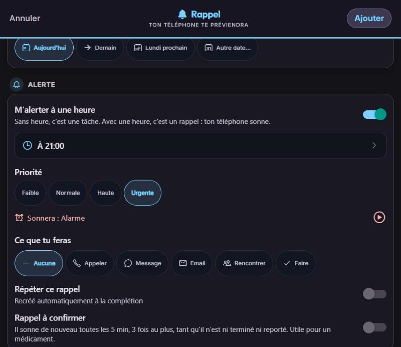
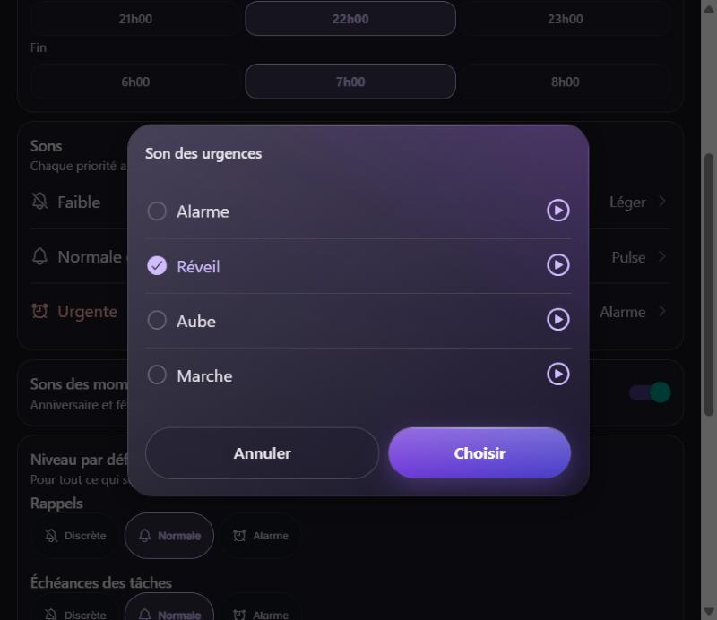

# FICHE OPÉRATOIRE N° 032 — La priorité choisit le son

Projet : **Junix Pulse** · Date : 25 novembre 2026 · Suite de : [FICHE 031](FICHE-031-sons.md) · Étude : [ÉTUDE 001](../etudes/ETUDE-001-clarifier-et-faire-evoluer.md), 16.8 (A, B, E)

---

## 1. Objectif

Après l'APK de la fiche 031, tu as relevé un malentendu : sous l'Alerte d'un rappel, on demandait **deux fois** la même chose, « Priorité » puis « Comment il te prévient ». Et les Paramètres Sons répétaient le dessin en pastilles qu'on voit partout. Proposition et maquette validées (« Oui, on valide ») :

| Avant | Après |
|---|---|
| Priorité **et** « Comment il te prévient » | **la priorité seule** : elle choisit comment ça sonne |
| « Urgente » montait d'un cran | **Urgente = toujours une alarme** ; Faible = discrète ; Haute = normale, **vibration plus longue** |
| on ne savait pas ce qui allait sonner | sous la priorité : « **Sonnera : Alarme** » ▶ (le son vient des Paramètres) |
| un moment n'avait pas de priorité | il en a une (migration 41), à la place de « Comment il te prévient » |
| Paramètres → Sons : trois rangées de pastilles | **trois lignes** (Faible · Normale et haute · Urgente) et une **fenêtre en verre** pour choisir et écouter |

Les règles déjà en place restent : la nuit baisse d'un cran sauf l'alarme ; un anniversaire sonne Festif, un deuil Sobre ; la veille d'une échéance reste discrète, et le jour suit la priorité (une tâche urgente sonne en alarme le jour de son échéance).



*Figure 32-1 — Capture réelle (web, thème sombre). Un rappel « Urgente » : « Sonnera : Alarme », en rouge, avec ▶. « Comment il te prévient » a disparu.*



*Figure 32-2 — Capture réelle. Paramètres → Sons → Urgente : la fenêtre en verre, un rond à cocher et ▶ par son.*

**Pas dans cette fiche** : le temps pour le faire libre, le Planning et Focus (fiche 033, étude 16.8 C et D).

## 2. État de départ

| À vérifier | Comment | Résultat attendu |
|---|---|---|
| La fiche 031 est enregistrée | `git log --oneline -1` | `feat(sounds): a sound for each level…` |
| Tout passe | `npx jest` | `Tests: 2136 passed` |

## 3. Matériel

Rien de nouveau.

## 4. Hypothèses

- Un élément enregistré avec un niveau choisi (fiches 023 à 031) **le garde** tant qu'on ne le modifie pas : rien ne change sans que la personne touche à l'élément. En l'enregistrant de nouveau, la priorité décide.
- « Normale » suit le **niveau par défaut** de sa famille (Paramètres → Niveau par défaut), comme avant.
- Les anciens canaux restent : Android les garde, et ils servent aux notifications déjà planifiées jusqu'à leur replanification.

## 5. Carte de l'intervention

| Fichier | Action |
|---|---|
| `notification-level-rules.ts` (+ test) | la priorité choisit le niveau ; `insistsFor` |
| `sound-rules.ts` (+ test) | les canaux qui insistent |
| `reminder-` et `item-notification-rules.ts` (+ tests) | la priorité et « insiste » dans chaque notification planifiée |
| `notification-service.ts`, services de synchronisation | les canaux de Haute ; replanifier si la priorité change |
| `migrations.ts`, `entities`, `event-repository.ts`, `backup-service.ts`, `event-use-cases.ts` | la priorité d'un moment (migration 41) |
| `components/create/form/PriorityField.tsx` | **nouveau** : la priorité et ce qui va sonner |
| `AlertLevelField.tsx` | **supprimé** |
| `TodoForm.tsx`, `MomentForm.tsx`, `edit-loaders.ts`, `item-forms.ts` (+ test) | les formulaires avec la nouvelle brique |
| `components/settings/SoundSetting.tsx`, i18n | la liste et la fenêtre de choix |

## 6. Sauvegarde

`git status` propre (hors `docs/motion/`). La migration **ajoute** une colonne ; rien n'est modifié ni effacé. Retour en arrière : section 10.

## 7. Pas à pas

Le plus simple : `node docs/fiches/outils/appliquer-fiche-032.js .` fait toutes les étapes ci-dessous. Pour comprendre ou refaire à la main, voici chaque étape.

### Étape 1 — La règle : la priorité choisit le niveau

**Pourquoi** : Une seule fonction décide du niveau (`notificationLevelFor`). Avant, « Urgente » montait seulement d'un cran ; maintenant **Urgente est toujours une alarme** et **Faible toujours discrète**. Normale et Haute gardent le niveau par défaut de leur famille (Paramètres) et le décalage du type de moment. La veille d'une échéance reste un cran sous le jour, et la nuit baisse tout sauf l'alarme. **Haute** sonne au niveau normal mais **insiste** : la fonction `insistsFor` le dit.

Repère (Ctrl+F) : la première ligne de chaque bloc « Chercher ». Le script `appliquer-fiche-032.js` fait tous ces changements d'un coup, et refuse d'écrire si un bloc ne se trouve pas exactement une fois.

#### `src/domain/rules/notification-level-rules.ts`


Changement 1 sur 2. Chercher :

<!-- bloc: notification-level-rules-1-avant -->

```ts
 * How loud a notification is: discreet, normal or alarm (study 001, 6-B and 12.6; sheets 011 and 023).
 * In order:
 * 1. the level the person chose for this item, if any ("Auto" chooses none);
 * 2. otherwise the default level of its family, set in the settings (normal for all at first),
 *    the evening before a deadline one step quieter, moved one step by the type of a moment
 *    (a mourning stays discreet, leaving for a journey is an alarm), and urgent one step up;
 * 3. at night, everything goes down one step, except the alarm.
 * Pure: no phone, no database, so every case is tested. A new criterion belongs here.
 */
```

Remplacer par :

<!-- bloc: notification-level-rules-1-apres -->

```ts
 * How loud a notification is: discreet, normal or alarm (study 001, 6-B and 12.6; sheets 011 and 023).
 * In order:
 * 1. the level the person chose for this item, if any ("Auto" chooses none);
 * 2. otherwise its priority (sheet 032, study 16.8): Urgente is always an alarm, Basse is discreet;
 *    Normale and Haute take the default level of the family (settings; normal at first), moved
 *    one step by the type of a moment (a mourning stays discreet, leaving for a journey is an
 *    alarm). The evening before a deadline is one step under its day;
 * 3. at night, everything goes down one step, except the alarm.
 * Pure: no phone, no database, so every case is tested. A new criterion belongs here.
 */
```

Changement 2 sur 2. Chercher :

<!-- bloc: notification-level-rules-2-avant -->

```ts
  if (chosen && isLevel(chosen)) {
    index = NOTIFICATION_LEVELS.indexOf(chosen);
  } else {
    index = NOTIFICATION_LEVELS.indexOf(defaults[alertFamilyOf(moment)]);
    // The evening before a deadline only informs: one step below the day itself
    if (moment === 'taskEve') index = step(index, -1);
    if (momentKind && (moment === 'momentBefore' || moment === 'momentLeave')) {
      const shift = MOMENT_KIND_ALERT_SHIFT[momentKind];
      index = step(index, moment === 'momentLeave' ? shift.leave : shift.before);
    }
    // Urgent goes up one level
    if (priority === 'URGENT') index = step(index, 1);
  }
  // At night everything goes down one level, except the alarm
  if (index < loudest && isQuietTime(at, quietHours)) index = step(index, -1);
  return NOTIFICATION_LEVELS[index];
}

/** The kind of Android channel of a level. With the sound switched off, nothing rings. */
export type NotificationChannelKind = 'discreet' | 'normal' | 'alarm' | 'silent';

```

Remplacer par :

<!-- bloc: notification-level-rules-2-apres -->

```ts
  if (chosen && isLevel(chosen)) {
    index = NOTIFICATION_LEVELS.indexOf(chosen);
  } else {
    if (priority === 'URGENT') {
      // Urgente rings as an alarm, whatever the family and the type (sheet 032)
      index = loudest;
    } else if (priority === 'LOW') {
      index = 0;
    } else {
      index = NOTIFICATION_LEVELS.indexOf(defaults[alertFamilyOf(moment)]);
      if (momentKind && (moment === 'momentBefore' || moment === 'momentLeave')) {
        const shift = MOMENT_KIND_ALERT_SHIFT[momentKind];
        index = step(index, moment === 'momentLeave' ? shift.leave : shift.before);
      }
    }
    // The evening before a deadline only informs: one step below the day itself
    if (moment === 'taskEve') index = step(index, -1);
  }
  // At night everything goes down one level, except the alarm
  if (index < loudest && isQuietTime(at, quietHours)) index = step(index, -1);
  return NOTIFICATION_LEVELS[index];
}

/**
 * Haute rings at the normal level but insists (sheet 032): a longer vibration, on channels of
 * their own. An alarm already insists; a discreet notification never does.
 */
export function insistsFor(priority: ReminderPriority | undefined, level: NotificationLevel): boolean {
  return priority === 'HIGH' && level === 'normal';
}

/** The kind of Android channel of a level. With the sound switched off, nothing rings. */
export type NotificationChannelKind = 'discreet' | 'normal' | 'alarm' | 'silent';

```

#### `src/domain/rules/__tests__/notification-level-rules.test.ts`


Changement 1 sur 2. Chercher :

<!-- bloc: notification-level-rules-test-1-avant -->

```ts
import {
  DEFAULT_QUIET_HOURS,
  isQuietTime,
  levelOf,
  notificationChannelFor,
```

Remplacer par :

<!-- bloc: notification-level-rules-test-1-apres -->

```ts
import {
  DEFAULT_QUIET_HOURS,
  insistsFor,
  isQuietTime,
  levelOf,
  notificationChannelFor,
```

Changement 2 sur 2. Chercher :

<!-- bloc: notification-level-rules-test-2-avant -->

```ts
    expect(levelOf('alarm')).toBe('alarm');
    expect(levelOf('loud')).toBe('normal');
  });
});
```

Remplacer par :

<!-- bloc: notification-level-rules-test-2-apres -->

```ts
    expect(levelOf('alarm')).toBe('alarm');
    expect(levelOf('loud')).toBe('normal');
  });

  it('lets the priority choose the level (sheet 032)', () => {
    const loud = { reminder: 'alarm', deadline: 'alarm', moment: 'alarm', habit: 'alarm' } as const;
    const quiet = { reminder: 'discreet', deadline: 'discreet', moment: 'discreet', habit: 'discreet' } as const;
    // Basse is discreet, even when the family rings as an alarm
    expect(notificationLevelFor({ moment: 'reminder', priority: 'LOW', at: at(10), defaults: loud })).toBe('discreet');
    // Urgente is an alarm, even for a quiet family or a mourning
    expect(notificationLevelFor({ moment: 'reminder', priority: 'URGENT', at: at(10), defaults: quiet })).toBe('alarm');
    expect(notificationLevelFor({ moment: 'momentBefore', priority: 'URGENT', momentKind: 'mourning', at: at(10) })).toBe('alarm');
    // Its deadline: an alarm on the day, normal the evening before
    expect(notificationLevelFor({ moment: 'taskDay', priority: 'URGENT', at: at(9) })).toBe('alarm');
    // Normale and Haute follow the family and the type
    expect(notificationLevelFor({ moment: 'momentBefore', priority: 'HIGH', momentKind: 'mourning', at: at(10) })).toBe('discreet');
  });

  it('makes Haute insist at the normal level only', () => {
    expect(insistsFor('HIGH', 'normal')).toBe(true);
    expect(insistsFor('HIGH', 'discreet')).toBe(false);
    expect(insistsFor('NORMAL', 'normal')).toBe(false);
    expect(insistsFor(undefined, 'alarm')).toBe(false);
  });
});
```


### Étape 2 — Haute insiste : ses propres canaux

**Pourquoi** : Sur Android, la vibration d'une notification appartient à son **canal** et ne change plus une fois le canal créé. Haute a donc ses canaux à elle (`…-insist-v1`), un par son du niveau normal, avec une vibration plus longue. Les rappels, les tâches et les moments planifiés disent s'ils insistent ; la synchronisation replanifie une notification dont la priorité a changé.

Repère (Ctrl+F) : la première ligne de chaque bloc « Chercher ». Le script `appliquer-fiche-032.js` fait tous ces changements d'un coup, et refuse d'écrire si un bloc ne se trouve pas exactement une fois.

#### `src/domain/rules/sound-rules.ts`


Changement 1 sur 2. Chercher :

<!-- bloc: sound-rules-1-avant -->

```ts
 * The Android channel of a level and a sound. A channel's sound cannot change once created
 * (Android): each pair has its own. Without sound, the channels that existed before keep serving.
 */
export function soundChannelId(level: NotificationLevel, sound: SoundChoice): string {
  if (sound === 'none') return level === 'discreet' ? 'junix-pulse-level-discreet-v1' : 'junix-pulse-reminders-silent-v1';
  return `junix-pulse-sound-${level}-${sound}-v1`;
}

/** Every pair of level and sound a notification can use: the channels to create. */
export function soundChannels(): { level: NotificationLevel; sound: SoundId }[] {
  const pairs: { level: NotificationLevel; sound: SoundId }[] = [];
  const add = (level: NotificationLevel, sound: SoundChoice) => {
    if (sound !== 'none' && !pairs.some(pair => pair.level === level && pair.sound === sound)) pairs.push({ level, sound });
  };
```

Remplacer par :

<!-- bloc: sound-rules-1-apres -->

```ts
 * The Android channel of a level and a sound. A channel's sound cannot change once created
 * (Android): each pair has its own. Without sound, the channels that existed before keep serving.
 */
export function soundChannelId(level: NotificationLevel, sound: SoundChoice, insists = false): string {
  if (sound === 'none') return level === 'discreet' ? 'junix-pulse-level-discreet-v1' : 'junix-pulse-reminders-silent-v1';
  // Haute (sheet 032): the same sound, a longer vibration; only the normal level insists
  if (insists && level === 'normal') return `junix-pulse-sound-normal-${sound}-insist-v1`;
  return `junix-pulse-sound-${level}-${sound}-v1`;
}

/** Every pair of level and sound a notification can use, and the insisting ones: the channels to create. */
export function soundChannels(): { level: NotificationLevel; sound: SoundId; insists?: boolean }[] {
  const pairs: { level: NotificationLevel; sound: SoundId; insists?: boolean }[] = [];
  const add = (level: NotificationLevel, sound: SoundChoice) => {
    if (sound !== 'none' && !pairs.some(pair => pair.level === level && pair.sound === sound)) pairs.push({ level, sound });
  };
```

Changement 2 sur 2. Chercher :

<!-- bloc: sound-rules-2-avant -->

```ts
  add('discreet', 'sober');
  add('normal', 'sober');
  add('normal', 'festive');
  return pairs;
}
```

Remplacer par :

<!-- bloc: sound-rules-2-apres -->

```ts
  add('discreet', 'sober');
  add('normal', 'sober');
  add('normal', 'festive');
  // Haute insists at the normal level, with each sound of that level (sheet 032)
  for (const pair of pairs.filter(item => item.level === 'normal')) pairs.push({ ...pair, insists: true });
  return pairs;
}
```

#### `src/domain/rules/__tests__/sound-rules.test.ts`


Changement 1 sur 1. Chercher :

<!-- bloc: sound-rules-test-1-avant -->

```ts
    }
    expect(pairs).toContainEqual({ level: 'normal', sound: 'festive' });
    expect(pairs).toContainEqual({ level: 'discreet', sound: 'sober' });
    expect(new Set(pairs.map(pair => soundChannelId(pair.level, pair.sound))).size).toBe(pairs.length);
  });

  it('names each file as Android wants it in res/raw', () => {
```

Remplacer par :

<!-- bloc: sound-rules-test-1-apres -->

```ts
    }
    expect(pairs).toContainEqual({ level: 'normal', sound: 'festive' });
    expect(pairs).toContainEqual({ level: 'discreet', sound: 'sober' });
    expect(new Set(pairs.map(pair => soundChannelId(pair.level, pair.sound, pair.insists))).size).toBe(pairs.length);
    // Haute insists at the normal level only, with each of its sounds (sheet 032)
    expect(soundChannelId('normal', 'pulse', true)).toBe('junix-pulse-sound-normal-pulse-insist-v1');
    expect(soundChannelId('alarm', 'wake', true)).toBe('junix-pulse-sound-alarm-wake-v1');
    expect(pairs).toContainEqual({ level: 'normal', sound: 'festive', insists: true });
  });

  it('names each file as Android wants it in res/raw', () => {
```

#### `src/domain/rules/reminder-notification-rules.ts`


Changement 1 sur 5. Chercher :

<!-- bloc: reminder-notification-rules-1-avant -->

```ts
import { HABIT_ACTION_DONE } from './habit-notification-rules';
import {
  AlertDefaults,
  DEFAULT_ALERT_DEFAULTS,
  DEFAULT_QUIET_HOURS,
  NotificationLevel,
```

Remplacer par :

<!-- bloc: reminder-notification-rules-1-apres -->

```ts
import { HABIT_ACTION_DONE } from './habit-notification-rules';
import {
  AlertDefaults,
  insistsFor,
  DEFAULT_ALERT_DEFAULTS,
  DEFAULT_QUIET_HOURS,
  NotificationLevel,
```

Changement 2 sur 5. Chercher :

<!-- bloc: reminder-notification-rules-2-avant -->

```ts
  scheduledAt: Date;
  /** How loud it rings (sheet 011). */
  level: NotificationLevel;
}

export interface ReminderToPlan {
```

Remplacer par :

<!-- bloc: reminder-notification-rules-2-apres -->

```ts
  scheduledAt: Date;
  /** How loud it rings (sheet 011). */
  level: NotificationLevel;
  /** Haute: it insists, with a longer vibration (sheet 032). */
  insists?: boolean;
}

export interface ReminderToPlan {
```

Changement 3 sur 5. Chercher :

<!-- bloc: reminder-notification-rules-3-avant -->

```ts
  return occurrences;
}

/** The level of a reminder: the one chosen for it, or its priority and the settings (sheet 023). */
function levelOfReminder(reminder: Reminder, at: Date, quietHours: QuietHours, defaults: AlertDefaults) {
  return notificationLevelFor({ moment: 'reminder', priority: reminder.priority, at, quietHours, chosen: reminder.alertLevel, defaults });
```

Remplacer par :

<!-- bloc: reminder-notification-rules-3-apres -->

```ts
  return occurrences;
}

/** Its level, and whether it insists (Haute, sheet 032). */
function levelAndInsistOf(
  reminder: Reminder,
  at: Date,
  quietHours: QuietHours,
  defaults: AlertDefaults
): { level: NotificationLevel; insists?: boolean } {
  const level = levelOfReminder(reminder, at, quietHours, defaults);
  return insistsFor(reminder.priority, level) ? { level, insists: true } : { level };
}

/** The level of a reminder: the one chosen for it, or its priority and the settings (sheet 023). */
function levelOfReminder(reminder: Reminder, at: Date, quietHours: QuietHours, defaults: AlertDefaults) {
  return notificationLevelFor({ moment: 'reminder', priority: reminder.priority, at, quietHours, chosen: reminder.alertLevel, defaults });
```

Changement 4 sur 5. Chercher :

<!-- bloc: reminder-notification-rules-4-avant -->

```ts
        title: item.reminder.title,
        body: translate(language, 'reminderNotif.confirmAgain'),
        scheduledAt,
        level: levelOfReminder(item.reminder, scheduledAt, quietHours, defaults),
      });
    }
  }
```

Remplacer par :

<!-- bloc: reminder-notification-rules-4-apres -->

```ts
        title: item.reminder.title,
        body: translate(language, 'reminderNotif.confirmAgain'),
        scheduledAt,
        ...levelAndInsistOf(item.reminder, scheduledAt, quietHours, defaults),
      });
    }
  }
```

Changement 5 sur 5. Chercher :

<!-- bloc: reminder-notification-rules-5-avant -->

```ts
          title: item.reminder.title,
          body: bodyOf(item.reminder, language),
          scheduledAt,
          level: levelOfReminder(item.reminder, scheduledAt, quietHours, defaults),
        };
      })
    )
```

Remplacer par :

<!-- bloc: reminder-notification-rules-5-apres -->

```ts
          title: item.reminder.title,
          body: bodyOf(item.reminder, language),
          scheduledAt,
          ...levelAndInsistOf(item.reminder, scheduledAt, quietHours, defaults),
        };
      })
    )
```

#### `src/domain/rules/__tests__/reminder-notification-rules.test.ts`


Changement 1 sur 1. Chercher :

<!-- bloc: reminder-notification-rules-test-1-avant -->

```ts
    expect(notificationRoute({ type: 'FOCUS_END' })).toBeNull();
    expect(notificationRoute(undefined)).toBeNull();
  });
});
```

Remplacer par :

<!-- bloc: reminder-notification-rules-test-1-apres -->

```ts
    expect(notificationRoute({ type: 'FOCUS_END' })).toBeNull();
    expect(notificationRoute(undefined)).toBeNull();
  });

  it('makes Haute insist and Urgente ring as an alarm (sheet 032)', () => {
    const [high] = planReminderNotifications([{ reminder: reminder({ priority: 'HIGH' }), rule: null }], NOW, 'fr', { startHour: 23, endHour: 6 });
    expect([high.level, high.insists]).toEqual(['normal', true]);
    const [urgent] = planReminderNotifications([{ reminder: reminder({ priority: 'URGENT' }), rule: null }], NOW, 'fr', { startHour: 23, endHour: 6 });
    expect([urgent.level, urgent.insists]).toEqual(['alarm', undefined]);
  });
});
```

#### `src/domain/rules/item-notification-rules.ts`


Changement 1 sur 5. Chercher :

<!-- bloc: item-notification-rules-1-avant -->

```ts
  DEFAULT_QUIET_HOURS,
  NotificationLevel,
  NotificationMoment,
  notificationLevelFor,
  QuietHours,
} from './notification-level-rules';
```

Remplacer par :

<!-- bloc: item-notification-rules-1-apres -->

```ts
  DEFAULT_QUIET_HOURS,
  NotificationLevel,
  NotificationMoment,
  insistsFor,
  notificationLevelFor,
  QuietHours,
} from './notification-level-rules';
```

Changement 2 sur 5. Chercher :

<!-- bloc: item-notification-rules-2-avant -->

```ts
  level: NotificationLevel;
  /** The tone of a moment (festive, neutral, sober): its sound follows it (sheet 031). */
  tone?: MomentTone;
}

export interface ItemPlanInput {
```

Remplacer par :

<!-- bloc: item-notification-rules-2-apres -->

```ts
  level: NotificationLevel;
  /** The tone of a moment (festive, neutral, sober): its sound follows it (sheet 031). */
  tone?: MomentTone;
  /** Haute: it insists, with a longer vibration (sheet 032). */
  insists?: boolean;
}

export interface ItemPlanInput {
```

Changement 3 sur 5. Chercher :

<!-- bloc: item-notification-rules-3-avant -->

```ts
}: ItemPlanInput): PlannedItemNotification[] {
  const planned: PlannedItemNotification[] = [];
  const add = (
    item: Omit<PlannedItemNotification, 'identifier' | 'level' | 'tone'>,
    priority?: Task['priority'],
    // A moment: its type and the level chosen for it (sheet 023)
    moment?: Pick<Event, 'momentKind' | 'alertLevel'>
  ) => {
    if (item.scheduledAt <= now) return;
    planned.push({
      ...item,
      // The time is in the identifier: a new date gives a new notification, and the old one is cancelled
      identifier: `${ITEM_IDENTIFIER_PREFIX}${item.itemType.toLowerCase()}-${item.itemId}-${item.moment}-${item.scheduledAt.getTime()}`,
      level: notificationLevelFor({
        moment: item.moment,
        priority,
        at: item.scheduledAt,
        quietHours,
        defaults: alertDefaults,
        chosen: moment?.alertLevel,
        momentKind: moment?.momentKind,
      }),
      ...(item.itemType === 'EVENT' ? { tone: MOMENT_KIND_TONES[momentKindOf(moment?.momentKind)] } : {}),
    });
  };

```

Remplacer par :

<!-- bloc: item-notification-rules-3-apres -->

```ts
}: ItemPlanInput): PlannedItemNotification[] {
  const planned: PlannedItemNotification[] = [];
  const add = (
    item: Omit<PlannedItemNotification, 'identifier' | 'level' | 'tone' | 'insists'>,
    priority?: Task['priority'],
    // A moment: its type and the level chosen for it (sheet 023)
    moment?: Pick<Event, 'momentKind' | 'alertLevel'>
  ) => {
    if (item.scheduledAt <= now) return;
    const level = notificationLevelFor({
      moment: item.moment,
      priority,
      at: item.scheduledAt,
      quietHours,
      defaults: alertDefaults,
      chosen: moment?.alertLevel,
      momentKind: moment?.momentKind,
    });
    planned.push({
      ...item,
      // The time is in the identifier: a new date gives a new notification, and the old one is cancelled
      identifier: `${ITEM_IDENTIFIER_PREFIX}${item.itemType.toLowerCase()}-${item.itemId}-${item.moment}-${item.scheduledAt.getTime()}`,
      level,
      ...(item.itemType === 'EVENT' ? { tone: MOMENT_KIND_TONES[momentKindOf(moment?.momentKind)] } : {}),
      ...(insistsFor(priority, level) ? { insists: true } : {}),
    });
  };

```

Changement 4 sur 5. Chercher :

<!-- bloc: item-notification-rules-4-avant -->

```ts
        moment: 'momentLeave',
        scheduledAt: new Date(start.getTime() - travel * MINUTE),
        body: translate(language, 'itemNotif.momentLeave', { place, time: clock(start) }),
      }, undefined, event);
    }
    // Leaving already warns this early or earlier: a second notice would only repeat it
    if (!leaves || travel < MOMENT_BEFORE_MINUTES) {
```

Remplacer par :

<!-- bloc: item-notification-rules-4-apres -->

```ts
        moment: 'momentLeave',
        scheduledAt: new Date(start.getTime() - travel * MINUTE),
        body: translate(language, 'itemNotif.momentLeave', { place, time: clock(start) }),
      }, event.priority, event);
    }
    // Leaving already warns this early or earlier: a second notice would only repeat it
    if (!leaves || travel < MOMENT_BEFORE_MINUTES) {
```

Changement 5 sur 5. Chercher :

<!-- bloc: item-notification-rules-5-avant -->

```ts
        moment: 'momentBefore',
        scheduledAt: new Date(start.getTime() - MOMENT_BEFORE_MINUTES * MINUTE),
        body: translate(language, 'itemNotif.momentBefore', { time: clock(start) }),
      }, undefined, event);
    }
  }

```

Remplacer par :

<!-- bloc: item-notification-rules-5-apres -->

```ts
        moment: 'momentBefore',
        scheduledAt: new Date(start.getTime() - MOMENT_BEFORE_MINUTES * MINUTE),
        body: translate(language, 'itemNotif.momentBefore', { time: clock(start) }),
      }, event.priority, event);
    }
  }

```

#### `src/domain/rules/__tests__/item-notification-rules.test.ts`


Changement 1 sur 1. Chercher :

<!-- bloc: item-notification-rules-test-1-avant -->

```ts
    const planned = planItemNotifications({ tasks: [task()], events: [], now, language: 'en' });
    expect(planned.map(item => item.body)).toEqual(['Due tomorrow.', 'Due today.']);
  });
});
```

Remplacer par :

<!-- bloc: item-notification-rules-test-1-apres -->

```ts
    const planned = planItemNotifications({ tasks: [task()], events: [], now, language: 'en' });
    expect(planned.map(item => item.body)).toEqual(['Due tomorrow.', 'Due today.']);
  });

  it('rings a moment as its priority says (sheet 032)', () => {
    const urgent = planItemNotifications({ tasks: [], events: [event({ priority: 'URGENT' })], now });
    expect(urgent.map(item => item.level)).toEqual(['alarm']);
    const high = planItemNotifications({ tasks: [], events: [event({ priority: 'HIGH' })], now });
    expect(high.map(item => [item.level, item.insists])).toEqual([['normal', true]]);
    const plain = planItemNotifications({ tasks: [], events: [event()], now });
    expect(plain[0].insists).toBeUndefined();
    // An urgent deadline: normal the evening before, an alarm on the day
    const due = planItemNotifications({ tasks: [task({ priority: 'URGENT' })], events: [], now });
    expect(due.map(item => item.level)).toEqual(['normal', 'alarm']);
  });
});
```

#### `src/services/notification-service.ts`


Changement 1 sur 7. Chercher :

<!-- bloc: notification-service-1-avant -->

```ts
  level?: NotificationLevel;
  /** The sound it rings with (sheet 031); without it, the sound of Junix of before. */
  sound?: SoundChoice;
}

export interface ScheduleItemParams {
```

Remplacer par :

<!-- bloc: notification-service-1-apres -->

```ts
  level?: NotificationLevel;
  /** The sound it rings with (sheet 031); without it, the sound of Junix of before. */
  sound?: SoundChoice;
  /** Haute: it insists, with a longer vibration (sheet 032). */
  insists?: boolean;
}

export interface ScheduleItemParams {
```

Changement 2 sur 7. Chercher :

<!-- bloc: notification-service-2-avant -->

```ts
  soundOn: boolean;
  /** The sound it rings with (sheet 031). */
  sound?: SoundChoice;
}

export interface ScheduleHabitParams {
```

Remplacer par :

<!-- bloc: notification-service-2-apres -->

```ts
  soundOn: boolean;
  /** The sound it rings with (sheet 031). */
  sound?: SoundChoice;
  /** Haute: it insists, with a longer vibration (sheet 032). */
  insists?: boolean;
}

export interface ScheduleHabitParams {
```

Changement 3 sur 7. Chercher :

<!-- bloc: notification-service-3-avant -->

```ts
}

/** The channel of a task, a moment or a habit: the one of its sound, or of its level as before. */
function itemChannelOf(params: { level: NotificationLevel; soundOn: boolean; sound?: SoundChoice }): string {
  return params.sound ? soundChannelId(params.level, params.sound) : channelIdFor(params.level, params.soundOn);
}

// ─── Service ─────────────────────────────────────────────────────────────────
```

Remplacer par :

<!-- bloc: notification-service-3-apres -->

```ts
}

/** The channel of a task, a moment or a habit: the one of its sound, or of its level as before. */
function itemChannelOf(params: { level: NotificationLevel; soundOn: boolean; sound?: SoundChoice; insists?: boolean }): string {
  return params.sound ? soundChannelId(params.level, params.sound, params.insists) : channelIdFor(params.level, params.soundOn);
}

// ─── Service ─────────────────────────────────────────────────────────────────
```

Changement 4 sur 7. Chercher :

<!-- bloc: notification-service-4-avant -->

```ts
          normal: Notifications.AndroidImportance.HIGH,
          alarm: Notifications.AndroidImportance.MAX,
        };
        for (const { level, sound } of soundChannels()) {
          await Notifications.setNotificationChannelAsync(soundChannelId(level, sound), {
            name: t('notifChannel.soundName', { level: t(`alertLevel.${level}`), sound: t(SOUNDS[sound].labelKey) }),
            description: t(`notifChannel.soundDesc.${level}`),
            importance: importances[level],
            vibrationPattern: level === "alarm" ? [0, 600, 300, 600, 300, 600] : [0, 250, 250, 250],
            enableVibrate: level !== "discreet",
            lightColor: level === "alarm" ? "#FFB4AB" : "#8B3DF0",
            showBadge: false,
```

Remplacer par :

<!-- bloc: notification-service-4-apres -->

```ts
          normal: Notifications.AndroidImportance.HIGH,
          alarm: Notifications.AndroidImportance.MAX,
        };
        for (const { level, sound, insists } of soundChannels()) {
          await Notifications.setNotificationChannelAsync(soundChannelId(level, sound, insists), {
            name: t('notifChannel.soundName', { level: insists ? t('priority.high') : t(`alertLevel.${level}`), sound: t(SOUNDS[sound].labelKey) }),
            description: insists ? t('notifChannel.soundDesc.insist') : t(`notifChannel.soundDesc.${level}`),
            importance: importances[level],
            // Haute insists: a longer vibration (sheet 032)
            vibrationPattern: level === "alarm" ? [0, 600, 300, 600, 300, 600] : insists ? [0, 500, 200, 500, 200, 500, 200, 500] : [0, 250, 250, 250],
            enableVibrate: level !== "discreet",
            lightColor: level === "alarm" ? "#FFB4AB" : "#8B3DF0",
            showBadge: false,
```

Changement 5 sur 7. Chercher :

<!-- bloc: notification-service-5-avant -->

```ts
            type: "REMINDER",
            level: params.level ?? "normal",
            ...(params.sound ? { sound: params.sound } : {}),
            ...params.data,
          },
          // iOS uses the filename; Android uses the channel's configured sound.
```

Remplacer par :

<!-- bloc: notification-service-5-apres -->

```ts
            type: "REMINDER",
            level: params.level ?? "normal",
            ...(params.sound ? { sound: params.sound } : {}),
            ...(params.insists ? { insists: true } : {}),
            ...params.data,
          },
          // iOS uses the filename; Android uses the channel's configured sound.
```

Changement 6 sur 7. Chercher :

<!-- bloc: notification-service-6-avant -->

```ts
          channelId:
            Platform.OS === "android"
              ? params.sound
                ? soundChannelId(params.level ?? "normal", params.sound)
                : channelIdFor(params.level ?? "normal", !params.silent)
              : undefined,
        } as import("expo-notifications").DateTriggerInput,
```

Remplacer par :

<!-- bloc: notification-service-6-apres -->

```ts
          channelId:
            Platform.OS === "android"
              ? params.sound
                ? soundChannelId(params.level ?? "normal", params.sound, params.insists)
                : channelIdFor(params.level ?? "normal", !params.silent)
              : undefined,
        } as import("expo-notifications").DateTriggerInput,
```

Changement 7 sur 7. Chercher :

<!-- bloc: notification-service-7-avant -->

```ts
            [params.itemType === "TASK" ? "taskId" : "eventId"]: params.itemId,
            level: params.level,
            ...(params.sound ? { sound: params.sound } : {}),
          },
          sound: params.sound
            ? soundFileOf(params.sound)
```

Remplacer par :

<!-- bloc: notification-service-7-apres -->

```ts
            [params.itemType === "TASK" ? "taskId" : "eventId"]: params.itemId,
            level: params.level,
            ...(params.sound ? { sound: params.sound } : {}),
            ...(params.insists ? { insists: true } : {}),
          },
          sound: params.sound
            ? soundFileOf(params.sound)
```

#### `src/services/reminder-notification-service.ts`


Changement 1 sur 2. Chercher :

<!-- bloc: reminder-notification-service-1-avant -->

```ts
        levelOf(request.content.data?.level) === item.level &&
        // A sound changed in the settings moves it to the channel of its new sound (sheet 031)
        request.content.data?.sound === soundOf(item.level) &&
        // Notifications planned before the buttons existed are planned again with them
        request.content.categoryIdentifier === REMINDER_CATEGORY_ID
      ) {
```

Remplacer par :

<!-- bloc: reminder-notification-service-1-apres -->

```ts
        levelOf(request.content.data?.level) === item.level &&
        // A sound changed in the settings moves it to the channel of its new sound (sheet 031)
        request.content.data?.sound === soundOf(item.level) &&
        // Haute moves it to the insisting channel, and back (sheet 032)
        Boolean(request.content.data?.insists) === Boolean(item.insists) &&
        // Notifications planned before the buttons existed are planned again with them
        request.content.categoryIdentifier === REMINDER_CATEGORY_ID
      ) {
```

Changement 2 sur 2. Chercher :

<!-- bloc: reminder-notification-service-2-avant -->

```ts
        silent: !settings.notificationSoundEnabled,
        level: item.level,
        sound: soundOf(item.level),
      });
      if (scheduled) report.scheduled += 1;
      else report.failed += 1;
```

Remplacer par :

<!-- bloc: reminder-notification-service-2-apres -->

```ts
        silent: !settings.notificationSoundEnabled,
        level: item.level,
        sound: soundOf(item.level),
        insists: item.insists,
      });
      if (scheduled) report.scheduled += 1;
      else report.failed += 1;
```

#### `src/services/item-notification-service.ts`


Changement 1 sur 2. Chercher :

<!-- bloc: item-notification-service-1-avant -->

```ts
        item.body === request.content.body &&
        levelOf(request.content.data?.level) === item.level &&
        // A sound changed in the settings moves it to the channel of its new sound (sheet 031)
        request.content.data?.sound === soundOf(item)
      ) {
        upToDate.add(request.identifier);
      } else {
```

Remplacer par :

<!-- bloc: item-notification-service-1-apres -->

```ts
        item.body === request.content.body &&
        levelOf(request.content.data?.level) === item.level &&
        // A sound changed in the settings moves it to the channel of its new sound (sheet 031)
        request.content.data?.sound === soundOf(item) &&
        // Haute moves it to the insisting channel, and back (sheet 032)
        Boolean(request.content.data?.insists) === Boolean(item.insists)
      ) {
        upToDate.add(request.identifier);
      } else {
```

Changement 2 sur 2. Chercher :

<!-- bloc: item-notification-service-2-avant -->

```ts
        level: item.level,
        soundOn: settings.notificationSoundEnabled,
        sound: soundOf(item),
      });
    }
  } catch {
```

Remplacer par :

<!-- bloc: item-notification-service-2-apres -->

```ts
        level: item.level,
        soundOn: settings.notificationSoundEnabled,
        sound: soundOf(item),
        insists: item.insists,
      });
    }
  } catch {
```


### Étape 3 — Les moments ont une priorité

**Pourquoi** : Un moment n'avait pas de priorité. Une **nouvelle colonne** (`events.priority`, migration 41) la garde : on **ajoute**, rien n'est modifié, et vide veut dire Normale. Le dépôt des moments la lit et l'écrit, la sauvegarde l'emporte, et les cas d'usage la transmettent.

Repère (Ctrl+F) : la première ligne de chaque bloc « Chercher ». Le script `appliquer-fiche-032.js` fait tous ces changements d'un coup, et refuse d'écrire si un bloc ne se trouve pas exactement une fois.

#### `src/database/migrations.ts`


Changement 1 sur 1. Chercher :

<!-- bloc: migrations-1-avant -->

```ts
      ALTER TABLE settings ADD COLUMN sound_prefs TEXT;
    `,
  },
];

```

Remplacer par :

<!-- bloc: migrations-1-apres -->

```ts
      ALTER TABLE settings ADD COLUMN sound_prefs TEXT;
    `,
  },
  {
    version: 41,
    name: 'add_event_priority',
    sql: `
      -- La priorite du moment (fiche 032, etude 16.8) : elle choisit comment il sonne.
      -- Vide : Normale, comme avant.
      ALTER TABLE events ADD COLUMN priority TEXT;
    `,
  },
];

```

#### `src/domain/entities/index.ts`


Changement 1 sur 1. Chercher :

<!-- bloc: index-1-avant -->

```ts
  momentKind?: MomentKind;
  /** The level chosen for it (sheet 023); absent is "Auto". */
  alertLevel?: AlertLevel;
  createdAt: string;
  updatedAt: string;
  deletedAt?: string;
```

Remplacer par :

<!-- bloc: index-1-apres -->

```ts
  momentKind?: MomentKind;
  /** The level chosen for it (sheet 023); absent is "Auto". */
  alertLevel?: AlertLevel;
  /** How much it matters (sheet 032): it chooses how it rings. Absent is Normale. */
  priority?: ReminderPriority;
  createdAt: string;
  updatedAt: string;
  deletedAt?: string;
```

#### `src/repositories/event-repository.ts`


Changement 1 sur 5. Chercher :

<!-- bloc: event-repository-1-avant -->

```ts

import type { SQLiteBindValue } from 'expo-sqlite';
import { getDatabase } from '../database/sqlite';
import { Event, Person } from '../domain/entities';
import { chosenLevelOf } from '../domain/rules/notification-level-rules';

type NullableFields<T> = {
  [K in keyof T]?: T[K] | null;
};
```

Remplacer par :

<!-- bloc: event-repository-1-apres -->

```ts

import type { SQLiteBindValue } from 'expo-sqlite';
import { getDatabase } from '../database/sqlite';
import { Event, Person, ReminderPriority } from '../domain/entities';
import { chosenLevelOf } from '../domain/rules/notification-level-rules';

const PRIORITIES: readonly ReminderPriority[] = ['LOW', 'NORMAL', 'HIGH', 'URGENT'];

type NullableFields<T> = {
  [K in keyof T]?: T[K] | null;
};
```

Changement 2 sur 5. Chercher :

<!-- bloc: event-repository-2-avant -->

```ts
    travelBufferMinutes: (row.travel_buffer_minutes as number | null) ?? undefined,
    momentKind: (row.moment_kind as Event['momentKind'] | null) ?? undefined,
    alertLevel: chosenLevelOf(row.alert_level) ?? undefined,
    createdAt: row.created_at as string,
    updatedAt: row.updated_at as string,
    deletedAt: (row.deleted_at as string | null) ?? undefined,
```

Remplacer par :

<!-- bloc: event-repository-2-apres -->

```ts
    travelBufferMinutes: (row.travel_buffer_minutes as number | null) ?? undefined,
    momentKind: (row.moment_kind as Event['momentKind'] | null) ?? undefined,
    alertLevel: chosenLevelOf(row.alert_level) ?? undefined,
    // Its priority (sheet 032); an unknown or empty one is Normale
    priority: PRIORITIES.includes(row.priority as ReminderPriority) ? (row.priority as ReminderPriority) : undefined,
    createdAt: row.created_at as string,
    updatedAt: row.updated_at as string,
    deletedAt: (row.deleted_at as string | null) ?? undefined,
```

Changement 3 sur 5. Chercher :

<!-- bloc: event-repository-3-avant -->

```ts
  async create(event: Omit<Event, 'deletedAt'>, personIds?: string[]): Promise<void> {
    const db = await getDatabase();
    await db.runAsync(
      `INSERT INTO events (id, title, notes, start_at, end_at, timezone, location, type, travel_buffer_minutes, moment_kind, alert_level, created_at, updated_at)
       VALUES (?, ?, ?, ?, ?, ?, ?, ?, ?, ?, ?, ?, ?)`,
      event.id,
      event.title,
      event.notes ?? null,
```

Remplacer par :

<!-- bloc: event-repository-3-apres -->

```ts
  async create(event: Omit<Event, 'deletedAt'>, personIds?: string[]): Promise<void> {
    const db = await getDatabase();
    await db.runAsync(
      `INSERT INTO events (id, title, notes, start_at, end_at, timezone, location, type, travel_buffer_minutes, moment_kind, alert_level, priority, created_at, updated_at)
       VALUES (?, ?, ?, ?, ?, ?, ?, ?, ?, ?, ?, ?, ?, ?)`,
      event.id,
      event.title,
      event.notes ?? null,
```

Changement 4 sur 5. Chercher :

<!-- bloc: event-repository-4-avant -->

```ts
      event.travelBufferMinutes ?? 0,
      event.momentKind ?? null,
      event.alertLevel ?? null,
      event.createdAt,
      event.updatedAt
    );
```

Remplacer par :

<!-- bloc: event-repository-4-apres -->

```ts
      event.travelBufferMinutes ?? 0,
      event.momentKind ?? null,
      event.alertLevel ?? null,
      event.priority ?? null,
      event.createdAt,
      event.updatedAt
    );
```

Changement 5 sur 5. Chercher :

<!-- bloc: event-repository-5-avant -->

```ts
      setClauses.push('alert_level = ?');
      values.push(params.alertLevel);
    }
    if (params.deletedAt !== undefined) {
      setClauses.push('deleted_at = ?');
      values.push(params.deletedAt);
```

Remplacer par :

<!-- bloc: event-repository-5-apres -->

```ts
      setClauses.push('alert_level = ?');
      values.push(params.alertLevel);
    }
    if (params.priority !== undefined) {
      setClauses.push('priority = ?');
      values.push(params.priority);
    }
    if (params.deletedAt !== undefined) {
      setClauses.push('deleted_at = ?');
      values.push(params.deletedAt);
```

#### `src/services/backup-service.ts`


Changement 1 sur 2. Chercher :

<!-- bloc: backup-service-1-avant -->

```ts
  reminder_checklist_items: ['id', 'reminder_id', 'title', 'is_completed', 'position'],
  tasks: ['id', 'title', 'description', 'status', 'scheduled_date', 'due_date', 'estimated_minutes', 'priority', 'goal_id', 'person_id', 'tags', 'created_at', 'updated_at', 'completed_at', 'deleted_at'],
  subtasks: ['id', 'task_id', 'title', 'is_completed', 'position', 'created_at', 'completed_at'],
  events: ['id', 'title', 'notes', 'start_at', 'end_at', 'timezone', 'location', 'type', 'travel_buffer_minutes', 'moment_kind', 'alert_level', 'created_at', 'updated_at', 'deleted_at'],
  event_persons: ['event_id', 'person_id'],
  reminder_persons: ['reminder_id', 'person_id'],
  task_persons: ['task_id', 'person_id'],
```

Remplacer par :

<!-- bloc: backup-service-1-apres -->

```ts
  reminder_checklist_items: ['id', 'reminder_id', 'title', 'is_completed', 'position'],
  tasks: ['id', 'title', 'description', 'status', 'scheduled_date', 'due_date', 'estimated_minutes', 'priority', 'goal_id', 'person_id', 'tags', 'created_at', 'updated_at', 'completed_at', 'deleted_at'],
  subtasks: ['id', 'task_id', 'title', 'is_completed', 'position', 'created_at', 'completed_at'],
  events: ['id', 'title', 'notes', 'start_at', 'end_at', 'timezone', 'location', 'type', 'travel_buffer_minutes', 'moment_kind', 'alert_level', 'priority', 'created_at', 'updated_at', 'deleted_at'],
  event_persons: ['event_id', 'person_id'],
  reminder_persons: ['reminder_id', 'person_id'],
  task_persons: ['task_id', 'person_id'],
```

Changement 2 sur 2. Chercher :

<!-- bloc: backup-service-2-avant -->

```ts
    status: ['INBOX', 'SCHEDULED', 'IN_PROGRESS', 'COMPLETED', 'POSTPONED'],
    priority: ['URGENT', 'HIGH', 'NORMAL', 'LOW'],
  },
  events: { type: ['FREE', 'BUSY'], alert_level: ['discreet', 'normal', 'alarm'] },
  tags: { color: TAG_COLORS },
  habits: {
    frequency: ['DAILY', 'WEEKLY'],
```

Remplacer par :

<!-- bloc: backup-service-2-apres -->

```ts
    status: ['INBOX', 'SCHEDULED', 'IN_PROGRESS', 'COMPLETED', 'POSTPONED'],
    priority: ['URGENT', 'HIGH', 'NORMAL', 'LOW'],
  },
  events: { type: ['FREE', 'BUSY'], alert_level: ['discreet', 'normal', 'alarm'], priority: ['URGENT', 'HIGH', 'NORMAL', 'LOW'] },
  tags: { color: TAG_COLORS },
  habits: {
    frequency: ['DAILY', 'WEEKLY'],
```

#### `src/use-cases/event-use-cases.ts`


Changement 1 sur 5. Chercher :

<!-- bloc: event-use-cases-1-avant -->

```ts
import { randomUUID } from 'expo-crypto';
import { TagRepository } from '../repositories/tag-repository';
import { EventRepository } from '../repositories/event-repository';
import { AlertLevel, EventType, MomentKind } from '../domain/entities';
import { t } from '../i18n';
import { emitMascotEvent } from '../services/mascot/mascot-event-bus';
import { syncItemNotifications } from '../services/item-notification-service';
```

Remplacer par :

<!-- bloc: event-use-cases-1-apres -->

```ts
import { randomUUID } from 'expo-crypto';
import { TagRepository } from '../repositories/tag-repository';
import { EventRepository } from '../repositories/event-repository';
import { AlertLevel, EventType, MomentKind, ReminderPriority } from '../domain/entities';
import { t } from '../i18n';
import { emitMascotEvent } from '../services/mascot/mascot-event-bus';
import { syncItemNotifications } from '../services/item-notification-service';
```

Changement 2 sur 5. Chercher :

<!-- bloc: event-use-cases-2-avant -->

```ts
  momentKind?: MomentKind;
  /** How it warns (sheet 023); null or absent is "Auto". */
  alertLevel?: AlertLevel | null;
  personIds?: string[];
  /** Its coloured tags. */
  tagIds?: string[];
```

Remplacer par :

<!-- bloc: event-use-cases-2-apres -->

```ts
  momentKind?: MomentKind;
  /** How it warns (sheet 023); null or absent is "Auto". */
  alertLevel?: AlertLevel | null;
  /** It chooses how it rings (sheet 032). */
  priority?: ReminderPriority;
  personIds?: string[];
  /** Its coloured tags. */
  tagIds?: string[];
```

Changement 3 sur 5. Chercher :

<!-- bloc: event-use-cases-3-avant -->

```ts
  momentKind?: MomentKind;
  /** null is "Auto", undefined keeps it. */
  alertLevel?: AlertLevel | null;
  personIds?: string[];
  /** Its coloured tags: replaces the ones it had. */
  tagIds?: string[];
```

Remplacer par :

<!-- bloc: event-use-cases-3-apres -->

```ts
  momentKind?: MomentKind;
  /** null is "Auto", undefined keeps it. */
  alertLevel?: AlertLevel | null;
  /** It chooses how it rings (sheet 032). */
  priority?: ReminderPriority;
  personIds?: string[];
  /** Its coloured tags: replaces the ones it had. */
  tagIds?: string[];
```

Changement 4 sur 5. Chercher :

<!-- bloc: event-use-cases-4-avant -->

```ts
        // "Autre" is kept as nothing: a moment of before the types reads the same
        momentKind: input.momentKind && input.momentKind !== 'other' ? input.momentKind : undefined,
        alertLevel: input.alertLevel ?? undefined,
        createdAt: now,
        updatedAt: now,
      },
```

Remplacer par :

<!-- bloc: event-use-cases-4-apres -->

```ts
        // "Autre" is kept as nothing: a moment of before the types reads the same
        momentKind: input.momentKind && input.momentKind !== 'other' ? input.momentKind : undefined,
        alertLevel: input.alertLevel ?? undefined,
        priority: input.priority,
        createdAt: now,
        updatedAt: now,
      },
```

Changement 5 sur 5. Chercher :

<!-- bloc: event-use-cases-5-avant -->

```ts
        travelBufferMinutes: input.travelBufferMinutes,
        momentKind: input.momentKind === undefined ? undefined : input.momentKind === 'other' ? null : input.momentKind,
        alertLevel: input.alertLevel,
        updatedAt: now,
      },
      input.personIds
```

Remplacer par :

<!-- bloc: event-use-cases-5-apres -->

```ts
        travelBufferMinutes: input.travelBufferMinutes,
        momentKind: input.momentKind === undefined ? undefined : input.momentKind === 'other' ? null : input.momentKind,
        alertLevel: input.alertLevel,
        priority: input.priority,
        updatedAt: now,
      },
      input.personIds
```


### Étape 4 — Les formulaires : la priorité seule, et ce qui va sonner

**Pourquoi** : Une nouvelle brique, `PriorityField`, remplace les pastilles de priorité **et** « Comment il te prévient » (le fichier `AlertLevelField.tsx` est supprimé : plus rien ne s'en sert). Sous les pastilles, une ligne dit ce qui va sonner, avec ▶ : elle lit les réglages (son de chaque priorité, son coupé) et le type du moment (un anniversaire dit « Festif »). Choisir Urgente propose les alarmes exactes. En enregistrant, un niveau choisi autrefois est abandonné : la priorité décide.

Repère (Ctrl+F) : la première ligne de chaque bloc « Chercher ». Le script `appliquer-fiche-032.js` fait tous ces changements d'un coup, et refuse d'écrire si un bloc ne se trouve pas exactement une fois.

#### `src/components/create/form/PriorityField.tsx`

Fichier nouveau, en entier :

<!-- bloc: new-priorityfield -->

```tsx
/**
 * "Priorité" in the forms (study 001, 16.8; sheet 032): Faible · Normale · Haute · Urgente, the
 * only choice about how it rings. Under it, one line says what will ring, with ▶ to hear it: the
 * priority chooses the level (Urgente is an alarm, Faible is discreet), and the settings the sound.
 * Shared by the "To do" form (a task, a reminder) and the "Moment" form.
 */
import React, { useEffect, useState } from 'react';
import { Text, TouchableOpacity, View } from 'react-native';
import { Ionicons } from '@expo/vector-icons';

import { ChoiceChips, FieldLabel, type Choice } from '@/components/create/form/FormBricks';
import { Spacing } from '@/constants/theme';
import type { MomentKind, ReminderPriority, Settings } from '@/domain/entities';
import { MOMENT_KIND_TONES, momentKindOf } from '@/domain/rules/moment-kind-rules';
import { notificationLevelFor, type NotificationMoment } from '@/domain/rules/notification-level-rules';
import { SOUNDS, soundFor } from '@/domain/rules/sound-rules';
import { offerExactAlarmsForAlarmLevel } from '@/features/reminders/offer-exact-alarms';
import { useTheme } from '@/hooks/use-theme';
import { useT, type MessageKey } from '@/i18n';
import { SettingsRepository } from '@/repositories/settings-repository';
import { NotificationSoundService } from '@/services/sound/NotificationSoundService';

export const PRIORITY_CHOICES: readonly { value: ReminderPriority; labelKey: MessageKey }[] = [
  { value: 'LOW', labelKey: 'form.priority.low' },
  { value: 'NORMAL', labelKey: 'priority.normal' },
  { value: 'HIGH', labelKey: 'priority.high' },
  { value: 'URGENT', labelKey: 'form.priority.urgentF' },
];

/** A daytime hour, for the line: the night lowers the level later, at the time it rings. */
const MIDDAY = new Date(2026, 0, 15, 12, 0);

export function PriorityField({
  value,
  onChange,
  accent,
  rings,
  testIDPrefix,
}: {
  value: ReminderPriority;
  onChange: (priority: ReminderPriority) => void;
  accent: string;
  /** What rings (a reminder, a deadline, a moment); without it, no line under the choice. */
  rings?: { moment: NotificationMoment; momentKind?: MomentKind };
  testIDPrefix?: string;
}) {
  const t = useT();
  const { palette } = useTheme();
  const [settings, setSettings] = useState<Settings | null>(null);

  useEffect(() => {
    let alive = true;
    SettingsRepository.get()
      .then(read => alive && setSettings(read))
      .catch(() => {});
    return () => {
      alive = false;
    };
  }, []);

  const options: Choice<ReminderPriority>[] = PRIORITY_CHOICES.map(option => ({ value: option.value, label: t(option.labelKey) }));
  const level = rings
    ? notificationLevelFor({ moment: rings.moment, priority: value, at: MIDDAY, momentKind: rings.momentKind, defaults: settings?.alertLevels })
    : null;
  const tone = rings?.momentKind ? MOMENT_KIND_TONES[momentKindOf(rings.momentKind)] : undefined;
  const sound = level
    ? soundFor({ level, tone, prefs: settings?.soundPrefs, soundOn: settings ? settings.notificationSoundEnabled : true })
    : null;
  const alarm = level === 'alarm';
  const lineColor = alarm ? palette.error.default : palette.onSurface.variant;

  return (
    <View style={{ gap: Spacing.xs }}>
      <FieldLabel label={t('itemForm.priority')} />
      <ChoiceChips
        options={options}
        value={value}
        onChange={next => {
          onChange(next);
          // An alarm needs exact alarms to ring at the minute (sheet 031)
          if (next === 'URGENT' && value !== 'URGENT' && rings) void offerExactAlarmsForAlarmLevel();
        }}
        accent={accent}
        testIDPrefix={testIDPrefix}
      />
      {sound ? (
        <View style={{ flexDirection: 'row', alignItems: 'center', gap: 6, minHeight: 32 }} testID={testIDPrefix ? `${testIDPrefix}-rings` : undefined}>
          <Ionicons name={sound === 'none' ? 'notifications-off-outline' : alarm ? 'alarm-outline' : 'notifications-outline'} size={16} color={lineColor} />
          <Text style={{ flex: 1, fontSize: 13, color: lineColor }}>
            {sound === 'none' ? t('priorityField.silent') : t('priorityField.rings', { sound: t(SOUNDS[sound].labelKey) })}
          </Text>
          {sound !== 'none' && (
            <TouchableOpacity
              onPress={() => void NotificationSoundService.preview(sound, 6000)}
              hitSlop={10}
              accessibilityRole="button"
              accessibilityLabel={t('soundSettings.play', { sound: t(SOUNDS[sound].labelKey) })}
            >
              <Ionicons name="play-circle-outline" size={24} color={alarm ? palette.error.default : accent} />
            </TouchableOpacity>
          )}
        </View>
      ) : null}
    </View>
  );
}
```

#### `src/features/create/TodoForm.tsx`


Changement 1 sur 10. Chercher :

<!-- bloc: todoform-1-avant -->

```tsx
  type Choice,
  type IconName,
} from '@/components/create/form/FormBricks';
import { AlertLevelField } from '@/components/create/form/AlertLevelField';
import { LoadingState } from '@/components/feedback/States';
import { PersonField } from '@/components/people/PersonField';
import { TagField } from '@/components/tags/TagField';
```

Remplacer par :

<!-- bloc: todoform-1-apres -->

```tsx
  type Choice,
  type IconName,
} from '@/components/create/form/FormBricks';
import { PriorityField } from '@/components/create/form/PriorityField';
import { LoadingState } from '@/components/feedback/States';
import { PersonField } from '@/components/people/PersonField';
import { TagField } from '@/components/tags/TagField';
```

Changement 2 sur 10. Chercher :

<!-- bloc: todoform-2-avant -->

```tsx
} from '@/constants/item-forms';
import { itemFamilyColor } from '@/constants/item-kinds';
import { Radius, Spacing } from '@/constants/theme';
import type { AlertLevel, Person, Reminder, ReminderPriority, TaskStatus } from '@/domain/entities';
import { todoFromSentence } from '@/domain/rules/form-dictation-rules';
import { alertTimeRefused, taskStatusAfterEdit, type SimpleRecurrence } from '@/domain/rules/item-edit-rules';
import { loadTodoForEdit, type TodoEditTarget } from '@/features/create/edit-loaders';
```

Remplacer par :

<!-- bloc: todoform-2-apres -->

```tsx
} from '@/constants/item-forms';
import { itemFamilyColor } from '@/constants/item-kinds';
import { Radius, Spacing } from '@/constants/theme';
import type { Person, Reminder, ReminderPriority, TaskStatus } from '@/domain/entities';
import { todoFromSentence } from '@/domain/rules/form-dictation-rules';
import { alertTimeRefused, taskStatusAfterEdit, type SimpleRecurrence } from '@/domain/rules/item-edit-rules';
import { loadTodoForEdit, type TodoEditTarget } from '@/features/create/edit-loaders';
```

Changement 3 sur 10. Chercher :

<!-- bloc: todoform-3-avant -->

```tsx
  const [recurrenceTouched, setRecurrenceTouched] = useState(false);
  const [confirm, setConfirm] = useState(false);
  // How it warns (sheet 023): null is "Auto"
  const [alertLevel, setAlertLevel] = useState<AlertLevel | null>(null);
  const [dueDate, setDueDate] = useState<string | undefined>(undefined);
  const [estimatedMinutes, setEstimatedMinutes] = useState<number | undefined>(undefined);
  const [subtasks, setSubtasks] = useState<string[]>([]);
```

Remplacer par :

<!-- bloc: todoform-3-apres -->

```tsx
  const [recurrenceTouched, setRecurrenceTouched] = useState(false);
  const [confirm, setConfirm] = useState(false);
  // How it warns (sheet 023): null is "Auto"
  const [dueDate, setDueDate] = useState<string | undefined>(undefined);
  const [estimatedMinutes, setEstimatedMinutes] = useState<number | undefined>(undefined);
  const [subtasks, setSubtasks] = useState<string[]>([]);
```

Changement 4 sur 10. Chercher :

<!-- bloc: todoform-4-avant -->

```tsx
        setRepeat(values.repeat);
        setRecurrence(values.repeat ? values.recurrence : 'DAILY');
        setConfirm(values.confirm);
        setAlertLevel(values.alertLevel);
        setDueDate(values.dueDate);
        setEstimatedMinutes(values.estimatedMinutes);
        setPersonIds(values.personIds);
```

Remplacer par :

<!-- bloc: todoform-4-apres -->

```tsx
        setRepeat(values.repeat);
        setRecurrence(values.repeat ? values.recurrence : 'DAILY');
        setConfirm(values.confirm);
        setDueDate(values.dueDate);
        setEstimatedMinutes(values.estimatedMinutes);
        setPersonIds(values.personIds);
```

Changement 5 sur 10. Chercher :

<!-- bloc: todoform-5-avant -->

```tsx
      icon: 'calendar-number-outline',
    },
  ];
  const priorityOptions: Choice<ReminderPriority>[] = PRIORITIES.map(option => ({ value: option.value, label: t(option.labelKey) }));
  const durationLabel = (minutes: number | undefined) => {
    if (minutes === undefined) return t('form.none');
    if (minutes === 60) return t('taskNew.hours1');
```

Remplacer par :

<!-- bloc: todoform-5-apres -->

```tsx
      icon: 'calendar-number-outline',
    },
  ];
  const durationLabel = (minutes: number | undefined) => {
    if (minutes === undefined) return t('form.none');
    if (minutes === 60) return t('taskNew.hours1');
```

Changement 6 sur 10. Chercher :

<!-- bloc: todoform-6-avant -->

```tsx
          tagIds,
          requiresConfirmation: confirm,
          recurrenceRule: recurrenceToSave(scheduledAt),
          alertLevel,
        });
        showSnackbar(t('remEdit.updated'));
      } else if (editing?.kind === 'task') {
```

Remplacer par :

<!-- bloc: todoform-6-apres -->

```tsx
          tagIds,
          requiresConfirmation: confirm,
          recurrenceRule: recurrenceToSave(scheduledAt),
          // The priority chooses how it rings now (sheet 032): a level chosen before is let go
          alertLevel: null,
        });
        showSnackbar(t('remEdit.updated'));
      } else if (editing?.kind === 'task') {
```

Changement 7 sur 10. Chercher :

<!-- bloc: todoform-7-avant -->

```tsx
          tagIds,
          requiresConfirmation: confirm,
          recurrenceRule: recurrenceToSave(scheduledAt) ?? undefined,
          alertLevel,
        });
        showSnackbar(t('remNew.created'));
      } else {
```

Remplacer par :

<!-- bloc: todoform-7-apres -->

```tsx
          tagIds,
          requiresConfirmation: confirm,
          recurrenceRule: recurrenceToSave(scheduledAt) ?? undefined,
        });
        showSnackbar(t('remNew.created'));
      } else {
```

Changement 8 sur 10. Chercher :

<!-- bloc: todoform-8-avant -->

```tsx
      case 'priority':
        return (
          <View key={field}>
            <FieldLabel label={t('itemForm.priority')} />
            <ChoiceChips options={priorityOptions} value={priority} onChange={setPriority} accent={accent} testIDPrefix="todo-priority" />
          </View>
        );
      case 'deadline':
```

Remplacer par :

<!-- bloc: todoform-8-apres -->

```tsx
      case 'priority':
        return (
          <View key={field}>
            {/* A task rings on its deadline: the line says how, once there is one (sheet 032) */}
            <PriorityField
              value={priority}
              onChange={setPriority}
              accent={accent}
              rings={dueDate ? { moment: 'taskDay' } : undefined}
              testIDPrefix="todo-priority"
            />
          </View>
        );
      case 'deadline':
```

Changement 9 sur 10. Chercher :

<!-- bloc: todoform-9-avant -->

```tsx
                  </View>
                  <Ionicons name="chevron-forward" size={16} color={palette.onSurface.disabled} />
                </TouchableOpacity>
                <FieldLabel label={t('itemForm.priority')} hint={t('itemForm.priorityHint')} />
                <ChoiceChips options={priorityOptions} value={priority} onChange={setPriority} accent={accent} testIDPrefix="todo-priority" />
                <FieldLabel label={t('itemForm.action')} />
                <ChoiceChips
                  options={ACTIONS.map(option => ({ value: option.value, label: t(option.labelKey), icon: option.icon }))}
```

Remplacer par :

<!-- bloc: todoform-9-apres -->

```tsx
                  </View>
                  <Ionicons name="chevron-forward" size={16} color={palette.onSurface.disabled} />
                </TouchableOpacity>
                {/* The priority chooses how it rings (sheet 032): one choice, and what will ring */}
                <PriorityField value={priority} onChange={setPriority} accent={accent} rings={{ moment: 'reminder' }} testIDPrefix="todo-priority" />
                <FieldLabel label={t('itemForm.action')} />
                <ChoiceChips
                  options={ACTIONS.map(option => ({ value: option.value, label: t(option.labelKey), icon: option.icon }))}
```

Changement 10 sur 10. Chercher :

<!-- bloc: todoform-10-avant -->

```tsx
                  accent={accent}
                  testID="reminder-confirmation"
                />
                <AlertLevelField value={alertLevel} onChange={setAlertLevel} accent={accent} testIDPrefix="todo-alert-level" />
              </View>
            ) : null}
          </FormSection>
```

Remplacer par :

<!-- bloc: todoform-10-apres -->

```tsx
                  accent={accent}
                  testID="reminder-confirmation"
                />
              </View>
            ) : null}
          </FormSection>
```

#### `src/features/create/MomentForm.tsx`


Changement 1 sur 7. Chercher :

<!-- bloc: momentform-1-avant -->

```tsx
  MoreOptions,
  type Choice,
} from '@/components/create/form/FormBricks';
import { AlertLevelField } from '@/components/create/form/AlertLevelField';
import { LoadingState } from '@/components/feedback/States';
import { PersonField } from '@/components/people/PersonField';
import { TagField } from '@/components/tags/TagField';
```

Remplacer par :

<!-- bloc: momentform-1-apres -->

```tsx
  MoreOptions,
  type Choice,
} from '@/components/create/form/FormBricks';
import { PriorityField } from '@/components/create/form/PriorityField';
import { LoadingState } from '@/components/feedback/States';
import { PersonField } from '@/components/people/PersonField';
import { TagField } from '@/components/tags/TagField';
```

Changement 2 sur 7. Chercher :

<!-- bloc: momentform-2-avant -->

```tsx
import { itemFamilyColor } from '@/constants/item-kinds';
import { MOMENT_KIND_LOOKS } from '@/constants/moment-kinds';
import { Spacing } from '@/constants/theme';
import type { AlertLevel, EventType, MomentKind, Person } from '@/domain/entities';
import { momentFromSentence } from '@/domain/rules/form-dictation-rules';
import { guessMomentKind, MOMENT_KINDS } from '@/domain/rules/moment-kind-rules';
import { loadMomentForEdit } from '@/features/create/edit-loaders';
```

Remplacer par :

<!-- bloc: momentform-2-apres -->

```tsx
import { itemFamilyColor } from '@/constants/item-kinds';
import { MOMENT_KIND_LOOKS } from '@/constants/moment-kinds';
import { Spacing } from '@/constants/theme';
import type { EventType, MomentKind, Person, ReminderPriority } from '@/domain/entities';
import { momentFromSentence } from '@/domain/rules/form-dictation-rules';
import { guessMomentKind, MOMENT_KINDS } from '@/domain/rules/moment-kind-rules';
import { loadMomentForEdit } from '@/features/create/edit-loaders';
```

Changement 3 sur 7. Chercher :

<!-- bloc: momentform-3-avant -->

```tsx
  // Its type (sheet 023): guessed from the title until the person picks one
  const [momentKind, setMomentKind] = useState<MomentKind>('other');
  const [kindPicked, setKindPicked] = useState(Boolean(editingId));
  const [alertLevel, setAlertLevel] = useState<AlertLevel | null>(null);
  const [personIds, setPersonIds] = useState<string[]>(() => (personId ? [personId] : []));
  const [tagIds, setTagIds] = useState<string[]>([]);
  const [picker, setPicker] = useState<'start' | 'end' | null>(null);
```

Remplacer par :

<!-- bloc: momentform-3-apres -->

```tsx
  // Its type (sheet 023): guessed from the title until the person picks one
  const [momentKind, setMomentKind] = useState<MomentKind>('other');
  const [kindPicked, setKindPicked] = useState(Boolean(editingId));
  // How much it matters: it chooses how it rings (sheet 032)
  const [priority, setPriority] = useState<ReminderPriority>('NORMAL');
  const [personIds, setPersonIds] = useState<string[]>(() => (personId ? [personId] : []));
  const [tagIds, setTagIds] = useState<string[]>([]);
  const [picker, setPicker] = useState<'start' | 'end' | null>(null);
```

Changement 4 sur 7. Chercher :

<!-- bloc: momentform-4-avant -->

```tsx
        setTravelBufferMinutes(values.travelBufferMinutes);
        setEventType(values.type);
        setMomentKind(values.momentKind);
        setAlertLevel(values.alertLevel);
        setPersonIds(values.personIds);
        setTagIds(values.tagIds);
        setReady(true);
```

Remplacer par :

<!-- bloc: momentform-4-apres -->

```tsx
        setTravelBufferMinutes(values.travelBufferMinutes);
        setEventType(values.type);
        setMomentKind(values.momentKind);
        setPriority(values.priority);
        setPersonIds(values.personIds);
        setTagIds(values.tagIds);
        setReady(true);
```

Changement 5 sur 7. Chercher :

<!-- bloc: momentform-5-avant -->

```tsx
          type: eventType,
          travelBufferMinutes: place ? travelBufferMinutes : 0,
          momentKind,
          alertLevel,
          personIds,
          tagIds,
        });
```

Remplacer par :

<!-- bloc: momentform-5-apres -->

```tsx
          type: eventType,
          travelBufferMinutes: place ? travelBufferMinutes : 0,
          momentKind,
          priority,
          // The priority chooses how it rings now (sheet 032): a level chosen before is let go
          alertLevel: null,
          personIds,
          tagIds,
        });
```

Changement 6 sur 7. Chercher :

<!-- bloc: momentform-6-avant -->

```tsx
          // Leaving only means something with a place
          travelBufferMinutes: place ? travelBufferMinutes : 0,
          momentKind,
          alertLevel,
          personIds,
          tagIds,
        });
```

Remplacer par :

<!-- bloc: momentform-6-apres -->

```tsx
          // Leaving only means something with a place
          travelBufferMinutes: place ? travelBufferMinutes : 0,
          momentKind,
          priority,
          personIds,
          tagIds,
        });
```

Changement 7 sur 7. Chercher :

<!-- bloc: momentform-7-avant -->

```tsx
          </View>
        );
      }
      case 'alertLevel':
        return <AlertLevelField key={field} value={alertLevel} onChange={setAlertLevel} accent={accent} testIDPrefix="moment-alert-level" />;
      case 'tags':
        return <TagField key={field} selectedIds={tagIds} onChange={setTagIds} />;
      default:
```

Remplacer par :

<!-- bloc: momentform-7-apres -->

```tsx
          </View>
        );
      }
      case 'priority':
        return (
          <PriorityField
            key={field}
            value={priority}
            onChange={setPriority}
            accent={accent}
            rings={{ moment: 'momentBefore', momentKind }}
            testIDPrefix="moment-priority"
          />
        );
      case 'tags':
        return <TagField key={field} selectedIds={tagIds} onChange={setTagIds} />;
      default:
```

#### `src/features/create/edit-loaders.ts`


Changement 1 sur 2. Chercher :

<!-- bloc: edit-loaders-1-avant -->

```ts
  type: EventType;
  momentKind: MomentKind;
  alertLevel: AlertLevel | null;
  personIds: string[];
  tagIds: string[];
}
```

Remplacer par :

<!-- bloc: edit-loaders-1-apres -->

```ts
  type: EventType;
  momentKind: MomentKind;
  alertLevel: AlertLevel | null;
  /** Normale when none was chosen (sheet 032). */
  priority: ReminderPriority;
  personIds: string[];
  tagIds: string[];
}
```

Changement 2 sur 2. Chercher :

<!-- bloc: edit-loaders-2-avant -->

```ts
    type: event.type,
    momentKind: momentKindOf(event.momentKind),
    alertLevel: chosenLevelOf(event.alertLevel),
    personIds: persons.map(person => person.id),
    tagIds,
  };
```

Remplacer par :

<!-- bloc: edit-loaders-2-apres -->

```ts
    type: event.type,
    momentKind: momentKindOf(event.momentKind),
    alertLevel: chosenLevelOf(event.alertLevel),
    priority: event.priority ?? 'NORMAL',
    personIds: persons.map(person => person.id),
    tagIds,
  };
```

#### `src/constants/item-forms.ts`


Changement 1 sur 2. Chercher :

<!-- bloc: item-forms-1-avant -->

```ts
import type { ItemFamily } from './item-kinds';

export type FormSectionId = 'what' | 'kind' | 'when' | 'alert' | 'slot' | 'where' | 'leave' | 'who' | 'more';
export type MoreFieldId = 'priority' | 'deadline' | 'duration' | 'subtasks' | 'tags' | 'availability' | 'alertLevel';

export interface ItemFormDefinition {
  sections: readonly FormSectionId[];
```

Remplacer par :

<!-- bloc: item-forms-1-apres -->

```ts
import type { ItemFamily } from './item-kinds';

export type FormSectionId = 'what' | 'kind' | 'when' | 'alert' | 'slot' | 'where' | 'leave' | 'who' | 'more';
export type MoreFieldId = 'priority' | 'deadline' | 'duration' | 'subtasks' | 'tags' | 'availability';

export interface ItemFormDefinition {
  sections: readonly FormSectionId[];
```

Changement 2 sur 2. Chercher :

<!-- bloc: item-forms-2-avant -->

```ts
  moment: {
    // The type right under the title (sheet 023): it is often guessed from it
    sections: ['what', 'kind', 'slot', 'where', 'leave', 'who', 'more'],
    more: ['alertLevel', 'availability', 'tags'],
  },
};

```

Remplacer par :

<!-- bloc: item-forms-2-apres -->

```ts
  moment: {
    // The type right under the title (sheet 023): it is often guessed from it
    sections: ['what', 'kind', 'slot', 'where', 'leave', 'who', 'more'],
    // The priority chooses how it rings (sheet 032), in place of "How it warns you"
    more: ['priority', 'availability', 'tags'],
  },
};

```

#### `src/__tests__/item-forms.test.ts`


Changement 1 sur 1. Chercher :

<!-- bloc: item-forms-test-1-avant -->

```ts
  it('hides what a reminder does not have once the alert is on', () => {
    expect(visibleMoreFields('todo')).toEqual(['priority', 'deadline', 'duration', 'subtasks', 'tags']);
    expect(visibleMoreFields('todo', { alert: true })).toEqual(['tags']);
    expect(visibleMoreFields('moment', { alert: true })).toEqual(['alertLevel', 'availability', 'tags']);
  });

  it('reads the day and the hour handed by the Planning', () => {
```

Remplacer par :

<!-- bloc: item-forms-test-1-apres -->

```ts
  it('hides what a reminder does not have once the alert is on', () => {
    expect(visibleMoreFields('todo')).toEqual(['priority', 'deadline', 'duration', 'subtasks', 'tags']);
    expect(visibleMoreFields('todo', { alert: true })).toEqual(['tags']);
    expect(visibleMoreFields('moment', { alert: true })).toEqual(['priority', 'availability', 'tags']);
  });

  it('reads the day and the hour handed by the Planning', () => {
```

Supprimer le fichier `src/components/create/form/AlertLevelField.tsx` (le script le fait).

### Étape 5 — Paramètres → Sons : une liste courte

**Pourquoi** : Les trois rangées de pastilles, répétitives, deviennent **trois lignes** nommées comme les priorités : Faible, Normale et haute, Urgente. Toucher une ligne ouvre une **fenêtre en verre** (`GlassDialog`, fiche 030) avec les sons : un rond à cocher, ▶ pour écouter, « Choisir » pour garder. Toucher à côté ne change rien.

Repère (Ctrl+F) : la première ligne de chaque bloc « Chercher ». Le script `appliquer-fiche-032.js` fait tous ces changements d'un coup, et refuse d'écrire si un bloc ne se trouve pas exactement une fois.

#### `src/components/settings/SoundSetting.tsx`


Changement 1 sur 2. Chercher :

<!-- bloc: soundsetting-1-avant -->

```tsx
/**
 * The sounds of Junix in the settings (study 001, 16.7; sheet 031): the sound of each level,
 * Discrète · Normale · Alarme (the switch of the tones of moments sits under it). Choosing a sound
 * plays it at once; the ▶ button plays the one chosen again.
 */
import React from 'react';
import { TouchableOpacity, View } from 'react-native';
import { Ionicons } from '@expo/vector-icons';

import { ChoiceChips, FieldLabel, type Choice } from '@/components/create/form/FormBricks';
import { Spacing } from '@/constants/theme';
import type { NotificationLevel } from '@/domain/rules/notification-level-rules';
import { SOUNDS, SOUND_CHOICES, type SoundChoice, type SoundPrefs } from '@/domain/rules/sound-rules';
import { useTheme } from '@/hooks/use-theme';
import { useT, type MessageKey } from '@/i18n';

const LEVELS: readonly NotificationLevel[] = ['discreet', 'normal', 'alarm'];
const LEVEL_LABELS: Readonly<Record<NotificationLevel, MessageKey>> = {
  discreet: 'soundSettings.discreet',
  normal: 'soundSettings.normal',
  alarm: 'soundSettings.alarm',
};

export function SoundSetting({
```

Remplacer par :

<!-- bloc: soundsetting-1-apres -->

```tsx
/**
 * The sounds of Junix in the settings (study 001, 16.7 and 16.8; sheets 031 and 032): a short list,
 * like the ringtones of the phone. One row for each priority (Faible, Normale et haute, Urgente)
 * with the sound chosen; a touch opens a glass window with the sounds of that row, a round to tick
 * and ▶ to hear each one. "Choisir" keeps the ticked one; touching outside changes nothing.
 */
import React, { useState } from 'react';
import { StyleSheet, Text, TouchableOpacity, View } from 'react-native';
import { Ionicons } from '@expo/vector-icons';

import { GlassDialog } from '@/components/feedback/GlassDialog';
import { Button } from '@/components/ui/Button';
import type { ThemePalette } from '@/constants/palettes';
import { Spacing, Typography } from '@/constants/theme';
import type { NotificationLevel } from '@/domain/rules/notification-level-rules';
import { SOUNDS, SOUND_CHOICES, type SoundChoice, type SoundPrefs } from '@/domain/rules/sound-rules';
import { useTheme } from '@/hooks/use-theme';
import { useThemedStyles } from '@/hooks/use-themed-styles';
import { useT, type MessageKey } from '@/i18n';

const LEVELS: readonly NotificationLevel[] = ['discreet', 'normal', 'alarm'];
/** Each level is named by the priorities that ring with it (sheet 032). */
const ROW_LABELS: Readonly<Record<NotificationLevel, MessageKey>> = {
  discreet: 'soundSettings.rowLow',
  normal: 'soundSettings.rowNormal',
  alarm: 'soundSettings.rowUrgent',
};
const PICKER_TITLES: Readonly<Record<NotificationLevel, MessageKey>> = {
  discreet: 'soundSettings.pickLow',
  normal: 'soundSettings.pickNormal',
  alarm: 'soundSettings.pickUrgent',
};

export function SoundSetting({
```

Changement 2 sur 2. Chercher :

<!-- bloc: soundsetting-2-avant -->

```tsx
}) {
  const t = useT();
  const { palette } = useTheme();
  const nameOf = (sound: SoundChoice) => t(sound === 'none' ? 'sound.none' : SOUNDS[sound].labelKey);

  return (
    <View style={{ gap: Spacing.sm }}>
      {LEVELS.map(level => {
        const options: Choice<SoundChoice>[] = SOUND_CHOICES[level].map(sound => ({ value: sound, label: nameOf(sound) }));
        return (
          <View key={level}>
            <View style={{ flexDirection: 'row', alignItems: 'center', justifyContent: 'space-between' }}>
              <FieldLabel label={t(LEVEL_LABELS[level])} />
              {value[level] !== 'none' && (
                <TouchableOpacity
                  onPress={() => onPreview(value[level])}
                  hitSlop={10}
                  accessibilityRole="button"
                  accessibilityLabel={t('soundSettings.play', { sound: nameOf(value[level]) })}
                  testID={`sound-play-${level}`}
                >
                  <Ionicons name="play-circle-outline" size={26} color={palette.primary.default} />
                </TouchableOpacity>
              )}
            </View>
            <ChoiceChips
              options={options}
              value={value[level]}
              onChange={sound => {
                onChange({ ...value, [level]: sound });
                if (sound !== 'none') onPreview(sound);
              }}
              accent={palette.primary.default}
              testIDPrefix={`sound-${level}`}
            />
          </View>
        );
      })}
    </View>
  );
}
```

Remplacer par :

<!-- bloc: soundsetting-2-apres -->

```tsx
}) {
  const t = useT();
  const { palette } = useTheme();
  const styles = useThemedStyles(makeStyles);
  const [picking, setPicking] = useState<NotificationLevel | null>(null);
  const [ticked, setTicked] = useState<SoundChoice>('pulse');
  const nameOf = (sound: SoundChoice) => t(sound === 'none' ? 'sound.none' : SOUNDS[sound].labelKey);

  const open = (level: NotificationLevel) => {
    setTicked(value[level]);
    setPicking(level);
  };
  const choose = () => {
    if (picking && ticked !== value[picking]) onChange({ ...value, [picking]: ticked });
    setPicking(null);
  };

  return (
    <View>
      {LEVELS.map((level, index) => {
        const urgent = level === 'alarm';
        return (
          <TouchableOpacity
            key={level}
            style={[styles.row, index > 0 && styles.rowLine]}
            onPress={() => open(level)}
            accessibilityRole="button"
            accessibilityLabel={`${t(ROW_LABELS[level])}, ${nameOf(value[level])}`}
            testID={`sound-row-${level}`}
          >
            <Ionicons
              name={urgent ? 'alarm-outline' : level === 'discreet' ? 'notifications-off-outline' : 'notifications-outline'}
              size={18}
              color={urgent ? palette.error.default : palette.onSurface.variant}
            />
            <Text style={[styles.rowLabel, urgent && { color: palette.error.default }]}>{t(ROW_LABELS[level])}</Text>
            <Text style={styles.rowValue}>{nameOf(value[level])}</Text>
            <Ionicons name="chevron-forward" size={16} color={palette.onSurface.disabled} />
          </TouchableOpacity>
        );
      })}

      <GlassDialog visible={picking !== null} onDismiss={() => setPicking(null)} testID="sound-picker">
        {picking ? (
          <>
            <Text style={styles.title}>{t(PICKER_TITLES[picking])}</Text>
            <View style={styles.list} accessibilityRole="radiogroup">
              {SOUND_CHOICES[picking].map((sound, index) => {
                const on = sound === ticked;
                return (
                  <View key={sound} style={[styles.choice, index > 0 && styles.rowLine]}>
                    <TouchableOpacity
                      style={styles.choiceMain}
                      onPress={() => {
                        setTicked(sound);
                        if (sound !== 'none') onPreview(sound);
                      }}
                      accessibilityRole="radio"
                      accessibilityState={{ selected: on }}
                      testID={`sound-choice-${sound}`}
                    >
                      <Ionicons
                        name={on ? 'checkmark-circle' : 'ellipse-outline'}
                        size={22}
                        color={on ? palette.primary.default : palette.onSurface.disabled}
                      />
                      <Text style={[styles.choiceLabel, on && { color: palette.primary.default }]}>{nameOf(sound)}</Text>
                    </TouchableOpacity>
                    {sound !== 'none' && (
                      <TouchableOpacity
                        onPress={() => onPreview(sound)}
                        hitSlop={10}
                        accessibilityRole="button"
                        accessibilityLabel={t('soundSettings.play', { sound: nameOf(sound) })}
                      >
                        <Ionicons name="play-circle-outline" size={26} color={palette.primary.default} />
                      </TouchableOpacity>
                    )}
                  </View>
                );
              })}
            </View>
            <View style={styles.actions}>
              <Button label={t('common.cancel')} onPress={() => setPicking(null)} variant="secondary" style={styles.action} />
              <Button label={t('soundSettings.choose')} onPress={choose} style={styles.action} testID="sound-picker-choose" />
            </View>
          </>
        ) : null}
      </GlassDialog>
    </View>
  );
}

function makeStyles(theme: ThemePalette) {
  return StyleSheet.create({
    row: { flexDirection: 'row', alignItems: 'center', gap: Spacing.sm, minHeight: 52, paddingVertical: Spacing.sm },
    rowLine: { borderTopWidth: StyleSheet.hairlineWidth, borderTopColor: theme.outline.variant },
    rowLabel: { ...Typography.bodyLarge, flex: 1, color: theme.onSurface.primary },
    rowValue: { ...Typography.bodyMedium, color: theme.onSurface.variant },
    title: { ...Typography.titleMedium, color: theme.onSurface.primary, marginBottom: Spacing.sm },
    list: { marginBottom: Spacing.md },
    choice: { flexDirection: 'row', alignItems: 'center', gap: Spacing.sm, minHeight: 52 },
    choiceMain: { flex: 1, flexDirection: 'row', alignItems: 'center', gap: Spacing.sm, minHeight: 48 },
    choiceLabel: { ...Typography.bodyLarge, color: theme.onSurface.primary },
    actions: { flexDirection: 'row', gap: Spacing.sm },
    action: { flex: 1 },
  });
}
```

#### `src/i18n/messages-rest-fr.ts`


Changement 1 sur 3. Chercher :

<!-- bloc: messages-rest-fr-1-avant -->

```ts
  'sound.march': 'Marche',
  'sound.none': 'Aucun',
  'soundSettings.title': 'Sons',
  'soundSettings.hint': 'Le son de chaque niveau. Touche ▶ pour l’écouter avant de choisir.',
  'soundSettings.discreet': 'Notifications discrètes',
  'soundSettings.normal': 'Notifications normales',
  'soundSettings.alarm': 'Alarmes',
```

Remplacer par :

<!-- bloc: messages-rest-fr-1-apres -->

```ts
  'sound.march': 'Marche',
  'sound.none': 'Aucun',
  'soundSettings.title': 'Sons',
  'soundSettings.hint': "Chaque priorité a son son. Touche une ligne pour choisir et écouter.",
  'soundSettings.rowLow': "Faible",
  'soundSettings.rowNormal': "Normale et haute",
  'soundSettings.rowUrgent': "Urgente",
  'soundSettings.pickLow': "Son de la priorité faible",
  'soundSettings.pickNormal': "Son des priorités normale et haute",
  'soundSettings.pickUrgent': "Son des urgences",
  'soundSettings.choose': "Choisir",
  'soundSettings.discreet': 'Notifications discrètes',
  'soundSettings.normal': 'Notifications normales',
  'soundSettings.alarm': 'Alarmes',
```

Changement 2 sur 3. Chercher :

<!-- bloc: messages-rest-fr-2-avant -->

```ts
  'notifChannel.soundName': '{level} · {sound}',
  'notifChannel.soundDesc.discreet': 'Notifications discrètes, avec ce son.',
  'notifChannel.soundDesc.normal': 'Notifications normales, avec ce son.',
  'notifChannel.soundDesc.alarm': 'Alarmes, avec ce son : longue vibration, visibles sur l’écran verrouillé.',
  'notifChannel.alarmName': "Alarmes",
  'notifChannel.alarmDesc': "Les choses urgentes : son, vibration longue, visibles écran verrouillé.",
```

Remplacer par :

<!-- bloc: messages-rest-fr-2-apres -->

```ts
  'notifChannel.soundName': '{level} · {sound}',
  'notifChannel.soundDesc.discreet': 'Notifications discrètes, avec ce son.',
  'notifChannel.soundDesc.normal': 'Notifications normales, avec ce son.',
  'notifChannel.soundDesc.insist': 'Notifications de priorité haute, avec ce son : vibration plus longue.',
  'notifChannel.soundDesc.alarm': 'Alarmes, avec ce son : longue vibration, visibles sur l’écran verrouillé.',
  'notifChannel.alarmName': "Alarmes",
  'notifChannel.alarmDesc': "Les choses urgentes : son, vibration longue, visibles écran verrouillé.",
```

Changement 3 sur 3. Chercher :

<!-- bloc: messages-rest-fr-3-avant -->

```ts
  'itemForm.alertSwitch': "M'alerter à une heure",
  'itemForm.alertHint': "Sans heure, c'est une tâche. Avec une heure, c'est un rappel : ton téléphone sonne.",
  'itemForm.alertTime': "À {time}",
  'itemForm.priority': "Priorité",
  'itemForm.priorityHint': "« Urgente » sonne comme une alarme.",
  'itemForm.action': "Ce que tu feras",
```

Remplacer par :

<!-- bloc: messages-rest-fr-3-apres -->

```ts
  'itemForm.alertSwitch': "M'alerter à une heure",
  'itemForm.alertHint': "Sans heure, c'est une tâche. Avec une heure, c'est un rappel : ton téléphone sonne.",
  'itemForm.alertTime': "À {time}",
  'priorityField.rings': "Sonnera : {sound}",
  'priorityField.silent': "Ne sonnera pas : le son des notifications est coupé",
  'itemForm.priority': "Priorité",
  'itemForm.priorityHint': "« Urgente » sonne comme une alarme.",
  'itemForm.action': "Ce que tu feras",
```

#### `src/i18n/messages-rest-en.ts`


Changement 1 sur 3. Chercher :

<!-- bloc: messages-rest-en-1-avant -->

```ts
  'sound.march': 'March',
  'sound.none': 'None',
  'soundSettings.title': 'Sounds',
  'soundSettings.hint': 'The sound of each level. Tap ▶ to hear it before you choose.',
  'soundSettings.discreet': 'Quiet notifications',
  'soundSettings.normal': 'Normal notifications',
  'soundSettings.alarm': 'Alarms',
```

Remplacer par :

<!-- bloc: messages-rest-en-1-apres -->

```ts
  'sound.march': 'March',
  'sound.none': 'None',
  'soundSettings.title': 'Sounds',
  'soundSettings.hint': "Each priority has its sound. Touch a row to choose and listen.",
  'soundSettings.rowLow': "Low",
  'soundSettings.rowNormal': "Normal and high",
  'soundSettings.rowUrgent': "Urgent",
  'soundSettings.pickLow': "Sound of low priority",
  'soundSettings.pickNormal': "Sound of normal and high priority",
  'soundSettings.pickUrgent': "Sound of urgent ones",
  'soundSettings.choose': "Choose",
  'soundSettings.discreet': 'Quiet notifications',
  'soundSettings.normal': 'Normal notifications',
  'soundSettings.alarm': 'Alarms',
```

Changement 2 sur 3. Chercher :

<!-- bloc: messages-rest-en-2-avant -->

```ts
  'notifChannel.soundName': '{level} · {sound}',
  'notifChannel.soundDesc.discreet': 'Quiet notifications, with this sound.',
  'notifChannel.soundDesc.normal': 'Normal notifications, with this sound.',
  'notifChannel.soundDesc.alarm': 'Alarms, with this sound: long vibration, shown on the lock screen.',
  'notifChannel.alarmName': "Alarms",
  'notifChannel.alarmDesc': "Urgent things: sound, long vibration, shown on the lock screen.",
```

Remplacer par :

<!-- bloc: messages-rest-en-2-apres -->

```ts
  'notifChannel.soundName': '{level} · {sound}',
  'notifChannel.soundDesc.discreet': 'Quiet notifications, with this sound.',
  'notifChannel.soundDesc.normal': 'Normal notifications, with this sound.',
  'notifChannel.soundDesc.insist': 'High priority notifications, with this sound: longer vibration.',
  'notifChannel.soundDesc.alarm': 'Alarms, with this sound: long vibration, shown on the lock screen.',
  'notifChannel.alarmName': "Alarms",
  'notifChannel.alarmDesc': "Urgent things: sound, long vibration, shown on the lock screen.",
```

Changement 3 sur 3. Chercher :

<!-- bloc: messages-rest-en-3-avant -->

```ts
  'itemForm.alertSwitch': "Alert me at a time",
  'itemForm.alertHint': "Without a time it is a task. With a time it is a reminder: your phone rings.",
  'itemForm.alertTime': "At {time}",
  'itemForm.priority': "Priority",
  'itemForm.priorityHint': "“Urgent” rings like an alarm.",
  'itemForm.action': "What you will do",
```

Remplacer par :

<!-- bloc: messages-rest-en-3-apres -->

```ts
  'itemForm.alertSwitch': "Alert me at a time",
  'itemForm.alertHint': "Without a time it is a task. With a time it is a reminder: your phone rings.",
  'itemForm.alertTime': "At {time}",
  'priorityField.rings': "Will ring: {sound}",
  'priorityField.silent': "Won't ring: notification sound is off",
  'itemForm.priority': "Priority",
  'itemForm.priorityHint': "“Urgent” rings like an alarm.",
  'itemForm.action': "What you will do",
```


## 8. Test final

| Contrôle | Résultat attendu |
|---|---|
| `npx jest` | tout passe, dont « lets the priority choose the level (sheet 032) » et « rings a moment as its priority says » |
| Nouvelle chose À faire → Alerte | Priorité, puis « Sonnera : Pulse » ; plus de « Comment il te prévient » |
| Choisir Urgente | « Sonnera : Alarme » en rouge ; sur Android sans alarmes exactes, la fenêtre « Une alarme à la minute » |
| Nouveau moment → Plus d'options | Priorité et sa ligne ; un anniversaire dit « Sonnera : Festif » |
| Paramètres → Notifications et vibrations → Sons | trois lignes : Faible · Léger, Normale et haute · Pulse, Urgente · Alarme |
| Toucher « Urgente », cocher Réveil, « Choisir » | la ligne dit Réveil, « Son enregistré » ; le formulaire dit alors « Sonnera : Réveil » |
| Toucher à côté de la fenêtre | elle se ferme sans rien changer |
| Sur le téléphone | un rappel Haute vibre plus longtemps ; un rappel Urgente sonne en alarme, même si le niveau par défaut des rappels est Discrète |

## 9. Dépannage

| Symptôme | Cause | Remède |
|---|---|---|
| Un ancien rappel sonne encore comme avant | il garde le niveau choisi autrefois | l'ouvrir, « Modifier », enregistrer : la priorité décide |
| « migration 41 has no comment line with an odd number of apostrophes » | une apostrophe dans un commentaire SQL | écrire « du moment », pas « d'un moment » |
| Deux canaux pour le même identifiant (test des sons) | l'identifiant ne tient pas compte de « insiste » | `soundChannelId(level, sound, insists)` |

## 10. Retour en arrière

`git checkout -- <fichiers de la section 5>` (ce qui remet aussi `AlertLevelField.tsx`), et supprimer `PriorityField.tsx`. La colonne `events.priority` peut rester : vide, elle ne gêne rien.

## 11. Lexique

| Mot | En une phrase |
|---|---|
| Priorité | Faible, Normale, Haute ou Urgente : ce qui compte, et désormais comment ça sonne |
| Insister | sonner au niveau normal, mais avec une vibration plus longue (priorité Haute) |
| Canal (Android) | une famille de notifications avec son son et sa vibration, qui ne changent plus une fois créés |

## 12. Et après

1. APK et essai sur le téléphone.
2. **Fiche 033** : le temps pour le faire libre (« Autre »), une chose À faire avec une heure qui occupe son temps au Planning, Focus depuis la carte avec séances et « Tâche terminée ? » (étude 16.8 C et D).

## Compte rendu d'exécution (25 novembre 2026)

- Lu avant d'écrire : les formulaires À faire et Moment, la règle des niveaux, la planification des rappels, des tâches et des moments, les canaux des sons, Focus ; comparaison avec TickTick, Todoist, Apple Rappels, Structured (de mémoire, sans vérification en ligne ce jour-là). Proposition et maquette validées avant de coder.
- Appliquée à partir des blocs de cette fiche (`appliquer-fiche-032.js`), puis rejouée sur une copie propre du code enregistré (`git archive HEAD`) : les 25 fichiers sont identiques, et `AlertLevelField.tsx` est bien supprimé.
- Écarts corrigés pendant les essais, et reportés dans la fiche : l'apostrophe du commentaire de la migration 41 ; le test d'unicité des canaux, qui ne connaissait pas « insiste » ; le script d'édition s'est arrêté à mi-chemin une fois (une ligne présente deux fois), les deux derniers fichiers ont été finis à la main.
- Tests : `Test Suites: 104 passed`, `Tests: 2141 passed` ; `tsc` et `eslint` sans erreur ni avertissement.
- **Vérifié à l'écran** (web, thème sombre) : rappel → Urgente → « Sonnera : Alarme » ; moment → priorité, et un anniversaire → « Sonnera : Festif » ; Paramètres → Sons : la liste, la fenêtre, Réveil choisi et enregistré, le formulaire qui dit alors « Sonnera : Réveil » ; remis ensuite sur Alarme ; aucune erreur dans la console.
- **Pas vérifié** : le son et la vibration eux-mêmes (le navigateur ne vibre pas, et je n'entends pas), la fenêtre des alarmes exactes (Android seulement), et tout sur le téléphone. Rien n'est encore enregistré dans git.
