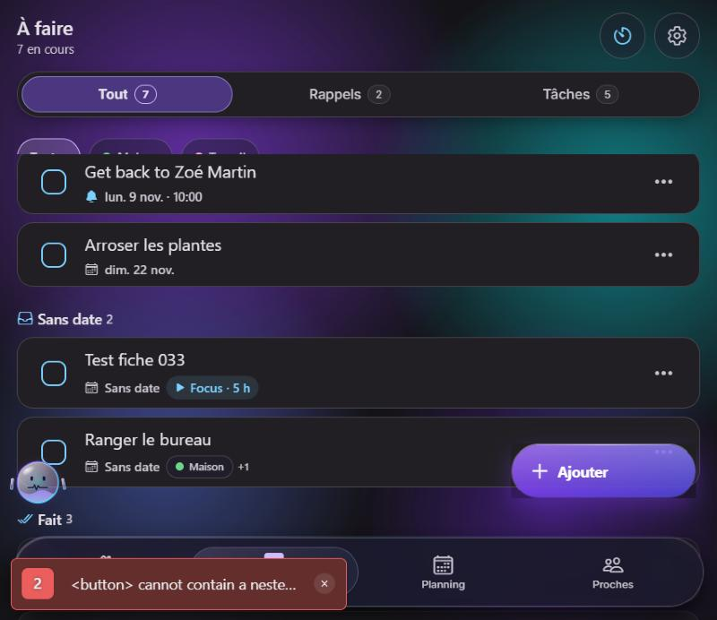
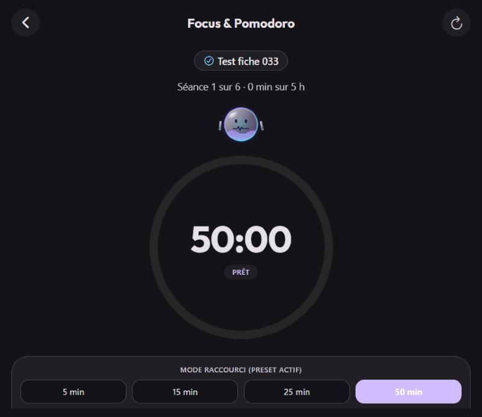
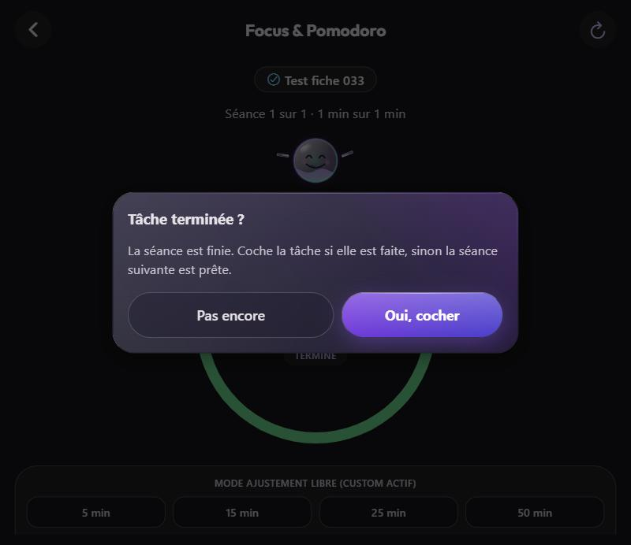
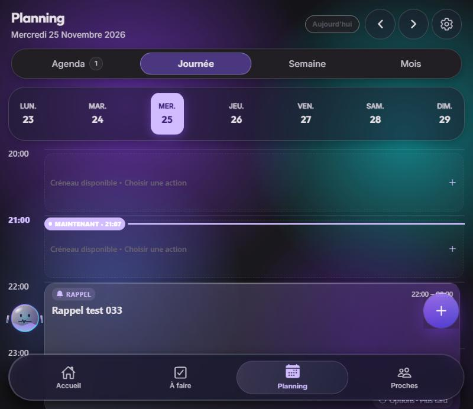

# FICHE OPÉRATOIRE N° 033 — Le temps pour le faire, le Planning et Focus

Projet : **Junix Pulse** · Date : 25 novembre 2026 · Suite de : [FICHE 032](FICHE-032-la-priorite-choisit-le-son.md) · Étude : [ÉTUDE 001](../etudes/ETUDE-001-clarifier-et-faire-evoluer.md), 16.8 (C, D)

---

## 1. Objectif

Tu l'as dit : « 2 h+ », c'est vague, et une vraie tâche peut demander 5 h. Et Focus pourrait aider à faire la tâche, sans jamais la cocher à ta place. Proposition et maquette validées :

| Avant | Après |
|---|---|
| Temps pour le faire : aucun, 15, 30, 45 min, 1 h, « 2 h+ » | Aucune, 30 min, 1 h, 2 h, 4 h et **Autre** (heures et minutes, jusqu'à 12 h) |
| une chose avec une heure n'avait pas de durée | elle garde son temps, et **l'occupe au Planning** (Journée et Semaine) |
| Focus seulement depuis la page de la tâche, réglé sur tout son temps (120 min au plus) | **▶ Focus** sur la carte et dans « ⋯ » ; des **séances de 50 min** : « Séance 2 sur 6 · 1 h 40 sur 5 h » |
| fin de séance : rien | **« Tâche terminée ? »** [Pas encore] [Oui, cocher] ; jamais cochée toute seule |
| le réveil des cartes suivait seulement le niveau choisi | il suit aussi la priorité (Urgente) |



*Figure 33-1 — Capture réelle (web, thème sombre). « Test fiche 033 » : 5 h choisies avec « Autre », et ▶ Focus · 5 h sur la carte.*



*Figure 33-2 — Capture réelle. Focus ouvert depuis la carte : la première séance de 50 min, « Séance 1 sur 6 · 0 min sur 5 h ».*



*Figure 33-3 — Capture réelle. Une séance finie : « Tâche terminée ? ». La personne décide.*



*Figure 33-4 — Capture réelle. Vue Journée : un rappel à 22:00 avec 2 h occupe la grille jusqu'à minuit.*

## 2. État de départ

| À vérifier | Comment | Résultat attendu |
|---|---|---|
| La fiche 032 est appliquée | `git status` | les fichiers de la fiche 032 modifiés (ou enregistrés) |
| Tout passe | `npx jest` | `Tests: 2141 passed` |

## 3. Matériel

Rien de nouveau.

## 4. Hypothèses

- Une tâche dont le temps est de 15 ou 45 min (choix d'avant) le garde : il s'affiche sur « Autre ».
- Les minutes de Focus d'une tâche ne comptent que les séances **finies** : une séance interrompue ne compte pas, comme pour les minutes du jour.
- Une séance de plus reste possible quand tout le temps est fait (« Pas encore » propose 50 min).

## 5. Carte de l'intervention

| Fichier | Action |
|---|---|
| `migrations.ts` (42), `entities`, dépôts des rappels et des tâches, `reminder-use-cases.ts`, `backup-service.ts`, `edit-loaders.ts` | la durée d'un rappel, le Focus d'une tâche |
| `domain/rules/duration-rules.ts` (+ test) | **nouveau** : le temps, « Autre », les séances |
| `components/create/form/DurationField.tsx` | **nouveau** : le champ et sa fenêtre |
| `TodoForm.tsx`, `item-forms.ts` (+ test), i18n | le champ dans le formulaire, aussi avec l'alerte |
| `DayTimeGrid.tsx`, `calendar.tsx`, `WeeklyTimetableGrid.tsx`, `MonthView.tsx`, `notification-level-rules.ts` (+ test) | le temps au Planning ; le réveil selon la priorité |
| `features/focus/open-focus.ts` | **nouveau** : ouvrir Focus pour une tâche |
| `app/focus.tsx`, `app/tasks/[id].tsx`, `todo-list-rules.ts`, `TodoRow.tsx`, `TodoTabScreen.tsx` | séances, question de fin, bouton et menu |

## 6. Sauvegarde

`git status` propre (hors `docs/motion/`), ou la fiche 032 seule en cours. La migration **ajoute** deux colonnes ; rien n'est modifié ni effacé. Retour en arrière : section 10.

## 7. Pas à pas

D'abord la fiche 032 (ses blocs supposent son code), puis : `node docs/fiches/outils/appliquer-fiche-033.js .` fait toutes les étapes ci-dessous. Pour comprendre ou refaire à la main, voici chaque étape.

### Étape 1 — Les données : la durée des rappels, le Focus déjà fait

**Pourquoi** : Deux **colonnes ajoutées** (migration 42) : `reminders.estimated_minutes`, le temps pour le faire d'une chose avec une heure, et `tasks.focus_minutes`, les minutes de Focus déjà faites pour une tâche. Vides, rien ne change : un rappel reste un point, une tâche n'a pas de Focus. Les dépôts les lisent et les écrivent, la sauvegarde les emporte.

Repère (Ctrl+F) : la première ligne de chaque bloc « Chercher ». Le script `appliquer-fiche-033.js` fait tous ces changements d'un coup, et refuse d'écrire si un bloc ne se trouve pas exactement une fois.

#### `src/database/migrations.ts`


Changement 1 sur 1. Chercher :

<!-- bloc: migrations-1-avant -->

```ts
      ALTER TABLE events ADD COLUMN priority TEXT;
    `,
  },
];

```

Remplacer par :

<!-- bloc: migrations-1-apres -->

```ts
      ALTER TABLE events ADD COLUMN priority TEXT;
    `,
  },
  {
    version: 42,
    name: 'add_reminder_duration_and_task_focus',
    sql: `
      -- Le temps pour le faire, aussi pour une chose a faire avec une heure (fiche 033,
      -- etude 16.8) : au Planning, elle occupe ce temps. Vide : un simple point, comme avant.
      ALTER TABLE reminders ADD COLUMN estimated_minutes INTEGER;
      -- Les minutes de Focus deja faites pour une tache : 1 h 40 sur 5 h. Vide : aucune.
      ALTER TABLE tasks ADD COLUMN focus_minutes INTEGER;
    `,
  },
];

```

#### `src/domain/entities/index.ts`


Changement 1 sur 3. Chercher :

<!-- bloc: index-1-avant -->

```ts
  requiresConfirmation?: boolean;
  /** The level chosen for it (sheet 023); absent is "Auto". */
  alertLevel?: AlertLevel;
  recurrenceRuleId?: string;
  notificationId?: string;     // ID fourni par expo-notifications (pour annulation)
  snoozedUntil?: string;       // ISO 8601 si snooze actif
```

Remplacer par :

<!-- bloc: index-1-apres -->

```ts
  requiresConfirmation?: boolean;
  /** The level chosen for it (sheet 023); absent is "Auto". */
  alertLevel?: AlertLevel;
  /** Its time to do it (sheet 033): it fills this time in the Planning. Absent is a point. */
  estimatedMinutes?: number;
  recurrenceRuleId?: string;
  notificationId?: string;     // ID fourni par expo-notifications (pour annulation)
  snoozedUntil?: string;       // ISO 8601 si snooze actif
```

Changement 2 sur 3. Chercher :

<!-- bloc: index-2-avant -->

```ts
  scheduledDate?: string;      // ISO date (YYYY-MM-DD) — pas d'heure, c'est une journée
  dueDate?: string;            // ISO date (YYYY-MM-DD) — à rendre ce jour-là au plus tard
  estimatedMinutes?: number;   // Estimation en minutes (15, 30, 60, etc.)
  priority: ReminderPriority;
  goalId?: string;
  personId?: string;
```

Remplacer par :

<!-- bloc: index-2-apres -->

```ts
  scheduledDate?: string;      // ISO date (YYYY-MM-DD) — pas d'heure, c'est une journée
  dueDate?: string;            // ISO date (YYYY-MM-DD) — à rendre ce jour-là au plus tard
  estimatedMinutes?: number;   // Estimation en minutes (15, 30, 60, etc.)
  /** The Focus minutes already done for it (sheet 033): "1 h 40 sur 5 h". */
  focusMinutes?: number;
  priority: ReminderPriority;
  goalId?: string;
  personId?: string;
```

Changement 3 sur 3. Chercher :

<!-- bloc: index-3-avant -->

```ts
  startTime: string;           // HH:MM (heure locale)
  endTime: string;             // HH:MM (heure locale)
  color?: string;
  createdAt: string;
  updatedAt: string;
}
```

Remplacer par :

<!-- bloc: index-3-apres -->

```ts
  startTime: string;           // HH:MM (heure locale)
  endTime: string;             // HH:MM (heure locale)
  color?: string;
  /** A reminder with a time to do it: the card shows its start and its end (sheet 033). */
  fillsTime?: boolean;
  createdAt: string;
  updatedAt: string;
}
```

#### `src/repositories/reminder-repository.ts`


Changement 1 sur 6. Chercher :

<!-- bloc: reminder-repository-1-avant -->

```ts
  personId?: string;
  requiresConfirmation?: boolean;
  alertLevel?: AlertLevel | null;
  recurrenceRuleId?: string;
  createdAt: string;
  updatedAt: string;
```

Remplacer par :

<!-- bloc: reminder-repository-1-apres -->

```ts
  personId?: string;
  requiresConfirmation?: boolean;
  alertLevel?: AlertLevel | null;
  /** Its time to do it, in minutes (sheet 033). */
  estimatedMinutes?: number | null;
  recurrenceRuleId?: string;
  createdAt: string;
  updatedAt: string;
```

Changement 2 sur 6. Chercher :

<!-- bloc: reminder-repository-2-avant -->

```ts
  recurrenceRuleId?: string | null;
  /** null: "Auto". */
  alertLevel?: AlertLevel | null;
  notificationId?: string | null;
  snoozedUntil?: string | null;
  updatedAt: string;
```

Remplacer par :

<!-- bloc: reminder-repository-2-apres -->

```ts
  recurrenceRuleId?: string | null;
  /** null: "Auto". */
  alertLevel?: AlertLevel | null;
  /** null: no time to do it (sheet 033). */
  estimatedMinutes?: number | null;
  notificationId?: string | null;
  snoozedUntil?: string | null;
  updatedAt: string;
```

Changement 3 sur 6. Chercher :

<!-- bloc: reminder-repository-3-avant -->

```ts
    personId: (row.person_id as string | null) ?? undefined,
    requiresConfirmation: (row.requires_confirmation as number | null) === 1,
    alertLevel: chosenLevelOf(row.alert_level) ?? undefined,
    recurrenceRuleId: (row.recurrence_rule_id as string | null) ?? undefined,
    notificationId: (row.notification_id as string | null) ?? undefined,
    snoozedUntil: (row.snoozed_until as string | null) ?? undefined,
```

Remplacer par :

<!-- bloc: reminder-repository-3-apres -->

```ts
    personId: (row.person_id as string | null) ?? undefined,
    requiresConfirmation: (row.requires_confirmation as number | null) === 1,
    alertLevel: chosenLevelOf(row.alert_level) ?? undefined,
    estimatedMinutes: (row.estimated_minutes as number | null) ?? undefined,
    recurrenceRuleId: (row.recurrence_rule_id as string | null) ?? undefined,
    notificationId: (row.notification_id as string | null) ?? undefined,
    snoozedUntil: (row.snoozed_until as string | null) ?? undefined,
```

Changement 4 sur 6. Chercher :

<!-- bloc: reminder-repository-4-avant -->

```ts
    await db.runAsync(
      `INSERT INTO reminders (
        id, title, notes, scheduled_at, timezone, priority, status, action_type,
        person_id, recurrence_rule_id, requires_confirmation, alert_level, created_at, updated_at
      ) VALUES (?, ?, ?, ?, ?, ?, 'UPCOMING', ?, ?, ?, ?, ?, ?, ?)`,
      params.id,
      params.title,
      params.notes ?? null,
```

Remplacer par :

<!-- bloc: reminder-repository-4-apres -->

```ts
    await db.runAsync(
      `INSERT INTO reminders (
        id, title, notes, scheduled_at, timezone, priority, status, action_type,
        person_id, recurrence_rule_id, requires_confirmation, alert_level, estimated_minutes, created_at, updated_at
      ) VALUES (?, ?, ?, ?, ?, ?, 'UPCOMING', ?, ?, ?, ?, ?, ?, ?, ?)`,
      params.id,
      params.title,
      params.notes ?? null,
```

Changement 5 sur 6. Chercher :

<!-- bloc: reminder-repository-5-avant -->

```ts
      params.recurrenceRuleId ?? null,
      params.requiresConfirmation ? 1 : 0,
      params.alertLevel ?? null,
      params.createdAt,
      params.updatedAt
    );
```

Remplacer par :

<!-- bloc: reminder-repository-5-apres -->

```ts
      params.recurrenceRuleId ?? null,
      params.requiresConfirmation ? 1 : 0,
      params.alertLevel ?? null,
      params.estimatedMinutes ?? null,
      params.createdAt,
      params.updatedAt
    );
```

Changement 6 sur 6. Chercher :

<!-- bloc: reminder-repository-6-avant -->

```ts
      setClauses.push('alert_level = ?');
      values.push(params.alertLevel);
    }
    if (params.personId !== undefined) {
      setClauses.push('person_id = ?');
      values.push(params.personId);
```

Remplacer par :

<!-- bloc: reminder-repository-6-apres -->

```ts
      setClauses.push('alert_level = ?');
      values.push(params.alertLevel);
    }
    if (params.estimatedMinutes !== undefined) {
      setClauses.push('estimated_minutes = ?');
      values.push(params.estimatedMinutes);
    }
    if (params.personId !== undefined) {
      setClauses.push('person_id = ?');
      values.push(params.personId);
```

#### `src/use-cases/reminder-use-cases.ts`


Changement 1 sur 4. Chercher :

<!-- bloc: reminder-use-cases-1-avant -->

```ts
  requiresConfirmation?: boolean;
  /** How it warns (sheet 023); null or absent is "Auto". */
  alertLevel?: AlertLevel | null;
  recurrenceRule?: Omit<RecurrenceRule, 'id'>;
  checklistItems?: { title: string; position: number }[];
}
```

Remplacer par :

<!-- bloc: reminder-use-cases-1-apres -->

```ts
  requiresConfirmation?: boolean;
  /** How it warns (sheet 023); null or absent is "Auto". */
  alertLevel?: AlertLevel | null;
  /** Its time to do it, in minutes (sheet 033). */
  estimatedMinutes?: number;
  recurrenceRule?: Omit<RecurrenceRule, 'id'>;
  checklistItems?: { title: string; position: number }[];
}
```

Changement 2 sur 4. Chercher :

<!-- bloc: reminder-use-cases-2-avant -->

```ts
    personId: input.personIds?.[0] ?? input.personId,
    requiresConfirmation: input.requiresConfirmation,
    alertLevel: input.alertLevel ?? null,
    recurrenceRuleId,
    createdAt: now,
    updatedAt: now,
```

Remplacer par :

<!-- bloc: reminder-use-cases-2-apres -->

```ts
    personId: input.personIds?.[0] ?? input.personId,
    requiresConfirmation: input.requiresConfirmation,
    alertLevel: input.alertLevel ?? null,
    estimatedMinutes: input.estimatedMinutes ?? null,
    recurrenceRuleId,
    createdAt: now,
    updatedAt: now,
```

Changement 3 sur 4. Chercher :

<!-- bloc: reminder-use-cases-3-avant -->

```ts
  requiresConfirmation?: boolean;
  /** How it warns (sheet 023): null is "Auto", undefined keeps it. */
  alertLevel?: AlertLevel | null;
  /** A new repeat (a new rule; the old one stays in the data), null to stop it, undefined to keep it. */
  recurrenceRule?: Omit<RecurrenceRule, 'id'> | null;
}
```

Remplacer par :

<!-- bloc: reminder-use-cases-3-apres -->

```ts
  requiresConfirmation?: boolean;
  /** How it warns (sheet 023): null is "Auto", undefined keeps it. */
  alertLevel?: AlertLevel | null;
  /** Its time to do it (sheet 033): null takes it off, undefined keeps it. */
  estimatedMinutes?: number | null;
  /** A new repeat (a new rule; the old one stays in the data), null to stop it, undefined to keep it. */
  recurrenceRule?: Omit<RecurrenceRule, 'id'> | null;
}
```

Changement 4 sur 4. Chercher :

<!-- bloc: reminder-use-cases-4-avant -->

```ts
    requiresConfirmation: input.requiresConfirmation,
    recurrenceRuleId,
    alertLevel: input.alertLevel,
    updatedAt: now,
  });

```

Remplacer par :

<!-- bloc: reminder-use-cases-4-apres -->

```ts
    requiresConfirmation: input.requiresConfirmation,
    recurrenceRuleId,
    alertLevel: input.alertLevel,
    estimatedMinutes: input.estimatedMinutes,
    updatedAt: now,
  });

```

#### `src/repositories/task-repository.ts`


Changement 1 sur 2. Chercher :

<!-- bloc: task-repository-1-avant -->

```ts
    scheduledDate: (row.scheduled_date as string | null) ?? undefined,
    dueDate: (row.due_date as string | null) ?? undefined,
    estimatedMinutes: (row.estimated_minutes as number | null) ?? undefined,
    priority: row.priority as Task['priority'],
    goalId: (row.goal_id as string | null) ?? undefined,
    personId: (row.person_id as string | null) ?? undefined,
```

Remplacer par :

<!-- bloc: task-repository-1-apres -->

```ts
    scheduledDate: (row.scheduled_date as string | null) ?? undefined,
    dueDate: (row.due_date as string | null) ?? undefined,
    estimatedMinutes: (row.estimated_minutes as number | null) ?? undefined,
    focusMinutes: (row.focus_minutes as number | null) ?? undefined,
    priority: row.priority as Task['priority'],
    goalId: (row.goal_id as string | null) ?? undefined,
    personId: (row.person_id as string | null) ?? undefined,
```

Changement 2 sur 2. Chercher :

<!-- bloc: task-repository-2-avant -->

```ts
      setClauses.push('estimated_minutes = ?');
      values.push(params.estimatedMinutes);
    }
    if (params.priority !== undefined) {
      setClauses.push('priority = ?');
      values.push(params.priority);
```

Remplacer par :

<!-- bloc: task-repository-2-apres -->

```ts
      setClauses.push('estimated_minutes = ?');
      values.push(params.estimatedMinutes);
    }
    if (params.focusMinutes !== undefined) {
      setClauses.push('focus_minutes = ?');
      values.push(params.focusMinutes);
    }
    if (params.priority !== undefined) {
      setClauses.push('priority = ?');
      values.push(params.priority);
```

#### `src/services/backup-service.ts`


Changement 1 sur 1. Chercher :

<!-- bloc: backup-service-1-avant -->

```ts
const TABLE_COLUMNS: Record<BackupTable, readonly string[]> = {
  persons: ['id', 'display_name', 'relationship', 'phone', 'email', 'birth_date', 'notes', 'last_interaction_at', 'forgotten_threshold_days', 'imported_from_contacts', 'timezone', 'availability', 'created_at', 'updated_at', 'deleted_at'],
  recurrence_rules: ['id', 'type', 'interval_val', 'days_of_week', 'day_of_month', 'week_position', 'end_date'],
  reminders: ['id', 'title', 'notes', 'scheduled_at', 'timezone', 'priority', 'status', 'action_type', 'person_id', 'recurrence_rule_id', 'requires_confirmation', 'alert_level', 'notification_id', 'snoozed_until', 'created_at', 'updated_at', 'completed_at', 'deleted_at'],
  reminder_checklist_items: ['id', 'reminder_id', 'title', 'is_completed', 'position'],
  tasks: ['id', 'title', 'description', 'status', 'scheduled_date', 'due_date', 'estimated_minutes', 'priority', 'goal_id', 'person_id', 'tags', 'created_at', 'updated_at', 'completed_at', 'deleted_at'],
  subtasks: ['id', 'task_id', 'title', 'is_completed', 'position', 'created_at', 'completed_at'],
  events: ['id', 'title', 'notes', 'start_at', 'end_at', 'timezone', 'location', 'type', 'travel_buffer_minutes', 'moment_kind', 'alert_level', 'priority', 'created_at', 'updated_at', 'deleted_at'],
  event_persons: ['event_id', 'person_id'],
```

Remplacer par :

<!-- bloc: backup-service-1-apres -->

```ts
const TABLE_COLUMNS: Record<BackupTable, readonly string[]> = {
  persons: ['id', 'display_name', 'relationship', 'phone', 'email', 'birth_date', 'notes', 'last_interaction_at', 'forgotten_threshold_days', 'imported_from_contacts', 'timezone', 'availability', 'created_at', 'updated_at', 'deleted_at'],
  recurrence_rules: ['id', 'type', 'interval_val', 'days_of_week', 'day_of_month', 'week_position', 'end_date'],
  reminders: ['id', 'title', 'notes', 'scheduled_at', 'timezone', 'priority', 'status', 'action_type', 'person_id', 'recurrence_rule_id', 'requires_confirmation', 'alert_level', 'estimated_minutes', 'notification_id', 'snoozed_until', 'created_at', 'updated_at', 'completed_at', 'deleted_at'],
  reminder_checklist_items: ['id', 'reminder_id', 'title', 'is_completed', 'position'],
  tasks: ['id', 'title', 'description', 'status', 'scheduled_date', 'due_date', 'estimated_minutes', 'focus_minutes', 'priority', 'goal_id', 'person_id', 'tags', 'created_at', 'updated_at', 'completed_at', 'deleted_at'],
  subtasks: ['id', 'task_id', 'title', 'is_completed', 'position', 'created_at', 'completed_at'],
  events: ['id', 'title', 'notes', 'start_at', 'end_at', 'timezone', 'location', 'type', 'travel_buffer_minutes', 'moment_kind', 'alert_level', 'priority', 'created_at', 'updated_at', 'deleted_at'],
  event_persons: ['event_id', 'person_id'],
```

#### `src/features/create/edit-loaders.ts`


Changement 1 sur 1. Chercher :

<!-- bloc: edit-loaders-1-avant -->

```ts
      confirm: Boolean(reminder.requiresConfirmation),
      alertLevel: chosenLevelOf(reminder.alertLevel),
      dueDate: undefined,
      estimatedMinutes: undefined,
      personIds,
      tagIds,
      scheduledAt,
```

Remplacer par :

<!-- bloc: edit-loaders-1-apres -->

```ts
      confirm: Boolean(reminder.requiresConfirmation),
      alertLevel: chosenLevelOf(reminder.alertLevel),
      dueDate: undefined,
      estimatedMinutes: reminder.estimatedMinutes,
      personIds,
      tagIds,
      scheduledAt,
```


### Étape 2 — La règle du temps et des séances

**Pourquoi** : Une règle pure, testée : un temps va de 1 min à 12 h ; « Autre » avance par heures et par quarts d'heure ; une tâche longue se fait en **séances de 50 min**, la dernière prend ce qui reste (5 h = 6 séances).

Repère (Ctrl+F) : la première ligne de chaque bloc « Chercher ». Le script `appliquer-fiche-033.js` fait tous ces changements d'un coup, et refuse d'écrire si un bloc ne se trouve pas exactement une fois.

#### `src/domain/rules/duration-rules.ts`

Fichier nouveau, en entier :

<!-- bloc: new-duration-rules -->

```ts
/**
 * "Temps pour le faire" (study 001, 16.8 C; sheet 033): four shortcuts and "Autre", any time up to
 * 12 hours (longer: subtasks). Pure: the form, the cards, the Planning and Focus read it.
 */

/** The shortcuts of the form, in minutes. */
export const DURATION_SHORTCUTS: readonly number[] = [30, 60, 120, 240];
/** The longest time to do one thing: beyond it, cut it into subtasks. */
export const MAX_DURATION_MINUTES = 12 * 60;
/** The minutes "Autre" offers, with the hours. */
export const DURATION_MINUTE_STEPS: readonly number[] = [0, 15, 30, 45];

/** A time kept between 1 minute and 12 hours, in whole minutes; anything else is no time. */
export function durationOf(minutes: number | null | undefined): number | undefined {
  if (minutes === null || minutes === undefined || !Number.isFinite(minutes) || minutes <= 0) return undefined;
  return Math.min(MAX_DURATION_MINUTES, Math.round(minutes));
}

/** Its hours and minutes, for "Autre" and for the labels. */
export function durationParts(minutes: number): { hours: number; minutes: number } {
  const total = durationOf(minutes) ?? 0;
  return { hours: Math.floor(total / 60), minutes: total % 60 };
}

/** One more or one less step of "Autre": hours from 0 to 12, minutes by 15, never past 12 h. */
export function stepDuration(current: number, part: 'hours' | 'minutes', by: 1 | -1): number {
  const { hours, minutes } = durationParts(current);
  if (part === 'hours') {
    const next = Math.min(12, Math.max(0, hours + by));
    return Math.min(MAX_DURATION_MINUTES, next * 60 + (next === 12 ? 0 : minutes));
  }
  const index = DURATION_MINUTE_STEPS.indexOf(minutes);
  const nextIndex = (Math.max(index, 0) + by + DURATION_MINUTE_STEPS.length) % DURATION_MINUTE_STEPS.length;
  return Math.min(MAX_DURATION_MINUTES, hours * 60 + DURATION_MINUTE_STEPS[nextIndex]);
}

/** Whether a time is one of the shortcuts: otherwise the form shows it on "Autre". */
export function isShortcut(minutes: number | undefined): boolean {
  return minutes === undefined || DURATION_SHORTCUTS.includes(minutes);
}

/**
 * Focus in sessions (study 16.8 D): a long task is done in sessions of 50 minutes; the last one
 * takes what is left. A task of 5 h is 6 sessions; one of 40 min is one session of 40.
 */
export const FOCUS_SESSION_MINUTES = 50;

export function focusPlan(estimatedMinutes: number | undefined, doneMinutes = 0): {
  /** The length of the next session. */
  sessionMinutes: number;
  /** Its number, from 1. */
  session: number;
  /** How many there are in all. */
  sessions: number;
  /** What is left to do, in minutes. */
  leftMinutes: number;
} | null {
  const total = durationOf(estimatedMinutes);
  if (!total) return null;
  const done = Math.max(0, Math.min(total, Math.round(doneMinutes)));
  const sessions = Math.ceil(total / FOCUS_SESSION_MINUTES);
  const leftMinutes = total - done;
  const session = Math.min(sessions, Math.floor(done / FOCUS_SESSION_MINUTES) + 1);
  const sessionMinutes = Math.max(1, Math.min(FOCUS_SESSION_MINUTES, leftMinutes || FOCUS_SESSION_MINUTES));
  return { sessionMinutes, session, sessions, leftMinutes };
}
```

#### `src/domain/rules/__tests__/duration-rules.test.ts`

Fichier nouveau, en entier :

<!-- bloc: new-duration-rules-test -->

```ts
import {
  DURATION_SHORTCUTS,
  MAX_DURATION_MINUTES,
  durationOf,
  durationParts,
  focusPlan,
  isShortcut,
  stepDuration,
} from '../duration-rules';

describe('duration-rules (sheet 033)', () => {
  it('keeps a time between 1 minute and 12 hours', () => {
    expect(durationOf(undefined)).toBeUndefined();
    expect(durationOf(0)).toBeUndefined();
    expect(durationOf(-5)).toBeUndefined();
    expect(durationOf(300)).toBe(300);
    expect(durationOf(10_000)).toBe(MAX_DURATION_MINUTES);
    expect(durationOf(44.6)).toBe(45);
  });

  it('cuts a time into hours and minutes', () => {
    expect(durationParts(300)).toEqual({ hours: 5, minutes: 0 });
    expect(durationParts(95)).toEqual({ hours: 1, minutes: 35 });
  });

  it('steps "Autre" by hours and by quarters, never past 12 h', () => {
    expect(stepDuration(240, 'hours', 1)).toBe(300);
    expect(stepDuration(60, 'hours', -1)).toBe(0);
    expect(stepDuration(0, 'hours', -1)).toBe(0);
    expect(stepDuration(60, 'minutes', 1)).toBe(75);
    expect(stepDuration(105, 'minutes', 1)).toBe(60);
    expect(stepDuration(60, 'minutes', -1)).toBe(105);
    expect(stepDuration(11 * 60 + 45, 'hours', 1)).toBe(MAX_DURATION_MINUTES);
  });

  it('knows the shortcuts', () => {
    expect(DURATION_SHORTCUTS).toEqual([30, 60, 120, 240]);
    expect(isShortcut(undefined)).toBe(true);
    expect(isShortcut(120)).toBe(true);
    expect(isShortcut(300)).toBe(false);
    // An old task of 15 or 45 minutes shows on "Autre"
    expect(isShortcut(45)).toBe(false);
  });

  it('plans Focus in sessions of 50 minutes', () => {
    expect(focusPlan(undefined)).toBeNull();
    expect(focusPlan(300)).toEqual({ sessionMinutes: 50, session: 1, sessions: 6, leftMinutes: 300 });
    expect(focusPlan(300, 100)).toEqual({ sessionMinutes: 50, session: 3, sessions: 6, leftMinutes: 200 });
    // The last session takes what is left
    expect(focusPlan(300, 280)).toEqual({ sessionMinutes: 20, session: 6, sessions: 6, leftMinutes: 20 });
    expect(focusPlan(40)).toEqual({ sessionMinutes: 40, session: 1, sessions: 1, leftMinutes: 40 });
    // All done: one more session of 50, if the person wants it
    expect(focusPlan(60, 90)).toEqual({ sessionMinutes: 50, session: 2, sessions: 2, leftMinutes: 0 });
  });
});
```


### Étape 3 — Le champ « Temps pour le faire »

**Pourquoi** : Une nouvelle brique, `DurationField` : Aucune, 30 min, 1 h, 2 h, 4 h et **Autre**, qui ouvre une fenêtre en verre avec les heures et les minutes (− et +). Un temps qui n'est pas un raccourci (5 h, ou les 45 min d'avant) s'affiche sur « Autre ». Le champ reste visible quand l'alerte est allumée : un rappel garde son temps.

Repère (Ctrl+F) : la première ligne de chaque bloc « Chercher ». Le script `appliquer-fiche-033.js` fait tous ces changements d'un coup, et refuse d'écrire si un bloc ne se trouve pas exactement une fois.

#### `src/components/create/form/DurationField.tsx`

Fichier nouveau, en entier :

<!-- bloc: new-durationfield -->

```tsx
/**
 * "Temps pour le faire" (study 001, 16.8 C; sheet 033): Aucun, four shortcuts (30 min, 1 h, 2 h,
 * 4 h) and "Autre", which opens a glass window to set hours and minutes, up to 12 h. A time that
 * is not a shortcut (5 h, or 45 min from before) shows on "Autre".
 */
import React, { useState } from 'react';
import { StyleSheet, Text, TouchableOpacity, View } from 'react-native';
import { Ionicons } from '@expo/vector-icons';

import { ChoiceChips, FieldLabel, type Choice } from '@/components/create/form/FormBricks';
import { GlassDialog } from '@/components/feedback/GlassDialog';
import { Button } from '@/components/ui/Button';
import type { ThemePalette } from '@/constants/palettes';
import { Spacing, Typography } from '@/constants/theme';
import { DURATION_SHORTCUTS, durationParts, isShortcut, stepDuration } from '@/domain/rules/duration-rules';
import { useTheme } from '@/hooks/use-theme';
import { useThemedStyles } from '@/hooks/use-themed-styles';
import { useT } from '@/i18n';

const OTHER = -1;

/** "45 min", "1 h", "1 h 30", "5 h". */
export function useDurationLabel() {
  const t = useT();
  return (minutes: number | undefined) => {
    if (minutes === undefined) return t('form.none');
    const parts = durationParts(minutes);
    if (parts.hours === 0) return t('duration.minutes', { m: parts.minutes });
    if (parts.minutes === 0) return t('duration.hours', { h: parts.hours });
    return t('duration.hoursMinutes', { h: parts.hours, m: String(parts.minutes).padStart(2, '0') });
  };
}

export function DurationField({
  value,
  onChange,
  accent,
  hint,
  testIDPrefix = 'todo-duration',
}: {
  value: number | undefined;
  onChange: (minutes: number | undefined) => void;
  accent: string;
  hint?: string;
  testIDPrefix?: string;
}) {
  const t = useT();
  const { palette } = useTheme();
  const styles = useThemedStyles(makeStyles);
  const label = useDurationLabel();
  const [open, setOpen] = useState(false);
  const [draft, setDraft] = useState(value ?? 90);

  const custom = !isShortcut(value);
  const options: Choice<number | undefined>[] = [
    { value: undefined, label: t('form.none') },
    ...DURATION_SHORTCUTS.map(minutes => ({ value: minutes, label: label(minutes) })),
    { value: OTHER, label: custom && value !== undefined ? label(value) : t('duration.other'), icon: 'create-outline' },
  ];

  const parts = durationParts(draft);
  const stepper = (part: 'hours' | 'minutes', shown: string) => (
    <View style={styles.stepper}>
      <Text style={styles.stepperLabel}>{t(part === 'hours' ? 'duration.hoursLabel' : 'duration.minutesLabel')}</Text>
      <View style={styles.stepperRow}>
        <TouchableOpacity
          style={styles.stepButton}
          onPress={() => setDraft(current => stepDuration(current, part, -1))}
          accessibilityRole="button"
          accessibilityLabel={t('duration.less')}
          testID={`${testIDPrefix}-${part}-less`}
        >
          <Ionicons name="remove" size={22} color={palette.onSurface.primary} />
        </TouchableOpacity>
        <Text style={styles.stepValue}>{shown}</Text>
        <TouchableOpacity
          style={styles.stepButton}
          onPress={() => setDraft(current => stepDuration(current, part, 1))}
          accessibilityRole="button"
          accessibilityLabel={t('duration.more')}
          testID={`${testIDPrefix}-${part}-more`}
        >
          <Ionicons name="add" size={22} color={palette.onSurface.primary} />
        </TouchableOpacity>
      </View>
    </View>
  );

  return (
    <View>
      <FieldLabel label={t('taskNew.durationHeader')} hint={hint} />
      <ChoiceChips
        options={options}
        value={custom ? OTHER : value}
        onChange={next => {
          if (next === OTHER) {
            setDraft(value ?? 90);
            setOpen(true);
          } else onChange(next);
        }}
        accent={accent}
        testIDPrefix={testIDPrefix}
      />
      <GlassDialog visible={open} onDismiss={() => setOpen(false)} testID={`${testIDPrefix}-other`}>
        <Text style={styles.title}>{t('taskNew.durationHeader')}</Text>
        <View style={styles.steppers}>
          {stepper('hours', String(parts.hours))}
          {stepper('minutes', String(parts.minutes).padStart(2, '0'))}
        </View>
        <Text style={styles.total}>{draft > 0 ? label(draft) : t('form.none')}</Text>
        <Text style={styles.note}>{t('duration.longer')}</Text>
        <View style={styles.actions}>
          <Button label={t('common.cancel')} onPress={() => setOpen(false)} variant="secondary" style={styles.action} />
          <Button
            label={t('soundSettings.choose')}
            onPress={() => {
              onChange(draft > 0 ? draft : undefined);
              setOpen(false);
            }}
            style={styles.action}
            testID={`${testIDPrefix}-other-choose`}
          />
        </View>
      </GlassDialog>
    </View>
  );
}

function makeStyles(theme: ThemePalette) {
  return StyleSheet.create({
    title: { ...Typography.titleMedium, color: theme.onSurface.primary, marginBottom: Spacing.md },
    steppers: { flexDirection: 'row', gap: Spacing.md },
    stepper: { flex: 1, alignItems: 'center', gap: Spacing.xs },
    stepperLabel: { ...Typography.bodyMedium, color: theme.onSurface.variant },
    stepperRow: { flexDirection: 'row', alignItems: 'center', gap: Spacing.sm },
    stepButton: {
      width: 44,
      height: 44,
      borderRadius: 22,
      alignItems: 'center',
      justifyContent: 'center',
      borderWidth: 1,
      borderColor: theme.outline.variant,
    },
    stepValue: { fontSize: 28, fontWeight: '600', minWidth: 44, textAlign: 'center', color: theme.onSurface.primary, fontVariant: ['tabular-nums'] },
    total: { ...Typography.bodyLarge, textAlign: 'center', color: theme.primary.default, marginTop: Spacing.md },
    note: { ...Typography.bodyMedium, textAlign: 'center', color: theme.onSurface.variant, marginTop: Spacing.xs, marginBottom: Spacing.md },
    actions: { flexDirection: 'row', gap: Spacing.sm },
    action: { flex: 1 },
  });
}
```

#### `src/features/create/TodoForm.tsx`


Changement 1 sur 6. Chercher :

<!-- bloc: todoform-1-avant -->

```tsx
  type IconName,
} from '@/components/create/form/FormBricks';
import { PriorityField } from '@/components/create/form/PriorityField';
import { LoadingState } from '@/components/feedback/States';
import { PersonField } from '@/components/people/PersonField';
import { TagField } from '@/components/tags/TagField';
```

Remplacer par :

<!-- bloc: todoform-1-apres -->

```tsx
  type IconName,
} from '@/components/create/form/FormBricks';
import { PriorityField } from '@/components/create/form/PriorityField';
import { DurationField, useDurationLabel } from '@/components/create/form/DurationField';
import { LoadingState } from '@/components/feedback/States';
import { PersonField } from '@/components/people/PersonField';
import { TagField } from '@/components/tags/TagField';
```

Changement 2 sur 6. Chercher :

<!-- bloc: todoform-2-avant -->

```tsx
  alertMoment,
  dayParam,
  hourParam,
  TODO_DURATION_OPTIONS,
  visibleMoreFields,
  visibleSections,
  type FormSectionId,
```

Remplacer par :

<!-- bloc: todoform-2-apres -->

```tsx
  alertMoment,
  dayParam,
  hourParam,
  visibleMoreFields,
  visibleSections,
  type FormSectionId,
```

Changement 3 sur 6. Chercher :

<!-- bloc: todoform-3-avant -->

```tsx
      icon: 'calendar-number-outline',
    },
  ];
  const durationLabel = (minutes: number | undefined) => {
    if (minutes === undefined) return t('form.none');
    if (minutes === 60) return t('taskNew.hours1');
    if (minutes === 120) return t('taskNew.hours2');
    return `${minutes} min`;
  };

  const toggleAlert = (on: boolean) => {
    setAlert(on);
```

Remplacer par :

<!-- bloc: todoform-3-apres -->

```tsx
      icon: 'calendar-number-outline',
    },
  ];
  // "45 min", "1 h 30", "5 h" (sheet 033)
  const durationLabel = useDurationLabel();

  const toggleAlert = (on: boolean) => {
    setAlert(on);
```

Changement 4 sur 6. Chercher :

<!-- bloc: todoform-4-avant -->

```tsx
          recurrenceRule: recurrenceToSave(scheduledAt),
          // The priority chooses how it rings now (sheet 032): a level chosen before is let go
          alertLevel: null,
        });
        showSnackbar(t('remEdit.updated'));
      } else if (editing?.kind === 'task') {
```

Remplacer par :

<!-- bloc: todoform-4-apres -->

```tsx
          recurrenceRule: recurrenceToSave(scheduledAt),
          // The priority chooses how it rings now (sheet 032): a level chosen before is let go
          alertLevel: null,
          // Its time in the Planning (sheet 033)
          estimatedMinutes: estimatedMinutes ?? null,
        });
        showSnackbar(t('remEdit.updated'));
      } else if (editing?.kind === 'task') {
```

Changement 5 sur 6. Chercher :

<!-- bloc: todoform-5-avant -->

```tsx
          tagIds,
          requiresConfirmation: confirm,
          recurrenceRule: recurrenceToSave(scheduledAt) ?? undefined,
        });
        showSnackbar(t('remNew.created'));
      } else {
```

Remplacer par :

<!-- bloc: todoform-5-apres -->

```tsx
          tagIds,
          requiresConfirmation: confirm,
          recurrenceRule: recurrenceToSave(scheduledAt) ?? undefined,
          // Its time in the Planning (sheet 033)
          estimatedMinutes,
        });
        showSnackbar(t('remNew.created'));
      } else {
```

Changement 6 sur 6. Chercher :

<!-- bloc: todoform-6-avant -->

```tsx
      case 'duration':
        return (
          <View key={field}>
            <FieldLabel label={t('taskNew.durationHeader')} hint={t('itemForm.durationHint')} />
            <ChoiceChips
              options={TODO_DURATION_OPTIONS.map(minutes => ({ value: minutes, label: durationLabel(minutes) }))}
              value={estimatedMinutes}
              onChange={setEstimatedMinutes}
              accent={accent}
              testIDPrefix="todo-duration"
            />
          </View>
        );
      case 'subtasks':
```

Remplacer par :

<!-- bloc: todoform-6-apres -->

```tsx
      case 'duration':
        return (
          <View key={field}>
            {/* Shortcuts and "Autre", any time up to 12 h (sheet 033) */}
            <DurationField value={estimatedMinutes} onChange={setEstimatedMinutes} accent={accent} hint={t('itemForm.durationHint')} />
          </View>
        );
      case 'subtasks':
```

#### `src/constants/item-forms.ts`


Changement 1 sur 2. Chercher :

<!-- bloc: item-forms-1-avant -->

```ts
  },
};

/** "Time to do it", in minutes; none at first. */
export const TODO_DURATION_OPTIONS: readonly (number | undefined)[] = [undefined, 15, 30, 45, 60, 120];
/** "Leave … min before", in minutes; 0 is no reminder to leave. */
export const LEAVE_OPTIONS: readonly number[] = [0, 15, 30, 45, 60];

```

Remplacer par :

<!-- bloc: item-forms-1-apres -->

```ts
  },
};

/** "Leave … min before", in minutes; 0 is no reminder to leave. */
export const LEAVE_OPTIONS: readonly number[] = [0, 15, 30, 45, 60];

```

Changement 2 sur 2. Chercher :

<!-- bloc: item-forms-2-avant -->

```ts

/**
 * With an alert, a todo is saved as a reminder: the priority moves under the alert, and what a
 * reminder does not have (deadline, time to do it, subtasks) is not offered.
 */
const HIDDEN_WITH_ALERT: readonly MoreFieldId[] = ['priority', 'deadline', 'duration', 'subtasks'];

/** The sections to draw, in order: "Leave … min before" only once a place is written. */
export function visibleSections(family: ItemFamily, state: FormState = {}): FormSectionId[] {
```

Remplacer par :

<!-- bloc: item-forms-2-apres -->

```ts

/**
 * With an alert, a todo is saved as a reminder: the priority moves under the alert, and what a
 * reminder does not have (deadline, subtasks) is not offered. Its time to do it stays: it fills
 * that time in the Planning (sheet 033).
 */
const HIDDEN_WITH_ALERT: readonly MoreFieldId[] = ['priority', 'deadline', 'subtasks'];

/** The sections to draw, in order: "Leave … min before" only once a place is written. */
export function visibleSections(family: ItemFamily, state: FormState = {}): FormSectionId[] {
```

#### `src/__tests__/item-forms.test.ts`


Changement 1 sur 1. Chercher :

<!-- bloc: item-forms-test-1-avant -->

```ts

  it('hides what a reminder does not have once the alert is on', () => {
    expect(visibleMoreFields('todo')).toEqual(['priority', 'deadline', 'duration', 'subtasks', 'tags']);
    expect(visibleMoreFields('todo', { alert: true })).toEqual(['tags']);
    expect(visibleMoreFields('moment', { alert: true })).toEqual(['priority', 'availability', 'tags']);
  });

```

Remplacer par :

<!-- bloc: item-forms-test-1-apres -->

```ts

  it('hides what a reminder does not have once the alert is on', () => {
    expect(visibleMoreFields('todo')).toEqual(['priority', 'deadline', 'duration', 'subtasks', 'tags']);
    // With an alert, the time to do it stays: it fills that time in the Planning (sheet 033)
    expect(visibleMoreFields('todo', { alert: true })).toEqual(['duration', 'tags']);
    expect(visibleMoreFields('moment', { alert: true })).toEqual(['priority', 'availability', 'tags']);
  });

```

#### `src/i18n/messages-rest-fr.ts`


Changement 1 sur 2. Chercher :

<!-- bloc: messages-rest-fr-1-avant -->

```ts
  'itemForm.alertTime': "À {time}",
  'priorityField.rings': "Sonnera : {sound}",
  'priorityField.silent': "Ne sonnera pas : le son des notifications est coupé",
  'itemForm.priority': "Priorité",
  'itemForm.priorityHint': "« Urgente » sonne comme une alarme.",
  'itemForm.action': "Ce que tu feras",
```

Remplacer par :

<!-- bloc: messages-rest-fr-1-apres -->

```ts
  'itemForm.alertTime': "À {time}",
  'priorityField.rings': "Sonnera : {sound}",
  'priorityField.silent': "Ne sonnera pas : le son des notifications est coupé",
  'focus.sessionLine': "Séance {session} sur {sessions} · {done} sur {total}",
  'focus.taskDoneTitle': "Tâche terminée ?",
  'focus.taskDoneBody': "La séance est finie. Coche la tâche si elle est faite, sinon la séance suivante est prête.",
  'focus.taskNotYet': "Pas encore",
  'focus.taskTick': "Oui, cocher",
  'focus.taskTicked': "Tâche cochée",
  'todoTab.focus': "Focus",
  'todoTab.focusFor': "Lancer Focus pour {title}",
  'itemForm.priority': "Priorité",
  'itemForm.priorityHint': "« Urgente » sonne comme une alarme.",
  'itemForm.action': "Ce que tu feras",
```

Changement 2 sur 2. Chercher :

<!-- bloc: messages-rest-fr-2-avant -->

```ts
  'itemForm.leaveHint': "Ton téléphone te dira quand partir.",
  'itemForm.more': "Plus d'options",
  'itemForm.less': "Moins d'options",
  'itemForm.durationHint': "Lancer Focus depuis cette tâche réglera le minuteur sur ce temps.",
  'itemForm.availability': "Pendant ce moment",
  'itemForm.dictateAll': "Dicter tout",
  'itemForm.dictateListening': "J'écoute… touche pour arrêter",
```

Remplacer par :

<!-- bloc: messages-rest-fr-2-apres -->

```ts
  'itemForm.leaveHint': "Ton téléphone te dira quand partir.",
  'itemForm.more': "Plus d'options",
  'itemForm.less': "Moins d'options",
  'itemForm.durationHint': "Au Planning, une chose avec une heure occupe ce temps. Focus se règle dessus, en séances de 50 min.",
  'duration.minutes': "{m} min",
  'duration.hours': "{h} h",
  'duration.hoursMinutes': "{h} h {m}",
  'duration.other': "Autre",
  'duration.hoursLabel': "Heures",
  'duration.minutesLabel': "Minutes",
  'duration.less': "Moins",
  'duration.more': "Plus",
  'duration.longer': "Jusqu’à 12 h. Plus long : découpe-la en sous-tâches.",
  'itemForm.availability': "Pendant ce moment",
  'itemForm.dictateAll': "Dicter tout",
  'itemForm.dictateListening': "J'écoute… touche pour arrêter",
```

#### `src/i18n/messages-rest-en.ts`


Changement 1 sur 2. Chercher :

<!-- bloc: messages-rest-en-1-avant -->

```ts
  'itemForm.alertTime': "At {time}",
  'priorityField.rings': "Will ring: {sound}",
  'priorityField.silent': "Won't ring: notification sound is off",
  'itemForm.priority': "Priority",
  'itemForm.priorityHint': "“Urgent” rings like an alarm.",
  'itemForm.action': "What you will do",
```

Remplacer par :

<!-- bloc: messages-rest-en-1-apres -->

```ts
  'itemForm.alertTime': "At {time}",
  'priorityField.rings': "Will ring: {sound}",
  'priorityField.silent': "Won't ring: notification sound is off",
  'focus.sessionLine': "Session {session} of {sessions} · {done} of {total}",
  'focus.taskDoneTitle': "Task done?",
  'focus.taskDoneBody': "The session is over. Tick the task if it is done; otherwise the next session is ready.",
  'focus.taskNotYet': "Not yet",
  'focus.taskTick': "Yes, tick it",
  'focus.taskTicked': "Task ticked",
  'todoTab.focus': "Focus",
  'todoTab.focusFor': "Start Focus for {title}",
  'itemForm.priority': "Priority",
  'itemForm.priorityHint': "“Urgent” rings like an alarm.",
  'itemForm.action': "What you will do",
```

Changement 2 sur 2. Chercher :

<!-- bloc: messages-rest-en-2-avant -->

```ts
  'itemForm.leaveHint': "Your phone will tell you when to leave.",
  'itemForm.more': "More options",
  'itemForm.less': "Fewer options",
  'itemForm.durationHint': "Starting Focus from this task sets the timer to this time.",
  'itemForm.availability': "During this moment",
  'itemForm.dictateAll': "Dictate everything",
  'itemForm.dictateListening': "Listening… tap to stop",
```

Remplacer par :

<!-- bloc: messages-rest-en-2-apres -->

```ts
  'itemForm.leaveHint': "Your phone will tell you when to leave.",
  'itemForm.more': "More options",
  'itemForm.less': "Fewer options",
  'itemForm.durationHint': "In the Planning, a thing with a time fills this time. Focus follows it, in sessions of 50 min.",
  'duration.minutes': "{m} min",
  'duration.hours': "{h} h",
  'duration.hoursMinutes': "{h} h {m}",
  'duration.other': "Other",
  'duration.hoursLabel': "Hours",
  'duration.minutesLabel': "Minutes",
  'duration.less': "Less",
  'duration.more': "More",
  'duration.longer': "Up to 12 h. Longer: split it into subtasks.",
  'itemForm.availability': "During this moment",
  'itemForm.dictateAll': "Dictate everything",
  'itemForm.dictateListening': "Listening… tap to stop",
```


### Étape 4 — Au Planning, une chose avec une heure occupe son temps

**Pourquoi** : Vue Journée : le rappel va de son heure à son heure plus son temps (« 22:00 – 00:00 »). Vue Semaine : le bloc a la même longueur (une demi-heure quand il n'a pas de temps, comme avant). Le réveil des cartes suit aussi la priorité : `ringsAsAlarm` dit qu'une chose Urgente sonne en alarme, sauf si un niveau a été choisi avant la fiche 032.

Repère (Ctrl+F) : la première ligne de chaque bloc « Chercher ». Le script `appliquer-fiche-033.js` fait tous ces changements d'un coup, et refuse d'écrire si un bloc ne se trouve pas exactement une fois.

#### `src/components/planning/DayTimeGrid.tsx`


Changement 1 sur 5. Chercher :

<!-- bloc: daytimegrid-1-avant -->

```tsx
import { useTheme } from '@/hooks/use-theme';
import { useThemedStyles } from '@/hooks/use-themed-styles';
import { useT } from '@/i18n';

import { DraggableBlock } from './DraggableBlock';
import { PlanningCard } from './PlanningCard';
```

Remplacer par :

<!-- bloc: daytimegrid-1-apres -->

```tsx
import { useTheme } from '@/hooks/use-theme';
import { useThemedStyles } from '@/hooks/use-themed-styles';
import { useT } from '@/i18n';
import { ringsAsAlarm } from '@/domain/rules/notification-level-rules';

import { DraggableBlock } from './DraggableBlock';
import { PlanningCard } from './PlanningCard';
```

Changement 2 sur 5. Chercher :

<!-- bloc: daytimegrid-2-avant -->

```tsx
  | { key: string; kind: 'device'; device: DeviceEvent; startMin: number; endMin: number };

/** Minutes since the start of the day shown, kept inside the day for a card that starts or ends on another. */
function minutesWithin(date: Date, day: Date): number {
  const startOfDay = new Date(day.getFullYear(), day.getMonth(), day.getDate());
  const diff = Math.round((date.getTime() - startOfDay.getTime()) / 60000);
```

Remplacer par :

<!-- bloc: daytimegrid-2-apres -->

```tsx
  | { key: string; kind: 'device'; device: DeviceEvent; startMin: number; endMin: number };

/** Minutes since the start of the day shown, kept inside the day for a card that starts or ends on another. */
/** "14:00", or "14:00 – 16:30" when it has a time to do it (sheet 033). */
function reminderTime(reminder: Reminder): string {
  const start = new Date(reminder.scheduledAt);
  if (!reminder.estimatedMinutes) return format(start, 'HH:mm');
  return `${format(start, 'HH:mm')} – ${format(new Date(start.getTime() + reminder.estimatedMinutes * 60_000), 'HH:mm')}`;
}

function minutesWithin(date: Date, day: Date): number {
  const startOfDay = new Date(day.getFullYear(), day.getMonth(), day.getDate());
  const diff = Math.round((date.getTime() - startOfDay.getTime()) / 60000);
```

Changement 3 sur 5. Chercher :

<!-- bloc: daytimegrid-3-avant -->

```tsx
    }
    for (const reminder of reminders) {
      const startMin = minutesOfDay(new Date(reminder.scheduledAt));
      list.push({ key: `r-${reminder.id}`, kind: 'reminder', reminder, startMin, endMin: startMin });
    }
    for (const device of deviceEvents.filter(d => !d.allDay)) {
      list.push({
```

Remplacer par :

<!-- bloc: daytimegrid-3-apres -->

```tsx
    }
    for (const reminder of reminders) {
      const startMin = minutesOfDay(new Date(reminder.scheduledAt));
      // Its time to do it fills the grid (sheet 033); without one, a point as before
      list.push({ key: `r-${reminder.id}`, kind: 'reminder', reminder, startMin, endMin: startMin + (reminder.estimatedMinutes ?? 0) });
    }
    for (const device of deviceEvents.filter(d => !d.allDay)) {
      list.push({
```

Changement 4 sur 5. Chercher :

<!-- bloc: daytimegrid-4-avant -->

```tsx
                card.kind === 'event'
                  ? `${format(new Date(card.event.startAt), 'HH:mm')} – ${format(new Date(card.event.endAt), 'HH:mm')}`
                  : card.kind === 'reminder'
                    ? format(new Date(card.reminder.scheduledAt), 'HH:mm')
                    : `${format(card.device.startAt, 'HH:mm')} – ${format(card.device.endAt, 'HH:mm')}`;
              return (
                <DraggableBlock
```

Remplacer par :

<!-- bloc: daytimegrid-4-apres -->

```tsx
                card.kind === 'event'
                  ? `${format(new Date(card.event.startAt), 'HH:mm')} – ${format(new Date(card.event.endAt), 'HH:mm')}`
                  : card.kind === 'reminder'
                    ? reminderTime(card.reminder)
                    : `${format(card.device.startAt, 'HH:mm')} – ${format(card.device.endAt, 'HH:mm')}`;
              return (
                <DraggableBlock
```

Changement 5 sur 5. Chercher :

<!-- bloc: daytimegrid-5-avant -->

```tsx
                    note={card.kind === 'reminder' ? card.reminder.notes : null}
                    showOptions={card.kind === 'reminder' && box.columns <= 2}
                    narrow={columnWidth < NARROW_CARD_WIDTH}
                    alarm={(card.kind === 'reminder' ? card.reminder.alertLevel : card.kind === 'event' ? card.event.alertLevel : undefined) === 'alarm'}
                  />
                </DraggableBlock>
              );
```

Remplacer par :

<!-- bloc: daytimegrid-5-apres -->

```tsx
                    note={card.kind === 'reminder' ? card.reminder.notes : null}
                    showOptions={card.kind === 'reminder' && box.columns <= 2}
                    narrow={columnWidth < NARROW_CARD_WIDTH}
                    alarm={card.kind === 'reminder' ? ringsAsAlarm(card.reminder) : card.kind === 'event' ? ringsAsAlarm(card.event) : false}
                  />
                </DraggableBlock>
              );
```

#### `src/app/(tabs)/calendar.tsx`


Changement 1 sur 2. Chercher :

<!-- bloc: calendar-1-avant -->

```tsx
      weekRems.flat().forEach(r => {
        if (!reminderBlocksMap.has(r.id)) {
          const s = new Date(r.scheduledAt);
          const end = addMinutes(s, 30);
          reminderBlocksMap.set(r.id, {
            id: r.id,
            scheduleId: 'reminder',
```

Remplacer par :

<!-- bloc: calendar-1-apres -->

```tsx
      weekRems.flat().forEach(r => {
        if (!reminderBlocksMap.has(r.id)) {
          const s = new Date(r.scheduledAt);
          // Its time to do it fills the week (sheet 033); without one, half an hour as before
          const end = addMinutes(s, r.estimatedMinutes ?? 30);
          reminderBlocksMap.set(r.id, {
            id: r.id,
            scheduleId: 'reminder',
```

Changement 2 sur 2. Chercher :

<!-- bloc: calendar-2-avant -->

```tsx
            dayOfWeek: s.getDay(),
            startTime: format(s, 'HH:mm'),
            endTime: format(end, 'HH:mm'),
            color: r.priority === 'HIGH' || r.priority === 'URGENT' ? theme.priority.HIGH : theme.tertiary.default,
            createdAt: r.createdAt,
            updatedAt: r.updatedAt,
```

Remplacer par :

<!-- bloc: calendar-2-apres -->

```tsx
            dayOfWeek: s.getDay(),
            startTime: format(s, 'HH:mm'),
            endTime: format(end, 'HH:mm'),
            fillsTime: Boolean(r.estimatedMinutes),
            color: r.priority === 'HIGH' || r.priority === 'URGENT' ? theme.priority.HIGH : theme.tertiary.default,
            createdAt: r.createdAt,
            updatedAt: r.updatedAt,
```

#### `src/components/schedule/WeeklyTimetableGrid.tsx`


Changement 1 sur 1. Chercher :

<!-- bloc: weeklytimetablegrid-1-avant -->

```tsx
                              <PlanningCard
                                look={look}
                                title={block.label}
                                time={isReminder ? block.startTime : `${block.startTime} – ${block.endTime}`}
                                height={item.heightPx}
                                narrow
                                tiny={item.widthPx < TINY_CARD_WIDTH}
```

Remplacer par :

<!-- bloc: weeklytimetablegrid-1-apres -->

```tsx
                              <PlanningCard
                                look={look}
                                title={block.label}
                                time={isReminder && !block.fillsTime ? block.startTime : `${block.startTime} – ${block.endTime}`}
                                height={item.heightPx}
                                narrow
                                tiny={item.widthPx < TINY_CARD_WIDTH}
```

#### `src/components/planning/MonthView.tsx`


Changement 1 sur 2. Chercher :

<!-- bloc: monthview-1-avant -->

```tsx
import { useTheme } from '@/hooks/use-theme';
import { useThemedStyles } from '@/hooks/use-themed-styles';
import { useDateLocale, useT } from '@/i18n';

import { DraggableBlock, type DropPoint } from './DraggableBlock';
import { PlanningCard } from './PlanningCard';
```

Remplacer par :

<!-- bloc: monthview-1-apres -->

```tsx
import { useTheme } from '@/hooks/use-theme';
import { useThemedStyles } from '@/hooks/use-themed-styles';
import { useDateLocale, useT } from '@/i18n';
import { ringsAsAlarm } from '@/domain/rules/notification-level-rules';

import { DraggableBlock, type DropPoint } from './DraggableBlock';
import { PlanningCard } from './PlanningCard';
```

Changement 2 sur 2. Chercher :

<!-- bloc: monthview-2-avant -->

```tsx
                place={item.place}
                done={item.done}
                index={index}
                alarm={(item.reminder?.alertLevel ?? item.event?.alertLevel) === 'alarm'}
              />
            </DraggableBlock>
          ))}
```

Remplacer par :

<!-- bloc: monthview-2-apres -->

```tsx
                place={item.place}
                done={item.done}
                index={index}
                alarm={item.reminder ? ringsAsAlarm(item.reminder) : item.event ? ringsAsAlarm(item.event) : false}
              />
            </DraggableBlock>
          ))}
```

#### `src/domain/rules/notification-level-rules.ts`


Changement 1 sur 1. Chercher :

<!-- bloc: notification-level-rules-1-avant -->

```ts
  return priority === 'HIGH' && level === 'normal';
}

/** The kind of Android channel of a level. With the sound switched off, nothing rings. */
export type NotificationChannelKind = 'discreet' | 'normal' | 'alarm' | 'silent';

```

Remplacer par :

<!-- bloc: notification-level-rules-1-apres -->

```ts
  return priority === 'HIGH' && level === 'normal';
}

/**
 * Whether a thing rings as an alarm, for its alarm clock on the cards (sheets 031 and 033): a level
 * chosen before sheet 032 decides; otherwise Urgente is an alarm.
 */
export function ringsAsAlarm(item: { alertLevel?: NotificationLevel | null; priority?: ReminderPriority }): boolean {
  if (item.alertLevel) return item.alertLevel === 'alarm';
  return item.priority === 'URGENT';
}

/** The kind of Android channel of a level. With the sound switched off, nothing rings. */
export type NotificationChannelKind = 'discreet' | 'normal' | 'alarm' | 'silent';

```

#### `src/domain/rules/__tests__/notification-level-rules.test.ts`


Changement 1 sur 2. Chercher :

<!-- bloc: notification-level-rules-test-1-avant -->

```ts
import {
  DEFAULT_QUIET_HOURS,
  insistsFor,
  isQuietTime,
  levelOf,
  notificationChannelFor,
```

Remplacer par :

<!-- bloc: notification-level-rules-test-1-apres -->

```ts
import {
  DEFAULT_QUIET_HOURS,
  insistsFor,
  ringsAsAlarm,
  isQuietTime,
  levelOf,
  notificationChannelFor,
```

Changement 2 sur 2. Chercher :

<!-- bloc: notification-level-rules-test-2-avant -->

```ts
    expect(notificationLevelFor({ moment: 'momentBefore', priority: 'HIGH', momentKind: 'mourning', at: at(10) })).toBe('discreet');
  });

  it('makes Haute insist at the normal level only', () => {
    expect(insistsFor('HIGH', 'normal')).toBe(true);
    expect(insistsFor('HIGH', 'discreet')).toBe(false);
```

Remplacer par :

<!-- bloc: notification-level-rules-test-2-apres -->

```ts
    expect(notificationLevelFor({ moment: 'momentBefore', priority: 'HIGH', momentKind: 'mourning', at: at(10) })).toBe('discreet');
  });

  it('shows the alarm clock for an urgent thing, or a level chosen as alarm (sheet 033)', () => {
    expect(ringsAsAlarm({ priority: 'URGENT' })).toBe(true);
    expect(ringsAsAlarm({ priority: 'HIGH' })).toBe(false);
    expect(ringsAsAlarm({ priority: 'NORMAL', alertLevel: 'alarm' })).toBe(true);
    // A level chosen before sheet 032 still decides
    expect(ringsAsAlarm({ priority: 'URGENT', alertLevel: 'discreet' })).toBe(false);
  });

  it('makes Haute insist at the normal level only', () => {
    expect(insistsFor('HIGH', 'normal')).toBe(true);
    expect(insistsFor('HIGH', 'discreet')).toBe(false);
```


### Étape 5 — Focus depuis la tâche, en séances, et « Tâche terminée ? »

**Pourquoi** : Une tâche qui a un temps pour le faire porte un bouton **▶ Focus · 5 h** sur sa carte ; toute tâche a **Focus** dans son « ⋯ » (et son glissement). Focus propose la séance suivante (« Séance 2 sur 6 · 1 h 40 sur 5 h »). À la fin d'une séance, les minutes sont gardées dans la tâche, puis la question **« Tâche terminée ? »** : « Oui, cocher » coche la tâche, « Pas encore » prépare la séance suivante. La tâche n'est jamais cochée toute seule. Ce qui se fait à la fin d'une séance (minutes du jour, Pulse, message) sort de la mise à jour de l'état, où il modifiait d'autres composants pendant leur dessin (avertissement de React).

Repère (Ctrl+F) : la première ligne de chaque bloc « Chercher ». Le script `appliquer-fiche-033.js` fait tous ces changements d'un coup, et refuse d'écrire si un bloc ne se trouve pas exactement une fois.

#### `src/features/focus/open-focus.ts`

Fichier nouveau, en entier :

<!-- bloc: new-open-focus -->

```ts
/**
 * Opens Focus for a task (study 001, 16.8 D; sheet 033), from its card, its "⋯" or its page: with
 * its time to do it and the Focus time already done, so Focus picks the next session.
 */
import { router } from 'expo-router';

export function openFocusForTask(task: { id: string; title: string; estimatedMinutes?: number; focusMinutes?: number }): void {
  router.push({
    pathname: '/focus' as never,
    params: {
      taskId: task.id,
      taskTitle: task.title,
      minutes: String(task.estimatedMinutes ?? ''),
      done: String(task.focusMinutes ?? 0),
    },
  });
}
```

#### `src/app/focus.tsx`


Changement 1 sur 6. Chercher :

<!-- bloc: focus-1-avant -->

```tsx
import { setMascotFocusState } from '@/services/mascot/mascot-runtime';
import { addFocusMinutes } from '@/services/focus-stats-service';
import { PulseMascot } from '@/features/mascot/PulseMascot';
import { useT } from '@/i18n';

const CIRCLE_SIZE = 260;
```

Remplacer par :

<!-- bloc: focus-1-apres -->

```tsx
import { setMascotFocusState } from '@/services/mascot/mascot-runtime';
import { addFocusMinutes } from '@/services/focus-stats-service';
import { PulseMascot } from '@/features/mascot/PulseMascot';
import { GlassAlert } from '@/components/feedback/GlassAlert';
import { useDurationLabel } from '@/components/create/form/DurationField';
import { focusPlan } from '@/domain/rules/duration-rules';
import { TaskRepository } from '@/repositories/task-repository';
import { TaskUseCases } from '@/use-cases/task-use-cases';
import { useT } from '@/i18n';

const CIRCLE_SIZE = 260;
```

Changement 2 sur 6. Chercher :

<!-- bloc: focus-2-avant -->

```tsx
  const styles = useThemedStyles(makeFocusStyles);
  const { showSnackbar } = useAppStore();

  const params = useLocalSearchParams<{ taskId?: string; taskTitle?: string; minutes?: string }>();

  const [session, setSession] = useState<FocusSession>(() =>
    createFocusSession({
      // From a task: its "time to do it" (sheet 012), otherwise 25 minutes
      ...focusMinutesForTask(Number(params.minutes)),
      taskId: params.taskId,
      taskTitle: params.taskTitle,
    })
```

Remplacer par :

<!-- bloc: focus-2-apres -->

```tsx
  const styles = useThemedStyles(makeFocusStyles);
  const { showSnackbar } = useAppStore();

  const params = useLocalSearchParams<{ taskId?: string; taskTitle?: string; minutes?: string; done?: string }>();
  // A task with a time to do it is done in sessions of 50 min (sheet 033); its Focus time so far
  const taskMinutes = Number(params.minutes) || undefined;
  const [doneMinutes, setDoneMinutes] = useState(() => Math.max(0, Number(params.done) || 0));
  const plan = params.taskId ? focusPlan(taskMinutes, doneMinutes) : null;
  const durationLabel = useDurationLabel();

  const [session, setSession] = useState<FocusSession>(() =>
    createFocusSession({
      // From a task: its next session (sheet 033), otherwise 25 minutes
      ...focusMinutesForTask(focusPlan(taskMinutes, Math.max(0, Number(params.done) || 0))?.sessionMinutes ?? taskMinutes),
      taskId: params.taskId,
      taskTitle: params.taskTitle,
    })
```

Changement 3 sur 6. Chercher :

<!-- bloc: focus-3-avant -->

```tsx
          : t('focus.endNotif')
      );
      timerRef.current = setInterval(() => {
        setSession((prev) => {
          const next = syncFocusSessionWithClock(prev, endsAtRef.current);
          if (next.state === 'completed' && prev.state === 'running') {
            // Kept for the day, even if the app is closed afterwards
            void addFocusMinutes(prev.durationMinutes).catch(() => {});
            emitMascotEvent({ type: 'FOCUS_COMPLETED', durationMinutes: prev.durationMinutes });
            showSnackbar(t('focus.done'));
          }
          return next;
        });
      }, 1000);
    } else {
      if (session.state !== 'completed') NotificationService.cancelFocusEnd();
```

Remplacer par :

<!-- bloc: focus-3-apres -->

```tsx
          : t('focus.endNotif')
      );
      timerRef.current = setInterval(() => {
        // Only the clock here: what the end of a session does is in the effect below (sheet 033),
        // never inside a state update, where it would update other components while rendering
        setSession((prev) => syncFocusSessionWithClock(prev, endsAtRef.current));
      }, 1000);
    } else {
      if (session.state !== 'completed') NotificationService.cancelFocusEnd();
```

Changement 4 sur 6. Chercher :

<!-- bloc: focus-4-avant -->

```tsx
    // eslint-disable-next-line react-hooks/exhaustive-deps -- the timer follows the session state; the remaining seconds it reads change every second
  }, [session.state, showSnackbar]);

  // La mascotte se tait pendant une session : elle doit savoir qu'elle est en cours
  useEffect(() => {
    setMascotFocusState(session.state);
```

Remplacer par :

<!-- bloc: focus-4-apres -->

```tsx
    // eslint-disable-next-line react-hooks/exhaustive-deps -- the timer follows the session state; the remaining seconds it reads change every second
  }, [session.state, showSnackbar]);

  // The end of a session of a task (sheet 033): its Focus time is kept, then the person says whether
  // the task is done. It is never ticked by itself: a session over is not the work over
  const finishedRef = useRef(false);
  useEffect(() => {
    if (session.state !== 'completed') {
      finishedRef.current = false;
      return;
    }
    if (finishedRef.current) return;
    finishedRef.current = true;
    // Kept for the day, even if the app is closed afterwards
    void addFocusMinutes(session.durationMinutes).catch(() => {});
    emitMascotEvent({ type: 'FOCUS_COMPLETED', durationMinutes: session.durationMinutes });
    if (!session.taskId) {
      showSnackbar(t('focus.done'));
      return;
    }
    const taskId = session.taskId;
    const done = doneMinutes + session.durationMinutes;
    setDoneMinutes(done);
    void TaskRepository.update({ id: taskId, focusMinutes: done, updatedAt: new Date().toISOString() }).catch(() => {});
    GlassAlert.alert(t('focus.taskDoneTitle'), t('focus.taskDoneBody'), [
      {
        text: t('focus.taskNotYet'),
        style: 'cancel',
        // The next session is ready, with what is left
        onPress: () =>
          setSession(
            createFocusSession({
              ...focusMinutesForTask(focusPlan(taskMinutes, done)?.sessionMinutes ?? session.durationMinutes),
              taskId,
              taskTitle: session.taskTitle,
            })
          ),
      },
      {
        text: t('focus.taskTick'),
        onPress: async () => {
          const task = await TaskRepository.findById(taskId);
          if (task && task.status !== 'COMPLETED') await TaskUseCases.toggleComplete(taskId);
          showSnackbar(t('focus.taskTicked'));
          // Back to where Focus was opened from; opened from a link, to the To do list
          if (router.canGoBack()) router.back();
          else router.replace('/(tabs)/tasks' as never);
        },
      },
    ]);
    // eslint-disable-next-line react-hooks/exhaustive-deps -- once, when a session of a task ends
  }, [session.state]);

  // La mascotte se tait pendant une session : elle doit savoir qu'elle est en cours
  useEffect(() => {
    setMascotFocusState(session.state);
```

Changement 5 sur 6. Chercher :

<!-- bloc: focus-5-avant -->

```tsx
            </Text>
          </View>
        ) : null}

        {/* ─── Pulse se concentre avec vous pendant la session, se réjouit à la fin ─── */}
        <View style={styles.mascot} importantForAccessibility="no-hide-descendants" accessibilityElementsHidden>
```

Remplacer par :

<!-- bloc: focus-5-apres -->

```tsx
            </Text>
          </View>
        ) : null}
        {/* "Séance 2 sur 6 · 1 h 40 sur 5 h" (sheet 033) */}
        {plan && taskMinutes ? (
          <Text style={styles.sessionLine} testID="focus-session-line">
            {t('focus.sessionLine', {
              session: plan.session,
              sessions: plan.sessions,
              done: durationLabel(Math.min(doneMinutes, taskMinutes)),
              total: durationLabel(taskMinutes),
            })}
          </Text>
        ) : null}

        {/* ─── Pulse se concentre avec vous pendant la session, se réjouit à la fin ─── */}
        <View style={styles.mascot} importantForAccessibility="no-hide-descendants" accessibilityElementsHidden>
```

Changement 6 sur 6. Chercher :

<!-- bloc: focus-6-avant -->

```tsx
      color: palette.onSurface.primary,
      fontWeight: Typography.labelLarge.fontWeight,
    },
    mascot: {
      alignItems: 'center',
      marginTop: Spacing.md,
```

Remplacer par :

<!-- bloc: focus-6-apres -->

```tsx
      color: palette.onSurface.primary,
      fontWeight: Typography.labelLarge.fontWeight,
    },
    sessionLine: {
      ...Typography.bodyMedium,
      color: palette.onSurface.variant,
      textAlign: 'center',
      marginTop: Spacing.xs,
    },
    mascot: {
      alignItems: 'center',
      marginTop: Spacing.md,
```

#### `src/app/tasks/[id].tsx`


Changement 1 sur 2. Chercher :

<!-- bloc: -id--1-avant -->

```tsx
import { useCallback, useMemo, useState } from 'react';
import { View, Text, TextInput, ScrollView, TouchableOpacity, KeyboardAvoidingView, Platform } from 'react-native';
import { router, useFocusEffect, useLocalSearchParams } from 'expo-router';
import { useSafeAreaInsets } from 'react-native-safe-area-context';
import { Ionicons } from '@expo/vector-icons';
import { format } from 'date-fns';
```

Remplacer par :

<!-- bloc: -id--1-apres -->

```tsx
import { useCallback, useMemo, useState } from 'react';
import { View, Text, TextInput, ScrollView, TouchableOpacity, KeyboardAvoidingView, Platform } from 'react-native';
import { router, useFocusEffect, useLocalSearchParams } from 'expo-router';
import { openFocusForTask } from '@/features/focus/open-focus';
import { useSafeAreaInsets } from 'react-native-safe-area-context';
import { Ionicons } from '@expo/vector-icons';
import { format } from 'date-fns';
```

Changement 2 sur 2. Chercher :

<!-- bloc: -id--2-avant -->

```tsx
              borderWidth: 1,
              borderColor: theme.outline.variant,
            }}
            onPress={() =>
              router.push({
                pathname: '/focus' as never,
                params: { taskId: task.id, taskTitle: task.title, minutes: String(task.estimatedMinutes ?? '') },
              })
            }
            accessibilityRole="button"
            accessibilityLabel={t('taskDetail.focusA11y')}
          >
```

Remplacer par :

<!-- bloc: -id--2-apres -->

```tsx
              borderWidth: 1,
              borderColor: theme.outline.variant,
            }}
            // Its next session, with the Focus time already done (sheet 033)
            onPress={() => openFocusForTask(task)}
            accessibilityRole="button"
            accessibilityLabel={t('taskDetail.focusA11y')}
          >
```

#### `src/domain/rules/todo-list-rules.ts`


Changement 1 sur 4. Chercher :

<!-- bloc: todo-list-rules-1-avant -->

```ts
 */

import type { Reminder, ReminderPriority, Task } from '../entities';

export type TodoFilter = 'all' | 'alert' | 'noAlert';
export const TODO_FILTERS: readonly TodoFilter[] = ['all', 'alert', 'noAlert'];
```

Remplacer par :

<!-- bloc: todo-list-rules-1-apres -->

```ts
 */

import type { Reminder, ReminderPriority, Task } from '../entities';
import { ringsAsAlarm } from './notification-level-rules';

export type TodoFilter = 'all' | 'alert' | 'noAlert';
export const TODO_FILTERS: readonly TodoFilter[] = ['all', 'alert', 'noAlert'];
```

Changement 2 sur 4. Chercher :

<!-- bloc: todo-list-rules-2-avant -->

```ts
  tagIds: readonly string[];
  /** A reminder set to ring as an Alarm (sheet 031): its card shows the alarm clock. */
  alarm?: boolean;
}

export interface TodoSection {
```

Remplacer par :

<!-- bloc: todo-list-rules-2-apres -->

```ts
  tagIds: readonly string[];
  /** A reminder set to ring as an Alarm (sheet 031): its card shows the alarm clock. */
  alarm?: boolean;
  /** A task: its time to do it and its Focus time so far (sheet 033). */
  estimatedMinutes?: number;
  focusMinutes?: number;
}

export interface TodoSection {
```

Changement 3 sur 4. Chercher :

<!-- bloc: todo-list-rules-3-avant -->

```ts
    done: task.status === 'COMPLETED',
    doneAt: task.completedAt,
    priority: task.priority,
    tagIds,
  };
}
```

Remplacer par :

<!-- bloc: todo-list-rules-3-apres -->

```ts
    done: task.status === 'COMPLETED',
    doneAt: task.completedAt,
    priority: task.priority,
    estimatedMinutes: task.estimatedMinutes,
    focusMinutes: task.focusMinutes,
    tagIds,
  };
}
```

Changement 4 sur 4. Chercher :

<!-- bloc: todo-list-rules-4-avant -->

```ts
    done: reminder.status === 'COMPLETED',
    doneAt: reminder.completedAt,
    priority: reminder.priority,
    alarm: reminder.alertLevel === 'alarm',
    tagIds,
  };
}
```

Remplacer par :

<!-- bloc: todo-list-rules-4-apres -->

```ts
    done: reminder.status === 'COMPLETED',
    doneAt: reminder.completedAt,
    priority: reminder.priority,
    alarm: ringsAsAlarm(reminder),
    tagIds,
  };
}
```

#### `src/components/todo/TodoRow.tsx`


Changement 1 sur 3. Chercher :

<!-- bloc: todorow-1-avant -->

```tsx
import { Ionicons } from '@expo/vector-icons';
import { format, isToday, isTomorrow } from 'date-fns';
import React from 'react';
import { Pressable, Text, TouchableOpacity, View } from 'react-native';

import { TagSummary } from '@/components/tags/TagChip';
import { CardMenuButton, useCardMenu } from '@/components/ui/CardMenu';
import { useSwipeAccessibilityProps } from '@/components/ui/swipe-accessibility';
import { itemFamilyColor } from '@/constants/item-kinds';
import { Radius, Spacing, Typography } from '@/constants/theme';
```

Remplacer par :

<!-- bloc: todorow-1-apres -->

```tsx
import { Ionicons } from '@expo/vector-icons';
import { format, isToday, isTomorrow } from 'date-fns';
import React from 'react';
import { Pressable, Text, TouchableOpacity, View, Platform } from 'react-native';

import { TagSummary } from '@/components/tags/TagChip';
import { CardMenuButton, useCardMenu } from '@/components/ui/CardMenu';
import { useDurationLabel } from '@/components/create/form/DurationField';
import { openFocusForTask } from '@/features/focus/open-focus';
import { useSwipeAccessibilityProps } from '@/components/ui/swipe-accessibility';
import { itemFamilyColor } from '@/constants/item-kinds';
import { Radius, Spacing, Typography } from '@/constants/theme';
```

Changement 2 sur 3. Chercher :

<!-- bloc: todorow-2-avant -->

```tsx
  const openMenu = useCardMenu(entry.title);
  const swipeAccessibility = useSwipeAccessibilityProps();
  const rings = entry.kind === 'reminder';
  // A reminder done cannot be reopened from here: its box is greyed
  const canToggle = !(rings && entry.done);

```

Remplacer par :

<!-- bloc: todorow-2-apres -->

```tsx
  const openMenu = useCardMenu(entry.title);
  const swipeAccessibility = useSwipeAccessibilityProps();
  const rings = entry.kind === 'reminder';
  const durationLabel = useDurationLabel();
  // A reminder done cannot be reopened from here: its box is greyed
  const canToggle = !(rings && entry.done);

```

Changement 3 sur 3. Chercher :

<!-- bloc: todorow-3-avant -->

```tsx
          </Text>
          {dot ? <View style={{ width: 8, height: 8, borderRadius: 4, backgroundColor: dot }} /> : null}
          <TagSummary tags={tags} />
        </View>
      </View>
      <CardMenuButton title={entry.title} testID={`todo-menu-${entry.id}`} />
```

Remplacer par :

<!-- bloc: todorow-3-apres -->

```tsx
          </Text>
          {dot ? <View style={{ width: 8, height: 8, borderRadius: 4, backgroundColor: dot }} /> : null}
          <TagSummary tags={tags} />
          {/* A task with a time to do it: Focus from the card, in sessions (sheet 033) */}
          {!rings && !entry.done && entry.estimatedMinutes ? (
            <TouchableOpacity
              onPress={() => openFocusForTask({ ...entry, title: entry.title })}
              hitSlop={8}
              // On the web a <button> may not sit inside the card, itself a <button> (as "⋯")
              accessibilityRole={Platform.OS === 'web' ? undefined : 'button'}
              accessibilityLabel={t('todoTab.focusFor', { title: entry.title })}
              testID={`todo-focus-${entry.id}`}
              style={{
                flexDirection: 'row',
                alignItems: 'center',
                gap: 4,
                paddingHorizontal: 8,
                paddingVertical: 3,
                borderRadius: 999,
                backgroundColor: `${accent}1F`,
              }}
            >
              <Ionicons name="play" size={11} color={accent} />
              <Text style={{ ...Typography.labelMedium, color: accent }}>
                {t('todoTab.focus')} · {durationLabel(entry.estimatedMinutes)}
              </Text>
            </TouchableOpacity>
          ) : null}
        </View>
      </View>
      <CardMenuButton title={entry.title} testID={`todo-menu-${entry.id}`} />
```

#### `src/features/todo/TodoTabScreen.tsx`


Changement 1 sur 2. Chercher :

<!-- bloc: todotabscreen-1-avant -->

```tsx
import { HeaderIconButton, SettingsButton } from '@/components/ui/HeaderIconButton';
import { PillTopBar } from '@/components/ui/PillTopBar';
import { SwipeableItem, makeStandardRightActions, type SwipeAction } from '@/components/ui/SwipeableItem';
import { useGestureTip } from '@/features/mascot/GestureTip';
import { itemFamilyColor } from '@/constants/item-kinds';
import { Spacing, TAB_BAR_TOTAL_HEIGHT, Typography } from '@/constants/theme';
```

Remplacer par :

<!-- bloc: todotabscreen-1-apres -->

```tsx
import { HeaderIconButton, SettingsButton } from '@/components/ui/HeaderIconButton';
import { PillTopBar } from '@/components/ui/PillTopBar';
import { SwipeableItem, makeStandardRightActions, type SwipeAction } from '@/components/ui/SwipeableItem';
import { openFocusForTask } from '@/features/focus/open-focus';
import { useGestureTip } from '@/features/mascot/GestureTip';
import { itemFamilyColor } from '@/constants/item-kinds';
import { Spacing, TAB_BAR_TOTAL_HEIGHT, Typography } from '@/constants/theme';
```

Changement 2 sur 2. Chercher :

<!-- bloc: todotabscreen-2-avant -->

```tsx
  };

  const rightActionsOf = (entry: TodoEntry): SwipeAction[] => [
    ...(entry.kind === 'reminder' && !entry.done
      ? [{ key: 'later', icon: 'time-outline' as const, label: t('todoTab.later'), color: palette.tertiary.default, onPress: () => void later(entry) }]
      : []),
```

Remplacer par :

<!-- bloc: todotabscreen-2-apres -->

```tsx
  };

  const rightActionsOf = (entry: TodoEntry): SwipeAction[] => [
    // A task not done: Focus, in its "⋯" and its swipe (sheet 033)
    ...(entry.kind === 'task' && !entry.done
      ? [{ key: 'focus', icon: 'timer-outline' as const, label: t('todoTab.focus'), color: palette.primary.default, onPress: () => openFocusForTask(entry) }]
      : []),
    ...(entry.kind === 'reminder' && !entry.done
      ? [{ key: 'later', icon: 'time-outline' as const, label: t('todoTab.later'), color: palette.tertiary.default, onPress: () => void later(entry) }]
      : []),
```


## 8. Test final

| Contrôle | Résultat attendu |
|---|---|
| `npx jest` | tout passe, dont `duration-rules` (5 tests) et « shows the alarm clock for an urgent thing » |
| Nouvelle tâche → Plus d'options → Temps pour le faire | Aucune, 30 min, 1 h, 2 h, 4 h, Autre |
| Autre → 5 h → Choisir | la pastille « Autre » dit « 5 h » |
| La liste À faire | la carte porte ▶ Focus · 5 h ; son « ⋯ » propose Focus |
| ▶ Focus | 50:00, « Séance 1 sur 6 · 0 min sur 5 h » |
| Fin d'une séance | « Tâche terminée ? » ; « Pas encore » prépare la séance suivante ; « Oui, cocher » coche la tâche |
| Alerte allumée + 2 h à 22:00 → Planning, Journée | la carte va de 22:00 à 00:00 |
| Vue Semaine | le même rappel occupe 2 h |

## 9. Dépannage

| Symptôme | Cause | Remède |
|---|---|---|
| « Tâche terminée ? » s'ouvre puis se ferme toute seule | la fin de séance modifiait d'autres composants pendant le dessin (dans la mise à jour de l'état) | tout ce que fait la fin d'une séance va dans un effet (étape 5) |
| « &lt;button&gt; cannot contain a nested &lt;button&gt; » sur le web | le bouton Focus est dans la carte, elle-même un bouton | pas de rôle « button » sur le web, comme « ⋯ » (étape 5) |
| « The action 'GO_BACK' was not handled » | Focus ouvert par un lien, sans écran d'avant | revenir à la liste À faire (étape 5) |
| Les blocs de la fiche 033 ne se trouvent pas | la fiche 032 n'est pas appliquée | appliquer d'abord la fiche 032 |

## 10. Retour en arrière

`git checkout -- <fichiers de la section 5>` (en gardant la fiche 032), et supprimer les quatre fichiers nouveaux. Les colonnes de la migration 42 peuvent rester : vides, elles ne gênent rien.

## 11. Lexique

| Mot | En une phrase |
|---|---|
| Temps pour le faire | combien de temps une chose demande : il règle Focus et, avec une heure, sa place au Planning |
| Séance | un temps de Focus de 50 min au plus ; une longue tâche en compte plusieurs |
| « Autre » | le choix d'un temps qui n'est pas un raccourci, en heures et minutes |

## 12. Et après

1. Mettre à jour le tutoriel, puis APK et essai sur le téléphone (fiches 032 et 033 ensemble).
2. Chantier n° 9, suite : **9-B**, l'alarme qui sonne en continu en plein écran.

## Compte rendu d'exécution (25 novembre 2026)

- Fait après la fiche 032, dans la même décision (étude 16.8 C et D), sur maquette validée.
- Appliquée à partir des blocs de cette fiche (`appliquer-fiche-033.js`), après la fiche 032, sur une copie propre du code enregistré : **tout le dossier `src` est identique**, fichier par fichier (0 différence).
- Écarts corrigés pendant les essais, et reportés dans la fiche :
  - la question « Tâche terminée ? » se fermait toute seule : la fin de séance faisait son travail dans la mise à jour de l'état (avertissement « Cannot update a component while rendering ») ; tout va maintenant dans un effet, et la question reste jusqu'à la réponse ;
  - le bouton Focus de la carte faisait un bouton dans un bouton sur le web ;
  - Focus ouvert par un lien ne savait pas où revenir ;
  - une clé de texte existait déjà (`todoTab.focusA11y`) : la nouvelle s'appelle `todoTab.focusFor`.
- Le serveur web s'est arrêté une fois (erreur 0xC0000005, mémoire) pendant la suite complète des tests ; relancé, puis arrêté avant les tests suivants.
- Tests : `Test Suites: 105 passed`, `Tests: 2148 passed` ; `tsc` et `eslint` sans erreur ni avertissement.
- **Vérifié à l'écran** (web, thème sombre) : une tâche de 5 h faite avec « Autre » ; sa carte ▶ Focus · 5 h ; Focus en 50:00, « Séance 1 sur 6 » ; une séance de 1 min jusqu'au bout, la question, « Oui, cocher » → « Tâche cochée » ; un rappel de 2 h à 22:00 qui occupe la vue Journée jusqu'à minuit. Les deux éléments d'essai ont ensuite été supprimés.
- **Pas vérifié** : « Pas encore » et la séance suivante à l'écran (vérifié par les tests de la règle des séances), la vue Semaine à l'écran (vérifiée par TypeScript), le glissement « Focus » de la carte, et tout sur le téléphone. Rien n'est encore enregistré dans git.
