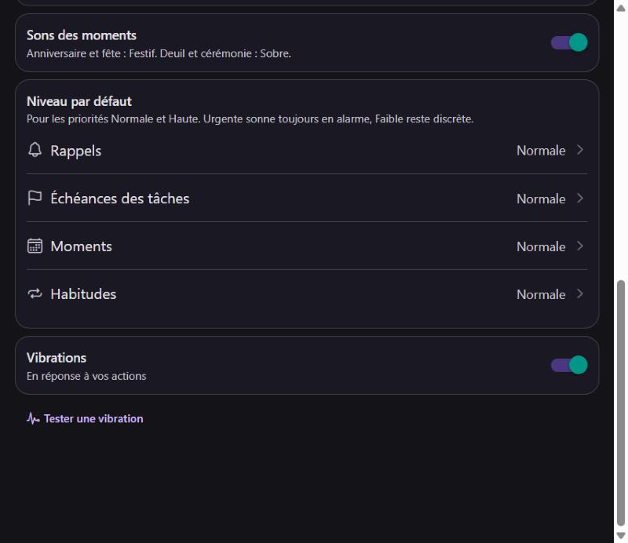
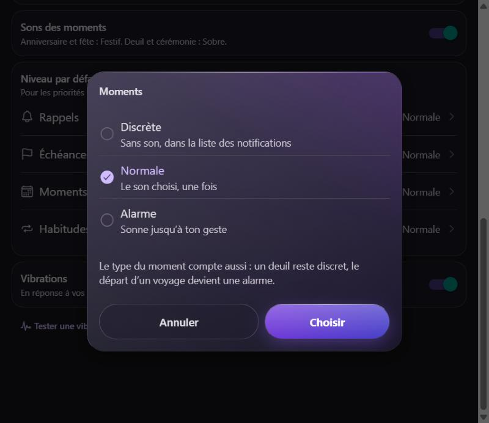

# FICHE OPÉRATOIRE N° 038 — « Niveau par défaut » : quatre lignes au lieu de douze pastilles

Projet : **Junix Pulse** · Date : 27 novembre 2026 · Suite de : [FICHE 037](FICHE-037-sonneries-et-musiques.md)

---

## 1. Objectif

Ta capture des Paramètres : « Niveau par défaut » montrait **4 familles × 3 pastilles**, et sa phrase parlait de « Auto », qui n'existe plus depuis la fiche 032. « Trop d'analyse » : maquette proposée, validée (« Oui, on valide »).

| Avant | Après |
|---|---|
| douze pastilles à lire | **quatre lignes** avec leur niveau et › (comme les Sons, fiche 032) |
| « Pour tout ce qui sonne en « Auto » » | « Pour les priorités Normale et Haute. Urgente sonne toujours en alarme, Faible reste discrète. » |
| le sens des niveaux à deviner | une **fenêtre en verre** : Discrète (sans son), Normale (le son choisi, une fois), Alarme (sonne jusqu'à ton geste) |



*Figure 38-1 — Capture réelle (web, thème sombre) : les quatre lignes.*



*Figure 38-2 — Capture réelle : la fenêtre des Moments, avec la note sur le type du moment.*

## 2. État de départ

| À vérifier | Comment | Résultat attendu |
|---|---|---|
| La fiche 037 est appliquée | `git status` | ses fichiers modifiés (ou enregistrés) |
| Tout passe | `npx jest` | `Tests: 2154 passed` |

## 3. Matériel

Rien de nouveau.

## 4. Hypothèses

- Rien ne change dans ce qui est enregistré : le même réglage, la même colonne (fiche 023).

## 5. Carte de l'intervention

| Fichier | Action |
|---|---|
| `src/components/settings/AlertDefaultsSetting.tsx` | les quatre lignes et la fenêtre |
| `src/i18n/messages-rest-fr.ts`, `messages-rest-en.ts` | la phrase, ce que fait chaque niveau, la note des Moments |

## 6. Sauvegarde

`git status` propre (hors `docs/motion/`), ou la fiche 037 seule en cours. Aucune donnée touchée.

## 7. Pas à pas

D'abord la fiche 037, puis : `node docs/fiches/outils/appliquer-fiche-038.js .`

### Étape 1 — Quatre lignes et une fenêtre en verre

**Pourquoi** : Le composant garde ce qu'il fait (un niveau par famille, enregistré par l'écran des Paramètres) et change de dessin : quatre lignes (Rappels, Échéances des tâches, Moments, Habitudes) avec leur icône et leur niveau (Alarme en rouge) ; toucher une ligne ouvre une fenêtre en verre (`GlassDialog`, fiche 030) avec les trois niveaux, un rond à cocher et ce que fait chacun ; pour les Moments, une note rappelle le type du moment. « Choisir » enregistre ; toucher à côté ne change rien.

Repère (Ctrl+F) : la première ligne de chaque bloc « Chercher ». Le script `appliquer-fiche-038.js` fait tous ces changements d'un coup, et refuse d'écrire si un bloc ne se trouve pas exactement une fois.

#### `src/components/settings/AlertDefaultsSetting.tsx`


Changement 1 sur 2. Chercher :

<!-- bloc: alertdefaultssetting-1-avant -->

```tsx
/**
 * The default level of each family in the settings (study 001, 12.8; sheet 023): reminders,
 * deadlines, moments and habits, each Discrète · Normale · Alarme. What is chosen on an item
 * comes first; the type of a moment, the urgency and the night move these defaults.
 */
import React from 'react';
import { View } from 'react-native';

import { ChoiceChips, FieldLabel, type Choice } from '@/components/create/form/FormBricks';
import { Spacing } from '@/constants/theme';
import type { AlertLevel } from '@/domain/entities';
import { ALERT_FAMILIES, type AlertDefaults, type AlertFamily } from '@/domain/rules/notification-level-rules';
import { useTheme } from '@/hooks/use-theme';
import { useT, type MessageKey } from '@/i18n';

const FAMILY_LABELS: Readonly<Record<AlertFamily, MessageKey>> = {
  reminder: 'alertDefaults.reminder',
  deadline: 'alertDefaults.deadline',
  moment: 'alertDefaults.moment',
  habit: 'alertDefaults.habit',
};

export function AlertDefaultsSetting({
  value,
  onChange,
```

Remplacer par :

<!-- bloc: alertdefaultssetting-1-apres -->

```tsx
/**
 * The default level of each family in the settings (study 001, 12.8; sheets 023 and 038): reminders,
 * deadlines, moments and habits. Since sheet 032 the priority decides (Urgente is an alarm, Faible is
 * discreet): this level is the one of Normale and Haute, and of the habits, which have no priority.
 *
 * Sheet 038, after your look at the screen: four rows with their level instead of twelve chips, as
 * the sounds (sheet 032); a touch opens a glass window with the three levels and what each one does.
 */
import React, { useState } from 'react';
import { StyleSheet, Text, TouchableOpacity, View } from 'react-native';
import { Ionicons } from '@expo/vector-icons';

import { GlassDialog } from '@/components/feedback/GlassDialog';
import { Button } from '@/components/ui/Button';
import type { ThemePalette } from '@/constants/palettes';
import { Spacing, Typography } from '@/constants/theme';
import type { AlertLevel } from '@/domain/entities';
import { ALERT_FAMILIES, type AlertDefaults, type AlertFamily } from '@/domain/rules/notification-level-rules';
import { useTheme } from '@/hooks/use-theme';
import { useThemedStyles } from '@/hooks/use-themed-styles';
import { useT, type MessageKey } from '@/i18n';

type IconName = keyof typeof Ionicons.glyphMap;

const FAMILIES: Readonly<Record<AlertFamily, { labelKey: MessageKey; icon: IconName }>> = {
  reminder: { labelKey: 'alertDefaults.reminder', icon: 'notifications-outline' },
  deadline: { labelKey: 'alertDefaults.deadline', icon: 'flag-outline' },
  moment: { labelKey: 'alertDefaults.moment', icon: 'calendar-outline' },
  habit: { labelKey: 'alertDefaults.habit', icon: 'repeat-outline' },
};

const LEVELS: readonly { value: AlertLevel; labelKey: MessageKey; hintKey: MessageKey }[] = [
  { value: 'discreet', labelKey: 'alertLevel.discreet', hintKey: 'alertDefaults.discreetHint' },
  { value: 'normal', labelKey: 'alertLevel.normal', hintKey: 'alertDefaults.normalHint' },
  { value: 'alarm', labelKey: 'alertLevel.alarm', hintKey: 'alertDefaults.alarmHint' },
];

export function AlertDefaultsSetting({
  value,
  onChange,
```

Changement 2 sur 2. Chercher :

<!-- bloc: alertdefaultssetting-2-avant -->

```tsx
}) {
  const t = useT();
  const { palette } = useTheme();
  const options: Choice<AlertLevel>[] = [
    { value: 'discreet', label: t('alertLevel.discreet'), icon: 'notifications-off-outline' },
    { value: 'normal', label: t('alertLevel.normal'), icon: 'notifications-outline' },
    { value: 'alarm', label: t('alertLevel.alarm'), icon: 'alarm-outline' },
  ];
  return (
    <View style={{ gap: Spacing.sm }}>
      {ALERT_FAMILIES.map(family => (
        <View key={family}>
          <FieldLabel label={t(FAMILY_LABELS[family])} />
          <ChoiceChips
            options={options}
            value={value[family]}
            onChange={level => onChange(family, level)}
            accent={palette.primary.default}
            testIDPrefix={`alert-default-${family}`}
          />
        </View>
      ))}
    </View>
  );
}
```

Remplacer par :

<!-- bloc: alertdefaultssetting-2-apres -->

```tsx
}) {
  const t = useT();
  const { palette } = useTheme();
  const styles = useThemedStyles(makeStyles);
  const [picking, setPicking] = useState<AlertFamily | null>(null);
  const [ticked, setTicked] = useState<AlertLevel>('normal');
  const levelName = (level: AlertLevel) => t(`alertLevel.${level}`);

  const open = (family: AlertFamily) => {
    setTicked(value[family]);
    setPicking(family);
  };
  const choose = () => {
    if (picking && ticked !== value[picking]) onChange(picking, ticked);
    setPicking(null);
  };

  return (
    <View>
      {ALERT_FAMILIES.map((family, index) => {
        const alarm = value[family] === 'alarm';
        return (
          <TouchableOpacity
            key={family}
            style={[styles.row, index > 0 && styles.line]}
            onPress={() => open(family)}
            accessibilityRole="button"
            accessibilityLabel={`${t(FAMILIES[family].labelKey)}, ${levelName(value[family])}`}
            testID={`alert-default-row-${family}`}
          >
            <Ionicons name={FAMILIES[family].icon} size={18} color={palette.onSurface.variant} />
            <Text style={styles.label}>{t(FAMILIES[family].labelKey)}</Text>
            <Text style={[styles.value, alarm && { color: palette.error.default }]}>{levelName(value[family])}</Text>
            <Ionicons name="chevron-forward" size={16} color={palette.onSurface.disabled} />
          </TouchableOpacity>
        );
      })}

      <GlassDialog visible={picking !== null} onDismiss={() => setPicking(null)} testID="alert-default-picker">
        {picking ? (
          <>
            <Text style={styles.title}>{t(FAMILIES[picking].labelKey)}</Text>
            <View style={styles.list} accessibilityRole="radiogroup">
              {LEVELS.map((level, index) => {
                const on = level.value === ticked;
                return (
                  <TouchableOpacity
                    key={level.value}
                    style={[styles.choice, index > 0 && styles.line]}
                    onPress={() => setTicked(level.value)}
                    accessibilityRole="radio"
                    accessibilityState={{ selected: on }}
                    testID={`alert-default-choice-${level.value}`}
                  >
                    <Ionicons
                      name={on ? 'checkmark-circle' : 'ellipse-outline'}
                      size={22}
                      color={on ? palette.primary.default : palette.onSurface.disabled}
                    />
                    <View style={{ flex: 1 }}>
                      <Text style={[styles.choiceLabel, on && { color: palette.primary.default }]}>{t(level.labelKey)}</Text>
                      <Text style={styles.choiceHint}>{t(level.hintKey)}</Text>
                    </View>
                  </TouchableOpacity>
                );
              })}
            </View>
            {/* The type of a moment still moves its level (sheet 023) */}
            {picking === 'moment' ? <Text style={styles.note}>{t('alertDefaults.momentNote')}</Text> : null}
            <View style={styles.actions}>
              <Button label={t('common.cancel')} onPress={() => setPicking(null)} variant="secondary" style={styles.action} />
              <Button label={t('soundSettings.choose')} onPress={choose} style={styles.action} testID="alert-default-choose" />
            </View>
          </>
        ) : null}
      </GlassDialog>
    </View>
  );
}

function makeStyles(theme: ThemePalette) {
  return StyleSheet.create({
    row: { flexDirection: 'row', alignItems: 'center', gap: Spacing.sm, minHeight: 52, paddingVertical: Spacing.sm },
    line: { borderTopWidth: StyleSheet.hairlineWidth, borderTopColor: theme.outline.variant },
    label: { ...Typography.bodyLarge, flex: 1, color: theme.onSurface.primary },
    value: { ...Typography.bodyMedium, color: theme.onSurface.variant },
    title: { ...Typography.titleMedium, color: theme.onSurface.primary, marginBottom: Spacing.sm },
    list: { marginBottom: Spacing.md },
    choice: { flexDirection: 'row', alignItems: 'center', gap: Spacing.sm, minHeight: 60, paddingVertical: Spacing.xs },
    choiceLabel: { ...Typography.bodyLarge, color: theme.onSurface.primary },
    choiceHint: { ...Typography.bodyMedium, color: theme.onSurface.variant },
    note: { ...Typography.bodyMedium, color: theme.onSurface.variant, marginBottom: Spacing.md },
    actions: { flexDirection: 'row', gap: Spacing.sm },
    action: { flex: 1 },
  });
}
```


### Étape 2 — Les mots : ce que fait chaque niveau, et pour quoi il compte

**Pourquoi** : La phrase d'avant parlait de « Auto », qui n'existe plus dans les formulaires depuis la fiche 032. Elle dit maintenant à quoi sert ce réglage : les priorités Normale et Haute (Urgente sonne toujours en alarme, Faible reste discrète), et les habitudes, qui n'ont pas de priorité.

Repère (Ctrl+F) : la première ligne de chaque bloc « Chercher ». Le script `appliquer-fiche-038.js` fait tous ces changements d'un coup, et refuse d'écrire si un bloc ne se trouve pas exactement une fois.

#### `src/i18n/messages-rest-fr.ts`


Changement 1 sur 1. Chercher :

<!-- bloc: messages-rest-fr-1-avant -->

```ts
  'alertLevel.normal': "Normale",
  'alertLevel.alarm': "Alarme",
  'alertDefaults.title': "Niveau par défaut",
  'alertDefaults.hint': "Pour tout ce qui sonne en « Auto ». Un deuil reste discret, le départ d'un voyage devient une alarme.",
  'alertDefaults.reminder': "Rappels",
  'alertDefaults.deadline': "Échéances des tâches",
  'alertDefaults.moment': "Moments",
```

Remplacer par :

<!-- bloc: messages-rest-fr-1-apres -->

```ts
  'alertLevel.normal': "Normale",
  'alertLevel.alarm': "Alarme",
  'alertDefaults.title': "Niveau par défaut",
  'alertDefaults.hint': "Pour les priorités Normale et Haute. Urgente sonne toujours en alarme, Faible reste discrète.",
  'alertDefaults.discreetHint': "Sans son, dans la liste des notifications",
  'alertDefaults.normalHint': "Le son choisi, une fois",
  'alertDefaults.alarmHint': "Sonne jusqu’à ton geste",
  'alertDefaults.momentNote': "Le type du moment compte aussi : un deuil reste discret, le départ d’un voyage devient une alarme.",
  'alertDefaults.reminder': "Rappels",
  'alertDefaults.deadline': "Échéances des tâches",
  'alertDefaults.moment': "Moments",
```

#### `src/i18n/messages-rest-en.ts`


Changement 1 sur 1. Chercher :

<!-- bloc: messages-rest-en-1-avant -->

```ts
  'alertLevel.normal': "Normal",
  'alertLevel.alarm': "Alarm",
  'alertDefaults.title': "Default level",
  'alertDefaults.hint': "For everything that rings on \"Auto\". A mourning stays discreet, leaving for a journey becomes an alarm.",
  'alertDefaults.reminder': "Reminders",
  'alertDefaults.deadline': "Task deadlines",
  'alertDefaults.moment': "Moments",
```

Remplacer par :

<!-- bloc: messages-rest-en-1-apres -->

```ts
  'alertLevel.normal': "Normal",
  'alertLevel.alarm': "Alarm",
  'alertDefaults.title': "Default level",
  'alertDefaults.hint': "For the Normal and High priorities. Urgent always rings as an alarm, Low stays quiet.",
  'alertDefaults.discreetHint': "No sound, in the list of notifications",
  'alertDefaults.normalHint': "The chosen sound, once",
  'alertDefaults.alarmHint': "Rings until you act",
  'alertDefaults.momentNote': "The type of the moment counts too: a mourning stays quiet, leaving for a journey becomes an alarm.",
  'alertDefaults.reminder': "Reminders",
  'alertDefaults.deadline': "Task deadlines",
  'alertDefaults.moment': "Moments",
```


## 8. Test final

| Contrôle | Résultat attendu |
|---|---|
| `npx jest` | tout passe |
| Paramètres → Notifications et vibrations → Niveau par défaut | quatre lignes, chacune avec son niveau |
| Toucher « Moments » | la fenêtre : Discrète, Normale, Alarme, avec ce que fait chacun, et la note sur le type du moment |
| Cocher Alarme, « Choisir » | « Niveau enregistré » ; la ligne dit « Alarme » en rouge |
| Toucher à côté | rien ne change |

## 9. Dépannage

| Symptôme | Cause | Remède |
|---|---|---|
| Les blocs ne se trouvent pas | la fiche 037 n'est pas appliquée | appliquer d'abord la fiche 037 |

## 10. Retour en arrière

`git checkout -- src/components/settings/AlertDefaultsSetting.tsx src/i18n/messages-rest-fr.ts src/i18n/messages-rest-en.ts` (en gardant la fiche 037).

## 11. Lexique

| Mot | En une phrase |
|---|---|
| Niveau par défaut | le niveau d'une famille pour les priorités Normale et Haute, et pour les habitudes |

## 12. Et après

1. Commit des fiches 037 et 038, APK, essai sur le téléphone.
2. Feuille de route : **n° 10**, un compte facultatif et la synchronisation.

## Compte rendu d'exécution (27 novembre 2026)

- Fait après ta capture (« trop d'analyse »), sur maquette validée.
- Appliquée à partir des blocs de cette fiche (`appliquer-fiche-038.js`), après la fiche 037, sur une copie propre du code enregistré : `src` identique.
- Tests : `Test Suites: 106 passed`, `Tests: 2154 passed` ; `tsc` et `eslint` sans erreur.
- **Vérifié sur le web** (thème sombre) : les quatre lignes ; la fenêtre des Moments avec sa note ; Moments passé en Alarme (« Niveau enregistré », la ligne dit « Alarme »), puis remis en Normale.
- **Pas vérifié** : sur le téléphone. Rien n'est encore enregistré dans git.
