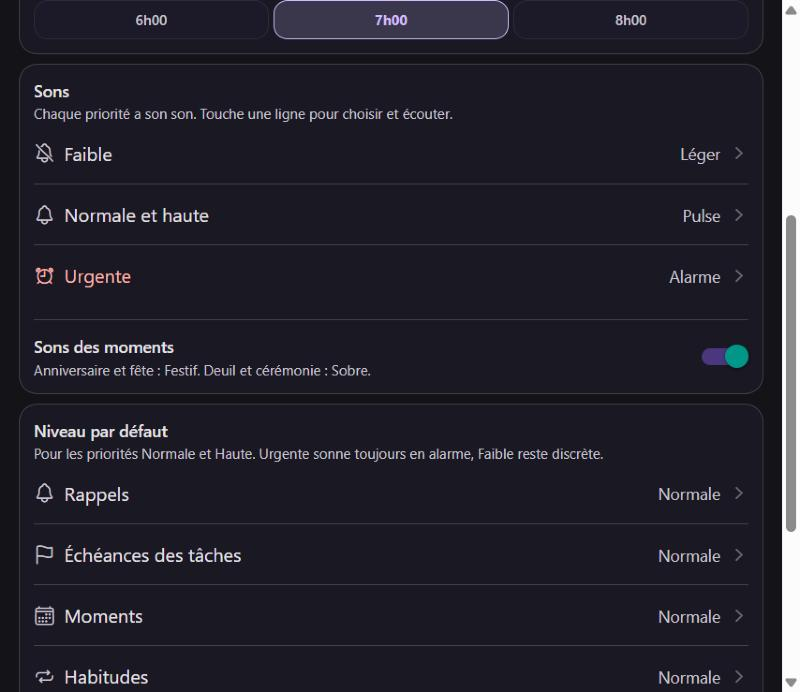

# FICHE OPÉRATOIRE N° 039 — Une musique pour chaque priorité, et « Terminer » sur l'alarme

Projet : **Junix Pulse** · Date : 27 novembre 2026 · Suite de : [FICHE 038](FICHE-038-niveau-par-defaut.md) · Étude : [ÉTUDE 001](../etudes/ETUDE-001-clarifier-et-faire-evoluer.md), 16.10

---

## 1. Objectif

Tes retours après l'essai de l'APK des fiches 037 et 038 (« tout fonctionne à merveille ») :

| Ton retour | Ce que fait cette fiche |
|---|---|
| « Une sonnerie du téléphone » : ce n'étaient pas les sons que tu voulais | retirée ; reste **« Une musique… »** |
| pouvoir enlever le son choisi | **Retirer** (la corbeille) : le son de Junix revient |
| des musiques aussi pour Normale et Faible | **une musique pour chaque priorité** |
| un long titre écrasait « Urgente » lettre par lettre | le nom de la priorité garde sa largeur ; le titre est coupé |
| sur l'alarme, pouvoir terminer l'action, pas seulement arrêter | **Terminer** sur la page et dans la notification : la chose est terminée (rappel, tâche, habitude) |
| l'ordre des réglages de « Notifications et vibrations » : faut-il ranger les grands cadres ensemble et les interrupteurs ensemble ? | non : un bon écran de réglages range **par sujet** (un bloc par sujet, son interrupteur en tête, ses réglages dessous), pas par sorte de commande. L'écran le fait déjà ; une seule chose n'était pas à sa place : « Sons des moments » rejoint le bloc **Sons** |



*Figure 39-1 — Capture réelle (web, thème sombre) : le bloc Sons avec « Sons des moments », « Urgente » sur une ligne.*

**À savoir, pour Faible et Normale** : ces notifications passent par les canaux d'Android ; chaque musique a son canal, créé par notre module. Si Android ne pouvait pas lire la musique, il jouerait son son par défaut, jamais le silence. L'alarme, elle, garde son filet : le son de Junix.

## 2. État de départ

| À vérifier | Comment | Résultat attendu |
|---|---|---|
| Les fiches 037 et 038 sont enregistrées | `git log --oneline -1` | `feat(sounds): phone ringtones and music for alarms…` |
| Tout passe | `npx jest` | `Tests: 2154 passed` |

## 3. Matériel

Rien à installer.

## 4. Hypothèses

- Une musique choisie avant (fiche 037, pour Urgente) est gardée : elle se relit telle quelle.
- Une sonnerie d'Android choisie avant (fiche 037) continue de sonner pour Urgente ; on ne peut simplement plus en choisir de nouvelle.
- « Terminer » ouvre Junix (le temps de terminer la chose) puis revient à l'accueil.

## 5. Carte de l'intervention

| Fichier | Action |
|---|---|
| `sound-rules.ts` (+ test) | une musique par priorité ; le canal et la marque de chaque musique |
| `…/junixalarm/DeviceSounds.kt`, `JunixAlarmModule.kt` | sans sonneries d'Android ; les canaux des musiques |
| `…/junixalarm/AlarmStore.kt`, `AlarmActivity.kt`, `AlarmService.kt`, `modules/junix-alarm/index.ts` | « Terminer » |
| `services/alarm-bridge.ts`, `notification-service.ts`, les trois synchronisations (+ test), `app/_layout.tsx` | la musique dans le bon canal, et entendue appli ouverte |
| `alarm-handover-rules.ts` (+ test), `services/alarm-done-service.ts` (+ test), `app/alarm-done.tsx` | le lien et la page qui terminent la chose |
| `SoundSetting.tsx`, `app/settings/index.tsx`, `PriorityField.tsx`, i18n | la fenêtre, Retirer, le bloc Sons |

## 6. Sauvegarde

`git status` propre (hors `docs/motion/`). Aucune migration.

## 7. Pas à pas

Le plus simple : `node docs/fiches/outils/appliquer-fiche-039.js .` fait toutes les étapes ci-dessous ; puis l'APK (fiche 003).

### Étape 1 — La règle : une musique du téléphone pour chaque priorité

**Pourquoi** : Les réglages gardent une musique par niveau (`devices`) au lieu d'une seule pour l'alarme. Le texte de la fiche 037 se relit toujours (`device=` reste la clé de l'alarme). `deviceSoundFor` donne la musique d'un niveau, sauf quand un moment garde le son de son ton (Festif, Sobre). Un canal d'Android par musique et par niveau (`phoneChannelId`), puisqu'un canal ne change plus de son ; une marque courte (`phoneSoundKey`) gardée dans la notification fait replanifier quand la musique change.

Repère (Ctrl+F) : la première ligne de chaque bloc « Chercher ». Le script `appliquer-fiche-039.js` fait tous ces changements d'un coup, et refuse d'écrire si un bloc ne se trouve pas exactement une fois.

#### `src/domain/rules/sound-rules.ts`


Changement 1 sur 5. Chercher :

<!-- bloc: sound-rules-1-avant -->

```ts
  alarm: ['alarm', 'wake', 'dawn', 'march'],
};

/** A sound of the phone for the alarms (study 16.10; sheet 037): a ringtone of Android, or a music. */
export interface DeviceSound {
  kind: 'ringtone' | 'music';
  /** Its address on the phone (content://…). */
```

Remplacer par :

<!-- bloc: sound-rules-1-apres -->

```ts
  alarm: ['alarm', 'wake', 'dawn', 'march'],
};

/** A sound of the phone (study 16.10; sheets 037 and 039): a music of the phone (a ringtone, before 039). */
export interface DeviceSound {
  kind: 'ringtone' | 'music';
  /** Its address on the phone (content://…). */
```

Changement 2 sur 5. Chercher :

<!-- bloc: sound-rules-2-avant -->

```ts
  alarm: SoundChoice;
  /** A festive or sober moment keeps the sound of its tone. */
  momentTones: boolean;
  /** The sound of the phone the alarms ring with, rather than `alarm` (sheet 037). */
  alarmDevice?: DeviceSound;
}

export const DEFAULT_SOUND_PREFS: Readonly<SoundPrefs> = { discreet: 'soft', normal: 'pulse', alarm: 'alarm', momentTones: true };

/**
```

Remplacer par :

<!-- bloc: sound-rules-2-apres -->

```ts
  alarm: SoundChoice;
  /** A festive or sober moment keeps the sound of its tone. */
  momentTones: boolean;
  /**
   * The sound of the phone of each priority, rather than the sound of Junix (sheets 037 and 039);
   * the sound of Junix of the level stays its safety net.
   */
  devices?: Partial<Record<NotificationLevel, DeviceSound>>;
}

/** The key of each level in the text of the settings: "device" stays the one of the alarms (sheet 037). */
const DEVICE_KEYS: Readonly<Record<NotificationLevel, string>> = {
  alarm: 'device',
  normal: 'device.normal',
  discreet: 'device.discreet',
};

export const DEFAULT_SOUND_PREFS: Readonly<SoundPrefs> = { discreet: 'soft', normal: 'pulse', alarm: 'alarm', momentTones: true };

/**
```

Changement 3 sur 5. Chercher :

<!-- bloc: sound-rules-3-avant -->

```ts
  for (const pair of (text ?? '').split(';')) {
    const [key, value] = pair.split('=').map(part => part.trim());
    if (key === 'tones') prefs.momentTones = value !== '0';
    else if (key === 'device') {
      const device = deviceSoundOf(value);
      if (device) prefs.alarmDevice = device;
    }
    else if (key === 'discreet' || key === 'normal' || key === 'alarm') {
      if ((SOUND_CHOICES[key] as readonly string[]).includes(value)) prefs[key] = value as SoundChoice;
```

Remplacer par :

<!-- bloc: sound-rules-3-apres -->

```ts
  for (const pair of (text ?? '').split(';')) {
    const [key, value] = pair.split('=').map(part => part.trim());
    if (key === 'tones') prefs.momentTones = value !== '0';
    else if (key.startsWith('device')) {
      const level = (Object.keys(DEVICE_KEYS) as NotificationLevel[]).find(each => DEVICE_KEYS[each] === key);
      const device = deviceSoundOf(value);
      if (level && device) prefs.devices = { ...prefs.devices, [level]: device };
    }
    else if (key === 'discreet' || key === 'normal' || key === 'alarm') {
      if ((SOUND_CHOICES[key] as readonly string[]).includes(value)) prefs[key] = value as SoundChoice;
```

Changement 4 sur 5. Chercher :

<!-- bloc: sound-rules-4-avant -->

```ts
}

export function soundPrefsText(prefs: SoundPrefs): string {
  const device = prefs.alarmDevice
    ? `;device=${prefs.alarmDevice.kind}|${encodeURIComponent(prefs.alarmDevice.uri)}|${encodeURIComponent(prefs.alarmDevice.name)}`
    : '';
  return `discreet=${prefs.discreet};normal=${prefs.normal};alarm=${prefs.alarm};tones=${prefs.momentTones ? 1 : 0}${device}`;
}

/** "ringtone|content%3A…|Argon": a sound of the phone kept in the settings; anything else, none. */
```

Remplacer par :

<!-- bloc: sound-rules-4-apres -->

```ts
}

export function soundPrefsText(prefs: SoundPrefs): string {
  const devices = (['alarm', 'normal', 'discreet'] as const)
    .map(level => {
      const device = prefs.devices?.[level];
      return device ? `;${DEVICE_KEYS[level]}=${device.kind}|${encodeURIComponent(device.uri)}|${encodeURIComponent(device.name)}` : '';
    })
    .join('');
  return `discreet=${prefs.discreet};normal=${prefs.normal};alarm=${prefs.alarm};tones=${prefs.momentTones ? 1 : 0}${devices}`;
}

/** "ringtone|content%3A…|Argon": a sound of the phone kept in the settings; anything else, none. */
```

Changement 5 sur 5. Chercher :

<!-- bloc: sound-rules-5-avant -->

```ts
}

/**
 * The sound of the phone a notification rings with (sheet 037): only an alarm, with the sound on;
 * otherwise none, and the sound of Junix rings.
 */
export function deviceSoundFor({
  level,
  prefs = DEFAULT_SOUND_PREFS,
  soundOn = true,
}: {
  level: NotificationLevel;
  prefs?: SoundPrefs;
  soundOn?: boolean;
}): DeviceSound | undefined {
  return level === 'alarm' && soundOn ? prefs.alarmDevice : undefined;
}

/** The sound of one notification: its level, the tone of its moment if any, the settings. */
```

Remplacer par :

<!-- bloc: sound-rules-5-apres -->

```ts
}

/**
 * The sound of the phone a notification rings with (sheets 037 and 039): the one of its level, with
 * the sound on. A moment that keeps the sound of its tone (Festif, Sobre) keeps it; an alarm always
 * takes its own. Otherwise none, and the sound of Junix rings.
 */
export function deviceSoundFor({
  level,
  tone,
  prefs = DEFAULT_SOUND_PREFS,
  soundOn = true,
}: {
  level: NotificationLevel;
  tone?: MomentTone;
  prefs?: SoundPrefs;
  soundOn?: boolean;
}): DeviceSound | undefined {
  if (!soundOn) return undefined;
  if (level !== 'alarm' && prefs.momentTones && (tone === 'sober' || (level === 'normal' && tone === 'festive'))) return undefined;
  return prefs.devices?.[level];
}

/** A short fixed mark of an address, for the names of the channels and the data of a notification. */
function markOf(uri: string): string {
  let hash = 5381;
  for (let i = 0; i < uri.length; i++) hash = ((hash << 5) + hash + uri.charCodeAt(i)) >>> 0;
  return hash.toString(36);
}

/** What a notification keeps of its sound of the phone: a new music plans it again (sheet 039). */
export function phoneSoundKey(device: DeviceSound): string {
  return `phone-${markOf(device.uri)}`;
}

/**
 * The channel of Android that rings a sound of the phone at a level (sheet 039): its sound is fixed
 * when it is made, so each music has its own; Haute insists on its own one, as the sounds of Junix.
 */
export function phoneChannelId(level: NotificationLevel, device: DeviceSound, insists = false): string {
  return `junix-pulse-phone-${level}${insists && level === 'normal' ? '-insist' : ''}-${markOf(device.uri)}-v1`;
}

/** The sound of one notification: its level, the tone of its moment if any, the settings. */
```

#### `src/domain/rules/__tests__/sound-rules.test.ts`


Changement 1 sur 2. Chercher :

<!-- bloc: sound-rules-test-1-avant -->

```ts
import {
  DEFAULT_SOUND_PREFS,
  deviceSoundFor,
  SOUNDS,
  SOUND_CHOICES,
  soundChannelId,
```

Remplacer par :

<!-- bloc: sound-rules-test-1-apres -->

```ts
import {
  DEFAULT_SOUND_PREFS,
  deviceSoundFor,
  phoneChannelId,
  phoneSoundKey,
  SOUNDS,
  SOUND_CHOICES,
  soundChannelId,
```

Changement 2 sur 2. Chercher :

<!-- bloc: sound-rules-test-2-avant -->

```ts
    const prefs = {
      ...DEFAULT_SOUND_PREFS,
      alarm: 'wake' as const,
      alarmDevice: { kind: 'music' as const, uri: 'content://media/audio/42', name: 'Mon titre; 2|bis' },
    };
    // Written and read back, even with ";" and "|" in the name
    expect(soundPrefsOf(soundPrefsText(prefs))).toEqual(prefs);
    // An address that is not a content of the phone, or an unknown kind: ignored
    expect(soundPrefsOf('device=music|file%3A%2F%2Fx|a').alarmDevice).toBeUndefined();
    expect(soundPrefsOf('device=video|content%3A%2F%2Fx|a').alarmDevice).toBeUndefined();
    // Only an alarm rings with it, and only with the sound on
    expect(deviceSoundFor({ level: 'alarm', prefs })?.name).toBe('Mon titre; 2|bis');
    expect(deviceSoundFor({ level: 'normal', prefs })).toBeUndefined();
    expect(deviceSoundFor({ level: 'alarm', prefs, soundOn: false })).toBeUndefined();
    // The sound of Junix stays the one of the ordinary notification of an alarm
    expect(soundFor({ level: 'alarm', prefs })).toBe('wake');
  });
});
```

Remplacer par :

<!-- bloc: sound-rules-test-2-apres -->

```ts
    const prefs = {
      ...DEFAULT_SOUND_PREFS,
      alarm: 'wake' as const,
      devices: { alarm: { kind: 'music' as const, uri: 'content://media/audio/42', name: 'Mon titre; 2|bis' } },
    };
    // Written and read back, even with ";" and "|" in the name
    expect(soundPrefsOf(soundPrefsText(prefs))).toEqual(prefs);
    // An address that is not a content of the phone, or an unknown kind: ignored
    expect(soundPrefsOf('device=music|file%3A%2F%2Fx|a').devices?.alarm).toBeUndefined();
    expect(soundPrefsOf('device=video|content%3A%2F%2Fx|a').devices?.alarm).toBeUndefined();
    // Only an alarm rings with it, and only with the sound on
    expect(deviceSoundFor({ level: 'alarm', prefs })?.name).toBe('Mon titre; 2|bis');
    expect(deviceSoundFor({ level: 'normal', prefs })).toBeUndefined(); // no music for Normale here
    expect(deviceSoundFor({ level: 'alarm', prefs, soundOn: false })).toBeUndefined();
    // The sound of Junix stays the one of the ordinary notification of an alarm
    expect(soundFor({ level: 'alarm', prefs })).toBe('wake');
  });

  it('gives a music of the phone to each priority, the tones of the moments first (sheet 039)', () => {
    const song = { kind: 'music' as const, uri: 'content://media/audio/7', name: 'Chanson' };
    const prefs = { ...DEFAULT_SOUND_PREFS, devices: { normal: song, discreet: song } };
    // The alarm text of sheet 037 still reads ("device" is the alarm)
    expect(soundPrefsOf('device=music|content%3A%2F%2Fa|A').devices?.alarm?.name).toBe('A');
    expect(soundPrefsOf(soundPrefsText(prefs))).toEqual(prefs);
    expect(deviceSoundFor({ level: 'normal', prefs })).toEqual(song);
    expect(deviceSoundFor({ level: 'discreet', prefs })).toEqual(song);
    // A birthday keeps Festif, a mourning keeps Sobre
    expect(deviceSoundFor({ level: 'normal', tone: 'festive', prefs })).toBeUndefined();
    expect(deviceSoundFor({ level: 'discreet', tone: 'sober', prefs })).toBeUndefined();
    expect(deviceSoundFor({ level: 'normal', tone: 'festive', prefs: { ...prefs, momentTones: false } })).toEqual(song);
    // One channel for each music and level, Haute on its own; a fixed key in the notification
    expect(phoneChannelId('normal', song)).toMatch(/^junix-pulse-phone-normal-[a-z0-9]+-v1$/);
    expect(phoneChannelId('normal', song, true)).toMatch(/^junix-pulse-phone-normal-insist-/);
    expect(phoneChannelId('discreet', song, true)).not.toContain('insist');
    expect(phoneChannelId('normal', song)).not.toBe(phoneChannelId('normal', { ...song, uri: 'content://media/audio/8' }));
    expect(phoneSoundKey(song)).toBe(phoneSoundKey({ ...song, name: 'autre nom' }));
  });
});
```


### Étape 2 — Le module : sans les sonneries d'Android, les canaux des musiques, « Terminer »

**Pourquoi** : La liste des sonneries d'Android est retirée (ce n'étaient pas les sons que tu voulais) : il reste « Une musique ». `syncChannels` crée les canaux des musiques choisies pour Faible et Normale (Haute a le sien, avec la vibration longue) et supprime ceux des musiques laissées ; ceux de Junix et des alarmes ne sont jamais touchés. L'alarme reçoit « Terminer » et le lien qui termine la chose : un bouton violet sur la page, un troisième bouton dans la notification.

Repère (Ctrl+F) : la première ligne de chaque bloc « Chercher ». Le script `appliquer-fiche-039.js` fait tous ces changements d'un coup, et refuse d'écrire si un bloc ne se trouve pas exactement une fois.

#### `modules/junix-alarm/android/src/main/java/expo/modules/junixalarm/DeviceSounds.kt`


Changement 1 sur 2. Chercher :

<!-- bloc: mod-devicesounds-1-avant -->

```kotlin
import android.content.Context
import android.media.AudioAttributes
import android.media.MediaPlayer
import android.media.RingtoneManager
import android.net.Uri
import android.os.Handler
import android.os.Looper
import android.provider.OpenableColumns

/**
 * The sounds of the phone for the alarms (study 001, 16.10; sheet 037): their names, and hearing
 * one before choosing it. The choosing itself goes through the pages of Android (the list of the
 * ringtones, the picker of files), opened by the module.
 */
object DeviceSounds {
  private var preview: MediaPlayer? = null
  private val handler = Handler(Looper.getMainLooper())

  /** The name of a ringtone, as Android shows it ("Argon"); empty when unknown. */
  fun ringtoneTitle(context: Context, uri: Uri): String =
    try {
      RingtoneManager.getRingtone(context, uri)?.getTitle(context) ?: ""
    } catch (error: Exception) {
      ""
    }

  /** The name of a file of music ("Mon titre.mp3"), without its extension. */
  fun fileTitle(context: Context, uri: Uri): String {
    val name = try {
```

Remplacer par :

<!-- bloc: mod-devicesounds-1-apres -->

```kotlin
import android.content.Context
import android.media.AudioAttributes
import android.media.MediaPlayer
import android.net.Uri
import android.os.Handler
import android.os.Looper
import android.provider.OpenableColumns

/**
 * The musics of the phone (study 001, 16.10; sheets 037 and 039): their names, hearing one before
 * choosing it, and the channels of Android that ring them for the ordinary notifications. The
 * choosing itself goes through the picker of files of Android, opened by the module.
 */
object DeviceSounds {
  private var preview: MediaPlayer? = null
  private val handler = Handler(Looper.getMainLooper())

  /** The name of a file of music ("Mon titre.mp3"), without its extension. */
  fun fileTitle(context: Context, uri: Uri): String {
    val name = try {
```

Changement 2 sur 2. Chercher :

<!-- bloc: mod-devicesounds-2-avant -->

```kotlin
    }
  }

  fun stopPreview() {
    handler.removeCallbacksAndMessages(null)
    preview?.let {
```

Remplacer par :

<!-- bloc: mod-devicesounds-2-apres -->

```kotlin
    }
  }

  /**
   * The channels of the musics of the phone for the discreet and normal notifications (sheet 039):
   * a channel's sound is fixed when it is made, so each music has its own. The ones not listed are
   * removed; those of Junix and of the alarms are never touched.
   */
  fun syncChannels(context: Context, channels: List<Map<String, Any?>>) {
    if (android.os.Build.VERSION.SDK_INT < android.os.Build.VERSION_CODES.O) return
    val manager = context.getSystemService(Context.NOTIFICATION_SERVICE) as android.app.NotificationManager
    val kept = mutableSetOf<String>()
    for (channel in channels) {
      val id = channel["id"] as? String ?: continue
      val uri = channel["uri"] as? String ?: continue
      if (!id.startsWith(PHONE_CHANNEL_PREFIX)) continue
      val level = channel["level"] as? String ?: "normal"
      val insists = channel["insists"] as? Boolean ?: false
      val made = android.app.NotificationChannel(
        id,
        channel["name"] as? String ?: id,
        if (level == "discreet") android.app.NotificationManager.IMPORTANCE_DEFAULT else android.app.NotificationManager.IMPORTANCE_HIGH
      ).apply {
        description = channel["description"] as? String ?: ""
        setSound(
          Uri.parse(uri),
          AudioAttributes.Builder()
            .setUsage(AudioAttributes.USAGE_NOTIFICATION)
            .setContentType(AudioAttributes.CONTENT_TYPE_SONIFICATION)
            .build()
        )
        enableVibration(level != "discreet")
        vibrationPattern = if (insists) longArrayOf(0, 500, 200, 500, 200, 500, 200, 500) else longArrayOf(0, 250, 250, 250)
        lightColor = 0xFF8B3DF0.toInt()
        setShowBadge(false)
      }
      manager.createNotificationChannel(made)
      kept.add(id)
    }
    for (old in manager.notificationChannels) {
      if (old.id.startsWith(PHONE_CHANNEL_PREFIX) && old.id !in kept) manager.deleteNotificationChannel(old.id)
    }
  }

  private const val PHONE_CHANNEL_PREFIX = "junix-pulse-phone-"

  fun stopPreview() {
    handler.removeCallbacksAndMessages(null)
    preview?.let {
```

#### `modules/junix-alarm/android/src/main/java/expo/modules/junixalarm/JunixAlarmModule.kt`


Changement 1 sur 5. Chercher :

<!-- bloc: mod-junixalarmmodule-1-avant -->

```kotlin
import android.os.Build
import android.provider.Settings
import android.app.Activity
import android.media.RingtoneManager
import expo.modules.kotlin.Promise
import expo.modules.kotlin.exception.Exceptions
import expo.modules.kotlin.modules.Module
```

Remplacer par :

<!-- bloc: mod-junixalarmmodule-1-apres -->

```kotlin
import android.os.Build
import android.provider.Settings
import android.app.Activity
import expo.modules.kotlin.Promise
import expo.modules.kotlin.exception.Exceptions
import expo.modules.kotlin.modules.Module
```

Changement 2 sur 5. Chercher :

<!-- bloc: mod-junixalarmmodule-2-avant -->

```kotlin

  // ─── A sound of the phone (sheet 037): a page of Android answers later ─────────
  private companion object {
    const val PICK_RINGTONE = 4_211
    const val PICK_MUSIC = 4_212
  }

```

Remplacer par :

<!-- bloc: mod-junixalarmmodule-2-apres -->

```kotlin

  // ─── A sound of the phone (sheet 037): a page of Android answers later ─────────
  private companion object {
    const val PICK_MUSIC = 4_212
  }

```

Changement 3 sur 5. Chercher :

<!-- bloc: mod-junixalarmmodule-3-avant -->

```kotlin

  /** The choice made: its address, its name, and whether it is a ringtone or a music. */
  private fun picked(uri: Uri, kind: String): Map<String, String> {
    val name = if (kind == "ringtone") DeviceSounds.ringtoneTitle(context, uri) else DeviceSounds.fileTitle(context, uri)
    return mapOf("uri" to uri.toString(), "name" to name, "kind" to kind)
  }

```

Remplacer par :

<!-- bloc: mod-junixalarmmodule-3-apres -->

```kotlin

  /** The choice made: its address, its name, and whether it is a ringtone or a music. */
  private fun picked(uri: Uri, kind: String): Map<String, String> {
    val name = DeviceSounds.fileTitle(context, uri)
    return mapOf("uri" to uri.toString(), "name" to name, "kind" to kind)
  }

```

Changement 4 sur 5. Chercher :

<!-- bloc: mod-junixalarmmodule-4-avant -->

```kotlin
      }
    }

    /** The list of the ringtones of Android (alarms and ringtones); null when nothing is chosen. */
    AsyncFunction("pickRingtone") { current: String?, promise: Promise ->
      val intent = Intent(RingtoneManager.ACTION_RINGTONE_PICKER)
        .putExtra(RingtoneManager.EXTRA_RINGTONE_TYPE, RingtoneManager.TYPE_ALARM or RingtoneManager.TYPE_RINGTONE)
        .putExtra(RingtoneManager.EXTRA_RINGTONE_SHOW_SILENT, false)
        .putExtra(RingtoneManager.EXTRA_RINGTONE_SHOW_DEFAULT, false)
      if (!current.isNullOrEmpty()) intent.putExtra(RingtoneManager.EXTRA_RINGTONE_EXISTING_URI, Uri.parse(current))
      open(intent, PICK_RINGTONE, promise)
    }

    /**
```

Remplacer par :

<!-- bloc: mod-junixalarmmodule-4-apres -->

```kotlin
      }
    }

    /** The channels of the musics of the phone for the ordinary notifications (sheet 039). */
    Function("syncPhoneChannels") { channels: List<Map<String, Any?>> ->
      DeviceSounds.syncChannels(context, channels)
    }

    /**
```

Changement 5 sur 5. Chercher :

<!-- bloc: mod-junixalarmmodule-5-avant -->

```kotlin

    OnActivityResult { _, payload ->
      val promise = pending ?: return@OnActivityResult
      if (payload.requestCode != PICK_RINGTONE && payload.requestCode != PICK_MUSIC) return@OnActivityResult
      pending = null
      if (payload.resultCode != Activity.RESULT_OK || payload.data == null) {
        promise.resolve(null)
        return@OnActivityResult
      }
      val data = payload.data!!
      if (payload.requestCode == PICK_RINGTONE) {
        @Suppress("DEPRECATION")
        val uri = data.getParcelableExtra<Uri>(RingtoneManager.EXTRA_RINGTONE_PICKED_URI)
        promise.resolve(uri?.let { picked(it, "ringtone") })
      } else {
        val uri = data.data
        if (uri == null) {
          promise.resolve(null)
        } else {
          try {
            context.contentResolver.takePersistableUriPermission(uri, Intent.FLAG_GRANT_READ_URI_PERMISSION)
          } catch (error: Exception) {
            // Some pickers give no lasting right: the alarm will fall back on the sound of Junix
          }
          promise.resolve(picked(uri, "music"))
        }
      }
    }

```

Remplacer par :

<!-- bloc: mod-junixalarmmodule-5-apres -->

```kotlin

    OnActivityResult { _, payload ->
      val promise = pending ?: return@OnActivityResult
      if (payload.requestCode != PICK_MUSIC) return@OnActivityResult
      pending = null
      if (payload.resultCode != Activity.RESULT_OK || payload.data == null) {
        promise.resolve(null)
        return@OnActivityResult
      }
      val uri = payload.data!!.data
      if (uri == null) {
        promise.resolve(null)
      } else {
        try {
          context.contentResolver.takePersistableUriPermission(uri, Intent.FLAG_GRANT_READ_URI_PERMISSION)
        } catch (error: Exception) {
          // Some pickers give no lasting right: the alarm will fall back on the sound of Junix
        }
        promise.resolve(picked(uri, "music"))
      }
    }

```

#### `modules/junix-alarm/android/src/main/java/expo/modules/junixalarm/AlarmStore.kt`


Changement 1 sur 4. Chercher :

<!-- bloc: mod-alarmstore-1-avant -->

```kotlin
  /** "Ouvrir dans Junix", on the page of the alarm (sheet 035). */
  val openLabel: String = "",
  /** A sound of the phone (content://…), rung first; `sound` is the safety net (sheet 037). */
  val soundUri: String = ""
) {
  fun toJson(): JSONObject = JSONObject()
    .put("id", id)
```

Remplacer par :

<!-- bloc: mod-alarmstore-1-apres -->

```kotlin
  /** "Ouvrir dans Junix", on the page of the alarm (sheet 035). */
  val openLabel: String = "",
  /** A sound of the phone (content://…), rung first; `sound` is the safety net (sheet 037). */
  val soundUri: String = "",
  /** "Terminer", and the link that ends the thing in the app; empty: no such button (sheet 039). */
  val doneLabel: String = "",
  val doneUrl: String = ""
) {
  fun toJson(): JSONObject = JSONObject()
    .put("id", id)
```

Changement 2 sur 4. Chercher :

<!-- bloc: mod-alarmstore-2-avant -->

```kotlin
    .put("kindLabel", kindLabel)
    .put("openLabel", openLabel)
    .put("soundUri", soundUri)

  companion object {
    fun fromJson(json: JSONObject): AlarmItem = AlarmItem(
```

Remplacer par :

<!-- bloc: mod-alarmstore-2-apres -->

```kotlin
    .put("kindLabel", kindLabel)
    .put("openLabel", openLabel)
    .put("soundUri", soundUri)
    .put("doneLabel", doneLabel)
    .put("doneUrl", doneUrl)

  companion object {
    fun fromJson(json: JSONObject): AlarmItem = AlarmItem(
```

Changement 3 sur 4. Chercher :

<!-- bloc: mod-alarmstore-3-avant -->

```kotlin
      channelName = json.optString("channelName", "Alarms"),
      kindLabel = json.optString("kindLabel", ""),
      openLabel = json.optString("openLabel", ""),
      soundUri = json.optString("soundUri", "")
    )

    /** From what the app sends (a map of the JS object); null when something essential is missing. */
```

Remplacer par :

<!-- bloc: mod-alarmstore-3-apres -->

```kotlin
      channelName = json.optString("channelName", "Alarms"),
      kindLabel = json.optString("kindLabel", ""),
      openLabel = json.optString("openLabel", ""),
      soundUri = json.optString("soundUri", ""),
      doneLabel = json.optString("doneLabel", ""),
      doneUrl = json.optString("doneUrl", "")
    )

    /** From what the app sends (a map of the JS object); null when something essential is missing. */
```

Changement 4 sur 4. Chercher :

<!-- bloc: mod-alarmstore-4-avant -->

```kotlin
        channelName = map["channelName"] as? String ?: "Alarms",
        kindLabel = map["kindLabel"] as? String ?: "",
        openLabel = map["openLabel"] as? String ?: "",
        soundUri = map["soundUri"] as? String ?: ""
      )
    }
  }
```

Remplacer par :

<!-- bloc: mod-alarmstore-4-apres -->

```kotlin
        channelName = map["channelName"] as? String ?: "Alarms",
        kindLabel = map["kindLabel"] as? String ?: "",
        openLabel = map["openLabel"] as? String ?: "",
        soundUri = map["soundUri"] as? String ?: "",
        doneLabel = map["doneLabel"] as? String ?: "",
        doneUrl = map["doneUrl"] as? String ?: ""
      )
    }
  }
```

#### `modules/junix-alarm/android/src/main/java/expo/modules/junixalarm/AlarmActivity.kt`


Changement 1 sur 3. Chercher :

<!-- bloc: mod-alarmactivity-1-avant -->

```kotlin
    root.addView(View(this), LinearLayout.LayoutParams(0, 0, 1f))
    val stop = button(alarm.stopLabel, ALARM_RED_DEEP, ALARM_RED, Color.WHITE) { send(AlarmService.ACTION_STOP) }
    root.addView(stop, LinearLayout.LayoutParams(LinearLayout.LayoutParams.MATCH_PARENT, LinearLayout.LayoutParams.WRAP_CONTENT))
    val later = button(alarm.snoozeLabel, Color.TRANSPARENT, TEXT_SOFT, TEXT) { send(AlarmService.ACTION_SNOOZE) }
    root.addView(later, LinearLayout.LayoutParams(LinearLayout.LayoutParams.MATCH_PARENT, LinearLayout.LayoutParams.WRAP_CONTENT).apply { topMargin = dp(12) })
    if (alarm.openLabel.isNotEmpty()) {
```

Remplacer par :

<!-- bloc: mod-alarmactivity-1-apres -->

```kotlin
    root.addView(View(this), LinearLayout.LayoutParams(0, 0, 1f))
    val stop = button(alarm.stopLabel, ALARM_RED_DEEP, ALARM_RED, Color.WHITE) { send(AlarmService.ACTION_STOP) }
    root.addView(stop, LinearLayout.LayoutParams(LinearLayout.LayoutParams.MATCH_PARENT, LinearLayout.LayoutParams.WRAP_CONTENT))
    // "Terminer" (sheet 039): the alarm stops and the thing is ended in Junix (a moment has none)
    if (alarm.doneLabel.isNotEmpty() && alarm.doneUrl.isNotEmpty()) {
      val done = button(alarm.doneLabel, VIOLET, VIOLET, NIGHT) { openInJunix(alarm, alarm.doneUrl) }
      root.addView(done, LinearLayout.LayoutParams(LinearLayout.LayoutParams.MATCH_PARENT, LinearLayout.LayoutParams.WRAP_CONTENT).apply { topMargin = dp(12) })
    }
    val later = button(alarm.snoozeLabel, Color.TRANSPARENT, TEXT_SOFT, TEXT) { send(AlarmService.ACTION_SNOOZE) }
    root.addView(later, LinearLayout.LayoutParams(LinearLayout.LayoutParams.MATCH_PARENT, LinearLayout.LayoutParams.WRAP_CONTENT).apply { topMargin = dp(12) })
    if (alarm.openLabel.isNotEmpty()) {
```

Changement 2 sur 3. Chercher :

<!-- bloc: mod-alarmactivity-2-avant -->

```kotlin
        setPadding(0, dp(18), 0, dp(4))
        isClickable = true
        contentDescription = alarm.openLabel
        setOnClickListener { openInJunix(alarm) }
      }
      root.addView(open)
    }
```

Remplacer par :

<!-- bloc: mod-alarmactivity-2-apres -->

```kotlin
        setPadding(0, dp(18), 0, dp(4))
        isClickable = true
        contentDescription = alarm.openLabel
        setOnClickListener { openInJunix(alarm, alarm.url) }
      }
      root.addView(open)
    }
```

Changement 3 sur 3. Chercher :

<!-- bloc: mod-alarmactivity-3-avant -->

```kotlin
    finish()
  }

  /** "Ouvrir dans Junix": the alarm stops, and the thing opens in the app. */
  private fun openInJunix(alarm: AlarmItem) {
    startService(Intent(this, AlarmService::class.java).setAction(AlarmService.ACTION_STOP))
    val open = if (alarm.url.isNotEmpty()) {
      Intent(Intent.ACTION_VIEW, Uri.parse(alarm.url)).setPackage(packageName)
    } else {
      packageManager.getLaunchIntentForPackage(packageName)
    }
```

Remplacer par :

<!-- bloc: mod-alarmactivity-3-apres -->

```kotlin
    finish()
  }

  /** "Ouvrir dans Junix" and "Terminer": the alarm stops, and the link opens in the app. */
  private fun openInJunix(alarm: AlarmItem, link: String) {
    startService(Intent(this, AlarmService::class.java).setAction(AlarmService.ACTION_STOP))
    val open = if (link.isNotEmpty()) {
      Intent(Intent.ACTION_VIEW, Uri.parse(link)).setPackage(packageName)
    } else {
      packageManager.getLaunchIntentForPackage(packageName)
    }
```

#### `modules/junix-alarm/android/src/main/java/expo/modules/junixalarm/AlarmService.kt`


Changement 1 sur 2. Chercher :

<!-- bloc: mod-alarmservice-1-avant -->

```kotlin
  private fun ringingNotification(alarm: AlarmItem): Notification {
    val stop = Notification.Action.Builder(null, alarm.stopLabel, actionIntent(ACTION_STOP, alarm)).build()
    val later = Notification.Action.Builder(null, alarm.snoozeLabel, actionIntent(ACTION_SNOOZE, alarm)).build()
    // Locked screen: the page lights it when Android allows it; otherwise, Android shows the
    // notification itself, at the top, still ringing (the fallback of the study, 10.6)
    return builder(RINGING_CHANNEL)
```

Remplacer par :

<!-- bloc: mod-alarmservice-1-apres -->

```kotlin
  private fun ringingNotification(alarm: AlarmItem): Notification {
    val stop = Notification.Action.Builder(null, alarm.stopLabel, actionIntent(ACTION_STOP, alarm)).build()
    val later = Notification.Action.Builder(null, alarm.snoozeLabel, actionIntent(ACTION_SNOOZE, alarm)).build()
    // "Terminer" (sheet 039): Junix opens on the link that ends the thing, and stops the alarm
    val done = if (alarm.doneLabel.isNotEmpty() && alarm.doneUrl.isNotEmpty()) {
      val open = Intent(Intent.ACTION_VIEW, Uri.parse(alarm.doneUrl)).setPackage(packageName)
        .addFlags(Intent.FLAG_ACTIVITY_NEW_TASK or Intent.FLAG_ACTIVITY_CLEAR_TOP)
      val pending = PendingIntent.getActivity(this, ("done" + alarm.id).hashCode(), open, PendingIntent.FLAG_UPDATE_CURRENT or PendingIntent.FLAG_IMMUTABLE)
      Notification.Action.Builder(null, alarm.doneLabel, pending).build()
    } else null
    // Locked screen: the page lights it when Android allows it; otherwise, Android shows the
    // notification itself, at the top, still ringing (the fallback of the study, 10.6)
    return builder(RINGING_CHANNEL)
```

Changement 2 sur 2. Chercher :

<!-- bloc: mod-alarmservice-2-avant -->

```kotlin
      .setVisibility(Notification.VISIBILITY_PUBLIC)
      .setContentIntent(openIntent(alarm))
      .addAction(stop)
      .addAction(later)
      .build()
  }
```

Remplacer par :

<!-- bloc: mod-alarmservice-2-apres -->

```kotlin
      .setVisibility(Notification.VISIBILITY_PUBLIC)
      .setContentIntent(openIntent(alarm))
      .addAction(stop)
      .apply { if (done != null) addAction(done) }
      .addAction(later)
      .build()
  }
```

#### `modules/junix-alarm/index.ts`


Changement 1 sur 3. Chercher :

<!-- bloc: mod-index-1-avant -->

```ts
  openLabel: string;
  /** A sound of the phone (content://…), rung first; `sound` is the safety net (sheet 037). */
  soundUri: string;
}

/** A sound of the phone chosen for the alarms (sheet 037). */
```

Remplacer par :

<!-- bloc: mod-index-1-apres -->

```ts
  openLabel: string;
  /** A sound of the phone (content://…), rung first; `sound` is the safety net (sheet 037). */
  soundUri: string;
  /** "Terminer", and the link that ends the thing in the app; '' for none (sheet 039). */
  doneLabel: string;
  doneUrl: string;
}

/** A channel of Android that rings a music of the phone (sheet 039). */
export interface PhoneChannel {
  id: string;
  name: string;
  description: string;
  level: 'discreet' | 'normal';
  uri: string;
  insists: boolean;
}

/** A sound of the phone chosen for the alarms (sheet 037). */
```

Changement 2 sur 3. Chercher :

<!-- bloc: mod-index-2-avant -->

```ts
  stopRinging(): void;
  canUseFullScreen(): boolean;
  openFullScreenSettings(): boolean;
  pickRingtone(current: string | null): Promise<PickedSound | null>;
  pickMusic(): Promise<PickedSound | null>;
  previewUri(uri: string, durationMs: number): boolean;
  stopPreview(): void;
}
```

Remplacer par :

<!-- bloc: mod-index-2-apres -->

```ts
  stopRinging(): void;
  canUseFullScreen(): boolean;
  openFullScreenSettings(): boolean;
  pickMusic(): Promise<PickedSound | null>;
  syncPhoneChannels(channels: PhoneChannel[]): void;
  previewUri(uri: string, durationMs: number): boolean;
  stopPreview(): void;
}
```

Changement 3 sur 3. Chercher :

<!-- bloc: mod-index-3-avant -->

```ts
    return native ? native.canUseFullScreen() : null;
  },

  /** The list of the ringtones of Android; null when nothing is chosen or without the module (sheet 037). */
  async pickRingtone(current: string | null): Promise<PickedSound | null> {
    return native ? native.pickRingtone(current) : null;
  },

  /** A file of music, kept readable for the alarms; null when nothing is chosen. */
```

Remplacer par :

<!-- bloc: mod-index-3-apres -->

```ts
    return native ? native.canUseFullScreen() : null;
  },

  /** The channels of the musics of the phone: exactly these, the others removed (sheet 039). */
  syncPhoneChannels(channels: PhoneChannel[]): void {
    native?.syncPhoneChannels(channels);
  },

  /** A file of music, kept readable for the alarms; null when nothing is chosen. */
```


### Étape 3 — Le pont et les notifications : la musique dans le bon canal

**Pourquoi** : Avant de planifier, chaque synchronisation fait exister les canaux des musiques (`syncPhoneChannels`) : une notification n'est jamais envoyée vers un canal absent. Une notification ordinaire dont le niveau a une musique va dans le canal de cette musique et garde sa marque et son adresse ; appli ouverte, elle est entendue depuis le téléphone. Sur le web, ou sans le module, rien ne change : le son de Junix.

Repère (Ctrl+F) : la première ligne de chaque bloc « Chercher ». Le script `appliquer-fiche-039.js` fait tous ces changements d'un coup, et refuse d'écrire si un bloc ne se trouve pas exactement une fois.

#### `src/services/alarm-bridge.ts`


Changement 1 sur 3. Chercher :

<!-- bloc: alarm-bridge-1-avant -->

```ts

import { JunixAlarm } from '../../modules/junix-alarm';
import type { AlarmHandover } from '../domain/rules/alarm-handover-rules';
import type { DeviceSound } from '../domain/rules/sound-rules';
import { logger } from '../utils/logger';

/** Whether this phone has the alarm of Junix. */
```

Remplacer par :

<!-- bloc: alarm-bridge-1-apres -->

```ts

import { JunixAlarm } from '../../modules/junix-alarm';
import type { AlarmHandover } from '../domain/rules/alarm-handover-rules';
import { phoneChannelId, phoneSoundKey, type DeviceSound, type SoundPrefs } from '../domain/rules/sound-rules';
import type { NotificationLevel } from '../domain/rules/notification-level-rules';
import type { AppLanguage } from '../domain/rules/language-rules';
import { translate } from '../i18n/translate';
import type { PhoneChannel } from '../../modules/junix-alarm';
import { logger } from '../utils/logger';

/** Whether this phone has the alarm of Junix. */
```

Changement 2 sur 3. Chercher :

<!-- bloc: alarm-bridge-2-avant -->

```ts
  return nativeAlarmsOn() ? JunixAlarm.openFullScreenSettings() : false;
}

/** A sound of the phone for the alarms (sheet 037): a ringtone of Android, or a music; null if none. */
export async function pickPhoneSound(kind: 'ringtone' | 'music', current: string | null): Promise<DeviceSound | null> {
  if (!nativeAlarmsOn()) return null;
  try {
    const picked = kind === 'ringtone' ? await JunixAlarm.pickRingtone(current) : await JunixAlarm.pickMusic();
    return picked && picked.uri.startsWith('content://') ? { kind: picked.kind, uri: picked.uri, name: picked.name } : null;
  } catch (error) {
    logger.warn('[AlarmBridge] Choix du son du téléphone impossible', error);
```

Remplacer par :

<!-- bloc: alarm-bridge-2-apres -->

```ts
  return nativeAlarmsOn() ? JunixAlarm.openFullScreenSettings() : false;
}

/** A music of the phone (sheets 037 and 039); null if none. The ringtones of Android are gone (039). */
export async function pickPhoneSound(kind: 'ringtone' | 'music', _current: string | null): Promise<DeviceSound | null> {
  if (!nativeAlarmsOn() || kind !== 'music') return null;
  try {
    const picked = await JunixAlarm.pickMusic();
    return picked && picked.uri.startsWith('content://') ? { kind: picked.kind, uri: picked.uri, name: picked.name } : null;
  } catch (error) {
    logger.warn('[AlarmBridge] Choix du son du téléphone impossible', error);
```

Changement 3 sur 3. Chercher :

<!-- bloc: alarm-bridge-3-avant -->

```ts
  }
}

/** Hears a sound of the phone a few seconds, on the alarm volume. */
export function previewPhoneSound(uri: string): void {
  if (nativeAlarmsOn()) JunixAlarm.previewUri(uri, 6000);
```

Remplacer par :

<!-- bloc: alarm-bridge-3-apres -->

```ts
  }
}

/**
 * The channels of the musics of the phone for the discreet and normal notifications (sheet 039), from
 * the settings: made when missing, the ones of musics no longer chosen removed. The sync services call
 * it before they plan: a notification never goes to a channel that does not exist.
 */
export function syncPhoneChannels(prefs: SoundPrefs | undefined, language: AppLanguage): void {
  if (!nativeAlarmsOn()) return;
  const channels: PhoneChannel[] = [];
  for (const level of ['discreet', 'normal'] as const) {
    const device = prefs?.devices?.[level];
    if (!device) continue;
    for (const insists of level === 'normal' ? [false, true] : [false]) {
      channels.push({
        id: phoneChannelId(level, device, insists),
        name: translate(language, 'notifChannel.phoneName', {
          level: translate(language, insists ? 'priority.high' : `alertLevel.${level}`),
          name: device.name || '…',
        }),
        description: translate(language, 'notifChannel.phoneDesc'),
        level,
        uri: device.uri,
        insists,
      });
    }
  }
  try {
    JunixAlarm.syncPhoneChannels(channels);
  } catch (error) {
    logger.warn('[AlarmBridge] Canaux des musiques du téléphone', error);
  }
}

/**
 * What an ordinary notification takes of a music of the phone (sheet 039): its channel, the mark
 * kept in its data (a new music plans it again) and its address (heard in the app). Nothing on the
 * web or without the module: the sound of Junix rings.
 */
export function phoneSoundOf(
  level: NotificationLevel,
  device: DeviceSound | undefined,
  insists = false
): { channel: string; key: string; uri: string } | undefined {
  if (!device || level === 'alarm' || !nativeAlarmsOn()) return undefined;
  return { channel: phoneChannelId(level, device, insists), key: phoneSoundKey(device), uri: device.uri };
}

/** Hears a sound of the phone a few seconds, on the alarm volume. */
export function previewPhoneSound(uri: string): void {
  if (nativeAlarmsOn()) JunixAlarm.previewUri(uri, 6000);
```

#### `src/services/notification-service.ts`


Changement 1 sur 8. Chercher :

<!-- bloc: notification-service-1-avant -->

```ts
  sound?: SoundChoice;
  /** Haute: it insists, with a longer vibration (sheet 032). */
  insists?: boolean;
}

export interface ScheduleItemParams {
```

Remplacer par :

<!-- bloc: notification-service-1-apres -->

```ts
  sound?: SoundChoice;
  /** Haute: it insists, with a longer vibration (sheet 032). */
  insists?: boolean;
  /** A music of the phone (sheet 039): its channel, its mark in the data, its address. */
  phone?: PhoneSound;
}

/** A music of the phone for an ordinary notification (sheet 039). */
export interface PhoneSound {
  channel: string;
  key: string;
  uri: string;
}

/** Its data: the mark of the music (a new music plans it again) and its address (heard in the app). */
function phoneData(phone: PhoneSound | undefined): Record<string, string> {
  return phone ? { sound: phone.key, soundUri: phone.uri } : {};
}

export interface ScheduleItemParams {
```

Changement 2 sur 8. Chercher :

<!-- bloc: notification-service-2-avant -->

```ts
  sound?: SoundChoice;
  /** Haute: it insists, with a longer vibration (sheet 032). */
  insists?: boolean;
}

export interface ScheduleHabitParams {
```

Remplacer par :

<!-- bloc: notification-service-2-apres -->

```ts
  sound?: SoundChoice;
  /** Haute: it insists, with a longer vibration (sheet 032). */
  insists?: boolean;
  /** A music of the phone (sheet 039): its channel, its mark in the data, its address. */
  phone?: PhoneSound;
}

export interface ScheduleHabitParams {
```

Changement 3 sur 8. Chercher :

<!-- bloc: notification-service-3-avant -->

```ts
  soundOn: boolean;
  /** The sound it rings with (sheet 031). */
  sound?: SoundChoice;
}

/** The file a sound plays, for iOS (Android takes the sound of the channel); false: silence. */
```

Remplacer par :

<!-- bloc: notification-service-3-apres -->

```ts
  soundOn: boolean;
  /** The sound it rings with (sheet 031). */
  sound?: SoundChoice;
  /** A music of the phone (sheet 039): its channel, its mark in the data, its address. */
  phone?: PhoneSound;
}

/** The file a sound plays, for iOS (Android takes the sound of the channel); false: silence. */
```

Changement 4 sur 8. Chercher :

<!-- bloc: notification-service-4-avant -->

```ts
}

/** The channel of a task, a moment or a habit: the one of its sound, or of its level as before. */
function itemChannelOf(params: { level: NotificationLevel; soundOn: boolean; sound?: SoundChoice; insists?: boolean }): string {
  return params.sound ? soundChannelId(params.level, params.sound, params.insists) : channelIdFor(params.level, params.soundOn);
}

```

Remplacer par :

<!-- bloc: notification-service-4-apres -->

```ts
}

/** The channel of a task, a moment or a habit: the one of its sound, or of its level as before. */
function itemChannelOf(params: { level: NotificationLevel; soundOn: boolean; sound?: SoundChoice; insists?: boolean; phone?: PhoneSound }): string {
  if (params.phone) return params.phone.channel;
  return params.sound ? soundChannelId(params.level, params.sound, params.insists) : channelIdFor(params.level, params.soundOn);
}

```

Changement 5 sur 8. Chercher :

<!-- bloc: notification-service-5-avant -->

```ts
            level: params.level ?? "normal",
            ...(params.sound ? { sound: params.sound } : {}),
            ...(params.insists ? { insists: true } : {}),
            ...params.data,
          },
          // iOS uses the filename; Android uses the channel's configured sound.
```

Remplacer par :

<!-- bloc: notification-service-5-apres -->

```ts
            level: params.level ?? "normal",
            ...(params.sound ? { sound: params.sound } : {}),
            ...(params.insists ? { insists: true } : {}),
            ...phoneData(params.phone),
            ...params.data,
          },
          // iOS uses the filename; Android uses the channel's configured sound.
```

Changement 6 sur 8. Chercher :

<!-- bloc: notification-service-6-avant -->

```ts
          date: triggerDate,
          channelId:
            Platform.OS === "android"
              ? params.sound
                ? soundChannelId(params.level ?? "normal", params.sound, params.insists)
                : channelIdFor(params.level ?? "normal", !params.silent)
              : undefined,
```

Remplacer par :

<!-- bloc: notification-service-6-apres -->

```ts
          date: triggerDate,
          channelId:
            Platform.OS === "android"
              ? params.phone
                ? params.phone.channel
                : params.sound
                ? soundChannelId(params.level ?? "normal", params.sound, params.insists)
                : channelIdFor(params.level ?? "normal", !params.silent)
              : undefined,
```

Changement 7 sur 8. Chercher :

<!-- bloc: notification-service-7-avant -->

```ts
            level: params.level,
            ...(params.sound ? { sound: params.sound } : {}),
            ...(params.insists ? { insists: true } : {}),
          },
          sound: params.sound
            ? soundFileOf(params.sound)
```

Remplacer par :

<!-- bloc: notification-service-7-apres -->

```ts
            level: params.level,
            ...(params.sound ? { sound: params.sound } : {}),
            ...(params.insists ? { insists: true } : {}),
            ...phoneData(params.phone),
          },
          sound: params.sound
            ? soundFileOf(params.sound)
```

Changement 8 sur 8. Chercher :

<!-- bloc: notification-service-8-avant -->

```ts
        content: {
          title: params.title,
          body: params.body,
          data: { type: "HABIT", habitId: params.habitId, level: params.level, ...(params.sound ? { sound: params.sound } : {}) },
          sound: params.sound
            ? soundFileOf(params.sound)
            : params.soundOn && params.level !== "discreet" ? NOTIFICATION_SOUND_WAV_FILENAME : false,
```

Remplacer par :

<!-- bloc: notification-service-8-apres -->

```ts
        content: {
          title: params.title,
          body: params.body,
          data: { type: "HABIT", habitId: params.habitId, level: params.level, ...(params.sound ? { sound: params.sound } : {}), ...phoneData(params.phone) },
          sound: params.sound
            ? soundFileOf(params.sound)
            : params.soundOn && params.level !== "discreet" ? NOTIFICATION_SOUND_WAV_FILENAME : false,
```

#### `src/services/reminder-notification-service.ts`


Changement 1 sur 4. Chercher :

<!-- bloc: reminder-notification-service-1-avant -->

```ts
import { deviceSoundFor, soundFor } from '@/domain/rules/sound-rules';
import type { NotificationLevel } from '@/domain/rules/notification-level-rules';
import { alarmOf, splitAlarms } from '@/domain/rules/alarm-handover-rules';
import { handOverAlarms, nativeAlarmsOn } from '@/services/alarm-bridge';

export interface ReminderSyncOptions {
  /** After a user action: may ask for the permission, and reports problems to the user. */
```

Remplacer par :

<!-- bloc: reminder-notification-service-1-apres -->

```ts
import { deviceSoundFor, soundFor } from '@/domain/rules/sound-rules';
import type { NotificationLevel } from '@/domain/rules/notification-level-rules';
import { alarmOf, splitAlarms } from '@/domain/rules/alarm-handover-rules';
import { handOverAlarms, nativeAlarmsOn, phoneSoundOf, syncPhoneChannels } from '@/services/alarm-bridge';

export interface ReminderSyncOptions {
  /** After a user action: may ask for the permission, and reports problems to the user. */
```

Changement 2 sur 4. Chercher :

<!-- bloc: reminder-notification-service-2-avant -->

```ts
    const language = useAppStore.getState().language;
    // A sound of the phone for the alarms (sheet 037); the sound of Junix stays its safety net
    const deviceUri = deviceSoundFor({ level: 'alarm', prefs: settings.soundPrefs, soundOn: settings.notificationSoundEnabled })?.uri ?? '';
    const split = splitAlarms(allPlanned, nativeAlarmsOn());
    const handed = await handOverAlarms(
      'reminder',
      split.alarms.map(item => alarmOf(item, soundOf(item.level), `/reminders/${item.reminderId}`, language, 'reminder', deviceUri))
    );
    const planned = handed ? split.notifications : allPlanned;

```

Remplacer par :

<!-- bloc: reminder-notification-service-2-apres -->

```ts
    const language = useAppStore.getState().language;
    // A sound of the phone for the alarms (sheet 037); the sound of Junix stays its safety net
    const deviceUri = deviceSoundFor({ level: 'alarm', prefs: settings.soundPrefs, soundOn: settings.notificationSoundEnabled })?.uri ?? '';
    // The musics of the phone of the ordinary notifications, their channels first (sheet 039)
    syncPhoneChannels(settings.soundPrefs, language);
    const phoneOf = (item: { level: NotificationLevel; insists?: boolean }) =>
      phoneSoundOf(item.level, deviceSoundFor({ level: item.level, prefs: settings.soundPrefs, soundOn: settings.notificationSoundEnabled }), item.insists);
    const split = splitAlarms(allPlanned, nativeAlarmsOn());
    const handed = await handOverAlarms(
      'reminder',
      split.alarms.map(item => alarmOf(item, soundOf(item.level), `/reminders/${item.reminderId}`, language, 'reminder', deviceUri, item.reminderId))
    );
    const planned = handed ? split.notifications : allPlanned;

```

Changement 3 sur 4. Chercher :

<!-- bloc: reminder-notification-service-3-avant -->

```ts
        // A reminder whose level changed (night, urgency) moves to the channel of its new level
        levelOf(request.content.data?.level) === item.level &&
        // A sound changed in the settings moves it to the channel of its new sound (sheet 031)
        request.content.data?.sound === soundOf(item.level) &&
        // Haute moves it to the insisting channel, and back (sheet 032)
        Boolean(request.content.data?.insists) === Boolean(item.insists) &&
        // Notifications planned before the buttons existed are planned again with them
```

Remplacer par :

<!-- bloc: reminder-notification-service-3-apres -->

```ts
        // A reminder whose level changed (night, urgency) moves to the channel of its new level
        levelOf(request.content.data?.level) === item.level &&
        // A sound changed in the settings moves it to the channel of its new sound (sheet 031)
        request.content.data?.sound === (phoneOf(item)?.key ?? soundOf(item.level)) &&
        // Haute moves it to the insisting channel, and back (sheet 032)
        Boolean(request.content.data?.insists) === Boolean(item.insists) &&
        // Notifications planned before the buttons existed are planned again with them
```

Changement 4 sur 4. Chercher :

<!-- bloc: reminder-notification-service-4-avant -->

```ts
        level: item.level,
        sound: soundOf(item.level),
        insists: item.insists,
      });
      if (scheduled) report.scheduled += 1;
      else report.failed += 1;
```

Remplacer par :

<!-- bloc: reminder-notification-service-4-apres -->

```ts
        level: item.level,
        sound: soundOf(item.level),
        insists: item.insists,
        phone: phoneOf(item),
      });
      if (scheduled) report.scheduled += 1;
      else report.failed += 1;
```

#### `src/services/item-notification-service.ts`


Changement 1 sur 4. Chercher :

<!-- bloc: item-notification-service-1-avant -->

```ts
import { useAppStore } from '@/store/app-store';
import { logger } from '@/utils/logger';
import { alarmOf, splitAlarms } from '@/domain/rules/alarm-handover-rules';
import { handOverAlarms, nativeAlarmsOn } from '@/services/alarm-bridge';

let queue: Promise<unknown> = Promise.resolve();

```

Remplacer par :

<!-- bloc: item-notification-service-1-apres -->

```ts
import { useAppStore } from '@/store/app-store';
import { logger } from '@/utils/logger';
import { alarmOf, splitAlarms } from '@/domain/rules/alarm-handover-rules';
import { handOverAlarms, nativeAlarmsOn, phoneSoundOf, syncPhoneChannels } from '@/services/alarm-bridge';

let queue: Promise<unknown> = Promise.resolve();

```

Changement 2 sur 4. Chercher :

<!-- bloc: item-notification-service-2-avant -->

```ts
    const language = useAppStore.getState().language;
    // A sound of the phone for the alarms (sheet 037); the sound of Junix stays its safety net
    const deviceUri = deviceSoundFor({ level: 'alarm', prefs: settings.soundPrefs, soundOn: settings.notificationSoundEnabled })?.uri ?? '';
    const split = splitAlarms(allPlanned, nativeAlarmsOn());
    const handed = await handOverAlarms(
      'item',
      split.alarms.map(item =>
        item.itemType === 'TASK'
          ? alarmOf(item, soundOf(item), `/tasks/${item.itemId}`, language, 'task', deviceUri)
          : alarmOf(item, soundOf(item), `/events/${item.itemId}`, language, 'moment', deviceUri)
      )
    );
```

Remplacer par :

<!-- bloc: item-notification-service-2-apres -->

```ts
    const language = useAppStore.getState().language;
    // A sound of the phone for the alarms (sheet 037); the sound of Junix stays its safety net
    const deviceUri = deviceSoundFor({ level: 'alarm', prefs: settings.soundPrefs, soundOn: settings.notificationSoundEnabled })?.uri ?? '';
    // The musics of the phone of the ordinary notifications, their channels first (sheet 039)
    syncPhoneChannels(settings.soundPrefs, language);
    const phoneOf = (item: { level: PlannedItemNotification['level']; tone?: PlannedItemNotification['tone']; insists?: boolean }) =>
      phoneSoundOf(
        item.level,
        deviceSoundFor({ level: item.level, tone: item.tone, prefs: settings.soundPrefs, soundOn: settings.notificationSoundEnabled }),
        item.insists
      );
    const split = splitAlarms(allPlanned, nativeAlarmsOn());
    const handed = await handOverAlarms(
      'item',
      split.alarms.map(item =>
        item.itemType === 'TASK'
          ? alarmOf(item, soundOf(item), `/tasks/${item.itemId}`, language, 'task', deviceUri, item.itemId)
          : alarmOf(item, soundOf(item), `/events/${item.itemId}`, language, 'moment', deviceUri)
      )
    );
```

Changement 3 sur 4. Chercher :

<!-- bloc: item-notification-service-3-avant -->

```ts
        item.body === request.content.body &&
        levelOf(request.content.data?.level) === item.level &&
        // A sound changed in the settings moves it to the channel of its new sound (sheet 031)
        request.content.data?.sound === soundOf(item) &&
        // Haute moves it to the insisting channel, and back (sheet 032)
        Boolean(request.content.data?.insists) === Boolean(item.insists)
      ) {
```

Remplacer par :

<!-- bloc: item-notification-service-3-apres -->

```ts
        item.body === request.content.body &&
        levelOf(request.content.data?.level) === item.level &&
        // A sound changed in the settings moves it to the channel of its new sound (sheet 031)
        request.content.data?.sound === (phoneOf(item)?.key ?? soundOf(item)) &&
        // Haute moves it to the insisting channel, and back (sheet 032)
        Boolean(request.content.data?.insists) === Boolean(item.insists)
      ) {
```

Changement 4 sur 4. Chercher :

<!-- bloc: item-notification-service-4-avant -->

```ts
        soundOn: settings.notificationSoundEnabled,
        sound: soundOf(item),
        insists: item.insists,
      });
    }
  } catch {
```

Remplacer par :

<!-- bloc: item-notification-service-4-apres -->

```ts
        soundOn: settings.notificationSoundEnabled,
        sound: soundOf(item),
        insists: item.insists,
        phone: phoneOf(item),
      });
    }
  } catch {
```

#### `src/services/habit-notification-service.ts`


Changement 1 sur 4. Chercher :

<!-- bloc: habit-notification-service-1-avant -->

```ts
import { logger } from '@/utils/logger';
import { deviceSoundFor, soundFor } from '@/domain/rules/sound-rules';
import { alarmOf, splitAlarms } from '@/domain/rules/alarm-handover-rules';
import { handOverAlarms, nativeAlarmsOn } from '@/services/alarm-bridge';

let queue: Promise<unknown> = Promise.resolve();

```

Remplacer par :

<!-- bloc: habit-notification-service-1-apres -->

```ts
import { logger } from '@/utils/logger';
import { deviceSoundFor, soundFor } from '@/domain/rules/sound-rules';
import { alarmOf, splitAlarms } from '@/domain/rules/alarm-handover-rules';
import { handOverAlarms, nativeAlarmsOn, phoneSoundOf, syncPhoneChannels } from '@/services/alarm-bridge';

let queue: Promise<unknown> = Promise.resolve();

```

Changement 2 sur 4. Chercher :

<!-- bloc: habit-notification-service-2-avant -->

```ts
    const language = useAppStore.getState().language;
    // A sound of the phone for the alarms (sheet 037); the sound of Junix stays its safety net
    const deviceUri = deviceSoundFor({ level: 'alarm', prefs: settings.soundPrefs, soundOn: settings.notificationSoundEnabled })?.uri ?? '';
    const split = splitAlarms(allPlanned, nativeAlarmsOn());
    const handed = await handOverAlarms(
      'habit',
      split.alarms.map(item => alarmOf(item, soundOf(item.level), `/habits/${item.habitId}`, language, 'habit', deviceUri))
    );
    const planned = handed ? split.notifications : allPlanned;

```

Remplacer par :

<!-- bloc: habit-notification-service-2-apres -->

```ts
    const language = useAppStore.getState().language;
    // A sound of the phone for the alarms (sheet 037); the sound of Junix stays its safety net
    const deviceUri = deviceSoundFor({ level: 'alarm', prefs: settings.soundPrefs, soundOn: settings.notificationSoundEnabled })?.uri ?? '';
    // The musics of the phone of the ordinary notifications, their channels first (sheet 039)
    syncPhoneChannels(settings.soundPrefs, language);
    const phoneOf = (level: (typeof allPlanned)[number]['level']) =>
      phoneSoundOf(level, deviceSoundFor({ level, prefs: settings.soundPrefs, soundOn: settings.notificationSoundEnabled }));
    const split = splitAlarms(allPlanned, nativeAlarmsOn());
    const handed = await handOverAlarms(
      'habit',
      split.alarms.map(item => alarmOf(item, soundOf(item.level), `/habits/${item.habitId}`, language, 'habit', deviceUri, item.habitId))
    );
    const planned = handed ? split.notifications : allPlanned;

```

Changement 3 sur 4. Chercher :

<!-- bloc: habit-notification-service-3-avant -->

```ts
        item.body === request.content.body &&
        levelOf(request.content.data?.level) === item.level &&
        // A sound changed in the settings moves it to the channel of its new sound (sheet 031)
        request.content.data?.sound === soundOf(item.level)
      ) {
        upToDate.add(request.identifier);
      } else {
```

Remplacer par :

<!-- bloc: habit-notification-service-3-apres -->

```ts
        item.body === request.content.body &&
        levelOf(request.content.data?.level) === item.level &&
        // A sound changed in the settings moves it to the channel of its new sound (sheet 031)
        request.content.data?.sound === (phoneOf(item.level)?.key ?? soundOf(item.level))
      ) {
        upToDate.add(request.identifier);
      } else {
```

Changement 4 sur 4. Chercher :

<!-- bloc: habit-notification-service-4-avant -->

```ts
    const missing = planned.filter(item => !upToDate.has(item.identifier));
    if (missing.length === 0 || !(await NotificationService.checkPermissions())) return;
    for (const item of missing) {
      await NotificationService.scheduleHabit({ ...item, soundOn: settings.notificationSoundEnabled, sound: soundOf(item.level) });
    }
  } catch {
    logger.error('[HabitNotificationService] Erreur lors de la synchronisation');
```

Remplacer par :

<!-- bloc: habit-notification-service-4-apres -->

```ts
    const missing = planned.filter(item => !upToDate.has(item.identifier));
    if (missing.length === 0 || !(await NotificationService.checkPermissions())) return;
    for (const item of missing) {
      await NotificationService.scheduleHabit({ ...item, soundOn: settings.notificationSoundEnabled, sound: soundOf(item.level), phone: phoneOf(item.level) });
    }
  } catch {
    logger.error('[HabitNotificationService] Erreur lors de la synchronisation');
```

#### `src/__tests__/reminder-notification-service.test.ts`


Changement 1 sur 2. Chercher :

<!-- bloc: reminder-notification-service-test-1-avant -->

```ts
// The alarm of Junix (sheet 034): off at first, as on the web and in old builds
const mockHandOver = jest.fn().mockResolvedValue(true);
let mockNativeOn = false;
jest.mock('../services/alarm-bridge', () => ({
  nativeAlarmsOn: () => mockNativeOn,
  handOverAlarms: (...args: unknown[]) => (mockNativeOn ? mockHandOver(...args) : Promise.resolve(false)),
}));

const AT = '2030-01-15T18:00:00.000Z';
```

Remplacer par :

<!-- bloc: reminder-notification-service-test-1-apres -->

```ts
// The alarm of Junix (sheet 034): off at first, as on the web and in old builds
const mockHandOver = jest.fn().mockResolvedValue(true);
let mockNativeOn = false;
let mockPhone: { channel: string; key: string; uri: string } | undefined;
jest.mock('../services/alarm-bridge', () => ({
  nativeAlarmsOn: () => mockNativeOn,
  handOverAlarms: (...args: unknown[]) => (mockNativeOn ? mockHandOver(...args) : Promise.resolve(false)),
  // The musics of the phone (sheet 039): none in these tests
  syncPhoneChannels: () => undefined,
  phoneSoundOf: () => mockPhone,
}));

const AT = '2030-01-15T18:00:00.000Z';
```

Changement 2 sur 2. Chercher :

<!-- bloc: reminder-notification-service-test-2-avant -->

```ts
    (NotificationService.requestPermissions as jest.Mock).mockResolvedValue(true);
    scheduled.mockResolvedValue('id');
    mockNativeOn = false;
    mockHandOver.mockResolvedValue(true);
  });

  it('hands an urgent reminder to the alarm of Junix, not to a notification (sheet 034)', async () => {
    mockNativeOn = true;
    (ReminderRepository.findAll as jest.Mock).mockResolvedValue([{ ...REMINDER, priority: 'URGENT' }]);
```

Remplacer par :

<!-- bloc: reminder-notification-service-test-2-apres -->

```ts
    (NotificationService.requestPermissions as jest.Mock).mockResolvedValue(true);
    scheduled.mockResolvedValue('id');
    mockNativeOn = false;
    mockPhone = undefined;
    mockHandOver.mockResolvedValue(true);
  });

  it('rings an ordinary reminder with its music of the phone, and plans it again when the music changes (sheet 039)', async () => {
    mockPhone = { channel: 'junix-pulse-phone-normal-abc-v1', key: 'phone-abc', uri: 'content://media/audio/7' };
    (NotificationService.getAllScheduled as jest.Mock).mockResolvedValue([held(IDENTIFIER)]);

    await syncReminderNotifications();

    // Held with the Pulse of before: replaced, on the channel of the music
    expect(cancelled).toHaveBeenCalledWith(IDENTIFIER);
    expect(scheduled).toHaveBeenCalledWith(expect.objectContaining({ phone: mockPhone }));

    jest.clearAllMocks();
    (NotificationService.getAllScheduled as jest.Mock).mockResolvedValue([held(IDENTIFIER, 'Appeler', 'Rappel Junix Pulse', 'phone-abc')]);
    await syncReminderNotifications();
    expect(scheduled).not.toHaveBeenCalled();
  });

  it('hands an urgent reminder to the alarm of Junix, not to a notification (sheet 034)', async () => {
    mockNativeOn = true;
    (ReminderRepository.findAll as jest.Mock).mockResolvedValue([{ ...REMINDER, priority: 'URGENT' }]);
```

#### `src/app/_layout.tsx`


Changement 1 sur 2. Chercher :

<!-- bloc: -layout-1-avant -->

```tsx
import { NotificationService } from "@/services/notification-service";
import { onReminderSyncProblem, syncReminderNotifications } from "@/services/reminder-notification-service";
import { NotificationSoundService } from "@/services/sound/NotificationSoundService";
import { SessionManager } from "@/services/session/SessionManager";
import { useAppStore } from "@/store/app-store";
import { reconcileOverdueRecurringReminders } from "@/use-cases/reminder-use-cases";
```

Remplacer par :

<!-- bloc: -layout-1-apres -->

```tsx
import { NotificationService } from "@/services/notification-service";
import { onReminderSyncProblem, syncReminderNotifications } from "@/services/reminder-notification-service";
import { NotificationSoundService } from "@/services/sound/NotificationSoundService";
import { previewPhoneSound } from "@/services/alarm-bridge";
import { SessionManager } from "@/services/session/SessionManager";
import { useAppStore } from "@/store/app-store";
import { reconcileOverdueRecurringReminders } from "@/use-cases/reminder-use-cases";
```

Changement 2 sur 2. Chercher :

<!-- bloc: -layout-2-avant -->

```tsx
      // Jouer le son Junix Pulse en foreground (le système ne joue pas de son car shouldPlaySound: false)
      // The sound it was planned with (sheet 031); without one, as before: discreet stays silent
      const sound = typeof data?.sound === "string" ? data.sound : undefined;
      if (sound || data?.level !== "discreet") NotificationSoundService.play(!splashFinishedRef.current, sound);

      if (reminderId) {
        void announceReminderArrived(reminderId);
```

Remplacer par :

<!-- bloc: -layout-2-apres -->

```tsx
      // Jouer le son Junix Pulse en foreground (le système ne joue pas de son car shouldPlaySound: false)
      // The sound it was planned with (sheet 031); without one, as before: discreet stays silent
      const sound = typeof data?.sound === "string" ? data.sound : undefined;
      // A music of the phone (sheet 039) is heard from the phone itself
      if (typeof data?.soundUri === "string" && data.soundUri) previewPhoneSound(data.soundUri);
      else if (sound || data?.level !== "discreet") NotificationSoundService.play(!splashFinishedRef.current, sound);

      if (reminderId) {
        void announceReminderArrived(reminderId);
```


### Étape 4 — « Terminer » : terminer la chose depuis son alarme

**Pourquoi** : Chaque alarme d'un rappel, d'une tâche ou d'une habitude porte le lien `junixpulse://alarm-done?type=…&id=…` (un moment n'a rien à terminer). Le toucher arrête l'alarme, ouvre Junix sur une page qui termine la chose comme les boutons des notifications (rappel complété, tâche cochée, habitude cochée pour aujourd'hui), jamais deux fois, puis revient à l'accueil avec « C'est fait ».

Repère (Ctrl+F) : la première ligne de chaque bloc « Chercher ». Le script `appliquer-fiche-039.js` fait tous ces changements d'un coup, et refuse d'écrire si un bloc ne se trouve pas exactement une fois.

#### `src/domain/rules/alarm-handover-rules.ts`


Changement 1 sur 3. Chercher :

<!-- bloc: alarm-handover-rules-1-avant -->

```ts
  openLabel: string;
  /** A sound of the phone, rung first; `sound` is the safety net (sheet 037). */
  soundUri: string;
}

/** What rings, for the page of the alarm. */
```

Remplacer par :

<!-- bloc: alarm-handover-rules-1-apres -->

```ts
  openLabel: string;
  /** A sound of the phone, rung first; `sound` is the safety net (sheet 037). */
  soundUri: string;
  /** "Terminer", and the link that ends the thing; '' for a moment, which has nothing to end (sheet 039). */
  doneLabel: string;
  doneUrl: string;
}

/** The link that ends a thing from its alarm: junixpulse://alarm-done?type=reminder&id=… (sheet 039). */
export function alarmDoneUrl(kind: AlarmKind, itemId: string | undefined): string {
  if (!itemId || kind === 'moment') return '';
  return `junixpulse://alarm-done?type=${kind}&id=${encodeURIComponent(itemId)}`;
}

/** What rings, for the page of the alarm. */
```

Changement 2 sur 3. Chercher :

<!-- bloc: alarm-handover-rules-2-avant -->

```ts
  route: string | null,
  language: AppLanguage,
  kind: AlarmKind = 'reminder',
  soundUri = ''
): AlarmHandover {
  return {
    id: item.identifier,
    at: item.scheduledAt.getTime(),
```

Remplacer par :

<!-- bloc: alarm-handover-rules-2-apres -->

```ts
  route: string | null,
  language: AppLanguage,
  kind: AlarmKind = 'reminder',
  soundUri = '',
  itemId?: string
): AlarmHandover {
  const doneUrl = alarmDoneUrl(kind, itemId);
  return {
    id: item.identifier,
    at: item.scheduledAt.getTime(),
```

Changement 3 sur 3. Chercher :

<!-- bloc: alarm-handover-rules-3-avant -->

```ts
    kindLabel: translate(language, `alarm.kind.${kind}`),
    openLabel: translate(language, 'alarm.open'),
    soundUri,
  };
}
```

Remplacer par :

<!-- bloc: alarm-handover-rules-3-apres -->

```ts
    kindLabel: translate(language, `alarm.kind.${kind}`),
    openLabel: translate(language, 'alarm.open'),
    soundUri,
    doneLabel: doneUrl ? translate(language, 'alarm.done') : '',
    doneUrl,
  };
}
```

#### `src/domain/rules/__tests__/alarm-handover-rules.test.ts`


Changement 1 sur 1. Chercher :

<!-- bloc: alarm-handover-rules-test-1-avant -->

```ts
      openLabel: 'Ouvrir dans Junix',
    });
    expect(alarmOf({ identifier: 'y', title: 't', body: 'b', scheduledAt: at }, 'alarm', '/events/e1', 'fr', 'moment').kindLabel).toBe('Moment');
    // The sound off: the vibration alone
    expect(alarmOf({ identifier: 'x', title: 't', body: 'b', scheduledAt: at }, 'none', null, 'en')).toMatchObject({ sound: '', url: '', stopLabel: 'Stop' });
  });
```

Remplacer par :

<!-- bloc: alarm-handover-rules-test-1-apres -->

```ts
      openLabel: 'Ouvrir dans Junix',
    });
    expect(alarmOf({ identifier: 'y', title: 't', body: 'b', scheduledAt: at }, 'alarm', '/events/e1', 'fr', 'moment').kindLabel).toBe('Moment');
    // "Terminer" (sheet 039): a reminder, a task or a habit can be ended; a moment cannot
    expect(alarmOf({ identifier: 'z', title: 't', body: 'b', scheduledAt: at }, 'alarm', '/reminders/r1', 'fr', 'reminder', '', 'r1')).toMatchObject({
      doneLabel: 'Terminer',
      doneUrl: 'junixpulse://alarm-done?type=reminder&id=r1',
    });
    expect(alarmOf({ identifier: 'z', title: 't', body: 'b', scheduledAt: at }, 'alarm', '/events/e1', 'fr', 'moment', '', 'e1')).toMatchObject({ doneLabel: '', doneUrl: '' });
    // The sound off: the vibration alone
    expect(alarmOf({ identifier: 'x', title: 't', body: 'b', scheduledAt: at }, 'none', null, 'en')).toMatchObject({ sound: '', url: '', stopLabel: 'Stop' });
  });
```

#### `src/services/alarm-done-service.ts`

Fichier nouveau, en entier :

<!-- bloc: new-alarm-done-service -->

```ts
/**
 * "Terminer" on an alarm (sheet 039): the thing is ended, as the buttons of the notifications end it
 * (sheet 014). A reminder is completed, a task ticked, a habit ticked for today. Never twice: a thing
 * already done, or removed, is left as it is.
 */
import { format } from 'date-fns';

import { HabitRepository } from '@/repositories/habit-repository';
import { ReminderRepository } from '@/repositories/reminder-repository';
import { TaskRepository } from '@/repositories/task-repository';
import { HabitUseCases } from '@/use-cases/habit-use-cases';
import { completeReminder } from '@/use-cases/reminder-use-cases';
import { TaskUseCases } from '@/use-cases/task-use-cases';

export type AlarmDoneResult = 'done' | 'already' | 'missing';

export async function completeFromAlarm(type: string | undefined, id: string | undefined, now = new Date()): Promise<AlarmDoneResult> {
  if (!id) return 'missing';
  if (type === 'reminder') {
    const reminder = await ReminderRepository.findById(id);
    if (!reminder || reminder.status === 'DELETED') return 'missing';
    if (reminder.status === 'COMPLETED') return 'already';
    await completeReminder(reminder);
    return 'done';
  }
  if (type === 'task') {
    const task = await TaskRepository.findById(id);
    if (!task || task.deletedAt) return 'missing';
    if (task.status === 'COMPLETED') return 'already';
    await TaskUseCases.toggleComplete(id);
    return 'done';
  }
  if (type === 'habit') {
    const day = format(now, 'yyyy-MM-dd');
    if (await HabitRepository.isCompletedOn(id, day)) return 'already';
    await HabitUseCases.toggleHabitCompletion(id, day);
    return 'done';
  }
  return 'missing';
}
```

#### `src/__tests__/alarm-done-service.test.ts`

Fichier nouveau, en entier :

<!-- bloc: new-alarm-done-service-test -->

```ts
import { HabitRepository } from '../repositories/habit-repository';
import { ReminderRepository } from '../repositories/reminder-repository';
import { TaskRepository } from '../repositories/task-repository';
import { completeFromAlarm } from '../services/alarm-done-service';
import { HabitUseCases } from '../use-cases/habit-use-cases';
import { completeReminder } from '../use-cases/reminder-use-cases';
import { TaskUseCases } from '../use-cases/task-use-cases';

jest.mock('../repositories/reminder-repository', () => ({ ReminderRepository: { findById: jest.fn() } }));
jest.mock('../repositories/task-repository', () => ({ TaskRepository: { findById: jest.fn() } }));
jest.mock('../repositories/habit-repository', () => ({ HabitRepository: { isCompletedOn: jest.fn() } }));
jest.mock('../use-cases/reminder-use-cases', () => ({ completeReminder: jest.fn() }));
jest.mock('../use-cases/task-use-cases', () => ({ TaskUseCases: { toggleComplete: jest.fn() } }));
jest.mock('../use-cases/habit-use-cases', () => ({ HabitUseCases: { toggleHabitCompletion: jest.fn() } }));

describe('completeFromAlarm, "Terminer" on an alarm (sheet 039)', () => {
  beforeEach(() => jest.clearAllMocks());

  it('completes a reminder, once', async () => {
    (ReminderRepository.findById as jest.Mock).mockResolvedValue({ id: 'r1', status: 'UPCOMING' });
    expect(await completeFromAlarm('reminder', 'r1')).toBe('done');
    expect(completeReminder).toHaveBeenCalledWith(expect.objectContaining({ id: 'r1' }));

    (ReminderRepository.findById as jest.Mock).mockResolvedValue({ id: 'r1', status: 'COMPLETED' });
    expect(await completeFromAlarm('reminder', 'r1')).toBe('already');
    expect(completeReminder).toHaveBeenCalledTimes(1);
  });

  it('ticks a task, never unticks it', async () => {
    (TaskRepository.findById as jest.Mock).mockResolvedValue({ id: 't1', status: 'SCHEDULED' });
    expect(await completeFromAlarm('task', 't1')).toBe('done');
    expect(TaskUseCases.toggleComplete).toHaveBeenCalledWith('t1');

    (TaskRepository.findById as jest.Mock).mockResolvedValue({ id: 't1', status: 'COMPLETED' });
    expect(await completeFromAlarm('task', 't1')).toBe('already');
    expect(TaskUseCases.toggleComplete).toHaveBeenCalledTimes(1);
  });

  it('ticks a habit for today, once', async () => {
    const now = new Date(2026, 10, 27, 7, 30);
    (HabitRepository.isCompletedOn as jest.Mock).mockResolvedValue(false);
    expect(await completeFromAlarm('habit', 'h1', now)).toBe('done');
    expect(HabitUseCases.toggleHabitCompletion).toHaveBeenCalledWith('h1', '2026-11-27');

    (HabitRepository.isCompletedOn as jest.Mock).mockResolvedValue(true);
    expect(await completeFromAlarm('habit', 'h1', now)).toBe('already');
  });

  it('leaves alone what is removed or unknown', async () => {
    (ReminderRepository.findById as jest.Mock).mockResolvedValue(null);
    expect(await completeFromAlarm('reminder', 'gone')).toBe('missing');
    expect(await completeFromAlarm('moment', 'e1')).toBe('missing');
    expect(await completeFromAlarm('reminder', undefined)).toBe('missing');
    expect(completeReminder).not.toHaveBeenCalled();
  });
});
```

#### `src/app/alarm-done.tsx`

Fichier nouveau, en entier :

<!-- bloc: new-alarm-done -->

```tsx
/**
 * Where "Terminer" of an alarm leads (sheet 039): junixpulse://alarm-done?type=reminder&id=…
 * The alarm stops, the thing is ended, a short message says so, and Junix opens on its home.
 */
import { useEffect } from 'react';
import { router, useLocalSearchParams } from 'expo-router';

import { LoadingState } from '@/components/feedback/States';
import { useT } from '@/i18n';
import { JunixAlarm } from '../../modules/junix-alarm';
import { completeFromAlarm } from '@/services/alarm-done-service';
import { useAppStore } from '@/store/app-store';

export default function AlarmDoneScreen() {
  const t = useT();
  const { showSnackbar } = useAppStore();
  const params = useLocalSearchParams<{ type?: string; id?: string }>();

  useEffect(() => {
    let alive = true;
    // The alarm stops at once, even if ending the thing takes a moment
    JunixAlarm.stopRinging();
    completeFromAlarm(params.type, params.id)
      .then(result => {
        if (!alive) return;
        showSnackbar(t(result === 'done' ? 'alarmDone.done' : result === 'already' ? 'alarmDone.already' : 'alarmDone.missing'));
      })
      .catch(() => alive && showSnackbar(t('common.genericError')))
      .finally(() => alive && router.replace('/' as never));
    return () => {
      alive = false;
    };
    // eslint-disable-next-line react-hooks/exhaustive-deps -- once, for the link that opened it
  }, []);

  return <LoadingState />;
}
```


### Étape 5 — Les écrans : la fenêtre des sons, « Retirer », le bloc Sons

**Pourquoi** : La fenêtre de chaque priorité a « Du téléphone » : la musique choisie, ▶, **Retirer** (la corbeille : le son de Junix revient), « Une autre musique… ». Le nom de la priorité ne se fait plus écraser par un long titre (il garde sa largeur, le titre est coupé). « Sons des moments » rejoint le bloc Sons : un réglage se range avec son sujet (voir la section 1). La ligne « Sonnera » des formulaires donne aussi la musique d'une priorité Normale.

Repère (Ctrl+F) : la première ligne de chaque bloc « Chercher ». Le script `appliquer-fiche-039.js` fait tous ces changements d'un coup, et refuse d'écrire si un bloc ne se trouve pas exactement une fois.

#### `src/components/settings/SoundSetting.tsx`


Changement 1 sur 7. Chercher :

<!-- bloc: soundsetting-1-avant -->

```tsx
 * like the ringtones of the phone. One row for each priority (Faible, Normale et haute, Urgente)
 * with the sound chosen; a touch opens a glass window with the sounds of that row, a round to tick
 * and ▶ to hear each one. "Choisir" keeps the ticked one; touching outside changes nothing.
 */
import React, { useState } from 'react';
import { StyleSheet, Text, TouchableOpacity, View } from 'react-native';
```

Remplacer par :

<!-- bloc: soundsetting-1-apres -->

```tsx
 * like the ringtones of the phone. One row for each priority (Faible, Normale et haute, Urgente)
 * with the sound chosen; a touch opens a glass window with the sounds of that row, a round to tick
 * and ▶ to hear each one. "Choisir" keeps the ticked one; touching outside changes nothing.
 *
 * Sheet 039, after your test on the phone: a music of the phone for each priority (not only the
 * urgent ones), "Retirer" to go back to the sound of Junix, no more ringtones of Android (not the
 * sounds you meant), and a row that never squeezes its name, however long the music's.
 */
import React, { useState } from 'react';
import { StyleSheet, Text, TouchableOpacity, View } from 'react-native';
```

Changement 2 sur 7. Chercher :

<!-- bloc: soundsetting-2-avant -->

```tsx
  value: SoundPrefs;
  onChange: (prefs: SoundPrefs) => void;
  onPreview: (sound: SoundChoice) => void;
  /** A sound of the phone for the urgent ones (sheet 037); absent where the alarm of Junix is not. */
  onPickPhone?: (kind: DeviceSound['kind'], current: string | null) => Promise<DeviceSound | null>;
  onPreviewPhone?: (uri: string) => void;
}) {
```

Remplacer par :

<!-- bloc: soundsetting-2-apres -->

```tsx
  value: SoundPrefs;
  onChange: (prefs: SoundPrefs) => void;
  onPreview: (sound: SoundChoice) => void;
  /** A music of the phone (sheets 037 and 039); absent where the alarm of Junix is not. */
  onPickPhone?: (kind: DeviceSound['kind'], current: string | null) => Promise<DeviceSound | null>;
  onPreviewPhone?: (uri: string) => void;
}) {
```

Changement 3 sur 7. Chercher :

<!-- bloc: soundsetting-3-avant -->

```tsx
  const { palette } = useTheme();
  const styles = useThemedStyles(makeStyles);
  const [picking, setPicking] = useState<NotificationLevel | null>(null);
  // A sound of Junix, or "device": the sound of the phone below (sheet 037)
  const [ticked, setTicked] = useState<SoundChoice | 'device'>('pulse');
  const [draftDevice, setDraftDevice] = useState<DeviceSound | undefined>(undefined);
  const nameOf = (sound: SoundChoice) => t(sound === 'none' ? 'sound.none' : SOUNDS[sound].labelKey);
  const phoneName = (device: DeviceSound) =>
    t(device.kind === 'ringtone' ? 'soundSettings.ringtoneName' : 'soundSettings.musicName', { name: device.name || '…' });
  /** What the row of a level says: the sound of the phone for the urgent ones, when chosen. */
  const rowValue = (level: NotificationLevel) =>
    level === 'alarm' && value.alarmDevice ? t('soundSettings.phoneValue', { name: value.alarmDevice.name || '…' }) : nameOf(value[level]);

  const open = (level: NotificationLevel) => {
    const phone = level === 'alarm' ? value.alarmDevice : undefined;
    setDraftDevice(phone);
    setTicked(phone ? 'device' : value[level]);
    setPicking(level);
  };
  const choose = () => {
    if (picking === 'alarm' && ticked === 'device' && draftDevice) {
      if (draftDevice.uri !== value.alarmDevice?.uri) onChange({ ...value, alarmDevice: draftDevice });
    } else if (picking && ticked !== 'device') {
      // A sound of Junix: the sound of the phone is let go
      const leavesPhone = picking === 'alarm' && value.alarmDevice !== undefined;
      if (ticked !== value[picking] || leavesPhone) onChange({ ...value, [picking]: ticked, ...(picking === 'alarm' ? { alarmDevice: undefined } : {}) });
    }
    setPicking(null);
  };
  const pickPhone = async (kind: DeviceSound['kind']) => {
    if (!onPickPhone) return;
    const picked = await onPickPhone(kind, draftDevice?.kind === kind ? draftDevice.uri : null);
```

Remplacer par :

<!-- bloc: soundsetting-3-apres -->

```tsx
  const { palette } = useTheme();
  const styles = useThemedStyles(makeStyles);
  const [picking, setPicking] = useState<NotificationLevel | null>(null);
  // A sound of Junix, or "device": the music of the phone below (sheets 037 and 039)
  const [ticked, setTicked] = useState<SoundChoice | 'device'>('pulse');
  const [draftDevice, setDraftDevice] = useState<DeviceSound | undefined>(undefined);
  const nameOf = (sound: SoundChoice) => t(sound === 'none' ? 'sound.none' : SOUNDS[sound].labelKey);
  const phoneName = (device: DeviceSound) =>
    t(device.kind === 'ringtone' ? 'soundSettings.ringtoneName' : 'soundSettings.musicName', { name: device.name || '…' });
  /** What the row of a level says: its music of the phone, when chosen, or its sound of Junix. */
  const rowValue = (level: NotificationLevel) => {
    const phone = value.devices?.[level];
    return phone ? phoneName(phone) : nameOf(value[level]);
  };
  /** The musics of the phone, with the one of this level changed (or taken away: undefined). */
  const devicesWith = (level: NotificationLevel, device: DeviceSound | undefined) => {
    const next = { ...value.devices };
    if (device) next[level] = device;
    else delete next[level];
    return Object.keys(next).length > 0 ? next : undefined;
  };

  const open = (level: NotificationLevel) => {
    const phone = value.devices?.[level];
    setDraftDevice(phone);
    setTicked(phone ? 'device' : value[level]);
    setPicking(level);
  };
  const choose = () => {
    if (picking && ticked === 'device' && draftDevice) {
      if (draftDevice.uri !== value.devices?.[picking]?.uri) onChange({ ...value, devices: devicesWith(picking, draftDevice) });
    } else if (picking && ticked !== 'device') {
      // A sound of Junix: the music of the phone is let go
      const leavesPhone = value.devices?.[picking] !== undefined;
      if (ticked !== value[picking] || leavesPhone) onChange({ ...value, [picking]: ticked, devices: devicesWith(picking, undefined) });
    }
    setPicking(null);
  };
  /** "Retirer": the music leaves the window; the sound of Junix of the level is ticked again. */
  const removePhone = () => {
    if (!picking) return;
    setDraftDevice(undefined);
    setTicked(value[picking]);
  };
  const pickPhone = async (kind: DeviceSound['kind']) => {
    if (!onPickPhone) return;
    const picked = await onPickPhone(kind, draftDevice?.kind === kind ? draftDevice.uri : null);
```

Changement 4 sur 7. Chercher :

<!-- bloc: soundsetting-4-avant -->

```tsx
              size={18}
              color={urgent ? palette.error.default : palette.onSurface.variant}
            />
            <Text style={[styles.rowLabel, urgent && { color: palette.error.default }]}>{t(ROW_LABELS[level])}</Text>
            <Text style={styles.rowValue} numberOfLines={1}>{rowValue(level)}</Text>
            <Ionicons name="chevron-forward" size={16} color={palette.onSurface.disabled} />
          </TouchableOpacity>
```

Remplacer par :

<!-- bloc: soundsetting-4-apres -->

```tsx
              size={18}
              color={urgent ? palette.error.default : palette.onSurface.variant}
            />
            <Text style={[styles.rowLabel, urgent && { color: palette.error.default }]} numberOfLines={1}>{t(ROW_LABELS[level])}</Text>
            <Text style={styles.rowValue} numberOfLines={1}>{rowValue(level)}</Text>
            <Ionicons name="chevron-forward" size={16} color={palette.onSurface.disabled} />
          </TouchableOpacity>
```

Changement 5 sur 7. Chercher :

<!-- bloc: soundsetting-5-avant -->

```tsx
                );
              })}
            </View>
            {/* The sounds of the phone, for the urgent ones (sheet 037) */}
            {picking === 'alarm' && onPickPhone ? (
              <>
                <Text style={styles.section}>{t('soundSettings.fromPhone')}</Text>
                <View style={styles.list}>
```

Remplacer par :

<!-- bloc: soundsetting-5-apres -->

```tsx
                );
              })}
            </View>
            {/* A music of the phone, for every priority (sheets 037 and 039) */}
            {onPickPhone ? (
              <>
                <Text style={styles.section}>{t('soundSettings.fromPhone')}</Text>
                <View style={styles.list}>
```

Changement 6 sur 7. Chercher :

<!-- bloc: soundsetting-6-avant -->

```tsx
                      >
                        <Ionicons name="play-circle-outline" size={26} color={palette.primary.default} />
                      </TouchableOpacity>
                    </View>
                  ) : null}
                  {(['ringtone', 'music'] as const).map((kind, index) => (
                    <TouchableOpacity
                      key={kind}
                      style={[styles.choice, (index > 0 || draftDevice) && styles.rowLine]}
                      onPress={() => void pickPhone(kind)}
                      accessibilityRole="button"
                      testID={`sound-pick-${kind}`}
                    >
                      <Ionicons name={kind === 'ringtone' ? 'notifications-circle-outline' : 'musical-notes-outline'} size={22} color={palette.onSurface.variant} />
                      <Text style={[styles.choiceLabel, { flex: 1 }]}>
                        {t(kind === 'ringtone' ? 'soundSettings.pickRingtone' : 'soundSettings.pickMusic')}
                      </Text>
                      <Ionicons name="chevron-forward" size={16} color={palette.onSurface.disabled} />
                    </TouchableOpacity>
                  ))}
                </View>
              </>
            ) : null}
```

Remplacer par :

<!-- bloc: soundsetting-6-apres -->

```tsx
                      >
                        <Ionicons name="play-circle-outline" size={26} color={palette.primary.default} />
                      </TouchableOpacity>
                      <TouchableOpacity
                        onPress={removePhone}
                        hitSlop={10}
                        accessibilityRole="button"
                        accessibilityLabel={t('soundSettings.removePhone', { sound: phoneName(draftDevice) })}
                        testID="sound-remove-phone"
                      >
                        <Ionicons name="trash-outline" size={22} color={palette.error.default} />
                      </TouchableOpacity>
                    </View>
                  ) : null}
                  <TouchableOpacity
                    style={[styles.choice, draftDevice && styles.rowLine]}
                    onPress={() => void pickPhone('music')}
                    accessibilityRole="button"
                    testID="sound-pick-music"
                  >
                    <Ionicons name="musical-notes-outline" size={22} color={palette.onSurface.variant} />
                    <Text style={[styles.choiceLabel, { flex: 1 }]}>
                      {t(draftDevice ? 'soundSettings.pickOtherMusic' : 'soundSettings.pickMusic')}
                    </Text>
                    <Ionicons name="chevron-forward" size={16} color={palette.onSurface.disabled} />
                  </TouchableOpacity>
                </View>
              </>
            ) : null}
```

Changement 7 sur 7. Chercher :

<!-- bloc: soundsetting-7-avant -->

```tsx
  return StyleSheet.create({
    row: { flexDirection: 'row', alignItems: 'center', gap: Spacing.sm, minHeight: 52, paddingVertical: Spacing.sm },
    rowLine: { borderTopWidth: StyleSheet.hairlineWidth, borderTopColor: theme.outline.variant },
    rowLabel: { ...Typography.bodyLarge, flex: 1, color: theme.onSurface.primary },
    rowValue: { ...Typography.bodyMedium, color: theme.onSurface.variant },
    title: { ...Typography.titleMedium, color: theme.onSurface.primary, marginBottom: Spacing.sm },
    list: { marginBottom: Spacing.md },
    section: { ...Typography.bodyMedium, color: theme.onSurface.variant, marginBottom: Spacing.xs },
```

Remplacer par :

<!-- bloc: soundsetting-7-apres -->

```tsx
  return StyleSheet.create({
    row: { flexDirection: 'row', alignItems: 'center', gap: Spacing.sm, minHeight: 52, paddingVertical: Spacing.sm },
    rowLine: { borderTopWidth: StyleSheet.hairlineWidth, borderTopColor: theme.outline.variant },
    // The name of the priority keeps its width; a long music is cut, never the name (sheet 039)
    rowLabel: { ...Typography.bodyLarge, flexShrink: 0, color: theme.onSurface.primary },
    rowValue: { ...Typography.bodyMedium, flex: 1, textAlign: 'right', color: theme.onSurface.variant },
    title: { ...Typography.titleMedium, color: theme.onSurface.primary, marginBottom: Spacing.sm },
    list: { marginBottom: Spacing.md },
    section: { ...Typography.bodyMedium, color: theme.onSurface.variant, marginBottom: Spacing.xs },
```

#### `src/app/settings/index.tsx`


Changement 1 sur 1. Chercher :

<!-- bloc: index-1-avant -->

```tsx
            onPickPhone={fullScreenAlarms !== null ? pickPhoneSound : undefined}
            onPreviewPhone={fullScreenAlarms !== null ? previewPhoneSound : undefined}
          />
        </View>
      )}
      {settings.notificationsEnabled && settings.notificationSoundEnabled && (
        <View style={styles.row}>
          <View style={styles.rowTextFill}>
            <Text style={styles.rowLabel}>{t('soundSettings.tones')}</Text>
            <Text style={styles.rowSub}>{t('soundSettings.tonesHint')}</Text>
          </View>
          <Switch
            value={(settings.soundPrefs ?? DEFAULT_SOUND_PREFS).momentTones}
            onValueChange={momentTones => handleUpdateSounds({ ...(settings.soundPrefs ?? DEFAULT_SOUND_PREFS), momentTones })}
            {...switchColors((settings.soundPrefs ?? DEFAULT_SOUND_PREFS).momentTones)}
            accessibilityLabel={t('soundSettings.tones')}
            testID="sound-tones"
          />
        </View>
      )}

```

Remplacer par :

<!-- bloc: index-1-apres -->

```tsx
            onPickPhone={fullScreenAlarms !== null ? pickPhoneSound : undefined}
            onPreviewPhone={fullScreenAlarms !== null ? previewPhoneSound : undefined}
          />
          {/* The sounds of the moments belong to the sounds: in the same block (sheet 039) */}
          <View style={[styles.glassRow, styles.groupRowApart]}>
            <View style={styles.rowTextFill}>
              <Text style={styles.rowLabel}>{t('soundSettings.tones')}</Text>
              <Text style={styles.rowSub}>{t('soundSettings.tonesHint')}</Text>
            </View>
            <Switch
              value={(settings.soundPrefs ?? DEFAULT_SOUND_PREFS).momentTones}
              onValueChange={momentTones => handleUpdateSounds({ ...(settings.soundPrefs ?? DEFAULT_SOUND_PREFS), momentTones })}
              {...switchColors((settings.soundPrefs ?? DEFAULT_SOUND_PREFS).momentTones)}
              accessibilityLabel={t('soundSettings.tones')}
              testID="sound-tones"
            />
          </View>
        </View>
      )}

```

#### `src/components/create/form/PriorityField.tsx`


Changement 1 sur 1. Chercher :

<!-- bloc: priorityfield-1-avant -->

```tsx
    : null;
  const alarm = level === 'alarm';
  // An alarm with a sound of the phone (sheet 037): its name, and it is heard from the phone
  const phone = level ? deviceSoundFor({ level, prefs: settings?.soundPrefs, soundOn: settings ? settings.notificationSoundEnabled : true }) : undefined;
  const soundName = phone ? phone.name || '…' : sound && sound !== 'none' ? t(SOUNDS[sound].labelKey) : '';
  const lineColor = alarm ? palette.error.default : palette.onSurface.variant;

```

Remplacer par :

<!-- bloc: priorityfield-1-apres -->

```tsx
    : null;
  const alarm = level === 'alarm';
  // An alarm with a sound of the phone (sheet 037): its name, and it is heard from the phone
  const phone = level ? deviceSoundFor({ level, tone, prefs: settings?.soundPrefs, soundOn: settings ? settings.notificationSoundEnabled : true }) : undefined;
  const soundName = phone ? phone.name || '…' : sound && sound !== 'none' ? t(SOUNDS[sound].labelKey) : '';
  const lineColor = alarm ? palette.error.default : palette.onSurface.variant;

```

#### `src/i18n/messages-rest-fr.ts`


Changement 1 sur 2. Chercher :

<!-- bloc: messages-rest-fr-1-avant -->

```ts
  'soundSettings.pickNormal': "Son des priorités normale et haute",
  'soundSettings.pickUrgent': "Son des urgences",
  'soundSettings.fromPhone': "Du téléphone",
  'soundSettings.pickRingtone': "Une sonnerie du téléphone…",
  'soundSettings.pickMusic': "Une musique…",
  'soundSettings.ringtoneName': "Sonnerie · {name}",
  'soundSettings.musicName': "Musique · {name}",
  'soundSettings.phoneValue': "{name} · téléphone",
  'soundSettings.choose': "Choisir",
  'soundSettings.discreet': 'Notifications discrètes',
  'soundSettings.normal': 'Notifications normales',
```

Remplacer par :

<!-- bloc: messages-rest-fr-1-apres -->

```ts
  'soundSettings.pickNormal': "Son des priorités normale et haute",
  'soundSettings.pickUrgent': "Son des urgences",
  'soundSettings.fromPhone': "Du téléphone",
  'soundSettings.pickMusic': "Une musique…",
  'soundSettings.ringtoneName': "Sonnerie · {name}",
  'soundSettings.musicName': "Musique · {name}",
  'soundSettings.pickOtherMusic': "Une autre musique…",
  'soundSettings.removePhone': "Retirer {sound}",
  'soundSettings.choose': "Choisir",
  'soundSettings.discreet': 'Notifications discrètes',
  'soundSettings.normal': 'Notifications normales',
```

Changement 2 sur 2. Chercher :

<!-- bloc: messages-rest-fr-2-avant -->

```ts
  'alarm.fullScreenHint': "Pour qu’une alarme allume l’écran, même verrouillé. Sinon, elle sonne en notification.",
  'alarm.fullScreenOn': "Autorisé",
  'alarm.fullScreenOff': "À autoriser",
  'alarm.stop': "Arrêter",
  'alarm.snooze': "Plus tard · 10 min",
  'alarm.missed': "Alarme manquée",
```

Remplacer par :

<!-- bloc: messages-rest-fr-2-apres -->

```ts
  'alarm.fullScreenHint': "Pour qu’une alarme allume l’écran, même verrouillé. Sinon, elle sonne en notification.",
  'alarm.fullScreenOn': "Autorisé",
  'alarm.fullScreenOff': "À autoriser",
  'alarm.done': "Terminer",
  'alarmDone.done': "C’est fait",
  'alarmDone.already': "C’était déjà fait",
  'alarmDone.missing': "Introuvable : il a peut-être été supprimé",
  'notifChannel.phoneName': "{level} · {name}",
  'notifChannel.phoneDesc': "Avec une musique du téléphone.",
  'alarm.stop': "Arrêter",
  'alarm.snooze': "Plus tard · 10 min",
  'alarm.missed': "Alarme manquée",
```

#### `src/i18n/messages-rest-en.ts`


Changement 1 sur 2. Chercher :

<!-- bloc: messages-rest-en-1-avant -->

```ts
  'soundSettings.pickNormal': "Sound of normal and high priority",
  'soundSettings.pickUrgent': "Sound of urgent ones",
  'soundSettings.fromPhone': "From the phone",
  'soundSettings.pickRingtone': "A ringtone of the phone…",
  'soundSettings.pickMusic': "A music…",
  'soundSettings.ringtoneName': "Ringtone · {name}",
  'soundSettings.musicName': "Music · {name}",
  'soundSettings.phoneValue': "{name} · phone",
  'soundSettings.choose': "Choose",
  'soundSettings.discreet': 'Quiet notifications',
  'soundSettings.normal': 'Normal notifications',
```

Remplacer par :

<!-- bloc: messages-rest-en-1-apres -->

```ts
  'soundSettings.pickNormal': "Sound of normal and high priority",
  'soundSettings.pickUrgent': "Sound of urgent ones",
  'soundSettings.fromPhone': "From the phone",
  'soundSettings.pickMusic': "A music…",
  'soundSettings.ringtoneName': "Ringtone · {name}",
  'soundSettings.musicName': "Music · {name}",
  'soundSettings.pickOtherMusic': "Another music…",
  'soundSettings.removePhone': "Remove {sound}",
  'soundSettings.choose': "Choose",
  'soundSettings.discreet': 'Quiet notifications',
  'soundSettings.normal': 'Normal notifications',
```

Changement 2 sur 2. Chercher :

<!-- bloc: messages-rest-en-2-avant -->

```ts
  'alarm.fullScreenHint': "So that an alarm lights the screen, even locked. Otherwise, it rings as a notification.",
  'alarm.fullScreenOn': "Allowed",
  'alarm.fullScreenOff': "To allow",
  'alarm.stop': "Stop",
  'alarm.snooze': "Later · 10 min",
  'alarm.missed': "Missed alarm",
```

Remplacer par :

<!-- bloc: messages-rest-en-2-apres -->

```ts
  'alarm.fullScreenHint': "So that an alarm lights the screen, even locked. Otherwise, it rings as a notification.",
  'alarm.fullScreenOn': "Allowed",
  'alarm.fullScreenOff': "To allow",
  'alarm.done': "Done",
  'alarmDone.done': "Done",
  'alarmDone.already': "It was already done",
  'alarmDone.missing': "Not found: it may have been deleted",
  'notifChannel.phoneName': "{level} · {name}",
  'notifChannel.phoneDesc': "With a music of the phone.",
  'alarm.stop': "Stop",
  'alarm.snooze': "Later · 10 min",
  'alarm.missed': "Missed alarm",
```


## 8. Test final

| Contrôle | Résultat attendu |
|---|---|
| `npx jest` | tout passe, dont `alarm-done-service` (4 tests) et « gives a music of the phone to each priority » |
| Compilation du module, puis l'APK | `BUILD SUCCESSFUL` |
| Web : Paramètres → Notifications et vibrations | le bloc Sons avec « Sons des moments » ; « Urgente » sur une ligne |
| **Téléphone** : Sons → Normale et haute → « Une musique… » | la musique s'entend, « Musique · … » cochée ; Choisir ; un rappel Normale sonne avec elle |
| La corbeille | la musique disparaît, le son de Junix est coché ; Choisir |
| Un rappel Urgente : la page de l'alarme | trois boutons : Arrêter, **Terminer**, Plus tard |
| Terminer | l'alarme s'arrête, Junix s'ouvre, « C'est fait », le rappel est terminé |
| La notification de l'alarme | Arrêter, Terminer, Plus tard |
| Un moment Urgent | pas de Terminer (un moment n'a rien à terminer) |

## 9. Dépannage

| Symptôme | Cause | Remède |
|---|---|---|
| Une notification Normale sonne avec le son par défaut d'Android | Android n'a pas pu lire la musique (supprimée, ou accès perdu) | la choisir de nouveau |
| Terminer ouvre Junix mais rien n'est terminé | la chose a été supprimée entre-temps | rien à faire : « Introuvable » le dit |

## 10. Retour en arrière

`git checkout -- <fichiers de la section 5>`, supprimer les trois fichiers nouveaux, refaire l'APK. Les canaux des musiques restent dans Android jusqu'à la désinstallation : sans effet.

## 11. Lexique

| Mot | En une phrase |
|---|---|
| Canal d'une musique | la famille de notifications d'Android qui sonne avec cette musique ; un canal par musique et par niveau |
| Ranger par sujet | mettre ensemble les réglages d'une même chose, quelle que soit leur forme (interrupteur, liste, choix) |

## 12. Et après

1. Commit, APK, essai sur le téléphone.
2. Tes nouvelles demandes sur les **Proches** et le **partage** (étude, à discuter).

## Compte rendu d'exécution (27 novembre 2026)

- Fait après tes retours sur l'APK des fiches 037 et 038.
- Appliquée à partir des blocs de cette fiche (`appliquer-fiche-039.js`), puis rejouée sur une copie propre : `src` et le module sont identiques.
- Écarts corrigés : le faux pont des tests de la synchronisation des rappels ne connaissait pas les deux nouvelles fonctions ; deux scripts d'édition écrits dans des fichiers (les guillemets cassaient le terminal).
- Tests : `Test Suites: 107 passed`, `Tests: 2160 passed` ; `tsc` et `eslint` sans erreur. Module compilé.
- **Vérifié sur le web** : le bloc Sons avec « Sons des moments », « Urgente » sur une ligne, aucune erreur.
- **Pas vérifié** : tout ce qui touche au téléphone (musique pour Normale et Faible, la corbeille, Terminer). Rien n'est encore enregistré dans git.
