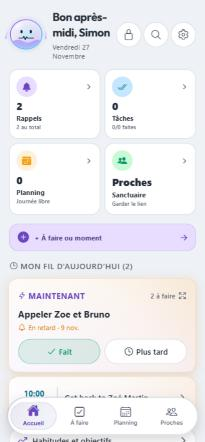
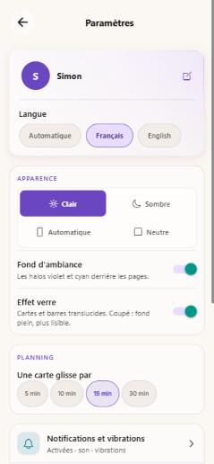

# FICHE OPÉRATOIRE N° 041 — Le thème Neutre et le fond d'ambiance

Projet : **Junix Pulse** · Date : 27 novembre 2026 · Suite de : [FICHE 040](FICHE-040-proches-et-appli-fermee.md)

---

## 1. Objectif

Première fiche du chantier n° 11 (le design à ton goût), validée dans l'étude 001, section 16.11 :

| Ta demande | Ce que fait cette fiche |
|---|---|
| des couleurs douces et unies, ni sombres ni ternes | un 4ᵉ choix d'apparence, **Neutre** : page gris-bleu clair `#EEF1F5`, cartes blanches, barre du bas blanche, **sans lueur ni verre ni halos** |
| pouvoir enlever les halos violet et cyan | un interrupteur « **Fond d'ambiance** » (en Clair, Sombre et Automatique) |
| (rangement) | « Fond d'ambiance » et « Effet verre » dans le même bloc que l'apparence ; cachés en Neutre, qui n'en a pas |
| (vu en passant) | les 4 choix d'apparence se chevauchaient sur un petit téléphone : **2 par ligne** |
| « pas besoin d'expliquer ce qu'on voit déjà » | les petits textes inutiles des paramètres sont retirés (prénom, langue, fuseau horaire, apparence, sons, vibrations) ; ceux qui apprennent quelque chose restent |
| le bug « Unexpected text node » | **pas reproduit** (voir le compte rendu) |



*Figure 41-1 — Capture réelle (web, 360 px de large) : l'accueil en Neutre, sans halos.*



*Figure 41-2 — Capture réelle : le bloc Apparence en Clair, avec « Fond d'ambiance » et « Effet verre ».*

Les couleurs choisies (couleur principale, couleurs des familles) sont la **fiche 042** ; une couleur par élément, la **fiche 043**.

## 2. État de départ

| À vérifier | Comment | Résultat attendu |
|---|---|---|
| La fiche 040 est enregistrée | `git log --oneline -1` | `feat(people): add a person from a form, edit a person, and work with the app closed` |
| Tout passe | `npx jest` | `Tests: 2161 passed` |

## 3. Matériel

Rien de nouveau.

## 4. Hypothèses

- Neutre est un thème **clair** pour tout ce qui demande « clair ou sombre » (barre d'état, icônes, cartes) : `resolveScheme('neutral', …)` répond `light`.
- Les textes gardent un contraste d'au moins **4,5 : 1** sur le gris-bleu et sur le blanc (vérifié par un test). Le gris « désactivé » a été foncé de `#6B7583` (4,1 : 1) à `#636D7B` (4,6 : 1) pour y arriver.
- Les réglages déjà enregistrés n'ont pas la nouvelle colonne : vide veut dire **allumé**, comme avant.

## 5. Carte de l'intervention

| Fichier | Action |
|---|---|
| `utils/color.ts`, `domain/entities/index.ts` | le mode `neutral`, le réglage `ambientBackground` |
| `constants/palettes.ts`, `hooks/use-theme.ts`, `hooks/use-reduce-transparency.ts` | la palette Neutre (`neutralOf`), sans verre |
| `components/ui/AmbientBackground.tsx`, `app/_layout.tsx` | les halos cachés en Neutre ou éteints |
| `database/migrations.ts`, `repositories/settings-repository.ts`, `services/backup-service.ts`, `store/app-store.ts` | la colonne `ambient_background` (migration 43), lue, écrite, sauvegardée |
| `app/settings/index.tsx`, `styles/settings/settings-styles.ts`, `components/settings/LanguagePicker.tsx`, i18n | le choix Neutre, l'interrupteur, 2 choix par ligne, moins de petits textes |
| `__tests__/neutral-theme.test.ts` | **nouveau** : le test du thème Neutre |

## 6. Sauvegarde

`git status` propre (hors `docs/motion/`). Une migration **additive** (une colonne ajoutée, rien d'effacé) : la 43.

## 7. Pas à pas

Le plus simple : `node docs/fiches/outils/appliquer-fiche-041.js .` fait toutes les étapes ci-dessous ; puis l'APK (fiche 003).

### Étape 1 — Le mode Neutre et sa palette

**Pourquoi** : Un 4ᵉ mode d'apparence, `neutral`. Pour tout ce qui demande « clair ou sombre », c'est un thème clair. Sa palette (`neutralOf`) part de la palette claire et change le fond (gris-bleu), les cartes (blanches), les textes (vérifiés à 4,5 : 1), et coupe la lueur, le verre et le dégradé. `use-theme` la choisit quand le mode est Neutre et dit `isNeutral` ; `use-reduce-transparency` répond « oui » en Neutre, donc tous les fonds deviennent pleins.

Repère (Ctrl+F) : la première ligne de chaque bloc « Chercher ». Le script `appliquer-fiche-041.js` fait tous ces changements d'un coup, et refuse d'écrire si un bloc ne se trouve pas exactement une fois.

#### `src/utils/color.ts`


Changement 1 sur 2. Chercher :

<!-- bloc: color-1-avant -->

```ts

// ─── Types ───────────────────────────────────────────────────────────────────

export type AppearanceMode = 'system' | 'light' | 'dark';
export type ColorScheme = 'light' | 'dark';

// ─── hexToRgba ───────────────────────────────────────────────────────────────
```

Remplacer par :

<!-- bloc: color-1-apres -->

```ts

// ─── Types ───────────────────────────────────────────────────────────────────

/** Neutre (sheet 041): a plain light theme, without glow nor glass. */
export type AppearanceMode = 'system' | 'light' | 'dark' | 'neutral';
export type ColorScheme = 'light' | 'dark';

// ─── hexToRgba ───────────────────────────────────────────────────────────────
```

Changement 2 sur 2. Chercher :

<!-- bloc: color-2-avant -->

```ts
  userMode: AppearanceMode,
  systemScheme: ColorScheme | 'unspecified' | null | undefined,
): ColorScheme {
  if (userMode === 'light') return 'light';
  if (userMode === 'dark') return 'dark';
  // userMode === 'system' : suit le système, fallback sur 'dark' si indéterminé
  return systemScheme === 'light' ? 'light' : 'dark';
```

Remplacer par :

<!-- bloc: color-2-apres -->

```ts
  userMode: AppearanceMode,
  systemScheme: ColorScheme | 'unspecified' | null | undefined,
): ColorScheme {
  // Neutre is a light theme for everything that asks light or dark (sheet 041)
  if (userMode === 'light' || userMode === 'neutral') return 'light';
  if (userMode === 'dark') return 'dark';
  // userMode === 'system' : suit le système, fallback sur 'dark' si indéterminé
  return systemScheme === 'light' ? 'light' : 'dark';
```

#### `src/domain/entities/index.ts`


Changement 1 sur 2. Chercher :

<!-- bloc: indexx-1-avant -->

```ts
  createdAt: string;
}

export type AppearanceMode = 'system' | 'light' | 'dark';

// ─── Paramètres utilisateur ──────────────────────────────────────────────────
export interface Settings {
```

Remplacer par :

<!-- bloc: indexx-1-apres -->

```ts
  createdAt: string;
}

/** Neutre (sheet 041): a plain light theme, without glow nor glass. */
export type AppearanceMode = 'system' | 'light' | 'dark' | 'neutral';

// ─── Paramètres utilisateur ──────────────────────────────────────────────────
export interface Settings {
```

Changement 2 sur 2. Chercher :

<!-- bloc: indexx-2-avant -->

```ts
  quietHoursEnd?: number;
  /** The default level of reminders, deadlines, moments and habits (sheet 023); all normal at first. */
  alertLevels?: AlertDefaults;
  /** The view the Planning opens on, the first day of the week and the step of a move (sheet 028). */
  planningPrefs?: PlanningPrefs;
  /** The sound of each level, and whether moments keep the sound of their tone (sheet 031). */
```

Remplacer par :

<!-- bloc: indexx-2-apres -->

```ts
  quietHoursEnd?: number;
  /** The default level of reminders, deadlines, moments and habits (sheet 023); all normal at first. */
  alertLevels?: AlertDefaults;
  /** The violet and cyan halos behind the pages (sheet 041); on at first. */
  ambientBackground?: boolean;
  /** The view the Planning opens on, the first day of the week and the step of a move (sheet 028). */
  planningPrefs?: PlanningPrefs;
  /** The sound of each level, and whether moments keep the sound of their tone (sheet 031). */
```

#### `src/constants/palettes.ts`


Changement 1 sur 1. Chercher :

<!-- bloc: palettes-1-avant -->

```ts
// Spec master prompt — crème chaleureuse, pas de blanc pur.
// Toutes les couleurs d'accent sont assombries pour garantir ≥ 4.5:1 sur crème.

export const lightPalette: ThemePalette = {
  mode: 'light',

```

Remplacer par :

<!-- bloc: palettes-1-apres -->

```ts
// Spec master prompt — crème chaleureuse, pas de blanc pur.
// Toutes les couleurs d'accent sont assombries pour garantir ≥ 4.5:1 sur crème.

/**
 * Neutre (study 001, 16.11; sheet 041): plain gentle colours, neither dark nor dull. A gray-blue
 * page, white cards with a thin border, a plain bottom bar, no glow and no glass. The texts keep
 * the contrasts of the light theme (checked on #EEF1F5 and on white).
 */
export function neutralOf(light: ThemePalette): ThemePalette {
  return {
    ...light,
    surface: {
      base: '#EEF1F5',
      low: '#F4F6F9',
      container: '#FFFFFF',
      high: '#F7F8FA',
      highest: '#E9EDF2',
    },
    onSurface: {
      primary: '#26303B', // 12.0:1 on #EEF1F5
      variant: '#5A6573', // 5.2:1 on #EEF1F5
      inactive: '#5A6573',
      disabled: '#636D7B', // 4.6:1 on #EEF1F5
    },
    outline: {
      default: '#636D7B',
      variant: '#D3D8E0',
    },
    gradient: {
      primary: [light.primary.default, light.primary.default],
      glassPrimary: [light.primary.default, light.primary.default],
    },
    glowCard: {
      background: '#FFFFFF',
      cornerGlowEnabled: false,
      topHighlightEnabled: false,
      haloEnabled: false,
      borderOpacityNeutral: 0.16,
    },
    glass: {
      card: { backgroundColor: '#FFFFFF', borderColor: '#D3D8E0' },
      control: { backgroundColor: '#FFFFFF', borderColor: '#D3D8E0' },
      controlActive: light.glass.controlActive,
      nav: { backgroundColor: '#FFFFFF', borderColor: '#D3D8E0' },
    },
    shadow: {
      color: 'rgba(38, 48, 59, 0.10)',
      smOpacity: 0.05,
      mdOpacity: 0.08,
    },
  };
}

export const lightPalette: ThemePalette = {
  mode: 'light',

```

#### `src/hooks/use-theme.ts`


Changement 1 sur 4. Chercher :

<!-- bloc: use-theme-1-avant -->

```ts
 */

import { useMemo } from 'react';
import { darkPalette, lightPalette, ThemePalette } from '@/constants/palettes';
import { AppearanceMode } from '@/domain/entities';
import { useColorScheme } from '@/hooks/use-color-scheme';
import { useAppStore } from '@/store/app-store';
import { resolveScheme } from '@/utils/color';

export interface UseThemeResult {
  /** Palette sémantique active complète */
  theme: ThemePalette;
```

Remplacer par :

<!-- bloc: use-theme-1-apres -->

```ts
 */

import { useMemo } from 'react';
import { darkPalette, lightPalette, neutralOf, ThemePalette } from '@/constants/palettes';
import { AppearanceMode } from '@/domain/entities';
import { useColorScheme } from '@/hooks/use-color-scheme';
import { useAppStore } from '@/store/app-store';
import { resolveScheme } from '@/utils/color';

/** Neutre: the light palette made plain (sheet 041). */
const NEUTRAL_PALETTE = neutralOf(lightPalette);

export interface UseThemeResult {
  /** Palette sémantique active complète */
  theme: ThemePalette;
```

Changement 2 sur 4. Chercher :

<!-- bloc: use-theme-2-avant -->

```ts
  mode: 'light' | 'dark';
  /** Indique si le mode sombre est actif */
  isDark: boolean;
  /** Réglage utilisateur courant ('system' | 'light' | 'dark') */
  themeMode: AppearanceMode;
  /** Méthode pour changer le mode */
```

Remplacer par :

<!-- bloc: use-theme-2-apres -->

```ts
  mode: 'light' | 'dark';
  /** Indique si le mode sombre est actif */
  isDark: boolean;
  /** Neutre: plain, without glow, glass nor ambient background (sheet 041) */
  isNeutral: boolean;
  /** Réglage utilisateur courant ('system' | 'light' | 'dark') */
  themeMode: AppearanceMode;
  /** Méthode pour changer le mode */
```

Changement 3 sur 4. Chercher :

<!-- bloc: use-theme-3-avant -->

```ts
    [themeMode, systemScheme]
  );

  const theme = mode === 'light' ? lightPalette : darkPalette;

  return useMemo(
    () => ({
```

Remplacer par :

<!-- bloc: use-theme-3-apres -->

```ts
    [themeMode, systemScheme]
  );

  const theme = themeMode === 'neutral' ? NEUTRAL_PALETTE : mode === 'light' ? lightPalette : darkPalette;

  return useMemo(
    () => ({
```

Changement 4 sur 4. Chercher :

<!-- bloc: use-theme-4-avant -->

```ts
      palette: theme,
      mode,
      isDark: mode === 'dark',
      themeMode,
      setThemeMode,
      surface: theme.surface,
```

Remplacer par :

<!-- bloc: use-theme-4-apres -->

```ts
      palette: theme,
      mode,
      isDark: mode === 'dark',
      isNeutral: themeMode === 'neutral',
      themeMode,
      setThemeMode,
      surface: theme.surface,
```

#### `src/hooks/use-reduce-transparency.ts`


Changement 1 sur 2. Chercher :

<!-- bloc: use-reduce-transparency-1-avant -->

```ts
export function useReduceTransparency(): boolean {
  const [systemReduced, setSystemReduced] = useState(false);
  const appReduced = useAppStore(state => state.reduceTransparency);

  useEffect(() => {
    let mounted = true;
```

Remplacer par :

<!-- bloc: use-reduce-transparency-1-apres -->

```ts
export function useReduceTransparency(): boolean {
  const [systemReduced, setSystemReduced] = useState(false);
  const appReduced = useAppStore(state => state.reduceTransparency);
  // Neutre has no glass: plain backgrounds everywhere (sheet 041)
  const neutral = useAppStore(state => state.themeMode === 'neutral');

  useEffect(() => {
    let mounted = true;
```

Changement 2 sur 2. Chercher :

<!-- bloc: use-reduce-transparency-2-avant -->

```ts
    };
  }, []);

  return systemReduced || appReduced;
}
```

Remplacer par :

<!-- bloc: use-reduce-transparency-2-apres -->

```ts
    };
  }, []);

  return systemReduced || appReduced || neutral;
}
```

#### `src/__tests__/neutral-theme.test.ts`

Fichier nouveau, en entier :

<!-- bloc: new-neutral-theme-test -->

```ts
import { lightPalette, neutralOf } from '../constants/palettes';
import { contrastRatio, resolveScheme } from '../utils/color';

describe('the Neutre theme (sheet 041)', () => {
  const neutral = neutralOf(lightPalette);

  it('is a light theme for everything that asks light or dark', () => {
    expect(resolveScheme('neutral', 'dark')).toBe('light');
    expect(resolveScheme('neutral', null)).toBe('light');
    expect(neutral.mode).toBe('light');
  });

  it('keeps its texts readable on the page and on the cards (4.5:1 at least)', () => {
    for (const background of [neutral.surface.base, neutral.surface.container]) {
      expect(contrastRatio(neutral.onSurface.primary, background)).toBeGreaterThanOrEqual(4.5);
      expect(contrastRatio(neutral.onSurface.variant, background)).toBeGreaterThanOrEqual(4.5);
      expect(contrastRatio(neutral.onSurface.disabled, background)).toBeGreaterThanOrEqual(4.5);
      expect(contrastRatio(neutral.primary.default, background)).toBeGreaterThanOrEqual(4.5);
    }
  });

  it('is plain: no glow, no glass, a flat gradient', () => {
    expect(neutral.glowCard.cornerGlowEnabled).toBe(false);
    expect(neutral.glowCard.haloEnabled).toBe(false);
    expect(neutral.glass.card.backgroundColor).toBe('#FFFFFF');
    expect(neutral.gradient.primary[0]).toBe(neutral.gradient.primary[1]);
  });
});
```


### Étape 2 — Le fond d'ambiance : caché en Neutre, ou éteint

**Pourquoi** : `AmbientBackground` avait une propriété `visible` qui **met en pause** l'animation (quand une page opaque le couvre) mais ne cache rien. Une nouvelle propriété, `showHalos`, fait disparaître les halos en fondu ; et en Neutre, le fond uni est le gris-bleu au lieu du crème. `_layout.tsx` la donne : `ambientOn && !isNeutral`.

Repère (Ctrl+F) : la première ligne de chaque bloc « Chercher ». Le script `appliquer-fiche-041.js` fait tous ces changements d'un coup, et refuse d'écrire si un bloc ne se trouve pas exactement une fois.

#### `src/components/ui/AmbientBackground.tsx`


Changement 1 sur 3. Chercher :

<!-- bloc: ambientbackground-1-avant -->

```tsx
  visible: boolean;
  /** False while the launch animation plays: the halos fade in once it becomes true. */
  revealed: boolean;
}

function AmbientBackgroundComponent({ visible, revealed }: AmbientBackgroundProps) {
  const { mode } = useTheme();
  const { width: screenWidth } = useWindowDimensions();
  const reducedMotion = useReducedMotion();
  const [halos] = useState(selectHalos);
```

Remplacer par :

<!-- bloc: ambientbackground-1-apres -->

```tsx
  visible: boolean;
  /** False while the launch animation plays: the halos fade in once it becomes true. */
  revealed: boolean;
  /** False: no halos, only the plain background (Neutre, or switched off: sheet 041). */
  showHalos?: boolean;
}

function AmbientBackgroundComponent({ visible, revealed, showHalos = true }: AmbientBackgroundProps) {
  const { mode, theme, isNeutral } = useTheme();
  // The plain background of a light page: the gray-blue of Neutre, or the cream of Clair (sheet 041)
  const lightBase = isNeutral ? theme.surface.base : lightPalette.surface.base;
  const { width: screenWidth } = useWindowDimensions();
  const reducedMotion = useReducedMotion();
  const [halos] = useState(selectHalos);
```

Changement 2 sur 3. Chercher :

<!-- bloc: ambientbackground-2-avant -->

```tsx
  );
  const frameCallback = useFrameCallback(advanceClock, false);

  const isRunning = halos.length > 0 && !reducedMotion && visible && revealed && isAppActive;

  useEffect(() => {
    frameCallback.setActive(isRunning);
```

Remplacer par :

<!-- bloc: ambientbackground-2-apres -->

```tsx
  );
  const frameCallback = useFrameCallback(advanceClock, false);

  const isRunning = halos.length > 0 && !reducedMotion && visible && revealed && isAppActive && showHalos;

  useEffect(() => {
    frameCallback.setActive(isRunning);
```

Changement 3 sur 3. Chercher :

<!-- bloc: ambientbackground-3-avant -->

```tsx
    });
  }, [mode, darkness]);

  useEffect(() => {
    if (revealed) {
      haloOpacity.value = withTiming(1, { duration: AMBIENT_REVEAL_FADE_MS });
    }
  }, [revealed, haloOpacity]);

  const baseStyle = useAnimatedStyle(() => ({
    backgroundColor: interpolateColor(
      darkness.value,
      [0, 1],
      [lightPalette.surface.base, darkPalette.surface.base]
    ),
  }));

```

Remplacer par :

<!-- bloc: ambientbackground-3-apres -->

```tsx
    });
  }, [mode, darkness]);

  // The halos fade in once revealed, and fade out when switched off (sheet 041)
  useEffect(() => {
    if (revealed) {
      haloOpacity.value = withTiming(showHalos ? 1 : 0, { duration: AMBIENT_REVEAL_FADE_MS });
    }
  }, [revealed, showHalos, haloOpacity]);

  const baseStyle = useAnimatedStyle(() => ({
    backgroundColor: interpolateColor(
      darkness.value,
      [0, 1],
      [lightBase, darkPalette.surface.base]
    ),
  }));

```

#### `src/app/_layout.tsx`


Changement 1 sur 3. Chercher :

<!-- bloc: -layout-1-avant -->

```tsx
    setThemeMode,
  } = useAppStore();

  const { isDark, mode, surface } = useTheme();
  const styles = useThemedStyles(makeRootLayoutStyles);
  const segments = useSegments();
  // Followed live: the launch animation reads it when Pulse is about to wave
```

Remplacer par :

<!-- bloc: -layout-1-apres -->

```tsx
    setThemeMode,
  } = useAppStore();

  const { isDark, mode, surface, isNeutral } = useTheme();
  // The halos behind the pages, unless switched off in the settings (sheet 041)
  const ambientOn = useAppStore(state => state.ambientBackground);
  const styles = useThemedStyles(makeRootLayoutStyles);
  const segments = useSegments();
  // Followed live: the launch animation reads it when Pulse is about to wave
```

Changement 2 sur 3. Chercher :

<!-- bloc: -layout-2-avant -->

```tsx
        }
        setThemeMode(settings.appearanceMode);
        useAppStore.getState().setReduceTransparency(settings.reduceTransparency);

        // 3. Initialiser les notifications (handler + canal Android)
        //    Isolé pour ne jamais bloquer le démarrage si expo-notifications est limité dans Expo Go
```

Remplacer par :

<!-- bloc: -layout-2-apres -->

```tsx
        }
        setThemeMode(settings.appearanceMode);
        useAppStore.getState().setReduceTransparency(settings.reduceTransparency);
        useAppStore.getState().setAmbientBackground(settings.ambientBackground !== false);

        // 3. Initialiser les notifications (handler + canal Android)
        //    Isolé pour ne jamais bloquer le démarrage si expo-notifications est limité dans Expo Go
```

Changement 3 sur 3. Chercher :

<!-- bloc: -layout-3-avant -->

```tsx
  return (
    <>
      <GestureHandlerRootView style={styles.root}>
        <AmbientBackground visible={segments[0] === "(tabs)"} revealed={splashFinished} />
        <SafeAreaProvider>
          <StatusBar style={!splashFinished ? "dark" : (isDark ? "light" : "dark")} />
          <ThemeProvider value={isDark ? TRANSPARENT_DARK_THEME : TRANSPARENT_LIGHT_THEME}>
```

Remplacer par :

<!-- bloc: -layout-3-apres -->

```tsx
  return (
    <>
      <GestureHandlerRootView style={styles.root}>
        {/* Off in Neutre or when switched off in the settings (sheet 041) */}
        <AmbientBackground visible={segments[0] === "(tabs)"} revealed={splashFinished} showHalos={ambientOn && !isNeutral} />
        <SafeAreaProvider>
          <StatusBar style={!splashFinished ? "dark" : (isDark ? "light" : "dark")} />
          <ThemeProvider value={isDark ? TRANSPARENT_DARK_THEME : TRANSPARENT_LIGHT_THEME}>
```


### Étape 3 — Le réglage enregistré

**Pourquoi** : Une colonne `ambient_background` dans les réglages (migration 43, **ajoutée**, rien d'effacé). Vide (les réglages d'avant) veut dire allumé. Le dépôt la lit et l'écrit, la sauvegarde la garde, et le magasin de l'appli (`app-store`) la tient en mémoire pour que le changement se voie tout de suite.

Repère (Ctrl+F) : la première ligne de chaque bloc « Chercher ». Le script `appliquer-fiche-041.js` fait tous ces changements d'un coup, et refuse d'écrire si un bloc ne se trouve pas exactement une fois.

#### `src/database/migrations.ts`


Changement 1 sur 1. Chercher :

<!-- bloc: migrations-1-avant -->

```ts
      ALTER TABLE tasks ADD COLUMN focus_minutes INTEGER;
    `,
  },
];

```

Remplacer par :

<!-- bloc: migrations-1-apres -->

```ts
      ALTER TABLE tasks ADD COLUMN focus_minutes INTEGER;
    `,
  },
  {
    version: 43,
    name: 'add_ambient_background',
    sql: `
      -- Le fond d ambiance, halos violet et cyan (fiche 041, etude 16.11). Vide : allume, comme avant.
      ALTER TABLE settings ADD COLUMN ambient_background INTEGER;
    `,
  },
];

```

#### `src/repositories/settings-repository.ts`


Changement 1 sur 3. Chercher :

<!-- bloc: settings-repository-1-avant -->

```ts
import { planningPrefsOf, planningPrefsText } from '../domain/rules/planning-settings-rules';
import { soundPrefsOf, soundPrefsText } from '../domain/rules/sound-rules';

const VALID_APPEARANCE_MODES: ReadonlySet<AppearanceMode> = new Set(['system', 'light', 'dark']);
const VALID_MASCOT_PRESENCE: ReadonlySet<string> = new Set<MascotPresence>(['full', 'discreet', 'off']);
const VALID_MASCOT_ADDRESS: ReadonlySet<string> = new Set<MascotAddress>(['tu', 'vous']);
const VALID_MASCOT_PROPOSALS: ReadonlySet<string> = new Set<MascotProposalsLevel>(['normal', 'rare', 'off']);
```

Remplacer par :

<!-- bloc: settings-repository-1-apres -->

```ts
import { planningPrefsOf, planningPrefsText } from '../domain/rules/planning-settings-rules';
import { soundPrefsOf, soundPrefsText } from '../domain/rules/sound-rules';

const VALID_APPEARANCE_MODES: ReadonlySet<AppearanceMode> = new Set(['system', 'light', 'dark', 'neutral']);
const VALID_MASCOT_PRESENCE: ReadonlySet<string> = new Set<MascotPresence>(['full', 'discreet', 'off']);
const VALID_MASCOT_ADDRESS: ReadonlySet<string> = new Set<MascotAddress>(['tu', 'vous']);
const VALID_MASCOT_PROPOSALS: ReadonlySet<string> = new Set<MascotProposalsLevel>(['normal', 'rare', 'off']);
```

Changement 2 sur 3. Chercher :

<!-- bloc: settings-repository-2-avant -->

```ts
    soundPrefs: soundPrefsOf(row.sound_prefs as string | null | undefined),
    appearanceMode,
    reduceTransparency: (row.reduce_transparency as number) === 1,
    appearanceDark: row.appearance_dark !== undefined ? (row.appearance_dark as number) === 1 : true,
    mascotPresence: validOr(row.mascot_presence, VALID_MASCOT_PRESENCE, DEFAULT_MASCOT_SETTINGS.presence),
    mascotAddress: validOr(row.mascot_address, VALID_MASCOT_ADDRESS, DEFAULT_MASCOT_SETTINGS.address),
```

Remplacer par :

<!-- bloc: settings-repository-2-apres -->

```ts
    soundPrefs: soundPrefsOf(row.sound_prefs as string | null | undefined),
    appearanceMode,
    reduceTransparency: (row.reduce_transparency as number) === 1,
    // On unless switched off (sheet 041): empty for the settings made before
    ambientBackground: (row.ambient_background as number | null | undefined) !== 0,
    appearanceDark: row.appearance_dark !== undefined ? (row.appearance_dark as number) === 1 : true,
    mascotPresence: validOr(row.mascot_presence, VALID_MASCOT_PRESENCE, DEFAULT_MASCOT_SETTINGS.presence),
    mascotAddress: validOr(row.mascot_address, VALID_MASCOT_ADDRESS, DEFAULT_MASCOT_SETTINGS.address),
```

Changement 3 sur 3. Chercher :

<!-- bloc: settings-repository-3-avant -->

```ts
      setClauses.push('reduce_transparency = ?');
      values.push(params.reduceTransparency ? 1 : 0);
    }
    if (params.hapticsEnabled !== undefined) {
      setClauses.push('haptics_enabled = ?');
      values.push(params.hapticsEnabled ? 1 : 0);
```

Remplacer par :

<!-- bloc: settings-repository-3-apres -->

```ts
      setClauses.push('reduce_transparency = ?');
      values.push(params.reduceTransparency ? 1 : 0);
    }
    if (params.ambientBackground !== undefined) {
      setClauses.push('ambient_background = ?');
      values.push(params.ambientBackground ? 1 : 0);
    }
    if (params.hapticsEnabled !== undefined) {
      setClauses.push('haptics_enabled = ?');
      values.push(params.hapticsEnabled ? 1 : 0);
```

#### `src/services/backup-service.ts`


Changement 1 sur 2. Chercher :

<!-- bloc: backup-service-1-avant -->

```ts
  planning_blocks: ['id', 'schedule_id', 'label', 'type', 'day_of_week', 'start_time', 'end_time', 'color', 'created_at', 'updated_at'],
  interactions: ['id', 'person_id', 'type', 'occurred_at', 'notes', 'reminder_id', 'task_id', 'event_id', 'created_at'],
  suggestions: ['id', 'type', 'status', 'title', 'explanation', 'target_id', 'target_type', 'proposed_data', 'generated_at', 'expires_at', 'decided_at', 'created_at'],
  settings: ['id', 'display_name', 'timezone', 'onboarding_completed', 'notifications_enabled', 'forgotten_contact_threshold_days', 'end_of_day_hour', 'morning_briefing_hour', 'appearance_dark', 'appearance_mode', 'mascot_presence', 'mascot_address', 'mascot_proposals', 'mascot_briefings', 'language', 'notification_sound_enabled', 'haptics_enabled', 'quiet_hours_start', 'quiet_hours_end', 'alert_levels', 'planning_prefs', 'sound_prefs', 'created_at', 'updated_at'],
  sanctum_notes: ['id', 'title', 'content', 'folder', 'created_at', 'updated_at'],
};

```

Remplacer par :

<!-- bloc: backup-service-1-apres -->

```ts
  planning_blocks: ['id', 'schedule_id', 'label', 'type', 'day_of_week', 'start_time', 'end_time', 'color', 'created_at', 'updated_at'],
  interactions: ['id', 'person_id', 'type', 'occurred_at', 'notes', 'reminder_id', 'task_id', 'event_id', 'created_at'],
  suggestions: ['id', 'type', 'status', 'title', 'explanation', 'target_id', 'target_type', 'proposed_data', 'generated_at', 'expires_at', 'decided_at', 'created_at'],
  settings: ['id', 'display_name', 'timezone', 'onboarding_completed', 'notifications_enabled', 'forgotten_contact_threshold_days', 'end_of_day_hour', 'morning_briefing_hour', 'appearance_dark', 'appearance_mode', 'mascot_presence', 'mascot_address', 'mascot_proposals', 'mascot_briefings', 'language', 'notification_sound_enabled', 'haptics_enabled', 'quiet_hours_start', 'quiet_hours_end', 'alert_levels', 'planning_prefs', 'sound_prefs', 'ambient_background', 'created_at', 'updated_at'],
  sanctum_notes: ['id', 'title', 'content', 'folder', 'created_at', 'updated_at'],
};

```

Changement 2 sur 2. Chercher :

<!-- bloc: backup-service-2-avant -->

```ts
    status: ['PENDING', 'ACCEPTED', 'MODIFIED', 'REFUSED', 'EXPIRED'],
  },
  settings: {
    appearance_mode: ['system', 'light', 'dark'],
    mascot_presence: ['full', 'discreet', 'off'],
    mascot_address: ['tu', 'vous'],
    mascot_proposals: ['normal', 'rare', 'off'],
```

Remplacer par :

<!-- bloc: backup-service-2-apres -->

```ts
    status: ['PENDING', 'ACCEPTED', 'MODIFIED', 'REFUSED', 'EXPIRED'],
  },
  settings: {
    appearance_mode: ['system', 'light', 'dark', 'neutral'],
    mascot_presence: ['full', 'discreet', 'off'],
    mascot_address: ['tu', 'vous'],
    mascot_proposals: ['normal', 'rare', 'off'],
```

#### `src/store/app-store.ts`


Changement 1 sur 2. Chercher :

<!-- bloc: app-store-1-avant -->

```ts
  /** Glass turned off in the settings: cards and bars on a plain background. */
  reduceTransparency: boolean;
  setReduceTransparency: (reduce: boolean) => void;

  // Langue : le choix de la personne, et la langue qui en résulte (celle du téléphone sur « auto »)
  languageSetting: LanguageSetting;
```

Remplacer par :

<!-- bloc: app-store-1-apres -->

```ts
  /** Glass turned off in the settings: cards and bars on a plain background. */
  reduceTransparency: boolean;
  setReduceTransparency: (reduce: boolean) => void;
  /** The violet and cyan halos behind the pages (sheet 041). */
  ambientBackground: boolean;
  setAmbientBackground: (on: boolean) => void;

  // Langue : le choix de la personne, et la langue qui en résulte (celle du téléphone sur « auto »)
  languageSetting: LanguageSetting;
```

Changement 2 sur 2. Chercher :

<!-- bloc: app-store-2-avant -->

```ts
  setThemeMode: (mode) => set({ themeMode: mode }),
  reduceTransparency: false,
  setReduceTransparency: (reduce) => set({ reduceTransparency: reduce }),

  // Langue
  languageSetting: 'auto',
```

Remplacer par :

<!-- bloc: app-store-2-apres -->

```ts
  setThemeMode: (mode) => set({ themeMode: mode }),
  reduceTransparency: false,
  setReduceTransparency: (reduce) => set({ reduceTransparency: reduce }),
  ambientBackground: true,
  setAmbientBackground: (on) => set({ ambientBackground: on }),

  // Langue
  languageSetting: 'auto',
```


### Étape 4 — Les paramètres : Neutre, « Fond d'ambiance », 2 choix par ligne, moins de petits textes

**Pourquoi** : Le bloc Apparence reçoit le choix Neutre et l'interrupteur « Fond d'ambiance », à côté d'« Effet verre » ; les deux sont cachés en Neutre. Avec 4 choix, « Automatique » chevauchait « Sombre » sur un téléphone de 360 px : la rangée passe à la ligne (`flexWrap`), 2 choix par ligne. Et les petits textes qui répètent ce qu'on voit déjà sont retirés (ta demande) : sous le prénom, sous la langue (nouvelle option `showHint` du sélecteur ; l'accueil la garde), le fuseau horaire, sous l'apparence, sous « Rappels & Alertes », « Son des notifications », « Sons » et « Vibrations ». Ceux qui apprennent quelque chose restent (Fond d'ambiance, Effet verre, Nuit plus calme, Niveau par défaut, etc.).

Repère (Ctrl+F) : la première ligne de chaque bloc « Chercher ». Le script `appliquer-fiche-041.js` fait tous ces changements d'un coup, et refuse d'écrire si un bloc ne se trouve pas exactement une fois.

#### `src/app/settings/index.tsx`


Changement 1 sur 11. Chercher :

<!-- bloc: index-1-avant -->

```tsx
import { hexToRgba } from '@/utils/color';
import { emitMascotEvent } from '@/services/mascot/mascot-event-bus';
import { SanctumAuthService } from '@/services/sanctum-auth-service';
import { detectDeviceTimezone } from '@/services/device-timezone';
import { timezoneLabel } from '@/constants/timezones';
import { useDateLocale, useLanguage, useT, type MessageKey } from '@/i18n';
import { LanguagePicker } from '@/components/settings/LanguagePicker';
import { AlertDefaultsSetting } from '@/components/settings/AlertDefaultsSetting';
import { SoundSetting } from '@/components/settings/SoundSetting';
```

Remplacer par :

<!-- bloc: index-1-apres -->

```tsx
import { hexToRgba } from '@/utils/color';
import { emitMascotEvent } from '@/services/mascot/mascot-event-bus';
import { SanctumAuthService } from '@/services/sanctum-auth-service';
import { useDateLocale, useT, type MessageKey } from '@/i18n';
import { LanguagePicker } from '@/components/settings/LanguagePicker';
import { AlertDefaultsSetting } from '@/components/settings/AlertDefaultsSetting';
import { SoundSetting } from '@/components/settings/SoundSetting';
```

Changement 2 sur 11. Chercher :

<!-- bloc: index-2-avant -->

```tsx
  { value: 'light', labelKey: 'settingsScreen.light', icon: 'sunny-outline' },
  { value: 'dark', labelKey: 'settingsScreen.dark', icon: 'moon-outline' },
  { value: 'system', labelKey: 'settingsScreen.auto', icon: 'phone-portrait-outline' },
];

/** The pages of the settings: the summary lists them, each opens on its own. */
```

Remplacer par :

<!-- bloc: index-2-apres -->

```tsx
  { value: 'light', labelKey: 'settingsScreen.light', icon: 'sunny-outline' },
  { value: 'dark', labelKey: 'settingsScreen.dark', icon: 'moon-outline' },
  { value: 'system', labelKey: 'settingsScreen.auto', icon: 'phone-portrait-outline' },
  // Plain, without glow nor glass (sheet 041)
  { value: 'neutral', labelKey: 'settingsScreen.neutral', icon: 'square-outline' },
];

/** The pages of the settings: the summary lists them, each opens on its own. */
```

Changement 3 sur 11. Chercher :

<!-- bloc: index-3-avant -->

```tsx

export default function SettingsScreen() {
  const insets = useSafeAreaInsets();
  const { setOnboardingComplete, showSnackbar, themeMode, setThemeMode, setReduceTransparency } = useAppStore();
  const { palette } = useTheme();
  const deviceTimezone = detectDeviceTimezone();
  const t = useT();
  const language = useLanguage();
  const styles = useThemedStyles(makeSettingsStyles);
  // The summary, or one of its pages: each page is the same screen opened with its name
  const section = pageOf(useLocalSearchParams<{ section?: string }>().section);
```

Remplacer par :

<!-- bloc: index-3-apres -->

```tsx

export default function SettingsScreen() {
  const insets = useSafeAreaInsets();
  const { setOnboardingComplete, showSnackbar, themeMode, setThemeMode, setReduceTransparency, setAmbientBackground } = useAppStore();
  const { palette } = useTheme();
  const t = useT();
  const styles = useThemedStyles(makeSettingsStyles);
  // The summary, or one of its pages: each page is the same screen opened with its name
  const section = pageOf(useLocalSearchParams<{ section?: string }>().section);
```

Changement 4 sur 11. Chercher :

<!-- bloc: index-4-avant -->

```tsx


  // The glass effect: on by default, off puts cards and bars on a plain background
  const handleToggleGlass = async (glass: boolean) => {
    setReduceTransparency(!glass);
    setSettings(s => (s ? { ...s, reduceTransparency: !glass } : s));
```

Remplacer par :

<!-- bloc: index-4-apres -->

```tsx


  // The glass effect: on by default, off puts cards and bars on a plain background
  // The halos behind the pages (sheet 041)
  const handleToggleAmbient = async (on: boolean) => {
    setAmbientBackground(on);
    setSettings(s => (s ? { ...s, ambientBackground: on } : s));
    try {
      await SettingsRepository.update({ ambientBackground: on, updatedAt: new Date().toISOString() });
    } catch {
      setAmbientBackground(!on);
      setSettings(s => (s ? { ...s, ambientBackground: !on } : s));
      showSnackbar(t('settingsScreen.appearanceFailed'));
    }
  };

  const handleToggleGlass = async (glass: boolean) => {
    setReduceTransparency(!glass);
    setSettings(s => (s ? { ...s, reduceTransparency: !glass } : s));
```

Changement 5 sur 11. Chercher :

<!-- bloc: index-5-avant -->

```tsx
          </View>
          <View style={styles.rowTextFill}>
            <Text style={styles.profileName}>{settings.displayName?.trim() || t('settingsHub.profileEmpty')}</Text>
            <Text style={styles.rowSub}>{t('settingsScreen.firstNameHint')}</Text>
          </View>
          <Ionicons name="create-outline" size={18} color={palette.primary.default} />
        </TouchableOpacity>

        <View style={styles.profileLanguage}>
          <Text style={styles.rowLabel}>{t('language.label')}</Text>
          <LanguagePicker onError={showSnackbar} />
          {/* Le fuseau suit le téléphone : une information, pas un réglage */}
          <Text style={styles.footnote}>
            {t('settingsHub.timezoneNote', { timezone: timezoneLabel(deviceTimezone, language) })}
          </Text>
        </View>
      </GlowCard>

```

Remplacer par :

<!-- bloc: index-5-apres -->

```tsx
          </View>
          <View style={styles.rowTextFill}>
            <Text style={styles.profileName}>{settings.displayName?.trim() || t('settingsHub.profileEmpty')}</Text>
          </View>
          <Ionicons name="create-outline" size={18} color={palette.primary.default} />
        </TouchableOpacity>

        <View style={styles.profileLanguage}>
          <Text style={styles.rowLabel}>{t('language.label')}</Text>
          {/* No line under the choices: they speak for themselves (sheet 041) */}
          <LanguagePicker onError={showSnackbar} showHint={false} />
        </View>
      </GlowCard>

```

Changement 6 sur 11. Chercher :

<!-- bloc: index-6-avant -->

```tsx
        })}
      </View>

      <Text style={styles.appearanceHelp}>{t('settingsScreen.appearanceHelp')}</Text>

      <View style={styles.glassRow}>
        <View style={styles.rowTextFill}>
          <Text style={styles.rowLabel}>{t('settingsScreen.glass')}</Text>
          <Text style={styles.rowSub}>{t('settingsScreen.glassHelp')}</Text>
```

Remplacer par :

<!-- bloc: index-6-apres -->

```tsx
        })}
      </View>


      {/* The ambient background and the glass, with the theme (sheet 041); both are off in Neutre */}
      {settings.appearanceMode !== 'neutral' ? (
        <View style={styles.glassRow}>
          <View style={styles.rowTextFill}>
            <Text style={styles.rowLabel}>{t('settingsScreen.ambient')}</Text>
            <Text style={styles.rowSub}>{t('settingsScreen.ambientHelp')}</Text>
          </View>
          <Switch
            value={settings.ambientBackground !== false}
            onValueChange={handleToggleAmbient}
            {...switchColors(settings.ambientBackground !== false)}
            accessibilityLabel={t('settingsScreen.ambient')}
            testID="settings-ambient"
          />
        </View>
      ) : null}

      {settings.appearanceMode !== 'neutral' ? (
      <View style={[styles.glassRow, styles.groupRowApart]}>
        <View style={styles.rowTextFill}>
          <Text style={styles.rowLabel}>{t('settingsScreen.glass')}</Text>
          <Text style={styles.rowSub}>{t('settingsScreen.glassHelp')}</Text>
```

Changement 7 sur 11. Chercher :

<!-- bloc: index-7-avant -->

```tsx
          testID="settings-glass"
        />
      </View>
    </View>
  );

```

Remplacer par :

<!-- bloc: index-7-apres -->

```tsx
          testID="settings-glass"
        />
      </View>
      ) : null}
    </View>
  );

```

Changement 8 sur 11. Chercher :

<!-- bloc: index-8-avant -->

```tsx
      <View style={styles.row}>
        <View style={styles.rowTextFill}>
          <Text style={styles.rowLabel}>{t('settingsScreen.remindersAlerts')}</Text>
          <Text style={styles.rowSub}>{t('settingsScreen.offlineNotifs')}</Text>
        </View>
        <Switch
          value={settings.notificationsEnabled}
```

Remplacer par :

<!-- bloc: index-8-apres -->

```tsx
      <View style={styles.row}>
        <View style={styles.rowTextFill}>
          <Text style={styles.rowLabel}>{t('settingsScreen.remindersAlerts')}</Text>
        </View>
        <Switch
          value={settings.notificationsEnabled}
```

Changement 9 sur 11. Chercher :

<!-- bloc: index-9-avant -->

```tsx
        <View style={styles.row}>
          <View style={styles.rowTextFill}>
            <Text style={styles.rowLabel}>{t('settingsScreen.soundLabel')}</Text>
            <Text style={styles.rowSub}>{t('settingsScreen.soundHint')}</Text>
          </View>
          <Switch
            value={settings.notificationSoundEnabled}
```

Remplacer par :

<!-- bloc: index-9-apres -->

```tsx
        <View style={styles.row}>
          <View style={styles.rowTextFill}>
            <Text style={styles.rowLabel}>{t('settingsScreen.soundLabel')}</Text>
          </View>
          <Switch
            value={settings.notificationSoundEnabled}
```

Changement 10 sur 11. Chercher :

<!-- bloc: index-10-avant -->

```tsx
      {settings.notificationsEnabled && settings.notificationSoundEnabled && (
        <View style={styles.rowCol}>
          <Text style={styles.rowLabel}>{t('soundSettings.title')}</Text>
          <Text style={styles.rowSub}>{t('soundSettings.hint')}</Text>
          <SoundSetting
            value={settings.soundPrefs ?? DEFAULT_SOUND_PREFS}
            onChange={handleUpdateSounds}
```

Remplacer par :

<!-- bloc: index-10-apres -->

```tsx
      {settings.notificationsEnabled && settings.notificationSoundEnabled && (
        <View style={styles.rowCol}>
          <Text style={styles.rowLabel}>{t('soundSettings.title')}</Text>
          <SoundSetting
            value={settings.soundPrefs ?? DEFAULT_SOUND_PREFS}
            onChange={handleUpdateSounds}
```

Changement 11 sur 11. Chercher :

<!-- bloc: index-11-avant -->

```tsx
      <View style={styles.row}>
        <View style={styles.rowTextFill}>
          <Text style={styles.rowLabel}>{t('settingsHub.vibrationsLabel')}</Text>
          <Text style={styles.rowSub}>{t('settingsHub.vibrationsHint')}</Text>
        </View>
        <Switch
          value={settings.hapticsEnabled}
```

Remplacer par :

<!-- bloc: index-11-apres -->

```tsx
      <View style={styles.row}>
        <View style={styles.rowTextFill}>
          <Text style={styles.rowLabel}>{t('settingsHub.vibrationsLabel')}</Text>
        </View>
        <Switch
          value={settings.hapticsEnabled}
```

#### `src/styles/settings/settings-styles.ts`


Changement 1 sur 2. Chercher :

<!-- bloc: settings-styles-1-avant -->

```ts
    modalAction: {
      flex: 1,
    },
    segmentedControl: {
      flexDirection: 'row',
      backgroundColor: segmentBg,
      borderRadius: Radius.md,
      padding: 4,
```

Remplacer par :

<!-- bloc: settings-styles-1-apres -->

```ts
    modalAction: {
      flex: 1,
    },
    // Four choices since Neutre (sheet 041): two per line, readable on a small phone
    segmentedControl: {
      flexDirection: 'row',
      flexWrap: 'wrap',
      gap: 4,
      backgroundColor: segmentBg,
      borderRadius: Radius.md,
      padding: 4,
```

Changement 2 sur 2. Chercher :

<!-- bloc: settings-styles-2-avant -->

```ts
      marginBottom: Spacing.xs,
    },
    segmentBtn: {
      flex: 1,
      flexDirection: 'row',
      alignItems: 'center',
      justifyContent: 'center',
```

Remplacer par :

<!-- bloc: settings-styles-2-apres -->

```ts
      marginBottom: Spacing.xs,
    },
    segmentBtn: {
      flexGrow: 1,
      flexBasis: '45%',
      flexDirection: 'row',
      alignItems: 'center',
      justifyContent: 'center',
```

#### `src/components/settings/LanguagePicker.tsx`


Changement 1 sur 2. Chercher :

<!-- bloc: languagepicker-1-avant -->

```tsx
  /** Shown when the choice could not be kept. */
  onError?: (message: string) => void;
  testIDPrefix?: string;
}

export function LanguagePicker({ onError, testIDPrefix = 'language' }: LanguagePickerProps) {
  const t = useT();
  const styles = useThemedStyles(makeLanguagePickerStyles);
  const setting = useAppStore(state => state.languageSetting);
```

Remplacer par :

<!-- bloc: languagepicker-1-apres -->

```tsx
  /** Shown when the choice could not be kept. */
  onError?: (message: string) => void;
  testIDPrefix?: string;
  /** False: no line under the choices (the settings, where the choice speaks for itself: sheet 041). */
  showHint?: boolean;
}

export function LanguagePicker({ onError, testIDPrefix = 'language', showHint = true }: LanguagePickerProps) {
  const t = useT();
  const styles = useThemedStyles(makeLanguagePickerStyles);
  const setting = useAppStore(state => state.languageSetting);
```

Changement 2 sur 2. Chercher :

<!-- bloc: languagepicker-2-avant -->

```tsx
          );
        })}
      </View>
      <Text style={styles.hint}>{t(current.hintKey)}</Text>
    </View>
  );
}
```

Remplacer par :

<!-- bloc: languagepicker-2-apres -->

```tsx
          );
        })}
      </View>
      {showHint ? <Text style={styles.hint}>{t(current.hintKey)}</Text> : null}
    </View>
  );
}
```

#### `src/i18n/messages-rest-fr.ts`


Changement 1 sur 1. Chercher :

<!-- bloc: messages-rest-fr-1-avant -->

```ts
  'settingsScreen.appearanceA11y': 'Sélection du mode d’apparence',
  'settingsScreen.selectedSuffix': ', sélectionné',
  'settingsScreen.appearanceHelp': 'Automatique suit le réglage de votre téléphone. Le mode clair est le réglage par défaut.',
  'settingsScreen.glass': 'Effet verre',
  'settingsScreen.glassHelp': 'Cartes et barres translucides. Coupé : fond plein, plus lisible.',
  'settingsScreen.briefings': 'Horaires des briefings',
```

Remplacer par :

<!-- bloc: messages-rest-fr-1-apres -->

```ts
  'settingsScreen.appearanceA11y': 'Sélection du mode d’apparence',
  'settingsScreen.selectedSuffix': ', sélectionné',
  'settingsScreen.appearanceHelp': 'Automatique suit le réglage de votre téléphone. Le mode clair est le réglage par défaut.',
  'settingsScreen.neutral': 'Neutre',
  'settingsScreen.ambient': "Fond d'ambiance",
  'settingsScreen.ambientHelp': 'Les halos violet et cyan derrière les pages.',
  'settingsScreen.glass': 'Effet verre',
  'settingsScreen.glassHelp': 'Cartes et barres translucides. Coupé : fond plein, plus lisible.',
  'settingsScreen.briefings': 'Horaires des briefings',
```

#### `src/i18n/messages-rest-en.ts`


Changement 1 sur 1. Chercher :

<!-- bloc: messages-rest-en-1-avant -->

```ts
  'settingsScreen.appearanceA11y': 'Appearance mode selection',
  'settingsScreen.selectedSuffix': ', selected',
  'settingsScreen.appearanceHelp': 'Automatic follows your phone setting. Light mode is the default.',
  'settingsScreen.glass': 'Glass effect',
  'settingsScreen.glassHelp': 'See-through cards and bars. Off: plain background, easier to read.',
  'settingsScreen.briefings': 'Briefing times',
```

Remplacer par :

<!-- bloc: messages-rest-en-1-apres -->

```ts
  'settingsScreen.appearanceA11y': 'Appearance mode selection',
  'settingsScreen.selectedSuffix': ', selected',
  'settingsScreen.appearanceHelp': 'Automatic follows your phone setting. Light mode is the default.',
  'settingsScreen.neutral': 'Neutral',
  'settingsScreen.ambient': 'Ambient background',
  'settingsScreen.ambientHelp': 'The violet and cyan halos behind the pages.',
  'settingsScreen.glass': 'Glass effect',
  'settingsScreen.glassHelp': 'See-through cards and bars. Off: plain background, easier to read.',
  'settingsScreen.briefings': 'Briefing times',
```


## 8. Test final

| Contrôle | Résultat attendu |
|---|---|
| `npx jest` | tout passe, dont « the Neutre theme » |
| Paramètres → Apparence | 4 choix, 2 par ligne, rien ne se chevauche |
| Neutre | page gris-bleu, cartes blanches, aucun halo ; « Fond d'ambiance » et « Effet verre » cachés |
| Clair → éteindre « Fond d'ambiance » | l'accueil sur un fond crème uni ; toujours éteint après avoir fermé l'appli |
| Le rallumer | les halos reviennent en fondu |
| Paramètres, en haut | plus de ligne sous le prénom ni sous la langue, plus de fuseau horaire, rien sous l'apparence |
| **Téléphone** : Neutre | barre d'état aux icônes sombres, cartes lisibles |

## 9. Dépannage

| Symptôme | Cause | Remède |
|---|---|---|
| Des halos en Neutre | l'ancien code passait seulement `visible` (qui met en pause, sans cacher) | `showHalos={ambientOn && !isNeutral}` dans `_layout.tsx` (étape 2) |
| L'appli plante au démarrage après la mise à jour | la migration 43 n'a pas tourné | vérifier la version 43 dans `migrations.ts` |

## 10. Retour en arrière

`git checkout -- <fichiers de la section 5>`, supprimer `neutral-theme.test.ts`. La colonne `ambient_background` peut rester : vide, elle ne change rien.

## 11. Lexique

| Mot | En une phrase |
|---|---|
| Palette | la liste des couleurs d'un thème (page, cartes, textes, bordures) |
| Contraste 4,5 : 1 | l'écart minimum entre un texte et son fond pour qu'il reste lisible (règle WCAG) |
| Halo | une grande tache de couleur floue qui bouge lentement derrière les pages |

## 12. Et après

1. Commit, APK, essai sur le téléphone.
2. **Fiche 042** : la couleur principale et les couleurs des familles (À faire, Moment), partout (notifications et widgets compris), et « Revenir aux couleurs de Junix ».
3. **Fiche 043** : une couleur par élément dans les formulaires.

## Compte rendu d'exécution (27 novembre 2026)

- Lu avant d'écrire : `use-theme` (2 palettes seulement), `AmbientBackground` (son `visible` met en pause sans cacher, et son fond mélange le crème et le sombre), le bloc Apparence des paramètres.
- Appliquée à partir des blocs de cette fiche (`appliquer-fiche-041.js`), puis rejouée sur une copie propre : identique.
- Écarts corrigés en route : les halos restaient visibles en Neutre (nouvelle propriété `showHalos`, et le fond du Neutre dans `AmbientBackground`) ; le gris désactivé trop clair (4,1 : 1) ; les 4 choix d'apparence se chevauchaient à 360 px (2 par ligne).
- Tests : `Test Suites: 109 passed`, `Tests: 2165 passed` ; `tsc` et `eslint` sans erreur.
- Ajouté après ta relecture de la maquette : les petits textes inutiles retirés des paramètres (le choix de la langue pendant l'accueil garde le sien).
- **Vérifié sur le web (360 px)** : les pages Paramètres et Notifications sans ces textes ; Neutre sans halos, cartes blanches ; Clair avec les deux interrupteurs ; « Fond d'ambiance » éteint → fond crème uni, gardé après rechargement ; rallumé ensuite.
- **Bug « Unexpected text node »** : pas reproduit (4 pages de rappel ouvertes sur le web) et aucun texte isolé trouvé dans le code. Si tu le revois, une capture de la page dira où il est.
- **Remarqué, pas changé** : en Neutre, la carte « Maintenant » et la carte du profil gardent une teinte légère (couleurs de famille) : c'est la fiche 042.
- **Pas vérifié** : le téléphone. Rien n'est encore enregistré dans git.
