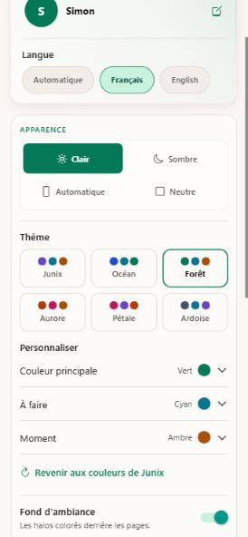
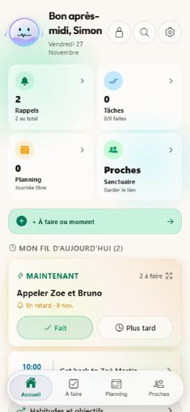
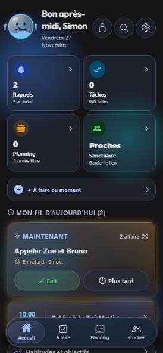

# FICHE OPÉRATOIRE N° 042 — Les thèmes de couleurs

Projet : **Junix Pulse** · Date : 27 novembre 2026 · Suite de : [FICHE 041](FICHE-041-theme-neutre.md)

---

## 1. Objectif

Deuxième fiche du chantier n° 11, validée avec sa maquette (« j'aime bien ce que tu as proposé ») :

| Ta demande | Ce que fait cette fiche |
|---|---|
| un thème qui gère toutes les couleurs du design | **6 thèmes** : Junix (celui d'avant, par défaut), Océan, Forêt, Aurore, Pétale, Ardoise |
| les halos, les boutons, les liens, les cases, les cartes… | tout suit le thème : halos du fond, lueur des glowcards, boutons pleins et en verre, liens, cases cochées, onglet actif, puces, ombres, bordure de la recherche, couleurs des familles |
| choisir une couleur précise | « **Personnaliser** » : couleur principale, À faire, Moment, chacune parmi **8 couleurs** lisibles (4,5 : 1 vérifié) |
| revenir en arrière | « **Revenir aux couleurs de Junix** » (visible seulement si quelque chose diffère) |
| le Neutre s'adapte au thème | oui : fond uni gris-bleu, mais boutons et cartes dans la couleur du thème |
| les notifications et le widget | la couleur d'accent des notifications, et le widget « Aujourd'hui » |
| un design cohérent : la mascotte, les cartes simples, les textes | **Pulse** prend le thème (anneau et liquide) ; **en sombre**, page, cartes, barres et textes prennent une légère teinte du thème ; au lancement, la lueur autour du logo aussi |
| l'icône, le logo, le lancement ? | **fixes** : c'est l'identité (comme Todoist, qui sépare thème et icône) ; Android 13+ teinte déjà l'icône au fond d'écran |
| (inchangé exprès) | le rouge « urgent », le vert « fait », les alarmes (rouges), le visage de Pulse et ses couleurs d'humeur, le logo |



*Figure 42-1 — Capture réelle (web, 360 px) : le bloc Thème, Forêt choisi ; les boutons passent au vert tout de suite.*



*Figure 42-2 — Capture réelle : l'accueil en Forêt, halos vert et cyan, bouton et onglet verts.*



*Figure 42-3 — Capture réelle : Océan en sombre ; fonds et cartes bleutés, halos bleus, Pulse à l'anneau bleu.*

La couleur d'**une carte** dans les formulaires est la **fiche 043**.

## 2. État de départ

| À vérifier | Comment | Résultat attendu |
|---|---|---|
| La fiche 041 est appliquée | `git diff --stat` | les fichiers de la fiche 041 |
| Tout passe | `npx jest` | `Tests: 2165 passed` |

## 3. Matériel

Rien de nouveau (aucune dépendance ajoutée).

## 4. Hypothèses

- Avec **Junix**, l'appli redonne **exactement** les mêmes couleurs qu'avant (un test le vérifie, et l'appli garde alors les palettes d'origine telles quelles).
- Deux couleurs de Junix étaient sous 4,5 : 1 sur le fond des cartes crème et sur le gris-bleu du Neutre : l'ambre des Moments (`#B45309` → `#A8500A`) et, dans le nuancier, le corail (`#C2410C` → `#B23C0A`). La différence se voit à peine.
- Une notification programmée par l'appli fermée (après un redémarrage du téléphone) prend la couleur d'accent de Junix : le thème n'est pas encore chargé à ce moment-là.

## 5. Carte de l'intervention

| Fichier | Action |
|---|---|
| `constants/color-themes.ts` (+ test) | **nouveau** : les 8 couleurs, les 6 thèmes, le choix enregistré |
| `constants/palettes.ts`, `hooks/use-theme.ts`, `constants/item-kinds.ts`, `constants/moment-kinds.ts`, `components/ui/AmbientBackground.tsx`, `components/ui/GlowCard.tsx` | la palette, les halos et la lueur dans les couleurs du thème |
| `domain/entities`, `store/app-store.ts`, `repositories/settings-repository.ts`, `database/migrations.ts`, `services/backup-service.ts`, `app/_layout.tsx` | le choix enregistré (migration 44, colonne `color_theme`) |
| 14 fichiers de styles et d'écrans | les violets écrits à la main suivent la couleur principale |
| `components/settings/ColorThemePicker.tsx` (**nouveau**), `app/settings/index.tsx`, i18n | le bloc Thème des paramètres |
| `services/notification-service.ts`, `widget/TodayWidget.tsx`, `widget/widget-task-handler.tsx` | les notifications et le widget |
| `features/mascot/*`, `widget/widget-mascot-svg.ts`, `features/launch/SplashAnimation.tsx`, `utils/color.ts` | Pulse, les gris sombres teintés, la lueur du lancement |

## 6. Sauvegarde

`git status` (fiche 041 appliquée, hors `docs/motion/`). Une migration **additive** (une colonne ajoutée, rien d'effacé) : la 44.

## 7. Pas à pas

Le plus simple : `node docs/fiches/outils/appliquer-fiche-042.js .` (après la fiche 041) fait toutes les étapes ci-dessous ; puis l'APK (fiche 003).

### Étape 1 — Les 8 couleurs et les 6 thèmes

**Pourquoi** : Un seul fichier décrit les couleurs (`color-themes.ts`). Chaque couleur a une version **claire** (assez foncée pour 4,5 : 1 sur le crème, le blanc et le gris-bleu) et une version **sombre** (assez claire pour 4,5 : 1 sur les fonds sombres), plus ses halos. Un thème choisit trois couleurs : principale, À faire, Moment. Le choix enregistré est petit : le thème, et éventuellement une couleur changée à la main (`{ theme: 'forest', moment: 'coral' }`). Tout ce qui est inconnu ou abîmé redevient Junix. Le test vérifie que Junix redonne exactement les palettes et les halos d'avant, et que chaque couleur est lisible partout.

Repère (Ctrl+F) : la première ligne de chaque bloc « Chercher ». Le script `appliquer-fiche-042.js` fait tous ces changements d'un coup, et refuse d'écrire si un bloc ne se trouve pas exactement une fois.

#### `src/constants/color-themes.ts`

Fichier nouveau, en entier :

<!-- bloc: new-color-themes -->

```ts
/**
 * The colour themes (study 001, 16.11; sheet 042).
 *
 * A theme picks three of the 8 colours below: the main colour (buttons, links, ticks, the active
 * tab, the first halo), the colour of « À faire » and the colour of « Moment ». The user can then
 * change any of the three alone. « Junix » gives back exactly the colours the app had before.
 *
 * Each colour has a light version (dark enough for 4.5:1 on the cream, the white and the gray-blue)
 * and a dark version (light enough for 4.5:1 on the dark surfaces): a test checks both.
 * The red of « urgent » and the green of « done » are not here: their colour is their meaning.
 */

import type { MessageKey } from '@/i18n';

export const SWATCH_IDS = ['violet', 'blue', 'cyan', 'green', 'amber', 'coral', 'pink', 'slate'] as const;
export type SwatchId = (typeof SWATCH_IDS)[number];

export interface SwatchTone {
  /** The colour itself: texts, icons, borders, ticks. */
  readonly default: string;
  /** A pale (light) or deep (dark) fill behind its own text. */
  readonly container: string;
  /** The text on a filled button of this colour. */
  readonly on: string;
  /** The text on `container`. */
  readonly onContainer: string;
  /** Filled buttons: white text at 4.5:1 on both stops. */
  readonly gradient: readonly [string, string];
}

export interface Swatch {
  readonly id: SwatchId;
  readonly labelKey: MessageKey;
  readonly light: SwatchTone;
  readonly dark: SwatchTone;
  /** The halo of this colour behind the pages. */
  readonly halo: { readonly light: string; readonly dark: string };
  /** A softer halo, for the fourth one. */
  readonly softHalo: { readonly light: string; readonly dark: string };
  /** The glass buttons, when they differ from the dark gradient at 0.90 and 0.84 (violet: as before). */
  readonly glassPrimary?: readonly [string, string];
  /** The border of the glass controls in light, when it differs from onContainer at 0.16. */
  readonly controlBorder?: string;
}

export const SWATCHES: Readonly<Record<SwatchId, Swatch>> = {
  violet: {
    id: 'violet',
    labelKey: 'colors.violet',
    light: { default: '#6B46C1', container: '#E9DDFF', on: '#FFFFFF', onContainer: '#4A3780', gradient: ['#6B46C1', '#553C9A'] },
    dark: { default: '#D0BCFF', container: '#4A3780', on: '#381E72', onContainer: '#E9DDFF', gradient: ['#7C3AED', '#6D28D9'] },
    halo: { light: '#A78BFA', dark: '#8B3DF0' },
    softHalo: { light: '#C4B5FD', dark: '#6D28D9' },
    glassPrimary: ['rgba(124, 58, 237, 0.90)', 'rgba(79, 70, 229, 0.84)'],
    controlBorder: 'rgba(76, 52, 120, 0.16)',
  },
  blue: {
    id: 'blue',
    labelKey: 'colors.blue',
    light: { default: '#1D4ED8', container: '#DBE4FF', on: '#FFFFFF', onContainer: '#1E3A8A', gradient: ['#1D4ED8', '#1E40AF'] },
    dark: { default: '#A5BFFF', container: '#1E3A8A', on: '#0B2265', onContainer: '#DBE4FF', gradient: ['#2563EB', '#1D4ED8'] },
    halo: { light: '#93C5FD', dark: '#3B82F6' },
    softHalo: { light: '#BFDBFE', dark: '#1D4ED8' },
  },
  cyan: {
    id: 'cyan',
    labelKey: 'colors.cyan',
    light: { default: '#0E7490', container: '#C3E7FF', on: '#FFFFFF', onContainer: '#004C6D', gradient: ['#0E7490', '#155E75'] },
    dark: { default: '#7BD0FF', container: '#004C6D', on: '#003549', onContainer: '#C3E7FF', gradient: ['#0E7490', '#155E75'] },
    halo: { light: '#67E8F9', dark: '#0AE8F0' },
    softHalo: { light: '#A5F3FC', dark: '#0E7490' },
  },
  green: {
    id: 'green',
    labelKey: 'colors.green',
    light: { default: '#047857', container: '#C8F2DE', on: '#FFFFFF', onContainer: '#064E3B', gradient: ['#047857', '#065F46'] },
    dark: { default: '#6EE7B7', container: '#064E3B', on: '#022C22', onContainer: '#C8F2DE', gradient: ['#047857', '#065F46'] },
    halo: { light: '#6EE7B7', dark: '#10B981' },
    softHalo: { light: '#A7F3D0', dark: '#047857' },
  },
  amber: {
    id: 'amber',
    labelKey: 'colors.amber',
    light: { default: '#A8500A', container: '#FDE7C7', on: '#FFFFFF', onContainer: '#78350F', gradient: ['#B45309', '#92400E'] },
    dark: { default: '#F5B942', container: '#78350F', on: '#451A03', onContainer: '#FDE7C7', gradient: ['#B45309', '#92400E'] },
    halo: { light: '#FCD34D', dark: '#F59E0B' },
    softHalo: { light: '#FDE68A', dark: '#B45309' },
  },
  coral: {
    id: 'coral',
    labelKey: 'colors.coral',
    light: { default: '#B23C0A', container: '#FFDBCB', on: '#FFFFFF', onContainer: '#7C2D12', gradient: ['#C2410C', '#9A3412'] },
    dark: { default: '#FDBA9A', container: '#7C2D12', on: '#4A1A07', onContainer: '#FFDBCB', gradient: ['#C2410C', '#9A3412'] },
    halo: { light: '#FDBA74', dark: '#F97316' },
    softHalo: { light: '#FED7AA', dark: '#C2410C' },
  },
  pink: {
    id: 'pink',
    labelKey: 'colors.pink',
    light: { default: '#BE185D', container: '#FFD9E6', on: '#FFFFFF', onContainer: '#831843', gradient: ['#BE185D', '#9D174D'] },
    dark: { default: '#F9A8D4', container: '#831843', on: '#500724', onContainer: '#FFD9E6', gradient: ['#BE185D', '#9D174D'] },
    halo: { light: '#F9A8D4', dark: '#EC4899' },
    softHalo: { light: '#FBCFE8', dark: '#BE185D' },
  },
  slate: {
    id: 'slate',
    labelKey: 'colors.slate',
    light: { default: '#475569', container: '#E2E8F0', on: '#FFFFFF', onContainer: '#1E293B', gradient: ['#475569', '#334155'] },
    dark: { default: '#CBD5E1', container: '#334155', on: '#0F172A', onContainer: '#E2E8F0', gradient: ['#475569', '#334155'] },
    halo: { light: '#CBD5E1', dark: '#64748B' },
    softHalo: { light: '#E2E8F0', dark: '#475569' },
  },
};

export const COLOR_THEME_IDS = ['junix', 'ocean', 'forest', 'dawn', 'rose', 'slate'] as const;
export type ColorThemeId = (typeof COLOR_THEME_IDS)[number];

/** The three colours a theme decides. */
export interface ThemeColors {
  readonly primary: SwatchId;
  readonly todo: SwatchId;
  readonly moment: SwatchId;
}

export interface ColorTheme extends ThemeColors {
  readonly id: ColorThemeId;
  readonly labelKey: MessageKey;
  /** The third halo, between the two others. */
  readonly blendHalo: { readonly light: string; readonly dark: string };
}

export const COLOR_THEMES: Readonly<Record<ColorThemeId, ColorTheme>> = {
  junix: { id: 'junix', labelKey: 'colorTheme.junix', primary: 'violet', todo: 'cyan', moment: 'amber', blendHalo: { light: '#93A8FB', dark: '#5E7BF2' } },
  ocean: { id: 'ocean', labelKey: 'colorTheme.ocean', primary: 'blue', todo: 'cyan', moment: 'green', blendHalo: { light: '#7DD3FC', dark: '#0EA5E9' } },
  forest: { id: 'forest', labelKey: 'colorTheme.forest', primary: 'green', todo: 'cyan', moment: 'amber', blendHalo: { light: '#BEF264', dark: '#65A30D' } },
  dawn: { id: 'dawn', labelKey: 'colorTheme.dawn', primary: 'coral', todo: 'pink', moment: 'amber', blendHalo: { light: '#FDA4AF', dark: '#F43F5E' } },
  rose: { id: 'rose', labelKey: 'colorTheme.rose', primary: 'pink', todo: 'violet', moment: 'coral', blendHalo: { light: '#F0ABFC', dark: '#C026D3' } },
  slate: { id: 'slate', labelKey: 'colorTheme.slate', primary: 'slate', todo: 'cyan', moment: 'violet', blendHalo: { light: '#BAE6FD', dark: '#38BDF8' } },
};

/** What the user chose: a theme, and maybe one colour changed by hand. Saved as is. */
export interface ColorChoice {
  readonly theme: ColorThemeId;
  readonly primary?: SwatchId;
  readonly todo?: SwatchId;
  readonly moment?: SwatchId;
}

/** The colours of Junix, the default. */
export const DEFAULT_COLOR_CHOICE: ColorChoice = { theme: 'junix' };

const isSwatch = (value: unknown): value is SwatchId => SWATCH_IDS.includes(value as SwatchId);
const isTheme = (value: unknown): value is ColorThemeId => COLOR_THEME_IDS.includes(value as ColorThemeId);

/** The three colours in use: the theme's, unless one was changed by hand. */
export function resolveThemeColors(choice: ColorChoice): ThemeColors {
  const theme = COLOR_THEMES[isTheme(choice.theme) ? choice.theme : 'junix'];
  return {
    primary: isSwatch(choice.primary) ? choice.primary : theme.primary,
    todo: isSwatch(choice.todo) ? choice.todo : theme.todo,
    moment: isSwatch(choice.moment) ? choice.moment : theme.moment,
  };
}

/** True when nothing differs from the colours of Junix. */
export function isDefaultColorChoice(choice: ColorChoice): boolean {
  const colors = resolveThemeColors(choice);
  const junix = COLOR_THEMES.junix;
  return colors.primary === junix.primary && colors.todo === junix.todo && colors.moment === junix.moment;
}

/** Reads a saved choice; anything unknown falls back to Junix (an old or damaged value). */
export function parseColorChoice(raw: string | null | undefined): ColorChoice {
  if (!raw) return DEFAULT_COLOR_CHOICE;
  try {
    const value = JSON.parse(raw) as Record<string, unknown>;
    if (!value || typeof value !== 'object' || !isTheme(value.theme)) return DEFAULT_COLOR_CHOICE;
    return {
      theme: value.theme,
      ...(isSwatch(value.primary) ? { primary: value.primary } : {}),
      ...(isSwatch(value.todo) ? { todo: value.todo } : {}),
      ...(isSwatch(value.moment) ? { moment: value.moment } : {}),
    };
  } catch {
    return DEFAULT_COLOR_CHOICE;
  }
}

/** The 4 halos behind the pages, in the order of AMBIENT_HALOS (main, À faire, blend, soft main). */
export function haloColorsOf(choice: ColorChoice): readonly { light: string; dark: string }[] {
  const colors = resolveThemeColors(choice);
  const theme = COLOR_THEMES[isTheme(choice.theme) ? choice.theme : 'junix'];
  return [
    SWATCHES[colors.primary].halo,
    SWATCHES[colors.todo].halo,
    theme.blendHalo,
    SWATCHES[colors.primary].softHalo,
  ];
}
```

#### `src/__tests__/color-themes.test.ts`

Fichier nouveau, en entier :

<!-- bloc: new-color-themes-test -->

```ts
import {
  COLOR_THEMES,
  COLOR_THEME_IDS,
  DEFAULT_COLOR_CHOICE,
  haloColorsOf,
  isDefaultColorChoice,
  parseColorChoice,
  resolveThemeColors,
  SWATCH_IDS,
  SWATCHES,
} from '../constants/color-themes';
import { AMBIENT_HALOS } from '../constants/ambient';
import { colorize, darkPalette, lightPalette, neutralOf } from '../constants/palettes';
import { contrastRatio, mixHex } from '../utils/color';
import { MOOD_VISUALS, moodVisualOf } from '../features/mascot/mascot-visuals';

describe('the colour themes (sheet 042)', () => {
  const junix = resolveThemeColors(DEFAULT_COLOR_CHOICE);

  it('gives back the palettes of before with the colours of Junix', () => {
    expect(colorize(lightPalette, junix)).toEqual(lightPalette);
    expect(colorize(darkPalette, junix)).toEqual(darkPalette);
  });

  it('gives back the halos of before with the colours of Junix', () => {
    expect(haloColorsOf(DEFAULT_COLOR_CHOICE)).toEqual(AMBIENT_HALOS.map(halo => halo.color));
  });

  it('keeps every colour readable (4.5:1) on every surface, light and dark', () => {
    const neutral = neutralOf(lightPalette);
    const lightBackgrounds = [lightPalette.surface.base, lightPalette.surface.container, '#FFFFFF', neutral.surface.base];
    const darkBackgrounds = [darkPalette.surface.base, darkPalette.surface.container, darkPalette.surface.high];
    for (const id of SWATCH_IDS) {
      const swatch = SWATCHES[id];
      for (const background of lightBackgrounds) {
        expect([id, contrastRatio(swatch.light.default, background) >= 4.5]).toEqual([id, true]);
      }
      for (const background of darkBackgrounds) {
        expect([id, contrastRatio(swatch.dark.default, background) >= 4.5]).toEqual([id, true]);
      }
      // A filled button: its text on both stops of the gradient
      for (const tone of [swatch.light, swatch.dark]) {
        for (const stop of tone.gradient) {
          const text = tone === swatch.light ? tone.on : '#FFFFFF';
          expect([id, stop, contrastRatio(text, stop) >= 4.5]).toEqual([id, stop, true]);
        }
        expect([id, contrastRatio(tone.onContainer, tone.container) >= 4.5]).toEqual([id, true]);
      }
    }
  });

  it('gives each theme three different colours', () => {
    for (const id of COLOR_THEME_IDS) {
      const theme = COLOR_THEMES[id];
      expect(new Set([theme.primary, theme.todo, theme.moment]).size).toBe(3);
    }
  });

  it('lets one colour be changed by hand, the others staying the theme ones', () => {
    expect(resolveThemeColors({ theme: 'ocean', moment: 'coral' })).toEqual({ primary: 'blue', todo: 'cyan', moment: 'coral' });
    expect(isDefaultColorChoice({ theme: 'junix' })).toBe(true);
    expect(isDefaultColorChoice({ theme: 'junix', primary: 'violet' })).toBe(true);
    expect(isDefaultColorChoice({ theme: 'junix', primary: 'pink' })).toBe(false);
  });

  it('colours the buttons, the ticks and the families, not the urgent red nor the done green', () => {
    const forest = colorize(lightPalette, resolveThemeColors({ theme: 'forest' }));
    expect(forest.primary.default).toBe(SWATCHES.green.light.default);
    expect(forest.tertiary.default).toBe(SWATCHES.cyan.light.default);
    expect(forest.family.moment).toBe(SWATCHES.amber.light.default);
    expect(forest.error).toEqual(lightPalette.error);
    expect(forest.success).toEqual(lightPalette.success);
    expect(forest.priority).toEqual(lightPalette.priority);
  });

  it('tints the dark grays of the other themes, keeping every text readable', () => {
    for (const id of COLOR_THEME_IDS) {
      const dark = colorize(darkPalette, resolveThemeColors({ theme: id }));
      for (const background of [dark.surface.base, dark.surface.container, dark.surface.high]) {
        for (const text of [dark.onSurface.primary, dark.onSurface.variant, dark.primary.default, dark.tertiary.default, dark.family.moment]) {
          expect([id, text, background, contrastRatio(text, background) >= 4.5]).toEqual([id, text, background, true]);
        }
      }
    }
    expect(colorize(darkPalette, resolveThemeColors({ theme: 'ocean' })).surface.base).not.toBe(darkPalette.surface.base);
    expect(mixHex('#141414', '#3B82F6', 0.06)).toBe('#161B22');
  });

  it('keeps Pulse as before with Junix, and recolours only its violet and cyan otherwise', () => {
    for (const mood of Object.keys(MOOD_VISUALS) as (keyof typeof MOOD_VISUALS)[]) {
      expect(moodVisualOf(mood, DEFAULT_COLOR_CHOICE)).toBe(MOOD_VISUALS[mood]);
    }
    const forest = moodVisualOf('calm', { theme: 'forest' });
    expect(forest.ring).toEqual([SWATCHES.green.halo.dark, SWATCHES.cyan.halo.dark]);
    // The colours of a mood stay: alert is orange and pink in every theme
    expect(moodVisualOf('alert', { theme: 'forest' }).ring).toEqual(MOOD_VISUALS.alert.ring);
  });

  it('reads a saved choice, and falls back to Junix on anything unknown', () => {
    expect(parseColorChoice('{"theme":"dawn","primary":"blue"}')).toEqual({ theme: 'dawn', primary: 'blue' });
    expect(parseColorChoice('{"theme":"dawn","primary":"gold"}')).toEqual({ theme: 'dawn' });
    expect(parseColorChoice('{"theme":"nope"}')).toEqual(DEFAULT_COLOR_CHOICE);
    expect(parseColorChoice('not json')).toEqual(DEFAULT_COLOR_CHOICE);
    expect(parseColorChoice(null)).toEqual(DEFAULT_COLOR_CHOICE);
  });
});
```

#### `src/i18n/messages-rest-fr.ts`


Changement 1 sur 1. Chercher :

<!-- bloc: messages-rest-fr-1-avant -->

```ts
  'settingsScreen.appearanceHelp': 'Automatique suit le réglage de votre téléphone. Le mode clair est le réglage par défaut.',
  'settingsScreen.neutral': 'Neutre',
  'settingsScreen.ambient': "Fond d'ambiance",
  'settingsScreen.ambientHelp': 'Les halos violet et cyan derrière les pages.',
  'settingsScreen.glass': 'Effet verre',
  'settingsScreen.glassHelp': 'Cartes et barres translucides. Coupé : fond plein, plus lisible.',
  'settingsScreen.briefings': 'Horaires des briefings',
```

Remplacer par :

<!-- bloc: messages-rest-fr-1-apres -->

```ts
  'settingsScreen.appearanceHelp': 'Automatique suit le réglage de votre téléphone. Le mode clair est le réglage par défaut.',
  'settingsScreen.neutral': 'Neutre',
  'settingsScreen.ambient': "Fond d'ambiance",
  'settingsScreen.ambientHelp': 'Les halos colorés derrière les pages.',
  'settingsScreen.theme': 'Thème',
  'settingsScreen.customize': 'Personnaliser',
  'settingsScreen.mainColor': 'Couleur principale',
  'settingsScreen.todoColor': 'À faire',
  'settingsScreen.momentColor': 'Moment',
  'settingsScreen.resetColors': 'Revenir aux couleurs de Junix',
  'settingsScreen.colorPreview': 'Aperçu',
  'settingsScreen.choose': 'Choisir',
  'colors.violet': 'Violet',
  'colors.blue': 'Bleu',
  'colors.cyan': 'Cyan',
  'colors.green': 'Vert',
  'colors.amber': 'Ambre',
  'colors.coral': 'Corail',
  'colors.pink': 'Rose',
  'colors.slate': 'Ardoise',
  'colorTheme.junix': 'Junix',
  'colorTheme.ocean': 'Océan',
  'colorTheme.forest': 'Forêt',
  'colorTheme.dawn': 'Aurore',
  'colorTheme.rose': 'Pétale',
  'colorTheme.slate': 'Ardoise',
  'settingsScreen.glass': 'Effet verre',
  'settingsScreen.glassHelp': 'Cartes et barres translucides. Coupé : fond plein, plus lisible.',
  'settingsScreen.briefings': 'Horaires des briefings',
```

#### `src/i18n/messages-rest-en.ts`


Changement 1 sur 1. Chercher :

<!-- bloc: messages-rest-en-1-avant -->

```ts
  'settingsScreen.appearanceHelp': 'Automatic follows your phone setting. Light mode is the default.',
  'settingsScreen.neutral': 'Neutral',
  'settingsScreen.ambient': 'Ambient background',
  'settingsScreen.ambientHelp': 'The violet and cyan halos behind the pages.',
  'settingsScreen.glass': 'Glass effect',
  'settingsScreen.glassHelp': 'See-through cards and bars. Off: plain background, easier to read.',
  'settingsScreen.briefings': 'Briefing times',
```

Remplacer par :

<!-- bloc: messages-rest-en-1-apres -->

```ts
  'settingsScreen.appearanceHelp': 'Automatic follows your phone setting. Light mode is the default.',
  'settingsScreen.neutral': 'Neutral',
  'settingsScreen.ambient': 'Ambient background',
  'settingsScreen.ambientHelp': 'The coloured halos behind the pages.',
  'settingsScreen.theme': 'Theme',
  'settingsScreen.customize': 'Customize',
  'settingsScreen.mainColor': 'Main colour',
  'settingsScreen.todoColor': 'To do',
  'settingsScreen.momentColor': 'Moment',
  'settingsScreen.resetColors': 'Back to the Junix colours',
  'settingsScreen.colorPreview': 'Preview',
  'settingsScreen.choose': 'Choose',
  'colors.violet': 'Violet',
  'colors.blue': 'Blue',
  'colors.cyan': 'Cyan',
  'colors.green': 'Green',
  'colors.amber': 'Amber',
  'colors.coral': 'Coral',
  'colors.pink': 'Pink',
  'colors.slate': 'Slate',
  'colorTheme.junix': 'Junix',
  'colorTheme.ocean': 'Ocean',
  'colorTheme.forest': 'Forest',
  'colorTheme.dawn': 'Dawn',
  'colorTheme.rose': 'Petal',
  'colorTheme.slate': 'Slate',
  'settingsScreen.glass': 'Glass effect',
  'settingsScreen.glassHelp': 'See-through cards and bars. Off: plain background, easier to read.',
  'settingsScreen.briefings': 'Briefing times',
```


### Étape 2 — La palette, les halos et la lueur dans les couleurs du thème

**Pourquoi** : `colorize(palette, couleurs)` remplace dans la palette l'accent principal, l'accent « À faire » (tertiaire), les couleurs des familles, les dégradés des boutons, le fond d'une puce choisie et la teinte des ombres ; les fonds, les textes, le rouge et le vert ne bougent pas. `use-theme` l'applique (et garde les palettes d'origine telles quelles avec Junix). Les halos du fond prennent les couleurs du thème, comme la lueur « primary » des glowcards. Les couleurs des familles se lisent maintenant dans la palette ; l'ambre clair est foncé à `#A8500A` (4,7 : 1).

Repère (Ctrl+F) : la première ligne de chaque bloc « Chercher ». Le script `appliquer-fiche-042.js` fait tous ces changements d'un coup, et refuse d'écrire si un bloc ne se trouve pas exactement une fois.

#### `src/constants/palettes.ts`


Changement 1 sur 5. Chercher :

<!-- bloc: palettes-1-avant -->

```ts
 * - Les priorités ont des clés UPPERCASE qui correspondent aux enums métier.
 */

// ─── Type structurel ─────────────────────────────────────────────────────────
// On type d'abord le « shape » de la palette, puis on l'implémente deux fois.

```

Remplacer par :

<!-- bloc: palettes-1-apres -->

```ts
 * - Les priorités ont des clés UPPERCASE qui correspondent aux enums métier.
 */

import { SWATCHES, type ThemeColors } from './color-themes';
import { mixHex, withAlpha } from '@/utils/color';

// ─── Type structurel ─────────────────────────────────────────────────────────
// On type d'abord le « shape » de la palette, puis on l'implémente deux fois.

```

Changement 2 sur 5. Chercher :

<!-- bloc: palettes-2-avant -->

```ts
    readonly onContainer: string;
  };

  // ── Erreur ──────────────────────────────────────────────────────────────
  readonly error: {
    readonly default: string;
```

Remplacer par :

<!-- bloc: palettes-2-apres -->

```ts
    readonly onContainer: string;
  };

  // ── Familles (sheet 042): the colour of « À faire » and of « Moment » ──
  readonly family: {
    readonly todo: string;
    readonly moment: string;
  };

  // ── Erreur ──────────────────────────────────────────────────────────────
  readonly error: {
    readonly default: string;
```

Changement 3 sur 5. Chercher :

<!-- bloc: palettes-3-avant -->

```ts
    onContainer: '#C3E7FF',
  },

  error: {
    default: '#FFB4AB',
    container: '#93000A',
```

Remplacer par :

<!-- bloc: palettes-3-apres -->

```ts
    onContainer: '#C3E7FF',
  },

  family: {
    todo: '#7BD0FF',
    moment: '#F5B942',
  },

  error: {
    default: '#FFB4AB',
    container: '#93000A',
```

Changement 4 sur 5. Chercher :

<!-- bloc: palettes-4-avant -->

```ts
// Spec master prompt — crème chaleureuse, pas de blanc pur.
// Toutes les couleurs d'accent sont assombries pour garantir ≥ 4.5:1 sur crème.

/**
 * Neutre (study 001, 16.11; sheet 041): plain gentle colours, neither dark nor dull. A gray-blue
 * page, white cards with a thin border, a plain bottom bar, no glow and no glass. The texts keep
```

Remplacer par :

<!-- bloc: palettes-4-apres -->

```ts
// Spec master prompt — crème chaleureuse, pas de blanc pur.
// Toutes les couleurs d'accent sont assombries pour garantir ≥ 4.5:1 sur crème.

/**
 * A palette in the colours of a theme (sheet 042): the main colour (buttons, links, ticks, the
 * active tab, the shadows' tint), the colour of « À faire » (the tertiary accent) and of « Moment ».
 * The surfaces, the texts, the red of « urgent » and the green of « done » do not change.
 * With the colours of Junix, it gives back the palette unchanged.
 */
export function colorize(palette: ThemePalette, colors: ThemeColors): ThemePalette {
  const mode = palette.mode;
  const main = SWATCHES[colors.primary];
  const primary = main[mode];
  const todo = SWATCHES[colors.todo][mode];
  const moment = SWATCHES[colors.moment][mode];
  const glassPrimary = main.glassPrimary ?? [withAlpha(main.dark.gradient[0], 0.9), withAlpha(main.dark.gradient[1], 0.84)];
  return {
    ...palette,
    primary: { default: primary.default, container: primary.container, on: primary.on, onContainer: primary.onContainer },
    tertiary: { default: todo.default, container: todo.container, on: todo.on, onContainer: todo.onContainer },
    family: { todo: todo.default, moment: moment.default },
    gradient: { primary: primary.gradient, glassPrimary },
    glass: {
      ...palette.glass,
      control:
        mode === 'light'
          ? { ...palette.glass.control, borderColor: main.controlBorder ?? withAlpha(main.light.onContainer, 0.16) }
          : palette.glass.control,
      controlActive: withAlpha(primary.default, mode === 'light' ? 0.16 : 0.2),
    },
    shadow: mode === 'light' ? { ...palette.shadow, color: withAlpha(primary.default, 0.12) } : palette.shadow,
    ...(mode === 'dark' && colors.primary !== 'violet' ? tintedDark(palette, main.halo.dark) : {}),
  };
}

/**
 * The dark grays with a light tint of the theme (sheet 042), like the Android apps of today: the
 * page, the cards, the bars, the lines and the texts lean towards the main colour, a few percent.
 * Junix (violet) keeps its own grays, which already lean towards violet.
 */
function tintedDark(palette: ThemePalette, hue: string): Partial<ThemePalette> {
  const tint = (gray: string, amount: number) => mixHex(gray, hue, amount);
  const glassOf = (gray: string, alpha: number) => withAlpha(tint(gray, 0.14), alpha);
  return {
    surface: {
      base: tint('#141414', 0.06),
      low: tint('#1C1C1C', 0.06),
      container: tint('#212121', 0.06),
      high: tint('#2B2B2B', 0.06),
      highest: tint('#363636', 0.06),
    },
    onSurface: {
      primary: tint('#E4E4E4', 0.04),
      variant: tint('#C8C8C8', 0.06),
      inactive: tint('#C8C8C8', 0.06),
      disabled: tint('#6B6B6B', 0.08),
    },
    outline: {
      default: tint('#939393', 0.08),
      variant: tint('#474747', 0.1),
    },
    glowCard: { ...palette.glowCard, background: tint('#141414', 0.06) },
    glass: {
      ...palette.glass,
      card: { ...palette.glass.card, backgroundColor: glassOf('#1E1E1E', 0.55) },
      control: { ...palette.glass.control, backgroundColor: glassOf('#1E1E1E', 0.45) },
      nav: { ...palette.glass.nav, backgroundColor: glassOf('#181818', 0.82) },
    },
  };
}

/**
 * Neutre (study 001, 16.11; sheet 041): plain gentle colours, neither dark nor dull. A gray-blue
 * page, white cards with a thin border, a plain bottom bar, no glow and no glass. The texts keep
```

Changement 5 sur 5. Chercher :

<!-- bloc: palettes-5-avant -->

```ts
    onContainer: '#004C6D',
  },

  error: {
    default: '#DC2626',     // contraste 4.6:1 sur #FBF7F2
    container: '#FFDAD6',
```

Remplacer par :

<!-- bloc: palettes-5-apres -->

```ts
    onContainer: '#004C6D',
  },

  family: {
    todo: '#0E7490',
    moment: '#A8500A', // 4.7:1 on #F2EDE8 and on the gray-blue of Neutre (sheet 042)
  },

  error: {
    default: '#DC2626',     // contraste 4.6:1 sur #FBF7F2
    container: '#FFDAD6',
```

#### `src/hooks/use-theme.ts`


Changement 1 sur 2. Chercher :

<!-- bloc: use-theme-1-avant -->

```ts
 */

import { useMemo } from 'react';
import { darkPalette, lightPalette, neutralOf, ThemePalette } from '@/constants/palettes';
import { AppearanceMode } from '@/domain/entities';
import { useColorScheme } from '@/hooks/use-color-scheme';
import { useAppStore } from '@/store/app-store';
import { resolveScheme } from '@/utils/color';

/** Neutre: the light palette made plain (sheet 041). */
const NEUTRAL_PALETTE = neutralOf(lightPalette);

export interface UseThemeResult {
```

Remplacer par :

<!-- bloc: use-theme-1-apres -->

```ts
 */

import { useMemo } from 'react';
import { isDefaultColorChoice, resolveThemeColors } from '@/constants/color-themes';
import { colorize, darkPalette, lightPalette, neutralOf, ThemePalette } from '@/constants/palettes';
import { AppearanceMode } from '@/domain/entities';
import { useColorScheme } from '@/hooks/use-color-scheme';
import { useAppStore } from '@/store/app-store';
import { resolveScheme } from '@/utils/color';


/** Neutre in the colours of Junix (sheet 041). */
const NEUTRAL_PALETTE = neutralOf(lightPalette);

export interface UseThemeResult {
```

Changement 2 sur 2. Chercher :

<!-- bloc: use-theme-2-avant -->

```ts
    [themeMode, systemScheme]
  );

  const theme = themeMode === 'neutral' ? NEUTRAL_PALETTE : mode === 'light' ? lightPalette : darkPalette;

  return useMemo(
    () => ({
```

Remplacer par :

<!-- bloc: use-theme-2-apres -->

```ts
    [themeMode, systemScheme]
  );

  const colorChoice = useAppStore((s) => s.colorChoice);

  // The palette in the colours of the theme (sheet 042); Neutre is the light one made plain (sheet 041)
  const theme = useMemo(() => {
    // Junix: the palettes as they are, the same objects as before
    if (isDefaultColorChoice(colorChoice)) {
      return themeMode === 'neutral' ? NEUTRAL_PALETTE : mode === 'light' ? lightPalette : darkPalette;
    }
    const colors = resolveThemeColors(colorChoice);
    if (themeMode === 'neutral') return neutralOf(colorize(lightPalette, colors));
    return colorize(mode === 'light' ? lightPalette : darkPalette, colors);
  }, [colorChoice, themeMode, mode]);

  return useMemo(
    () => ({
```

#### `src/constants/item-kinds.ts`


Changement 1 sur 2. Chercher :

<!-- bloc: item-kinds-1-avant -->

```ts
/** The colour of each family in each theme: cyan and amber, readable on every surface. */
export const ITEM_FAMILY_COLORS: Readonly<Record<'dark' | 'light', Readonly<Record<ItemFamily, string>>>> = {
  dark: { todo: '#7BD0FF', moment: '#F5B942' },
  light: { todo: '#0E7490', moment: '#B45309' },
};

export const ITEM_KINDS = ['reminder', 'task', 'event'] as const;
```

Remplacer par :

<!-- bloc: item-kinds-1-apres -->

```ts
/** The colour of each family in each theme: cyan and amber, readable on every surface. */
export const ITEM_FAMILY_COLORS: Readonly<Record<'dark' | 'light', Readonly<Record<ItemFamily, string>>>> = {
  dark: { todo: '#7BD0FF', moment: '#F5B942' },
  light: { todo: '#0E7490', moment: '#A8500A' },
};

export const ITEM_KINDS = ['reminder', 'task', 'event'] as const;
```

Changement 2 sur 2. Chercher :

<!-- bloc: item-kinds-2-avant -->

```ts
  },
};

export function itemFamilyColor(palette: Pick<ThemePalette, 'mode'>, family: ItemFamily): string {
  return ITEM_FAMILY_COLORS[palette.mode === 'light' ? 'light' : 'dark'][family];
}

/** The colour of a kind is the colour of its family. */
export function itemKindColor(palette: Pick<ThemePalette, 'mode'>, kind: ItemKind): string {
  return itemFamilyColor(palette, ITEM_KIND_DEFINITIONS[kind].family);
}

```

Remplacer par :

<!-- bloc: item-kinds-2-apres -->

```ts
  },
};

/** The colour of a family: the theme's when the palette carries it (sheet 042), else Junix's. */
export function itemFamilyColor(palette: Pick<ThemePalette, 'mode'> & { family?: ThemePalette['family'] }, family: ItemFamily): string {
  return palette.family?.[family] ?? ITEM_FAMILY_COLORS[palette.mode === 'light' ? 'light' : 'dark'][family];
}

/** The colour of a kind is the colour of its family. */
export function itemKindColor(palette: Pick<ThemePalette, 'mode'> & { family?: ThemePalette['family'] }, kind: ItemKind): string {
  return itemFamilyColor(palette, ITEM_KIND_DEFINITIONS[kind].family);
}

```

#### `src/constants/moment-kinds.ts`


Changement 1 sur 2. Chercher :

<!-- bloc: moment-kinds-1-avant -->

```ts
}

export const MOMENT_KIND_LOOKS: Readonly<Record<MomentKind, MomentKindLook>> = {
  appointment: { icon: 'calendar-outline', labelKey: 'momentKind.appointment', color: { dark: '#F5B942', light: '#B45309' } },
  work: { icon: 'briefcase-outline', labelKey: 'momentKind.work', color: { dark: '#7AA2F7', light: '#1D4ED8' } },
  health: { icon: 'medkit-outline', labelKey: 'momentKind.health', color: { dark: '#5EEAD4', light: '#0F766E' } },
  birthday: { icon: 'gift-outline', labelKey: 'momentKind.birthday', color: { dark: '#F9A8D4', light: '#BE185D' } },
```

Remplacer par :

<!-- bloc: moment-kinds-1-apres -->

```ts
}

export const MOMENT_KIND_LOOKS: Readonly<Record<MomentKind, MomentKindLook>> = {
  appointment: { icon: 'calendar-outline', labelKey: 'momentKind.appointment', color: { dark: '#F5B942', light: '#A8500A' } },
  work: { icon: 'briefcase-outline', labelKey: 'momentKind.work', color: { dark: '#7AA2F7', light: '#1D4ED8' } },
  health: { icon: 'medkit-outline', labelKey: 'momentKind.health', color: { dark: '#5EEAD4', light: '#0F766E' } },
  birthday: { icon: 'gift-outline', labelKey: 'momentKind.birthday', color: { dark: '#F9A8D4', light: '#BE185D' } },
```

Changement 2 sur 2. Chercher :

<!-- bloc: moment-kinds-2-avant -->

```ts
  mourning: { icon: 'leaf-outline', labelKey: 'momentKind.mourning', color: { dark: '#A8A29E', light: '#57534E' } },
  travel: { icon: 'airplane-outline', labelKey: 'momentKind.travel', color: { dark: '#93C5FD', light: '#0369A1' } },
  // "Autre" keeps the amber of the Moment family, as before the types
  other: { icon: 'ellipse-outline', labelKey: 'momentKind.other', color: { dark: '#F5B942', light: '#B45309' } },
};

/** The look of a saved type; an unknown one looks like "Autre". */
```

Remplacer par :

<!-- bloc: moment-kinds-2-apres -->

```ts
  mourning: { icon: 'leaf-outline', labelKey: 'momentKind.mourning', color: { dark: '#A8A29E', light: '#57534E' } },
  travel: { icon: 'airplane-outline', labelKey: 'momentKind.travel', color: { dark: '#93C5FD', light: '#0369A1' } },
  // "Autre" keeps the amber of the Moment family, as before the types
  other: { icon: 'ellipse-outline', labelKey: 'momentKind.other', color: { dark: '#F5B942', light: '#A8500A' } },
};

/** The look of a saved type; an unknown one looks like "Autre". */
```

#### `src/components/ui/AmbientBackground.tsx`


Changement 1 sur 4. Chercher :

<!-- bloc: ambientbackground-1-avant -->

```tsx
 */

import * as Device from 'expo-device';
import { memo, useCallback, useEffect, useState } from 'react';
import { AppState, StyleSheet, useWindowDimensions, View } from 'react-native';
import Animated, {
  interpolateColor,
```

Remplacer par :

<!-- bloc: ambientbackground-1-apres -->

```tsx
 */

import * as Device from 'expo-device';
import { memo, useCallback, useEffect, useMemo, useState } from 'react';
import { AppState, StyleSheet, useWindowDimensions, View } from 'react-native';
import Animated, {
  interpolateColor,
```

Changement 2 sur 4. Chercher :

<!-- bloc: ambientbackground-2-avant -->

```tsx
  type AmbientHaloConfig,
  type AmbientThemeMode,
} from '@/constants/ambient';
import { darkPalette, lightPalette } from '@/constants/palettes';
import { sampleAmbientPose } from '@/domain/rules/ambient-motion';
import { useTheme } from '@/hooks/use-theme';

const BOTH_MODES: readonly AmbientThemeMode[] = ['light', 'dark'];

```

Remplacer par :

<!-- bloc: ambientbackground-2-apres -->

```tsx
  type AmbientHaloConfig,
  type AmbientThemeMode,
} from '@/constants/ambient';
import { haloColorsOf } from '@/constants/color-themes';
import { darkPalette, lightPalette } from '@/constants/palettes';
import { sampleAmbientPose } from '@/domain/rules/ambient-motion';
import { useTheme } from '@/hooks/use-theme';
import { useAppStore } from '@/store/app-store';

const BOTH_MODES: readonly AmbientThemeMode[] = ['light', 'dark'];

```

Changement 3 sur 4. Chercher :

<!-- bloc: ambientbackground-3-avant -->

```tsx

function AmbientBackgroundComponent({ visible, revealed, showHalos = true }: AmbientBackgroundProps) {
  const { mode, theme, isNeutral } = useTheme();
  // The plain background of a light page: the gray-blue of Neutre, or the cream of Clair (sheet 041)
  const lightBase = isNeutral ? theme.surface.base : lightPalette.surface.base;
  const { width: screenWidth } = useWindowDimensions();
```

Remplacer par :

<!-- bloc: ambientbackground-3-apres -->

```tsx

function AmbientBackgroundComponent({ visible, revealed, showHalos = true }: AmbientBackgroundProps) {
  const { mode, theme, isNeutral } = useTheme();
  // The halos take the colours of the theme (sheet 042)
  const colorChoice = useAppStore((state) => state.colorChoice);
  const haloColors = useMemo(() => haloColorsOf(colorChoice), [colorChoice]);
  // The plain background of a light page: the gray-blue of Neutre, or the cream of Clair (sheet 041)
  const lightBase = isNeutral ? theme.surface.base : lightPalette.surface.base;
  const { width: screenWidth } = useWindowDimensions();
```

Changement 4 sur 4. Chercher :

<!-- bloc: ambientbackground-4-avant -->

```tsx
    >
      <Animated.View style={[StyleSheet.absoluteFill, baseStyle]} />
      <Animated.View style={[StyleSheet.absoluteFill, halosStyle]}>
        {halos.map((halo) => (
          <AmbientHalo
            key={halo.id}
            halo={halo}
            screenWidth={screenWidth}
            clock={clock}
            darkness={darkness}
```

Remplacer par :

<!-- bloc: ambientbackground-4-apres -->

```tsx
    >
      <Animated.View style={[StyleSheet.absoluteFill, baseStyle]} />
      <Animated.View style={[StyleSheet.absoluteFill, halosStyle]}>
        {halos.map((halo, index) => (
          <AmbientHalo
            key={halo.id}
            halo={haloColors[index] ? { ...halo, color: haloColors[index] } : halo}
            screenWidth={screenWidth}
            clock={clock}
            darkness={darkness}
```

#### `src/components/ui/GlowCard.tsx`


Changement 1 sur 2. Chercher :

<!-- bloc: glowcard-1-avant -->

```tsx
import { useCardMenu } from '@/components/ui/CardMenu';
import { useReduceTransparency } from '@/hooks/use-reduce-transparency';
import { useTheme } from '@/hooks/use-theme';
import { hexToRgba } from '@/utils/color';

export type GlowCardSize = 'list' | 'hero';
```

Remplacer par :

<!-- bloc: glowcard-1-apres -->

```tsx
import { useCardMenu } from '@/components/ui/CardMenu';
import { useReduceTransparency } from '@/hooks/use-reduce-transparency';
import { useTheme } from '@/hooks/use-theme';
import { resolveThemeColors, SWATCHES } from '@/constants/color-themes';
import { useAppStore } from '@/store/app-store';
import { hexToRgba } from '@/utils/color';

export type GlowCardSize = 'list' | 'hero';
```

Changement 2 sur 2. Chercher :

<!-- bloc: glowcard-2-avant -->

```tsx
    ],
  }));

  const accentHex = isDark ? Glow[tone] : GlowLight[tone];
  const hasGlow = tone !== 'neutral';
  const radius = size === 'hero' ? GlowCardTokens.radiusHero : GlowCardTokens.radiusList;

```

Remplacer par :

<!-- bloc: glowcard-2-apres -->

```tsx
    ],
  }));

  // The « primary » glow takes the main colour of the theme; violet keeps the glow of before (sheet 042)
  const mainColor = useAppStore(state => resolveThemeColors(state.colorChoice).primary);
  const accentHex =
    tone === 'primary' && mainColor !== 'violet'
      ? isDark ? SWATCHES[mainColor].halo.dark : SWATCHES[mainColor].light.default
      : isDark ? Glow[tone] : GlowLight[tone];
  const hasGlow = tone !== 'neutral';
  const radius = size === 'hero' ? GlowCardTokens.radiusHero : GlowCardTokens.radiusList;

```


### Étape 3 — Le choix enregistré

**Pourquoi** : Une colonne `color_theme` dans les réglages (migration 44, **ajoutée**, rien d'effacé), écrite en JSON. Vide (les réglages d'avant) veut dire Junix. Le dépôt la lit et l'écrit, la sauvegarde la garde, le magasin de l'appli la tient en mémoire, et le démarrage la charge avant d'afficher les pages.

Repère (Ctrl+F) : la première ligne de chaque bloc « Chercher ». Le script `appliquer-fiche-042.js` fait tous ces changements d'un coup, et refuse d'écrire si un bloc ne se trouve pas exactement une fois.

#### `src/domain/entities/index.ts`


Changement 1 sur 2. Chercher :

<!-- bloc: indexx-1-avant -->

```ts
import type { PlanningPrefs } from '../rules/planning-settings-rules';
import type { SoundPrefs } from '../rules/sound-rules';
import type { TagColor } from '../rules/tag-rules';

export * from '../enums';

```

Remplacer par :

<!-- bloc: indexx-1-apres -->

```ts
import type { PlanningPrefs } from '../rules/planning-settings-rules';
import type { SoundPrefs } from '../rules/sound-rules';
import type { TagColor } from '../rules/tag-rules';
import type { ColorChoice } from '../../constants/color-themes';

export * from '../enums';

```

Changement 2 sur 2. Chercher :

<!-- bloc: indexx-2-avant -->

```ts
  quietHoursEnd?: number;
  /** The default level of reminders, deadlines, moments and habits (sheet 023); all normal at first. */
  alertLevels?: AlertDefaults;
  /** The violet and cyan halos behind the pages (sheet 041); on at first. */
  ambientBackground?: boolean;
  /** The view the Planning opens on, the first day of the week and the step of a move (sheet 028). */
  planningPrefs?: PlanningPrefs;
  /** The sound of each level, and whether moments keep the sound of their tone (sheet 031). */
```

Remplacer par :

<!-- bloc: indexx-2-apres -->

```ts
  quietHoursEnd?: number;
  /** The default level of reminders, deadlines, moments and habits (sheet 023); all normal at first. */
  alertLevels?: AlertDefaults;
  /** The coloured halos behind the pages (sheet 041); on at first. */
  ambientBackground?: boolean;
  /** The colour theme, and the colours changed by hand (sheet 042); Junix at first. */
  colorChoice?: ColorChoice;
  /** The view the Planning opens on, the first day of the week and the step of a move (sheet 028). */
  planningPrefs?: PlanningPrefs;
  /** The sound of each level, and whether moments keep the sound of their tone (sheet 031). */
```

#### `src/store/app-store.ts`


Changement 1 sur 3. Chercher :

<!-- bloc: app-store-1-avant -->

```ts

import { create } from 'zustand';
import { AppearanceMode } from '@/domain/entities';
import type { AppLanguage, LanguageSetting } from '@/domain/rules/language-rules';

// ─── Snackbar (undo de suppression, confirmations) ────────────────────────────
```

Remplacer par :

<!-- bloc: app-store-1-apres -->

```ts

import { create } from 'zustand';
import { AppearanceMode } from '@/domain/entities';
import { DEFAULT_COLOR_CHOICE, type ColorChoice } from '@/constants/color-themes';
import type { AppLanguage, LanguageSetting } from '@/domain/rules/language-rules';

// ─── Snackbar (undo de suppression, confirmations) ────────────────────────────
```

Changement 2 sur 3. Chercher :

<!-- bloc: app-store-2-avant -->

```ts
  /** Glass turned off in the settings: cards and bars on a plain background. */
  reduceTransparency: boolean;
  setReduceTransparency: (reduce: boolean) => void;
  /** The violet and cyan halos behind the pages (sheet 041). */
  ambientBackground: boolean;
  setAmbientBackground: (on: boolean) => void;

  // Langue : le choix de la personne, et la langue qui en résulte (celle du téléphone sur « auto »)
  languageSetting: LanguageSetting;
```

Remplacer par :

<!-- bloc: app-store-2-apres -->

```ts
  /** Glass turned off in the settings: cards and bars on a plain background. */
  reduceTransparency: boolean;
  setReduceTransparency: (reduce: boolean) => void;
  /** The coloured halos behind the pages (sheet 041). */
  ambientBackground: boolean;
  setAmbientBackground: (on: boolean) => void;
  /** The colour theme and the colours changed by hand (sheet 042). */
  colorChoice: ColorChoice;
  setColorChoice: (choice: ColorChoice) => void;

  // Langue : le choix de la personne, et la langue qui en résulte (celle du téléphone sur « auto »)
  languageSetting: LanguageSetting;
```

Changement 3 sur 3. Chercher :

<!-- bloc: app-store-3-avant -->

```ts
  setReduceTransparency: (reduce) => set({ reduceTransparency: reduce }),
  ambientBackground: true,
  setAmbientBackground: (on) => set({ ambientBackground: on }),

  // Langue
  languageSetting: 'auto',
```

Remplacer par :

<!-- bloc: app-store-3-apres -->

```ts
  setReduceTransparency: (reduce) => set({ reduceTransparency: reduce }),
  ambientBackground: true,
  setAmbientBackground: (on) => set({ ambientBackground: on }),
  colorChoice: DEFAULT_COLOR_CHOICE,
  setColorChoice: (choice) => set({ colorChoice: choice }),

  // Langue
  languageSetting: 'auto',
```

#### `src/repositories/settings-repository.ts`


Changement 1 sur 3. Chercher :

<!-- bloc: settings-repository-1-avant -->

```ts
import { alertDefaultsOf, alertDefaultsText } from '../domain/rules/notification-level-rules';
import { planningPrefsOf, planningPrefsText } from '../domain/rules/planning-settings-rules';
import { soundPrefsOf, soundPrefsText } from '../domain/rules/sound-rules';

const VALID_APPEARANCE_MODES: ReadonlySet<AppearanceMode> = new Set(['system', 'light', 'dark', 'neutral']);
const VALID_MASCOT_PRESENCE: ReadonlySet<string> = new Set<MascotPresence>(['full', 'discreet', 'off']);
```

Remplacer par :

<!-- bloc: settings-repository-1-apres -->

```ts
import { alertDefaultsOf, alertDefaultsText } from '../domain/rules/notification-level-rules';
import { planningPrefsOf, planningPrefsText } from '../domain/rules/planning-settings-rules';
import { soundPrefsOf, soundPrefsText } from '../domain/rules/sound-rules';
import { parseColorChoice } from '../constants/color-themes';

const VALID_APPEARANCE_MODES: ReadonlySet<AppearanceMode> = new Set(['system', 'light', 'dark', 'neutral']);
const VALID_MASCOT_PRESENCE: ReadonlySet<string> = new Set<MascotPresence>(['full', 'discreet', 'off']);
```

Changement 2 sur 3. Chercher :

<!-- bloc: settings-repository-2-avant -->

```ts
    reduceTransparency: (row.reduce_transparency as number) === 1,
    // On unless switched off (sheet 041): empty for the settings made before
    ambientBackground: (row.ambient_background as number | null | undefined) !== 0,
    appearanceDark: row.appearance_dark !== undefined ? (row.appearance_dark as number) === 1 : true,
    mascotPresence: validOr(row.mascot_presence, VALID_MASCOT_PRESENCE, DEFAULT_MASCOT_SETTINGS.presence),
    mascotAddress: validOr(row.mascot_address, VALID_MASCOT_ADDRESS, DEFAULT_MASCOT_SETTINGS.address),
```

Remplacer par :

<!-- bloc: settings-repository-2-apres -->

```ts
    reduceTransparency: (row.reduce_transparency as number) === 1,
    // On unless switched off (sheet 041): empty for the settings made before
    ambientBackground: (row.ambient_background as number | null | undefined) !== 0,
    // Junix unless chosen (sheet 042): empty for the settings made before
    colorChoice: parseColorChoice(row.color_theme as string | null | undefined),
    appearanceDark: row.appearance_dark !== undefined ? (row.appearance_dark as number) === 1 : true,
    mascotPresence: validOr(row.mascot_presence, VALID_MASCOT_PRESENCE, DEFAULT_MASCOT_SETTINGS.presence),
    mascotAddress: validOr(row.mascot_address, VALID_MASCOT_ADDRESS, DEFAULT_MASCOT_SETTINGS.address),
```

Changement 3 sur 3. Chercher :

<!-- bloc: settings-repository-3-avant -->

```ts
      setClauses.push('ambient_background = ?');
      values.push(params.ambientBackground ? 1 : 0);
    }
    if (params.hapticsEnabled !== undefined) {
      setClauses.push('haptics_enabled = ?');
      values.push(params.hapticsEnabled ? 1 : 0);
```

Remplacer par :

<!-- bloc: settings-repository-3-apres -->

```ts
      setClauses.push('ambient_background = ?');
      values.push(params.ambientBackground ? 1 : 0);
    }
    if (params.colorChoice !== undefined) {
      setClauses.push('color_theme = ?');
      values.push(JSON.stringify(params.colorChoice));
    }
    if (params.hapticsEnabled !== undefined) {
      setClauses.push('haptics_enabled = ?');
      values.push(params.hapticsEnabled ? 1 : 0);
```

#### `src/database/migrations.ts`


Changement 1 sur 1. Chercher :

<!-- bloc: migrations-1-avant -->

```ts
      ALTER TABLE settings ADD COLUMN ambient_background INTEGER;
    `,
  },
];

```

Remplacer par :

<!-- bloc: migrations-1-apres -->

```ts
      ALTER TABLE settings ADD COLUMN ambient_background INTEGER;
    `,
  },
  {
    version: 44,
    name: 'add_color_theme',
    sql: `
      -- Le theme de couleurs et les couleurs changees a la main (fiche 042). Vide : Junix, comme avant.
      ALTER TABLE settings ADD COLUMN color_theme TEXT;
    `,
  },
];

```

#### `src/services/backup-service.ts`


Changement 1 sur 1. Chercher :

<!-- bloc: backup-service-1-avant -->

```ts
  planning_blocks: ['id', 'schedule_id', 'label', 'type', 'day_of_week', 'start_time', 'end_time', 'color', 'created_at', 'updated_at'],
  interactions: ['id', 'person_id', 'type', 'occurred_at', 'notes', 'reminder_id', 'task_id', 'event_id', 'created_at'],
  suggestions: ['id', 'type', 'status', 'title', 'explanation', 'target_id', 'target_type', 'proposed_data', 'generated_at', 'expires_at', 'decided_at', 'created_at'],
  settings: ['id', 'display_name', 'timezone', 'onboarding_completed', 'notifications_enabled', 'forgotten_contact_threshold_days', 'end_of_day_hour', 'morning_briefing_hour', 'appearance_dark', 'appearance_mode', 'mascot_presence', 'mascot_address', 'mascot_proposals', 'mascot_briefings', 'language', 'notification_sound_enabled', 'haptics_enabled', 'quiet_hours_start', 'quiet_hours_end', 'alert_levels', 'planning_prefs', 'sound_prefs', 'ambient_background', 'created_at', 'updated_at'],
  sanctum_notes: ['id', 'title', 'content', 'folder', 'created_at', 'updated_at'],
};

```

Remplacer par :

<!-- bloc: backup-service-1-apres -->

```ts
  planning_blocks: ['id', 'schedule_id', 'label', 'type', 'day_of_week', 'start_time', 'end_time', 'color', 'created_at', 'updated_at'],
  interactions: ['id', 'person_id', 'type', 'occurred_at', 'notes', 'reminder_id', 'task_id', 'event_id', 'created_at'],
  suggestions: ['id', 'type', 'status', 'title', 'explanation', 'target_id', 'target_type', 'proposed_data', 'generated_at', 'expires_at', 'decided_at', 'created_at'],
  settings: ['id', 'display_name', 'timezone', 'onboarding_completed', 'notifications_enabled', 'forgotten_contact_threshold_days', 'end_of_day_hour', 'morning_briefing_hour', 'appearance_dark', 'appearance_mode', 'mascot_presence', 'mascot_address', 'mascot_proposals', 'mascot_briefings', 'language', 'notification_sound_enabled', 'haptics_enabled', 'quiet_hours_start', 'quiet_hours_end', 'alert_levels', 'planning_prefs', 'sound_prefs', 'ambient_background', 'color_theme', 'created_at', 'updated_at'],
  sanctum_notes: ['id', 'title', 'content', 'folder', 'created_at', 'updated_at'],
};

```

#### `src/app/_layout.tsx`


Changement 1 sur 1. Chercher :

<!-- bloc: -layout-1-avant -->

```tsx
        setThemeMode(settings.appearanceMode);
        useAppStore.getState().setReduceTransparency(settings.reduceTransparency);
        useAppStore.getState().setAmbientBackground(settings.ambientBackground !== false);

        // 3. Initialiser les notifications (handler + canal Android)
        //    Isolé pour ne jamais bloquer le démarrage si expo-notifications est limité dans Expo Go
```

Remplacer par :

<!-- bloc: -layout-1-apres -->

```tsx
        setThemeMode(settings.appearanceMode);
        useAppStore.getState().setReduceTransparency(settings.reduceTransparency);
        useAppStore.getState().setAmbientBackground(settings.ambientBackground !== false);
        if (settings.colorChoice) useAppStore.getState().setColorChoice(settings.colorChoice);

        // 3. Initialiser les notifications (handler + canal Android)
        //    Isolé pour ne jamais bloquer le démarrage si expo-notifications est limité dans Expo Go
```


### Étape 4 — Les violets écrits à la main suivent la couleur principale

**Pourquoi** : 78 couleurs étaient écrites en dur : `rgba(107, 70, 193, x)` (le violet clair), `rgba(208, 188, 255, x)` (le violet sombre), `rgba(124, 58, 237, x)` (le violet vif des boutons sombres). Elles deviennent `withAlpha(theme.primary.default, x)` ou `withAlpha(theme.gradient.primary[0], x)`. Avant de remplacer, on a vérifié que chacune était dans la bonne branche (clair ou sombre) : avec Junix, la valeur produite est la même, au caractère près.

Repère (Ctrl+F) : la première ligne de chaque bloc « Chercher ». Le script `appliquer-fiche-042.js` fait tous ces changements d'un coup, et refuse d'écrire si un bloc ne se trouve pas exactement une fois.

#### `src/styles/common/form-styles.ts`


Changement 1 sur 7. Chercher :

<!-- bloc: form-styles-1-avant -->

```ts
  TitleFontFamily,
} from '@/constants/theme';
import { darkPalette, type ThemePalette } from '@/constants/palettes';

export function makeFormStyles(theme: ThemePalette) {
  const isDark = theme.mode === 'dark';
```

Remplacer par :

<!-- bloc: form-styles-1-apres -->

```ts
  TitleFontFamily,
} from '@/constants/theme';
import { darkPalette, type ThemePalette } from '@/constants/palettes';
import { withAlpha } from '@/utils/color';

export function makeFormStyles(theme: ThemePalette) {
  const isDark = theme.mode === 'dark';
```

Changement 2 sur 7. Chercher :

<!-- bloc: form-styles-2-avant -->

```ts
      width: 24,
      height: 24,
      borderRadius: Radius.full,
      backgroundColor: isDark ? 'rgba(208, 188, 255, 0.12)' : 'rgba(107, 70, 193, 0.12)',
      alignItems: 'center',
      justifyContent: 'center',
    },
```

Remplacer par :

<!-- bloc: form-styles-2-apres -->

```ts
      width: 24,
      height: 24,
      borderRadius: Radius.full,
      backgroundColor: isDark ? withAlpha(theme.primary.default, 0.12) : withAlpha(theme.primary.default, 0.12),
      alignItems: 'center',
      justifyContent: 'center',
    },
```

Changement 3 sur 7. Chercher :

<!-- bloc: form-styles-3-avant -->

```ts
        default: {
          boxShadow: isDark
            ? '0 4px 14px -2px rgba(0, 0, 0, 0.35)'
            : '0 4px 14px -2px rgba(107, 70, 193, 0.08)',
        },
      }),
    },
```

Remplacer par :

<!-- bloc: form-styles-3-apres -->

```ts
        default: {
          boxShadow: isDark
            ? '0 4px 14px -2px rgba(0, 0, 0, 0.35)'
            : `0 4px 14px -2px ${withAlpha(theme.primary.default, 0.08)}`,
        },
      }),
    },
```

Changement 4 sur 7. Chercher :

<!-- bloc: form-styles-4-avant -->

```ts
      borderRadius: Radius.md,
      padding: Spacing.md,
      borderWidth: 1,
      borderColor: isDark ? 'rgba(208, 188, 255, 0.18)' : theme.outline.variant,
    },
    selectorLeft: {
      flexDirection: 'row',
```

Remplacer par :

<!-- bloc: form-styles-4-apres -->

```ts
      borderRadius: Radius.md,
      padding: Spacing.md,
      borderWidth: 1,
      borderColor: isDark ? withAlpha(theme.primary.default, 0.18) : theme.outline.variant,
    },
    selectorLeft: {
      flexDirection: 'row',
```

Changement 5 sur 7. Chercher :

<!-- bloc: form-styles-5-avant -->

```ts
      width: 32,
      height: 32,
      borderRadius: Radius.md,
      backgroundColor: isDark ? 'rgba(208, 188, 255, 0.12)' : 'rgba(107, 70, 193, 0.12)',
      alignItems: 'center',
      justifyContent: 'center',
    },
```

Remplacer par :

<!-- bloc: form-styles-5-apres -->

```ts
      width: 32,
      height: 32,
      borderRadius: Radius.md,
      backgroundColor: isDark ? withAlpha(theme.primary.default, 0.12) : withAlpha(theme.primary.default, 0.12),
      alignItems: 'center',
      justifyContent: 'center',
    },
```

Changement 6 sur 7. Chercher :

<!-- bloc: form-styles-6-avant -->

```ts
      gap: 6,
    },
    chipActive: {
      backgroundColor: isDark ? 'rgba(208, 188, 255, 0.18)' : 'rgba(107, 70, 193, 0.15)',
      borderColor: theme.primary.default,
    },
    chipDot: {
```

Remplacer par :

<!-- bloc: form-styles-6-apres -->

```ts
      gap: 6,
    },
    chipActive: {
      backgroundColor: isDark ? withAlpha(theme.primary.default, 0.18) : withAlpha(theme.primary.default, 0.15),
      borderColor: theme.primary.default,
    },
    chipDot: {
```

Changement 7 sur 7. Chercher :

<!-- bloc: form-styles-7-avant -->

```ts
      gap: 4,
    },
    actionTileActive: {
      backgroundColor: isDark ? 'rgba(208, 188, 255, 0.16)' : 'rgba(107, 70, 193, 0.15)',
      borderColor: theme.primary.default,
    },
    actionTileText: {
```

Remplacer par :

<!-- bloc: form-styles-7-apres -->

```ts
      gap: 4,
    },
    actionTileActive: {
      backgroundColor: isDark ? withAlpha(theme.primary.default, 0.16) : withAlpha(theme.primary.default, 0.15),
      borderColor: theme.primary.default,
    },
    actionTileText: {
```

#### `src/styles/reminders/new-reminder-styles.ts`


Changement 1 sur 4. Chercher :

<!-- bloc: new-reminder-styles-1-avant -->

```ts
  Typography,
} from '@/constants/theme';
import { darkPalette, type ThemePalette } from '@/constants/palettes';

export function makeNewReminderStyles(theme: ThemePalette) {
  const isDark = theme.mode === 'dark';
```

Remplacer par :

<!-- bloc: new-reminder-styles-1-apres -->

```ts
  Typography,
} from '@/constants/theme';
import { darkPalette, type ThemePalette } from '@/constants/palettes';
import { withAlpha } from '@/utils/color';

export function makeNewReminderStyles(theme: ThemePalette) {
  const isDark = theme.mode === 'dark';
```

Changement 2 sur 4. Chercher :

<!-- bloc: new-reminder-styles-2-avant -->

```ts
      borderRadius: Radius.lg,
      padding: Spacing.md,
      borderWidth: 1,
      borderColor: isDark ? 'rgba(208, 188, 255, 0.16)' : theme.glass.card.borderColor,
      gap: Spacing.sm,
      shadowColor: theme.shadow.color,
      shadowOffset: { width: 0, height: 4 },
```

Remplacer par :

<!-- bloc: new-reminder-styles-2-apres -->

```ts
      borderRadius: Radius.lg,
      padding: Spacing.md,
      borderWidth: 1,
      borderColor: isDark ? withAlpha(theme.primary.default, 0.16) : theme.glass.card.borderColor,
      gap: Spacing.sm,
      shadowColor: theme.shadow.color,
      shadowOffset: { width: 0, height: 4 },
```

Changement 3 sur 4. Chercher :

<!-- bloc: new-reminder-styles-3-avant -->

```ts
      borderRadius: Radius.md,
      padding: Spacing.md,
      borderWidth: 1,
      borderColor: isDark ? 'rgba(208, 188, 255, 0.22)' : theme.outline.variant,
    },
    dateSelectorLeft: {
      flexDirection: 'row',
```

Remplacer par :

<!-- bloc: new-reminder-styles-3-apres -->

```ts
      borderRadius: Radius.md,
      padding: Spacing.md,
      borderWidth: 1,
      borderColor: isDark ? withAlpha(theme.primary.default, 0.22) : theme.outline.variant,
    },
    dateSelectorLeft: {
      flexDirection: 'row',
```

Changement 4 sur 4. Chercher :

<!-- bloc: new-reminder-styles-4-avant -->

```ts
      gap: 4,
    },
    actionTileSelected: {
      backgroundColor: isDark ? 'rgba(208, 188, 255, 0.16)' : 'rgba(107, 70, 193, 0.15)',
      borderColor: theme.primary.default,
    },
    actionTileLabel: {
```

Remplacer par :

<!-- bloc: new-reminder-styles-4-apres -->

```ts
      gap: 4,
    },
    actionTileSelected: {
      backgroundColor: isDark ? withAlpha(theme.primary.default, 0.16) : withAlpha(theme.primary.default, 0.15),
      borderColor: theme.primary.default,
    },
    actionTileLabel: {
```

#### `src/styles/sanctum/sanctum-styles.ts`


Changement 1 sur 13. Chercher :

<!-- bloc: sanctum-styles-1-avant -->

```ts
  Typography,
} from '@/constants/theme';
import { ThemePalette, darkPalette } from '@/constants/palettes';

export function makeSanctumStyles(theme: ThemePalette) {
  const isLight = theme.mode === 'light';
```

Remplacer par :

<!-- bloc: sanctum-styles-1-apres -->

```ts
  Typography,
} from '@/constants/theme';
import { ThemePalette, darkPalette } from '@/constants/palettes';
import { withAlpha } from '@/utils/color';

export function makeSanctumStyles(theme: ThemePalette) {
  const isLight = theme.mode === 'light';
```

Changement 2 sur 13. Chercher :

<!-- bloc: sanctum-styles-2-avant -->

```ts
      borderRadius: Radius.xl,
      padding: Spacing.xl,
      borderWidth: 1,
      borderColor: isLight ? theme.outline.variant : 'rgba(208, 188, 255, 0.18)',
      gap: Spacing.md,
      ...Platform.select({
        ios: {
```

Remplacer par :

<!-- bloc: sanctum-styles-2-apres -->

```ts
      borderRadius: Radius.xl,
      padding: Spacing.xl,
      borderWidth: 1,
      borderColor: isLight ? theme.outline.variant : withAlpha(theme.primary.default, 0.18),
      gap: Spacing.md,
      ...Platform.select({
        ios: {
```

Changement 3 sur 13. Chercher :

<!-- bloc: sanctum-styles-3-avant -->

```ts
        },
        default: {
          boxShadow: isLight
            ? '0 8px 24px -4px rgba(107, 70, 193, 0.14)'
            : '0 8px 32px -4px rgba(0, 0, 0, 0.40)',
        },
      }),
```

Remplacer par :

<!-- bloc: sanctum-styles-3-apres -->

```ts
        },
        default: {
          boxShadow: isLight
            ? `0 8px 24px -4px ${withAlpha(theme.primary.default, 0.14)}`
            : '0 8px 32px -4px rgba(0, 0, 0, 0.40)',
        },
      }),
```

Changement 4 sur 13. Chercher :

<!-- bloc: sanctum-styles-4-avant -->

```ts
      width: 60,
      height: 60,
      borderRadius: 30,
      backgroundColor: isLight ? theme.primary.container : 'rgba(208, 188, 255, 0.12)',
      alignItems: 'center',
      justifyContent: 'center',
    },
```

Remplacer par :

<!-- bloc: sanctum-styles-4-apres -->

```ts
      width: 60,
      height: 60,
      borderRadius: 30,
      backgroundColor: isLight ? theme.primary.container : withAlpha(theme.primary.default, 0.12),
      alignItems: 'center',
      justifyContent: 'center',
    },
```

Changement 5 sur 13. Chercher :

<!-- bloc: sanctum-styles-5-avant -->

```ts
      width: 32,
      height: 32,
      borderRadius: Radius.md,
      backgroundColor: isLight ? theme.primary.container : 'rgba(208, 188, 255, 0.12)',
      alignItems: 'center',
      justifyContent: 'center',
    },
```

Remplacer par :

<!-- bloc: sanctum-styles-5-apres -->

```ts
      width: 32,
      height: 32,
      borderRadius: Radius.md,
      backgroundColor: isLight ? theme.primary.container : withAlpha(theme.primary.default, 0.12),
      alignItems: 'center',
      justifyContent: 'center',
    },
```

Changement 6 sur 13. Chercher :

<!-- bloc: sanctum-styles-6-avant -->

```ts
      textAlign: 'center',
      letterSpacing: 12,
      borderWidth: 1,
      borderColor: isLight ? theme.outline.variant : 'rgba(208, 188, 255, 0.22)',
      marginTop: Spacing.xs,
    },
    pinFormGroup: {
```

Remplacer par :

<!-- bloc: sanctum-styles-6-apres -->

```ts
      textAlign: 'center',
      letterSpacing: 12,
      borderWidth: 1,
      borderColor: isLight ? theme.outline.variant : withAlpha(theme.primary.default, 0.22),
      marginTop: Spacing.xs,
    },
    pinFormGroup: {
```

Changement 7 sur 13. Chercher :

<!-- bloc: sanctum-styles-7-avant -->

```ts
      letterSpacing: 8,
      fontSize: 18,
      borderWidth: 1,
      borderColor: isLight ? theme.outline.variant : 'rgba(208, 188, 255, 0.22)',
    },

    // ─── Security badge ────────────────────────────────────────────────────
```

Remplacer par :

<!-- bloc: sanctum-styles-7-apres -->

```ts
      letterSpacing: 8,
      fontSize: 18,
      borderWidth: 1,
      borderColor: isLight ? theme.outline.variant : withAlpha(theme.primary.default, 0.22),
    },

    // ─── Security badge ────────────────────────────────────────────────────
```

Changement 8 sur 13. Chercher :

<!-- bloc: sanctum-styles-8-avant -->

```ts
      paddingVertical: Spacing.sm,
      gap: Spacing.sm,
      borderWidth: 1,
      borderColor: isLight ? theme.outline.variant : 'rgba(208, 188, 255, 0.14)',
    },
    searchInput: {
      flex: 1,
```

Remplacer par :

<!-- bloc: sanctum-styles-8-apres -->

```ts
      paddingVertical: Spacing.sm,
      gap: Spacing.sm,
      borderWidth: 1,
      borderColor: isLight ? theme.outline.variant : withAlpha(theme.primary.default, 0.14),
    },
    searchInput: {
      flex: 1,
```

Changement 9 sur 13. Chercher :

<!-- bloc: sanctum-styles-9-avant -->

```ts
      borderRadius: Radius.lg,
      padding: Spacing.lg,
      borderWidth: 1,
      borderColor: isLight ? theme.outline.variant : 'rgba(208, 188, 255, 0.16)',
      gap: Spacing.xs,
      ...Platform.select({
        ios: {
```

Remplacer par :

<!-- bloc: sanctum-styles-9-apres -->

```ts
      borderRadius: Radius.lg,
      padding: Spacing.lg,
      borderWidth: 1,
      borderColor: isLight ? theme.outline.variant : withAlpha(theme.primary.default, 0.16),
      gap: Spacing.xs,
      ...Platform.select({
        ios: {
```

Changement 10 sur 13. Chercher :

<!-- bloc: sanctum-styles-10-avant -->

```ts
        },
        default: {
          boxShadow: isLight
            ? '0 4px 14px -2px rgba(107, 70, 193, 0.08)'
            : '0 4px 14px -2px rgba(0, 0, 0, 0.3)',
        },
      }),
```

Remplacer par :

<!-- bloc: sanctum-styles-10-apres -->

```ts
        },
        default: {
          boxShadow: isLight
            ? `0 4px 14px -2px ${withAlpha(theme.primary.default, 0.08)}`
            : '0 4px 14px -2px rgba(0, 0, 0, 0.3)',
        },
      }),
```

Changement 11 sur 13. Chercher :

<!-- bloc: sanctum-styles-11-avant -->

```ts
      paddingHorizontal: Spacing.md,
      paddingVertical: Spacing.sm + 2,
      borderWidth: 1,
      borderColor: isLight ? theme.outline.variant : 'rgba(208, 188, 255, 0.18)',
      marginTop: Spacing.xs,
    },
    folderBadgeSmall: {
      width: 28,
      height: 28,
      borderRadius: Radius.sm,
      backgroundColor: isLight ? theme.primary.container : 'rgba(208, 188, 255, 0.12)',
      alignItems: 'center',
      justifyContent: 'center',
    },
```

Remplacer par :

<!-- bloc: sanctum-styles-11-apres -->

```ts
      paddingHorizontal: Spacing.md,
      paddingVertical: Spacing.sm + 2,
      borderWidth: 1,
      borderColor: isLight ? theme.outline.variant : withAlpha(theme.primary.default, 0.18),
      marginTop: Spacing.xs,
    },
    folderBadgeSmall: {
      width: 28,
      height: 28,
      borderRadius: Radius.sm,
      backgroundColor: isLight ? theme.primary.container : withAlpha(theme.primary.default, 0.12),
      alignItems: 'center',
      justifyContent: 'center',
    },
```

Changement 12 sur 13. Chercher :

<!-- bloc: sanctum-styles-12-avant -->

```ts
      backgroundColor: isLight ? theme.surface.container : 'rgba(18, 22, 34, 0.95)',
      borderRadius: Radius.md,
      borderWidth: 1,
      borderColor: isLight ? theme.outline.variant : 'rgba(208, 188, 255, 0.18)',
      overflow: 'hidden',
      marginTop: 4,
    },
```

Remplacer par :

<!-- bloc: sanctum-styles-12-apres -->

```ts
      backgroundColor: isLight ? theme.surface.container : 'rgba(18, 22, 34, 0.95)',
      borderRadius: Radius.md,
      borderWidth: 1,
      borderColor: isLight ? theme.outline.variant : withAlpha(theme.primary.default, 0.18),
      overflow: 'hidden',
      marginTop: 4,
    },
```

Changement 13 sur 13. Chercher :

<!-- bloc: sanctum-styles-13-avant -->

```ts
      borderBottomColor: isLight ? theme.outline.variant : 'rgba(255, 255, 255, 0.06)',
    },
    folderPickerItemActive: {
      backgroundColor: isLight ? theme.primary.container : 'rgba(208, 188, 255, 0.16)',
    },
    folderPickerItemText: {
      ...Typography.bodyMedium,
```

Remplacer par :

<!-- bloc: sanctum-styles-13-apres -->

```ts
      borderBottomColor: isLight ? theme.outline.variant : 'rgba(255, 255, 255, 0.06)',
    },
    folderPickerItemActive: {
      backgroundColor: isLight ? theme.primary.container : withAlpha(theme.primary.default, 0.16),
    },
    folderPickerItemText: {
      ...Typography.bodyMedium,
```

#### `src/styles/tabs/calendar-styles.ts`


Changement 1 sur 6. Chercher :

<!-- bloc: calendar-styles-1-avant -->

```ts
  TitleFontFamily,
} from '@/constants/theme';
import { ThemePalette, darkPalette } from '@/constants/palettes';

export function makeCalendarStyles(theme: ThemePalette) {
  const isLight = theme.mode === 'light';
```

Remplacer par :

<!-- bloc: calendar-styles-1-apres -->

```ts
  TitleFontFamily,
} from '@/constants/theme';
import { ThemePalette, darkPalette } from '@/constants/palettes';
import { withAlpha } from '@/utils/color';

export function makeCalendarStyles(theme: ThemePalette) {
  const isLight = theme.mode === 'light';
```

Changement 2 sur 6. Chercher :

<!-- bloc: calendar-styles-2-avant -->

```ts
        },
        default: {
          boxShadow: isLight
            ? '0 4px 14px -2px rgba(107, 70, 193, 0.08)'
            : '0 4px 14px -2px rgba(0, 0, 0, 0.3)',
        },
      }),
```

Remplacer par :

<!-- bloc: calendar-styles-2-apres -->

```ts
        },
        default: {
          boxShadow: isLight
            ? `0 4px 14px -2px ${withAlpha(theme.primary.default, 0.08)}`
            : '0 4px 14px -2px rgba(0, 0, 0, 0.3)',
        },
      }),
```

Changement 3 sur 6. Chercher :

<!-- bloc: calendar-styles-3-avant -->

```ts
        },
        default: {
          boxShadow: isLight
            ? '0 4px 14px 0 rgba(107, 70, 193, 0.35)'
            : '0 4px 14px 0 rgba(139, 92, 246, 0.45)',
        },
      }),
    },
    dayCellToday: {
      backgroundColor: theme.glass.controlActive,
      borderWidth: 1,
      borderColor: isLight ? theme.primary.default + '60' : 'rgba(139, 92, 246, 0.50)',
    },
    dayName: {
      ...Typography.labelSmall,
```

Remplacer par :

<!-- bloc: calendar-styles-3-apres -->

```ts
        },
        default: {
          boxShadow: isLight
            ? `0 4px 14px 0 ${withAlpha(theme.primary.default, 0.35)}`
            : `0 4px 14px 0 ${withAlpha(theme.primary.default, 0.45)}`,
        },
      }),
    },
    dayCellToday: {
      backgroundColor: theme.glass.controlActive,
      borderWidth: 1,
      borderColor: isLight ? theme.primary.default + '60' : withAlpha(theme.primary.default, 0.50),
    },
    dayName: {
      ...Typography.labelSmall,
```

Changement 4 sur 6. Chercher :

<!-- bloc: calendar-styles-4-avant -->

```ts
      borderWidth: 1,
    },
    typeBadgeBusy: {
      backgroundColor: isLight ? theme.primary.container : 'rgba(139, 92, 246, 0.20)',
      borderColor: isLight ? theme.primary.default + '40' : 'rgba(139, 92, 246, 0.35)',
    },
    typeBadgeFree: {
      backgroundColor: isLight ? theme.surface.high : 'rgba(255, 255, 255, 0.06)',
```

Remplacer par :

<!-- bloc: calendar-styles-4-apres -->

```ts
      borderWidth: 1,
    },
    typeBadgeBusy: {
      backgroundColor: isLight ? theme.primary.container : withAlpha(theme.primary.default, 0.20),
      borderColor: isLight ? theme.primary.default + '40' : withAlpha(theme.primary.default, 0.35),
    },
    typeBadgeFree: {
      backgroundColor: isLight ? theme.surface.high : 'rgba(255, 255, 255, 0.06)',
```

Changement 5 sur 6. Chercher :

<!-- bloc: calendar-styles-5-avant -->

```ts
        },
        default: {
          boxShadow: isLight
            ? '0 6px 20px -4px rgba(107, 70, 193, 0.10)'
            : '0 6px 20px -4px rgba(0, 0, 0, 0.35)',
        },
      }),
```

Remplacer par :

<!-- bloc: calendar-styles-5-apres -->

```ts
        },
        default: {
          boxShadow: isLight
            ? `0 6px 20px -4px ${withAlpha(theme.primary.default, 0.10)}`
            : '0 6px 20px -4px rgba(0, 0, 0, 0.35)',
        },
      }),
```

Changement 6 sur 6. Chercher :

<!-- bloc: calendar-styles-6-avant -->

```ts
        },
        default: {
          boxShadow: isLight
            ? '0 8px 32px -4px rgba(107, 70, 193, 0.35)'
            : '0 8px 32px -4px rgba(124, 58, 237, 0.40)',
        },
      }),
    },
```

Remplacer par :

<!-- bloc: calendar-styles-6-apres -->

```ts
        },
        default: {
          boxShadow: isLight
            ? `0 8px 32px -4px ${withAlpha(theme.primary.default, 0.35)}`
            : `0 8px 32px -4px ${withAlpha(theme.gradient.primary[0], 0.40)}`,
        },
      }),
    },
```

#### `src/styles/tabs/people-styles.ts`


Changement 1 sur 2. Chercher :

<!-- bloc: people-styles-1-avant -->

```ts
  TitleFontFamily,
} from '@/constants/theme';
import { ThemePalette, darkPalette } from '@/constants/palettes';

export function makePeopleStyles(theme: ThemePalette) {
  const isLight = theme.mode === 'light';
```

Remplacer par :

<!-- bloc: people-styles-1-apres -->

```ts
  TitleFontFamily,
} from '@/constants/theme';
import { ThemePalette, darkPalette } from '@/constants/palettes';
import { withAlpha } from '@/utils/color';

export function makePeopleStyles(theme: ThemePalette) {
  const isLight = theme.mode === 'light';
```

Changement 2 sur 2. Chercher :

<!-- bloc: people-styles-2-avant -->

```ts
        },
        default: {
          boxShadow: isLight
            ? '0 8px 32px -4px rgba(107, 70, 193, 0.35)'
            : '0 8px 32px -4px rgba(124, 58, 237, 0.40)',
        },
      }),
    },
```

Remplacer par :

<!-- bloc: people-styles-2-apres -->

```ts
        },
        default: {
          boxShadow: isLight
            ? `0 8px 32px -4px ${withAlpha(theme.primary.default, 0.35)}`
            : `0 8px 32px -4px ${withAlpha(theme.gradient.primary[0], 0.40)}`,
        },
      }),
    },
```

#### `src/styles/tabs/pulse-styles.ts`


Changement 1 sur 5. Chercher :

<!-- bloc: pulse-styles-1-avant -->

```ts
  TitleFontFamily,
} from '@/constants/theme';
import { ThemePalette, darkPalette } from '@/constants/palettes';

export function makePulseStyles(theme: ThemePalette) {
  const isLight = theme.mode === 'light';
```

Remplacer par :

<!-- bloc: pulse-styles-1-apres -->

```ts
  TitleFontFamily,
} from '@/constants/theme';
import { ThemePalette, darkPalette } from '@/constants/palettes';
import { withAlpha } from '@/utils/color';

export function makePulseStyles(theme: ThemePalette) {
  const isLight = theme.mode === 'light';
```

Changement 2 sur 5. Chercher :

<!-- bloc: pulse-styles-2-avant -->

```ts
      width: 120,
      height: 120,
      borderRadius: Radius.full,
      backgroundColor: isLight ? 'rgba(107, 70, 193, 0.08)' : 'rgba(160, 120, 255, 0.08)',
      borderWidth: 1,
      borderColor: isLight ? 'rgba(107, 70, 193, 0.16)' : 'rgba(208, 188, 255, 0.12)',
    },
    orbRingOuter: {
      position: 'absolute',
      width: 150,
      height: 150,
      borderRadius: Radius.full,
      backgroundColor: isLight ? 'rgba(107, 70, 193, 0.04)' : 'rgba(160, 120, 255, 0.04)',
      borderWidth: 1,
      borderColor: isLight ? 'rgba(107, 70, 193, 0.08)' : 'rgba(208, 188, 255, 0.06)',
    },
    heroTitle: {
      ...Typography.headlineMedium,
```

Remplacer par :

<!-- bloc: pulse-styles-2-apres -->

```ts
      width: 120,
      height: 120,
      borderRadius: Radius.full,
      backgroundColor: isLight ? withAlpha(theme.primary.default, 0.08) : withAlpha(theme.primary.default, 0.08),
      borderWidth: 1,
      borderColor: isLight ? withAlpha(theme.primary.default, 0.16) : withAlpha(theme.primary.default, 0.12),
    },
    orbRingOuter: {
      position: 'absolute',
      width: 150,
      height: 150,
      borderRadius: Radius.full,
      backgroundColor: isLight ? withAlpha(theme.primary.default, 0.04) : withAlpha(theme.primary.default, 0.04),
      borderWidth: 1,
      borderColor: isLight ? withAlpha(theme.primary.default, 0.08) : withAlpha(theme.primary.default, 0.06),
    },
    heroTitle: {
      ...Typography.headlineMedium,
```

Changement 3 sur 5. Chercher :

<!-- bloc: pulse-styles-3-avant -->

```ts
      paddingHorizontal: Spacing.md,
      paddingVertical: Spacing.xs,
      borderRadius: Radius.full,
      backgroundColor: isLight ? theme.primary.container : 'rgba(160, 120, 255, 0.12)',
      borderWidth: 1,
      borderColor: isLight ? theme.primary.default + '40' : 'rgba(208, 188, 255, 0.20)',
    },
    statusDot: {
      width: 6,
```

Remplacer par :

<!-- bloc: pulse-styles-3-apres -->

```ts
      paddingHorizontal: Spacing.md,
      paddingVertical: Spacing.xs,
      borderRadius: Radius.full,
      backgroundColor: isLight ? theme.primary.container : withAlpha(theme.primary.default, 0.12),
      borderWidth: 1,
      borderColor: isLight ? theme.primary.default + '40' : withAlpha(theme.primary.default, 0.20),
    },
    statusDot: {
      width: 6,
```

Changement 4 sur 5. Chercher :

<!-- bloc: pulse-styles-4-avant -->

```ts
    suggCount: {
      ...Typography.labelSmall,
      color: isLight ? theme.primary.onContainer : theme.primary.default,
      backgroundColor: isLight ? theme.primary.container : 'rgba(208, 188, 255, 0.14)',
      borderRadius: Radius.full,
      paddingHorizontal: Spacing.sm,
      paddingVertical: 2,
```

Remplacer par :

<!-- bloc: pulse-styles-4-apres -->

```ts
    suggCount: {
      ...Typography.labelSmall,
      color: isLight ? theme.primary.onContainer : theme.primary.default,
      backgroundColor: isLight ? theme.primary.container : withAlpha(theme.primary.default, 0.14),
      borderRadius: Radius.full,
      paddingHorizontal: Spacing.sm,
      paddingVertical: 2,
```

Changement 5 sur 5. Chercher :

<!-- bloc: pulse-styles-5-avant -->

```ts
      width: 52,
      height: 52,
      borderRadius: Radius.full,
      backgroundColor: isLight ? theme.primary.container : 'rgba(208, 188, 255, 0.10)',
      alignItems: 'center',
      justifyContent: 'center',
      marginBottom: Spacing.md,
```

Remplacer par :

<!-- bloc: pulse-styles-5-apres -->

```ts
      width: 52,
      height: 52,
      borderRadius: Radius.full,
      backgroundColor: isLight ? theme.primary.container : withAlpha(theme.primary.default, 0.10),
      alignItems: 'center',
      justifyContent: 'center',
      marginBottom: Spacing.md,
```

#### `src/styles/tabs/tasks-styles.ts`


Changement 1 sur 2. Chercher :

<!-- bloc: tasks-styles-1-avant -->

```ts
  TitleFontFamily,
} from '@/constants/theme';
import { ThemePalette, darkPalette } from '@/constants/palettes';

export function makeTasksStyles(theme: ThemePalette) {
  const isLight = theme.mode === 'light';
```

Remplacer par :

<!-- bloc: tasks-styles-1-apres -->

```ts
  TitleFontFamily,
} from '@/constants/theme';
import { ThemePalette, darkPalette } from '@/constants/palettes';
import { withAlpha } from '@/utils/color';

export function makeTasksStyles(theme: ThemePalette) {
  const isLight = theme.mode === 'light';
```

Changement 2 sur 2. Chercher :

<!-- bloc: tasks-styles-2-avant -->

```ts
        },
        default: {
          boxShadow: isLight
            ? '0 8px 24px -4px rgba(107, 70, 193, 0.35)'
            : '0 8px 32px -4px rgba(124, 58, 237, 0.40)',
        },
      }),
    },
```

Remplacer par :

<!-- bloc: tasks-styles-2-apres -->

```ts
        },
        default: {
          boxShadow: isLight
            ? `0 8px 24px -4px ${withAlpha(theme.primary.default, 0.35)}`
            : `0 8px 32px -4px ${withAlpha(theme.gradient.primary[0], 0.40)}`,
        },
      }),
    },
```

#### `src/styles/tabs/today-styles.ts`


Changement 1 sur 9. Chercher :

<!-- bloc: today-styles-1-avant -->

```ts
  TitleFontFamily,
} from '@/constants/theme';
import { darkPalette, type ThemePalette } from '@/constants/palettes';

export function makeTodayStyles(theme: ThemePalette) {
  const isDark = theme.mode === 'dark';
```

Remplacer par :

<!-- bloc: today-styles-1-apres -->

```ts
  TitleFontFamily,
} from '@/constants/theme';
import { darkPalette, type ThemePalette } from '@/constants/palettes';
import { withAlpha } from '@/utils/color';

export function makeTodayStyles(theme: ThemePalette) {
  const isDark = theme.mode === 'dark';
```

Changement 2 sur 9. Chercher :

<!-- bloc: today-styles-2-avant -->

```ts
        default: {
          boxShadow: isDark
            ? '0 2px 10px -2px rgba(0, 0, 0, 0.35)'
            : '0 2px 10px -2px rgba(107, 70, 193, 0.08)',
        },
      }),
    },
```

Remplacer par :

<!-- bloc: today-styles-2-apres -->

```ts
        default: {
          boxShadow: isDark
            ? '0 2px 10px -2px rgba(0, 0, 0, 0.35)'
            : `0 2px 10px -2px ${withAlpha(theme.primary.default, 0.08)}`,
        },
      }),
    },
```

Changement 3 sur 9. Chercher :

<!-- bloc: today-styles-3-avant -->

```ts
        default: {
          boxShadow: isDark
            ? '0 2px 8px -2px rgba(0, 0, 0, 0.30)'
            : '0 2px 8px -2px rgba(107, 70, 193, 0.06)',
        },
      }),
    },
```

Remplacer par :

<!-- bloc: today-styles-3-apres -->

```ts
        default: {
          boxShadow: isDark
            ? '0 2px 8px -2px rgba(0, 0, 0, 0.30)'
            : `0 2px 8px -2px ${withAlpha(theme.primary.default, 0.06)}`,
        },
      }),
    },
```

Changement 4 sur 9. Chercher :

<!-- bloc: today-styles-4-avant -->

```ts
      borderRadius: Radius.lg,
      padding: Spacing.lg,
      borderWidth: 1,
      borderColor: isDark ? 'rgba(139, 92, 246, 0.35)' : 'rgba(107, 70, 193, 0.35)',
      gap: Spacing.sm,
      // Pas d'elevation Android : son ombre se verrait à travers le verre translucide
      ...Platform.select({
```

Remplacer par :

<!-- bloc: today-styles-4-apres -->

```ts
      borderRadius: Radius.lg,
      padding: Spacing.lg,
      borderWidth: 1,
      borderColor: isDark ? withAlpha(theme.primary.default, 0.35) : withAlpha(theme.primary.default, 0.35),
      gap: Spacing.sm,
      // Pas d'elevation Android : son ombre se verrait à travers le verre translucide
      ...Platform.select({
```

Changement 5 sur 9. Chercher :

<!-- bloc: today-styles-5-avant -->

```ts
        },
        default: {
          boxShadow: isDark
            ? '0 8px 24px -4px rgba(139, 92, 246, 0.22)'
            : '0 8px 24px -4px rgba(107, 70, 193, 0.12)',
        },
      }),
    },
```

Remplacer par :

<!-- bloc: today-styles-5-apres -->

```ts
        },
        default: {
          boxShadow: isDark
            ? `0 8px 24px -4px ${withAlpha(theme.primary.default, 0.22)}`
            : `0 8px 24px -4px ${withAlpha(theme.primary.default, 0.12)}`,
        },
      }),
    },
```

Changement 6 sur 9. Chercher :

<!-- bloc: today-styles-6-avant -->

```ts
        default: {
          boxShadow: isDark
            ? '0 6px 18px -4px rgba(0, 0, 0, 0.35)'
            : '0 6px 18px -4px rgba(107, 70, 193, 0.08)',
        },
      }),
    },
```

Remplacer par :

<!-- bloc: today-styles-6-apres -->

```ts
        default: {
          boxShadow: isDark
            ? '0 6px 18px -4px rgba(0, 0, 0, 0.35)'
            : `0 6px 18px -4px ${withAlpha(theme.primary.default, 0.08)}`,
        },
      }),
    },
```

Changement 7 sur 9. Chercher :

<!-- bloc: today-styles-7-avant -->

```ts
      borderRadius: Radius.lg,
      overflow: 'hidden',
      borderWidth: 1,
      borderColor: isDark ? 'rgba(208, 188, 255, 0.3)' : 'rgba(107, 70, 193, 0.3)',
      marginBottom: Spacing.sm,
    },
    demoCard: {
```

Remplacer par :

<!-- bloc: today-styles-7-apres -->

```ts
      borderRadius: Radius.lg,
      overflow: 'hidden',
      borderWidth: 1,
      borderColor: isDark ? withAlpha(theme.primary.default, 0.3) : withAlpha(theme.primary.default, 0.3),
      marginBottom: Spacing.sm,
    },
    demoCard: {
```

Changement 8 sur 9. Chercher :

<!-- bloc: today-styles-8-avant -->

```ts
      flexDirection: 'row',
      alignItems: 'center',
      gap: 4,
      backgroundColor: isDark ? 'rgba(208, 188, 255, 0.15)' : 'rgba(107, 70, 193, 0.15)',
      paddingHorizontal: 8,
      paddingVertical: 3,
      borderRadius: Radius.full,
```

Remplacer par :

<!-- bloc: today-styles-8-apres -->

```ts
      flexDirection: 'row',
      alignItems: 'center',
      gap: 4,
      backgroundColor: isDark ? withAlpha(theme.primary.default, 0.15) : withAlpha(theme.primary.default, 0.15),
      paddingHorizontal: 8,
      paddingVertical: 3,
      borderRadius: Radius.full,
```

Changement 9 sur 9. Chercher :

<!-- bloc: today-styles-9-avant -->

```ts
      flexDirection: 'row',
      alignItems: 'center',
      justifyContent: 'space-between',
      backgroundColor: isDark ? 'rgba(208, 188, 255, 0.08)' : theme.primary.container,
      borderRadius: Radius.lg,
      paddingHorizontal: Spacing.md,
      paddingVertical: Spacing.sm + 2,
```

Remplacer par :

<!-- bloc: today-styles-9-apres -->

```ts
      flexDirection: 'row',
      alignItems: 'center',
      justifyContent: 'space-between',
      backgroundColor: isDark ? withAlpha(theme.primary.default, 0.08) : theme.primary.container,
      borderRadius: Radius.lg,
      paddingHorizontal: Spacing.md,
      paddingVertical: Spacing.sm + 2,
```

#### `src/components/ui/Button.tsx`


Changement 1 sur 3. Chercher :

<!-- bloc: button-1-avant -->

```tsx
import type { ThemePalette } from '@/constants/palettes';
import { useTheme } from '@/hooks/use-theme';
import { useThemedStyles } from '@/hooks/use-themed-styles';

export type ButtonVariant = 'primary' | 'secondary' | 'ghost' | 'destructive';
export type ButtonSize = 'sm' | 'md' | 'lg';
```

Remplacer par :

<!-- bloc: button-1-apres -->

```tsx
import type { ThemePalette } from '@/constants/palettes';
import { useTheme } from '@/hooks/use-theme';
import { useThemedStyles } from '@/hooks/use-themed-styles';
import { withAlpha } from '@/utils/color';

export type ButtonVariant = 'primary' | 'secondary' | 'ghost' | 'destructive';
export type ButtonSize = 'sm' | 'md' | 'lg';
```

Changement 2 sur 3. Chercher :

<!-- bloc: button-2-avant -->

```tsx
      borderWidth: 1,
      borderTopColor: isDark ? 'rgba(255, 255, 255, 0.45)' : 'rgba(255, 255, 255, 0.80)',
      borderLeftColor: isDark ? 'rgba(255, 255, 255, 0.25)' : 'rgba(255, 255, 255, 0.50)',
      borderBottomColor: isDark ? 'rgba(255, 255, 255, 0.10)' : 'rgba(107, 70, 193, 0.35)',
      borderRightColor: isDark ? 'rgba(255, 255, 255, 0.10)' : 'rgba(107, 70, 193, 0.25)',
      ...Platform.select({
        ios: {
          shadowColor: theme.shadow.color,
```

Remplacer par :

<!-- bloc: button-2-apres -->

```tsx
      borderWidth: 1,
      borderTopColor: isDark ? 'rgba(255, 255, 255, 0.45)' : 'rgba(255, 255, 255, 0.80)',
      borderLeftColor: isDark ? 'rgba(255, 255, 255, 0.25)' : 'rgba(255, 255, 255, 0.50)',
      borderBottomColor: isDark ? 'rgba(255, 255, 255, 0.10)' : withAlpha(theme.primary.default, 0.35),
      borderRightColor: isDark ? 'rgba(255, 255, 255, 0.10)' : withAlpha(theme.primary.default, 0.25),
      ...Platform.select({
        ios: {
          shadowColor: theme.shadow.color,
```

Changement 3 sur 3. Chercher :

<!-- bloc: button-3-avant -->

```tsx
        },
        default: {
          boxShadow: isDark
            ? '0 6px 24px -2px rgba(139, 92, 246, 0.40)'
            : '0 6px 20px -2px rgba(107, 70, 193, 0.25)',
        },
      }),
    },
```

Remplacer par :

<!-- bloc: button-3-apres -->

```tsx
        },
        default: {
          boxShadow: isDark
            ? `0 6px 24px -2px ${withAlpha(theme.primary.default, 0.40)}`
            : `0 6px 20px -2px ${withAlpha(theme.primary.default, 0.25)}`,
        },
      }),
    },
```

#### `src/components/ui/GlassFloatingActionButton.tsx`


Changement 1 sur 3. Chercher :

<!-- bloc: glassfloatingactionbutton-1-avant -->

```tsx
import type { ThemePalette } from '@/constants/palettes';
import { useThemedStyles } from '@/hooks/use-themed-styles';
import { useSafeReducedMotion } from '@/hooks/use-safe-reduced-motion';

export interface GlassFloatingActionButtonProps {
  label: string;
```

Remplacer par :

<!-- bloc: glassfloatingactionbutton-1-apres -->

```tsx
import type { ThemePalette } from '@/constants/palettes';
import { useThemedStyles } from '@/hooks/use-themed-styles';
import { useSafeReducedMotion } from '@/hooks/use-safe-reduced-motion';
import { withAlpha } from '@/utils/color';

export interface GlassFloatingActionButtonProps {
  label: string;
```

Changement 2 sur 3. Chercher :

<!-- bloc: glassfloatingactionbutton-2-avant -->

```tsx
        },
        default: {
          boxShadow: isDark
            ? '0 8px 24px -2px rgba(124, 58, 237, 0.45)'
            : '0 8px 20px -2px rgba(107, 70, 193, 0.25)',
        },
      }),
    },
```

Remplacer par :

<!-- bloc: glassfloatingactionbutton-2-apres -->

```tsx
        },
        default: {
          boxShadow: isDark
            ? `0 8px 24px -2px ${withAlpha(theme.gradient.primary[0], 0.45)}`
            : `0 8px 20px -2px ${withAlpha(theme.primary.default, 0.25)}`,
        },
      }),
    },
```

Changement 3 sur 3. Chercher :

<!-- bloc: glassfloatingactionbutton-3-avant -->

```tsx
      borderWidth: 1,
      borderTopColor: isDark ? 'rgba(255, 255, 255, 0.45)' : 'rgba(255, 255, 255, 0.80)',
      borderLeftColor: isDark ? 'rgba(255, 255, 255, 0.25)' : 'rgba(255, 255, 255, 0.50)',
      borderBottomColor: isDark ? 'rgba(255, 255, 255, 0.10)' : 'rgba(107, 70, 193, 0.35)',
      borderRightColor: isDark ? 'rgba(255, 255, 255, 0.10)' : 'rgba(107, 70, 193, 0.25)',
    },
    gradient: {
      width: '100%',
```

Remplacer par :

<!-- bloc: glassfloatingactionbutton-3-apres -->

```tsx
      borderWidth: 1,
      borderTopColor: isDark ? 'rgba(255, 255, 255, 0.45)' : 'rgba(255, 255, 255, 0.80)',
      borderLeftColor: isDark ? 'rgba(255, 255, 255, 0.25)' : 'rgba(255, 255, 255, 0.50)',
      borderBottomColor: isDark ? 'rgba(255, 255, 255, 0.10)' : withAlpha(theme.primary.default, 0.35),
      borderRightColor: isDark ? 'rgba(255, 255, 255, 0.10)' : withAlpha(theme.primary.default, 0.25),
    },
    gradient: {
      width: '100%',
```

#### `src/app/habits/new.tsx`


Changement 1 sur 2. Chercher :

<!-- bloc: new-1-avant -->

```tsx
import { Button } from '@/components/ui/Button';
import { makeFormStyles } from '@/styles/common/form-styles';
import { useT } from '@/i18n';

export default function NewHabitScreen() {
  const t = useT();
```

Remplacer par :

<!-- bloc: new-1-apres -->

```tsx
import { Button } from '@/components/ui/Button';
import { makeFormStyles } from '@/styles/common/form-styles';
import { useT } from '@/i18n';
import { withAlpha } from '@/utils/color';

export default function NewHabitScreen() {
  const t = useT();
```

Changement 2 sur 2. Chercher :

<!-- bloc: new-2-avant -->

```tsx
      alignItems: 'center',
    },
    dayPillActive: {
      backgroundColor: isDark ? 'rgba(208, 188, 255, 0.20)' : 'rgba(107, 70, 193, 0.15)',
      borderColor: theme.primary.default,
    },
    dayPillText: {
```

Remplacer par :

<!-- bloc: new-2-apres -->

```tsx
      alignItems: 'center',
    },
    dayPillActive: {
      backgroundColor: isDark ? withAlpha(theme.primary.default, 0.20) : withAlpha(theme.primary.default, 0.15),
      borderColor: theme.primary.default,
    },
    dayPillText: {
```

#### `src/app/people/new.tsx`


Changement 1 sur 2. Chercher :

<!-- bloc: newx-1-avant -->

```tsx
import { DictatedInput } from '@/components/create/form/FormBricks';
import { PersonTimeFields, PersonTimeValue } from '@/components/people/PersonTimeFields';
import { MessageKey, useDateLocale, useLanguage, useT } from '@/i18n';

const RELATIONSHIP_OPTIONS: readonly MessageKey[] = [
  'rel.friend',
```

Remplacer par :

<!-- bloc: newx-1-apres -->

```tsx
import { DictatedInput } from '@/components/create/form/FormBricks';
import { PersonTimeFields, PersonTimeValue } from '@/components/people/PersonTimeFields';
import { MessageKey, useDateLocale, useLanguage, useT } from '@/i18n';
import { withAlpha } from '@/utils/color';

const RELATIONSHIP_OPTIONS: readonly MessageKey[] = [
  'rel.friend',
```

Changement 2 sur 2. Chercher :

<!-- bloc: newx-2-avant -->

```tsx
      width: 36,
      height: 36,
      borderRadius: Radius.full,
      backgroundColor: isDark ? 'rgba(160, 120, 255, 0.12)' : 'rgba(107, 70, 193, 0.12)',
      alignItems: 'center',
      justifyContent: 'center',
    },
```

Remplacer par :

<!-- bloc: newx-2-apres -->

```tsx
      width: 36,
      height: 36,
      borderRadius: Radius.full,
      backgroundColor: isDark ? withAlpha(theme.primary.default, 0.12) : withAlpha(theme.primary.default, 0.12),
      alignItems: 'center',
      justifyContent: 'center',
    },
```

#### `src/components/schedule/WeeklyTimetableGrid.tsx`


Changement 1 sur 2. Chercher :

<!-- bloc: weeklytimetablegrid-1-avant -->

```tsx
import { PlanningCard } from '@/components/planning/PlanningCard';
import { eventAccent, planningLook, taskAccent, type PlanningLook } from '@/constants/planning-look';
import { columnsForOffset, MIN_CARD_HEIGHT, minutesForOffset, SNAP_MINUTES } from '@/domain/rules/planning-move-rules';

export interface WeeklyTimetableGridProps {
  blocks: PlanningBlock[];
```

Remplacer par :

<!-- bloc: weeklytimetablegrid-1-apres -->

```tsx
import { PlanningCard } from '@/components/planning/PlanningCard';
import { eventAccent, planningLook, taskAccent, type PlanningLook } from '@/constants/planning-look';
import { columnsForOffset, MIN_CARD_HEIGHT, minutesForOffset, SNAP_MINUTES } from '@/domain/rules/planning-move-rules';
import { withAlpha } from '@/utils/color';

export interface WeeklyTimetableGridProps {
  blocks: PlanningBlock[];
```

Changement 2 sur 2. Chercher :

<!-- bloc: weeklytimetablegrid-2-avant -->

```tsx
    switch (type) {
      case 'WORK':
        return {
          bg: isDark ? 'rgba(208, 188, 255, 0.20)' : 'rgba(107, 70, 193, 0.15)',
          border: palette.primary.default, // #D0BCFF ou #6B46C1
          text: isDark ? '#E9DDFF' : '#4A3780',
          accent: palette.primary.default,
```

Remplacer par :

<!-- bloc: weeklytimetablegrid-2-apres -->

```tsx
    switch (type) {
      case 'WORK':
        return {
          bg: isDark ? withAlpha(palette.primary.default, 0.20) : withAlpha(palette.primary.default, 0.15),
          border: palette.primary.default, // #D0BCFF ou #6B46C1
          text: isDark ? '#E9DDFF' : '#4A3780',
          accent: palette.primary.default,
```

#### `src/app/search.tsx`


Changement 1 sur 2. Chercher :

<!-- bloc: search-1-avant -->

```tsx
import { MessageKey, useT } from '@/i18n';
import { getDatabase } from '@/database/sqlite';
import { useTheme } from '@/hooks/use-theme';
import { useThemedStyles } from '@/hooks/use-themed-styles';
import { GlowCard } from '@/components/ui/GlowCard';
import { makeSearchStyles } from '@/styles/search-styles';
```

Remplacer par :

<!-- bloc: search-1-apres -->

```tsx
import { MessageKey, useT } from '@/i18n';
import { getDatabase } from '@/database/sqlite';
import { useTheme } from '@/hooks/use-theme';
import { withAlpha } from '@/utils/color';
import { useThemedStyles } from '@/hooks/use-themed-styles';
import { GlowCard } from '@/components/ui/GlowCard';
import { makeSearchStyles } from '@/styles/search-styles';
```

Changement 2 sur 2. Chercher :

<!-- bloc: search-2-avant -->

```tsx
        {/* L'unique gradient discret de l'écran en contour subtil de la barre de recherche */}
        <LinearGradient
          colors={
            isLight
              ? ['rgba(107, 70, 193, 0.35)', 'rgba(14, 116, 144, 0.2)']
              : ['rgba(208, 188, 255, 0.35)', 'rgba(123, 208, 255, 0.2)']
          }
          start={{ x: 0, y: 0 }}
          end={{ x: 1, y: 0 }}
```

Remplacer par :

<!-- bloc: search-2-apres -->

```tsx
        {/* L'unique gradient discret de l'écran en contour subtil de la barre de recherche */}
        <LinearGradient
          colors={
            // The main colour and the colour of « À faire » of the theme (sheet 042)
            [withAlpha(theme.primary.default, 0.35), withAlpha(theme.tertiary.default, 0.2)]
          }
          start={{ x: 0, y: 0 }}
          end={{ x: 1, y: 0 }}
```


### Étape 5 — Le bloc Thème des paramètres

**Pourquoi** : Un composant à part (`ColorThemePicker`) pour ne pas alourdir la page : les 6 thèmes en grille (3 points de couleur et le nom), puis « Personnaliser » : toucher une ligne ouvre les 8 couleurs juste en dessous. Le changement s'applique tout de suite à toute l'appli (c'est l'aperçu), puis il est enregistré ; en cas d'échec, l'ancien choix revient. Choisir un thème efface les couleurs changées à la main.

Repère (Ctrl+F) : la première ligne de chaque bloc « Chercher ». Le script `appliquer-fiche-042.js` fait tous ces changements d'un coup, et refuse d'écrire si un bloc ne se trouve pas exactement une fois.

#### `src/components/settings/ColorThemePicker.tsx`

Fichier nouveau, en entier :

<!-- bloc: new-colorthemepicker -->

```tsx
/**
 * ColorThemePicker: the colour themes of the settings (study 001, 16.11; sheet 042).
 *
 * Six themes, each a set of three colours (main, « À faire », « Moment »), then « Personnaliser »:
 * touching a line opens the 8 colours under it. The whole app changes at once, which is the preview.
 * « Revenir aux couleurs de Junix » shows only when something differs from Junix.
 */

import { Ionicons } from '@expo/vector-icons';
import { useState } from 'react';
import { StyleSheet, Text, TouchableOpacity, View } from 'react-native';
import {
  COLOR_THEME_IDS,
  COLOR_THEMES,
  DEFAULT_COLOR_CHOICE,
  isDefaultColorChoice,
  resolveThemeColors,
  SWATCH_IDS,
  SWATCHES,
  type ColorChoice,
  type SwatchId,
  type ThemeColors,
} from '@/constants/color-themes';
import type { ThemePalette } from '@/constants/palettes';
import { Radius, Spacing, Typography } from '@/constants/theme';
import { useTheme } from '@/hooks/use-theme';
import { useThemedStyles } from '@/hooks/use-themed-styles';
import { useT, type MessageKey } from '@/i18n';

type Slot = keyof ThemeColors;

const SLOTS: readonly { slot: Slot; labelKey: MessageKey }[] = [
  { slot: 'primary', labelKey: 'settingsScreen.mainColor' },
  { slot: 'todo', labelKey: 'settingsScreen.todoColor' },
  { slot: 'moment', labelKey: 'settingsScreen.momentColor' },
];

interface ColorThemePickerProps {
  choice: ColorChoice;
  onChange: (choice: ColorChoice) => void;
}

/** One colour changed by hand; back to the theme's own colour, it is no longer an exception. */
export function withSlot(choice: ColorChoice, slot: Slot, swatch: SwatchId): ColorChoice {
  const next: { -readonly [K in keyof ColorChoice]: ColorChoice[K] } = { ...choice, [slot]: swatch };
  if (COLOR_THEMES[choice.theme][slot] === swatch) delete next[slot];
  return next;
}

export function ColorThemePicker({ choice, onChange }: ColorThemePickerProps) {
  const t = useT();
  const { palette } = useTheme();
  const styles = useThemedStyles(makeColorThemePickerStyles);
  const [open, setOpen] = useState<Slot | null>(null);
  const colors = resolveThemeColors(choice);
  const tone = (id: SwatchId) => SWATCHES[id][palette.mode].default;

  return (
    <View style={styles.root}>
      <Text style={styles.label}>{t('settingsScreen.theme')}</Text>
      <View style={styles.grid} accessibilityRole="radiogroup" accessibilityLabel={t('settingsScreen.theme')}>
        {COLOR_THEME_IDS.map(id => {
          const theme = COLOR_THEMES[id];
          const selected = choice.theme === id;
          return (
            <TouchableOpacity
              key={id}
              style={[styles.tile, selected && styles.tileActive]}
              onPress={() => onChange({ theme: id })}
              accessibilityRole="radio"
              accessibilityState={{ selected }}
              accessibilityLabel={t(theme.labelKey)}
              testID={`color-theme-${id}`}
            >
              <View style={styles.dots}>
                {[theme.primary, theme.todo, theme.moment].map((swatch, index) => (
                  <View key={index} style={[styles.dot, { backgroundColor: tone(swatch) }]} />
                ))}
              </View>
              <Text style={[styles.tileText, selected && styles.tileTextActive]} numberOfLines={1}>
                {t(theme.labelKey)}
              </Text>
            </TouchableOpacity>
          );
        })}
      </View>

      <Text style={[styles.label, styles.labelApart]}>{t('settingsScreen.customize')}</Text>
      {SLOTS.map(({ slot, labelKey }) => {
        const expanded = open === slot;
        return (
          <View key={slot} style={styles.slot}>
            <TouchableOpacity
              style={styles.slotRow}
              onPress={() => setOpen(expanded ? null : slot)}
              accessibilityRole="button"
              accessibilityState={{ expanded }}
              accessibilityLabel={`${t(labelKey)}, ${t(SWATCHES[colors[slot]].labelKey)}`}
              testID={`color-slot-${slot}`}
            >
              <Text style={styles.slotLabel}>{t(labelKey)}</Text>
              <Text style={styles.slotValue}>{t(SWATCHES[colors[slot]].labelKey)}</Text>
              <View style={[styles.slotDot, { backgroundColor: tone(colors[slot]) }]} />
              <Ionicons name={expanded ? 'chevron-up' : 'chevron-down'} size={18} color={palette.onSurface.variant} />
            </TouchableOpacity>
            {expanded ? (
              <View style={styles.swatches} accessibilityRole="radiogroup" accessibilityLabel={t(labelKey)}>
                {SWATCH_IDS.map(id => {
                  const selected = colors[slot] === id;
                  return (
                    <TouchableOpacity
                      key={id}
                      style={styles.swatchTouch}
                      onPress={() => onChange(withSlot(choice, slot, id))}
                      accessibilityRole="radio"
                      accessibilityState={{ selected }}
                      accessibilityLabel={t(SWATCHES[id].labelKey)}
                      testID={`color-${slot}-${id}`}
                    >
                      <View style={[styles.swatch, { backgroundColor: tone(id) }, selected && styles.swatchActive]}>
                        {selected ? <Ionicons name="checkmark" size={18} color={SWATCHES[id][palette.mode].on} /> : null}
                      </View>
                    </TouchableOpacity>
                  );
                })}
              </View>
            ) : null}
          </View>
        );
      })}

      {!isDefaultColorChoice(choice) ? (
        <TouchableOpacity
          style={styles.reset}
          onPress={() => onChange(DEFAULT_COLOR_CHOICE)}
          accessibilityRole="button"
          testID="color-reset"
        >
          <Ionicons name="refresh" size={16} color={palette.primary.default} />
          <Text style={styles.resetText}>{t('settingsScreen.resetColors')}</Text>
        </TouchableOpacity>
      ) : null}
    </View>
  );
}

function makeColorThemePickerStyles(theme: ThemePalette) {
  const line = theme.mode === 'light' ? theme.outline.variant : 'rgba(255, 255, 255, 0.10)';
  return StyleSheet.create({
    root: {
      paddingTop: Spacing.md,
      marginTop: Spacing.md,
      borderTopWidth: StyleSheet.hairlineWidth,
      borderTopColor: line,
    },
    label: {
      ...Typography.titleMedium,
      color: theme.onSurface.primary,
      fontWeight: '600',
      marginBottom: Spacing.sm,
    },
    labelApart: {
      marginTop: Spacing.md,
      marginBottom: 0,
    },
    grid: {
      flexDirection: 'row',
      flexWrap: 'wrap',
      gap: Spacing.sm,
    },
    tile: {
      flexGrow: 1,
      flexBasis: '30%',
      minHeight: 56,
      alignItems: 'center',
      justifyContent: 'center',
      gap: 4,
      paddingVertical: Spacing.sm,
      borderRadius: Radius.md,
      borderWidth: 1.5,
      borderColor: line,
    },
    tileActive: {
      borderWidth: 2,
      borderColor: theme.primary.default,
    },
    dots: {
      flexDirection: 'row',
      gap: 3,
    },
    dot: {
      width: 12,
      height: 12,
      borderRadius: 6,
    },
    tileText: {
      ...Typography.labelMedium,
      color: theme.onSurface.variant,
    },
    tileTextActive: {
      color: theme.onSurface.primary,
      fontWeight: '700',
    },
    slot: {
      borderBottomWidth: StyleSheet.hairlineWidth,
      borderBottomColor: line,
    },
    slotRow: {
      flexDirection: 'row',
      alignItems: 'center',
      gap: Spacing.sm,
      minHeight: 48,
    },
    slotLabel: {
      ...Typography.bodyMedium,
      color: theme.onSurface.primary,
      flex: 1,
    },
    slotValue: {
      ...Typography.bodySmall,
      color: theme.onSurface.variant,
    },
    slotDot: {
      width: 18,
      height: 18,
      borderRadius: 9,
    },
    swatches: {
      flexDirection: 'row',
      flexWrap: 'wrap',
      paddingBottom: Spacing.sm,
    },
    swatchTouch: {
      width: 44,
      height: 44,
      alignItems: 'center',
      justifyContent: 'center',
    },
    swatch: {
      width: 32,
      height: 32,
      borderRadius: 16,
      alignItems: 'center',
      justifyContent: 'center',
    },
    swatchActive: {
      borderWidth: 2,
      borderColor: theme.onSurface.primary,
    },
    reset: {
      flexDirection: 'row',
      alignItems: 'center',
      gap: 6,
      minHeight: 44,
      marginTop: Spacing.xs,
    },
    resetText: {
      ...Typography.labelLarge,
      color: theme.primary.default,
      fontWeight: '600',
    },
  });
}
```

#### `src/app/settings/index.tsx`


Changement 1 sur 4. Chercher :

<!-- bloc: index-1-avant -->

```tsx
import { SanctumAuthService } from '@/services/sanctum-auth-service';
import { useDateLocale, useT, type MessageKey } from '@/i18n';
import { LanguagePicker } from '@/components/settings/LanguagePicker';
import { AlertDefaultsSetting } from '@/components/settings/AlertDefaultsSetting';
import { SoundSetting } from '@/components/settings/SoundSetting';
import {
```

Remplacer par :

<!-- bloc: index-1-apres -->

```tsx
import { SanctumAuthService } from '@/services/sanctum-auth-service';
import { useDateLocale, useT, type MessageKey } from '@/i18n';
import { LanguagePicker } from '@/components/settings/LanguagePicker';
import { ColorThemePicker } from '@/components/settings/ColorThemePicker';
import type { ColorChoice } from '@/constants/color-themes';
import { AlertDefaultsSetting } from '@/components/settings/AlertDefaultsSetting';
import { SoundSetting } from '@/components/settings/SoundSetting';
import {
```

Changement 2 sur 4. Chercher :

<!-- bloc: index-2-avant -->

```tsx

export default function SettingsScreen() {
  const insets = useSafeAreaInsets();
  const { setOnboardingComplete, showSnackbar, themeMode, setThemeMode, setReduceTransparency, setAmbientBackground } = useAppStore();
  const { palette } = useTheme();
  const t = useT();
  const styles = useThemedStyles(makeSettingsStyles);
```

Remplacer par :

<!-- bloc: index-2-apres -->

```tsx

export default function SettingsScreen() {
  const insets = useSafeAreaInsets();
  const { setOnboardingComplete, showSnackbar, themeMode, setThemeMode, setReduceTransparency, setAmbientBackground, setColorChoice, colorChoice } = useAppStore();
  const { palette } = useTheme();
  const t = useT();
  const styles = useThemedStyles(makeSettingsStyles);
```

Changement 3 sur 4. Chercher :

<!-- bloc: index-3-avant -->

```tsx

  // The glass effect: on by default, off puts cards and bars on a plain background
  // The halos behind the pages (sheet 041)
  const handleToggleAmbient = async (on: boolean) => {
    setAmbientBackground(on);
    setSettings(s => (s ? { ...s, ambientBackground: on } : s));
```

Remplacer par :

<!-- bloc: index-3-apres -->

```tsx

  // The glass effect: on by default, off puts cards and bars on a plain background
  // The halos behind the pages (sheet 041)
  // The colour theme (sheet 042): the whole app changes at once, saved after
  const handleColorChoice = async (choice: ColorChoice) => {
    const before = useAppStore.getState().colorChoice;
    setColorChoice(choice);
    setSettings(s => (s ? { ...s, colorChoice: choice } : s));
    try {
      await SettingsRepository.update({ colorChoice: choice, updatedAt: new Date().toISOString() });
    } catch {
      setColorChoice(before);
      setSettings(s => (s ? { ...s, colorChoice: before } : s));
      showSnackbar(t('settingsScreen.appearanceFailed'));
    }
  };

  const handleToggleAmbient = async (on: boolean) => {
    setAmbientBackground(on);
    setSettings(s => (s ? { ...s, ambientBackground: on } : s));
```

Changement 4 sur 4. Chercher :

<!-- bloc: index-4-avant -->

```tsx
        })}
      </View>


      {/* The ambient background and the glass, with the theme (sheet 041); both are off in Neutre */}
      {settings.appearanceMode !== 'neutral' ? (
        <View style={styles.glassRow}>
          <View style={styles.rowTextFill}>
            <Text style={styles.rowLabel}>{t('settingsScreen.ambient')}</Text>
            <Text style={styles.rowSub}>{t('settingsScreen.ambientHelp')}</Text>
```

Remplacer par :

<!-- bloc: index-4-apres -->

```tsx
        })}
      </View>

      {/* The colour themes and the colours one by one (sheet 042); Neutre takes them too */}
      <ColorThemePicker choice={settings.colorChoice ?? colorChoice} onChange={handleColorChoice} />

      {/* The ambient background and the glass, with the theme (sheet 041); both are off in Neutre */}
      {settings.appearanceMode !== 'neutral' ? (
        <View style={[styles.glassRow, styles.groupRowApart]}>
          <View style={styles.rowTextFill}>
            <Text style={styles.rowLabel}>{t('settingsScreen.ambient')}</Text>
            <Text style={styles.rowSub}>{t('settingsScreen.ambientHelp')}</Text>
```


### Étape 6 — Les notifications et le widget

**Pourquoi** : Les notifications reçoivent la couleur d'accent du thème (`color`, Android) ; avec Junix, rien n'est ajouté (la couleur d'`app.json` reste). Le widget « Aujourd'hui » lit le choix dans les réglages et calcule ses couleurs (`widgetColorsOf`) : avec Junix, les mêmes valeurs qu'avant. Il traite maintenant Neutre comme un thème clair. Les alarmes gardent leur rouge.

Repère (Ctrl+F) : la première ligne de chaque bloc « Chercher ». Le script `appliquer-fiche-042.js` fait tous ces changements d'un coup, et refuse d'écrire si un bloc ne se trouve pas exactement une fois.

#### `src/services/notification-service.ts`


Changement 1 sur 8. Chercher :

<!-- bloc: notification-service-1-avant -->

```ts
 * Seules les notifications PUSH (serveur distant) nécessitent un Development Build.
 */

import type { DailyRecapKind, DailyRecapNotification } from "@/domain/rules/daily-recap-rules";
import { t } from "@/i18n";
import { logger } from "@/utils/logger";
import { expectAppLockReturn } from "@/services/app-lock-service";
import {
  REMINDER_ACTION_COMPLETE,
  REMINDER_ACTION_SNOOZE,
  REMINDER_ACTION_TASK,
  REMINDER_CATEGORY_ID,
```

Remplacer par :

<!-- bloc: notification-service-1-apres -->

```ts
 * Seules les notifications PUSH (serveur distant) nécessitent un Development Build.
 */

import type { DailyRecapKind, DailyRecapNotification } from "@/domain/rules/daily-recap-rules";
import { t } from "@/i18n";
import { logger } from "@/utils/logger";
import { resolveThemeColors, SWATCHES } from "@/constants/color-themes";
import { useAppStore } from "@/store/app-store";

/**
 * The accent of a notification (its icon and title on Android) in the main colour of the theme
 * (sheet 042). Violet keeps the colour declared in app.json, as before.
 */
function themeAccent(): { color?: string } {
  const main = resolveThemeColors(useAppStore.getState().colorChoice).primary;
  return main === "violet" ? {} : { color: SWATCHES[main].halo.dark };
}
import { expectAppLockReturn } from "@/services/app-lock-service";
import {
  REMINDER_ACTION_COMPLETE,
  REMINDER_ACTION_SNOOZE,
  REMINDER_ACTION_TASK,
  REMINDER_CATEGORY_ID,
```

Changement 2 sur 8. Chercher :

<!-- bloc: notification-service-2-avant -->

```ts
        return null;
      }

      return await Notifications.scheduleNotificationAsync({
        identifier: params.identifier ?? `reminder-${params.id}`,
        content: {
          title: params.title,
          body: params.body ?? t('reminderNotif.default'),
          data: {
            reminderId: params.id,
            type: "REMINDER",
            level: params.level ?? "normal",
```

Remplacer par :

<!-- bloc: notification-service-2-apres -->

```ts
        return null;
      }

      return await Notifications.scheduleNotificationAsync({
        identifier: params.identifier ?? `reminder-${params.id}`,
        content: {
          ...themeAccent(),
          title: params.title,
          body: params.body ?? t('reminderNotif.default'),
          data: {
            reminderId: params.id,
            type: "REMINDER",
            level: params.level ?? "normal",
```

Changement 3 sur 8. Chercher :

<!-- bloc: notification-service-3-avant -->

```ts
      alarm: Notifications.AndroidNotificationPriority.MAX,
    };
    try {
      return await Notifications.scheduleNotificationAsync({
        identifier: params.identifier,
        content: {
          title: params.title,
          body: params.body,
          data: {
            type: params.itemType,
            [params.itemType === "TASK" ? "taskId" : "eventId"]: params.itemId,
            level: params.level,
```

Remplacer par :

<!-- bloc: notification-service-3-apres -->

```ts
      alarm: Notifications.AndroidNotificationPriority.MAX,
    };
    try {
      return await Notifications.scheduleNotificationAsync({
        identifier: params.identifier,
        content: {
          ...themeAccent(),
          title: params.title,
          body: params.body,
          data: {
            type: params.itemType,
            [params.itemType === "TASK" ? "taskId" : "eventId"]: params.itemId,
            level: params.level,
```

Changement 4 sur 8. Chercher :

<!-- bloc: notification-service-4-avant -->

```ts
  async scheduleHabit(params: ScheduleHabitParams): Promise<string | null> {
    if (!Notifications || params.scheduledAt <= new Date()) return null;
    try {
      return await Notifications.scheduleNotificationAsync({
        identifier: params.identifier,
        content: {
          title: params.title,
          body: params.body,
          data: { type: "HABIT", habitId: params.habitId, level: params.level, ...(params.sound ? { sound: params.sound } : {}), ...phoneData(params.phone) },
          sound: params.sound
            ? soundFileOf(params.sound)
            : params.soundOn && params.level !== "discreet" ? NOTIFICATION_SOUND_WAV_FILENAME : false,
```

Remplacer par :

<!-- bloc: notification-service-4-apres -->

```ts
  async scheduleHabit(params: ScheduleHabitParams): Promise<string | null> {
    if (!Notifications || params.scheduledAt <= new Date()) return null;
    try {
      return await Notifications.scheduleNotificationAsync({
        identifier: params.identifier,
        content: {
          ...themeAccent(),
          title: params.title,
          body: params.body,
          data: { type: "HABIT", habitId: params.habitId, level: params.level, ...(params.sound ? { sound: params.sound } : {}), ...phoneData(params.phone) },
          sound: params.sound
            ? soundFileOf(params.sound)
            : params.soundOn && params.level !== "discreet" ? NOTIFICATION_SOUND_WAV_FILENAME : false,
```

Changement 5 sur 8. Chercher :

<!-- bloc: notification-service-5-avant -->

```ts
    if (!Notifications) return;
    try {
      if (!(await this.requestPermissions())) return;
      await Notifications.scheduleNotificationAsync({
        identifier: FOCUS_END_IDENTIFIER,
        content: {
          title: t('notifFocus.title'),
          body,
          data: { type: "FOCUS_END" },
          sound: NOTIFICATION_SOUND_WAV_FILENAME,
        },
        trigger: {
```

Remplacer par :

<!-- bloc: notification-service-5-apres -->

```ts
    if (!Notifications) return;
    try {
      if (!(await this.requestPermissions())) return;
      await Notifications.scheduleNotificationAsync({
        identifier: FOCUS_END_IDENTIFIER,
        content: {
          ...themeAccent(),
          title: t('notifFocus.title'),
          body,
          data: { type: "FOCUS_END" },
          sound: NOTIFICATION_SOUND_WAV_FILENAME,
        },
        trigger: {
```

Changement 6 sur 8. Chercher :

<!-- bloc: notification-service-6-avant -->

```ts
  async scheduleDailyRecap(recap: DailyRecapNotification): Promise<void> {
    if (!Notifications) return;
    try {
      await Notifications.scheduleNotificationAsync({
        identifier: dailyRecapIdentifier(recap.kind),
        content: {
          title: recap.title,
          body: recap.body,
          data: { type: "DAILY_RECAP", kind: recap.kind },
          sound: true,
        },
        trigger: {
```

Remplacer par :

<!-- bloc: notification-service-6-apres -->

```ts
  async scheduleDailyRecap(recap: DailyRecapNotification): Promise<void> {
    if (!Notifications) return;
    try {
      await Notifications.scheduleNotificationAsync({
        identifier: dailyRecapIdentifier(recap.kind),
        content: {
          ...themeAccent(),
          title: recap.title,
          body: recap.body,
          data: { type: "DAILY_RECAP", kind: recap.kind },
          sound: true,
        },
        trigger: {
```

Changement 7 sur 8. Chercher :

<!-- bloc: notification-service-7-avant -->

```ts
   */
  async notifyNow(params: { identifier: string; title: string; body: string; data: Record<string, unknown> }): Promise<void> {
    if (!Notifications) return;
    try {
      await Notifications.scheduleNotificationAsync({
        identifier: params.identifier,
        content: { title: params.title, body: params.body, data: params.data, sound: true },
        trigger: Platform.OS === "android" ? { channelId: DAILY_RECAP_CHANNEL_ID } : null,
      });
    } catch {
      logger.error("[NotificationService] Erreur lors de notifyNow");
    }
  },
```

Remplacer par :

<!-- bloc: notification-service-7-apres -->

```ts
   */
  async notifyNow(params: { identifier: string; title: string; body: string; data: Record<string, unknown> }): Promise<void> {
    if (!Notifications) return;
    try {
      await Notifications.scheduleNotificationAsync({
        identifier: params.identifier,
        content: { ...themeAccent(), title: params.title, body: params.body, data: params.data, sound: true },
        trigger: Platform.OS === "android" ? { channelId: DAILY_RECAP_CHANNEL_ID } : null,
      });
    } catch {
      logger.error("[NotificationService] Erreur lors de notifyNow");
    }
  },
```

Changement 8 sur 8. Chercher :

<!-- bloc: notification-service-8-avant -->

```ts
        options?.body ??
        t('notifTest.body');

      const id = await Notifications.scheduleNotificationAsync({
        identifier: `test-${Date.now()}`,
        content: {
          title,
          body,
          sound: NOTIFICATION_SOUND_WAV_FILENAME,
          data: {
            type: "TEST_NOTIFICATION",
            sentAt: new Date().toISOString(),
```

Remplacer par :

<!-- bloc: notification-service-8-apres -->

```ts
        options?.body ??
        t('notifTest.body');

      const id = await Notifications.scheduleNotificationAsync({
        identifier: `test-${Date.now()}`,
        content: {
          ...themeAccent(),
          title,
          body,
          sound: NOTIFICATION_SOUND_WAV_FILENAME,
          data: {
            type: "TEST_NOTIFICATION",
            sentAt: new Date().toISOString(),
```

#### `src/widget/TodayWidget.tsx`


Changement 1 sur 5. Chercher :

<!-- bloc: todaywidget-1-avant -->

```tsx
import { FlexWidget, SvgWidget, TextWidget } from 'react-native-android-widget';

import type { MascotMood } from '@/domain/rules/mascot-mood-rules';

import { widgetMascotSvg } from './widget-mascot-svg';

```

Remplacer par :

<!-- bloc: todaywidget-1-apres -->

```tsx
import { FlexWidget, SvgWidget, TextWidget } from 'react-native-android-widget';

import type { MascotMood } from '@/domain/rules/mascot-mood-rules';
import { DEFAULT_COLOR_CHOICE, resolveThemeColors, SWATCHES, type ColorChoice } from '@/constants/color-themes';
import { mixHex, withAlpha } from '@/utils/color';

import { widgetMascotSvg } from './widget-mascot-svg';

```

Changement 2 sur 5. Chercher :

<!-- bloc: todaywidget-2-avant -->

```tsx
  mood: MascotMood;
  /** Share of today's tasks done, 0 to 1. */
  progress: number;
}

export function TodayWidget({ texts, theme, mood, progress }: TodayWidgetProps) {
  const c = THEMES[theme];
  // Weights of the two parts of the bar: a sliver stays visible at 0 and at 100 %
  const done = Math.round(Math.min(1, Math.max(0, progress)) * 100);

```

Remplacer par :

<!-- bloc: todaywidget-2-apres -->

```tsx
  mood: MascotMood;
  /** Share of today's tasks done, 0 to 1. */
  progress: number;
  /** The colour theme of the app (sheet 042); Junix when absent. */
  colorChoice?: ColorChoice;
}

/** The widget in the colours of the theme (sheet 042): the same values as before with Junix. */
export function widgetColorsOf(theme: WidgetTheme, choice: ColorChoice = DEFAULT_COLOR_CHOICE) {
  const base = THEMES[theme];
  const colors = resolveThemeColors(choice);
  const main = SWATCHES[colors.primary];
  const tone = main[theme].default;
  const violet = colors.primary === 'violet';
  return {
    ...base,
    to: violet ? base.to : ((theme === 'dark' ? mixHex('#1E1E1E', main.halo.dark, 0.14) : main.light.container) as Hex),
    border: withAlpha(tone, theme === 'dark' ? 0.28 : 0.22) as Rgba,
    glassBorder: theme === 'dark' ? base.glassBorder : (withAlpha(tone, 0.16) as Rgba),
    brand: tone as Hex,
    accent: SWATCHES[colors.todo][theme].default as Hex,
    track: theme === 'dark' ? base.track : (withAlpha(tone, 0.14) as Rgba),
    chip: withAlpha(tone, theme === 'dark' ? 0.16 : 0.1) as Rgba,
    button: (violet ? ['#7C3AED', '#4F46E5'] : main.dark.gradient) as readonly [string, string],
  };
}

export function TodayWidget({ texts, theme, mood, progress, colorChoice }: TodayWidgetProps) {
  const c = widgetColorsOf(theme, colorChoice);
  // Weights of the two parts of the bar: a sliver stays visible at 0 and at 100 %
  const done = Math.round(Math.min(1, Math.max(0, progress)) * 100);

```

Changement 3 sur 5. Chercher :

<!-- bloc: todaywidget-3-avant -->

```tsx
    >
      {/* Pulse, la marque et ce qu'elle dit de la journée */}
      <FlexWidget style={{ flexDirection: 'row', alignItems: 'center', width: 'match_parent' }}>
        <SvgWidget svg={widgetMascotSvg(mood)} style={{ width: 54, height: 49 }} />
        <FlexWidget style={{ flex: 1, flexDirection: 'column', marginLeft: 8 }}>
          <FlexWidget style={{ flexDirection: 'row', alignItems: 'center', width: 'match_parent' }}>
            <FlexWidget style={{ flex: 1 }}>
```

Remplacer par :

<!-- bloc: todaywidget-3-apres -->

```tsx
    >
      {/* Pulse, la marque et ce qu'elle dit de la journée */}
      <FlexWidget style={{ flexDirection: 'row', alignItems: 'center', width: 'match_parent' }}>
        <SvgWidget svg={widgetMascotSvg(mood, colorChoice)} style={{ width: 54, height: 49 }} />
        <FlexWidget style={{ flex: 1, flexDirection: 'column', marginLeft: 8 }}>
          <FlexWidget style={{ flexDirection: 'row', alignItems: 'center', width: 'match_parent' }}>
            <FlexWidget style={{ flex: 1 }}>
```

Changement 4 sur 5. Chercher :

<!-- bloc: todaywidget-4-avant -->

```tsx
                flex: Math.max(done, 1),
                height: 6,
                borderRadius: 3,
                backgroundGradient: { from: '#7C3AED', to: '#4F46E5', orientation: 'LEFT_RIGHT' },
              }}
            />
            <FlexWidget style={{ flex: Math.max(100 - done, 1), height: 6 }} />
```

Remplacer par :

<!-- bloc: todaywidget-4-apres -->

```tsx
                flex: Math.max(done, 1),
                height: 6,
                borderRadius: 3,
                backgroundGradient: { from: c.button[0] as Hex, to: c.button[1] as Hex, orientation: 'LEFT_RIGHT' },
              }}
            />
            <FlexWidget style={{ flex: Math.max(100 - done, 1), height: 6 }} />
```

Changement 5 sur 5. Chercher :

<!-- bloc: todaywidget-5-avant -->

```tsx
            paddingHorizontal: 14,
            paddingVertical: 8,
            borderRadius: 18,
            backgroundGradient: { from: '#7C3AED', to: '#4F46E5', orientation: 'LEFT_RIGHT' },
          }}
        >
          <TextWidget text={texts.capture} style={{ fontSize: 13, fontWeight: '700', color: '#FFFFFF' }} />
```

Remplacer par :

<!-- bloc: todaywidget-5-apres -->

```tsx
            paddingHorizontal: 14,
            paddingVertical: 8,
            borderRadius: 18,
            backgroundGradient: { from: c.button[0] as Hex, to: c.button[1] as Hex, orientation: 'LEFT_RIGHT' },
          }}
        >
          <TextWidget text={texts.capture} style={{ fontSize: 13, fontWeight: '700', color: '#FFFFFF' }} />
```

#### `src/widget/widget-task-handler.tsx`


Changement 1 sur 4. Chercher :

<!-- bloc: widget-task-handler-1-avant -->

```tsx
import { logger } from '@/utils/logger';

import { TodayWidget, TodayWidgetTexts, WidgetTheme } from './TodayWidget';
import type { MascotMood } from '@/domain/rules/mascot-mood-rules';

function themeOf(mode: AppearanceMode): WidgetTheme {
  if (mode === 'light' || mode === 'dark') return mode;
  return Appearance.getColorScheme() === 'light' ? 'light' : 'dark';
}

```

Remplacer par :

<!-- bloc: widget-task-handler-1-apres -->

```tsx
import { logger } from '@/utils/logger';

import { TodayWidget, TodayWidgetTexts, WidgetTheme } from './TodayWidget';
import type { ColorChoice } from '@/constants/color-themes';
import type { MascotMood } from '@/domain/rules/mascot-mood-rules';

function themeOf(mode: AppearanceMode): WidgetTheme {
  if (mode === 'light' || mode === 'dark') return mode;
  // Neutre is a light theme (sheet 041)
  if (mode === 'neutral') return 'light';
  return Appearance.getColorScheme() === 'light' ? 'light' : 'dark';
}

```

Changement 2 sur 4. Chercher :

<!-- bloc: widget-task-handler-2-avant -->

```tsx
  theme: WidgetTheme;
  mood: MascotMood;
  progress: number;
}

export async function loadTodayWidget(now = new Date()): Promise<WidgetContent> {
```

Remplacer par :

<!-- bloc: widget-task-handler-2-apres -->

```tsx
  theme: WidgetTheme;
  mood: MascotMood;
  progress: number;
  colorChoice?: ColorChoice;
}

export async function loadTodayWidget(now = new Date()): Promise<WidgetContent> {
```

Changement 3 sur 4. Chercher :

<!-- bloc: widget-task-handler-3-avant -->

```tsx

  return {
    theme: themeOf(settings.appearanceMode),
    mood,
    progress: todayWidgetProgress(data),
    texts: {
```

Remplacer par :

<!-- bloc: widget-task-handler-3-apres -->

```tsx

  return {
    theme: themeOf(settings.appearanceMode),
    colorChoice: settings.colorChoice,
    mood,
    progress: todayWidgetProgress(data),
    texts: {
```

Changement 4 sur 4. Chercher :

<!-- bloc: widget-task-handler-4-avant -->

```tsx
}

function render(content: WidgetContent) {
  return <TodayWidget texts={content.texts} theme={content.theme} mood={content.mood} progress={content.progress} />;
}

export async function widgetTaskHandler(props: WidgetTaskHandlerProps): Promise<void> {
```

Remplacer par :

<!-- bloc: widget-task-handler-4-apres -->

```tsx
}

function render(content: WidgetContent) {
  return (
    <TodayWidget
      texts={content.texts}
      theme={content.theme}
      mood={content.mood}
      progress={content.progress}
      colorChoice={content.colorChoice}
    />
  );
}

export async function widgetTaskHandler(props: WidgetTaskHandlerProps): Promise<void> {
```


### Étape 7 — Pulse, les fonds sombres et le lancement (proposition validée)

**Pourquoi** : Ta demande : un design cohérent, pas seulement les boutons. **Pulse** prend le thème : son violet devient la couleur principale et son cyan celle des « À faire » (`moodVisualOf`) ; les couleurs qui disent une humeur (le vert content, l'orange et le rose de l'alerte, le rose de la fête, l'ambre inquiet) restent, son visage aussi. Le Pulse du widget fait pareil. **En sombre**, les gris (page, cartes simples, barres, lignes, textes) prennent quelques pour cent de la couleur du thème (`mixHex`, `tintedDark`), comme les applis Android récentes ; Junix garde ses gris, déjà un peu violets. Le clair garde son crème et le Neutre son gris-bleu. **Au lancement**, le logo reste Junix, la lueur et l'onde autour prennent le thème. L'icône, le logo et le nom restent fixes : c'est l'identité (Android 13+ teinte déjà l'icône au fond d'écran, grâce à l'image monochrome d'`app.json`).

Repère (Ctrl+F) : la première ligne de chaque bloc « Chercher ». Le script `appliquer-fiche-042.js` fait tous ces changements d'un coup, et refuse d'écrire si un bloc ne se trouve pas exactement une fois.

#### `src/features/mascot/mascot-visuals.ts`


Changement 1 sur 2. Chercher :

<!-- bloc: mascot-visuals-1-avant -->

```ts
 * Everything here is pure, so the pose logic is unit tested without a renderer.
 */

import type { GuidePointAt, GuidePose } from '@/domain/rules/mascot-guide-rules';
import type { MascotMood } from '@/domain/rules/mascot-mood-rules';
import type { MascotReactionLevel } from '@/domain/rules/mascot-reaction-rules';
```

Remplacer par :

<!-- bloc: mascot-visuals-1-apres -->

```ts
 * Everything here is pure, so the pose logic is unit tested without a renderer.
 */

import { isDefaultColorChoice, resolveThemeColors, SWATCHES, type ColorChoice } from '@/constants/color-themes';
import type { GuidePointAt, GuidePose } from '@/domain/rules/mascot-guide-rules';
import type { MascotMood } from '@/domain/rules/mascot-mood-rules';
import type { MascotReactionLevel } from '@/domain/rules/mascot-reaction-rules';
```

Changement 2 sur 2. Chercher :

<!-- bloc: mascot-visuals-2-avant -->

```ts
};

/** Arms of the "greet" pose: raised in a V, waving a little faster than the mood. */
export const GREET_ARMS = { angles: [150, -150], swingDeg: 6, swingPeriodMs: 600 } as const;

export interface ArmPose {
```

Remplacer par :

<!-- bloc: mascot-visuals-2-apres -->

```ts
};

/** Arms of the "greet" pose: raised in a V, waving a little faster than the mood. */
/**
 * Pulse in the colours of the theme (sheet 042): its violet becomes the main colour and its cyan the
 * colour of « À faire ». The colours that carry a mood (the green of happy, the orange and pink of
 * alert, the pink of party, the amber of worried) stay. With Junix, Pulse is exactly as before.
 */
export function moodVisualOf(mood: MascotMood, choice: ColorChoice): MoodVisual {
  const visual = MOOD_VISUALS[mood];
  if (isDefaultColorChoice(choice)) return visual;
  const colors = resolveThemeColors(choice);
  const main = SWATCHES[colors.primary];
  const todo = SWATCHES[colors.todo];
  const swap: Record<string, string> = {
    '#8B3DF0': main.halo.dark,
    '#4a1fa8': main.light.onContainer,
    '#b58bff': main.halo.light,
    '#c4a0ff': main.softHalo.light,
    '#8f6bdc': main.halo.light,
    '#b9a7ff': main.softHalo.light,
    '#d6cbff': main.softHalo.light,
    '#0AE8F0': todo.halo.dark,
    '#7fe9f2': todo.halo.light,
    '#58d4e6': todo.halo.light,
  };
  const recolor = ([a, b]: readonly [string, string]): readonly [string, string] => [swap[a] ?? a, swap[b] ?? b];
  return { ...visual, ring: recolor(visual.ring), liquid: recolor(visual.liquid) };
}

export const GREET_ARMS = { angles: [150, -150], swingDeg: 6, swingPeriodMs: 600 } as const;

export interface ArmPose {
```

#### `src/features/mascot/PulseMascot.tsx`


Changement 1 sur 3. Chercher :

<!-- bloc: pulsemascot-1-avant -->

```tsx
import type { MascotMood } from '@/domain/rules/mascot-mood-rules';
import { MascotReactionLevel, REACTION_DURATIONS_MS } from '@/domain/rules/mascot-reaction-rules';
import { useSafeReducedMotion } from '@/hooks/use-safe-reduced-motion';

import { MascotArms } from './MascotArms';
import { MascotFace } from './MascotFace';
```

Remplacer par :

<!-- bloc: pulsemascot-1-apres -->

```tsx
import type { MascotMood } from '@/domain/rules/mascot-mood-rules';
import { MascotReactionLevel, REACTION_DURATIONS_MS } from '@/domain/rules/mascot-reaction-rules';
import { useSafeReducedMotion } from '@/hooks/use-safe-reduced-motion';
import { useAppStore } from '@/store/app-store';

import { MascotArms } from './MascotArms';
import { MascotFace } from './MascotFace';
```

Changement 2 sur 3. Chercher :

<!-- bloc: pulsemascot-2-avant -->

```tsx
  MASCOT_VIEWBOX,
  MascotSize,
  mascotDimensions,
  MOOD_VISUALS,
  REACTION_EFFECTS,
  resolveArmPose,
  toSvgId,
```

Remplacer par :

<!-- bloc: pulsemascot-2-apres -->

```tsx
  MASCOT_VIEWBOX,
  MascotSize,
  mascotDimensions,
  moodVisualOf,
  REACTION_EFFECTS,
  resolveArmPose,
  toSvgId,
```

Changement 3 sur 3. Chercher :

<!-- bloc: pulsemascot-3-avant -->

```tsx
  const reduceMotion = useSafeReducedMotion();
  const moving = animated && !reduceMotion;
  const { width, height, scale } = mascotDimensions(size);
  const visual = MOOD_VISUALS[mood];
  const svgId = toSvgId(useId());

  const bob = useSharedValue(0);
```

Remplacer par :

<!-- bloc: pulsemascot-3-apres -->

```tsx
  const reduceMotion = useSafeReducedMotion();
  const moving = animated && !reduceMotion;
  const { width, height, scale } = mascotDimensions(size);
  // Pulse takes the colours of the theme (sheet 042)
  const colorChoice = useAppStore(state => state.colorChoice);
  const visual = moodVisualOf(mood, colorChoice);
  const svgId = toSvgId(useId());

  const bob = useSharedValue(0);
```

#### `src/widget/widget-mascot-svg.ts`


Changement 1 sur 2. Chercher :

<!-- bloc: widget-mascot-svg-1-avant -->

```ts
 */

import type { MascotMood } from '@/domain/rules/mascot-mood-rules';
import { MASCOT_LIQUID, MASCOT_ORB, MASCOT_VIEWBOX, MOOD_VISUALS } from '@/features/mascot/mascot-visuals';

const INK = '#1A1040';
const EYES = [66, 94] as const;
```

Remplacer par :

<!-- bloc: widget-mascot-svg-1-apres -->

```ts
 */

import type { MascotMood } from '@/domain/rules/mascot-mood-rules';
import { MASCOT_LIQUID, MASCOT_ORB, MASCOT_VIEWBOX, moodVisualOf } from '@/features/mascot/mascot-visuals';
import { DEFAULT_COLOR_CHOICE, type ColorChoice } from '@/constants/color-themes';

const INK = '#1A1040';
const EYES = [66, 94] as const;
```

Changement 2 sur 2. Chercher :

<!-- bloc: widget-mascot-svg-2-avant -->

```ts
}

/** The SVG text of Pulse in this mood, ready for SvgWidget. */
export function widgetMascotSvg(mood: MascotMood): string {
  const visual = MOOD_VISUALS[mood];
  const { cx, cy, radius, haloRadius, clipRadius } = MASCOT_ORB;
  const wave = `M${MASCOT_LIQUID.pathStartX} ${MASCOT_LIQUID.surfaceY} q15 -9 30 0${' t30 0'.repeat(8)} V130 H${MASCOT_LIQUID.pathStartX}Z`;
  return `<svg xmlns="http://www.w3.org/2000/svg" viewBox="${MASCOT_VIEWBOX.minX} ${MASCOT_VIEWBOX.minY} ${MASCOT_VIEWBOX.width} ${MASCOT_VIEWBOX.height}">
```

Remplacer par :

<!-- bloc: widget-mascot-svg-2-apres -->

```ts
}

/** The SVG text of Pulse in this mood, ready for SvgWidget. */
export function widgetMascotSvg(mood: MascotMood, colorChoice: ColorChoice = DEFAULT_COLOR_CHOICE): string {
  const visual = moodVisualOf(mood, colorChoice);
  const { cx, cy, radius, haloRadius, clipRadius } = MASCOT_ORB;
  const wave = `M${MASCOT_LIQUID.pathStartX} ${MASCOT_LIQUID.surfaceY} q15 -9 30 0${' t30 0'.repeat(8)} V130 H${MASCOT_LIQUID.pathStartX}Z`;
  return `<svg xmlns="http://www.w3.org/2000/svg" viewBox="${MASCOT_VIEWBOX.minX} ${MASCOT_VIEWBOX.minY} ${MASCOT_VIEWBOX.width} ${MASCOT_VIEWBOX.height}">
```

#### `src/features/launch/SplashAnimation.tsx`


Changement 1 sur 3. Chercher :

<!-- bloc: splashanimation-1-avant -->

```tsx
import { useSafeReducedMotion } from '@/hooks/use-safe-reduced-motion';

import { SPLASH_COLORS, SPLASH_EASINGS, SPLASH_HEARTBEAT, SPLASH_LAYOUT, SPLASH_TIMINGS } from './splash-constants';

const AnimatedCircle = Animated.createAnimatedComponent(Circle);

```

Remplacer par :

<!-- bloc: splashanimation-1-apres -->

```tsx
import { useSafeReducedMotion } from '@/hooks/use-safe-reduced-motion';

import { SPLASH_COLORS, SPLASH_EASINGS, SPLASH_HEARTBEAT, SPLASH_LAYOUT, SPLASH_TIMINGS } from './splash-constants';
import { haloColorsOf } from '@/constants/color-themes';
import { useAppStore } from '@/store/app-store';

const AnimatedCircle = Animated.createAnimatedComponent(Circle);

```

Changement 2 sur 3. Chercher :

<!-- bloc: splashanimation-2-avant -->

```tsx

export function SplashAnimation({ onFinish, greet = false }: SplashAnimationProps) {
  const reduceMotion = useSafeReducedMotion();
  const onFinishRef = useRef(onFinish);
  const greetRef = useRef(greet);
  const finishedRef = useRef(false);
```

Remplacer par :

<!-- bloc: splashanimation-2-apres -->

```tsx

export function SplashAnimation({ onFinish, greet = false }: SplashAnimationProps) {
  const reduceMotion = useSafeReducedMotion();
  // The Junix logo stays; the glow and the ripple around it take the theme (sheet 042)
  const colorChoice = useAppStore(state => state.colorChoice);
  const [launchGlow, launchRipple] = useMemo(() => {
    const halos = haloColorsOf(colorChoice);
    return [halos[0].dark, halos[1].dark] as const;
  }, [colorChoice]);
  const onFinishRef = useRef(onFinish);
  const greetRef = useRef(greet);
  const finishedRef = useRef(false);
```

Changement 3 sur 3. Chercher :

<!-- bloc: splashanimation-3-avant -->

```tsx
            >
              <Defs>
                <RadialGradient id="launchGlow" cx="50%" cy="50%" r="50%">
                  <Stop offset="0" stopColor={SPLASH_COLORS.glow} stopOpacity={0.45} />
                  <Stop offset="1" stopColor={SPLASH_COLORS.glow} stopOpacity={0} />
                </RadialGradient>
              </Defs>
              <AnimatedCircle r={GLOW_PX / 2} fill="url(#launchGlow)" animatedProps={glowProps} />
              <AnimatedCircle fill="none" stroke={SPLASH_COLORS.ripple} strokeWidth={3} animatedProps={rippleProps} />
            </Svg>
            <Animated.View style={orbStyle}>
              <OrbMark size={ORB_PX} variant="dark" progress={progress} />
```

Remplacer par :

<!-- bloc: splashanimation-3-apres -->

```tsx
            >
              <Defs>
                <RadialGradient id="launchGlow" cx="50%" cy="50%" r="50%">
                  <Stop offset="0" stopColor={launchGlow} stopOpacity={0.45} />
                  <Stop offset="1" stopColor={launchGlow} stopOpacity={0} />
                </RadialGradient>
              </Defs>
              <AnimatedCircle r={GLOW_PX / 2} fill="url(#launchGlow)" animatedProps={glowProps} />
              <AnimatedCircle fill="none" stroke={launchRipple} strokeWidth={3} animatedProps={rippleProps} />
            </Svg>
            <Animated.View style={orbStyle}>
              <OrbMark size={ORB_PX} variant="dark" progress={progress} />
```

#### `src/utils/color.ts`


Changement 1 sur 1. Chercher :

<!-- bloc: color-1-avant -->

```ts
  return hexToRgba(hex, alpha);
}

// ─── Luminance relative (WCAG 2.1) ──────────────────────────────────────────

/**
```

Remplacer par :

<!-- bloc: color-1-apres -->

```ts
  return hexToRgba(hex, alpha);
}

// ─── mixHex ──────────────────────────────────────────────────────────────────

/**
 * Mixes two hex colours: `amount` of the second into the first (0 = the first, 1 = the second).
 * Gives a hex colour (#RRGGBB). Used to tint the dark grays with the theme (sheet 042).
 *
 * @example
 * mixHex('#141414', '#3B82F6', 0.06) → '#161B22'
 */
export function mixHex(base: string, tint: string, amount: number): string {
  const channels = (hex: string) => {
    const cleaned = hex.replace('#', '');
    return [0, 2, 4].map(i => parseInt(cleaned.substring(i, i + 2), 16));
  };
  const a = channels(base);
  const b = channels(tint);
  return '#' + a.map((value, i) => Math.round(value + (b[i] - value) * amount).toString(16).padStart(2, '0')).join('').toUpperCase();
}

// ─── Luminance relative (WCAG 2.1) ──────────────────────────────────────────

/**
```


## 8. Test final

| Contrôle | Résultat attendu |
|---|---|
| `npx jest` | tout passe, dont « the colour themes » (Junix identique, contrastes, choix enregistré) |
| Paramètres → Thème → Forêt | boutons, onglet, lien « Revenir » en vert tout de suite |
| Accueil | halos vert et cyan, bouton « + À faire ou moment » vert |
| Fermer et rouvrir l'appli | Forêt est toujours choisi |
| Personnaliser → Moment → Corail | la ligne dit Corail ; les cartes des moments changent |
| Revenir aux couleurs de Junix | tout redevient violet et cyan ; la ligne « Revenir » disparaît |
| Sombre, puis Neutre, avec Forêt | en sombre, fonds et cartes légèrement verts ; en Neutre, le gris-bleu ; les accents restent verts |
| Pulse, en Océan | anneau bleu et cyan ; en alerte, toujours orange et rose |
| Fermer et rouvrir l'appli | le logo Junix, la lueur autour dans le thème |
| **Téléphone** : une notification, le widget | l'accent et le widget dans la couleur du thème |

## 9. Dépannage

| Symptôme | Cause | Remède |
|---|---|---|
| Une page reste violette avec un autre thème | une couleur écrite à la main oubliée | chercher `rgba(107, 70, 193` ou `#6B46C1` dans `src`, remplacer par `withAlpha(theme.primary.default, …)` |
| Le widget garde l'ancienne couleur | il se redessine à sa prochaine mise à jour | ouvrir l'appli, ou attendre sa mise à jour |
| Plantage au démarrage | la migration 44 n'a pas tourné | vérifier la version 44 dans `migrations.ts` |

## 10. Retour en arrière

`git checkout -- <fichiers de la section 5>`, supprimer les 3 fichiers nouveaux. La colonne `color_theme` peut rester : vide, c'est Junix.

## 11. Lexique

| Mot | En une phrase |
|---|---|
| Nuancier (swatch) | une couleur prête, avec sa version claire, sa version sombre et ses halos |
| Thème de couleurs | trois couleurs choisies ensemble : principale, À faire, Moment |
| `withAlpha` | une couleur rendue plus ou moins transparente (0 = invisible, 1 = pleine) |
| Accent d'une notification | la couleur de la petite icône et du nom de l'appli dans la notification Android |

## 12. Et après

1. **Fiche 043** : une couleur par carte dans les formulaires (tâche, rappel, moment), à la création comme en modification.
2. Puis commit des fiches 041 à 043, APK, essai sur le téléphone.

## Compte rendu d'exécution (27 novembre 2026)

- Lu avant d'écrire : les deux palettes (le violet et le cyan y sont des « accents »), les halos (4, couleurs fixes), la lueur des glowcards, les couleurs des familles, 78 violets écrits à la main dans 13 fichiers, les notifications (`color` d'Android), le widget.
- Les violets écrits à la main étaient tous dans la bonne branche (clair ou sombre), vérifié avant de les remplacer : avec Junix, les valeurs restent identiques au caractère près.
- Appliquée à partir des blocs de cette fiche (`appliquer-fiche-042.js`), rejouée sur une copie à l'état de la fiche 041 : identique (40 fichiers).
- Écarts corrigés en route : l'ambre et le corail clairs sous 4,5 : 1 (foncés légèrement) ; le widget traitait Neutre comme « suivre le téléphone » (Neutre est clair) ; avec Junix, l'appli recréait les palettes au lieu de garder les mêmes (4 tests le signalaient).
- Tests : `Test Suites: 110 passed`, `Tests: 2175 passed` ; `tsc` et `eslint` sans erreur.
- **Vérifié sur le web (360 px)** : le bloc Thème ; Forêt appliqué tout de suite (boutons, carte du profil, onglet, halos, bouton « + ») et gardé après rechargement.
- Ajouté après ta relecture (proposition validée) : Pulse, les gris sombres teintés et la lueur du lancement ; vérifié sur le web en Océan sombre (fonds et cartes bleutés, halos bleus, Pulse bleu).
- **Pas vérifié** : Neutre avec un autre thème sur le web, le lancement sur le téléphone (le thème est lu au démarrage : la toute première image peut rester violette), les notifications et le widget (Android seulement). Rien n'est encore enregistré dans git.
