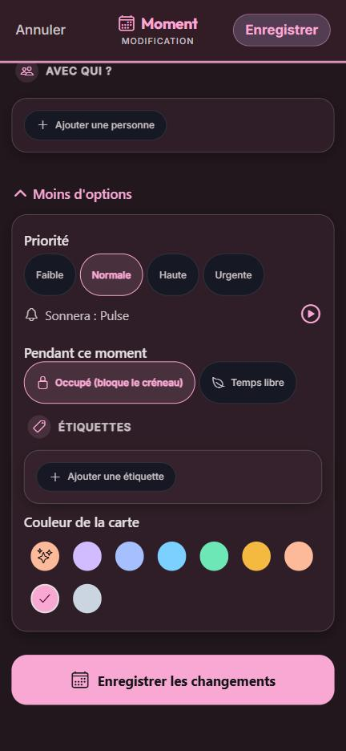
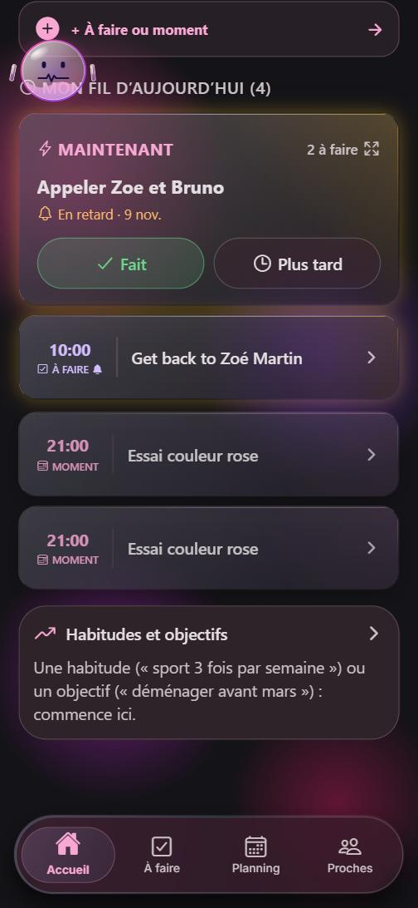

# FICHE OPÉRATOIRE N° 043 — La couleur d'une carte

Projet : **Junix Pulse** · Date : 27 novembre 2026 · Suite de : [FICHE 042](FICHE-042-themes-de-couleurs.md)

---

## 1. Objectif

Troisième et dernière fiche du chantier n° 11 (étude 001, 16.11 ; maquette validée) :

| Ta demande | Ce que fait cette fiche |
|---|---|
| choisir la couleur de la carte en créant une tâche, un rappel ou un moment | « **Couleur de la carte** » dans « Plus d'options », pour les trois |
| et en la modifiant | le même formulaire : il se rouvre avec la couleur cochée |
| la carte prend la couleur | la glowcard de l'accueil (lueur et bord), l'heure et la famille ; la case de la liste « À faire » ; le Planning ; la notification |
| un aperçu | le formulaire entier (barre, puces, gros bouton) prend la couleur choisie |
| (sans choix) | le premier rond, ✨ : la couleur de sa famille, celle du thème, comme avant |
| (vu en passant) | deux couleurs écrites à la main du Planning de la semaine suivent maintenant le thème |



*Figure 43-1 — Capture réelle (web, 360 px, thème Pétale sombre) : « Modifier » d'un moment, Rose coché ; tout le formulaire est rose.*



*Figure 43-2 — Capture réelle : le moment d'essai dans le fil (l'heure et « MOMENT » en rose ; un moment est en corail dans ce thème). Les deux moments d'essai ont été supprimés ensuite.*

## 2. État de départ

| À vérifier | Comment | Résultat attendu |
|---|---|---|
| Les fiches 041 et 042 sont appliquées | `git diff --stat` | leurs fichiers |
| Tout passe | `npx jest` | `Tests: 2175 passed` |

## 3. Matériel

Rien de nouveau.

## 4. Hypothèses

- La couleur choisie est une des 8 du nuancier (fiche 042), enregistrée par son nom (`pink`) : elle prend la bonne nuance en clair, en sombre et en Neutre.
- Une carte **Urgente** garde sa lueur rouge dans l'accueil, et le Planning garde l'orange pour un rappel Urgent : le sens d'abord.
- Changer la couleur d'un rappel déjà programmé : sa notification prend la nouvelle couleur la prochaine fois qu'elle est reprogrammée (au changement d'heure, ou de jour pour un rappel qui se répète).

## 5. Carte de l'intervention

| Fichier | Action |
|---|---|
| `components/create/form/CardColorField.tsx` (**nouveau**), `constants/item-forms.ts`, `features/create/*`, `components/create/form/FormBricks.tsx`, i18n | le champ, dans les deux formulaires, et l'aperçu |
| `domain/entities`, `database/migrations.ts`, `repositories/*`, `use-cases/*`, `services/backup-service.ts`, `constants/color-themes.ts`, `constants/item-kinds.ts` | la couleur enregistrée (migration 45) et lue |
| `app/(tabs)/index.tsx`, `components/ui/GlowCard.tsx`, `components/todo/TodoRow.tsx`, `domain/rules/todo-list-rules.ts`, `app/(tabs)/calendar.tsx`, `components/planning/DayTimeGrid.tsx`, `components/schedule/WeeklyTimetableGrid.tsx` | les cartes, la liste et le Planning |
| `domain/rules/*-notification-rules.ts`, `services/*notification-service.ts` | la notification |
| `__tests__/card-color.test.ts` (**nouveau**), `__tests__/item-forms.test.ts` | les tests |

## 6. Sauvegarde

`git status` (fiches 041 et 042 appliquées, hors `docs/motion/`). Une migration **additive** : la 45 (une colonne `color` dans trois tables, rien d'effacé).

## 7. Pas à pas

Le plus simple : `node docs/fiches/outils/appliquer-fiche-043.js .` (après les fiches 041 et 042) fait toutes les étapes ci-dessous ; puis l'APK (fiche 003).

### Étape 1 — La couleur enregistrée avec la carte

**Pourquoi** : Une colonne `color` dans les rappels, les tâches et les moments (migration 45, **ajoutée**, rien d'effacé). Elle garde le nom d'une des 8 couleurs (`pink`), jamais une valeur hexadécimale : la nuance claire, sombre ou Neutre se choisit à l'affichage. Vide, c'est la couleur de la famille. `swatchOf` lit une valeur enregistrée et oublie ce qui est inconnu ; `itemColorOf(palette, couleur, famille)` donne la couleur à dessiner. Le chemin est le même que pour le temps à faire (fiche 033) : l'entité, le dépôt (lecture, création, mise à jour), le cas d'usage, la sauvegarde.

Repère (Ctrl+F) : la première ligne de chaque bloc « Chercher ». Le script `appliquer-fiche-043.js` fait tous ces changements d'un coup, et refuse d'écrire si un bloc ne se trouve pas exactement une fois.

#### `src/constants/color-themes.ts`


Changement 1 sur 1. Chercher :

<!-- bloc: color-themes-1-avant -->

```ts
  return colors.primary === junix.primary && colors.todo === junix.todo && colors.moment === junix.moment;
}

/** Reads a saved choice; anything unknown falls back to Junix (an old or damaged value). */
export function parseColorChoice(raw: string | null | undefined): ColorChoice {
  if (!raw) return DEFAULT_COLOR_CHOICE;
```

Remplacer par :

<!-- bloc: color-themes-1-apres -->

```ts
  return colors.primary === junix.primary && colors.todo === junix.todo && colors.moment === junix.moment;
}

/** A saved colour of a card (sheet 043): one of the 8, or undefined (the colour of its family). */
export function swatchOf(value: unknown): SwatchId | undefined {
  return isSwatch(value) ? value : undefined;
}

/** Reads a saved choice; anything unknown falls back to Junix (an old or damaged value). */
export function parseColorChoice(raw: string | null | undefined): ColorChoice {
  if (!raw) return DEFAULT_COLOR_CHOICE;
```

#### `src/constants/item-kinds.ts`


Changement 1 sur 2. Chercher :

<!-- bloc: item-kinds-1-avant -->

```ts

import type { ThemePalette } from '@/constants/palettes';
import type { MessageKey } from '@/i18n';

export const ITEM_FAMILIES = ['todo', 'moment'] as const;
export type ItemFamily = (typeof ITEM_FAMILIES)[number];
```

Remplacer par :

<!-- bloc: item-kinds-1-apres -->

```ts

import type { ThemePalette } from '@/constants/palettes';
import type { MessageKey } from '@/i18n';
import { SWATCHES, type SwatchId } from './color-themes';

export const ITEM_FAMILIES = ['todo', 'moment'] as const;
export type ItemFamily = (typeof ITEM_FAMILIES)[number];
```

Changement 2 sur 2. Chercher :

<!-- bloc: item-kinds-2-avant -->

```ts
  return palette.family?.[family] ?? ITEM_FAMILY_COLORS[palette.mode === 'light' ? 'light' : 'dark'][family];
}

/** The colour of a kind is the colour of its family. */
export function itemKindColor(palette: Pick<ThemePalette, 'mode'> & { family?: ThemePalette['family'] }, kind: ItemKind): string {
  return itemFamilyColor(palette, ITEM_KIND_DEFINITIONS[kind].family);
```

Remplacer par :

<!-- bloc: item-kinds-2-apres -->

```ts
  return palette.family?.[family] ?? ITEM_FAMILY_COLORS[palette.mode === 'light' ? 'light' : 'dark'][family];
}

/**
 * The colour of one card (sheet 043): the one chosen for it, in the tone of the light or dark mode,
 * or else the colour of its family.
 */
export function itemColorOf(
  palette: Pick<ThemePalette, 'mode'> & { family?: ThemePalette['family'] },
  color: SwatchId | null | undefined,
  family: ItemFamily
): string {
  return color ? SWATCHES[color][palette.mode === 'light' ? 'light' : 'dark'].default : itemFamilyColor(palette, family);
}

/** The colour of a kind is the colour of its family. */
export function itemKindColor(palette: Pick<ThemePalette, 'mode'> & { family?: ThemePalette['family'] }, kind: ItemKind): string {
  return itemFamilyColor(palette, ITEM_KIND_DEFINITIONS[kind].family);
```

#### `src/domain/entities/index.ts`


Changement 1 sur 4. Chercher :

<!-- bloc: indexx-1-avant -->

```ts
import type { PlanningPrefs } from '../rules/planning-settings-rules';
import type { SoundPrefs } from '../rules/sound-rules';
import type { TagColor } from '../rules/tag-rules';
import type { ColorChoice } from '../../constants/color-themes';

export * from '../enums';

```

Remplacer par :

<!-- bloc: indexx-1-apres -->

```ts
import type { PlanningPrefs } from '../rules/planning-settings-rules';
import type { SoundPrefs } from '../rules/sound-rules';
import type { TagColor } from '../rules/tag-rules';
import type { ColorChoice, SwatchId } from '../../constants/color-themes';

export * from '../enums';

```

Changement 2 sur 4. Chercher :

<!-- bloc: indexx-2-avant -->

```ts
  alertLevel?: AlertLevel;
  /** Its time to do it (sheet 033): it fills this time in the Planning. Absent is a point. */
  estimatedMinutes?: number;
  recurrenceRuleId?: string;
  notificationId?: string;     // ID fourni par expo-notifications (pour annulation)
  snoozedUntil?: string;       // ISO 8601 si snooze actif
```

Remplacer par :

<!-- bloc: indexx-2-apres -->

```ts
  alertLevel?: AlertLevel;
  /** Its time to do it (sheet 033): it fills this time in the Planning. Absent is a point. */
  estimatedMinutes?: number;
  /** The colour of its card (sheet 043); absent is the colour of its family. */
  color?: SwatchId;
  recurrenceRuleId?: string;
  notificationId?: string;     // ID fourni par expo-notifications (pour annulation)
  snoozedUntil?: string;       // ISO 8601 si snooze actif
```

Changement 3 sur 4. Chercher :

<!-- bloc: indexx-3-avant -->

```ts
  estimatedMinutes?: number;   // Estimation en minutes (15, 30, 60, etc.)
  /** The Focus minutes already done for it (sheet 033): "1 h 40 sur 5 h". */
  focusMinutes?: number;
  priority: ReminderPriority;
  goalId?: string;
  personId?: string;
```

Remplacer par :

<!-- bloc: indexx-3-apres -->

```ts
  estimatedMinutes?: number;   // Estimation en minutes (15, 30, 60, etc.)
  /** The Focus minutes already done for it (sheet 033): "1 h 40 sur 5 h". */
  focusMinutes?: number;
  /** The colour of its card (sheet 043); absent is the colour of its family. */
  color?: SwatchId;
  priority: ReminderPriority;
  goalId?: string;
  personId?: string;
```

Changement 4 sur 4. Chercher :

<!-- bloc: indexx-4-avant -->

```ts
  alertLevel?: AlertLevel;
  /** How much it matters (sheet 032): it chooses how it rings. Absent is Normale. */
  priority?: ReminderPriority;
  createdAt: string;
  updatedAt: string;
  deletedAt?: string;
```

Remplacer par :

<!-- bloc: indexx-4-apres -->

```ts
  alertLevel?: AlertLevel;
  /** How much it matters (sheet 032): it chooses how it rings. Absent is Normale. */
  priority?: ReminderPriority;
  /** The colour of its card (sheet 043); absent is the colour of its family. */
  color?: SwatchId;
  createdAt: string;
  updatedAt: string;
  deletedAt?: string;
```

#### `src/database/migrations.ts`


Changement 1 sur 1. Chercher :

<!-- bloc: migrations-1-avant -->

```ts
      ALTER TABLE settings ADD COLUMN color_theme TEXT;
    `,
  },
];

```

Remplacer par :

<!-- bloc: migrations-1-apres -->

```ts
      ALTER TABLE settings ADD COLUMN color_theme TEXT;
    `,
  },
  {
    version: 45,
    name: 'add_item_colors',
    sql: `
      -- La couleur d une carte (fiche 043). Vide : la couleur de sa famille, comme avant.
      ALTER TABLE reminders ADD COLUMN color TEXT;
      ALTER TABLE tasks ADD COLUMN color TEXT;
      ALTER TABLE events ADD COLUMN color TEXT;
    `,
  },
];

```

#### `src/services/backup-service.ts`


Changement 1 sur 1. Chercher :

<!-- bloc: backup-service-1-avant -->

```ts
const TABLE_COLUMNS: Record<BackupTable, readonly string[]> = {
  persons: ['id', 'display_name', 'relationship', 'phone', 'email', 'birth_date', 'notes', 'last_interaction_at', 'forgotten_threshold_days', 'imported_from_contacts', 'timezone', 'availability', 'created_at', 'updated_at', 'deleted_at'],
  recurrence_rules: ['id', 'type', 'interval_val', 'days_of_week', 'day_of_month', 'week_position', 'end_date'],
  reminders: ['id', 'title', 'notes', 'scheduled_at', 'timezone', 'priority', 'status', 'action_type', 'person_id', 'recurrence_rule_id', 'requires_confirmation', 'alert_level', 'estimated_minutes', 'notification_id', 'snoozed_until', 'created_at', 'updated_at', 'completed_at', 'deleted_at'],
  reminder_checklist_items: ['id', 'reminder_id', 'title', 'is_completed', 'position'],
  tasks: ['id', 'title', 'description', 'status', 'scheduled_date', 'due_date', 'estimated_minutes', 'focus_minutes', 'priority', 'goal_id', 'person_id', 'tags', 'created_at', 'updated_at', 'completed_at', 'deleted_at'],
  subtasks: ['id', 'task_id', 'title', 'is_completed', 'position', 'created_at', 'completed_at'],
  events: ['id', 'title', 'notes', 'start_at', 'end_at', 'timezone', 'location', 'type', 'travel_buffer_minutes', 'moment_kind', 'alert_level', 'priority', 'created_at', 'updated_at', 'deleted_at'],
  event_persons: ['event_id', 'person_id'],
  reminder_persons: ['reminder_id', 'person_id'],
  task_persons: ['task_id', 'person_id'],
```

Remplacer par :

<!-- bloc: backup-service-1-apres -->

```ts
const TABLE_COLUMNS: Record<BackupTable, readonly string[]> = {
  persons: ['id', 'display_name', 'relationship', 'phone', 'email', 'birth_date', 'notes', 'last_interaction_at', 'forgotten_threshold_days', 'imported_from_contacts', 'timezone', 'availability', 'created_at', 'updated_at', 'deleted_at'],
  recurrence_rules: ['id', 'type', 'interval_val', 'days_of_week', 'day_of_month', 'week_position', 'end_date'],
  reminders: ['id', 'title', 'notes', 'scheduled_at', 'timezone', 'priority', 'status', 'action_type', 'person_id', 'recurrence_rule_id', 'requires_confirmation', 'alert_level', 'estimated_minutes', 'color', 'notification_id', 'snoozed_until', 'created_at', 'updated_at', 'completed_at', 'deleted_at'],
  reminder_checklist_items: ['id', 'reminder_id', 'title', 'is_completed', 'position'],
  tasks: ['id', 'title', 'description', 'status', 'scheduled_date', 'due_date', 'estimated_minutes', 'focus_minutes', 'color', 'priority', 'goal_id', 'person_id', 'tags', 'created_at', 'updated_at', 'completed_at', 'deleted_at'],
  subtasks: ['id', 'task_id', 'title', 'is_completed', 'position', 'created_at', 'completed_at'],
  events: ['id', 'title', 'notes', 'start_at', 'end_at', 'timezone', 'location', 'type', 'travel_buffer_minutes', 'moment_kind', 'alert_level', 'priority', 'color', 'created_at', 'updated_at', 'deleted_at'],
  event_persons: ['event_id', 'person_id'],
  reminder_persons: ['reminder_id', 'person_id'],
  task_persons: ['task_id', 'person_id'],
```

#### `src/repositories/reminder-repository.ts`


Changement 1 sur 7. Chercher :

<!-- bloc: reminder-repository-1-avant -->

```ts
import { getDatabase } from '../database/sqlite';
import { AlertLevel, Reminder, ReminderChecklistItem, RecurrenceRule } from '../domain/entities';
import { chosenLevelOf } from '../domain/rules/notification-level-rules';

// ─── Types de paramètres ──────────────────────────────────────────────────────

```

Remplacer par :

<!-- bloc: reminder-repository-1-apres -->

```ts
import { getDatabase } from '../database/sqlite';
import { AlertLevel, Reminder, ReminderChecklistItem, RecurrenceRule } from '../domain/entities';
import { chosenLevelOf } from '../domain/rules/notification-level-rules';
import { swatchOf, type SwatchId } from '../constants/color-themes';

// ─── Types de paramètres ──────────────────────────────────────────────────────

```

Changement 2 sur 7. Chercher :

<!-- bloc: reminder-repository-2-avant -->

```ts
  alertLevel?: AlertLevel | null;
  /** Its time to do it, in minutes (sheet 033). */
  estimatedMinutes?: number | null;
  recurrenceRuleId?: string;
  createdAt: string;
  updatedAt: string;
```

Remplacer par :

<!-- bloc: reminder-repository-2-apres -->

```ts
  alertLevel?: AlertLevel | null;
  /** Its time to do it, in minutes (sheet 033). */
  estimatedMinutes?: number | null;
  /** The colour of its card (sheet 043). */
  color?: SwatchId | null;
  recurrenceRuleId?: string;
  createdAt: string;
  updatedAt: string;
```

Changement 3 sur 7. Chercher :

<!-- bloc: reminder-repository-3-avant -->

```ts
  alertLevel?: AlertLevel | null;
  /** null: no time to do it (sheet 033). */
  estimatedMinutes?: number | null;
  notificationId?: string | null;
  snoozedUntil?: string | null;
  updatedAt: string;
```

Remplacer par :

<!-- bloc: reminder-repository-3-apres -->

```ts
  alertLevel?: AlertLevel | null;
  /** null: no time to do it (sheet 033). */
  estimatedMinutes?: number | null;
  /** null: the colour of its family (sheet 043). */
  color?: SwatchId | null;
  notificationId?: string | null;
  snoozedUntil?: string | null;
  updatedAt: string;
```

Changement 4 sur 7. Chercher :

<!-- bloc: reminder-repository-4-avant -->

```ts
    requiresConfirmation: (row.requires_confirmation as number | null) === 1,
    alertLevel: chosenLevelOf(row.alert_level) ?? undefined,
    estimatedMinutes: (row.estimated_minutes as number | null) ?? undefined,
    recurrenceRuleId: (row.recurrence_rule_id as string | null) ?? undefined,
    notificationId: (row.notification_id as string | null) ?? undefined,
    snoozedUntil: (row.snoozed_until as string | null) ?? undefined,
```

Remplacer par :

<!-- bloc: reminder-repository-4-apres -->

```ts
    requiresConfirmation: (row.requires_confirmation as number | null) === 1,
    alertLevel: chosenLevelOf(row.alert_level) ?? undefined,
    estimatedMinutes: (row.estimated_minutes as number | null) ?? undefined,
    color: swatchOf(row.color),
    recurrenceRuleId: (row.recurrence_rule_id as string | null) ?? undefined,
    notificationId: (row.notification_id as string | null) ?? undefined,
    snoozedUntil: (row.snoozed_until as string | null) ?? undefined,
```

Changement 5 sur 7. Chercher :

<!-- bloc: reminder-repository-5-avant -->

```ts
    await db.runAsync(
      `INSERT INTO reminders (
        id, title, notes, scheduled_at, timezone, priority, status, action_type,
        person_id, recurrence_rule_id, requires_confirmation, alert_level, estimated_minutes, created_at, updated_at
      ) VALUES (?, ?, ?, ?, ?, ?, 'UPCOMING', ?, ?, ?, ?, ?, ?, ?, ?)`,
      params.id,
      params.title,
      params.notes ?? null,
```

Remplacer par :

<!-- bloc: reminder-repository-5-apres -->

```ts
    await db.runAsync(
      `INSERT INTO reminders (
        id, title, notes, scheduled_at, timezone, priority, status, action_type,
        person_id, recurrence_rule_id, requires_confirmation, alert_level, estimated_minutes, color, created_at, updated_at
      ) VALUES (?, ?, ?, ?, ?, ?, 'UPCOMING', ?, ?, ?, ?, ?, ?, ?, ?, ?)`,
      params.id,
      params.title,
      params.notes ?? null,
```

Changement 6 sur 7. Chercher :

<!-- bloc: reminder-repository-6-avant -->

```ts
      params.requiresConfirmation ? 1 : 0,
      params.alertLevel ?? null,
      params.estimatedMinutes ?? null,
      params.createdAt,
      params.updatedAt
    );
```

Remplacer par :

<!-- bloc: reminder-repository-6-apres -->

```ts
      params.requiresConfirmation ? 1 : 0,
      params.alertLevel ?? null,
      params.estimatedMinutes ?? null,
      params.color ?? null,
      params.createdAt,
      params.updatedAt
    );
```

Changement 7 sur 7. Chercher :

<!-- bloc: reminder-repository-7-avant -->

```ts
      setClauses.push('estimated_minutes = ?');
      values.push(params.estimatedMinutes);
    }
    if (params.personId !== undefined) {
      setClauses.push('person_id = ?');
      values.push(params.personId);
```

Remplacer par :

<!-- bloc: reminder-repository-7-apres -->

```ts
      setClauses.push('estimated_minutes = ?');
      values.push(params.estimatedMinutes);
    }
    if (params.color !== undefined) {
      setClauses.push('color = ?');
      values.push(params.color);
    }
    if (params.personId !== undefined) {
      setClauses.push('person_id = ?');
      values.push(params.personId);
```

#### `src/repositories/task-repository.ts`


Changement 1 sur 4. Chercher :

<!-- bloc: task-repository-1-avant -->

```ts
import type { SQLiteBindValue } from 'expo-sqlite';
import { getDatabase } from '../database/sqlite';
import { Task, Subtask } from '../domain/entities';

type NullableFields<T> = {
  [K in keyof T]?: T[K] | null;
```

Remplacer par :

<!-- bloc: task-repository-1-apres -->

```ts
import type { SQLiteBindValue } from 'expo-sqlite';
import { getDatabase } from '../database/sqlite';
import { Task, Subtask } from '../domain/entities';
import { swatchOf } from '../constants/color-themes';

type NullableFields<T> = {
  [K in keyof T]?: T[K] | null;
```

Changement 2 sur 4. Chercher :

<!-- bloc: task-repository-2-avant -->

```ts
    dueDate: (row.due_date as string | null) ?? undefined,
    estimatedMinutes: (row.estimated_minutes as number | null) ?? undefined,
    focusMinutes: (row.focus_minutes as number | null) ?? undefined,
    priority: row.priority as Task['priority'],
    goalId: (row.goal_id as string | null) ?? undefined,
    personId: (row.person_id as string | null) ?? undefined,
```

Remplacer par :

<!-- bloc: task-repository-2-apres -->

```ts
    dueDate: (row.due_date as string | null) ?? undefined,
    estimatedMinutes: (row.estimated_minutes as number | null) ?? undefined,
    focusMinutes: (row.focus_minutes as number | null) ?? undefined,
    color: swatchOf(row.color),
    priority: row.priority as Task['priority'],
    goalId: (row.goal_id as string | null) ?? undefined,
    personId: (row.person_id as string | null) ?? undefined,
```

Changement 3 sur 4. Chercher :

<!-- bloc: task-repository-3-avant -->

```ts
    const db = await getDatabase();
    await db.runAsync(
      `INSERT INTO tasks (id, title, description, status, scheduled_date, due_date, estimated_minutes,
        priority, goal_id, person_id, tags, created_at, updated_at)
       VALUES (?, ?, ?, ?, ?, ?, ?, ?, ?, ?, ?, ?, ?)`,
      task.id, task.title, task.description ?? null, task.status,
      task.scheduledDate ?? null, task.dueDate ?? null, task.estimatedMinutes ?? null, task.priority,
      task.goalId ?? null, task.personId ?? null,
      task.tags ? JSON.stringify(task.tags) : null,
      task.createdAt, task.updatedAt
    );
  },
```

Remplacer par :

<!-- bloc: task-repository-3-apres -->

```ts
    const db = await getDatabase();
    await db.runAsync(
      `INSERT INTO tasks (id, title, description, status, scheduled_date, due_date, estimated_minutes,
        priority, goal_id, person_id, tags, color, created_at, updated_at)
       VALUES (?, ?, ?, ?, ?, ?, ?, ?, ?, ?, ?, ?, ?, ?)`,
      task.id, task.title, task.description ?? null, task.status,
      task.scheduledDate ?? null, task.dueDate ?? null, task.estimatedMinutes ?? null, task.priority,
      task.goalId ?? null, task.personId ?? null,
      task.tags ? JSON.stringify(task.tags) : null,
      task.color ?? null,
      task.createdAt, task.updatedAt
    );
  },
```

Changement 4 sur 4. Chercher :

<!-- bloc: task-repository-4-avant -->

```ts
      setClauses.push('estimated_minutes = ?');
      values.push(params.estimatedMinutes);
    }
    if (params.focusMinutes !== undefined) {
      setClauses.push('focus_minutes = ?');
      values.push(params.focusMinutes);
```

Remplacer par :

<!-- bloc: task-repository-4-apres -->

```ts
      setClauses.push('estimated_minutes = ?');
      values.push(params.estimatedMinutes);
    }
    if (params.color !== undefined) {
      setClauses.push('color = ?');
      values.push(params.color);
    }
    if (params.focusMinutes !== undefined) {
      setClauses.push('focus_minutes = ?');
      values.push(params.focusMinutes);
```

#### `src/repositories/event-repository.ts`


Changement 1 sur 5. Chercher :

<!-- bloc: event-repository-1-avant -->

```ts
import { getDatabase } from '../database/sqlite';
import { Event, Person, ReminderPriority } from '../domain/entities';
import { chosenLevelOf } from '../domain/rules/notification-level-rules';

const PRIORITIES: readonly ReminderPriority[] = ['LOW', 'NORMAL', 'HIGH', 'URGENT'];

```

Remplacer par :

<!-- bloc: event-repository-1-apres -->

```ts
import { getDatabase } from '../database/sqlite';
import { Event, Person, ReminderPriority } from '../domain/entities';
import { chosenLevelOf } from '../domain/rules/notification-level-rules';
import { swatchOf } from '../constants/color-themes';

const PRIORITIES: readonly ReminderPriority[] = ['LOW', 'NORMAL', 'HIGH', 'URGENT'];

```

Changement 2 sur 5. Chercher :

<!-- bloc: event-repository-2-avant -->

```ts
    alertLevel: chosenLevelOf(row.alert_level) ?? undefined,
    // Its priority (sheet 032); an unknown or empty one is Normale
    priority: PRIORITIES.includes(row.priority as ReminderPriority) ? (row.priority as ReminderPriority) : undefined,
    createdAt: row.created_at as string,
    updatedAt: row.updated_at as string,
    deletedAt: (row.deleted_at as string | null) ?? undefined,
```

Remplacer par :

<!-- bloc: event-repository-2-apres -->

```ts
    alertLevel: chosenLevelOf(row.alert_level) ?? undefined,
    // Its priority (sheet 032); an unknown or empty one is Normale
    priority: PRIORITIES.includes(row.priority as ReminderPriority) ? (row.priority as ReminderPriority) : undefined,
    color: swatchOf(row.color),
    createdAt: row.created_at as string,
    updatedAt: row.updated_at as string,
    deletedAt: (row.deleted_at as string | null) ?? undefined,
```

Changement 3 sur 5. Chercher :

<!-- bloc: event-repository-3-avant -->

```ts
  async create(event: Omit<Event, 'deletedAt'>, personIds?: string[]): Promise<void> {
    const db = await getDatabase();
    await db.runAsync(
      `INSERT INTO events (id, title, notes, start_at, end_at, timezone, location, type, travel_buffer_minutes, moment_kind, alert_level, priority, created_at, updated_at)
       VALUES (?, ?, ?, ?, ?, ?, ?, ?, ?, ?, ?, ?, ?, ?)`,
      event.id,
      event.title,
      event.notes ?? null,
```

Remplacer par :

<!-- bloc: event-repository-3-apres -->

```ts
  async create(event: Omit<Event, 'deletedAt'>, personIds?: string[]): Promise<void> {
    const db = await getDatabase();
    await db.runAsync(
      `INSERT INTO events (id, title, notes, start_at, end_at, timezone, location, type, travel_buffer_minutes, moment_kind, alert_level, priority, color, created_at, updated_at)
       VALUES (?, ?, ?, ?, ?, ?, ?, ?, ?, ?, ?, ?, ?, ?, ?)`,
      event.id,
      event.title,
      event.notes ?? null,
```

Changement 4 sur 5. Chercher :

<!-- bloc: event-repository-4-avant -->

```ts
      event.momentKind ?? null,
      event.alertLevel ?? null,
      event.priority ?? null,
      event.createdAt,
      event.updatedAt
    );
```

Remplacer par :

<!-- bloc: event-repository-4-apres -->

```ts
      event.momentKind ?? null,
      event.alertLevel ?? null,
      event.priority ?? null,
      event.color ?? null,
      event.createdAt,
      event.updatedAt
    );
```

Changement 5 sur 5. Chercher :

<!-- bloc: event-repository-5-avant -->

```ts
      setClauses.push('priority = ?');
      values.push(params.priority);
    }
    if (params.deletedAt !== undefined) {
      setClauses.push('deleted_at = ?');
      values.push(params.deletedAt);
```

Remplacer par :

<!-- bloc: event-repository-5-apres -->

```ts
      setClauses.push('priority = ?');
      values.push(params.priority);
    }
    if (params.color !== undefined) {
      setClauses.push('color = ?');
      values.push(params.color);
    }
    if (params.deletedAt !== undefined) {
      setClauses.push('deleted_at = ?');
      values.push(params.deletedAt);
```

#### `src/use-cases/reminder-use-cases.ts`


Changement 1 sur 5. Chercher :

<!-- bloc: reminder-use-cases-1-avant -->

```ts
import { emitMascotEvent } from '../services/mascot/mascot-event-bus';
import { interactionTypeForAction } from '../domain/rules/person-link-rules';
import { recordLinkedInteraction } from './person-use-cases';

// ─── Création ────────────────────────────────────────────────────────────────

```

Remplacer par :

<!-- bloc: reminder-use-cases-1-apres -->

```ts
import { emitMascotEvent } from '../services/mascot/mascot-event-bus';
import { interactionTypeForAction } from '../domain/rules/person-link-rules';
import { recordLinkedInteraction } from './person-use-cases';
import type { SwatchId } from '@/constants/color-themes';

// ─── Création ────────────────────────────────────────────────────────────────

```

Changement 2 sur 5. Chercher :

<!-- bloc: reminder-use-cases-2-avant -->

```ts
  alertLevel?: AlertLevel | null;
  /** Its time to do it, in minutes (sheet 033). */
  estimatedMinutes?: number;
  recurrenceRule?: Omit<RecurrenceRule, 'id'>;
  checklistItems?: { title: string; position: number }[];
}
```

Remplacer par :

<!-- bloc: reminder-use-cases-2-apres -->

```ts
  alertLevel?: AlertLevel | null;
  /** Its time to do it, in minutes (sheet 033). */
  estimatedMinutes?: number;
  /** The colour of its card (sheet 043); absent is the colour of its family. */
  color?: SwatchId;
  recurrenceRule?: Omit<RecurrenceRule, 'id'>;
  checklistItems?: { title: string; position: number }[];
}
```

Changement 3 sur 5. Chercher :

<!-- bloc: reminder-use-cases-3-avant -->

```ts
    requiresConfirmation: input.requiresConfirmation,
    alertLevel: input.alertLevel ?? null,
    estimatedMinutes: input.estimatedMinutes ?? null,
    recurrenceRuleId,
    createdAt: now,
    updatedAt: now,
```

Remplacer par :

<!-- bloc: reminder-use-cases-3-apres -->

```ts
    requiresConfirmation: input.requiresConfirmation,
    alertLevel: input.alertLevel ?? null,
    estimatedMinutes: input.estimatedMinutes ?? null,
    color: input.color ?? null,
    recurrenceRuleId,
    createdAt: now,
    updatedAt: now,
```

Changement 4 sur 5. Chercher :

<!-- bloc: reminder-use-cases-4-avant -->

```ts
  alertLevel?: AlertLevel | null;
  /** Its time to do it (sheet 033): null takes it off, undefined keeps it. */
  estimatedMinutes?: number | null;
  /** A new repeat (a new rule; the old one stays in the data), null to stop it, undefined to keep it. */
  recurrenceRule?: Omit<RecurrenceRule, 'id'> | null;
}
```

Remplacer par :

<!-- bloc: reminder-use-cases-4-apres -->

```ts
  alertLevel?: AlertLevel | null;
  /** Its time to do it (sheet 033): null takes it off, undefined keeps it. */
  estimatedMinutes?: number | null;
  /** The colour of its card (sheet 043): null is its family's, undefined keeps it. */
  color?: SwatchId | null;
  /** A new repeat (a new rule; the old one stays in the data), null to stop it, undefined to keep it. */
  recurrenceRule?: Omit<RecurrenceRule, 'id'> | null;
}
```

Changement 5 sur 5. Chercher :

<!-- bloc: reminder-use-cases-5-avant -->

```ts
    recurrenceRuleId,
    alertLevel: input.alertLevel,
    estimatedMinutes: input.estimatedMinutes,
    updatedAt: now,
  });

```

Remplacer par :

<!-- bloc: reminder-use-cases-5-apres -->

```ts
    recurrenceRuleId,
    alertLevel: input.alertLevel,
    estimatedMinutes: input.estimatedMinutes,
    color: input.color,
    updatedAt: now,
  });

```

#### `src/use-cases/task-use-cases.ts`


Changement 1 sur 4. Chercher :

<!-- bloc: task-use-cases-1-avant -->

```ts
import { t } from '../i18n';
import { emitMascotEvent } from '../services/mascot/mascot-event-bus';
import { syncItemNotifications } from '../services/item-notification-service';

// ─── Interfaces d'entrée ──────────────────────────────────────────────────────

```

Remplacer par :

<!-- bloc: task-use-cases-1-apres -->

```ts
import { t } from '../i18n';
import { emitMascotEvent } from '../services/mascot/mascot-event-bus';
import { syncItemNotifications } from '../services/item-notification-service';
import type { SwatchId } from '@/constants/color-themes';

// ─── Interfaces d'entrée ──────────────────────────────────────────────────────

```

Changement 2 sur 4. Chercher :

<!-- bloc: task-use-cases-2-avant -->

```ts
  scheduledDate?: string;      // YYYY-MM-DD
  dueDate?: string;            // YYYY-MM-DD, à rendre au plus tard ce jour-là
  estimatedMinutes?: number;   // 15, 30, 60...
  priority?: ReminderPriority;
  goalId?: string;
  personId?: string;
```

Remplacer par :

<!-- bloc: task-use-cases-2-apres -->

```ts
  scheduledDate?: string;      // YYYY-MM-DD
  dueDate?: string;            // YYYY-MM-DD, à rendre au plus tard ce jour-là
  estimatedMinutes?: number;   // 15, 30, 60...
  /** The colour of its card (sheet 043); absent is the colour of its family. */
  color?: SwatchId;
  priority?: ReminderPriority;
  goalId?: string;
  personId?: string;
```

Changement 3 sur 4. Chercher :

<!-- bloc: task-use-cases-3-avant -->

```ts
  dueDate?: string | null;
  /** null takes its time off. */
  estimatedMinutes?: number | null;
  priority?: ReminderPriority;
  goalId?: string;
  /** null takes the person off the task. */
```

Remplacer par :

<!-- bloc: task-use-cases-3-apres -->

```ts
  dueDate?: string | null;
  /** null takes its time off. */
  estimatedMinutes?: number | null;
  /** The colour of its card (sheet 043): null is its family's, undefined keeps it. */
  color?: SwatchId | null;
  priority?: ReminderPriority;
  goalId?: string;
  /** null takes the person off the task. */
```

Changement 4 sur 4. Chercher :

<!-- bloc: task-use-cases-4-avant -->

```ts
      scheduledDate: input.scheduledDate,
      dueDate: input.dueDate,
      estimatedMinutes: input.estimatedMinutes,
      priority: input.priority ?? 'NORMAL',
      goalId: input.goalId,
      personId: input.personIds?.[0] ?? input.personId,
```

Remplacer par :

<!-- bloc: task-use-cases-4-apres -->

```ts
      scheduledDate: input.scheduledDate,
      dueDate: input.dueDate,
      estimatedMinutes: input.estimatedMinutes,
      color: input.color,
      priority: input.priority ?? 'NORMAL',
      goalId: input.goalId,
      personId: input.personIds?.[0] ?? input.personId,
```

#### `src/use-cases/event-use-cases.ts`


Changement 1 sur 5. Chercher :

<!-- bloc: event-use-cases-1-avant -->

```ts
import { syncItemNotifications } from '../services/item-notification-service';
import { meetingWindow } from '../domain/rules/person-link-rules';
import { recordLinkedInteraction } from './person-use-cases';

export interface CreateEventInput {
  title: string;
```

Remplacer par :

<!-- bloc: event-use-cases-1-apres -->

```ts
import { syncItemNotifications } from '../services/item-notification-service';
import { meetingWindow } from '../domain/rules/person-link-rules';
import { recordLinkedInteraction } from './person-use-cases';
import type { SwatchId } from '@/constants/color-themes';

export interface CreateEventInput {
  title: string;
```

Changement 2 sur 5. Chercher :

<!-- bloc: event-use-cases-2-avant -->

```ts
  alertLevel?: AlertLevel | null;
  /** It chooses how it rings (sheet 032). */
  priority?: ReminderPriority;
  personIds?: string[];
  /** Its coloured tags. */
  tagIds?: string[];
```

Remplacer par :

<!-- bloc: event-use-cases-2-apres -->

```ts
  alertLevel?: AlertLevel | null;
  /** It chooses how it rings (sheet 032). */
  priority?: ReminderPriority;
  /** The colour of its card (sheet 043); absent is the colour of its family. */
  color?: SwatchId;
  personIds?: string[];
  /** Its coloured tags. */
  tagIds?: string[];
```

Changement 3 sur 5. Chercher :

<!-- bloc: event-use-cases-3-avant -->

```ts
  alertLevel?: AlertLevel | null;
  /** It chooses how it rings (sheet 032). */
  priority?: ReminderPriority;
  personIds?: string[];
  /** Its coloured tags: replaces the ones it had. */
  tagIds?: string[];
```

Remplacer par :

<!-- bloc: event-use-cases-3-apres -->

```ts
  alertLevel?: AlertLevel | null;
  /** It chooses how it rings (sheet 032). */
  priority?: ReminderPriority;
  /** The colour of its card (sheet 043): null is its family's, undefined keeps it. */
  color?: SwatchId | null;
  personIds?: string[];
  /** Its coloured tags: replaces the ones it had. */
  tagIds?: string[];
```

Changement 4 sur 5. Chercher :

<!-- bloc: event-use-cases-4-avant -->

```ts
        momentKind: input.momentKind && input.momentKind !== 'other' ? input.momentKind : undefined,
        alertLevel: input.alertLevel ?? undefined,
        priority: input.priority,
        createdAt: now,
        updatedAt: now,
      },
```

Remplacer par :

<!-- bloc: event-use-cases-4-apres -->

```ts
        momentKind: input.momentKind && input.momentKind !== 'other' ? input.momentKind : undefined,
        alertLevel: input.alertLevel ?? undefined,
        priority: input.priority,
        color: input.color,
        createdAt: now,
        updatedAt: now,
      },
```

Changement 5 sur 5. Chercher :

<!-- bloc: event-use-cases-5-avant -->

```ts
        momentKind: input.momentKind === undefined ? undefined : input.momentKind === 'other' ? null : input.momentKind,
        alertLevel: input.alertLevel,
        priority: input.priority,
        updatedAt: now,
      },
      input.personIds
```

Remplacer par :

<!-- bloc: event-use-cases-5-apres -->

```ts
        momentKind: input.momentKind === undefined ? undefined : input.momentKind === 'other' ? null : input.momentKind,
        alertLevel: input.alertLevel,
        priority: input.priority,
        color: input.color,
        updatedAt: now,
      },
      input.personIds
```


### Étape 2 — « Couleur de la carte » dans les formulaires

**Pourquoi** : Un petit composant (`CardColorField`) : ✨ pour la couleur de la famille, puis les 8 couleurs. Il est ajouté à « Plus d'options » des deux familles (`item-forms.ts`), donc aux tâches, aux rappels et aux moments. Comme le même formulaire sert à créer et à modifier, le chargeur (`edit-loaders`) rend la couleur enregistrée et la modification la rouvre cochée. Le formulaire entier, barre et gros bouton compris (`FormShell`), prend la couleur choisie : c'est l'aperçu.

Repère (Ctrl+F) : la première ligne de chaque bloc « Chercher ». Le script `appliquer-fiche-043.js` fait tous ces changements d'un coup, et refuse d'écrire si un bloc ne se trouve pas exactement une fois.

#### `src/components/create/form/CardColorField.tsx`

Fichier nouveau, en entier :

<!-- bloc: new-cardcolorfield -->

```tsx
/**
 * CardColorField: the colour of one card (study 001, 16.11; sheet 043), under « Plus d'options ».
 *
 * The first circle is the colour of its family (« À faire » or « Moment », from the theme); then the
 * 8 colours of the themes. The card, the Planning and the notification take the chosen one.
 */

import { Ionicons } from '@expo/vector-icons';
import { StyleSheet, Text, TouchableOpacity, View } from 'react-native';
import { SWATCH_IDS, SWATCHES, type SwatchId } from '@/constants/color-themes';
import { itemFamilyColor, type ItemFamily } from '@/constants/item-kinds';
import { Spacing, Typography } from '@/constants/theme';
import { useTheme } from '@/hooks/use-theme';
import { useT } from '@/i18n';

interface CardColorFieldProps {
  family: ItemFamily;
  /** null: the colour of the family. */
  value: SwatchId | null;
  onChange: (value: SwatchId | null) => void;
}

export function CardColorField({ family, value, onChange }: CardColorFieldProps) {
  const t = useT();
  const { palette } = useTheme();
  const familyColor = itemFamilyColor(palette, family);
  const ring = palette.onSurface.primary;

  return (
    <View style={styles.root}>
      <Text style={[styles.label, { color: palette.onSurface.primary }]}>{t('itemForm.cardColor')}</Text>
      <View style={styles.row} accessibilityRole="radiogroup" accessibilityLabel={t('itemForm.cardColor')}>
        <TouchableOpacity
          style={styles.touch}
          onPress={() => onChange(null)}
          accessibilityRole="radio"
          accessibilityState={{ selected: value === null }}
          accessibilityLabel={t('itemForm.cardColorFamily')}
          testID="card-color-family"
        >
          <View style={[styles.circle, { backgroundColor: familyColor }, value === null && { borderWidth: 2, borderColor: ring }]}>
            <Ionicons name={value === null ? 'checkmark' : 'sparkles-outline'} size={16} color={palette.mode === 'light' ? '#FFFFFF' : palette.surface.base} />
          </View>
        </TouchableOpacity>
        {SWATCH_IDS.map(id => {
          const selected = value === id;
          const tone = SWATCHES[id][palette.mode];
          return (
            <TouchableOpacity
              key={id}
              style={styles.touch}
              onPress={() => onChange(id)}
              accessibilityRole="radio"
              accessibilityState={{ selected }}
              accessibilityLabel={t(SWATCHES[id].labelKey)}
              testID={`card-color-${id}`}
            >
              <View style={[styles.circle, { backgroundColor: tone.default }, selected && { borderWidth: 2, borderColor: ring }]}>
                {selected ? <Ionicons name="checkmark" size={16} color={tone.on} /> : null}
              </View>
            </TouchableOpacity>
          );
        })}
      </View>
    </View>
  );
}

const styles = StyleSheet.create({
  root: {
    gap: Spacing.xs,
  },
  label: {
    ...Typography.titleMedium,
  },
  row: {
    flexDirection: 'row',
    flexWrap: 'wrap',
  },
  touch: {
    width: 44,
    height: 44,
    alignItems: 'center',
    justifyContent: 'center',
  },
  circle: {
    width: 30,
    height: 30,
    borderRadius: 15,
    alignItems: 'center',
    justifyContent: 'center',
  },
});
```

#### `src/constants/item-forms.ts`


Changement 1 sur 2. Chercher :

<!-- bloc: item-forms-1-avant -->

```ts
import type { ItemFamily } from './item-kinds';

export type FormSectionId = 'what' | 'kind' | 'when' | 'alert' | 'slot' | 'where' | 'leave' | 'who' | 'more';
export type MoreFieldId = 'priority' | 'deadline' | 'duration' | 'subtasks' | 'tags' | 'availability';

export interface ItemFormDefinition {
  sections: readonly FormSectionId[];
```

Remplacer par :

<!-- bloc: item-forms-1-apres -->

```ts
import type { ItemFamily } from './item-kinds';

export type FormSectionId = 'what' | 'kind' | 'when' | 'alert' | 'slot' | 'where' | 'leave' | 'who' | 'more';
export type MoreFieldId = 'priority' | 'deadline' | 'duration' | 'subtasks' | 'tags' | 'availability' | 'color';

export interface ItemFormDefinition {
  sections: readonly FormSectionId[];
```

Changement 2 sur 2. Chercher :

<!-- bloc: item-forms-2-avant -->

```ts
export const ITEM_FORMS: Readonly<Record<ItemFamily, ItemFormDefinition>> = {
  todo: {
    sections: ['what', 'when', 'alert', 'who', 'more'],
    more: ['priority', 'deadline', 'duration', 'subtasks', 'tags'],
  },
  moment: {
    // The type right under the title (sheet 023): it is often guessed from it
    sections: ['what', 'kind', 'slot', 'where', 'leave', 'who', 'more'],
    // The priority chooses how it rings (sheet 032), in place of "How it warns you"
    more: ['priority', 'availability', 'tags'],
  },
};

```

Remplacer par :

<!-- bloc: item-forms-2-apres -->

```ts
export const ITEM_FORMS: Readonly<Record<ItemFamily, ItemFormDefinition>> = {
  todo: {
    sections: ['what', 'when', 'alert', 'who', 'more'],
    // The colour of the card (sheet 043)
    more: ['priority', 'deadline', 'duration', 'subtasks', 'tags', 'color'],
  },
  moment: {
    // The type right under the title (sheet 023): it is often guessed from it
    sections: ['what', 'kind', 'slot', 'where', 'leave', 'who', 'more'],
    // The priority chooses how it rings (sheet 032), in place of "How it warns you"
    more: ['priority', 'availability', 'tags', 'color'],
  },
};

```

#### `src/features/create/edit-loaders.ts`


Changement 1 sur 6. Chercher :

<!-- bloc: edit-loaders-1-avant -->

```ts
import { ReminderRepository } from '@/repositories/reminder-repository';
import { TagRepository } from '@/repositories/tag-repository';
import { TaskRepository } from '@/repositories/task-repository';

/** A "To do" opened to be changed: a reminder (it rings) or a task (it does not). */
export interface TodoEditTarget {
```

Remplacer par :

<!-- bloc: edit-loaders-1-apres -->

```ts
import { ReminderRepository } from '@/repositories/reminder-repository';
import { TagRepository } from '@/repositories/tag-repository';
import { TaskRepository } from '@/repositories/task-repository';
import type { SwatchId } from '@/constants/color-themes';

/** A "To do" opened to be changed: a reminder (it rings) or a task (it does not). */
export interface TodoEditTarget {
```

Changement 2 sur 6. Chercher :

<!-- bloc: edit-loaders-2-avant -->

```ts
  alertLevel: AlertLevel | null;
  dueDate: string | undefined;
  estimatedMinutes: number | undefined;
  personIds: string[];
  tagIds: string[];
  /** The saved alert time of a reminder, to tell whether the person moved it. */
```

Remplacer par :

<!-- bloc: edit-loaders-2-apres -->

```ts
  alertLevel: AlertLevel | null;
  dueDate: string | undefined;
  estimatedMinutes: number | undefined;
  /** The colour of its card (sheet 043), null for its family's. */
  color: SwatchId | null;
  personIds: string[];
  tagIds: string[];
  /** The saved alert time of a reminder, to tell whether the person moved it. */
```

Changement 3 sur 6. Chercher :

<!-- bloc: edit-loaders-3-avant -->

```ts
      alertLevel: chosenLevelOf(reminder.alertLevel),
      dueDate: undefined,
      estimatedMinutes: reminder.estimatedMinutes,
      personIds,
      tagIds,
      scheduledAt,
```

Remplacer par :

<!-- bloc: edit-loaders-3-apres -->

```ts
      alertLevel: chosenLevelOf(reminder.alertLevel),
      dueDate: undefined,
      estimatedMinutes: reminder.estimatedMinutes,
      color: reminder.color ?? null,
      personIds,
      tagIds,
      scheduledAt,
```

Changement 4 sur 6. Chercher :

<!-- bloc: edit-loaders-4-avant -->

```ts
    alertLevel: null,
    dueDate: task.dueDate,
    estimatedMinutes: task.estimatedMinutes,
    personIds,
    tagIds,
    scheduledAt: null,
```

Remplacer par :

<!-- bloc: edit-loaders-4-apres -->

```ts
    alertLevel: null,
    dueDate: task.dueDate,
    estimatedMinutes: task.estimatedMinutes,
    color: task.color ?? null,
    personIds,
    tagIds,
    scheduledAt: null,
```

Changement 5 sur 6. Chercher :

<!-- bloc: edit-loaders-5-avant -->

```ts
  alertLevel: AlertLevel | null;
  /** Normale when none was chosen (sheet 032). */
  priority: ReminderPriority;
  personIds: string[];
  tagIds: string[];
}
```

Remplacer par :

<!-- bloc: edit-loaders-5-apres -->

```ts
  alertLevel: AlertLevel | null;
  /** Normale when none was chosen (sheet 032). */
  priority: ReminderPriority;
  /** The colour of its card (sheet 043), null for its family's. */
  color: SwatchId | null;
  personIds: string[];
  tagIds: string[];
}
```

Changement 6 sur 6. Chercher :

<!-- bloc: edit-loaders-6-avant -->

```ts
    momentKind: momentKindOf(event.momentKind),
    alertLevel: chosenLevelOf(event.alertLevel),
    priority: event.priority ?? 'NORMAL',
    personIds: persons.map(person => person.id),
    tagIds,
  };
```

Remplacer par :

<!-- bloc: edit-loaders-6-apres -->

```ts
    momentKind: momentKindOf(event.momentKind),
    alertLevel: chosenLevelOf(event.alertLevel),
    priority: event.priority ?? 'NORMAL',
    color: event.color ?? null,
    personIds: persons.map(person => person.id),
    tagIds,
  };
```

#### `src/features/create/TodoForm.tsx`


Changement 1 sur 9. Chercher :

<!-- bloc: todoform-1-avant -->

```tsx
  type FormSectionId,
  type MoreFieldId,
} from '@/constants/item-forms';
import { itemFamilyColor } from '@/constants/item-kinds';
import { Radius, Spacing } from '@/constants/theme';
import type { Person, Reminder, ReminderPriority, TaskStatus } from '@/domain/entities';
import { todoFromSentence } from '@/domain/rules/form-dictation-rules';
```

Remplacer par :

<!-- bloc: todoform-1-apres -->

```tsx
  type FormSectionId,
  type MoreFieldId,
} from '@/constants/item-forms';
import { itemColorOf } from '@/constants/item-kinds';
import type { SwatchId } from '@/constants/color-themes';
import { CardColorField } from '@/components/create/form/CardColorField';
import { Radius, Spacing } from '@/constants/theme';
import type { Person, Reminder, ReminderPriority, TaskStatus } from '@/domain/entities';
import { todoFromSentence } from '@/domain/rules/form-dictation-rules';
```

Changement 2 sur 9. Chercher :

<!-- bloc: todoform-2-avant -->

```tsx
  const { palette } = useTheme();
  const formStyles = useThemedStyles(makeFormStyles);
  const { showSnackbar } = useAppStore();
  const accent = itemFamilyColor(palette, 'todo');

  const today = format(new Date(), 'yyyy-MM-dd');
  const tomorrow = format(addDays(new Date(), 1), 'yyyy-MM-dd');
```

Remplacer par :

<!-- bloc: todoform-2-apres -->

```tsx
  const { palette } = useTheme();
  const formStyles = useThemedStyles(makeFormStyles);
  const { showSnackbar } = useAppStore();
  // The colour of the card (sheet 043): the form takes it too, as a preview
  const [color, setColor] = useState<SwatchId | null>(null);
  const accent = itemColorOf(palette, color, 'todo');

  const today = format(new Date(), 'yyyy-MM-dd');
  const tomorrow = format(addDays(new Date(), 1), 'yyyy-MM-dd');
```

Changement 3 sur 9. Chercher :

<!-- bloc: todoform-3-avant -->

```tsx
        setConfirm(values.confirm);
        setDueDate(values.dueDate);
        setEstimatedMinutes(values.estimatedMinutes);
        setPersonIds(values.personIds);
        setTagIds(values.tagIds);
        savedRef.current = { scheduledAt: values.scheduledAt, status: values.status };
```

Remplacer par :

<!-- bloc: todoform-3-apres -->

```tsx
        setConfirm(values.confirm);
        setDueDate(values.dueDate);
        setEstimatedMinutes(values.estimatedMinutes);
        setColor(values.color);
        setPersonIds(values.personIds);
        setTagIds(values.tagIds);
        savedRef.current = { scheduledAt: values.scheduledAt, status: values.status };
```

Changement 4 sur 9. Chercher :

<!-- bloc: todoform-4-avant -->

```tsx
          alertLevel: null,
          // Its time in the Planning (sheet 033)
          estimatedMinutes: estimatedMinutes ?? null,
        });
        showSnackbar(t('remEdit.updated'));
      } else if (editing?.kind === 'task') {
```

Remplacer par :

<!-- bloc: todoform-4-apres -->

```tsx
          alertLevel: null,
          // Its time in the Planning (sheet 033)
          estimatedMinutes: estimatedMinutes ?? null,
          color,
        });
        showSnackbar(t('remEdit.updated'));
      } else if (editing?.kind === 'task') {
```

Changement 5 sur 9. Chercher :

<!-- bloc: todoform-5-avant -->

```tsx
          scheduledDate: day ?? null,
          dueDate: dueDate ?? null,
          estimatedMinutes: estimatedMinutes ?? null,
          personIds,
          tagIds,
          status: savedRef.current.status ? taskStatusAfterEdit(savedRef.current.status, day) : undefined,
```

Remplacer par :

<!-- bloc: todoform-5-apres -->

```tsx
          scheduledDate: day ?? null,
          dueDate: dueDate ?? null,
          estimatedMinutes: estimatedMinutes ?? null,
          color,
          personIds,
          tagIds,
          status: savedRef.current.status ? taskStatusAfterEdit(savedRef.current.status, day) : undefined,
```

Changement 6 sur 9. Chercher :

<!-- bloc: todoform-6-avant -->

```tsx
          recurrenceRule: recurrenceToSave(scheduledAt) ?? undefined,
          // Its time in the Planning (sheet 033)
          estimatedMinutes,
        });
        showSnackbar(t('remNew.created'));
      } else {
```

Remplacer par :

<!-- bloc: todoform-6-apres -->

```tsx
          recurrenceRule: recurrenceToSave(scheduledAt) ?? undefined,
          // Its time in the Planning (sheet 033)
          estimatedMinutes,
          color: color ?? undefined,
        });
        showSnackbar(t('remNew.created'));
      } else {
```

Changement 7 sur 9. Chercher :

<!-- bloc: todoform-7-avant -->

```tsx
          scheduledDate: day,
          dueDate,
          estimatedMinutes,
          subtasks,
          personIds,
          tagIds,
```

Remplacer par :

<!-- bloc: todoform-7-apres -->

```tsx
          scheduledDate: day,
          dueDate,
          estimatedMinutes,
          color: color ?? undefined,
          subtasks,
          personIds,
          tagIds,
```

Changement 8 sur 9. Chercher :

<!-- bloc: todoform-8-avant -->

```tsx
        );
      case 'tags':
        return <TagField key={field} selectedIds={tagIds} onChange={setTagIds} />;
      default:
        return null;
    }
```

Remplacer par :

<!-- bloc: todoform-8-apres -->

```tsx
        );
      case 'tags':
        return <TagField key={field} selectedIds={tagIds} onChange={setTagIds} />;
      case 'color':
        return <CardColorField key={field} family="todo" value={color} onChange={setColor} />;
      default:
        return null;
    }
```

Changement 9 sur 9. Chercher :

<!-- bloc: todoform-9-avant -->

```tsx
  return (
    <FormShell
      family="todo"
      // The header says whether it will ring (sheet 014)
      icon={alert ? 'notifications' : undefined}
      // Changing keeps the short name of the kind; the subtitle says it is a change (sheet 022)
```

Remplacer par :

<!-- bloc: todoform-9-apres -->

```tsx
  return (
    <FormShell
      family="todo"
      accentColor={accent}
      // The header says whether it will ring (sheet 014)
      icon={alert ? 'notifications' : undefined}
      // Changing keeps the short name of the kind; the subtitle says it is a change (sheet 022)
```

#### `src/features/create/MomentForm.tsx`


Changement 1 sur 7. Chercher :

<!-- bloc: momentform-1-avant -->

```tsx
  type FormSectionId,
  type MoreFieldId,
} from '@/constants/item-forms';
import { itemFamilyColor } from '@/constants/item-kinds';
import { MOMENT_KIND_LOOKS } from '@/constants/moment-kinds';
import { Spacing } from '@/constants/theme';
import type { EventType, MomentKind, Person, ReminderPriority } from '@/domain/entities';
```

Remplacer par :

<!-- bloc: momentform-1-apres -->

```tsx
  type FormSectionId,
  type MoreFieldId,
} from '@/constants/item-forms';
import { itemColorOf } from '@/constants/item-kinds';
import type { SwatchId } from '@/constants/color-themes';
import { CardColorField } from '@/components/create/form/CardColorField';
import { MOMENT_KIND_LOOKS } from '@/constants/moment-kinds';
import { Spacing } from '@/constants/theme';
import type { EventType, MomentKind, Person, ReminderPriority } from '@/domain/entities';
```

Changement 2 sur 7. Chercher :

<!-- bloc: momentform-2-avant -->

```tsx
  const { palette } = useTheme();
  const formStyles = useThemedStyles(makeFormStyles);
  const { showSnackbar, userTimezone } = useAppStore();
  const accent = itemFamilyColor(palette, 'moment');

  const [title, setTitle] = useState('');
  const [notes, setNotes] = useState('');
```

Remplacer par :

<!-- bloc: momentform-2-apres -->

```tsx
  const { palette } = useTheme();
  const formStyles = useThemedStyles(makeFormStyles);
  const { showSnackbar, userTimezone } = useAppStore();
  // The colour of the card (sheet 043): the form takes it too, as a preview
  const [color, setColor] = useState<SwatchId | null>(null);
  const accent = itemColorOf(palette, color, 'moment');

  const [title, setTitle] = useState('');
  const [notes, setNotes] = useState('');
```

Changement 3 sur 7. Chercher :

<!-- bloc: momentform-3-avant -->

```tsx
        setEventType(values.type);
        setMomentKind(values.momentKind);
        setPriority(values.priority);
        setPersonIds(values.personIds);
        setTagIds(values.tagIds);
        setReady(true);
```

Remplacer par :

<!-- bloc: momentform-3-apres -->

```tsx
        setEventType(values.type);
        setMomentKind(values.momentKind);
        setPriority(values.priority);
        setColor(values.color);
        setPersonIds(values.personIds);
        setTagIds(values.tagIds);
        setReady(true);
```

Changement 4 sur 7. Chercher :

<!-- bloc: momentform-4-avant -->

```tsx
          travelBufferMinutes: place ? travelBufferMinutes : 0,
          momentKind,
          priority,
          // The priority chooses how it rings now (sheet 032): a level chosen before is let go
          alertLevel: null,
          personIds,
```

Remplacer par :

<!-- bloc: momentform-4-apres -->

```tsx
          travelBufferMinutes: place ? travelBufferMinutes : 0,
          momentKind,
          priority,
          color,
          // The priority chooses how it rings now (sheet 032): a level chosen before is let go
          alertLevel: null,
          personIds,
```

Changement 5 sur 7. Chercher :

<!-- bloc: momentform-5-avant -->

```tsx
          travelBufferMinutes: place ? travelBufferMinutes : 0,
          momentKind,
          priority,
          personIds,
          tagIds,
        });
```

Remplacer par :

<!-- bloc: momentform-5-apres -->

```tsx
          travelBufferMinutes: place ? travelBufferMinutes : 0,
          momentKind,
          priority,
          color: color ?? undefined,
          personIds,
          tagIds,
        });
```

Changement 6 sur 7. Chercher :

<!-- bloc: momentform-6-avant -->

```tsx
        );
      case 'tags':
        return <TagField key={field} selectedIds={tagIds} onChange={setTagIds} />;
      default:
        return null;
    }
```

Remplacer par :

<!-- bloc: momentform-6-apres -->

```tsx
        );
      case 'tags':
        return <TagField key={field} selectedIds={tagIds} onChange={setTagIds} />;
      case 'color':
        return <CardColorField key={field} family="moment" value={color} onChange={setColor} />;
      default:
        return null;
    }
```

Changement 7 sur 7. Chercher :

<!-- bloc: momentform-7-avant -->

```tsx
  return (
    <FormShell
      family="moment"
      title={t('itemForm.moment.title')}
      subtitle={t(editingId ? 'itemForm.editSubtitle' : 'itemForm.moment.subtitle')}
      saveLabel={t(editingId ? 'itemForm.editSubmit' : 'itemForm.moment.submit')}
```

Remplacer par :

<!-- bloc: momentform-7-apres -->

```tsx
  return (
    <FormShell
      family="moment"
      accentColor={accent}
      title={t('itemForm.moment.title')}
      subtitle={t(editingId ? 'itemForm.editSubtitle' : 'itemForm.moment.subtitle')}
      saveLabel={t(editingId ? 'itemForm.editSubmit' : 'itemForm.moment.submit')}
```

#### `src/components/create/form/FormBricks.tsx`


Changement 1 sur 2. Chercher :

<!-- bloc: formbricks-1-avant -->

```tsx
  onSave,
  testID,
  children,
}: {
  family: ItemFamily;
  /** Another icon than the family's, for instance a bell for a todo with an alert. */
  icon?: IconName;
  title: string;
```

Remplacer par :

<!-- bloc: formbricks-1-apres -->

```tsx
  onSave,
  testID,
  children,
  accentColor,
}: {
  family: ItemFamily;
  /** The colour chosen for the card (sheet 043): the bar and the big button take it, as a preview. */
  accentColor?: string;
  /** Another icon than the family's, for instance a bell for a todo with an alert. */
  icon?: IconName;
  title: string;
```

Changement 2 sur 2. Chercher :

<!-- bloc: formbricks-2-avant -->

```tsx
  const insets = useSafeAreaInsets();
  const { palette } = useTheme();
  const formStyles = useThemedStyles(makeFormStyles);
  const accent = itemFamilyColor(palette, family);
  // Dark text on the light cyan and amber of the dark theme, white on the deep ones of the light theme
  const onAccent = palette.mode === 'light' ? '#FFFFFF' : '#141317';

```

Remplacer par :

<!-- bloc: formbricks-2-apres -->

```tsx
  const insets = useSafeAreaInsets();
  const { palette } = useTheme();
  const formStyles = useThemedStyles(makeFormStyles);
  const accent = accentColor ?? itemFamilyColor(palette, family);
  // Dark text on the light cyan and amber of the dark theme, white on the deep ones of the light theme
  const onAccent = palette.mode === 'light' ? '#FFFFFF' : '#141317';

```

#### `src/i18n/messages-rest-fr.ts`


Changement 1 sur 1. Chercher :

<!-- bloc: messages-rest-fr-1-avant -->

```ts
  'colorTheme.dawn': 'Aurore',
  'colorTheme.rose': 'Pétale',
  'colorTheme.slate': 'Ardoise',
  'settingsScreen.glass': 'Effet verre',
  'settingsScreen.glassHelp': 'Cartes et barres translucides. Coupé : fond plein, plus lisible.',
  'settingsScreen.briefings': 'Horaires des briefings',
```

Remplacer par :

<!-- bloc: messages-rest-fr-1-apres -->

```ts
  'colorTheme.dawn': 'Aurore',
  'colorTheme.rose': 'Pétale',
  'colorTheme.slate': 'Ardoise',
  'itemForm.cardColor': 'Couleur de la carte',
  'itemForm.cardColorFamily': 'Couleur de la famille',
  'settingsScreen.glass': 'Effet verre',
  'settingsScreen.glassHelp': 'Cartes et barres translucides. Coupé : fond plein, plus lisible.',
  'settingsScreen.briefings': 'Horaires des briefings',
```

#### `src/i18n/messages-rest-en.ts`


Changement 1 sur 1. Chercher :

<!-- bloc: messages-rest-en-1-avant -->

```ts
  'colorTheme.dawn': 'Dawn',
  'colorTheme.rose': 'Petal',
  'colorTheme.slate': 'Slate',
  'settingsScreen.glass': 'Glass effect',
  'settingsScreen.glassHelp': 'See-through cards and bars. Off: plain background, easier to read.',
  'settingsScreen.briefings': 'Briefing times',
```

Remplacer par :

<!-- bloc: messages-rest-en-1-apres -->

```ts
  'colorTheme.dawn': 'Dawn',
  'colorTheme.rose': 'Petal',
  'colorTheme.slate': 'Slate',
  'itemForm.cardColor': 'Card colour',
  'itemForm.cardColorFamily': 'Family colour',
  'settingsScreen.glass': 'Glass effect',
  'settingsScreen.glassHelp': 'See-through cards and bars. Off: plain background, easier to read.',
  'settingsScreen.briefings': 'Briefing times',
```


### Étape 3 — Les cartes, la liste « À faire » et le Planning

**Pourquoi** : La glowcard reçoit `accentColor` : sa lueur et son bord prennent la couleur, quel que soit son ton. Le fil de l'accueil la donne (sauf à une carte Urgente, qui reste rouge) et colore l'heure et la famille. La liste « À faire » colore la case de chaque ligne. Le Planning colore les moments et les rappels (Urgent reste orange) et les tâches de la journée. Deux couleurs écrites à la main du Planning de la semaine suivent maintenant le thème.

Repère (Ctrl+F) : la première ligne de chaque bloc « Chercher ». Le script `appliquer-fiche-043.js` fait tous ces changements d'un coup, et refuse d'écrire si un bloc ne se trouve pas exactement une fois.

#### `src/components/ui/GlowCard.tsx`


Changement 1 sur 3. Chercher :

<!-- bloc: glowcard-1-avant -->

```tsx
  delay?: number;
  /** Désactive l'animation d'entrée si nécessaire */
  disableEntranceAnimation?: boolean;
}

// Teintes Glow en mode clair (Section 10 du Master Prompt)
```

Remplacer par :

<!-- bloc: glowcard-1-apres -->

```tsx
  delay?: number;
  /** Désactive l'animation d'entrée si nécessaire */
  disableEntranceAnimation?: boolean;
  /** The colour chosen for the card (sheet 043): its glow and its rim take it, whatever the tone. */
  accentColor?: string;
}

// Teintes Glow en mode clair (Section 10 du Master Prompt)
```

Changement 2 sur 3. Chercher :

<!-- bloc: glowcard-2-avant -->

```tsx
  index,
  delay,
  disableEntranceAnimation = false,
}: GlowCardProps) {
  const { isDark } = useTheme();
  const reduceTransparency = useReduceTransparency();
```

Remplacer par :

<!-- bloc: glowcard-2-apres -->

```tsx
  index,
  delay,
  disableEntranceAnimation = false,
  accentColor,
}: GlowCardProps) {
  const { isDark } = useTheme();
  const reduceTransparency = useReduceTransparency();
```

Changement 3 sur 3. Chercher :

<!-- bloc: glowcard-3-avant -->

```tsx

  // The « primary » glow takes the main colour of the theme; violet keeps the glow of before (sheet 042)
  const mainColor = useAppStore(state => resolveThemeColors(state.colorChoice).primary);
  const accentHex =
    tone === 'primary' && mainColor !== 'violet'
      ? isDark ? SWATCHES[mainColor].halo.dark : SWATCHES[mainColor].light.default
      : isDark ? Glow[tone] : GlowLight[tone];
  const hasGlow = tone !== 'neutral';
  const radius = size === 'hero' ? GlowCardTokens.radiusHero : GlowCardTokens.radiusList;

  // Opacités de coin selon le mode
```

Remplacer par :

<!-- bloc: glowcard-3-apres -->

```tsx

  // The « primary » glow takes the main colour of the theme; violet keeps the glow of before (sheet 042)
  const mainColor = useAppStore(state => resolveThemeColors(state.colorChoice).primary);
  const accentHex = accentColor
    ? accentColor
    : tone === 'primary' && mainColor !== 'violet'
      ? isDark ? SWATCHES[mainColor].halo.dark : SWATCHES[mainColor].light.default
      : isDark ? Glow[tone] : GlowLight[tone];
  const hasGlow = tone !== 'neutral' || Boolean(accentColor);
  const radius = size === 'hero' ? GlowCardTokens.radiusHero : GlowCardTokens.radiusList;

  // Opacités de coin selon le mode
```

#### `src/app/(tabs)/index.tsx`


Changement 1 sur 4. Chercher :

<!-- bloc: index-1-avant -->

```tsx
import { suggestionDestination } from '@/domain/rules/mascot-suggestion-rules';
import { useMascotDayMood } from '@/features/mascot/use-mascot-day-mood';
import { NowCard } from '@/components/today/NowCard';
import { itemKindColor, itemKindLook } from '@/constants/item-kinds';
import { NewItemChooser } from '@/components/create/NewItemChooser';
import { isDayOverloaded, nowQueue, tasksToLighten } from '@/domain/rules/now-rules';
import { useNowActions } from '@/features/now/use-now-actions';
import { makeTodayStyles } from '@/styles/tabs/today-styles';

type ScreenState = 'loading' | 'content' | 'error';

interface TimelineItem {
  id: string;
  type: 'reminder' | 'event' | 'task';
```

Remplacer par :

<!-- bloc: index-1-apres -->

```tsx
import { suggestionDestination } from '@/domain/rules/mascot-suggestion-rules';
import { useMascotDayMood } from '@/features/mascot/use-mascot-day-mood';
import { NowCard } from '@/components/today/NowCard';
import { ITEM_KIND_DEFINITIONS, itemColorOf, itemKindLook } from '@/constants/item-kinds';
import { NewItemChooser } from '@/components/create/NewItemChooser';
import { isDayOverloaded, nowQueue, tasksToLighten } from '@/domain/rules/now-rules';
import { useNowActions } from '@/features/now/use-now-actions';
import { makeTodayStyles } from '@/styles/tabs/today-styles';
import type { SwatchId } from '@/constants/color-themes';

type ScreenState = 'loading' | 'content' | 'error';

/** The colour chosen for the card of a feed item (sheet 043), if any. */
function cardColorOf(item: TimelineItem): SwatchId | undefined {
  return (item.raw as { color?: SwatchId } | undefined)?.color;
}

interface TimelineItem {
  id: string;
  type: 'reminder' | 'event' | 'task';
```

Changement 2 sur 4. Chercher :

<!-- bloc: index-2-avant -->

```tsx
                    : 'neutral'
                }
                intensity="soft"
                onPress={() => {
                  if (item.type === 'reminder') {
                    router.push({ pathname: '/reminders/[id]', params: { id: (item.raw as Reminder).id } });
```

Remplacer par :

<!-- bloc: index-2-apres -->

```tsx
                    : 'neutral'
                }
                intensity="soft"
                // The colour chosen for the card (sheet 043); an urgent one stays red
                accentColor={item.priority !== 'URGENT' && cardColorOf(item) ? itemColorOf(palette, cardColorOf(item), ITEM_KIND_DEFINITIONS[item.type].family) : undefined}
                onPress={() => {
                  if (item.type === 'reminder') {
                    router.push({ pathname: '/reminders/[id]', params: { id: (item.raw as Reminder).id } });
```

Changement 3 sur 4. Chercher :

<!-- bloc: index-3-avant -->

```tsx
              >
                <View style={styles.timelineCard}>
                  <View style={styles.timelineTimeCol}>
                    <Text style={[styles.timelineTimeText, { color: itemKindColor(palette, item.type) }]}>
                      {item.time || t('home.timeline.today')}
                    </Text>
                    {/* La famille, reconnaissable partout : son icône, sa couleur et son nom, et la cloche si ça sonne */}
```

Remplacer par :

<!-- bloc: index-3-apres -->

```tsx
              >
                <View style={styles.timelineCard}>
                  <View style={styles.timelineTimeCol}>
                    <Text style={[styles.timelineTimeText, { color: itemColorOf(palette, cardColorOf(item), ITEM_KIND_DEFINITIONS[item.type].family) }]}>
                      {item.time || t('home.timeline.today')}
                    </Text>
                    {/* La famille, reconnaissable partout : son icône, sa couleur et son nom, et la cloche si ça sonne */}
```

Changement 4 sur 4. Chercher :

<!-- bloc: index-4-avant -->

```tsx
                      <Ionicons
                        name={itemKindLook(item.type).icon}
                        size={10}
                        color={itemKindColor(palette, item.type)}
                      />
                      <Text style={[styles.timelineTypeTag, { color: itemKindColor(palette, item.type) }]}>
                        {t(itemKindLook(item.type).labelKey)}
                      </Text>
                      {itemKindLook(item.type).withAlert && (
                        <Ionicons name="notifications" size={9} color={itemKindColor(palette, item.type)} />
                      )}
                    </View>
                  </View>
```

Remplacer par :

<!-- bloc: index-4-apres -->

```tsx
                      <Ionicons
                        name={itemKindLook(item.type).icon}
                        size={10}
                        color={itemColorOf(palette, cardColorOf(item), ITEM_KIND_DEFINITIONS[item.type].family)}
                      />
                      <Text style={[styles.timelineTypeTag, { color: itemColorOf(palette, cardColorOf(item), ITEM_KIND_DEFINITIONS[item.type].family) }]}>
                        {t(itemKindLook(item.type).labelKey)}
                      </Text>
                      {itemKindLook(item.type).withAlert && (
                        <Ionicons name="notifications" size={9} color={itemColorOf(palette, cardColorOf(item), ITEM_KIND_DEFINITIONS[item.type].family)} />
                      )}
                    </View>
                  </View>
```

#### `src/domain/rules/todo-list-rules.ts`


Changement 1 sur 4. Chercher :

<!-- bloc: todo-list-rules-1-avant -->

```ts

import type { Reminder, ReminderPriority, Task } from '../entities';
import { ringsAsAlarm } from './notification-level-rules';

export type TodoFilter = 'all' | 'alert' | 'noAlert';
export const TODO_FILTERS: readonly TodoFilter[] = ['all', 'alert', 'noAlert'];
```

Remplacer par :

<!-- bloc: todo-list-rules-1-apres -->

```ts

import type { Reminder, ReminderPriority, Task } from '../entities';
import { ringsAsAlarm } from './notification-level-rules';
import type { SwatchId } from '../../constants/color-themes';

export type TodoFilter = 'all' | 'alert' | 'noAlert';
export const TODO_FILTERS: readonly TodoFilter[] = ['all', 'alert', 'noAlert'];
```

Changement 2 sur 4. Chercher :

<!-- bloc: todo-list-rules-2-avant -->

```ts
  /** A task: its time to do it and its Focus time so far (sheet 033). */
  estimatedMinutes?: number;
  focusMinutes?: number;
}

export interface TodoSection {
```

Remplacer par :

<!-- bloc: todo-list-rules-2-apres -->

```ts
  /** A task: its time to do it and its Focus time so far (sheet 033). */
  estimatedMinutes?: number;
  focusMinutes?: number;
  /** The colour chosen for its card (sheet 043). */
  color?: SwatchId;
}

export interface TodoSection {
```

Changement 3 sur 4. Chercher :

<!-- bloc: todo-list-rules-3-avant -->

```ts
    priority: task.priority,
    estimatedMinutes: task.estimatedMinutes,
    focusMinutes: task.focusMinutes,
    tagIds,
  };
}
```

Remplacer par :

<!-- bloc: todo-list-rules-3-apres -->

```ts
    priority: task.priority,
    estimatedMinutes: task.estimatedMinutes,
    focusMinutes: task.focusMinutes,
    color: task.color,
    tagIds,
  };
}
```

Changement 4 sur 4. Chercher :

<!-- bloc: todo-list-rules-4-avant -->

```ts
    doneAt: reminder.completedAt,
    priority: reminder.priority,
    alarm: ringsAsAlarm(reminder),
    tagIds,
  };
}
```

Remplacer par :

<!-- bloc: todo-list-rules-4-apres -->

```ts
    doneAt: reminder.completedAt,
    priority: reminder.priority,
    alarm: ringsAsAlarm(reminder),
    color: reminder.color,
    tagIds,
  };
}
```

#### `src/components/todo/TodoRow.tsx`


Changement 1 sur 2. Chercher :

<!-- bloc: todorow-1-avant -->

```tsx
import { useDurationLabel } from '@/components/create/form/DurationField';
import { openFocusForTask } from '@/features/focus/open-focus';
import { useSwipeAccessibilityProps } from '@/components/ui/swipe-accessibility';
import { itemFamilyColor } from '@/constants/item-kinds';
import { Radius, Spacing, Typography } from '@/constants/theme';
import type { Tag } from '@/domain/entities';
import type { TodoEntry } from '@/domain/rules/todo-list-rules';
```

Remplacer par :

<!-- bloc: todorow-1-apres -->

```tsx
import { useDurationLabel } from '@/components/create/form/DurationField';
import { openFocusForTask } from '@/features/focus/open-focus';
import { useSwipeAccessibilityProps } from '@/components/ui/swipe-accessibility';
import { itemColorOf } from '@/constants/item-kinds';
import { Radius, Spacing, Typography } from '@/constants/theme';
import type { Tag } from '@/domain/entities';
import type { TodoEntry } from '@/domain/rules/todo-list-rules';
```

Changement 2 sur 2. Chercher :

<!-- bloc: todorow-2-avant -->

```tsx
  const t = useT();
  const locale = useDateLocale();
  const { palette } = useTheme();
  const accent = itemFamilyColor(palette, 'todo');
  // The actions of the swipe, also by a long press, "⋯" and the screen reader (sheet 024)
  const openMenu = useCardMenu(entry.title);
  const swipeAccessibility = useSwipeAccessibilityProps();
```

Remplacer par :

<!-- bloc: todorow-2-apres -->

```tsx
  const t = useT();
  const locale = useDateLocale();
  const { palette } = useTheme();
  // The colour chosen for its card, or the colour of « À faire » (sheet 043)
  const accent = itemColorOf(palette, entry.color, 'todo');
  // The actions of the swipe, also by a long press, "⋯" and the screen reader (sheet 024)
  const openMenu = useCardMenu(entry.title);
  const swipeAccessibility = useSwipeAccessibilityProps();
```

#### `src/app/(tabs)/calendar.tsx`


Changement 1 sur 3. Chercher :

<!-- bloc: calendar-1-avant -->

```tsx
import { WeeklyTimetableGrid } from '@/components/schedule/WeeklyTimetableGrid';
import { makeCalendarStyles } from '@/styles/tabs/calendar-styles';
import { momentKindColor } from '@/constants/moment-kinds';
import { planningLook } from '@/constants/planning-look';
import { useDateLocale, useT } from '@/i18n';

```

Remplacer par :

<!-- bloc: calendar-1-apres -->

```tsx
import { WeeklyTimetableGrid } from '@/components/schedule/WeeklyTimetableGrid';
import { makeCalendarStyles } from '@/styles/tabs/calendar-styles';
import { momentKindColor } from '@/constants/moment-kinds';
import { itemColorOf } from '@/constants/item-kinds';
import { planningLook } from '@/constants/planning-look';
import { useDateLocale, useT } from '@/i18n';

```

Changement 2 sur 3. Chercher :

<!-- bloc: calendar-2-avant -->

```tsx
            startTime: format(s, 'HH:mm'),
            endTime: format(end, 'HH:mm'),
            // The colour of its type (sheet 023); "Autre" keeps the amber of the moments
            color: momentKindColor(theme, e.momentKind),
            createdAt: e.createdAt,
            updatedAt: e.updatedAt,
          });
```

Remplacer par :

<!-- bloc: calendar-2-apres -->

```tsx
            startTime: format(s, 'HH:mm'),
            endTime: format(end, 'HH:mm'),
            // The colour of its type (sheet 023); "Autre" keeps the amber of the moments
            // The colour chosen for its card wins (sheet 043)
            color: e.color ? itemColorOf(theme, e.color, 'moment') : momentKindColor(theme, e.momentKind),
            createdAt: e.createdAt,
            updatedAt: e.updatedAt,
          });
```

Changement 3 sur 3. Chercher :

<!-- bloc: calendar-3-avant -->

```tsx
            startTime: format(s, 'HH:mm'),
            endTime: format(end, 'HH:mm'),
            fillsTime: Boolean(r.estimatedMinutes),
            color: r.priority === 'HIGH' || r.priority === 'URGENT' ? theme.priority.HIGH : theme.tertiary.default,
            createdAt: r.createdAt,
            updatedAt: r.updatedAt,
          });
```

Remplacer par :

<!-- bloc: calendar-3-apres -->

```tsx
            startTime: format(s, 'HH:mm'),
            endTime: format(end, 'HH:mm'),
            fillsTime: Boolean(r.estimatedMinutes),
            color: r.priority === 'URGENT' ? theme.priority.HIGH : r.color ? itemColorOf(theme, r.color, 'todo') : r.priority === 'HIGH' ? theme.priority.HIGH : theme.tertiary.default,
            createdAt: r.createdAt,
            updatedAt: r.updatedAt,
          });
```

#### `src/components/planning/DayTimeGrid.tsx`


Changement 1 sur 2. Chercher :

<!-- bloc: daytimegrid-1-avant -->

```tsx

import { DraggableBlock } from './DraggableBlock';
import { PlanningCard } from './PlanningCard';

const HOURS_WIDTH = 52;
/** Under this width a card shows its badge as an icon and its time under the title. */
```

Remplacer par :

<!-- bloc: daytimegrid-1-apres -->

```tsx

import { DraggableBlock } from './DraggableBlock';
import { PlanningCard } from './PlanningCard';
import { itemColorOf } from '@/constants/item-kinds';

const HOURS_WIDTH = 52;
/** Under this width a card shows its badge as an icon and its time under the title. */
```

Changement 2 sur 2. Chercher :

<!-- bloc: daytimegrid-2-avant -->

```tsx
                index={index}
                tone="success"
                intensity="soft"
                style={styles.taskMiniCard}
                contentStyle={styles.taskMiniInner}
                onPress={() => onOpenTask(task)}
                accessibilityLabel={t('timetable.taskA11y', { title: task.title, done: task.status === 'COMPLETED' ? t('timetable.doneSuffix') : '' })}
              >
                <View style={styles.taskMiniContent}>
                  <Ionicons name={task.status === 'COMPLETED' ? 'checkmark-circle' : 'ellipse-outline'} size={16} color={taskColor} />
                  <Text style={styles.taskMiniTitle} numberOfLines={1}>{task.title}</Text>
                  {task.estimatedMinutes ? (
                    <Text style={[styles.taskMiniDuration, { color: taskColor }]}>{task.estimatedMinutes}m</Text>
                  ) : null}
                </View>
              </GlowCard>
```

Remplacer par :

<!-- bloc: daytimegrid-2-apres -->

```tsx
                index={index}
                tone="success"
                intensity="soft"
                accentColor={task.color ? itemColorOf(theme, task.color, 'todo') : undefined}
                style={styles.taskMiniCard}
                contentStyle={styles.taskMiniInner}
                onPress={() => onOpenTask(task)}
                accessibilityLabel={t('timetable.taskA11y', { title: task.title, done: task.status === 'COMPLETED' ? t('timetable.doneSuffix') : '' })}
              >
                <View style={styles.taskMiniContent}>
                  <Ionicons name={task.status === 'COMPLETED' ? 'checkmark-circle' : 'ellipse-outline'} size={16} color={task.color ? itemColorOf(theme, task.color, 'todo') : taskColor} />
                  <Text style={styles.taskMiniTitle} numberOfLines={1}>{task.title}</Text>
                  {task.estimatedMinutes ? (
                    <Text style={[styles.taskMiniDuration, { color: task.color ? itemColorOf(theme, task.color, 'todo') : taskColor }]}>{task.estimatedMinutes}m</Text>
                  ) : null}
                </View>
              </GlowCard>
```

#### `src/components/schedule/WeeklyTimetableGrid.tsx`


Changement 1 sur 2. Chercher :

<!-- bloc: weeklytimetablegrid-1-avant -->

```tsx
        return {
          bg: isDark ? withAlpha(palette.primary.default, 0.20) : withAlpha(palette.primary.default, 0.15),
          border: palette.primary.default, // #D0BCFF ou #6B46C1
          text: isDark ? '#E9DDFF' : '#4A3780',
          accent: palette.primary.default,
          badgeBg: isDark ? 'rgba(15, 14, 17, 0.7)' : 'rgba(255, 255, 255, 0.85)',
          icon: 'briefcase',
```

Remplacer par :

<!-- bloc: weeklytimetablegrid-1-apres -->

```tsx
        return {
          bg: isDark ? withAlpha(palette.primary.default, 0.20) : withAlpha(palette.primary.default, 0.15),
          border: palette.primary.default, // #D0BCFF ou #6B46C1
          text: palette.primary.onContainer,
          accent: palette.primary.default,
          badgeBg: isDark ? 'rgba(15, 14, 17, 0.7)' : 'rgba(255, 255, 255, 0.85)',
          icon: 'briefcase',
```

Changement 2 sur 2. Chercher :

<!-- bloc: weeklytimetablegrid-2-avant -->

```tsx
        };
      case 'STUDY':
        return {
          bg: isDark ? 'rgba(123, 208, 255, 0.18)' : 'rgba(14, 116, 144, 0.12)',
          border: palette.tertiary.default, // #7BD0FF ou #0E7490
          text: isDark ? '#C3E7FF' : '#004C6D',
          accent: palette.tertiary.default,
          badgeBg: isDark ? 'rgba(15, 14, 17, 0.7)' : 'rgba(255, 255, 255, 0.85)',
          icon: 'book',
```

Remplacer par :

<!-- bloc: weeklytimetablegrid-2-apres -->

```tsx
        };
      case 'STUDY':
        return {
          bg: withAlpha(palette.tertiary.default, isDark ? 0.18 : 0.12),
          border: palette.tertiary.default, // #7BD0FF ou #0E7490
          text: palette.tertiary.onContainer,
          accent: palette.tertiary.default,
          badgeBg: isDark ? 'rgba(15, 14, 17, 0.7)' : 'rgba(255, 255, 255, 0.85)',
          icon: 'book',
```


### Étape 4 — La notification

**Pourquoi** : La planification des notifications garde la couleur de la carte (seulement si elle en a une : rien ne change pour les autres), et la notification prend cet accent ; sans couleur, c'est l'accent du thème (fiche 042).

Repère (Ctrl+F) : la première ligne de chaque bloc « Chercher ». Le script `appliquer-fiche-043.js` fait tous ces changements d'un coup, et refuse d'écrire si un bloc ne se trouve pas exactement une fois.

#### `src/domain/rules/reminder-notification-rules.ts`


Changement 1 sur 4. Chercher :

<!-- bloc: reminder-notification-rules-1-avant -->

```ts
  notificationLevelFor,
  QuietHours,
} from './notification-level-rules';

export const MAX_RECURRING_OCCURRENCES = 14;
/** A reminder to confirm rings again this many times, this many minutes apart. */
```

Remplacer par :

<!-- bloc: reminder-notification-rules-1-apres -->

```ts
  notificationLevelFor,
  QuietHours,
} from './notification-level-rules';
import type { SwatchId } from '../../constants/color-themes';

export const MAX_RECURRING_OCCURRENCES = 14;
/** A reminder to confirm rings again this many times, this many minutes apart. */
```

Changement 2 sur 4. Chercher :

<!-- bloc: reminder-notification-rules-2-avant -->

```ts
  level: NotificationLevel;
  /** Haute: it insists, with a longer vibration (sheet 032). */
  insists?: boolean;
}

export interface ReminderToPlan {
```

Remplacer par :

<!-- bloc: reminder-notification-rules-2-apres -->

```ts
  level: NotificationLevel;
  /** Haute: it insists, with a longer vibration (sheet 032). */
  insists?: boolean;
  /** The colour chosen for its card (sheet 043): the notification takes it. */
  color?: SwatchId;
}

export interface ReminderToPlan {
```

Changement 3 sur 4. Chercher :

<!-- bloc: reminder-notification-rules-3-avant -->

```ts
        identifier: `${REMINDER_IDENTIFIER_PREFIX}${item.reminder.id}-${anchor}-r${turn}`,
        reminderId: item.reminder.id,
        title: item.reminder.title,
        body: translate(language, 'reminderNotif.confirmAgain'),
        scheduledAt,
        ...levelAndInsistOf(item.reminder, scheduledAt, quietHours, defaults),
```

Remplacer par :

<!-- bloc: reminder-notification-rules-3-apres -->

```ts
        identifier: `${REMINDER_IDENTIFIER_PREFIX}${item.reminder.id}-${anchor}-r${turn}`,
        reminderId: item.reminder.id,
        title: item.reminder.title,
        ...(item.reminder.color ? { color: item.reminder.color } : {}),
        body: translate(language, 'reminderNotif.confirmAgain'),
        scheduledAt,
        ...levelAndInsistOf(item.reminder, scheduledAt, quietHours, defaults),
```

Changement 4 sur 4. Chercher :

<!-- bloc: reminder-notification-rules-4-avant -->

```ts
          identifier: `${REMINDER_IDENTIFIER_PREFIX}${item.reminder.id}-${scheduledAt.getTime()}`,
          reminderId: item.reminder.id,
          title: item.reminder.title,
          body: bodyOf(item.reminder, language),
          scheduledAt,
          ...levelAndInsistOf(item.reminder, scheduledAt, quietHours, defaults),
```

Remplacer par :

<!-- bloc: reminder-notification-rules-4-apres -->

```ts
          identifier: `${REMINDER_IDENTIFIER_PREFIX}${item.reminder.id}-${scheduledAt.getTime()}`,
          reminderId: item.reminder.id,
          title: item.reminder.title,
          ...(item.reminder.color ? { color: item.reminder.color } : {}),
          body: bodyOf(item.reminder, language),
          scheduledAt,
          ...levelAndInsistOf(item.reminder, scheduledAt, quietHours, defaults),
```

#### `src/domain/rules/item-notification-rules.ts`


Changement 1 sur 4. Chercher :

<!-- bloc: item-notification-rules-1-avant -->

```ts
  notificationLevelFor,
  QuietHours,
} from './notification-level-rules';

export const ITEM_IDENTIFIER_PREFIX = 'item-';
export const TASK_EVE_HOUR = 18;
```

Remplacer par :

<!-- bloc: item-notification-rules-1-apres -->

```ts
  notificationLevelFor,
  QuietHours,
} from './notification-level-rules';
import type { SwatchId } from '../../constants/color-themes';

export const ITEM_IDENTIFIER_PREFIX = 'item-';
export const TASK_EVE_HOUR = 18;
```

Changement 2 sur 4. Chercher :

<!-- bloc: item-notification-rules-2-avant -->

```ts
  tone?: MomentTone;
  /** Haute: it insists, with a longer vibration (sheet 032). */
  insists?: boolean;
}

export interface ItemPlanInput {
```

Remplacer par :

<!-- bloc: item-notification-rules-2-apres -->

```ts
  tone?: MomentTone;
  /** Haute: it insists, with a longer vibration (sheet 032). */
  insists?: boolean;
  /** The colour chosen for its card (sheet 043): the notification takes it. */
  color?: SwatchId;
}

export interface ItemPlanInput {
```

Changement 3 sur 4. Chercher :

<!-- bloc: item-notification-rules-3-avant -->

```ts

  for (const task of tasks) {
    if (task.deletedAt || task.status === 'COMPLETED' || !task.dueDate) continue;
    const base = { itemType: 'TASK' as const, itemId: task.id, title: task.title };
    const eve = dayAt(task.dueDate, TASK_EVE_HOUR, -1);
    const day = dayAt(task.dueDate, TASK_DAY_HOUR);
    if (eve) add({ ...base, moment: 'taskEve', scheduledAt: eve, body: translate(language, 'itemNotif.taskEve') }, task.priority);
```

Remplacer par :

<!-- bloc: item-notification-rules-3-apres -->

```ts

  for (const task of tasks) {
    if (task.deletedAt || task.status === 'COMPLETED' || !task.dueDate) continue;
    const base = { itemType: 'TASK' as const, itemId: task.id, title: task.title, ...(task.color ? { color: task.color } : {}) };
    const eve = dayAt(task.dueDate, TASK_EVE_HOUR, -1);
    const day = dayAt(task.dueDate, TASK_DAY_HOUR);
    if (eve) add({ ...base, moment: 'taskEve', scheduledAt: eve, body: translate(language, 'itemNotif.taskEve') }, task.priority);
```

Changement 4 sur 4. Chercher :

<!-- bloc: item-notification-rules-4-avant -->

```ts
  for (const event of events) {
    const start = new Date(event.startAt);
    if (event.deletedAt || Number.isNaN(start.getTime()) || start.getTime() > horizon) continue;
    const base = { itemType: 'EVENT' as const, itemId: event.id, title: event.title };
    const place = event.location?.trim() ?? '';
    const travel = event.travelBufferMinutes ?? 0;
    const leaves = place !== '' && travel > 0;
```

Remplacer par :

<!-- bloc: item-notification-rules-4-apres -->

```ts
  for (const event of events) {
    const start = new Date(event.startAt);
    if (event.deletedAt || Number.isNaN(start.getTime()) || start.getTime() > horizon) continue;
    const base = { itemType: 'EVENT' as const, itemId: event.id, title: event.title, ...(event.color ? { color: event.color } : {}) };
    const place = event.location?.trim() ?? '';
    const travel = event.travelBufferMinutes ?? 0;
    const leaves = place !== '' && travel > 0;
```

#### `src/services/notification-service.ts`


Changement 1 sur 5. Chercher :

<!-- bloc: notification-service-1-avant -->

```ts
 * Seules les notifications PUSH (serveur distant) nécessitent un Development Build.
 */

import type { DailyRecapKind, DailyRecapNotification } from "@/domain/rules/daily-recap-rules";
import { t } from "@/i18n";
import { logger } from "@/utils/logger";
import { resolveThemeColors, SWATCHES } from "@/constants/color-themes";
import { useAppStore } from "@/store/app-store";

/**
 * The accent of a notification (its icon and title on Android) in the main colour of the theme
 * (sheet 042). Violet keeps the colour declared in app.json, as before.
 */
function themeAccent(): { color?: string } {
  const main = resolveThemeColors(useAppStore.getState().colorChoice).primary;
  return main === "violet" ? {} : { color: SWATCHES[main].halo.dark };
}
import { expectAppLockReturn } from "@/services/app-lock-service";
import {
  REMINDER_ACTION_COMPLETE,
```

Remplacer par :

<!-- bloc: notification-service-1-apres -->

```ts
 * Seules les notifications PUSH (serveur distant) nécessitent un Development Build.
 */

import type { DailyRecapKind, DailyRecapNotification } from "@/domain/rules/daily-recap-rules";
import { t } from "@/i18n";
import { logger } from "@/utils/logger";
import { resolveThemeColors, SWATCHES, type SwatchId } from "@/constants/color-themes";
import { useAppStore } from "@/store/app-store";

/**
 * The accent of a notification (its icon and title on Android) in the main colour of the theme
 * (sheet 042). Violet keeps the colour declared in app.json, as before.
 */
function themeAccent(cardColor?: SwatchId): { color?: string } {
  // The colour chosen for the card wins (sheet 043)
  if (cardColor) return { color: SWATCHES[cardColor].halo.dark };
  const main = resolveThemeColors(useAppStore.getState().colorChoice).primary;
  return main === "violet" ? {} : { color: SWATCHES[main].halo.dark };
}
import { expectAppLockReturn } from "@/services/app-lock-service";
import {
  REMINDER_ACTION_COMPLETE,
```

Changement 2 sur 5. Chercher :

<!-- bloc: notification-service-2-avant -->

```ts
const FOCUS_END_IDENTIFIER = "focus-end";

// ─── Types ────────────────────────────────────────────────────────────────────

export interface ScheduleReminderParams {
  id: string; // ID du rappel Junix Pulse
  /** Le son des notifications est coupé dans les réglages : canal silencieux. */
  silent?: boolean;
  /** Identifiant de la notification : un rappel récurrent en planifie plusieurs. */
  identifier?: string;
  title: string;
  body?: string;
```

Remplacer par :

<!-- bloc: notification-service-2-apres -->

```ts
const FOCUS_END_IDENTIFIER = "focus-end";

// ─── Types ────────────────────────────────────────────────────────────────────

export interface ScheduleReminderParams {
  id: string; // ID du rappel Junix Pulse
  /** The colour chosen for its card (sheet 043). */
  color?: SwatchId;
  /** Le son des notifications est coupé dans les réglages : canal silencieux. */
  silent?: boolean;
  /** Identifiant de la notification : un rappel récurrent en planifie plusieurs. */
  identifier?: string;
  title: string;
  body?: string;
```

Changement 3 sur 5. Chercher :

<!-- bloc: notification-service-3-avant -->

```ts
function phoneData(phone: PhoneSound | undefined): Record<string, string> {
  return phone ? { sound: phone.key, soundUri: phone.uri } : {};
}

export interface ScheduleItemParams {
  identifier: string;
  itemType: "TASK" | "EVENT";
  itemId: string;
  title: string;
  body: string;
  scheduledAt: Date;
  level: NotificationLevel;
```

Remplacer par :

<!-- bloc: notification-service-3-apres -->

```ts
function phoneData(phone: PhoneSound | undefined): Record<string, string> {
  return phone ? { sound: phone.key, soundUri: phone.uri } : {};
}

export interface ScheduleItemParams {
  identifier: string;
  /** The colour chosen for its card (sheet 043). */
  color?: SwatchId;
  itemType: "TASK" | "EVENT";
  itemId: string;
  title: string;
  body: string;
  scheduledAt: Date;
  level: NotificationLevel;
```

Changement 4 sur 5. Chercher :

<!-- bloc: notification-service-4-avant -->

```ts
        return null;
      }

      return await Notifications.scheduleNotificationAsync({
        identifier: params.identifier ?? `reminder-${params.id}`,
        content: {
          ...themeAccent(),
          title: params.title,
          body: params.body ?? t('reminderNotif.default'),
          data: {
            reminderId: params.id,
            type: "REMINDER",
            level: params.level ?? "normal",
```

Remplacer par :

<!-- bloc: notification-service-4-apres -->

```ts
        return null;
      }

      return await Notifications.scheduleNotificationAsync({
        identifier: params.identifier ?? `reminder-${params.id}`,
        content: {
          ...themeAccent(params.color),
          title: params.title,
          body: params.body ?? t('reminderNotif.default'),
          data: {
            reminderId: params.id,
            type: "REMINDER",
            level: params.level ?? "normal",
```

Changement 5 sur 5. Chercher :

<!-- bloc: notification-service-5-avant -->

```ts
      alarm: Notifications.AndroidNotificationPriority.MAX,
    };
    try {
      return await Notifications.scheduleNotificationAsync({
        identifier: params.identifier,
        content: {
          ...themeAccent(),
          title: params.title,
          body: params.body,
          data: {
            type: params.itemType,
            [params.itemType === "TASK" ? "taskId" : "eventId"]: params.itemId,
            level: params.level,
```

Remplacer par :

<!-- bloc: notification-service-5-apres -->

```ts
      alarm: Notifications.AndroidNotificationPriority.MAX,
    };
    try {
      return await Notifications.scheduleNotificationAsync({
        identifier: params.identifier,
        content: {
          ...themeAccent(params.color),
          title: params.title,
          body: params.body,
          data: {
            type: params.itemType,
            [params.itemType === "TASK" ? "taskId" : "eventId"]: params.itemId,
            level: params.level,
```

#### `src/services/reminder-notification-service.ts`


Changement 1 sur 1. Chercher :

<!-- bloc: reminder-notification-service-1-avant -->

```ts
        sound: soundOf(item.level),
        insists: item.insists,
        phone: phoneOf(item),
      });
      if (scheduled) report.scheduled += 1;
      else report.failed += 1;
```

Remplacer par :

<!-- bloc: reminder-notification-service-1-apres -->

```ts
        sound: soundOf(item.level),
        insists: item.insists,
        phone: phoneOf(item),
        color: item.color,
      });
      if (scheduled) report.scheduled += 1;
      else report.failed += 1;
```

#### `src/services/item-notification-service.ts`


Changement 1 sur 1. Chercher :

<!-- bloc: item-notification-service-1-avant -->

```ts
        sound: soundOf(item),
        insists: item.insists,
        phone: phoneOf(item),
      });
    }
  } catch {
```

Remplacer par :

<!-- bloc: item-notification-service-1-apres -->

```ts
        sound: soundOf(item),
        insists: item.insists,
        phone: phoneOf(item),
        color: item.color,
      });
    }
  } catch {
```


### Étape 5 — Les tests

**Pourquoi** : `card-color.test.ts` : la couleur dans la bonne nuance ou celle de la famille, une couleur inconnue oubliée, le champ dans les deux formulaires, la migration sans rien effacer, la couleur dans la liste et dans les notifications. `item-forms.test.ts` attend maintenant « color » dans « Plus d'options ».

Repère (Ctrl+F) : la première ligne de chaque bloc « Chercher ». Le script `appliquer-fiche-043.js` fait tous ces changements d'un coup, et refuse d'écrire si un bloc ne se trouve pas exactement une fois.

#### `src/__tests__/card-color.test.ts`

Fichier nouveau, en entier :

<!-- bloc: new-card-color-test -->

```ts
import { SWATCHES, swatchOf } from '../constants/color-themes';
import { visibleMoreFields } from '../constants/item-forms';
import { itemColorOf, itemFamilyColor } from '../constants/item-kinds';
import { darkPalette, lightPalette } from '../constants/palettes';
import { MIGRATIONS } from '../database/migrations';
import type { Event, Reminder, Task } from '../domain/entities';
import { planItemNotifications } from '../domain/rules/item-notification-rules';
import { planReminderNotifications } from '../domain/rules/reminder-notification-rules';
import { entryFromReminder, entryFromTask } from '../domain/rules/todo-list-rules';

describe('the colour of a card (sheet 043)', () => {
  const now = new Date(2026, 10, 20, 12, 0);
  const task = (over: Partial<Task> = {}): Task =>
    ({ id: 't1', title: 'Rendre le dossier', status: 'SCHEDULED', priority: 'NORMAL', dueDate: '2026-11-25', createdAt: '', updatedAt: '', ...over }) as Task;
  const event = (over: Partial<Event> = {}): Event => ({
    id: 'e1',
    title: 'Dîner chez Léa',
    startAt: new Date(2026, 10, 22, 19, 0).toISOString(),
    endAt: new Date(2026, 10, 22, 21, 0).toISOString(),
    timezone: 'Europe/Paris',
    type: 'BUSY',
    createdAt: '',
    updatedAt: '',
    ...over,
  });
  const reminder = (over: Partial<Reminder> = {}): Reminder =>
    ({
      id: 'r1',
      title: 'Appeler Léa',
      scheduledAt: new Date(2026, 10, 21, 10, 0).toISOString(),
      timezone: 'Europe/Paris',
      priority: 'NORMAL',
      status: 'UPCOMING',
      actionType: 'NONE',
      createdAt: '',
      updatedAt: '',
      ...over,
    }) as Reminder;

  it('takes the chosen colour in the tone of the mode, or else the colour of its family', () => {
    expect(itemColorOf(lightPalette, 'coral', 'todo')).toBe(SWATCHES.coral.light.default);
    expect(itemColorOf(darkPalette, 'coral', 'moment')).toBe(SWATCHES.coral.dark.default);
    expect(itemColorOf(lightPalette, undefined, 'todo')).toBe(itemFamilyColor(lightPalette, 'todo'));
    expect(itemColorOf(darkPalette, null, 'moment')).toBe(itemFamilyColor(darkPalette, 'moment'));
  });

  it('reads a saved colour, and forgets an unknown one (the family colour then)', () => {
    expect(swatchOf('green')).toBe('green');
    expect(swatchOf('gold')).toBeUndefined();
    expect(swatchOf(null)).toBeUndefined();
  });

  it('is offered in « Plus d’options » of both forms', () => {
    expect(visibleMoreFields('todo')).toContain('color');
    expect(visibleMoreFields('todo', { alert: true })).toContain('color');
    expect(visibleMoreFields('moment')).toContain('color');
  });

  it('is added to the three tables without touching anything else (migration 45)', () => {
    const migration = MIGRATIONS.find(m => m.version === 45);
    expect(migration?.sql).toContain('ALTER TABLE reminders ADD COLUMN color TEXT');
    expect(migration?.sql).toContain('ALTER TABLE tasks ADD COLUMN color TEXT');
    expect(migration?.sql).toContain('ALTER TABLE events ADD COLUMN color TEXT');
    expect(migration?.sql).not.toMatch(/DROP|DELETE|UPDATE/);
  });

  it('follows the card into the To-do list', () => {
    expect(entryFromTask(task({ color: 'pink' })).color).toBe('pink');
    expect(entryFromReminder(reminder({ color: 'blue' })).color).toBe('blue');
    expect(entryFromTask(task()).color).toBeUndefined();
  });

  it('goes with its notifications, and changes nothing for a card without colour', () => {
    const tasks = planItemNotifications({ tasks: [task({ color: 'green' })], events: [event({ color: 'slate' })], now });
    expect(tasks.filter(item => item.itemType === 'TASK').every(item => item.color === 'green')).toBe(true);
    expect(tasks.filter(item => item.itemType === 'EVENT').every(item => item.color === 'slate')).toBe(true);
    expect(planItemNotifications({ tasks: [task()], events: [], now }).every(item => !('color' in item))).toBe(true);

    const reminders = planReminderNotifications([{ reminder: reminder({ color: 'amber' }), rule: null }], now);
    expect(reminders.length).toBeGreaterThan(0);
    expect(reminders.every(item => item.color === 'amber')).toBe(true);
    expect(planReminderNotifications([{ reminder: reminder(), rule: null }], now).every(item => !('color' in item))).toBe(true);
  });
});
```

#### `src/__tests__/item-forms.test.ts`


Changement 1 sur 1. Chercher :

<!-- bloc: item-forms-test-1-avant -->

```ts
  });

  it('hides what a reminder does not have once the alert is on', () => {
    expect(visibleMoreFields('todo')).toEqual(['priority', 'deadline', 'duration', 'subtasks', 'tags']);
    // With an alert, the time to do it stays: it fills that time in the Planning (sheet 033)
    expect(visibleMoreFields('todo', { alert: true })).toEqual(['duration', 'tags']);
    expect(visibleMoreFields('moment', { alert: true })).toEqual(['priority', 'availability', 'tags']);
  });

  it('reads the day and the hour handed by the Planning', () => {
```

Remplacer par :

<!-- bloc: item-forms-test-1-apres -->

```ts
  });

  it('hides what a reminder does not have once the alert is on', () => {
    expect(visibleMoreFields('todo')).toEqual(['priority', 'deadline', 'duration', 'subtasks', 'tags', 'color']);
    // With an alert, the time to do it stays: it fills that time in the Planning (sheet 033)
    expect(visibleMoreFields('todo', { alert: true })).toEqual(['duration', 'tags', 'color']);
    // The colour of the card stays in both cases (sheet 043)
    expect(visibleMoreFields('moment', { alert: true })).toEqual(['priority', 'availability', 'tags', 'color']);
  });

  it('reads the day and the hour handed by the Planning', () => {
```


## 8. Test final

| Contrôle | Résultat attendu |
|---|---|
| `npx jest` | tout passe, dont « the colour of a card » |
| Nouveau moment → Plus d'options | « Couleur de la carte » : ✨ puis 8 ronds |
| Toucher Rose | tout le formulaire devient rose |
| Ajouter | dans l'accueil, la carte a une lueur rose, l'heure en rose |
| Ouvrir le moment → Modifier → Plus d'options | Rose est coché |
| Toucher ✨, Enregistrer | la carte reprend la couleur des moments |
| Même chose avec une tâche et un rappel | la case de la liste « À faire » prend la couleur |
| **Téléphone** : un rappel coloré | la notification a l'accent de sa couleur |

## 9. Dépannage

| Symptôme | Cause | Remède |
|---|---|---|
| Plantage à l'enregistrement | la migration 45 n'a pas tourné | vérifier la version 45 dans `migrations.ts` |
| Une ancienne notification garde l'ancienne couleur | elle était déjà programmée | elle se met à jour à sa prochaine reprogrammation |
| Message « GO_BACK » sur le web | la page du formulaire a été ouverte directement, sans page avant | ouvrir le formulaire depuis l'appli |

## 10. Retour en arrière

`git checkout -- <fichiers de la section 5>`, supprimer les 2 fichiers nouveaux. Les colonnes `color` peuvent rester : vides, c'est la couleur de la famille.

## 11. Lexique

| Mot | En une phrase |
|---|---|
| Famille | « À faire » (rappels et tâches) ou « Moment » : chacune a sa couleur dans le thème |
| Aperçu | voir le résultat pendant qu'on choisit, avant d'enregistrer |
| Reprogrammer | annuler une notification prévue et la prévoir de nouveau, avec ses nouvelles infos |

## 12. Et après

1. Commit des fiches 041, 042 et 043, push, APK, essai sur le téléphone.
2. Le chantier n° 11 est alors fini. Restent le n° 10 (compte, synchronisation, partage par lien : étude d'abord) et le n° 12 (refaire l'accueil, avec maquette).

## Compte rendu d'exécution (27 novembre 2026)

- Lu avant d'écrire : les deux formulaires (ils servent à créer **et** à modifier), le chemin d'un champ récent (`estimatedMinutes`, fiche 033) jusqu'à la base, les cartes du fil, la liste « À faire », le Planning, la planification des notifications.
- Appliquée à partir des blocs de cette fiche (`appliquer-fiche-043.js`), rejouée sur une copie à l'état de la fiche 042 : identique (33 fichiers).
- Écarts corrigés en route : la barre et le gros bouton du formulaire gardaient la couleur de la famille (ils prennent maintenant celle choisie) ; le test des champs de « Plus d'options » attendait l'ancienne liste.
- Tests : `Test Suites: 111 passed`, `Tests: 2182 passed` ; tsc et eslint sans erreur.
- **Vérifié sur le web (360 px, Pétale sombre)** : le champ dans un nouveau moment ; Rose colore tout le formulaire ; le moment enregistré a sa carte rose dans le fil ; « Modifier » le rouvre avec Rose coché. Un clic en trop a créé un doublon : les deux moments d'essai ont été supprimés ensuite.
- **Pas vérifié** : la tâche et le rappel sur le web (même champ, même code), le Planning à l'écran, la notification sur le téléphone. Rien n'est encore enregistré dans git.
