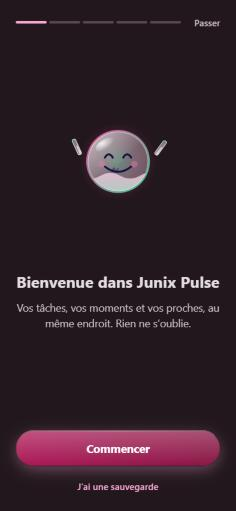
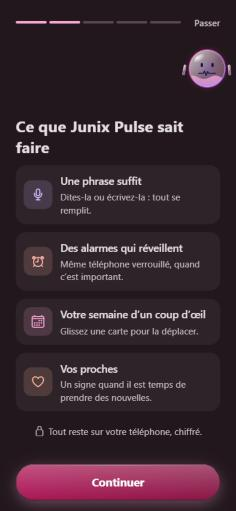
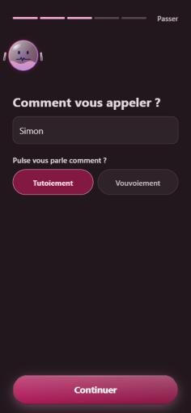
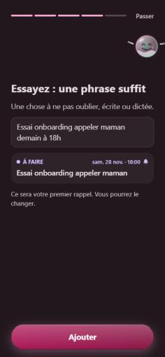
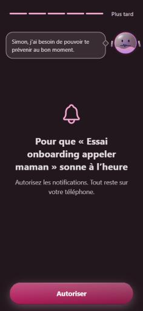

# FICHE OPÉRATOIRE N° 044 — Le nouvel onboarding : 5 écrans, le bouton toujours en bas

Projet : **Junix Pulse** · Date : 27 novembre 2026 · Suite de : [FICHE 043](FICHE-043-couleur-d-une-carte.md)

---

## 1. Objectif

Première fiche du chantier n° 12 (étude 001, 16.13 ; deuxième maquette validée) :

| Ta demande | Ce que fait cette fiche |
|---|---|
| trop d'informations, une impression d'« évasif » | **5 écrans courts** au lieu de 5 écrans chargés |
| le bouton pour avancer changeait de place | un **cadre commun** (`OnboardingFrame`) : la barre de progression et « Passer » en haut, le bouton **toujours en bas, au même endroit** |
| présenter les points forts | l'écran 2 : une phrase suffit, des alarmes qui réveillent, la semaine d'un coup d'œil, les proches ; Pulse montre chaque carte |
| essayer plutôt que lire | l'écran 4 : une vraie phrase devient le **premier rappel** |
| une seule permission, avec la raison | l'écran 5 : « Pour que « Appeler maman » sonne à l'heure » |
| (sorti de l'onboarding) | les heures du matin et du soir, la sauvegarde, la langue (Paramètres) ; les contacts quand on importe une personne |
| jamais de bord gauche coloré | la carte d'aperçu montre sa couleur par un point et un texte |

| | |
|---|---|
|  |  |
| *Figure 44-1 — 1 · Bonjour* | *Figure 44-2 — 2 · Les points forts* |
|  |  |
| *Figure 44-3 — 3 · Le prénom (prérempli quand on revoit la visite)* | *Figure 44-4 — 4 · Une phrase devient le premier rappel* |
|  | |
| *Figure 44-5 — 5 · Une seule permission, avec la raison* | |

*Captures réelles (web, 360 px, Pétale sombre).* La visite de chaque onglet est la **fiche 045** ; les secrets de Pulse, la **fiche 046**.

## 2. État de départ

| À vérifier | Comment | Résultat attendu |
|---|---|---|
| Les fiches 041 à 043 sont enregistrées | `git log --oneline -1` | `feat(design): a Neutre theme, colour themes, and a colour for each card` |
| Tout passe | `npx jest` | `Tests: 2182 passed` |

## 3. Matériel

Rien de nouveau.

## 4. Hypothèses

- Les **adresses** des écrans restent (`index`, `discover`, `personalize`, `permissions`) : le guide de Pulse les reconnaît par leur nom. `schedule` devient `try`.
- Les **alarmes exactes** sont encore proposées juste après les notifications : un rappel vient d'être créé, c'est le moment où elles servent.
- Une heure déjà passée aujourd'hui (« à 8 h » dit à 10 h) sonne demain.
- Les anciens textes (badges, « Comment ça fonctionne », « Votre rythme ») restent dans les traductions, non affichés : rien ne casse s'ils servent ailleurs.

## 5. Carte de l'intervention

| Fichier | Action |
|---|---|
| `features/onboarding/OnboardingFrame.tsx` (**nouveau**) | le cadre commun |
| `constants/onboarding-features.ts` (**nouveau**) | les 4 points forts |
| `app/(onboarding)/index.tsx`, `discover.tsx`, `personalize.tsx`, `permissions.tsx`, `try.tsx` (**nouveau**), `_layout.tsx` ; `schedule.tsx` **retiré** | les 5 écrans |
| `domain/rules/mascot-guide-rules.ts`, `mascot-message-catalog*.ts`, `app/dev/mascot.tsx` | Pulse suit les nouveaux écrans |
| i18n | les textes |
| `__tests__/onboarding.test.tsx`, `coherence-021.test.ts`, `domain/rules/__tests__/mascot-guide-rules.test.ts` | les tests |

## 6. Sauvegarde

`git status` propre (hors `docs/motion/`). Aucune migration.

## 7. Pas à pas

Le plus simple : `node docs/fiches/outils/appliquer-fiche-044.js .` fait toutes les étapes ci-dessous (il retire aussi `schedule.tsx`) ; puis l'APK (fiche 003). **Après une nouvelle page** (`try`), lancer une fois le serveur (`npx expo start`) : il met à jour la liste des adresses que `tsc` connaît.

### Étape 1 — Le cadre commun et les 4 points forts

**Pourquoi** : `OnboardingFrame` dessine ce que les 5 écrans partagent : la barre de progression (5 traits) et « Passer » en haut, le contenu au milieu, le bouton principal **en bas, au même endroit** sur chaque écran (avant, il montait et descendait). `guideRoom` laisse de la place au-dessus du titre quand Pulse s'y pose. `onboarding-features.ts` liste les 4 points forts (icône, titre, une phrase, couleur du thème) : l'écran les lit, il ne les écrit pas à la main.

Repère (Ctrl+F) : la première ligne de chaque bloc « Chercher ». Le script `appliquer-fiche-044.js` fait tous ces changements d'un coup, et refuse d'écrire si un bloc ne se trouve pas exactement une fois.

#### `src/features/onboarding/OnboardingFrame.tsx`

Fichier nouveau, en entier :

<!-- bloc: new-onboardingframe -->

```tsx
/**
 * OnboardingFrame: the frame shared by the 5 onboarding screens (study 001, 16.13; sheet 044).
 *
 * The progress bar and « Passer » at the top, the content in the middle, and the button to go
 * on always at the bottom, at the same place on every screen (it used to move up and down).
 */

import type { ReactNode } from 'react';
import { KeyboardAvoidingView, Platform, ScrollView, StyleSheet, Text, TouchableOpacity, View } from 'react-native';
import { useSafeAreaInsets } from 'react-native-safe-area-context';
import { Button } from '@/components/ui/Button';
import type { ThemePalette } from '@/constants/palettes';
import { Radius, Spacing, Typography } from '@/constants/theme';
import { useThemedStyles } from '@/hooks/use-themed-styles';
import { useT } from '@/i18n';

/** The room kept above the title for Pulse and a bubble of two lines. */
export const GUIDE_ROOM = 96;

/** The number of onboarding screens: five at most (the user's rule). */
export const ONBOARDING_SCREEN_COUNT = 5;

interface OnboardingFrameProps {
  /** 1 to 5. */
  step: number;
  /** « Passer » (or another word); absent: no button at the top right. */
  onSkip?: () => void;
  skipLabel?: string;
  title?: string;
  subtitle?: string;
  children?: ReactNode;
  cta: { label: string; onPress: () => void; loading?: boolean; disabled?: boolean; testID?: string };
  /** A small line under the button (« J'ai une sauvegarde »). */
  below?: ReactNode;
  /** Centre the content vertically (Bonjour, the permission). */
  centered?: boolean;
  /** Room above the title for Pulse and its bubble, on the screens where it sits at the top. */
  guideRoom?: number;
  testID?: string;
}

export function OnboardingFrame({ step, onSkip, skipLabel, title, subtitle, children, cta, below, centered = false, guideRoom = 0, testID }: OnboardingFrameProps) {
  const t = useT();
  const insets = useSafeAreaInsets();
  const styles = useThemedStyles(makeOnboardingFrameStyles);

  return (
    <KeyboardAvoidingView style={styles.root} behavior={Platform.OS === 'ios' ? 'padding' : undefined} testID={testID}>
      <View style={[styles.top, { paddingTop: insets.top + Spacing.md }]}>
        <View
          style={styles.bar}
          accessible
          accessibilityRole="progressbar"
          accessibilityLabel={t('step.a11y', { current: step, total: ONBOARDING_SCREEN_COUNT })}
        >
          {Array.from({ length: ONBOARDING_SCREEN_COUNT }, (_, index) => (
            <View key={index} style={[styles.segment, index < step && styles.segmentOn]} />
          ))}
        </View>
        {onSkip ? (
          <TouchableOpacity onPress={onSkip} style={styles.skip} accessibilityRole="button" testID="onboarding-skip">
            <Text style={styles.skipText}>{skipLabel ?? t('common.skip')}</Text>
          </TouchableOpacity>
        ) : null}
      </View>

      <ScrollView
        style={styles.scroll}
        contentContainerStyle={[styles.content, centered && styles.contentCentered]}
        keyboardShouldPersistTaps="handled"
        showsVerticalScrollIndicator={false}
      >
        {guideRoom > 0 ? <View style={{ height: guideRoom }} /> : null}
        {title ? <Text style={[styles.title, centered && styles.textCentered]}>{title}</Text> : null}
        {subtitle ? <Text style={[styles.subtitle, centered && styles.textCentered]}>{subtitle}</Text> : null}
        {children}
      </ScrollView>

      <View style={[styles.bottom, { paddingBottom: insets.bottom + Spacing.lg }]}>
        <Button
          label={cta.label}
          onPress={cta.onPress}
          loading={cta.loading}
          disabled={cta.disabled}
          variant="primary"
          size="lg"
          style={styles.cta}
          testID={cta.testID}
        />
        {below ? <View style={styles.below}>{below}</View> : null}
      </View>
    </KeyboardAvoidingView>
  );
}

function makeOnboardingFrameStyles(theme: ThemePalette) {
  return StyleSheet.create({
    root: {
      flex: 1,
      backgroundColor: theme.surface.base,
    },
    top: {
      flexDirection: 'row',
      alignItems: 'center',
      gap: Spacing.md,
      paddingHorizontal: Spacing.xl,
      paddingBottom: Spacing.md,
    },
    bar: {
      flex: 1,
      flexDirection: 'row',
      gap: 4,
    },
    segment: {
      flex: 1,
      height: 4,
      borderRadius: 2,
      backgroundColor: theme.outline.variant,
    },
    segmentOn: {
      backgroundColor: theme.primary.default,
    },
    skip: {
      minHeight: 44,
      justifyContent: 'center',
      paddingLeft: Spacing.sm,
    },
    skipText: {
      ...Typography.labelLarge,
      color: theme.onSurface.variant,
    },
    scroll: {
      flex: 1,
    },
    content: {
      paddingHorizontal: Spacing.xl,
      paddingBottom: Spacing.lg,
      gap: Spacing.md,
    },
    contentCentered: {
      flexGrow: 1,
      justifyContent: 'center',
    },
    title: {
      ...Typography.displayMedium,
      color: theme.onSurface.primary,
      fontWeight: '700',
    },
    subtitle: {
      ...Typography.bodyLarge,
      color: theme.onSurface.variant,
    },
    textCentered: {
      textAlign: 'center',
    },
    bottom: {
      paddingHorizontal: Spacing.xl,
      paddingTop: Spacing.md,
    },
    cta: {
      borderRadius: Radius.full,
    },
    below: {
      alignItems: 'center',
      marginTop: Spacing.sm,
    },
  });
}
```

#### `src/constants/onboarding-features.ts`

Fichier nouveau, en entier :

<!-- bloc: new-onboarding-features -->

```ts
/**
 * The flagship features shown on the 2nd onboarding screen (study 001, 16.13; sheet 044).
 * Four, not everything: the rest is found while using the app, and Pulse tells a few secrets later.
 * Pulse points at each card in turn with a sentence of DISCOVER_CARD_MESSAGES (same order; a test
 * keeps both the same length).
 */

import type { Ionicons } from '@expo/vector-icons';
import type { ComponentProps } from 'react';
import type { ThemePalette } from '@/constants/palettes';
import type { MessageKey } from '@/i18n';

export const ONBOARDING_FEATURES = ['voice', 'alarm', 'week', 'people'] as const;
export type OnboardingFeature = (typeof ONBOARDING_FEATURES)[number];

export interface OnboardingFeatureDefinition {
  icon: ComponentProps<typeof Ionicons>['name'];
  titleKey: MessageKey;
  descKey: MessageKey;
  /** Its colour in the palette of the theme. */
  color: (palette: ThemePalette) => string;
}

export const ONBOARDING_FEATURE_DEFINITIONS: Readonly<Record<OnboardingFeature, OnboardingFeatureDefinition>> = {
  voice: { icon: 'mic-outline', titleKey: 'onb.feature.voice', descKey: 'onb.feature.voiceDesc', color: palette => palette.tertiary.default },
  alarm: { icon: 'alarm-outline', titleKey: 'onb.feature.alarm', descKey: 'onb.feature.alarmDesc', color: palette => palette.error.default },
  week: { icon: 'calendar-outline', titleKey: 'onb.feature.week', descKey: 'onb.feature.weekDesc', color: palette => palette.primary.default },
  people: { icon: 'heart-outline', titleKey: 'onb.feature.people', descKey: 'onb.feature.peopleDesc', color: palette => palette.family.moment },
};
```


### Étape 2 — Les 5 écrans

**Pourquoi** : 1 · **Bonjour** : Pulse se présente (il vient dans la place gardée), une phrase, « Commencer » et « J'ai une sauvegarde ». 2 · **Les points forts**, mesurés pour que Pulse les montre un à un. 3 · **Le prénom** et tu ou vous (prérempli quand on revoit la visite). 4 · **L'essai** (`try.tsx`, nouveau) : la phrase est comprise comme dans les formulaires (`todoFromSentence`) et montrée comme sa carte ; « Ajouter » crée un rappel s'il y a une heure, une tâche sinon, puis passe le titre à l'écran 5. 5 · **Une permission** : la raison avec ce titre ; Autoriser (puis les alarmes exactes) ou Plus tard ; la fin marque l'onboarding comme fait. L'écran des heures (`schedule.tsx`) est retiré : ces réglages sont dans Paramètres.

Repère (Ctrl+F) : la première ligne de chaque bloc « Chercher ». Le script `appliquer-fiche-044.js` fait tous ces changements d'un coup, et refuse d'écrire si un bloc ne se trouve pas exactement une fois.

#### `src/app/(onboarding)/_layout.tsx`


Changement 1 sur 1. Chercher :

<!-- bloc: -layout-1-avant -->

```tsx
        <Stack.Screen name="index" options={{ gestureEnabled: false }} />
        <Stack.Screen name="discover" />
        <Stack.Screen name="personalize" />
        <Stack.Screen name="schedule" />
        <Stack.Screen name="permissions" />
      </Stack>
      <OnboardingGuide />
```

Remplacer par :

<!-- bloc: -layout-1-apres -->

```tsx
        <Stack.Screen name="index" options={{ gestureEnabled: false }} />
        <Stack.Screen name="discover" />
        <Stack.Screen name="personalize" />
        {/* A first reminder from a sentence (sheet 044), in place of the hours of the day */}
        <Stack.Screen name="try" />
        <Stack.Screen name="permissions" />
      </Stack>
      <OnboardingGuide />
```

#### `src/app/(onboarding)/index.tsx`


Changement 1 sur 3. Chercher :

<!-- bloc: index-1-avant -->

```tsx
/**
 * Onboarding — Étape 1 : Bienvenue (R-02)
 *
 * Structure : logo → accroche → 3 badges de valeur → CTA dégradé → lien restauration
 * Corrections vs source Stitch :
 * - Aucun emoji — icônes Ionicons uniquement (règle A.1)
 * - Titre en Outfit Bold (règle A.2)
 * - CTA dégradé pleine largeur (1 seul dégradé par écran)
 * - Badges pill avec icônes vectorielles (pas d'emojis)
 * - Navigation 5 destinations inchangée
 */
import { View, Text, StyleSheet, Dimensions, TouchableOpacity } from 'react-native';
import React, { useEffect, useRef } from 'react';
import { router } from 'expo-router';
import { setGuidePermission, setWelcomeAnchorY } from '@/features/mascot/onboarding-guide-state';
import { useMascotPreferences } from '@/features/mascot/use-mascot-preferences';
import { Spacing, Radius, Typography } from '@/constants/theme';
import type { ThemePalette } from '@/constants/palettes';
import { useTheme } from '@/hooks/use-theme';
import { useThemedStyles } from '@/hooks/use-themed-styles';
import { Button } from '@/components/ui/Button';
import { PulseLogo } from '@/components/ui/PulseLogo';
import { StepIndicator } from '@/components/ui/StepIndicator';
import { ValueBadge } from '@/components/ui/ValueBadge';
import { SettingsRepository } from '@/repositories/settings-repository';
import { useAppStore } from '@/store/app-store';
import { useBackupRestore } from '@/features/backup/use-backup-restore';
import { useT } from '@/i18n';

const { height } = Dimensions.get('window');

/** Hauteur réservée à la mascotte guide : son orbe de 96 dp, puis sa bulle de deux phrases. */
const MASCOT_ROOM_HEIGHT = 210;
/** Centre de l'orbe, mesuré depuis le haut de cette place. */
const MASCOT_ROOM_ANCHOR_OFFSET = 56;

export default function OnboardingWelcome() {
  const t = useT();
  const { palette } = useTheme();
  const styles = useThemedStyles(makeOnboardingWelcomeStyles);
  const setOnboardingComplete = useAppStore(state => state.setOnboardingComplete);
  const { startRestore, restoreModal } = useBackupRestore(async () => {
```

Remplacer par :

<!-- bloc: index-1-apres -->

```tsx
/**
 * Onboarding, screen 1 of 5: Bonjour (study 001, 16.13; sheet 044).
 *
 * Pulse greets in one sentence (the guide sits in the room kept here; the logo when Pulse is off),
 * one line on what the app is for, « Commencer », and « J'ai une sauvegarde » for someone who
 * already uses Junix Pulse.
 */
import React, { useEffect, useRef } from 'react';
import { StyleSheet, Text, TouchableOpacity, View } from 'react-native';
import { router } from 'expo-router';
import { PulseLogo } from '@/components/ui/PulseLogo';
import type { ThemePalette } from '@/constants/palettes';
import { Spacing, Typography } from '@/constants/theme';
import { useBackupRestore } from '@/features/backup/use-backup-restore';
import { setGuidePermission, setWelcomeAnchorY } from '@/features/mascot/onboarding-guide-state';
import { useMascotPreferences } from '@/features/mascot/use-mascot-preferences';
import { OnboardingFrame } from '@/features/onboarding/OnboardingFrame';
import { useThemedStyles } from '@/hooks/use-themed-styles';
import { useT } from '@/i18n';
import { SettingsRepository } from '@/repositories/settings-repository';
import { useAppStore } from '@/store/app-store';

/** Room kept for the guide: its orb of 96 dp, then its bubble of two sentences. */
const MASCOT_ROOM_HEIGHT = 210;
/** Centre of the orb, measured from the top of that room. */
const MASCOT_ROOM_ANCHOR_OFFSET = 56;

export default function OnboardingWelcome() {
  const t = useT();
  const styles = useThemedStyles(makeOnboardingWelcomeStyles);
  const setOnboardingComplete = useAppStore(state => state.setOnboardingComplete);
  const { startRestore, restoreModal } = useBackupRestore(async () => {
```

Changement 2 sur 3. Chercher :

<!-- bloc: index-2-avant -->

```tsx
    router.replace('/(tabs)');
  });

  // La mascotte guide prend la place du logo, avec sa bulle juste dessous. Elle se pose à
  // l'endroit mesuré ici ; si l'utilisateur l'a désactivée, le logo reste.
  const { settings: mascotSettings } = useMascotPreferences();
  const mascotPresent = mascotSettings.presence !== 'off';
  const mascotRoomRef = useRef<React.ComponentRef<typeof View>>(null);
```

Remplacer par :

<!-- bloc: index-2-apres -->

```tsx
    router.replace('/(tabs)');
  });

  const { settings: mascotSettings } = useMascotPreferences();
  const mascotPresent = mascotSettings.presence !== 'off';
  const mascotRoomRef = useRef<React.ComponentRef<typeof View>>(null);
```

Changement 3 sur 3. Chercher :

<!-- bloc: index-3-avant -->

```tsx
    mascotRoomRef.current?.measureInWindow((_x, y) => setWelcomeAnchorY(y + MASCOT_ROOM_ANCHOR_OFFSET));
  };

  // Un nouveau passage dans l'onboarding repart d'une permission non demandée
  useEffect(() => {
    setGuidePermission('ask');
  }, []);

  return (
    <View style={styles.container}>
      {restoreModal}
      {/* En-tête : étape + bouton passer */}
      <View style={styles.topRow}>
        <StepIndicator total={5} current={1} showLabel={true} />
        <TouchableOpacity
          onPress={() => router.push('/(onboarding)/permissions')}
          style={styles.skipBtn}
          accessibilityLabel={t('welcome.skipA11y')}
          accessibilityRole="button"
        >
          <Text style={styles.skipText}>{t('common.skip')}</Text>
        </TouchableOpacity>
      </View>

      {/* Section hero : logo + accroche */}
      <View style={styles.heroSection}>
        {mascotPresent ? (
          // Place réservée à la mascotte (orbe en haut) et à sa bulle (dessous)
          <View
            ref={mascotRoomRef}
            onLayout={measureMascotRoom}
            style={{ height: MASCOT_ROOM_HEIGHT, alignSelf: 'stretch', marginBottom: Spacing.md }}
          />
        ) : (
          /* Cercle de fond subtil derrière le logo */
          <View style={styles.logoOrb}>
            <PulseLogo size={88} mode="idle" />
          </View>
        )}

        <Text style={styles.headline}>
          {t('welcome.headline')}{'\n'}
          <Text style={styles.headlineAccent}>{t('welcome.headlineAccent')}</Text>
        </Text>

        <Text style={styles.subheadline}>{t('welcome.tagline')}</Text>
        <Text style={styles.description}>
          {t('welcome.description1')}{'\n'}
          {t('welcome.description2')}
        </Text>
      </View>

      {/* 3 badges de valeur */}
      <View style={styles.badges}>
        <ValueBadge
          icon="mic-outline"
          title={t('welcome.badge.calm.title')}
          subtitle={t('welcome.badge.calm.subtitle')}
          accentColor={palette.primary.default}
        />
        <ValueBadge
          icon="shield-checkmark-outline"
          title={t('welcome.badge.private.title')}
          subtitle={t('welcome.badge.private.subtitle')}
          accentColor={palette.tertiary.default}
        />
        <ValueBadge
          icon="pulse-outline"
          title={t('welcome.badge.rhythm.title')}
          subtitle={t('welcome.badge.rhythm.subtitle')}
          accentColor={palette.primary.default}
        />
      </View>

      {/* Actions */}
      <View style={styles.actions}>
        <Button
          label={t('welcome.start')}
          onPress={() => router.push('/(onboarding)/discover')}
          variant="primary"
          size="lg"
          style={styles.btnPrimary}
          testID="onboarding-start-btn"
          icon={undefined}
        />
        <TouchableOpacity
          onPress={startRestore}
          accessibilityRole="button"
          accessibilityLabel={t('welcome.restoreA11y')}
          style={styles.restoreBtn}
        >
          <Text style={styles.restoreText}>
            {t('welcome.restoreQuestion')}{' '}
            <Text style={styles.restoreLink}>{t('welcome.restoreLink')}</Text>
          </Text>
        </TouchableOpacity>
      </View>
    </View>
  );
}

const makeOnboardingWelcomeStyles = (theme: ThemePalette) =>
  StyleSheet.create({
    container: {
      flex: 1,
      backgroundColor: theme.surface.base,
      paddingHorizontal: Spacing.xl,
      paddingTop: height * 0.06,
      paddingBottom: Spacing.xxl,
    },

    // ─── En-tête ──────────────────────────────────────────────────────────────
    topRow: {
      flexDirection: 'row',
      alignItems: 'flex-start',
      justifyContent: 'space-between',
      marginBottom: Spacing.md,
    },
    skipBtn: {
      paddingVertical: Spacing.xs,
      paddingLeft: Spacing.md,
      minHeight: 44,
      justifyContent: 'center',
    },
    skipText: {
      ...Typography.bodyMedium,
      color: theme.onSurface.disabled,
    },

    // ─── Hero ─────────────────────────────────────────────────────────────────
    heroSection: {
      alignItems: 'center',
      marginBottom: Spacing.xl,
    },
    logoOrb: {
      width: 120,
      height: 120,
      borderRadius: Radius.full,
      backgroundColor: theme.primary.container + '33',
      borderWidth: 1,
      borderColor: theme.primary.default + '33',
      alignItems: 'center',
      justifyContent: 'center',
      marginBottom: Spacing.xl,
    },
    headline: {
      fontSize: 28,
      fontFamily: 'Outfit-Bold',
      color: theme.onSurface.primary,
      textAlign: 'center',
      lineHeight: 36,
      marginBottom: Spacing.sm,
    },
    headlineAccent: {
      color: theme.primary.default,
      fontFamily: 'Outfit-Bold',
    },
    subheadline: {
      ...Typography.titleMedium,
      color: theme.onSurface.primary,
      textAlign: 'center',
      marginBottom: Spacing.xs,
    },
    description: {
      ...Typography.bodyMedium,
      color: theme.onSurface.variant,
      textAlign: 'center',
      lineHeight: 22,
    },

    // ─── Badges ───────────────────────────────────────────────────────────────
    badges: {
      flexDirection: 'row',
      gap: Spacing.sm,
      marginBottom: Spacing.xl,
    },

    // ─── Actions ──────────────────────────────────────────────────────────────
    actions: {
      gap: Spacing.md,
      alignItems: 'center',
    },
    btnPrimary: {
      width: '100%',
    },
    restoreBtn: {
      paddingVertical: Spacing.xs,
      minHeight: 44,
      justifyContent: 'center',
    },
    restoreText: {
      ...Typography.bodySmall,
      color: theme.onSurface.disabled,
      textAlign: 'center',
    },
    restoreLink: {
      color: theme.primary.default,
      textDecorationLine: 'underline',
    },
  });

```

Remplacer par :

<!-- bloc: index-3-apres -->

```tsx
    mascotRoomRef.current?.measureInWindow((_x, y) => setWelcomeAnchorY(y + MASCOT_ROOM_ANCHOR_OFFSET));
  };

  // A new pass through the onboarding starts from a permission not asked yet
  useEffect(() => {
    setGuidePermission('ask');
  }, []);

  return (
    <>
      {restoreModal}
      <OnboardingFrame
        step={1}
        onSkip={() => router.push('/(onboarding)/permissions')}
        centered
        cta={{ label: t('onb.hello.start'), onPress: () => router.push('/(onboarding)/discover'), testID: 'onboarding-start-btn' }}
        below={
          <TouchableOpacity onPress={startRestore} accessibilityRole="button" accessibilityLabel={t('welcome.restoreA11y')} style={styles.restore}>
            <Text style={styles.restoreText}>{t('onb.hello.restore')}</Text>
          </TouchableOpacity>
        }
      >
        {mascotPresent ? (
          // The guide comes here (its orb, then its bubble)
          <View ref={mascotRoomRef} onLayout={measureMascotRoom} style={styles.mascotRoom} />
        ) : (
          <View style={styles.logo}>
            <PulseLogo size={88} mode="idle" />
          </View>
        )}
        <Text style={styles.title}>{t('onb.hello.title')}</Text>
        <Text style={styles.subtitle}>{t('onb.hello.subtitle')}</Text>
      </OnboardingFrame>
    </>
  );
}

function makeOnboardingWelcomeStyles(theme: ThemePalette) {
  return StyleSheet.create({
    mascotRoom: {
      height: MASCOT_ROOM_HEIGHT,
      alignSelf: 'stretch',
    },
    logo: {
      alignItems: 'center',
      marginBottom: Spacing.md,
    },
    title: {
      ...Typography.displayMedium,
      color: theme.onSurface.primary,
      textAlign: 'center',
    },
    subtitle: {
      ...Typography.bodyLarge,
      color: theme.onSurface.variant,
      textAlign: 'center',
    },
    restore: {
      minHeight: 44,
      justifyContent: 'center',
    },
    restoreText: {
      ...Typography.labelLarge,
      color: theme.primary.default,
    },
  });
}
```

#### `src/app/(onboarding)/discover.tsx`


Changement 1 sur 2. Chercher :

<!-- bloc: discover-1-avant -->

```tsx
/**
 * Onboarding, step 2: how it works. The five things of Junix Pulse (task, reminder, moment,
 * habit, goal) as shared cards, and one line on how to add (sheet 021). The list and its
 * texts live in constants/pulse-concepts.ts, so this screen never lists them by hand.
 */
import React, { useEffect, useRef } from 'react';
import { View, Text, StyleSheet, ScrollView, TouchableOpacity } from 'react-native';
import { router } from 'expo-router';
import { Ionicons } from '@expo/vector-icons';

import { Button } from '@/components/ui/Button';
import { StepIndicator } from '@/components/ui/StepIndicator';
import type { ThemePalette } from '@/constants/palettes';
import { PULSE_CONCEPTS } from '@/constants/pulse-concepts';
import { Spacing, Radius, Typography } from '@/constants/theme';
import { setDiscoverCardsY } from '@/features/mascot/onboarding-guide-state';
import { ConceptCard } from '@/features/onboarding/ConceptCard';
import { useTheme } from '@/hooks/use-theme';
import { useThemedStyles } from '@/hooks/use-themed-styles';
import { useT } from '@/i18n';

/** How far above the bottom of the list the mascot points for a card that is scrolled out of view. */
const HIDDEN_CARD_MARGIN = 24;

export default function OnboardingDiscover() {
  const t = useT();
  const { palette } = useTheme();
  const styles = useThemedStyles(makeOnboardingDiscoverStyles);

  // The mascot guide points at each card: the screen tells it where they are. They are measured
  // once the screen has finished sliding in, otherwise the position would be the moving one.
  // A card below the visible part of the list is pointed at the bottom of that part.
  const listRef = useRef<React.ComponentRef<typeof View>>(null);
  const cardRefs = useRef<(React.ComponentRef<typeof View> | null)[]>([]);
  useEffect(() => {
    const timer = setTimeout(() => {
      listRef.current?.measureInWindow((_lx, listY, _lw, listHeight) => {
        const bottom = listY + listHeight - HIDDEN_CARD_MARGIN;
        const centres: number[] = [];
        let measured = 0;
        cardRefs.current.forEach((card, index) => {
          card?.measureInWindow((_x, y, _w, h) => {
            centres[index] = Math.min(y + h / 2, bottom);
            measured += 1;
            if (measured === PULSE_CONCEPTS.length) setDiscoverCardsY(centres);
          });
        });
      });
    }, 600);
```

Remplacer par :

<!-- bloc: discover-1-apres -->

```tsx
/**
 * Onboarding, screen 2 of 5: what Junix Pulse does best (study 001, 16.13; sheet 044).
 *
 * Four flagship features, not everything (the rest is found while using the app). Pulse points
 * at each card in turn: the screen tells the guide where the cards are, once it has slid in.
 */
import React, { useEffect, useRef } from 'react';
import { StyleSheet, Text, View } from 'react-native';
import { router } from 'expo-router';
import { Ionicons } from '@expo/vector-icons';
import { ONBOARDING_FEATURE_DEFINITIONS, ONBOARDING_FEATURES } from '@/constants/onboarding-features';
import type { ThemePalette } from '@/constants/palettes';
import { Radius, Spacing, Typography } from '@/constants/theme';
import { setDiscoverCardsY } from '@/features/mascot/onboarding-guide-state';
import { GUIDE_ROOM, OnboardingFrame } from '@/features/onboarding/OnboardingFrame';
import { useTheme } from '@/hooks/use-theme';
import { useThemedStyles } from '@/hooks/use-themed-styles';
import { useT } from '@/i18n';
import { withAlpha } from '@/utils/color';

export default function OnboardingDiscover() {
  const t = useT();
  const { palette } = useTheme();
  const styles = useThemedStyles(makeOnboardingDiscoverStyles);

  // Where each card is, for the guide that points at them
  const cardRefs = useRef<(React.ComponentRef<typeof View> | null)[]>([]);
  useEffect(() => {
    const timer = setTimeout(() => {
      const centres: number[] = [];
      let measured = 0;
      cardRefs.current.forEach((card, index) => {
        card?.measureInWindow((_x, y, _w, h) => {
          centres[index] = y + h / 2;
          measured += 1;
          if (measured === ONBOARDING_FEATURES.length) setDiscoverCardsY(centres);
        });
      });
    }, 600);
```

Changement 2 sur 2. Chercher :

<!-- bloc: discover-2-avant -->

```tsx
  }, []);

  return (
    <View style={styles.container}>
      <View style={styles.header}>
        <View style={styles.headerRow}>
          <StepIndicator total={5} current={2} />
          <TouchableOpacity
            onPress={() => router.push('/(onboarding)/permissions')}
            style={styles.skipBtn}
            accessibilityLabel={t('discover.skipA11y')}
            accessibilityRole="button"
          >
            <Text style={styles.skipText}>{t('common.skip')}</Text>
          </TouchableOpacity>
        </View>
        <Text style={styles.title}>{t('discover.title')}</Text>
        <Text style={styles.subtitle}>{t('discover.subtitle')}</Text>
      </View>

      <View ref={listRef} collapsable={false} style={styles.scroll}>
        <ScrollView showsVerticalScrollIndicator={false} contentContainerStyle={styles.list}>
          {PULSE_CONCEPTS.map((concept, index) => (
            <View
              key={concept}
              ref={node => {
                cardRefs.current[index] = node;
              }}
              collapsable={false}
            >
              <ConceptCard concept={concept} />
            </View>
          ))}

          <View style={styles.hint}>
            <Ionicons name="mic-outline" size={18} color={palette.primary.default} />
            <Text style={styles.hintText}>{t('discover.hint')}</Text>
          </View>
        </ScrollView>
      </View>

      <View style={styles.actions}>
        <Button
          label={t('common.next')}
          onPress={() => router.push('/(onboarding)/personalize')}
          variant="primary"
          size="lg"
          style={styles.btnPrimary}
          testID="onboarding-discover-next"
        />
        <Button label={t('common.back')} onPress={() => router.back()} variant="ghost" size="md" />
      </View>
    </View>
  );
}

const makeOnboardingDiscoverStyles = (theme: ThemePalette) =>
  StyleSheet.create({
    container: {
      flex: 1,
      backgroundColor: theme.surface.base,
      paddingHorizontal: Spacing.xl,
      paddingTop: Spacing.xxl,
      paddingBottom: Spacing.xxl,
    },
    header: {
      marginBottom: Spacing.lg,
    },
    headerRow: {
      flexDirection: 'row',
      alignItems: 'flex-start',
      justifyContent: 'space-between',
    },
    skipBtn: {
      paddingVertical: Spacing.xs,
      paddingLeft: Spacing.md,
      minHeight: 44,
      justifyContent: 'center',
    },
    skipText: {
      ...Typography.bodyMedium,
      color: theme.onSurface.disabled,
    },
    title: {
      fontSize: 26,
      fontFamily: 'Outfit-Bold',
      color: theme.onSurface.primary,
      marginBottom: Spacing.xs,
      lineHeight: 34,
    },
    subtitle: {
      ...Typography.bodyLarge,
      color: theme.onSurface.variant,
    },
    scroll: {
      flex: 1,
    },
    list: {
      gap: Spacing.sm,
      paddingBottom: Spacing.lg,
    },
    hint: {
      flexDirection: 'row',
      alignItems: 'center',
      gap: Spacing.sm,
      backgroundColor: theme.surface.high,
      borderRadius: Radius.md,
      padding: Spacing.md,
      marginTop: Spacing.xs,
      borderWidth: 1,
      borderColor: theme.primary.default + '26',
    },
    hintText: {
      ...Typography.bodySmall,
      color: theme.onSurface.variant,
      flex: 1,
    },
    actions: {
      gap: Spacing.sm,
      alignItems: 'center',
      paddingTop: Spacing.md,
    },
    btnPrimary: {
      width: '100%',
    },
  });
```

Remplacer par :

<!-- bloc: discover-2-apres -->

```tsx
  }, []);

  return (
    <OnboardingFrame
      step={2}
      onSkip={() => router.push('/(onboarding)/permissions')}
      // Pulse sits at the top right with its bubble: room for it above the title
      guideRoom={GUIDE_ROOM}
      title={t('onb.features.title')}
      cta={{ label: t('common.continue'), onPress: () => router.push('/(onboarding)/personalize'), testID: 'onboarding-discover-next' }}
    >
      {ONBOARDING_FEATURES.map((feature, index) => {
        const definition = ONBOARDING_FEATURE_DEFINITIONS[feature];
        const color = definition.color(palette);
        const title = t(definition.titleKey);
        const desc = t(definition.descKey);
        return (
          <View
            key={feature}
            ref={node => {
              cardRefs.current[index] = node;
            }}
            collapsable={false}
            style={styles.card}
            accessible
            accessibilityLabel={`${title}. ${desc}`}
          >
            <View style={[styles.icon, { backgroundColor: withAlpha(color, 0.16) }]}>
              <Ionicons name={definition.icon} size={22} color={color} />
            </View>
            <View style={styles.body}>
              <Text style={styles.cardTitle}>{title}</Text>
              <Text style={styles.cardDesc}>{desc}</Text>
            </View>
          </View>
        );
      })}
      <View style={styles.private}>
        <Ionicons name="lock-closed-outline" size={16} color={palette.onSurface.variant} />
        <Text style={styles.privateText}>{t('onb.features.private')}</Text>
      </View>
    </OnboardingFrame>
  );
}

function makeOnboardingDiscoverStyles(theme: ThemePalette) {
  return StyleSheet.create({
    card: {
      flexDirection: 'row',
      alignItems: 'center',
      gap: Spacing.md,
      padding: Spacing.md,
      borderRadius: Radius.lg,
      backgroundColor: theme.surface.container,
    },
    icon: {
      width: 44,
      height: 44,
      borderRadius: Radius.md,
      alignItems: 'center',
      justifyContent: 'center',
    },
    body: {
      flex: 1,
      gap: 2,
    },
    cardTitle: {
      ...Typography.titleLarge,
      color: theme.onSurface.primary,
    },
    cardDesc: {
      ...Typography.bodyMedium,
      color: theme.onSurface.variant,
    },
    private: {
      flexDirection: 'row',
      alignItems: 'center',
      justifyContent: 'center',
      gap: 6,
      marginTop: Spacing.sm,
    },
    privateText: {
      ...Typography.bodyMedium,
      color: theme.onSurface.variant,
    },
  });
}
```

#### `src/app/(onboarding)/personalize.tsx`


Changement 1 sur 7. Chercher :

<!-- bloc: personalize-1-avant -->

```tsx
/**
 * Onboarding — Étape 3 : Personnalisation minimale
 * Demande le prénom et le fuseau horaire. Rien de plus.
 */

import { useState } from 'react';
import {
  View,
  Text,
  TextInput,
  StyleSheet,
  ScrollView,
  KeyboardAvoidingView,
  Platform,
  TouchableOpacity,
} from 'react-native';
import { router } from 'expo-router';
import { detectDeviceTimezone } from '@/services/device-timezone';
import {
  Spacing,
  Radius,
  Typography,
} from '@/constants/theme';
import type { ThemePalette } from '@/constants/palettes';
import { useTheme } from '@/hooks/use-theme';
import { useThemedStyles } from '@/hooks/use-themed-styles';
import { Button } from '@/components/ui/Button';
import { StepIndicator } from '@/components/ui/StepIndicator';
import { SettingsRepository } from '@/repositories/settings-repository';
import { useMascotPreferences } from '@/features/mascot/use-mascot-preferences';
import { saveMascotSettings } from '@/services/mascot/mascot-settings-service';
import { MessageKey, useLanguage, useT } from '@/i18n';

const ADDRESS_CHOICES: readonly { value: 'tu' | 'vous'; labelKey: MessageKey }[] = [
  { value: 'tu', labelKey: 'personalize.addressTu' },
```

Remplacer par :

<!-- bloc: personalize-1-apres -->

```tsx
/**
 * Onboarding, screen 3 of 5: the first name, and « tu » or « vous » (study 001, 16.13; sheet 044).
 * Both optional. The time zone is the phone's: it is never asked.
 */
import React, { useEffect, useState } from 'react';
import { StyleSheet, Text, TextInput, TouchableOpacity, View } from 'react-native';
import { router } from 'expo-router';
import type { ThemePalette } from '@/constants/palettes';
import { Radius, Spacing, Typography } from '@/constants/theme';
import { useMascotPreferences } from '@/features/mascot/use-mascot-preferences';
import { GUIDE_ROOM, OnboardingFrame } from '@/features/onboarding/OnboardingFrame';
import { useTheme } from '@/hooks/use-theme';
import { useThemedStyles } from '@/hooks/use-themed-styles';
import { MessageKey, useLanguage, useT } from '@/i18n';
import { SettingsRepository } from '@/repositories/settings-repository';
import { detectDeviceTimezone } from '@/services/device-timezone';
import { saveMascotSettings } from '@/services/mascot/mascot-settings-service';

const ADDRESS_CHOICES: readonly { value: 'tu' | 'vous'; labelKey: MessageKey }[] = [
  { value: 'tu', labelKey: 'personalize.addressTu' },
```

Changement 2 sur 7. Chercher :

<!-- bloc: personalize-2-avant -->

```tsx
  const [name, setName] = useState('');
  const [saving, setSaving] = useState(false);

  async function handleNext() {
    setSaving(true);
    try {
```

Remplacer par :

<!-- bloc: personalize-2-apres -->

```tsx
  const [name, setName] = useState('');
  const [saving, setSaving] = useState(false);

  // A visit seen again: the first name already known is there
  useEffect(() => {
    SettingsRepository.get()
      .then(settings => setName(current => current || settings.displayName?.trim() || ''))
      .catch(() => {});
  }, []);

  async function handleNext() {
    setSaving(true);
    try {
```

Changement 3 sur 7. Chercher :

<!-- bloc: personalize-3-avant -->

```tsx
        timezone: detectDeviceTimezone(),
        updatedAt: new Date().toISOString(),
      });
      router.push('/(onboarding)/schedule');
    } finally {
      setSaving(false);
    }
  }

  return (
    <KeyboardAvoidingView
      style={{ flex: 1 }}
      behavior={Platform.OS === 'ios' ? 'padding' : 'height'}
    >
      <ScrollView
        style={styles.container}
        contentContainerStyle={styles.content}
        keyboardShouldPersistTaps="handled"
      >
        {/* Indicateur d'étape */}
        <View style={styles.headerRow}>
          <StepIndicator total={5} current={3} />
          <TouchableOpacity
            onPress={() => router.push('/(onboarding)/permissions')}
            style={styles.skipBtn}
            accessibilityLabel={t('discover.skipA11y')}
            accessibilityRole="button"
          >
            <Text style={styles.skipText}>{t('common.skip')}</Text>
          </TouchableOpacity>
        </View>

        <Text style={styles.title}>{t('personalize.title')}</Text>
        <Text style={styles.subtitle}>{t('personalize.subtitle')}</Text>

        {/* Prénom (optionnel) */}
        <View style={styles.field}>
          <Text style={styles.label}>{t('personalize.nameLabel')}</Text>
          <Text style={styles.hint}>{t('personalize.nameHint')}</Text>
          <TextInput
            style={styles.input}
            value={name}
            onChangeText={setName}
            placeholder={t('personalize.namePlaceholder')}
            placeholderTextColor={palette.onSurface.disabled}
            maxLength={50}
            autoCorrect={false}
            testID="onboarding-name-input"
          />
        </View>

        {/* Façon dont la mascotte s'adresse à l'utilisateur (sans réponse : tutoiement).
            L'anglais n'a pas de tu ni de vous : le choix n'a de sens qu'en français. */}
        {language === 'fr' && (
        <View style={styles.field}>
          <Text style={styles.label}>{t('personalize.addressLabel')}</Text>
          <Text style={styles.hint}>{t('personalize.addressHint')}</Text>
          <View style={styles.choiceRow}>
            {ADDRESS_CHOICES.map(choice => {
              const selected = mascotSettings.address === choice.value;
```

Remplacer par :

<!-- bloc: personalize-3-apres -->

```tsx
        timezone: detectDeviceTimezone(),
        updatedAt: new Date().toISOString(),
      });
      router.push('/(onboarding)/try');
    } finally {
      setSaving(false);
    }
  }

  return (
    <OnboardingFrame
      step={3}
      onSkip={() => router.push('/(onboarding)/permissions')}
      // Pulse sits at the top left with its bubble: room for it above the title
      guideRoom={GUIDE_ROOM}
      title={t('onb.name.title')}
      cta={{ label: t('common.continue'), onPress: handleNext, loading: saving, testID: 'onboarding-personalize-next' }}
    >
      <TextInput
        style={styles.input}
        value={name}
        onChangeText={setName}
        placeholder={t('personalize.namePlaceholder')}
        placeholderTextColor={palette.onSurface.disabled}
        maxLength={50}
        autoCorrect={false}
        accessibilityLabel={t('personalize.nameLabel')}
        testID="onboarding-name-input"
      />

      {/* « tu » or « vous » for Pulse (none chosen: tu). English has neither: French only. */}
      {language === 'fr' && (
        <View style={styles.field}>
          <Text style={styles.label}>{t('onb.name.address')}</Text>
          <View style={styles.choiceRow}>
            {ADDRESS_CHOICES.map(choice => {
              const selected = mascotSettings.address === choice.value;
```

Changement 4 sur 7. Chercher :

<!-- bloc: personalize-4-avant -->

```tsx
                  key={choice.value}
                  style={[styles.choice, selected && styles.choiceSelected]}
                  onPress={() => void saveMascotSettings({ address: choice.value }).catch(() => {})}
                  accessibilityRole="button"
                  accessibilityState={{ selected }}
                  testID={`onboarding-address-${choice.value}`}
                >
```

Remplacer par :

<!-- bloc: personalize-4-apres -->

```tsx
                  key={choice.value}
                  style={[styles.choice, selected && styles.choiceSelected]}
                  onPress={() => void saveMascotSettings({ address: choice.value }).catch(() => {})}
                  accessibilityRole="radio"
                  accessibilityState={{ selected }}
                  testID={`onboarding-address-${choice.value}`}
                >
```

Changement 5 sur 7. Chercher :

<!-- bloc: personalize-5-avant -->

```tsx
            })}
          </View>
        </View>
        )}

        <View style={styles.actions}>
          <Button
            label={t('common.continue')}
            onPress={handleNext}
            variant="primary"
            size="lg"
            loading={saving}
            style={styles.btnPrimary}
            testID="onboarding-personalize-next"
          />
          <Button
            label={t('common.back')}
            onPress={() => router.back()}
            variant="ghost"
            size="md"
          />
        </View>
      </ScrollView>
    </KeyboardAvoidingView>
  );
}

const makeOnboardingPersonalizeStyles = (theme: ThemePalette) =>
  StyleSheet.create({
    container: {
      flex: 1,
      backgroundColor: theme.surface.base,
    },
    content: {
      paddingHorizontal: Spacing.xl,
      paddingTop: Spacing.xxl,
      paddingBottom: Spacing.xxxl,
    },
    headerRow: {
      flexDirection: 'row',
      alignItems: 'flex-start',
      justifyContent: 'space-between',
    },
    skipBtn: {
      paddingVertical: Spacing.xs,
      paddingLeft: Spacing.md,
      minHeight: 44,
      justifyContent: 'center',
    },
    skipText: {
      ...Typography.bodyMedium,
      color: theme.onSurface.disabled,
    },
    title: {
      fontSize: 26,
      fontFamily: 'Outfit-Bold',
      color: theme.onSurface.primary,
      marginBottom: Spacing.sm,
      lineHeight: 34,
    },
    subtitle: {
      ...Typography.bodyLarge,
      color: theme.onSurface.variant,
      lineHeight: 24,
      marginBottom: Spacing.xxl,
    },
    field: {
      marginBottom: Spacing.xl,
    },
    label: {
      ...Typography.titleMedium,
      color: theme.onSurface.primary,
      marginBottom: Spacing.xs,
    },
    hint: {
      ...Typography.bodySmall,
      color: theme.onSurface.disabled,
      marginBottom: Spacing.sm,
    },
    input: {
      backgroundColor: theme.surface.container,
      borderRadius: Radius.md,
      borderWidth: 1,
      borderColor: theme.outline.variant,
      color: theme.onSurface.primary,
      fontSize: 16,
      paddingHorizontal: Spacing.lg,
      paddingVertical: Spacing.md,
      minHeight: 48,
    },
    choiceRow: {
      flexDirection: 'row',
```

Remplacer par :

<!-- bloc: personalize-5-apres -->

```tsx
            })}
          </View>
        </View>
      )}
    </OnboardingFrame>
  );
}

function makeOnboardingPersonalizeStyles(theme: ThemePalette) {
  return StyleSheet.create({
    input: {
      ...Typography.bodyLarge,
      color: theme.onSurface.primary,
      backgroundColor: theme.surface.container,
      borderRadius: Radius.md,
      borderWidth: 1,
      borderColor: theme.outline.variant,
      paddingHorizontal: Spacing.md,
      minHeight: 52,
    },
    field: {
      gap: Spacing.sm,
      marginTop: Spacing.sm,
    },
    label: {
      ...Typography.titleMedium,
      color: theme.onSurface.primary,
    },
    choiceRow: {
      flexDirection: 'row',
```

Changement 6 sur 7. Chercher :

<!-- bloc: personalize-6-avant -->

```tsx
      minHeight: 48,
      alignItems: 'center',
      justifyContent: 'center',
      backgroundColor: theme.surface.container,
      borderRadius: Radius.md,
      borderWidth: 1,
      borderColor: theme.outline.variant,
    },
    choiceSelected: {
      backgroundColor: theme.primary.container,
      borderColor: theme.primary.default,
    },
    choiceText: {
      ...Typography.labelLarge,
```

Remplacer par :

<!-- bloc: personalize-6-apres -->

```tsx
      minHeight: 48,
      alignItems: 'center',
      justifyContent: 'center',
      borderRadius: Radius.full,
      borderWidth: 1,
      borderColor: theme.outline.variant,
      backgroundColor: theme.surface.container,
    },
    choiceSelected: {
      borderColor: theme.primary.default,
      backgroundColor: theme.primary.container,
    },
    choiceText: {
      ...Typography.labelLarge,
```

Changement 7 sur 7. Chercher :

<!-- bloc: personalize-7-avant -->

```tsx
      color: theme.primary.onContainer,
      fontWeight: '700',
    },
    actions: {
      gap: Spacing.sm,
      alignItems: 'center',
      marginTop: Spacing.xl,
    },
    btnPrimary: {
      width: '100%',
    },
  });

```

Remplacer par :

<!-- bloc: personalize-7-apres -->

```tsx
      color: theme.primary.onContainer,
      fontWeight: '700',
    },
  });
}
```

#### `src/app/(onboarding)/try.tsx`

Fichier nouveau, en entier :

<!-- bloc: new-try -->

```tsx
/**
 * Onboarding, screen 4 of 5: try rather than read (study 001, 16.13; sheet 044).
 *
 * One real sentence, typed or dictated (« Appeler maman demain à 18 h »), is understood as in the
 * forms (todoFromSentence) and shown as its card; « Ajouter » makes it the first reminder (a task
 * when no hour is said). The next screen asks for the notifications with its title as the reason.
 */
import React, { useMemo, useState } from 'react';
import { StyleSheet, Text, View } from 'react-native';
import { router } from 'expo-router';
import { Ionicons } from '@expo/vector-icons';
import { format } from 'date-fns';
import { DictatedInput } from '@/components/create/form/FormBricks';
import { alertMoment } from '@/constants/item-forms';
import { itemFamilyColor } from '@/constants/item-kinds';
import type { ThemePalette } from '@/constants/palettes';
import { Radius, Spacing, Typography } from '@/constants/theme';
import { todoFromSentence } from '@/domain/rules/form-dictation-rules';
import { GUIDE_ROOM, OnboardingFrame } from '@/features/onboarding/OnboardingFrame';
import { useTheme } from '@/hooks/use-theme';
import { useThemedStyles } from '@/hooks/use-themed-styles';
import { useDateLocale, useLanguage, useT } from '@/i18n';
import { detectDeviceTimezone } from '@/services/device-timezone';
import { useAppStore } from '@/store/app-store';
import { createReminder } from '@/use-cases/reminder-use-cases';
import { TaskUseCases } from '@/use-cases/task-use-cases';

const DAY_MS = 24 * 60 * 60 * 1000;

export default function OnboardingTry() {
  const t = useT();
  const language = useLanguage();
  const dateLocale = useDateLocale();
  const { palette } = useTheme();
  const styles = useThemedStyles(makeOnboardingTryStyles);
  const showSnackbar = useAppStore(state => state.showSnackbar);
  const [sentence, setSentence] = useState('');
  const [saving, setSaving] = useState(false);
  const color = itemFamilyColor(palette, 'todo');

  // What the sentence says, as the card it will become
  const fill = useMemo(
    () => (sentence.trim() ? todoFromSentence(sentence, [], new Date(), language) : null),
    [sentence, language]
  );
  const when = useMemo(() => {
    if (!fill) return null;
    if (!fill.alert) return fill.day ? format(new Date(`${fill.day}T12:00:00`), 'EEE d MMM', { locale: dateLocale }) : null;
    return format(alertMoment(fill.day, fill.time, new Date()), 'EEE d MMM · HH:mm', { locale: dateLocale });
  }, [fill, dateLocale]);

  async function add() {
    if (!fill || !fill.title.trim()) return;
    setSaving(true);
    try {
      if (fill.alert) {
        const now = new Date();
        let at = alertMoment(fill.day, fill.time, now);
        // An hour already past today rings tomorrow
        if (at.getTime() <= now.getTime()) at = new Date(at.getTime() + DAY_MS);
        await createReminder({ title: fill.title.trim(), scheduledAt: at, timezone: detectDeviceTimezone(), priority: fill.priority });
      } else {
        await TaskUseCases.createTask({ title: fill.title.trim(), scheduledDate: fill.day, priority: fill.priority });
      }
      router.push({ pathname: '/(onboarding)/permissions', params: { first: fill.title.trim() } });
    } catch {
      showSnackbar(t('taskNew.createError'));
    } finally {
      setSaving(false);
    }
  }

  return (
    <OnboardingFrame
      step={4}
      onSkip={() => router.push('/(onboarding)/permissions')}
      // Pulse sits at the top right with its bubble: room for it above the title
      guideRoom={GUIDE_ROOM}
      title={t('onb.try.title')}
      subtitle={t('onb.try.subtitle')}
      cta={{ label: t('onb.try.add'), onPress: () => void add(), loading: saving, disabled: !fill?.title.trim(), testID: 'onboarding-try-add' }}
    >
      <DictatedInput
        value={sentence}
        onChangeText={setSentence}
        accent={color}
        placeholder={t('onb.try.placeholder')}
        // Its own box here: in the forms, a card gives it one
        inputStyle={styles.input}
        multiline
        accessibilityLabel={t('onb.try.title')}
        testID="onboarding-try-input"
      />

      {fill && fill.title.trim() ? (
        <View style={styles.card} accessible accessibilityLabel={`${fill.title}${when ? `, ${when}` : ''}`}>
          <View style={styles.cardTop}>
            <View style={[styles.dot, { backgroundColor: color }]} />
            <Text style={[styles.kind, { color }]}>{t('itemFamily.todo')}</Text>
            <View style={styles.spacer} />
            {when ? <Text style={[styles.when, { color }]}>{when}</Text> : null}
            {fill.alert ? <Ionicons name="notifications" size={12} color={color} /> : null}
          </View>
          <Text style={styles.cardTitle}>{fill.title}</Text>
        </View>
      ) : null}

      {fill && fill.title.trim() ? <Text style={styles.note}>{t('onb.try.note')}</Text> : null}
    </OnboardingFrame>
  );
}

function makeOnboardingTryStyles(theme: ThemePalette) {
  return StyleSheet.create({
    input: {
      ...Typography.bodyLarge,
      color: theme.onSurface.primary,
      backgroundColor: theme.surface.container,
      borderRadius: Radius.md,
      borderWidth: 1,
      borderColor: theme.outline.variant,
      paddingHorizontal: Spacing.md,
      paddingVertical: Spacing.sm,
      minHeight: 52,
    },
    card: {
      padding: Spacing.md,
      borderRadius: Radius.lg,
      backgroundColor: theme.surface.container,
      gap: 4,
    },
    cardTop: {
      flexDirection: 'row',
      alignItems: 'center',
      gap: 6,
    },
    dot: {
      width: 8,
      height: 8,
      borderRadius: 4,
    },
    kind: {
      ...Typography.labelMedium,
      fontWeight: '700',
      textTransform: 'uppercase',
    },
    spacer: {
      flex: 1,
    },
    when: {
      ...Typography.labelMedium,
    },
    cardTitle: {
      ...Typography.titleLarge,
      color: theme.onSurface.primary,
    },
    note: {
      ...Typography.bodyMedium,
      color: theme.onSurface.variant,
    },
  });
}
```

#### `src/app/(onboarding)/permissions.tsx`


Changement 1 sur 1. Chercher :

<!-- bloc: permissions-1-avant -->

```tsx
/**
 * Onboarding — Étape 5 : Permissions
 * Demande les permissions utiles au bon moment (BR-019).
 * Les permissions sont demandées ici, après que l'utilisateur comprend leur utilité.
 * Si refusées, l'application continue de fonctionner.
 */

import { useState } from 'react';
import { View, Text, StyleSheet, ScrollView, Platform } from 'react-native';
import { GlassAlert } from '@/components/feedback/GlassAlert';
import { Ionicons } from '@expo/vector-icons';
import { NotificationService } from '@/services/notification-service';
import { setGuidePermission } from '@/features/mascot/onboarding-guide-state';
import {
  Spacing,
  Radius,
  Typography,
} from '@/constants/theme';
import type { ThemePalette } from '@/constants/palettes';
import { useTheme } from '@/hooks/use-theme';
import { useThemedStyles } from '@/hooks/use-themed-styles';
import { Button } from '@/components/ui/Button';
import { StepIndicator } from '@/components/ui/StepIndicator';
import { SettingsRepository } from '@/repositories/settings-repository';
import { useAppStore } from '@/store/app-store';
import { useT } from '@/i18n';
import { LanguagePicker } from '@/components/settings/LanguagePicker';
import { useAutoBackupSetup } from '@/features/backup/use-auto-backup-setup';
import { runAutoBackup } from '@/services/auto-backup-service';

export default function OnboardingPermissions() {
  const t = useT();
  const { palette } = useTheme();
  const styles = useThemedStyles(makeOnboardingPermissionsStyles);
  const { setOnboardingComplete } = useAppStore();
  const [notifStatus, setNotifStatus] = useState<'idle' | 'granted' | 'denied'>('idle');
  const [finishing, setFinishing] = useState(false);
  const [autoBackupOn, setAutoBackupOn] = useState(false);
  // The automatic backup, offered once here: the first copy is made at once
  const { startSetup: startAutoBackupSetup, setupModal: autoBackupSetupModal } = useAutoBackupSetup(async () => {
    setAutoBackupOn(true);
    await runAutoBackup({ force: true });
  });

  async function requestNotifications() {
    try {
      const granted = await NotificationService.requestPermissions();
      setNotifStatus(granted ? 'granted' : 'denied');
      // La mascotte guide réagit à la réponse : petite fête si acceptée, sans insistance sinon
      setGuidePermission(granted ? 'granted' : 'denied');
      await SettingsRepository.update({
        notificationsEnabled: granted,
        updatedAt: new Date().toISOString(),
      });
      if (granted) await offerExactAlarms();
    } catch {
      setNotifStatus('denied');
      setGuidePermission('denied');
    }
  }

  async function offerExactAlarms() {
    const { granted, canAsk } = await NotificationService.getExactAlarmStatus();
    if (granted || !canAsk) return;
    GlassAlert.alert(
      t('permissions.exactAlarms.title'),
      t('permissions.exactAlarms.body'),
      [
        { text: t('permissions.exactAlarms.later'), style: 'cancel' },
        { text: t('permissions.exactAlarms.allow'), onPress: () => void NotificationService.requestExactAlarms() },
      ]
    );
  }

  async function finish() {
    setFinishing(true);
    try {
      await SettingsRepository.markOnboardingComplete(new Date().toISOString());
      setOnboardingComplete(true);
      // La navigation vers (tabs) est gérée par le redirect dans _layout.tsx
    } finally {
      setFinishing(false);
    }
  }

  return (
    <ScrollView style={styles.container} contentContainerStyle={styles.content}>
      {/* Indicateur d'étape — toutes complètes */}
      <StepIndicator total={5} current={5} />

      <Text style={styles.title}>{t('permissions.title')}</Text>
      <Text style={styles.subtitle}>{t('permissions.subtitle')}</Text>

      {/* Langue : celle du téléphone, ou un choix */}
      <View style={styles.permCard}>
        <Text style={styles.permTitle}>{t('language.label')}</Text>
        <LanguagePicker testIDPrefix="onboarding-language" />
      </View>

      {/* Notification */}
      <View style={styles.permCard}>
        <View style={styles.permHeader}>
          <View style={[styles.permIcon, { backgroundColor: palette.primary.container + '33' }]}>
            <Ionicons name="notifications-outline" size={22} color={palette.primary.default} />
          </View>
          <View style={styles.permInfo}>
            <Text style={styles.permTitle}>{t('permissions.notifications.title')}</Text>
            <Text style={styles.permDesc}>{t('permissions.notifications.desc')}</Text>
          </View>
        </View>

        {notifStatus === 'idle' ? (
          <Button
            label={t('permissions.notifications.allow')}
            onPress={requestNotifications}
            variant="secondary"
            size="md"
            style={styles.permBtn}
            testID="onboarding-notif-btn"
          />
        ) : notifStatus === 'granted' ? (
          <View style={styles.permGranted}>
            <Ionicons name="checkmark-circle" size={16} color={palette.success.default} style={{ marginRight: 6 }} />
            <Text style={styles.permGrantedText}>{t('permissions.notifications.granted')}</Text>
          </View>
        ) : (
          <View style={styles.permDenied}>
            <Text style={styles.permDeniedText}>{t('permissions.notifications.denied')}</Text>
          </View>
        )}
      </View>

      {/* Sauvegarde automatique, proposée une fois ici (pas sur le web, sans dossier du système) */}
      {Platform.OS !== 'web' && (
        <View style={styles.permCard}>
          <View style={styles.permHeader}>
            <View style={[styles.permIcon, { backgroundColor: palette.primary.container + '33' }]}>
              <Ionicons name="sync-outline" size={22} color={palette.primary.default} />
            </View>
            <View style={styles.permInfo}>
              <Text style={styles.permTitle}>{t('permissions.autoBackup.title')}</Text>
              <Text style={styles.permDesc}>{t('permissions.autoBackup.desc')}</Text>
            </View>
          </View>
          {autoBackupOn ? (
            <View style={styles.permGranted}>
              <Ionicons name="checkmark-circle" size={16} color={palette.success.default} style={{ marginRight: 6 }} />
              <Text style={styles.permGrantedText}>{t('permissions.autoBackup.enabled')}</Text>
            </View>
          ) : (
            <Button
              label={t('permissions.autoBackup.enable')}
              onPress={startAutoBackupSetup}
              variant="secondary"
              size="md"
              style={styles.permBtn}
              testID="onboarding-auto-backup-btn"
            />
          )}
        </View>
      )}

      {/* Note contacts (pour plus tard dans l'app) */}
      <View style={styles.noteCard}>
        <View style={styles.noteTitleRow}>
          <Ionicons name="people-outline" size={18} color={palette.tertiary.default} style={{ marginRight: 6 }} />
          <Text style={styles.noteTitle}>{t('permissions.contacts.title')}</Text>
        </View>
        <Text style={styles.noteDesc}>{t('permissions.contacts.desc')}</Text>
      </View>

      <View style={styles.ready}>
        <Text style={styles.readyTitle}>{t('permissions.ready.title')}</Text>
        <Text style={styles.readyDesc}>{t('permissions.ready.desc')}</Text>
      </View>

      <Button
        label={t('permissions.start')}
        onPress={finish}
        variant="primary"
        size="lg"
        loading={finishing}
        style={styles.btnFinish}
        testID="onboarding-finish-btn"
      />
      {autoBackupSetupModal}
    </ScrollView>
  );
}

const makeOnboardingPermissionsStyles = (theme: ThemePalette) =>
  StyleSheet.create({
    container: { flex: 1, backgroundColor: theme.surface.base },
    content: {
      paddingHorizontal: Spacing.xl,
      paddingTop: Spacing.xxl,
      paddingBottom: Spacing.xxxl,
    },
    title: {
      fontSize: 26,
      fontFamily: 'Outfit-Bold',
      color: theme.onSurface.primary,
      marginBottom: Spacing.sm,
      lineHeight: 34,
    },
    subtitle: {
      ...Typography.bodyMedium,
      color: theme.onSurface.variant,
      lineHeight: 22,
      marginBottom: Spacing.xxl,
    },
    permCard: {
      backgroundColor: theme.surface.container,
      borderRadius: Radius.lg,
      padding: Spacing.lg,
      marginBottom: Spacing.lg,
    },
    permHeader: { flexDirection: 'row', gap: Spacing.md, marginBottom: Spacing.md },
    permIcon: {
      width: 48,
      height: 48,
      borderRadius: Radius.md,
      alignItems: 'center',
      justifyContent: 'center',
    },
    permInfo: { flex: 1 },
    permTitle: { ...Typography.titleMedium, color: theme.onSurface.primary, marginBottom: Spacing.xs },
    permDesc: { ...Typography.bodySmall, color: theme.onSurface.variant, lineHeight: 18 },
    permBtn: { width: '100%' },
    permGranted: {
      backgroundColor: theme.success.container,
      borderRadius: Radius.sm,
      padding: Spacing.sm,
      flexDirection: 'row',
      alignItems: 'center',
    },
    permGrantedText: { ...Typography.labelMedium, color: theme.success.default },
    permDenied: {
      backgroundColor: theme.surface.high,
      borderRadius: Radius.sm,
      padding: Spacing.sm,
    },
    permDeniedText: { ...Typography.bodySmall, color: theme.onSurface.disabled, lineHeight: 18 },
    noteCard: {
      backgroundColor: theme.surface.high,
      borderRadius: Radius.md,
      padding: Spacing.lg,
      marginBottom: Spacing.xl,
    },
    noteTitleRow: {
      flexDirection: 'row',
      alignItems: 'center',
      marginBottom: Spacing.xs,
    },
    noteTitle: { ...Typography.titleMedium, color: theme.onSurface.primary, marginBottom: Spacing.xs },
    noteDesc: { ...Typography.bodySmall, color: theme.onSurface.variant, lineHeight: 18 },
    ready: {
      alignItems: 'center',
      marginBottom: Spacing.xl,
      padding: Spacing.xl,
    },
    readyTitle: {
      ...Typography.headlineMedium,
      color: theme.primary.default,
      marginBottom: Spacing.sm,
      textAlign: 'center',
    },
    readyDesc: {
      ...Typography.bodyMedium,
      color: theme.onSurface.variant,
      textAlign: 'center',
      lineHeight: 22,
    },
    btnFinish: { width: '100%' },
  });

```

Remplacer par :

<!-- bloc: permissions-1-apres -->

```tsx
/**
 * Onboarding, screen 5 of 5: one permission, the notifications, with its reason (study 001, 16.13;
 * sheet 044). « Pour que "Appeler maman" sonne demain » when the person just added one.
 *
 * The other permissions are asked when they serve (the contacts when importing a person); the
 * exact alarms are offered right after the notifications are allowed, since a reminder now waits.
 * The backup, the hours of the morning and the evening and the language stay in the settings.
 * Refused, the app still works: the reminders stay visible in it.
 */
import { useState } from 'react';
import { StyleSheet, Text, View } from 'react-native';
import { useLocalSearchParams } from 'expo-router';
import { Ionicons } from '@expo/vector-icons';
import { GlassAlert } from '@/components/feedback/GlassAlert';
import type { ThemePalette } from '@/constants/palettes';
import { Spacing, Typography } from '@/constants/theme';
import { setGuidePermission } from '@/features/mascot/onboarding-guide-state';
import { OnboardingFrame } from '@/features/onboarding/OnboardingFrame';
import { useTheme } from '@/hooks/use-theme';
import { useThemedStyles } from '@/hooks/use-themed-styles';
import { useT } from '@/i18n';
import { SettingsRepository } from '@/repositories/settings-repository';
import { NotificationService } from '@/services/notification-service';
import { useAppStore } from '@/store/app-store';

export default function OnboardingPermissions() {
  const t = useT();
  const { palette } = useTheme();
  const styles = useThemedStyles(makeOnboardingPermissionsStyles);
  const setOnboardingComplete = useAppStore(state => state.setOnboardingComplete);
  const { first } = useLocalSearchParams<{ first?: string }>();
  const [answer, setAnswer] = useState<'idle' | 'granted' | 'denied'>('idle');
  const [busy, setBusy] = useState(false);

  async function offerExactAlarms() {
    const { granted, canAsk } = await NotificationService.getExactAlarmStatus();
    if (granted || !canAsk) return;
    GlassAlert.alert(t('permissions.exactAlarms.title'), t('permissions.exactAlarms.body'), [
      { text: t('permissions.exactAlarms.later'), style: 'cancel' },
      { text: t('permissions.exactAlarms.allow'), onPress: () => void NotificationService.requestExactAlarms() },
    ]);
  }

  async function allow() {
    setBusy(true);
    try {
      const granted = await NotificationService.requestPermissions();
      setAnswer(granted ? 'granted' : 'denied');
      // Pulse answers: a small party if allowed, no insisting otherwise
      setGuidePermission(granted ? 'granted' : 'denied');
      await SettingsRepository.update({ notificationsEnabled: granted, updatedAt: new Date().toISOString() });
      if (granted) await offerExactAlarms();
    } catch {
      setAnswer('denied');
      setGuidePermission('denied');
    } finally {
      setBusy(false);
    }
  }

  async function finish() {
    setBusy(true);
    try {
      await SettingsRepository.markOnboardingComplete(new Date().toISOString());
      setOnboardingComplete(true);
      // The move to the tabs is made by the redirect of the root layout
    } finally {
      setBusy(false);
    }
  }

  const asked = answer !== 'idle';
  const title = first ? t('onb.notif.titleFirst', { title: first }) : t('onb.notif.title');
  const subtitle =
    answer === 'granted' ? t('onb.notif.granted') : answer === 'denied' ? t('onb.notif.denied') : t('onb.notif.subtitle');

  return (
    <OnboardingFrame
      step={5}
      onSkip={asked ? undefined : () => void finish()}
      skipLabel={t('permissions.exactAlarms.later')}
      centered
      cta={
        asked
          ? { label: t('onb.notif.start'), onPress: () => void finish(), loading: busy, testID: 'onboarding-finish-btn' }
          : { label: t('onb.notif.allow'), onPress: () => void allow(), loading: busy, testID: 'onboarding-notif-btn' }
      }
    >
      <View style={styles.icon}>
        <Ionicons
          name={answer === 'granted' ? 'checkmark-circle' : 'notifications-outline'}
          size={56}
          color={answer === 'granted' ? palette.success.default : palette.primary.default}
        />
      </View>
      <Text style={styles.title}>{title}</Text>
      <Text style={styles.subtitle}>{subtitle}</Text>
    </OnboardingFrame>
  );
}

function makeOnboardingPermissionsStyles(theme: ThemePalette) {
  return StyleSheet.create({
    icon: {
      alignItems: 'center',
      marginBottom: Spacing.sm,
    },
    title: {
      ...Typography.displayMedium,
      color: theme.onSurface.primary,
      textAlign: 'center',
    },
    subtitle: {
      ...Typography.bodyLarge,
      color: theme.onSurface.variant,
      textAlign: 'center',
    },
  });
}
```

#### `src/i18n/messages-rest-fr.ts`


Changement 1 sur 1. Chercher :

<!-- bloc: messages-rest-fr-1-avant -->

```ts
  'colorTheme.slate': 'Ardoise',
  'itemForm.cardColor': 'Couleur de la carte',
  'itemForm.cardColorFamily': 'Couleur de la famille',
  'settingsScreen.glass': 'Effet verre',
  'settingsScreen.glassHelp': 'Cartes et barres translucides. Coupé : fond plein, plus lisible.',
  'settingsScreen.briefings': 'Horaires des briefings',
```

Remplacer par :

<!-- bloc: messages-rest-fr-1-apres -->

```ts
  'colorTheme.slate': 'Ardoise',
  'itemForm.cardColor': 'Couleur de la carte',
  'itemForm.cardColorFamily': 'Couleur de la famille',
  'onb.hello.title': 'Bienvenue dans Junix Pulse',
  'onb.hello.subtitle': 'Vos tâches, vos moments et vos proches, au même endroit. Rien ne s’oublie.',
  'onb.hello.start': 'Commencer',
  'onb.hello.restore': 'J’ai une sauvegarde',
  'onb.features.title': 'Ce que Junix Pulse sait faire',
  'onb.features.private': 'Tout reste sur votre téléphone, chiffré.',
  'onb.feature.voice': 'Une phrase suffit',
  'onb.feature.voiceDesc': 'Dites-la ou écrivez-la : tout se remplit.',
  'onb.feature.alarm': 'Des alarmes qui réveillent',
  'onb.feature.alarmDesc': 'Même téléphone verrouillé, quand c’est important.',
  'onb.feature.week': 'Votre semaine d’un coup d’œil',
  'onb.feature.weekDesc': 'Glissez une carte pour la déplacer.',
  'onb.feature.people': 'Vos proches',
  'onb.feature.peopleDesc': 'Un signe quand il est temps de prendre des nouvelles.',
  'onb.name.title': 'Comment vous appeler ?',
  'onb.name.address': 'Pulse vous parle comment ?',
  'onb.try.title': 'Essayez : une phrase suffit',
  'onb.try.subtitle': 'Une chose à ne pas oublier, écrite ou dictée.',
  'onb.try.placeholder': 'Appeler maman demain à 18 h',
  'onb.try.note': 'Ce sera votre premier rappel. Vous pourrez le changer.',
  'onb.try.add': 'Ajouter',
  'onb.notif.title': 'Pour que vos rappels sonnent à l’heure',
  'onb.notif.titleFirst': 'Pour que « {title} » sonne à l’heure',
  'onb.notif.subtitle': 'Autorisez les notifications. Tout reste sur votre téléphone.',
  'onb.notif.allow': 'Autoriser',
  'onb.notif.granted': 'C’est autorisé. Tout est prêt.',
  'onb.notif.denied': 'D’accord. Vos rappels resteront visibles dans l’appli ; vous pourrez changer d’avis dans les Paramètres.',
  'onb.notif.start': 'C’est parti',
  'settingsScreen.glass': 'Effet verre',
  'settingsScreen.glassHelp': 'Cartes et barres translucides. Coupé : fond plein, plus lisible.',
  'settingsScreen.briefings': 'Horaires des briefings',
```

#### `src/i18n/messages-rest-en.ts`


Changement 1 sur 1. Chercher :

<!-- bloc: messages-rest-en-1-avant -->

```ts
  'colorTheme.slate': 'Slate',
  'itemForm.cardColor': 'Card colour',
  'itemForm.cardColorFamily': 'Family colour',
  'settingsScreen.glass': 'Glass effect',
  'settingsScreen.glassHelp': 'See-through cards and bars. Off: plain background, easier to read.',
  'settingsScreen.briefings': 'Briefing times',
```

Remplacer par :

<!-- bloc: messages-rest-en-1-apres -->

```ts
  'colorTheme.slate': 'Slate',
  'itemForm.cardColor': 'Card colour',
  'itemForm.cardColorFamily': 'Family colour',
  'onb.hello.title': 'Welcome to Junix Pulse',
  'onb.hello.subtitle': 'Your tasks, your moments and your loved ones, in one place. Nothing gets forgotten.',
  'onb.hello.start': 'Get started',
  'onb.hello.restore': 'I have a backup',
  'onb.features.title': 'What Junix Pulse does',
  'onb.features.private': 'Everything stays on your phone, encrypted.',
  'onb.feature.voice': 'One sentence is enough',
  'onb.feature.voiceDesc': 'Say it or type it: everything fills in.',
  'onb.feature.alarm': 'Alarms that wake you up',
  'onb.feature.alarmDesc': 'Even on a locked phone, when it matters.',
  'onb.feature.week': 'Your week at a glance',
  'onb.feature.weekDesc': 'Drag a card to move it.',
  'onb.feature.people': 'Your loved ones',
  'onb.feature.peopleDesc': 'A sign when it’s time to check in.',
  'onb.name.title': 'What should we call you?',
  'onb.name.address': 'How should Pulse talk to you?',
  'onb.try.title': 'Try it: one sentence is enough',
  'onb.try.subtitle': 'Something not to forget, typed or dictated.',
  'onb.try.placeholder': 'Call mum tomorrow at 6 pm',
  'onb.try.note': 'It will be your first reminder. You can change it later.',
  'onb.try.add': 'Add',
  'onb.notif.title': 'So that your reminders ring on time',
  'onb.notif.titleFirst': 'So that “{title}” rings on time',
  'onb.notif.subtitle': 'Allow notifications. Everything stays on your phone.',
  'onb.notif.allow': 'Allow',
  'onb.notif.granted': 'Allowed. Everything is ready.',
  'onb.notif.denied': 'All right. Your reminders stay visible in the app; you can change your mind in the Settings.',
  'onb.notif.start': 'Let’s go',
  'settingsScreen.glass': 'Glass effect',
  'settingsScreen.glassHelp': 'See-through cards and bars. Off: plain background, easier to read.',
  'settingsScreen.briefings': 'Briefing times',
```


### Étape 3 — Pulse suit les nouveaux écrans

**Pourquoi** : Le guide de Pulse reconnaît chaque écran par son nom : l'étape `schedule` devient `try` (en haut à droite, au-dessus de la phrase). Il dit une phrase par point fort (`DISCOVER_VOICE`, `_ALARM`, `_WEEK`, `_PEOPLE`) et une pour l'essai (`TRY_INTRO`), en français (tu et vous, chaleureux ou sobre) et en anglais. Les anciennes phrases restent dans le catalogue, inutilisées.

Repère (Ctrl+F) : la première ligne de chaque bloc « Chercher ». Le script `appliquer-fiche-044.js` fait tous ces changements d'un coup, et refuse d'écrire si un bloc ne se trouve pas exactement une fois.

#### `src/domain/rules/mascot-guide-rules.ts`


Changement 1 sur 6. Chercher :

<!-- bloc: mascot-guide-rules-1-avant -->

```ts
import type { MascotMessageId } from './mascot-message-catalog';
import type { MascotMood } from './mascot-mood-rules';

export type GuideStep = 'welcome' | 'discover' | 'personalize' | 'schedule' | 'permissions' | 'home';
export type GuideDirection = 'forward' | 'back' | 'skip';
export type GuidePermissionPhase = 'ask' | 'done';
export type GuidePose = 'greet' | 'rest' | 'pointAt' | 'attentive' | 'happy';
```

Remplacer par :

<!-- bloc: mascot-guide-rules-1-apres -->

```ts
import type { MascotMessageId } from './mascot-message-catalog';
import type { MascotMood } from './mascot-mood-rules';

// 'try' (sheet 044): a first reminder from a sentence, in place of the hours of the day
export type GuideStep = 'welcome' | 'discover' | 'personalize' | 'try' | 'permissions' | 'home';
export type GuideDirection = 'forward' | 'back' | 'skip';
export type GuidePermissionPhase = 'ask' | 'done';
export type GuidePose = 'greet' | 'rest' | 'pointAt' | 'attentive' | 'happy';
```

Changement 2 sur 6. Chercher :

<!-- bloc: mascot-guide-rules-2-avant -->

```ts
      return { id: 'DISCOVER_INTRO', mood: 'calm' };
    case 'personalize':
      return { id: 'PERSONALIZE_NAME', mood: 'calm' };
    case 'schedule':
      return { id: 'SCHEDULE_INTRO', mood: 'calm' };
    case 'permissions':
      if (permission === 'granted') return { id: 'PERMISSION_GRANTED', mood: 'party' };
      if (permission === 'denied') return { id: 'PERMISSION_DENIED', mood: 'calm' };
```

Remplacer par :

<!-- bloc: mascot-guide-rules-2-apres -->

```ts
      return { id: 'DISCOVER_INTRO', mood: 'calm' };
    case 'personalize':
      return { id: 'PERSONALIZE_NAME', mood: 'calm' };
    case 'try':
      return { id: 'TRY_INTRO', mood: 'happy' };
    case 'permissions':
      if (permission === 'granted') return { id: 'PERMISSION_GRANTED', mood: 'party' };
      if (permission === 'denied') return { id: 'PERMISSION_DENIED', mood: 'calm' };
```

Changement 3 sur 6. Chercher :

<!-- bloc: mascot-guide-rules-3-avant -->

```ts
}

/**
 * What the mascot says as it points at each discovery card, in order: the order of
 * PULSE_CONCEPTS (task, reminder, moment, habit, goal; sheet 021). A test keeps both the same length.
 */
export const DISCOVER_CARD_MESSAGES: readonly GuideMessage[] = [
  { id: 'DISCOVER_TASK', mood: 'calm' },
  { id: 'DISCOVER_REMINDER', mood: 'calm' },
  { id: 'DISCOVER_EVENT', mood: 'calm' },
  { id: 'DISCOVER_HABIT', mood: 'calm' },
  { id: 'DISCOVER_GOAL', mood: 'happy' },
];

/** The onboarding screens, in order, as the router names them. */
export const ONBOARDING_STEPS: readonly GuideStep[] = ['welcome', 'discover', 'personalize', 'schedule', 'permissions'];

/**
 * Direction of a move between two steps. Jumping straight to the last one from an earlier one
```

Remplacer par :

<!-- bloc: mascot-guide-rules-3-apres -->

```ts
}

/**
 * What the mascot says as it points at each card of the 2nd screen, in order: the order of
 * ONBOARDING_FEATURES (voice, alarm, week, people; sheet 044). A test keeps both the same length.
 */
export const DISCOVER_CARD_MESSAGES: readonly GuideMessage[] = [
  { id: 'DISCOVER_VOICE', mood: 'calm' },
  { id: 'DISCOVER_ALARM', mood: 'calm' },
  { id: 'DISCOVER_WEEK', mood: 'calm' },
  { id: 'DISCOVER_PEOPLE', mood: 'happy' },
];

/** The onboarding screens, in order, as the router names them. */
export const ONBOARDING_STEPS: readonly GuideStep[] = ['welcome', 'discover', 'personalize', 'try', 'permissions'];

/**
 * Direction of a move between two steps. Jumping straight to the last one from an earlier one
```

Changement 4 sur 6. Chercher :

<!-- bloc: mascot-guide-rules-4-avant -->

```ts
  switch (input.step) {
    case 'welcome':
      return 96;
    case 'schedule':
      return 48;
    case 'permissions':
      return input.phase === 'done' ? 80 : 56;
```

Remplacer par :

<!-- bloc: mascot-guide-rules-4-apres -->

```ts
  switch (input.step) {
    case 'welcome':
      return 96;
    case 'try':
      return 48;
    case 'permissions':
      return input.phase === 'done' ? 80 : 56;
```

Changement 5 sur 6. Chercher :

<!-- bloc: mascot-guide-rules-5-avant -->

```ts
    case 'welcome':
      return input.reducedMotion ? 'rest' : 'greet';
    case 'discover':
    case 'schedule':
      return input.target ? 'pointAt' : 'rest';
    case 'personalize':
      return input.target ? 'pointAt' : 'attentive';
```

Remplacer par :

<!-- bloc: mascot-guide-rules-5-apres -->

```ts
    case 'welcome':
      return input.reducedMotion ? 'rest' : 'greet';
    case 'discover':
    case 'try':
      return input.target ? 'pointAt' : 'rest';
    case 'personalize':
      return input.target ? 'pointAt' : 'attentive';
```

Changement 6 sur 6. Chercher :

<!-- bloc: mascot-guide-rules-6-avant -->

```ts
    case 'personalize':
    case 'home':
      return { x: left, y: topY };
    case 'schedule':
      return { x: right, y: input.rowCenterY ?? band.top + span / 2 };
    case 'permissions':
      return input.phase === 'done' ? { x: width / 2, y: band.top + span * 0.25 } : { x: right, y: topY };
  }
```

Remplacer par :

<!-- bloc: mascot-guide-rules-6-apres -->

```ts
    case 'personalize':
    case 'home':
      return { x: left, y: topY };
    case 'try':
      return { x: right, y: topY };
    case 'permissions':
      return input.phase === 'done' ? { x: width / 2, y: band.top + span * 0.25 } : { x: right, y: topY };
  }
```

#### `src/domain/rules/mascot-message-catalog.ts`


Changement 1 sur 2. Chercher :

<!-- bloc: mascot-message-catalog-1-avant -->

```ts
    ["Voici les cinq choses que je garde pour vous.", "{name}, voici les cinq choses que je garde pour vous."],
    ["Voici les cinq éléments que je suis pour vous.", "{name}, voici les cinq éléments que je suis pour vous."],
  ),
  DISCOVER_TASK: entry(
    ["Une tâche se coche quand c'est fait.", "{name}, une tâche se coche quand c'est fait."],
    ["Une tâche se coche une fois faite.", "{name}, une tâche se coche une fois faite."],
```

Remplacer par :

<!-- bloc: mascot-message-catalog-1-apres -->

```ts
    ["Voici les cinq choses que je garde pour vous.", "{name}, voici les cinq choses que je garde pour vous."],
    ["Voici les cinq éléments que je suis pour vous.", "{name}, voici les cinq éléments que je suis pour vous."],
  ),
  DISCOVER_VOICE: entry(
    ["Dis-moi une phrase, je remplis tout le reste.", "{name}, dis-moi une phrase, je remplis tout le reste."],
    ["Une phrase suffit : je remplis le reste.", "{name}, une phrase suffit : je remplis le reste."],
    ["Dites-moi une phrase, je remplis tout le reste.", "{name}, dites-moi une phrase, je remplis tout le reste."],
    ["Une phrase suffit : je remplis le reste.", "{name}, une phrase suffit : je remplis le reste."],
  ),
  DISCOVER_ALARM: entry(
    ["Quand c'est important, je sonne même téléphone verrouillé.", "{name}, quand c'est important, je sonne même téléphone verrouillé."],
    ["Les alarmes sonnent même écran verrouillé.", "{name}, les alarmes sonnent même écran verrouillé."],
    ["Quand c'est important, je sonne même téléphone verrouillé.", "{name}, quand c'est important, je sonne même téléphone verrouillé."],
    ["Les alarmes sonnent même écran verrouillé.", "{name}, les alarmes sonnent même écran verrouillé."],
  ),
  DISCOVER_WEEK: entry(
    ["Ta semaine tient sur un écran : glisse une carte pour la déplacer.", "{name}, ta semaine tient sur un écran : glisse une carte pour la déplacer."],
    ["La semaine se voit d'un coup d'œil ; une carte se déplace en la glissant.", "{name}, la semaine se voit d'un coup d'œil ; une carte se déplace en la glissant."],
    ["Votre semaine tient sur un écran : glissez une carte pour la déplacer.", "{name}, votre semaine tient sur un écran : glissez une carte pour la déplacer."],
    ["La semaine se voit d'un coup d'œil ; une carte se déplace en la glissant.", "{name}, la semaine se voit d'un coup d'œil ; une carte se déplace en la glissant."],
  ),
  DISCOVER_PEOPLE: entry(
    ["Et je te dis quand prendre des nouvelles de tes proches.", "Et {name}, je te dis quand prendre des nouvelles de tes proches."],
    ["Je signale les proches à qui donner des nouvelles.", "{name}, je signale les proches à qui donner des nouvelles."],
    ["Et je vous dis quand prendre des nouvelles de vos proches.", "Et {name}, je vous dis quand prendre des nouvelles de vos proches."],
    ["Je signale les proches à qui donner des nouvelles.", "{name}, je signale les proches à qui donner des nouvelles."],
  ),
  DISCOVER_TASK: entry(
    ["Une tâche se coche quand c'est fait.", "{name}, une tâche se coche quand c'est fait."],
    ["Une tâche se coche une fois faite.", "{name}, une tâche se coche une fois faite."],
```

Changement 2 sur 2. Chercher :

<!-- bloc: mascot-message-catalog-2-avant -->

```ts
    ["Je vérifie que vos rappels sonnent à la bonne heure.", "{name}, je vérifie que vos rappels sonnent à la bonne heure."],
    ["Je contrôle le fuseau horaire de vos rappels.", "{name}, je contrôle le fuseau horaire de vos rappels."],
  ),
  SCHEDULE_INTRO: entry(
    ["Enchantée ! Le matin je te résume ta journée, le soir je fais le bilan.", "Enchantée, {name} ! Le matin je te résume ta journée, le soir je fais le bilan."],
    ["Enchantée. Le matin je résume ta journée, le soir je fais le bilan.", "Enchantée, {name}. Le matin je résume ta journée, le soir je fais le bilan."],
    ["Enchantée ! Le matin je vous résume votre journée, le soir je fais le bilan.", "Enchantée, {name} ! Le matin je vous résume votre journée, le soir je fais le bilan."],
    ["Enchantée. Le matin je résume votre journée, le soir je fais le bilan.", "Enchantée, {name}. Le matin je résume votre journée, le soir je fais le bilan."],
  ),
  PERMISSION_ASK: entry(
    ["J'ai besoin de pouvoir te prévenir au bon moment.", "{name}, j'ai besoin de pouvoir te prévenir au bon moment."],
```

Remplacer par :

<!-- bloc: mascot-message-catalog-2-apres -->

```ts
    ["Je vérifie que vos rappels sonnent à la bonne heure.", "{name}, je vérifie que vos rappels sonnent à la bonne heure."],
    ["Je contrôle le fuseau horaire de vos rappels.", "{name}, je contrôle le fuseau horaire de vos rappels."],
  ),
  // The 4th onboarding screen (sheet 044): a first reminder from a sentence
  TRY_INTRO: entry(
    ["Enchantée ! Essaie : écris ou dis une chose à ne pas oublier.", "Enchantée, {name} ! Essaie : écris ou dis une chose à ne pas oublier."],
    ["Essaie : écris ou dis une chose à ne pas oublier.", "{name}, essaie : écris ou dis une chose à ne pas oublier."],
    ["Enchantée ! Essayez : écrivez ou dites une chose à ne pas oublier.", "Enchantée, {name} ! Essayez : écrivez ou dites une chose à ne pas oublier."],
    ["Essayez : écrivez ou dites une chose à ne pas oublier.", "{name}, essayez : écrivez ou dites une chose à ne pas oublier."],
  ),
  PERMISSION_ASK: entry(
    ["J'ai besoin de pouvoir te prévenir au bon moment.", "{name}, j'ai besoin de pouvoir te prévenir au bon moment."],
```

#### `src/domain/rules/mascot-message-catalog-en.ts`


Changement 1 sur 2. Chercher :

<!-- bloc: mascot-message-catalog-en-1-avant -->

```ts
    ["Here are the five things I keep for you.", "{name}, here are the five things I keep for you."],
    ["Here are the five items I follow for you.", "{name}, here are the five items I follow for you."],
  ),
  DISCOVER_TASK: entry(
    ["A task is ticked once it's done.", "{name}, a task is ticked once it's done."],
    ["A task is ticked when done.", "{name}, a task is ticked when done."],
```

Remplacer par :

<!-- bloc: mascot-message-catalog-en-1-apres -->

```ts
    ["Here are the five things I keep for you.", "{name}, here are the five things I keep for you."],
    ["Here are the five items I follow for you.", "{name}, here are the five items I follow for you."],
  ),
  DISCOVER_VOICE: entry(
    ["Tell me one sentence, I fill in all the rest.", "{name}, tell me one sentence, I fill in all the rest."],
    ["One sentence is enough: I fill in the rest.", "{name}, one sentence is enough: I fill in the rest."],
  ),
  DISCOVER_ALARM: entry(
    ["When it matters, I ring even on a locked phone.", "{name}, when it matters, I ring even on a locked phone."],
    ["Alarms ring even on a locked screen.", "{name}, alarms ring even on a locked screen."],
  ),
  DISCOVER_WEEK: entry(
    ["Your week fits on one screen: drag a card to move it.", "{name}, your week fits on one screen: drag a card to move it."],
    ["The week at a glance; a card moves by dragging it.", "{name}, the week at a glance; a card moves by dragging it."],
  ),
  DISCOVER_PEOPLE: entry(
    ["And I tell you when to check in on your loved ones.", "And {name}, I tell you when to check in on your loved ones."],
    ["I point out the people to check in on.", "{name}, I point out the people to check in on."],
  ),
  DISCOVER_TASK: entry(
    ["A task is ticked once it's done.", "{name}, a task is ticked once it's done."],
    ["A task is ticked when done.", "{name}, a task is ticked when done."],
```

Changement 2 sur 2. Chercher :

<!-- bloc: mascot-message-catalog-en-2-avant -->

```ts
    ["I'm checking that your reminders ring at the right time.", "{name}, I'm checking that your reminders ring at the right time."],
    ["I'm checking the time zone of your reminders.", "{name}, I'm checking the time zone of your reminders."],
  ),
  SCHEDULE_INTRO: entry(
    ["Lovely! In the morning I sum up your day, in the evening I review it.", "Lovely, {name}! In the morning I sum up your day, in the evening I review it."],
    ["Nice to meet you. In the morning I sum up your day, in the evening I review it.", "Nice to meet you, {name}. In the morning I sum up your day, in the evening I review it."],
  ),
  PERMISSION_ASK: entry(
    ["I need to be able to alert you at the right time.", "{name}, I need to be able to alert you at the right time."],
```

Remplacer par :

<!-- bloc: mascot-message-catalog-en-2-apres -->

```ts
    ["I'm checking that your reminders ring at the right time.", "{name}, I'm checking that your reminders ring at the right time."],
    ["I'm checking the time zone of your reminders.", "{name}, I'm checking the time zone of your reminders."],
  ),
  TRY_INTRO: entry(
    ["Nice to meet you! Try it: write or say something not to forget.", "Nice to meet you, {name}! Try it: write or say something not to forget."],
    ["Try it: write or say something not to forget.", "{name}, try it: write or say something not to forget."],
  ),
  PERMISSION_ASK: entry(
    ["I need to be able to alert you at the right time.", "{name}, I need to be able to alert you at the right time."],
```

#### `src/app/dev/mascot.tsx`


Changement 1 sur 1. Chercher :

<!-- bloc: mascot-1-avant -->

```tsx
  { step: 'welcome', label: 'Bienvenue' },
  { step: 'discover', label: 'Découverte' },
  { step: 'personalize', label: 'Personnaliser' },
  { step: 'schedule', label: 'Rythme' },
  { step: 'permissions', label: 'Notifications' },
  { step: 'home', label: 'Accueil' },
];
```

Remplacer par :

<!-- bloc: mascot-1-apres -->

```tsx
  { step: 'welcome', label: 'Bienvenue' },
  { step: 'discover', label: 'Découverte' },
  { step: 'personalize', label: 'Personnaliser' },
  { step: 'try', label: 'Essai' },
  { step: 'permissions', label: 'Notifications' },
  { step: 'home', label: 'Accueil' },
];
```


### Étape 4 — Les tests

**Pourquoi** : `onboarding.test.tsx` rend les 5 écrans et vérifie « Passer » en haut et le bouton en bas de chacun, les 4 points forts, et « Ajouter » éteint tant qu'il n'y a pas de phrase. Le test du guide parle de `try` ; `coherence-021` lie les phrases de Pulse aux 4 points forts.

Repère (Ctrl+F) : la première ligne de chaque bloc « Chercher ». Le script `appliquer-fiche-044.js` fait tous ces changements d'un coup, et refuse d'écrire si un bloc ne se trouve pas exactement une fois.

#### `src/__tests__/onboarding.test.tsx`


Changement 1 sur 4. Chercher :

<!-- bloc: onboarding-test-1-avant -->

```tsx
 *
 * Couverture :
 * - Vérification que le layout exporte un composant rendable
 * - Vérification de la présence du bouton "Passer" sur les étapes 1-4
 * - Vérification que l'étape 5 n'a pas de bouton Passer
 * - Vérification de resetOnboarding dans le repository
 */

```

Remplacer par :

<!-- bloc: onboarding-test-1-apres -->

```tsx
 *
 * Couverture :
 * - Vérification que le layout exporte un composant rendable
 * - Les 5 écrans de la fiche 044 : « Passer » en haut et le bouton en bas de chacun
 * - Vérification de resetOnboarding dans le repository
 */

```

Changement 2 sur 4. Chercher :

<!-- bloc: onboarding-test-2-avant -->

```tsx
      replace: jest.fn(),
    },
    useSegments: () => [],
    useFocusEffect: (cb: () => void) => {
      ReactModule.useEffect(() => cb(), [cb]);
    },
  };
});

// La mascotte guide a ses propres tests ; ici on vérifie seulement que le layout se rend
jest.mock('@/features/mascot/OnboardingGuide', () => ({ OnboardingGuide: () => null }));

```

Remplacer par :

<!-- bloc: onboarding-test-2-apres -->

```tsx
      replace: jest.fn(),
    },
    useSegments: () => [],
    useLocalSearchParams: () => ({}),
    useFocusEffect: (cb: () => void) => {
      ReactModule.useEffect(() => cb(), [cb]);
    },
  };
});

// The frame keeps clear of the phone's edges; the try screen has a microphone (sheet 044)
jest.mock('react-native-safe-area-context', () => ({ useSafeAreaInsets: () => ({ top: 0, bottom: 0, left: 0, right: 0 }) }));
jest.mock('@/features/capture/use-dictation', () => ({
  useDictation: () => ({ available: false, supported: false, listening: false, toggle: jest.fn() }),
}));

// La mascotte guide a ses propres tests ; ici on vérifie seulement que le layout se rend
jest.mock('@/features/mascot/OnboardingGuide', () => ({ OnboardingGuide: () => null }));

```

Changement 3 sur 4. Chercher :

<!-- bloc: onboarding-test-3-avant -->

```tsx
jest.mock('@/services/notification-service', () => ({
  NotificationService: {
    requestPermissions: jest.fn().mockResolvedValue(true),
  },
}));

jest.mock('@/repositories/settings-repository', () => ({
  SettingsRepository: {
    get: jest.fn().mockResolvedValue({
```

Remplacer par :

<!-- bloc: onboarding-test-3-apres -->

```tsx
jest.mock('@/services/notification-service', () => ({
  NotificationService: {
    requestPermissions: jest.fn().mockResolvedValue(true),
    getExactAlarmStatus: jest.fn().mockResolvedValue({ granted: true, canAsk: false }),
  },
}));

// The try screen creates a reminder or a task (sheet 044)
jest.mock('@/use-cases/reminder-use-cases', () => ({ createReminder: jest.fn().mockResolvedValue('r1') }));
jest.mock('@/use-cases/task-use-cases', () => ({ TaskUseCases: { createTask: jest.fn().mockResolvedValue('t1') } }));

jest.mock('@/repositories/settings-repository', () => ({
  SettingsRepository: {
    get: jest.fn().mockResolvedValue({
```

Changement 4 sur 4. Chercher :

<!-- bloc: onboarding-test-4-avant -->

```tsx
    });
  });

  describe('Étape 1 — Bienvenue', () => {
    it('rend le composant et contient un bouton Passer', () => {
      const Welcome = require('@/app/(onboarding)/index').default;
      let root: ReactTestRenderer.ReactTestRenderer;
      act(() => {
        root = ReactTestRenderer.create(<Welcome />);
      });
      const skipBtn = root!.root.findByProps({ accessibilityLabel: "Passer l'onboarding" });
      expect(skipBtn).toBeDefined();
    });
  });

  describe('Étape 2 — Découverte', () => {
    it('rend le composant et contient un bouton Passer', () => {
      const Discover = require('@/app/(onboarding)/discover').default;
      let root: ReactTestRenderer.ReactTestRenderer;
      act(() => {
        root = ReactTestRenderer.create(<Discover />);
      });
      const skipBtn = root!.root.findByProps({ accessibilityLabel: "Passer les étapes restantes" });
      expect(skipBtn).toBeDefined();
    });
  });

  describe('Étape 3 — Personnalisation', () => {
    it('rend le composant et contient un bouton Passer', () => {
      const Personalize = require('@/app/(onboarding)/personalize').default;
      let root: ReactTestRenderer.ReactTestRenderer;
      act(() => {
        root = ReactTestRenderer.create(<Personalize />);
      });
      const skipBtns = root!.root.findAllByProps({ accessibilityLabel: "Passer les étapes restantes" });
      expect(skipBtns.length).toBeGreaterThanOrEqual(1);
    });
  });

  describe('Étape 4 — Planification', () => {
    it('rend le composant et contient un bouton Passer', () => {
      const Schedule = require('@/app/(onboarding)/schedule').default;
      let root: ReactTestRenderer.ReactTestRenderer;
      act(() => {
        root = ReactTestRenderer.create(<Schedule />);
      });
      const skipBtns = root!.root.findAllByProps({ accessibilityLabel: "Passer à la dernière étape" });
      expect(skipBtns.length).toBeGreaterThanOrEqual(1);
    });
  });

  describe('Étape 5 — Permissions', () => {
    it('rend le composant final sans bouton Passer', () => {
      const Permissions = require('@/app/(onboarding)/permissions').default;
      let root: ReactTestRenderer.ReactTestRenderer;
      act(() => {
        root = ReactTestRenderer.create(<Permissions />);
      });
      // L'étape finale ne doit pas avoir de bouton Passer
      const skipBtns = root!.root.findAllByProps({ accessibilityLabel: "Passer les étapes restantes" });
      expect(skipBtns.length).toBe(0);
    });
  });

  describe('SettingsRepository.resetOnboarding', () => {
```

Remplacer par :

<!-- bloc: onboarding-test-4-apres -->

```tsx
    });
  });

  // The 5 screens of sheet 044: the same frame, « Passer » at the top (none once the last one is
  // answered), and the button to go on at the bottom of each
  const render = (path: string) => {
    const Screen = require(path).default;
    let root: ReactTestRenderer.ReactTestRenderer;
    act(() => {
      root = ReactTestRenderer.create(<Screen />);
    });
    return root!;
  };
  const byTestId = (root: ReactTestRenderer.ReactTestRenderer, testID: string) =>
    root.root.findAll(node => node.props.testID === testID);

  it.each([
    ['@/app/(onboarding)/index', 'onboarding-start-btn'],
    ['@/app/(onboarding)/discover', 'onboarding-discover-next'],
    ['@/app/(onboarding)/personalize', 'onboarding-personalize-next'],
    ['@/app/(onboarding)/try', 'onboarding-try-add'],
    ['@/app/(onboarding)/permissions', 'onboarding-notif-btn'],
  ])('%s has « Passer » and its button at the bottom', (path, button) => {
    const root = render(path);
    expect(byTestId(root, 'onboarding-skip').length).toBeGreaterThanOrEqual(1);
    expect(byTestId(root, button).length).toBeGreaterThanOrEqual(1);
  });

  it('shows the four flagship features on the 2nd screen', () => {
    const root = render('@/app/(onboarding)/discover');
    const labels = root.root.findAll(node => typeof node.props.accessibilityLabel === 'string' && node.props.accessible === true);
    expect(labels.length).toBeGreaterThanOrEqual(4);
  });

  it('keeps the « Ajouter » of the try screen off until a sentence is written', () => {
    const root = render('@/app/(onboarding)/try');
    const add = byTestId(root, 'onboarding-try-add')[0];
    expect(add.props.disabled).toBe(true);
  });

  describe('SettingsRepository.resetOnboarding', () => {
```

#### `src/domain/rules/__tests__/mascot-guide-rules.test.ts`


Changement 1 sur 9. Chercher :

<!-- bloc: mascot-guide-rules-test-1-avant -->

```ts
    ['welcome', 96],
    ['discover', 56],
    ['personalize', 56],
    ['schedule', 48],
    ['permissions', 56],
    ['home', 56],
  ])('step %s uses %i px', (step, size) => {
```

Remplacer par :

<!-- bloc: mascot-guide-rules-test-1-apres -->

```ts
    ['welcome', 96],
    ['discover', 56],
    ['personalize', 56],
    ['try', 48],
    ['permissions', 56],
    ['home', 56],
  ])('step %s uses %i px', (step, size) => {
```

Changement 2 sur 9. Chercher :

<!-- bloc: mascot-guide-rules-test-2-avant -->

```ts
  });

  it('only ever uses the five allowed sizes', () => {
    const steps: GuideStep[] = ['welcome', 'discover', 'personalize', 'schedule', 'permissions', 'home'];
    for (const step of steps) {
      for (const keyboardOpen of [false, true]) {
        for (const phase of ['ask', 'done'] as const) {
```

Remplacer par :

<!-- bloc: mascot-guide-rules-test-2-apres -->

```ts
  });

  it('only ever uses the five allowed sizes', () => {
    const steps: GuideStep[] = ['welcome', 'discover', 'personalize', 'try', 'permissions', 'home'];
    for (const step of steps) {
      for (const keyboardOpen of [false, true]) {
        for (const phase of ['ask', 'done'] as const) {
```

Changement 3 sur 9. Chercher :

<!-- bloc: mascot-guide-rules-test-3-avant -->

```ts
    }
  });

  it('follows the active row on the schedule step', () => {
    expect(place({ step: 'schedule', rowCenterY: 400 }).center).toMatchObject({ y: 400 });
  });

  it('moves to the centre once the permission is answered', () => {
```

Remplacer par :

<!-- bloc: mascot-guide-rules-test-3-apres -->

```ts
    }
  });

  it('sits at the top right on the try step, above the sentence (sheet 044)', () => {
    // On the right, in the top band, like on the discovery screen (a smaller orb: a few dp apart)
    const at = place({ step: 'try' }).center;
    const discover = place({ step: 'discover' }).center;
    expect(Math.abs(at.x - discover.x)).toBeLessThanOrEqual(8);
    expect(Math.abs(at.y - discover.y)).toBeLessThanOrEqual(8);
  });

  it('moves to the centre once the permission is answered', () => {
```

Changement 4 sur 9. Chercher :

<!-- bloc: mascot-guide-rules-test-4-avant -->

```ts
});

describe('forbidden zones', () => {
  const steps: GuideStep[] = ['welcome', 'discover', 'personalize', 'schedule', 'permissions', 'home'];

  it.each([
    ['normal', PHONE],
```

Remplacer par :

<!-- bloc: mascot-guide-rules-test-4-apres -->

```ts
});

describe('forbidden zones', () => {
  const steps: GuideStep[] = ['welcome', 'discover', 'personalize', 'try', 'permissions', 'home'];

  it.each([
    ['normal', PHONE],
```

Changement 5 sur 9. Chercher :

<!-- bloc: mascot-guide-rules-test-5-avant -->

```ts
  });

  it('keeps clear of the top bar and the button on the reference phone', () => {
    const { center, size } = place({ step: 'schedule', rowCenterY: 5000 });
    expect(center.y + size / 2).toBeLessThanOrEqual(forbidden.buttonZoneTop);
    expect(place({ step: 'schedule', rowCenterY: 0 }).center.y - 24).toBeGreaterThanOrEqual(forbidden.topBarBottom);
  });
});

```

Remplacer par :

<!-- bloc: mascot-guide-rules-test-5-apres -->

```ts
  });

  it('keeps clear of the top bar and the button on the reference phone', () => {
    const { center, size } = place({ step: 'try' });
    expect(center.y + size / 2).toBeLessThanOrEqual(forbidden.buttonZoneTop);
    expect(center.y - 24).toBeGreaterThanOrEqual(forbidden.topBarBottom);
  });
});

```

Changement 6 sur 9. Chercher :

<!-- bloc: mascot-guide-rules-test-6-avant -->

```ts
    ['welcome', 'ask', 'WELCOME', 'happy'],
    ['discover', 'ask', 'DISCOVER_INTRO', 'calm'],
    ['personalize', 'ask', 'PERSONALIZE_NAME', 'calm'],
    ['schedule', 'ask', 'SCHEDULE_INTRO', 'calm'],
    ['permissions', 'ask', 'PERMISSION_ASK', 'calm'],
    ['permissions', 'granted', 'PERMISSION_GRANTED', 'party'],
    ['permissions', 'denied', 'PERMISSION_DENIED', 'calm'],
```

Remplacer par :

<!-- bloc: mascot-guide-rules-test-6-apres -->

```ts
    ['welcome', 'ask', 'WELCOME', 'happy'],
    ['discover', 'ask', 'DISCOVER_INTRO', 'calm'],
    ['personalize', 'ask', 'PERSONALIZE_NAME', 'calm'],
    ['try', 'ask', 'TRY_INTRO', 'happy'],
    ['permissions', 'ask', 'PERMISSION_ASK', 'calm'],
    ['permissions', 'granted', 'PERMISSION_GRANTED', 'party'],
    ['permissions', 'denied', 'PERMISSION_DENIED', 'calm'],
```

Changement 7 sur 9. Chercher :

<!-- bloc: mascot-guide-rules-test-7-avant -->

```ts

  it('only speaks about the permission on the last step', () => {
    expect(guideMessageFor('welcome', 'granted')?.id).toBe('WELCOME');
    expect(guideMessageFor('schedule', 'denied')?.id).toBe('SCHEDULE_INTRO');
  });

  it('leaves the home screen to its own tour', () => {
```

Remplacer par :

<!-- bloc: mascot-guide-rules-test-7-apres -->

```ts

  it('only speaks about the permission on the last step', () => {
    expect(guideMessageFor('welcome', 'granted')?.id).toBe('WELCOME');
    expect(guideMessageFor('try', 'denied')?.id).toBe('TRY_INTRO');
  });

  it('leaves the home screen to its own tour', () => {
```

Changement 8 sur 9. Chercher :

<!-- bloc: mascot-guide-rules-test-8-avant -->

```ts
    [null, 'welcome', 'forward'],
    ['welcome', 'discover', 'forward'],
    ['discover', 'personalize', 'forward'],
    ['permissions', 'schedule', 'back'],
    ['discover', 'welcome', 'back'],
    ['welcome', 'permissions', 'skip'],
    ['discover', 'permissions', 'skip'],
    ['schedule', 'permissions', 'forward'],
    ['personalize', 'personalize', 'forward'],
    ['home', 'welcome', 'forward'],
  ] as const)('from %s to %s is %s', (from, to, expected) => {
```

Remplacer par :

<!-- bloc: mascot-guide-rules-test-8-apres -->

```ts
    [null, 'welcome', 'forward'],
    ['welcome', 'discover', 'forward'],
    ['discover', 'personalize', 'forward'],
    ['permissions', 'try', 'back'],
    ['discover', 'welcome', 'back'],
    ['welcome', 'permissions', 'skip'],
    ['discover', 'permissions', 'skip'],
    ['try', 'permissions', 'forward'],
    ['personalize', 'personalize', 'forward'],
    ['home', 'welcome', 'forward'],
  ] as const)('from %s to %s is %s', (from, to, expected) => {
```

Changement 9 sur 9. Chercher :

<!-- bloc: mascot-guide-rules-test-9-avant -->

```ts
describe('the discovery cards', () => {
  it('has one message per card, in the order of the cards', () => {
    expect(DISCOVER_CARD_MESSAGES.map(item => item.id)).toEqual([
      'DISCOVER_TASK',
      'DISCOVER_REMINDER',
      'DISCOVER_EVENT',
      'DISCOVER_HABIT',
      'DISCOVER_GOAL',
    ]);
  });

```

Remplacer par :

<!-- bloc: mascot-guide-rules-test-9-apres -->

```ts
describe('the discovery cards', () => {
  it('has one message per card, in the order of the cards', () => {
    expect(DISCOVER_CARD_MESSAGES.map(item => item.id)).toEqual([
      'DISCOVER_VOICE',
      'DISCOVER_ALARM',
      'DISCOVER_WEEK',
      'DISCOVER_PEOPLE',
    ]);
  });

```

#### `src/__tests__/coherence-021.test.ts`


Changement 1 sur 2. Chercher :

<!-- bloc: coherence-021-test-1-avant -->

```ts
import { PULSE_CONCEPTS, PULSE_CONCEPT_DEFINITIONS } from '../constants/pulse-concepts';
import { DISCOVER_CARD_MESSAGES } from '../domain/rules/mascot-guide-rules';
import { MASCOT_MESSAGES } from '../domain/rules/mascot-message-catalog';
import { MASCOT_MESSAGES_EN } from '../domain/rules/mascot-message-catalog-en';
import { translate } from '../i18n/translate';
```

Remplacer par :

<!-- bloc: coherence-021-test-1-apres -->

```ts
import { PULSE_CONCEPTS, PULSE_CONCEPT_DEFINITIONS } from '../constants/pulse-concepts';
import { DISCOVER_CARD_MESSAGES } from '../domain/rules/mascot-guide-rules';
import { ONBOARDING_FEATURES } from '../constants/onboarding-features';
import { MASCOT_MESSAGES } from '../domain/rules/mascot-message-catalog';
import { MASCOT_MESSAGES_EN } from '../domain/rules/mascot-message-catalog-en';
import { translate } from '../i18n/translate';
```

Changement 2 sur 2. Chercher :

<!-- bloc: coherence-021-test-2-avant -->

```ts
    expect(PULSE_CONCEPTS).toEqual(['task', 'reminder', 'moment', 'habit', 'goal']);
  });

  it('gives the mascot one sentence per card', () => {
    expect(DISCOVER_CARD_MESSAGES).toHaveLength(PULSE_CONCEPTS.length);
    for (const message of DISCOVER_CARD_MESSAGES) {
      expect(MASCOT_MESSAGES[message.id]).toBeDefined();
      expect(MASCOT_MESSAGES_EN[message.id]).toBeDefined();
```

Remplacer par :

<!-- bloc: coherence-021-test-2-apres -->

```ts
    expect(PULSE_CONCEPTS).toEqual(['task', 'reminder', 'moment', 'habit', 'goal']);
  });

  // The 2nd onboarding screen shows the four flagship features now (sheet 044)
  it('gives the mascot one sentence per card of the 2nd onboarding screen', () => {
    expect(DISCOVER_CARD_MESSAGES).toHaveLength(ONBOARDING_FEATURES.length);
    for (const message of DISCOVER_CARD_MESSAGES) {
      expect(MASCOT_MESSAGES[message.id]).toBeDefined();
      expect(MASCOT_MESSAGES_EN[message.id]).toBeDefined();
```


## 8. Test final

| Contrôle | Résultat attendu |
|---|---|
| `npx jest` | tout passe, dont les 5 écrans de l'onboarding |
| Paramètres → Sauvegarde et données → Recommencer l'onboarding | l'écran 1, la barre de progression au 1/5 |
| Chaque écran | « Passer » en haut à droite, le bouton en bas, toujours au même endroit |
| Écran 2 | Pulse montre chaque point fort, sans cacher le titre |
| Écran 4 : « Appeler maman demain à 18 h » | la carte « À FAIRE · demain 18:00 🔔 » ; « Ajouter » |
| Écran 5 | « Pour que « Appeler maman » sonne à l'heure » ; Autoriser, ou Plus tard |
| Fin | l'Accueil ; le rappel est dans « À faire » |

## 9. Dépannage

| Symptôme | Cause | Remède |
|---|---|---|
| `tsc` : « /(onboarding)/try » refusé | la liste des adresses n'est pas à jour | lancer une fois `npx expo start` |
| Pulse cache le titre | l'écran n'a pas de place pour lui | `guideRoom={GUIDE_ROOM}` sur le cadre |
| Sur le web, le texte tapé ne s'affiche pas tout de suite | le champ dicté se remplit par le clavier du téléphone | normal sur le web ; sur le téléphone, taper ou dicter |

## 10. Retour en arrière

`git checkout -- <fichiers de la section 5>` (et `git checkout -- "src/app/(onboarding)/schedule.tsx"`), supprimer les 3 fichiers nouveaux.

## 11. Lexique

| Mot | En une phrase |
|---|---|
| Onboarding | la visite des premiers écrans, pour quelqu'un qui découvre l'appli |
| Cadre commun | un composant que tous les écrans utilisent, pour qu'ils se ressemblent et ne bougent pas |
| Permission | une autorisation qu'Android demande à la personne (notifications, contacts…) |

## 12. Et après

1. **Fiche 045** : la visite de chaque onglet (Accueil, À faire, Planning, Proches), à revoir par ⓘ.
2. **Fiche 046** : les secrets de Pulse (« Tu savais ? »).
3. Puis le n° 13 : la nouvelle vue Semaine.

## Compte rendu d'exécution (27 novembre 2026)

- Lu avant d'écrire : les 5 anciens écrans, le guide de Pulse (il reconnaît les écrans par leur nom et montre les cartes de l'écran 2), la compréhension d'une phrase des formulaires (`todoFromSentence`).
- Appliquée à partir des blocs de cette fiche (`appliquer-fiche-044.js`), rejouée sur une copie propre : identique (17 fichiers, `schedule.tsx` retiré).
- Tests : `Test Suites: 111 passed`, `Tests: 2232 passed` ; tsc et eslint sans erreur.
- Écarts corrigés en route : la bulle de Pulse cachait le titre des écrans 2 et 3 (place réservée, `guideRoom`) ; le champ de l'essai n'avait pas de cadre ; le prénom déjà connu n'était pas prérempli.
- **Vérifié sur le web (360 px)** : les 5 écrans un par un, du Bonjour à l'Accueil ; la phrase « … appeler maman demain à 18h » comprise (demain 18:00, cloche) et le rappel créé dans « À faire » ; le titre de la permission avec ce rappel. Le rappel d'essai a été supprimé ensuite.
- **Pas vérifié** : la dictée et la demande de notifications sur le téléphone, le choix tu ou vous en anglais (il est caché en anglais, comme avant). Rien n'est encore enregistré dans git.
