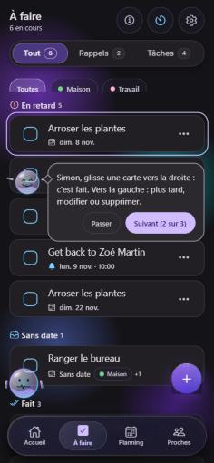
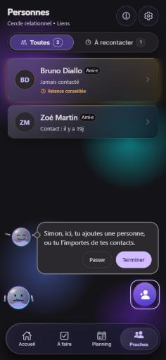
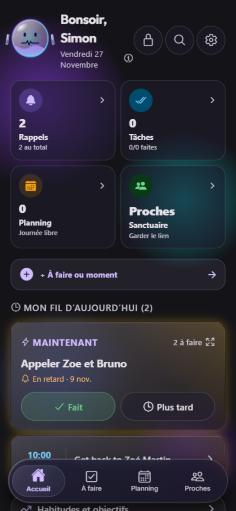

# FICHE OPÉRATOIRE N° 045 — La visite de chaque onglet, à revoir par ⓘ

Projet : **Junix Pulse** · Date : 27 novembre 2026 · Suite de : [FICHE 044](FICHE-044-nouvel-onboarding.md)

---

## 1. Objectif

Deuxième fiche du chantier n° 12 (étude 001, 16.13) :

| Ta demande | Ce que fait cette fiche |
|---|---|
| présenter les fonctionnalités sur les autres pages, pas seulement l'Accueil | une **visite par onglet**, la première fois : À faire (3 arrêts), Planning (2), Proches (2) ; l'Accueil garde la sienne (4) |
| supprimer est trop caché | la visite de « À faire » montre **les deux sens du glissement** (droite : Fait ; gauche : Plus tard, Modifier, **Supprimer**) puis le bouton **⋯** |
| la revoir | un petit **ⓘ à côté du sous-titre** de chaque onglet relance sa visite, même déjà vue, même Pulse coupé |
| (vu en passant) | « Revoir la présentation » des réglages de Pulse rend toutes les visites, pas seulement celle de l'Accueil |

| | |
|---|---|
|  |  |
| *Figure 45-1 — À faire, arrêt 2 sur 3 : les deux sens du glissement* | *Figure 45-2 — Proches, arrêt 2 sur 2 : le bouton + entouré* |
|  | |
| *Figure 45-3 — Le ⓘ à côté de la date ; le titre garde sa place* | |

*Captures réelles (web, 360 px).* Les secrets de Pulse sont la **fiche 046**.

## 2. État de départ

| À vérifier | Comment | Résultat attendu |
|---|---|---|
| La fiche 044 est appliquée | `git status` | ses fichiers |
| Tout passe | `npx jest` | `Tests: 2232 passed` |

## 3. Matériel

Rien de nouveau.

## 4. Hypothèses

- Une visite ne se donne qu'une fois par onglet ; ⓘ la redonne à la demande.
- Les onglets qui ont une visite n'ont plus leur ancienne bulle unique de première visite : la visite en dit plus.
- Un arrêt dont la cible n'est pas à l'écran est sauté (une liste vide, le Planning en vue Mois) ; une visite d'onglet peut alors n'avoir qu'un arrêt, celle de l'Accueil en garde deux au moins.
- Le ⓘ est petit à l'œil (16) mais fait 44 dp au doigt.

## 5. Carte de l'intervention

| Fichier | Action |
|---|---|
| `domain/rules/mascot-tour-rules.ts` | les visites des 4 onglets (`SCREEN_TOURS`), l'onglet d'une route |
| `domain/rules/mascot-message-catalog*.ts` | les 7 phrases de Pulse |
| `features/mascot/HomeTour.tsx`, `MascotTabsLayer.tsx`, `TourTarget.tsx`, `TourInfoButton.tsx` (**nouveau**), `MascotSettingsSection.tsx`, `services/mascot/mascot-tips-service.ts` | la visite de n'importe quel onglet, ⓘ, revoir toutes les visites |
| `features/todo/TodoTabScreen.tsx`, `components/todo/TodoRow.tsx`, `app/(tabs)/calendar.tsx`, `app/(tabs)/people.tsx`, `app/(tabs)/index.tsx`, `components/ui/GlassFloatingActionButton.tsx`, i18n | les cibles et le ⓘ de chaque onglet |
| `__tests__/screen-tours.test.ts` (**nouveau**) | le test |

## 6. Sauvegarde

`git status` (fiche 044 appliquée, hors `docs/motion/`). Aucune migration : ce qui a été vu est gardé dans la petite table de Pulse, comme avant.

## 7. Pas à pas

Le plus simple : `node docs/fiches/outils/appliquer-fiche-045.js .` (après la fiche 044) fait toutes les étapes ci-dessous ; puis l'APK (fiche 003).

### Étape 1 — Les visites des 4 onglets, et les phrases de Pulse

**Pourquoi** : `SCREEN_TOURS` décrit chaque visite : son nom en mémoire (`tour:todo`…) et ses arrêts, chacun avec la phrase de Pulse. L'Accueil garde ses 4 arrêts. « À faire » : le filtre, une carte (les deux sens du glissement, **Supprimer** compris), le ⋯. Le Planning : le choix de la vue, une carte du jour. Proches : une personne, le +. `tourFromSegments` dit quel onglet est ouvert. `planTour` accepte un minimum d'arrêts : 2 pour l'Accueil, 1 ailleurs. Les phrases existent en tu et vous, chaleureux et sobre, et en anglais.

Repère (Ctrl+F) : la première ligne de chaque bloc « Chercher ». Le script `appliquer-fiche-045.js` fait tous ces changements d'un coup, et refuse d'écrire si un bloc ne se trouve pas exactement une fois.

#### `src/domain/rules/mascot-tour-rules.ts`


Changement 1 sur 3. Chercher :

<!-- bloc: mascot-tour-rules-1-avant -->

```ts

// ─── Home tour ──────────────────────────────────────────────────────────────────────────────

export type TourStopId = 'pillars' | 'quickAdd' | 'timeline' | 'mascot';

export const TOUR_STOPS: readonly { id: TourStopId; message: MascotMessageId }[] = [
  { id: 'pillars', message: 'TOUR_PILLARS' },
  { id: 'quickAdd', message: 'TOUR_QUICK_ADD' },
  { id: 'timeline', message: 'TOUR_TIMELINE' },
  { id: 'mascot', message: 'TOUR_MASCOT' },
];

export interface TourRect {
  x: number;
```

Remplacer par :

<!-- bloc: mascot-tour-rules-1-apres -->

```ts

// ─── Home tour ──────────────────────────────────────────────────────────────────────────────

export type TourStopId =
  | 'pillars'
  | 'quickAdd'
  | 'timeline'
  | 'mascot'
  // The other tabs (sheet 045)
  | 'todoFilter'
  | 'todoCard'
  | 'todoMore'
  | 'planViews'
  | 'planList'
  | 'peopleCard'
  | 'peopleAdd';

export interface TourStop {
  id: TourStopId;
  message: MascotMessageId;
}

/** The tabs that have a tour (sheet 045): the home screen, À faire, the Planning and Proches. */
export type TourId = 'home' | 'todo' | 'planning' | 'people';

export const SCREEN_TOURS: Readonly<Record<TourId, { tipId: string; stops: readonly TourStop[] }>> = {
  home: {
    tipId: 'tour:home',
    stops: [
      { id: 'pillars', message: 'TOUR_PILLARS' },
      { id: 'quickAdd', message: 'TOUR_QUICK_ADD' },
      { id: 'timeline', message: 'TOUR_TIMELINE' },
      { id: 'mascot', message: 'TOUR_MASCOT' },
    ],
  },
  // The two ways a card is swiped, and its ⋯: deleting is no longer hidden
  todo: {
    tipId: 'tour:todo',
    stops: [
      { id: 'todoFilter', message: 'TOUR_TODO_FILTER' },
      { id: 'todoCard', message: 'TOUR_TODO_SWIPE' },
      { id: 'todoMore', message: 'TOUR_TODO_MORE' },
    ],
  },
  planning: {
    tipId: 'tour:planning',
    stops: [
      { id: 'planViews', message: 'TOUR_PLAN_VIEWS' },
      { id: 'planList', message: 'TOUR_PLAN_MOVE' },
    ],
  },
  people: {
    tipId: 'tour:people',
    stops: [
      { id: 'peopleCard', message: 'TOUR_PEOPLE_CARD' },
      { id: 'peopleAdd', message: 'TOUR_PEOPLE_ADD' },
    ],
  },
};

/** The four stops of the home tour, as before. */
export const TOUR_STOPS: readonly TourStop[] = SCREEN_TOURS.home.stops;

/** The tour of the tab a route stands for, or null. */
export function tourFromSegments(segments: readonly string[]): TourId | null {
  if (isHomeSegments(segments)) return 'home';
  if (segments[0] !== '(tabs)') return null;
  if (segments[1] === 'tasks') return 'todo';
  if (segments[1] === 'calendar') return 'planning';
  if (segments[1] === 'people') return 'people';
  return null;
}

export interface TourRect {
  x: number;
```

Changement 2 sur 3. Chercher :

<!-- bloc: mascot-tour-rules-2-avant -->

```ts

/**
 * The stops that can be shown: those whose target was measured and sits fully on screen,
 * in tour order. A tour with fewer than two such stops is not worth giving.
 */
export function planTour(
  measured: Readonly<Partial<Record<TourStopId, TourRect | null>>>,
  screen: TourScreen
): TourStopId[] {
  const visible = TOUR_STOPS.map(stop => stop.id).filter(id => {
    const rect = measured[id];
    if (!rect || rect.width <= 0 || rect.height <= 0) return false;
    return (
```

Remplacer par :

<!-- bloc: mascot-tour-rules-2-apres -->

```ts

/**
 * The stops that can be shown: those whose target was measured and sits fully on screen,
 * in tour order. A home tour with fewer than two such stops is not worth giving; the tour of
 * another tab (sheet 045) may have one (the Planning in Month view has no card of the day).
 */
export function planTour(
  measured: Readonly<Partial<Record<TourStopId, TourRect | null>>>,
  screen: TourScreen,
  stops: readonly TourStop[] = TOUR_STOPS,
  minStops: number = MIN_TOUR_STOPS
): TourStopId[] {
  const visible = stops.map(stop => stop.id).filter(id => {
    const rect = measured[id];
    if (!rect || rect.width <= 0 || rect.height <= 0) return false;
    return (
```

Changement 3 sur 3. Chercher :

<!-- bloc: mascot-tour-rules-3-avant -->

```ts
      rect.x + rect.width <= screen.width + 1
    );
  });
  return visible.length >= MIN_TOUR_STOPS ? visible : [];
}

export const TOUR_BUBBLE_HEIGHT = 150;
```

Remplacer par :

<!-- bloc: mascot-tour-rules-3-apres -->

```ts
      rect.x + rect.width <= screen.width + 1
    );
  });
  return visible.length >= minStops ? visible : [];
}

export const TOUR_BUBBLE_HEIGHT = 150;
```

#### `src/domain/rules/mascot-message-catalog.ts`


Changement 1 sur 1. Chercher :

<!-- bloc: mascot-message-catalog-1-avant -->

```ts
    ["Compris. Vos rappels resteront visibles dans l'app.", "Compris {name}. Vos rappels resteront visibles dans l'app."],
  ),

  // ─── Home tour (four stops) and first visit tips ───────────────────────────
  TOUR_PILLARS: entry(
    ["Voici ton accueil : ce qui reste à faire, ton planning et tes proches d'un coup d'œil.", "{name}, voici ton accueil : ce qui reste à faire, ton planning et tes proches d'un coup d'œil."],
```

Remplacer par :

<!-- bloc: mascot-message-catalog-1-apres -->

```ts
    ["Compris. Vos rappels resteront visibles dans l'app.", "Compris {name}. Vos rappels resteront visibles dans l'app."],
  ),

  // ─── Tours of the other tabs (sheet 045) ─────────────────────────────────
  TOUR_TODO_FILTER: entry(
    ["En haut, choisis : tout, ce qui sonne, ou ce qui ne sonne pas.", "{name}, en haut, choisis : tout, ce qui sonne, ou ce qui ne sonne pas."],
    ["Le filtre en haut sépare ce qui sonne du reste.", "{name}, le filtre en haut sépare ce qui sonne du reste."],
    ["En haut, choisissez : tout, ce qui sonne, ou ce qui ne sonne pas.", "{name}, en haut, choisissez : tout, ce qui sonne, ou ce qui ne sonne pas."],
    ["Le filtre en haut sépare ce qui sonne du reste.", "{name}, le filtre en haut sépare ce qui sonne du reste."],
  ),
  TOUR_TODO_SWIPE: entry(
    ["Glisse une carte vers la droite : c'est fait. Vers la gauche : plus tard, modifier ou supprimer.", "{name}, glisse une carte vers la droite : c'est fait. Vers la gauche : plus tard, modifier ou supprimer."],
    ["Vers la droite : fait. Vers la gauche : plus tard, modifier, supprimer.", "{name}, vers la droite : fait. Vers la gauche : plus tard, modifier, supprimer."],
    ["Glissez une carte vers la droite : c'est fait. Vers la gauche : plus tard, modifier ou supprimer.", "{name}, glissez une carte vers la droite : c'est fait. Vers la gauche : plus tard, modifier ou supprimer."],
    ["Vers la droite : fait. Vers la gauche : plus tard, modifier, supprimer.", "{name}, vers la droite : fait. Vers la gauche : plus tard, modifier, supprimer."],
  ),
  TOUR_TODO_MORE: entry(
    ["Le bouton ⋯ d'une carte donne les mêmes choix, sans glisser.", "{name}, le bouton ⋯ d'une carte donne les mêmes choix, sans glisser."],
    ["Le bouton ⋯ donne les mêmes choix.", "{name}, le bouton ⋯ donne les mêmes choix."],
    ["Le bouton ⋯ d'une carte donne les mêmes choix, sans glisser.", "{name}, le bouton ⋯ d'une carte donne les mêmes choix, sans glisser."],
    ["Le bouton ⋯ donne les mêmes choix.", "{name}, le bouton ⋯ donne les mêmes choix."],
  ),
  TOUR_PLAN_VIEWS: entry(
    ["Ta journée, ta semaine ou ton mois : choisis ta vue ici.", "{name}, ta journée, ta semaine ou ton mois : choisis ta vue ici."],
    ["Jour, semaine ou mois : la vue se choisit ici.", "{name}, jour, semaine ou mois : la vue se choisit ici."],
    ["Votre journée, votre semaine ou votre mois : choisissez votre vue ici.", "{name}, votre journée, votre semaine ou votre mois : choisissez votre vue ici."],
    ["Jour, semaine ou mois : la vue se choisit ici.", "{name}, jour, semaine ou mois : la vue se choisit ici."],
  ),
  TOUR_PLAN_MOVE: entry(
    ["Touche une carte pour l'ouvrir. En Jour, Semaine ou Mois, garde le doigt dessus pour la déplacer.", "{name}, touche une carte pour l'ouvrir. En Jour, Semaine ou Mois, garde le doigt dessus pour la déplacer."],
    ["Une carte s'ouvre d'un toucher ; en Jour, Semaine ou Mois, un appui long la déplace.", "{name}, une carte s'ouvre d'un toucher ; en Jour, Semaine ou Mois, un appui long la déplace."],
    ["Touchez une carte pour l'ouvrir. En Jour, Semaine ou Mois, gardez le doigt dessus pour la déplacer.", "{name}, touchez une carte pour l'ouvrir. En Jour, Semaine ou Mois, gardez le doigt dessus pour la déplacer."],
    ["Une carte s'ouvre d'un toucher ; en Jour, Semaine ou Mois, un appui long la déplace.", "{name}, une carte s'ouvre d'un toucher ; en Jour, Semaine ou Mois, un appui long la déplace."],
  ),
  TOUR_PEOPLE_CARD: entry(
    ["Touche une personne pour noter un échange ou voir ce qui est prévu avec elle.", "{name}, touche une personne pour noter un échange ou voir ce qui est prévu avec elle."],
    ["Une personne s'ouvre d'un toucher : échanges et moments prévus.", "{name}, une personne s'ouvre d'un toucher : échanges et moments prévus."],
    ["Touchez une personne pour noter un échange ou voir ce qui est prévu avec elle.", "{name}, touchez une personne pour noter un échange ou voir ce qui est prévu avec elle."],
    ["Une personne s'ouvre d'un toucher : échanges et moments prévus.", "{name}, une personne s'ouvre d'un toucher : échanges et moments prévus."],
  ),
  TOUR_PEOPLE_ADD: entry(
    ["Ici, tu ajoutes une personne, ou tu l'importes de tes contacts.", "{name}, ici, tu ajoutes une personne, ou tu l'importes de tes contacts."],
    ["Ici, on ajoute une personne ou on l'importe des contacts.", "{name}, ici, on ajoute une personne ou on l'importe des contacts."],
    ["Ici, vous ajoutez une personne, ou vous l'importez de vos contacts.", "{name}, ici, vous ajoutez une personne, ou vous l'importez de vos contacts."],
    ["Ici, on ajoute une personne ou on l'importe des contacts.", "{name}, ici, on ajoute une personne ou on l'importe des contacts."],
  ),
  // ─── Home tour (four stops) and first visit tips ───────────────────────────
  TOUR_PILLARS: entry(
    ["Voici ton accueil : ce qui reste à faire, ton planning et tes proches d'un coup d'œil.", "{name}, voici ton accueil : ce qui reste à faire, ton planning et tes proches d'un coup d'œil."],
```

#### `src/domain/rules/mascot-message-catalog-en.ts`


Changement 1 sur 1. Chercher :

<!-- bloc: mascot-message-catalog-en-1-avant -->

```ts
  ),

  // ─── Home tour (four stops) and first visit tips ───────────────────────────
  TOUR_PILLARS: entry(
    ["This is your home: what's left to do, your schedule and loved ones at a glance.", "{name}, this is your home: what's left to do, your schedule and loved ones at a glance."],
    ["Your home brings together your tasks, schedule and loved ones.", "{name}, your home brings together your tasks, schedule and loved ones."],
```

Remplacer par :

<!-- bloc: mascot-message-catalog-en-1-apres -->

```ts
  ),

  // ─── Home tour (four stops) and first visit tips ───────────────────────────
  // ─── Tours of the other tabs (sheet 045) ─────────────────────────────────
  TOUR_TODO_FILTER: entry(
    ["At the top, pick: everything, what rings, or what doesn't.", "{name}, at the top, pick: everything, what rings, or what doesn't."],
    ["The filter at the top sets apart what rings.", "{name}, the filter at the top sets apart what rings."],
  ),
  TOUR_TODO_SWIPE: entry(
    ["Swipe a card right: it's done. Left: later, edit or delete.", "{name}, swipe a card right: it's done. Left: later, edit or delete."],
    ["Right: done. Left: later, edit, delete.", "{name}, right: done. Left: later, edit, delete."],
  ),
  TOUR_TODO_MORE: entry(
    ["A card's ⋯ button gives the same choices, without swiping.", "{name}, a card's ⋯ button gives the same choices, without swiping."],
    ["The ⋯ button gives the same choices.", "{name}, the ⋯ button gives the same choices."],
  ),
  TOUR_PLAN_VIEWS: entry(
    ["Your day, your week or your month: pick your view here.", "{name}, your day, your week or your month: pick your view here."],
    ["Day, week or month: the view is picked here.", "{name}, day, week or month: the view is picked here."],
  ),
  TOUR_PLAN_MOVE: entry(
    ["Tap a card to open it. In Day, Week or Month, hold it to move it.", "{name}, tap a card to open it. In Day, Week or Month, hold it to move it."],
    ["A card opens with a tap; in Day, Week or Month, a long press moves it.", "{name}, a card opens with a tap; in Day, Week or Month, a long press moves it."],
  ),
  TOUR_PEOPLE_CARD: entry(
    ["Tap someone to note a catch-up or see what you have planned.", "{name}, tap someone to note a catch-up or see what you have planned."],
    ["A person opens with a tap: catch-ups and planned moments.", "{name}, a person opens with a tap: catch-ups and planned moments."],
  ),
  TOUR_PEOPLE_ADD: entry(
    ["Here, you add someone, or import them from your contacts.", "{name}, here, you add someone, or import them from your contacts."],
    ["Here, add someone or import them from contacts.", "{name}, here, add someone or import them from contacts."],
  ),
  TOUR_PILLARS: entry(
    ["This is your home: what's left to do, your schedule and loved ones at a glance.", "{name}, this is your home: what's left to do, your schedule and loved ones at a glance."],
    ["Your home brings together your tasks, schedule and loved ones.", "{name}, your home brings together your tasks, schedule and loved ones."],
```


### Étape 2 — Une visite pour n'importe quel onglet, et ⓘ

**Pourquoi** : `HomeTour` prend l'onglet en paramètre (`tour`) et lit sa visite dans `SCREEN_TOURS`. `replayTour(tour)` la relance tout de suite, vue ou non, Pulse coupé ou non : c'est ce que fait ⓘ (`TourInfoButton`, petit à l'œil, 44 dp au doigt). `MascotTabsLayer` monte la visite de l'onglet ouvert, et la bulle unique de première visite seulement pour les onglets sans visite. « Revoir la présentation » rend toutes les visites (`replayAllTours`).

Repère (Ctrl+F) : la première ligne de chaque bloc « Chercher ». Le script `appliquer-fiche-045.js` fait tous ces changements d'un coup, et refuse d'écrire si un bloc ne se trouve pas exactement une fois.

#### `src/features/mascot/HomeTour.tsx`


Changement 1 sur 6. Chercher :

<!-- bloc: hometour-1-avant -->

```tsx

import { resolveMascotMessage } from '@/domain/rules/mascot-message-rules';
import {
  HOME_TOUR_TIP_ID,
  placeTourBubble,
  planTour,
  relativeToLayer,
  TOUR_BUBBLE_MAX_WIDTH,
  TOUR_STOPS,
  TourRect,
  TourScreen,
  TourStopId,
```

Remplacer par :

<!-- bloc: hometour-1-apres -->

```tsx

import { resolveMascotMessage } from '@/domain/rules/mascot-message-rules';
import {
  MIN_TOUR_STOPS,
  placeTourBubble,
  planTour,
  relativeToLayer,
  TOUR_BUBBLE_MAX_WIDTH,
  SCREEN_TOURS,
  TourId,
  TourRect,
  TourScreen,
  TourStopId,
```

Changement 2 sur 6. Chercher :

<!-- bloc: hometour-2-avant -->

```tsx
  return tourRunning;
}

interface ActiveTour {
  stops: TourStopId[];
  index: number;
  rect: TourRect;
}

export function HomeTour() {
  const { width, height } = useWindowDimensions();
  const insets = useSafeAreaInsets();
  const { palette } = useTheme();
```

Remplacer par :

<!-- bloc: hometour-2-apres -->

```tsx
  return tourRunning;
}

/** ⓘ in a tab's header (sheet 045): gives its tour again, now, even if it was seen. */
const replayListeners = new Set<(tour: TourId) => void>();
export function replayTour(tour: TourId): void {
  replayListeners.forEach(listener => listener(tour));
}

interface ActiveTour {
  stops: TourStopId[];
  index: number;
  rect: TourRect;
}

/** The tour of one tab (sheet 045); the home screen's by default. */
export function HomeTour({ tour: tourId = 'home' }: { tour?: TourId }) {
  const definition = SCREEN_TOURS[tourId];
  const { width, height } = useWindowDimensions();
  const insets = useSafeAreaInsets();
  const { palette } = useTheme();
```

Changement 3 sur 6. Chercher :

<!-- bloc: hometour-3-avant -->

```tsx
  const [displayName, setDisplayName] = useState<string | null>(null);
  const [bubbleHeight, setBubbleHeight] = useState<number | null>(null);
  const startedRef = useRef(false);
  const layerRef = useRef<React.ComponentRef<typeof View>>(null);

  // A target is measured in window coordinates, the ring is drawn in the layer's own: on some
```

Remplacer par :

<!-- bloc: hometour-3-apres -->

```tsx
  const [displayName, setDisplayName] = useState<string | null>(null);
  const [bubbleHeight, setBubbleHeight] = useState<number | null>(null);
  const startedRef = useRef(false);
  // ⓘ: the tour starts again at once, seen or not, Pulse on or off
  const [replay, setReplay] = useState(0);
  useEffect(() => {
    const listener = (asked: TourId) => {
      if (asked !== tourId) return;
      startedRef.current = false;
      setReplay(count => count + 1);
    };
    replayListeners.add(listener);
    return () => {
      replayListeners.delete(listener);
    };
  }, [tourId]);
  const layerRef = useRef<React.ComponentRef<typeof View>>(null);

  // A target is measured in window coordinates, the ring is drawn in the layer's own: on some
```

Changement 4 sur 6. Chercher :

<!-- bloc: hometour-4-avant -->

```tsx
  const finish = useCallback(() => {
    tourRunning = false;
    setTour(null);
    void markTipSeen(HOME_TOUR_TIP_ID);
  }, []);

  // Start once, a moment after the home screen shows
  useEffect(() => {
    if (settings.presence === 'off' || startedRef.current) return;
    let active = true;
    let timer: ReturnType<typeof setTimeout>;

    const attempt = async (remaining: number) => {
      if (!active || (await hasSeenTip(HOME_TOUR_TIP_ID))) return;

      const measured: Partial<Record<TourStopId, TourRect | null>> = {};
      for (const stop of TOUR_STOPS) measured[stop.id] = await measureStop(stop.id);
      const stops = planTour(measured, screenRef.current);
      if (!active) return;
      if (stops.length === 0) {
        // The screen is not laid out yet: look again shortly, a few times at most
```

Remplacer par :

<!-- bloc: hometour-4-apres -->

```tsx
  const finish = useCallback(() => {
    tourRunning = false;
    setTour(null);
    void markTipSeen(definition.tipId);
  }, [definition.tipId]);

  // Start once, a moment after the home screen shows
  useEffect(() => {
    const forced = replay > 0;
    if ((settings.presence === 'off' && !forced) || startedRef.current) return;
    let active = true;
    let timer: ReturnType<typeof setTimeout>;

    const attempt = async (remaining: number) => {
      if (!active || (!forced && (await hasSeenTip(definition.tipId)))) return;

      const measured: Partial<Record<TourStopId, TourRect | null>> = {};
      for (const stop of definition.stops) measured[stop.id] = await measureStop(stop.id);
      const stops = planTour(measured, screenRef.current, definition.stops, tourId === 'home' ? MIN_TOUR_STOPS : 1);
      if (!active) return;
      if (stops.length === 0) {
        // The screen is not laid out yet: look again shortly, a few times at most
```

Changement 5 sur 6. Chercher :

<!-- bloc: hometour-5-avant -->

```tsx
      setTour({ stops, index: 0, rect: first });
    };

    timer = setTimeout(() => void attempt(START_ATTEMPTS), START_DELAY_MS);

    return () => {
      active = false;
      clearTimeout(timer);
    };
  }, [settings.presence, measureStop]);

  // Leaving the screen ends the tour for good: it has been shown
  useEffect(() => {
```

Remplacer par :

<!-- bloc: hometour-5-apres -->

```tsx
      setTour({ stops, index: 0, rect: first });
    };

    timer = setTimeout(() => void attempt(START_ATTEMPTS), forced ? 0 : START_DELAY_MS);

    return () => {
      active = false;
      clearTimeout(timer);
    };
  }, [settings.presence, measureStop, definition, replay, tourId]);

  // Leaving the screen ends the tour for good: it has been shown
  useEffect(() => {
```

Changement 6 sur 6. Chercher :

<!-- bloc: hometour-6-avant -->

```tsx
    </View>
  );

  if (!tour || settings.presence === 'off') return layer(null);

  const stop = TOUR_STOPS.find(item => item.id === tour.stops[tour.index]);
  if (!stop) return layer(null);

  const placement = placeTourBubble(tour.rect, screen, bubbleHeight ?? undefined);
```

Remplacer par :

<!-- bloc: hometour-6-apres -->

```tsx
    </View>
  );

  if (!tour || (settings.presence === 'off' && replay === 0)) return layer(null);

  const stop = definition.stops.find(item => item.id === tour.stops[tour.index]);
  if (!stop) return layer(null);

  const placement = placeTourBubble(tour.rect, screen, bubbleHeight ?? undefined);
```

#### `src/features/mascot/MascotTabsLayer.tsx`


Changement 1 sur 1. Chercher :

<!-- bloc: mascottabslayer-1-avant -->

```tsx
import React from 'react';
import { StyleSheet, View } from 'react-native';

import { isHomeSegments, tipScreenFromSegments } from '@/domain/rules/mascot-tour-rules';

import { FirstVisitTip } from './FirstVisitTip';
import { HomeTour } from './HomeTour';

export function MascotTabsLayer() {
  const segments = useSegments();
  const tipScreen = tipScreenFromSegments(segments);

  return (
    <View pointerEvents="box-none" style={StyleSheet.absoluteFill}>
      {isHomeSegments(segments) ? <HomeTour /> : null}
      {tipScreen ? <FirstVisitTip key={tipScreen} screen={tipScreen} /> : null}
    </View>
  );
```

Remplacer par :

<!-- bloc: mascottabslayer-1-apres -->

```tsx
import React from 'react';
import { StyleSheet, View } from 'react-native';

import { tipScreenFromSegments, tourFromSegments } from '@/domain/rules/mascot-tour-rules';

import { FirstVisitTip } from './FirstVisitTip';
import { HomeTour } from './HomeTour';

export function MascotTabsLayer() {
  const segments = useSegments();
  // A tab with a tour (sheet 045) has no single first visit tip: the tour says more
  const tour = tourFromSegments(segments);
  const tipScreen = tour ? null : tipScreenFromSegments(segments);

  return (
    <View pointerEvents="box-none" style={StyleSheet.absoluteFill}>
      {tour ? <HomeTour key={tour} tour={tour} /> : null}
      {tipScreen ? <FirstVisitTip key={tipScreen} screen={tipScreen} /> : null}
    </View>
  );
```

#### `src/features/mascot/TourInfoButton.tsx`

Fichier nouveau, en entier :

<!-- bloc: new-tourinfobutton -->

```tsx
/**
 * TourInfoButton: a small ⓘ next to the subtitle of a tab (sheet 045). It gives the tab's tour
 * again, at once, even if it was seen and even with Pulse switched off. Small to the eye so the
 * titles keep their room, 44 dp to the finger (hitSlop).
 */
import { Ionicons } from '@expo/vector-icons';
import { TouchableOpacity } from 'react-native';
import type { TourId } from '@/domain/rules/mascot-tour-rules';
import { useTheme } from '@/hooks/use-theme';
import { useT } from '@/i18n';
import { replayTour } from './HomeTour';

export function TourInfoButton({ tour }: { tour: TourId }) {
  const t = useT();
  const { palette } = useTheme();
  return (
    <TouchableOpacity
      onPress={() => replayTour(tour)}
      hitSlop={14}
      accessibilityRole="button"
      accessibilityLabel={t('tour.replayA11y')}
      testID={`tour-info-${tour}`}
    >
      <Ionicons name="information-circle-outline" size={16} color={palette.onSurface.variant} />
    </TouchableOpacity>
  );
}
```

#### `src/features/mascot/MascotSettingsSection.tsx`


Changement 1 sur 2. Chercher :

<!-- bloc: mascotsettingssection-1-avant -->

```tsx
import { useThemedStyles } from '@/hooks/use-themed-styles';
import { MascotStateRepository } from '@/repositories/mascot-state-repository';
import { resetBudget } from '@/services/mascot/mascot-budget-service';
import { replayHomeTour } from '@/services/mascot/mascot-tips-service';
import { saveMascotSettings } from '@/services/mascot/mascot-settings-service';
import { useAppStore } from '@/store/app-store';
import { useLanguage, useT, type MessageKey } from '@/i18n';
```

Remplacer par :

<!-- bloc: mascotsettingssection-1-apres -->

```tsx
import { useThemedStyles } from '@/hooks/use-themed-styles';
import { MascotStateRepository } from '@/repositories/mascot-state-repository';
import { resetBudget } from '@/services/mascot/mascot-budget-service';
import { replayAllTours } from '@/services/mascot/mascot-tips-service';
import { saveMascotSettings } from '@/services/mascot/mascot-settings-service';
import { useAppStore } from '@/store/app-store';
import { useLanguage, useT, type MessageKey } from '@/i18n';
```

Changement 2 sur 2. Chercher :

<!-- bloc: mascotsettingssection-2-avant -->

```tsx

  const replayTour = async () => {
    try {
      await replayHomeTour();
      // The tour starts by itself a moment after the home screen shows
      router.push('/(tabs)' as never);
    } catch (e) {
```

Remplacer par :

<!-- bloc: mascotsettingssection-2-apres -->

```tsx

  const replayTour = async () => {
    try {
      await replayAllTours();
      // The tour starts by itself a moment after the home screen shows
      router.push('/(tabs)' as never);
    } catch (e) {
```

#### `src/services/mascot/mascot-tips-service.ts`


Changement 1 sur 2. Chercher :

<!-- bloc: mascot-tips-service-1-avant -->

```ts
 */

import { LAST_TIP_DAY_ID, tipDay } from '../../domain/rules/gesture-tip-rules';
import { HOME_TOUR_TIP_ID, tipKey } from '../../domain/rules/mascot-tour-rules';
import { MascotStateRepository } from '../../repositories/mascot-state-repository';

/** True when the tip was already given. A failed read counts as seen: better silent than repeated. */
```

Remplacer par :

<!-- bloc: mascot-tips-service-1-apres -->

```ts
 */

import { LAST_TIP_DAY_ID, tipDay } from '../../domain/rules/gesture-tip-rules';
import { HOME_TOUR_TIP_ID, SCREEN_TOURS, tipKey } from '../../domain/rules/mascot-tour-rules';
import { MascotStateRepository } from '../../repositories/mascot-state-repository';

/** True when the tip was already given. A failed read counts as seen: better silent than repeated. */
```

Changement 2 sur 2. Chercher :

<!-- bloc: mascot-tips-service-2-avant -->

```ts
export async function replayHomeTour(): Promise<void> {
  await MascotStateRepository.delete(tipKey(HOME_TOUR_TIP_ID));
}
```

Remplacer par :

<!-- bloc: mascot-tips-service-2-apres -->

```ts
export async function replayHomeTour(): Promise<void> {
  await MascotStateRepository.delete(tipKey(HOME_TOUR_TIP_ID));
}

/** "Revoir la présentation" gives back the tours of the other tabs too (sheet 045). */
export async function replayAllTours(): Promise<void> {
  await Promise.all(Object.values(SCREEN_TOURS).map(tour => MascotStateRepository.delete(tipKey(tour.tipId))));
}
```


### Étape 3 — Les cibles et le ⓘ de chaque onglet

**Pourquoi** : `tourTargetIf(condition, id, élément)` entoure un élément d'une cible seulement quand il le faut (la première carte d'une liste). « À faire » marque son filtre, sa première carte et le ⋯ de celle-ci (`menuTour` de `TodoRow`). Le Planning marque sa barre de vues et la première carte du jour. Proches marque sa première personne et son bouton + (`tourId` du bouton flottant). Le ⓘ se met **à côté du sous-titre** de chaque onglet : dans l'en-tête, il coupait les titres à 360 px.

Repère (Ctrl+F) : la première ligne de chaque bloc « Chercher ». Le script `appliquer-fiche-045.js` fait tous ces changements d'un coup, et refuse d'écrire si un bloc ne se trouve pas exactement une fois.

#### `src/features/mascot/TourTarget.tsx`


Changement 1 sur 1. Chercher :

<!-- bloc: tourtarget-1-avant -->

```tsx
    </View>
  );
}
```

Remplacer par :

<!-- bloc: tourtarget-1-apres -->

```tsx
    </View>
  );
}

/** The element wrapped as a target when the condition holds (the first card of a list; sheet 045). */
export function tourTargetIf(condition: boolean, id: TourStopId, node: React.ReactElement): React.ReactElement {
  return condition ? (
    <TourTarget key={node.key ?? id} id={id}>
      {node}
    </TourTarget>
  ) : (
    node
  );
}
```

#### `src/features/todo/TodoTabScreen.tsx`


Changement 1 sur 6. Chercher :

<!-- bloc: todotabscreen-1-avant -->

```tsx
import { TodoRow } from '@/components/todo/TodoRow';
import { GlassFloatingActionButton } from '@/components/ui/GlassFloatingActionButton';
import { HeaderIconButton, SettingsButton } from '@/components/ui/HeaderIconButton';
import { PillTopBar } from '@/components/ui/PillTopBar';
import { SwipeableItem, makeStandardRightActions, type SwipeAction } from '@/components/ui/SwipeableItem';
import { openFocusForTask } from '@/features/focus/open-focus';
```

Remplacer par :

<!-- bloc: todotabscreen-1-apres -->

```tsx
import { TodoRow } from '@/components/todo/TodoRow';
import { GlassFloatingActionButton } from '@/components/ui/GlassFloatingActionButton';
import { HeaderIconButton, SettingsButton } from '@/components/ui/HeaderIconButton';
import { TourInfoButton } from '@/features/mascot/TourInfoButton';
import { TourTarget, tourTargetIf } from '@/features/mascot/TourTarget';
import { PillTopBar } from '@/components/ui/PillTopBar';
import { SwipeableItem, makeStandardRightActions, type SwipeAction } from '@/components/ui/SwipeableItem';
import { openFocusForTask } from '@/features/focus/open-focus';
```

Changement 2 sur 6. Chercher :

<!-- bloc: todotabscreen-2-avant -->

```tsx
          <Text style={{ ...Typography.headlineMedium, color: palette.onSurface.primary }} numberOfLines={1}>
            {t('tab.todo')}
          </Text>
          <Text style={{ ...Typography.bodySmall, color: palette.onSurface.variant }} numberOfLines={1}>
            {t('todoTab.subtitle', { count: counts.all })}
          </Text>
        </View>
        <HeaderIconButton
          icon="timer-outline"
```

Remplacer par :

<!-- bloc: todotabscreen-2-apres -->

```tsx
          <Text style={{ ...Typography.headlineMedium, color: palette.onSurface.primary }} numberOfLines={1}>
            {t('tab.todo')}
          </Text>
          {/* ⓘ next to the subtitle: the tour of this tab again (sheet 045) */}
          <View style={{ flexDirection: 'row', alignItems: 'center', gap: 6 }}>
            <Text style={{ ...Typography.bodySmall, color: palette.onSurface.variant, flexShrink: 1 }} numberOfLines={1}>
              {t('todoTab.subtitle', { count: counts.all })}
            </Text>
            <TourInfoButton tour="todo" />
          </View>
        </View>
        <HeaderIconButton
          icon="timer-outline"
```

Changement 3 sur 6. Chercher :

<!-- bloc: todotabscreen-3-avant -->

```tsx
        <SettingsButton />
      </View>

      <PillTopBar<TodoFilter>
        tabs={[
          { key: 'all', label: t('todoTab.all'), count: counts.all },
```

Remplacer par :

<!-- bloc: todotabscreen-3-apres -->

```tsx
        <SettingsButton />
      </View>

      <TourTarget id="todoFilter">
      <PillTopBar<TodoFilter>
        tabs={[
          { key: 'all', label: t('todoTab.all'), count: counts.all },
```

Changement 4 sur 6. Chercher :

<!-- bloc: todotabscreen-4-avant -->

```tsx
        activeTab={filter}
        onTabChange={setFilter}
      />
      <TagFilterRow tags={tags} selectedId={tagFilter} onSelect={setTagFilter} />

      <ScrollView
```

Remplacer par :

<!-- bloc: todotabscreen-4-apres -->

```tsx
        activeTab={filter}
        onTabChange={setFilter}
      />
      </TourTarget>
      <TagFilterRow tags={tags} selectedId={tagFilter} onSelect={setTagFilter} />

      <ScrollView
```

Changement 5 sur 6. Chercher :

<!-- bloc: todotabscreen-5-avant -->

```tsx
                <Text style={{ ...Typography.titleMedium, color: palette.onSurface.primary }}>{t(SECTION_LOOK[section.id].labelKey)}</Text>
                <Text style={{ ...Typography.labelMedium, color: palette.onSurface.variant }}>{section.entries.length}</Text>
              </View>
              {section.entries.map(entry => (
                <SwipeableItem
                  key={`${entry.kind}-${entry.id}`}
                  peek={swipeTip.peeking && `${entry.kind}-${entry.id}` === firstKey}
```

Remplacer par :

<!-- bloc: todotabscreen-5-apres -->

```tsx
                <Text style={{ ...Typography.titleMedium, color: palette.onSurface.primary }}>{t(SECTION_LOOK[section.id].labelKey)}</Text>
                <Text style={{ ...Typography.labelMedium, color: palette.onSurface.variant }}>{section.entries.length}</Text>
              </View>
              {section.entries.map(entry => tourTargetIf(`${entry.kind}-${entry.id}` === firstKey, 'todoCard', (
                <SwipeableItem
                  key={`${entry.kind}-${entry.id}`}
                  peek={swipeTip.peeking && `${entry.kind}-${entry.id}` === firstKey}
```

Changement 6 sur 6. Chercher :

<!-- bloc: todotabscreen-6-avant -->

```tsx
                    tags={tagsOf(entry.tagIds, tags)}
                    onPress={() => openEntry(entry)}
                    onToggle={() => void toggle(entry)}
                  />
                </SwipeableItem>
              ))}
            </View>
          ))
        )}
```

Remplacer par :

<!-- bloc: todotabscreen-6-apres -->

```tsx
                    tags={tagsOf(entry.tagIds, tags)}
                    onPress={() => openEntry(entry)}
                    onToggle={() => void toggle(entry)}
                    menuTour={`${entry.kind}-${entry.id}` === firstKey}
                  />
                </SwipeableItem>
              )))}
            </View>
          ))
        )}
```

#### `src/components/todo/TodoRow.tsx`


Changement 1 sur 3. Chercher :

<!-- bloc: todorow-1-avant -->

```tsx

import { TagSummary } from '@/components/tags/TagChip';
import { CardMenuButton, useCardMenu } from '@/components/ui/CardMenu';
import { useDurationLabel } from '@/components/create/form/DurationField';
import { openFocusForTask } from '@/features/focus/open-focus';
import { useSwipeAccessibilityProps } from '@/components/ui/swipe-accessibility';
```

Remplacer par :

<!-- bloc: todorow-1-apres -->

```tsx

import { TagSummary } from '@/components/tags/TagChip';
import { CardMenuButton, useCardMenu } from '@/components/ui/CardMenu';
import { tourTargetIf } from '@/features/mascot/TourTarget';
import { useDurationLabel } from '@/components/create/form/DurationField';
import { openFocusForTask } from '@/features/focus/open-focus';
import { useSwipeAccessibilityProps } from '@/components/ui/swipe-accessibility';
```

Changement 2 sur 3. Chercher :

<!-- bloc: todorow-2-avant -->

```tsx
  tags,
  onPress,
  onToggle,
}: {
  entry: TodoEntry;
  tags: readonly Tag[];
  onPress: () => void;
  onToggle: () => void;
}) {
  const t = useT();
  const locale = useDateLocale();
```

Remplacer par :

<!-- bloc: todorow-2-apres -->

```tsx
  tags,
  onPress,
  onToggle,
  menuTour = false,
}: {
  entry: TodoEntry;
  tags: readonly Tag[];
  onPress: () => void;
  onToggle: () => void;
  /** The first card: the tour of À faire points at its ⋯ (sheet 045). */
  menuTour?: boolean;
}) {
  const t = useT();
  const locale = useDateLocale();
```

Changement 3 sur 3. Chercher :

<!-- bloc: todorow-3-avant -->

```tsx
          ) : null}
        </View>
      </View>
      <CardMenuButton title={entry.title} testID={`todo-menu-${entry.id}`} />
    </Pressable>
  );
}
```

Remplacer par :

<!-- bloc: todorow-3-apres -->

```tsx
          ) : null}
        </View>
      </View>
      {tourTargetIf(menuTour, 'todoMore', <CardMenuButton title={entry.title} testID={`todo-menu-${entry.id}`} />)}
    </Pressable>
  );
}
```

#### `src/app/(tabs)/calendar.tsx`


Changement 1 sur 8. Chercher :

<!-- bloc: calendar-1-avant -->

```tsx
} from 'react-native';
import { GlassAlert } from '@/components/feedback/GlassAlert';
import { useSafeAreaInsets } from 'react-native-safe-area-context';
import { router, useFocusEffect } from 'expo-router';
import { Ionicons } from '@expo/vector-icons';
import { SettingsButton } from '@/components/ui/HeaderIconButton';
import {
  format,
  addDays,
  subDays,
  addMinutes,
  addMonths,
```

Remplacer par :

<!-- bloc: calendar-1-apres -->

```tsx
} from 'react-native';
import { GlassAlert } from '@/components/feedback/GlassAlert';
import { useSafeAreaInsets } from 'react-native-safe-area-context';
import { router, useFocusEffect } from 'expo-router';
import { Ionicons } from '@expo/vector-icons';
import { SettingsButton } from '@/components/ui/HeaderIconButton';
import { TourInfoButton } from '@/features/mascot/TourInfoButton';
import { TourTarget, tourTargetIf } from '@/features/mascot/TourTarget';
import {
  format,
  addDays,
  subDays,
  addMinutes,
  addMonths,
```

Changement 2 sur 8. Chercher :

<!-- bloc: calendar-2-avant -->

```tsx
  return (
    <View style={[styles.container, { paddingTop: insets.top }]}>
      {/* En-tête avec navigation de date */}
      <View style={styles.header}>
        <View style={styles.headerTitleCol}>
          <Text style={styles.title}>{t('tab.calendar')}</Text>
          <Text style={styles.subtitle} numberOfLines={2}>
            {viewMode === 'week'
              ? weekLabel
              : viewMode === 'month'
                ? format(shownMonth, 'MMMM yyyy', { locale: dateLocale })
                : format(selectedDate, 'EEEE d MMMM yyyy', { locale: dateLocale })}
          </Text>
        </View>

        <View style={styles.headerActions}>
          <TouchableOpacity
            style={[
              styles.todayBtn,
```

Remplacer par :

<!-- bloc: calendar-2-apres -->

```tsx
  return (
    <View style={[styles.container, { paddingTop: insets.top }]}>
      {/* En-tête avec navigation de date */}
      <View style={styles.header}>
        <View style={styles.headerTitleCol}>
          <Text style={styles.title}>{t('tab.calendar')}</Text>
          {/* ⓘ next to the subtitle: the tour of this tab again (sheet 045) */}
          <View style={{ flexDirection: 'row', alignItems: 'center', gap: 6 }}>
            <Text style={[styles.subtitle, { flexShrink: 1 }]} numberOfLines={2}>
              {viewMode === 'week'
                ? weekLabel
                : viewMode === 'month'
                  ? format(shownMonth, 'MMMM yyyy', { locale: dateLocale })
                  : format(selectedDate, 'EEEE d MMMM yyyy', { locale: dateLocale })}
            </Text>
            <TourInfoButton tour="planning" />
          </View>
        </View>

        <View style={styles.headerActions}>
          <TouchableOpacity
            style={[
              styles.todayBtn,
```

Changement 3 sur 8. Chercher :

<!-- bloc: calendar-3-avant -->

```tsx

          <SettingsButton />
        </View>
      </View>

      {/* ─── Segmented Control PillTopBar (Modèle Personnes) ─────────────────── */}
      <PillTopBar
        tabs={[
          {
            key: 'agenda',
            label: t('calendar.view.agenda'),
            count: events.length + reminders.length + tasks.length,
```

Remplacer par :

<!-- bloc: calendar-3-apres -->

```tsx

          <SettingsButton />
        </View>
      </View>

      {/* ─── Segmented Control PillTopBar (Modèle Personnes) ─────────────────── */}
      <TourTarget id="planViews">
      <PillTopBar
        tabs={[
          {
            key: 'agenda',
            label: t('calendar.view.agenda'),
            count: events.length + reminders.length + tasks.length,
```

Changement 4 sur 8. Chercher :

<!-- bloc: calendar-4-avant -->

```tsx
          // The view used last is the one the Planning opens on next time (sheet 029)
          const next = { ...prefs, openView: tab as PlanningPrefs['openView'] };
          setPrefs(next);
          void SettingsRepository.update({ planningPrefs: next, updatedAt: new Date().toISOString() }).catch(() => undefined);
        }}
      />

      {/* Bandeau des 7 jours (affiché pour les vues quotidiennes) */}
      {viewMode !== 'week' && viewMode !== 'month' && (
        <View style={styles.weekStrip}>
          {weekDays.map((d, index) => {
            const isSelected = isSameDay(d, selectedDate);
```

Remplacer par :

<!-- bloc: calendar-4-apres -->

```tsx
          // The view used last is the one the Planning opens on next time (sheet 029)
          const next = { ...prefs, openView: tab as PlanningPrefs['openView'] };
          setPrefs(next);
          void SettingsRepository.update({ planningPrefs: next, updatedAt: new Date().toISOString() }).catch(() => undefined);
        }}
      />
      </TourTarget>

      {/* Bandeau des 7 jours (affiché pour les vues quotidiennes) */}
      {viewMode !== 'week' && viewMode !== 'month' && (
        <View style={styles.weekStrip}>
          {weekDays.map((d, index) => {
            const isSelected = isSameDay(d, selectedDate);
```

Changement 5 sur 8. Chercher :

<!-- bloc: calendar-5-avant -->

```tsx
            {events.length > 0 && (
              <View style={styles.section}>
                <View style={styles.sectionHeader}>
                  <Ionicons name="calendar-outline" size={16} color={theme.primary.default} />
                  <Text style={styles.sectionTitle}>{t('calendar.events', { count: events.length })}</Text>
                </View>
                {events.map((e, idx) => (
                  <GlowCard
                    key={`agenda-event-${e.id}-${idx}`}
                    index={idx}
                    tone="primary"
                    intensity="soft"
                    onPress={() => router.push({ pathname: '/events/[id]', params: { id: e.id } })}
```

Remplacer par :

<!-- bloc: calendar-5-apres -->

```tsx
            {events.length > 0 && (
              <View style={styles.section}>
                <View style={styles.sectionHeader}>
                  <Ionicons name="calendar-outline" size={16} color={theme.primary.default} />
                  <Text style={styles.sectionTitle}>{t('calendar.events', { count: events.length })}</Text>
                </View>
                {events.map((e, idx) => tourTargetIf(idx === 0, 'planList', (
                  <GlowCard
                    key={`agenda-event-${e.id}-${idx}`}
                    index={idx}
                    tone="primary"
                    intensity="soft"
                    onPress={() => router.push({ pathname: '/events/[id]', params: { id: e.id } })}
```

Changement 6 sur 8. Chercher :

<!-- bloc: calendar-6-avant -->

```tsx
                      <Text style={styles.typeBadgeText}>
                        {e.type === 'BUSY' ? t('calendar.busy') : t('calendar.free')}
                      </Text>
                    </View>
                  </View>
                  </GlowCard>
                ))}
              </View>
            )}

            {/* Agenda du téléphone, en lecture seule */}
            {deviceEvents.length > 0 && (
              <View style={styles.section}>
```

Remplacer par :

<!-- bloc: calendar-6-apres -->

```tsx
                      <Text style={styles.typeBadgeText}>
                        {e.type === 'BUSY' ? t('calendar.busy') : t('calendar.free')}
                      </Text>
                    </View>
                  </View>
                  </GlowCard>
                )))}
              </View>
            )}

            {/* Agenda du téléphone, en lecture seule */}
            {deviceEvents.length > 0 && (
              <View style={styles.section}>
```

Changement 7 sur 8. Chercher :

<!-- bloc: calendar-7-avant -->

```tsx
            {reminders.length > 0 && (
              <View style={styles.section}>
                <View style={styles.sectionHeader}>
                  <Ionicons name="notifications-outline" size={16} color={theme.priority.HIGH} />
                  <Text style={styles.sectionTitle}>{t('calendar.reminders', { count: reminders.length })}</Text>
                </View>
                {reminders.map((r, idx) => (
                  <GlowCard
                    key={`agenda-reminder-${r.id}-${idx}`}
                    index={idx}
                    tone="attention"
                    intensity="soft"
                    onPress={() => router.push({ pathname: '/reminders/[id]', params: { id: r.id } })}
```

Remplacer par :

<!-- bloc: calendar-7-apres -->

```tsx
            {reminders.length > 0 && (
              <View style={styles.section}>
                <View style={styles.sectionHeader}>
                  <Ionicons name="notifications-outline" size={16} color={theme.priority.HIGH} />
                  <Text style={styles.sectionTitle}>{t('calendar.reminders', { count: reminders.length })}</Text>
                </View>
                {reminders.map((r, idx) => tourTargetIf(idx === 0 && events.length === 0, 'planList', (
                  <GlowCard
                    key={`agenda-reminder-${r.id}-${idx}`}
                    index={idx}
                    tone="attention"
                    intensity="soft"
                    onPress={() => router.push({ pathname: '/reminders/[id]', params: { id: r.id } })}
```

Changement 8 sur 8. Chercher :

<!-- bloc: calendar-8-avant -->

```tsx
                        {format(new Date(r.scheduledAt), 'HH:mm')}
                      </Text>
                    </View>
                    <Ionicons name="chevron-forward" size={16} color={theme.onSurface.disabled} />
                  </View>
                  </GlowCard>
                ))}
              </View>
            )}

            {/* Tâches */}
            {tasks.length > 0 && (
              <View style={styles.section}>
```

Remplacer par :

<!-- bloc: calendar-8-apres -->

```tsx
                        {format(new Date(r.scheduledAt), 'HH:mm')}
                      </Text>
                    </View>
                    <Ionicons name="chevron-forward" size={16} color={theme.onSurface.disabled} />
                  </View>
                  </GlowCard>
                )))}
              </View>
            )}

            {/* Tâches */}
            {tasks.length > 0 && (
              <View style={styles.section}>
```

#### `src/app/(tabs)/people.tsx`


Changement 1 sur 4. Chercher :

<!-- bloc: people-1-avant -->

```tsx
import { router, useFocusEffect } from 'expo-router';
import { Ionicons } from '@expo/vector-icons';
import { SettingsButton } from '@/components/ui/HeaderIconButton';

import { PersonRepository } from '@/repositories/person-repository';
import { Person } from '@/domain/entities';
```

Remplacer par :

<!-- bloc: people-1-apres -->

```tsx
import { router, useFocusEffect } from 'expo-router';
import { Ionicons } from '@expo/vector-icons';
import { SettingsButton } from '@/components/ui/HeaderIconButton';
import { TourInfoButton } from '@/features/mascot/TourInfoButton';
import { tourTargetIf } from '@/features/mascot/TourTarget';

import { PersonRepository } from '@/repositories/person-repository';
import { Person } from '@/domain/entities';
```

Changement 2 sur 4. Chercher :

<!-- bloc: people-2-avant -->

```tsx
      <View style={styles.header}>
        <View>
          <Text style={styles.title}>{t('people.title')}</Text>
          <Text style={styles.subtitle}>{t('people.subtitle')}</Text>
        </View>

        <SettingsButton />
```

Remplacer par :

<!-- bloc: people-2-apres -->

```tsx
      <View style={styles.header}>
        <View>
          <Text style={styles.title}>{t('people.title')}</Text>
          {/* ⓘ next to the subtitle: the tour of this tab again (sheet 045) */}
          <View style={{ flexDirection: 'row', alignItems: 'center', gap: 6 }}>
            <Text style={styles.subtitle}>{t('people.subtitle')}</Text>
            <TourInfoButton tour="people" />
          </View>
        </View>

        <SettingsButton />
```

Changement 3 sur 4. Chercher :

<!-- bloc: people-3-avant -->

```tsx
            onAction={() => router.push('/people/new')}
          />
        ) : (
          persons.map(person => (
            <PersonCardR09
              key={person.id}
              person={person}
              theme={theme}
              styles={styles}
            />
          ))
        )}
      </ScrollView>

```

Remplacer par :

<!-- bloc: people-3-apres -->

```tsx
            onAction={() => router.push('/people/new')}
          />
        ) : (
          persons.map((person, index) => tourTargetIf(index === 0, 'peopleCard', (
            <PersonCardR09
              key={person.id}
              person={person}
              theme={theme}
              styles={styles}
            />
          )))
        )}
      </ScrollView>

```

Changement 4 sur 4. Chercher :

<!-- bloc: people-4-avant -->

```tsx
        label={t('people.new')}
        icon="person-add"
        onPress={() => router.push('/people/new')}
      />
    </View>
  );
```

Remplacer par :

<!-- bloc: people-4-apres -->

```tsx
        label={t('people.new')}
        icon="person-add"
        onPress={() => router.push('/people/new')}
        tourId="peopleAdd"
      />
    </View>
  );
```

#### `src/app/(tabs)/index.tsx`


Changement 1 sur 2. Chercher :

<!-- bloc: index-1-avant -->

```tsx
import { MascotProposalBubble } from '@/features/mascot/MascotProposalBubble';
import { CompanionAnchor } from '@/features/mascot/CompanionAnchor';
import { TourTarget } from '@/features/mascot/TourTarget';
import { MessageKey, useDateLocale, useT } from '@/i18n';
import { useMascotPreferences } from '@/features/mascot/use-mascot-preferences';
import { useMascotTimeTrigger } from '@/features/mascot/use-mascot-time-trigger';
```

Remplacer par :

<!-- bloc: index-1-apres -->

```tsx
import { MascotProposalBubble } from '@/features/mascot/MascotProposalBubble';
import { CompanionAnchor } from '@/features/mascot/CompanionAnchor';
import { TourTarget } from '@/features/mascot/TourTarget';
import { TourInfoButton } from '@/features/mascot/TourInfoButton';
import { MessageKey, useDateLocale, useT } from '@/i18n';
import { useMascotPreferences } from '@/features/mascot/use-mascot-preferences';
import { useMascotTimeTrigger } from '@/features/mascot/use-mascot-time-trigger';
```

Changement 2 sur 2. Chercher :

<!-- bloc: index-2-avant -->

```tsx
            <Text style={styles.greeting}>
              {greeting}{displayName ? `, ${displayName}` : ''}
            </Text>
            <Text style={styles.date}>{dateLabel}</Text>
          </View>
          <View style={styles.headerActions}>
            <HeaderIconButton icon="lock-closed-outline" label={t('home.a11y.sanctum')} onPress={() => router.push('/sanctum')} />
```

Remplacer par :

<!-- bloc: index-2-apres -->

```tsx
            <Text style={styles.greeting}>
              {greeting}{displayName ? `, ${displayName}` : ''}
            </Text>
            {/* ⓘ next to the subtitle: the tour of this tab again (sheet 045) */}
            <View style={{ flexDirection: 'row', alignItems: 'center', gap: 6 }}>
              <Text style={styles.date}>{dateLabel}</Text>
              <TourInfoButton tour="home" />
            </View>
          </View>
          <View style={styles.headerActions}>
            <HeaderIconButton icon="lock-closed-outline" label={t('home.a11y.sanctum')} onPress={() => router.push('/sanctum')} />
```

#### `src/components/ui/GlassFloatingActionButton.tsx`


Changement 1 sur 6. Chercher :

<!-- bloc: glassfloatingactionbutton-1-avant -->

```tsx
import { useThemedStyles } from '@/hooks/use-themed-styles';
import { useSafeReducedMotion } from '@/hooks/use-safe-reduced-motion';
import { withAlpha } from '@/utils/color';

export interface GlassFloatingActionButtonProps {
  label: string;
```

Remplacer par :

<!-- bloc: glassfloatingactionbutton-1-apres -->

```tsx
import { useThemedStyles } from '@/hooks/use-themed-styles';
import { useSafeReducedMotion } from '@/hooks/use-safe-reduced-motion';
import { withAlpha } from '@/utils/color';
import type { TourStopId } from '@/domain/rules/mascot-tour-rules';
import { TourTarget } from '@/features/mascot/TourTarget';

export interface GlassFloatingActionButtonProps {
  label: string;
```

Changement 2 sur 6. Chercher :

<!-- bloc: glassfloatingactionbutton-2-avant -->

```tsx
  collapseDelayMs?: number;
  accessibilityLabel?: string;
  style?: StyleProp<ViewStyle>;
}

export function GlassFloatingActionButton({
```

Remplacer par :

<!-- bloc: glassfloatingactionbutton-2-apres -->

```tsx
  collapseDelayMs?: number;
  accessibilityLabel?: string;
  style?: StyleProp<ViewStyle>;
  /** A stop of a tab's tour points at this button (sheet 045). */
  tourId?: TourStopId;
}

export function GlassFloatingActionButton({
```

Changement 3 sur 6. Chercher :

<!-- bloc: glassfloatingactionbutton-3-avant -->

```tsx
  collapseDelayMs = 10000, // 10 secondes avant réduction
  accessibilityLabel,
  style,
}: GlassFloatingActionButtonProps) {
  const styles = useThemedStyles(makeGlassFabStyles);
  const reduceMotion = useSafeReducedMotion();
```

Remplacer par :

<!-- bloc: glassfloatingactionbutton-3-apres -->

```tsx
  collapseDelayMs = 10000, // 10 secondes avant réduction
  accessibilityLabel,
  style,
  tourId,
}: GlassFloatingActionButtonProps) {
  const styles = useThemedStyles(makeGlassFabStyles);
  const reduceMotion = useSafeReducedMotion();
```

Changement 4 sur 6. Chercher :

<!-- bloc: glassfloatingactionbutton-4-avant -->

```tsx
    transform: [{ scale: interpolate(expandAnim.value, [0, 1], [0.85, 1]) }],
  }));

  return (
    <Animated.View
      style={[
```

Remplacer par :

<!-- bloc: glassfloatingactionbutton-4-apres -->

```tsx
    transform: [{ scale: interpolate(expandAnim.value, [0, 1], [0.85, 1]) }],
  }));

  const wrapTour = (node: React.ReactElement) => (tourId ? <TourTarget id={tourId}>{node}</TourTarget> : node);

  return (
    <Animated.View
      style={[
```

Changement 5 sur 6. Chercher :

<!-- bloc: glassfloatingactionbutton-5-avant -->

```tsx
        style,
      ]}
    >
      <TouchableOpacity
        onPress={onPress}
        onPressIn={handlePressIn}
```

Remplacer par :

<!-- bloc: glassfloatingactionbutton-5-apres -->

```tsx
        style,
      ]}
    >
      {wrapTour(
      <TouchableOpacity
        onPress={onPress}
        onPressIn={handlePressIn}
```

Changement 6 sur 6. Chercher :

<!-- bloc: glassfloatingactionbutton-6-avant -->

```tsx
          </Animated.View>
        </Animated.View>
      </TouchableOpacity>
    </Animated.View>
  );
}
```

Remplacer par :

<!-- bloc: glassfloatingactionbutton-6-apres -->

```tsx
          </Animated.View>
        </Animated.View>
      </TouchableOpacity>
      )}
    </Animated.View>
  );
}
```

#### `src/i18n/messages-rest-fr.ts`


Changement 1 sur 1. Chercher :

<!-- bloc: messages-rest-fr-1-avant -->

```ts
  'onb.notif.granted': 'C’est autorisé. Tout est prêt.',
  'onb.notif.denied': 'D’accord. Vos rappels resteront visibles dans l’appli ; vous pourrez changer d’avis dans les Paramètres.',
  'onb.notif.start': 'C’est parti',
  'settingsScreen.glass': 'Effet verre',
  'settingsScreen.glassHelp': 'Cartes et barres translucides. Coupé : fond plein, plus lisible.',
  'settingsScreen.briefings': 'Horaires des briefings',
```

Remplacer par :

<!-- bloc: messages-rest-fr-1-apres -->

```ts
  'onb.notif.granted': 'C’est autorisé. Tout est prêt.',
  'onb.notif.denied': 'D’accord. Vos rappels resteront visibles dans l’appli ; vous pourrez changer d’avis dans les Paramètres.',
  'onb.notif.start': 'C’est parti',
  'tour.replayA11y': 'Revoir la visite de cet écran',
  'settingsScreen.glass': 'Effet verre',
  'settingsScreen.glassHelp': 'Cartes et barres translucides. Coupé : fond plein, plus lisible.',
  'settingsScreen.briefings': 'Horaires des briefings',
```

#### `src/i18n/messages-rest-en.ts`


Changement 1 sur 1. Chercher :

<!-- bloc: messages-rest-en-1-avant -->

```ts
  'onb.notif.granted': 'Allowed. Everything is ready.',
  'onb.notif.denied': 'All right. Your reminders stay visible in the app; you can change your mind in the Settings.',
  'onb.notif.start': 'Let’s go',
  'settingsScreen.glass': 'Glass effect',
  'settingsScreen.glassHelp': 'See-through cards and bars. Off: plain background, easier to read.',
  'settingsScreen.briefings': 'Briefing times',
```

Remplacer par :

<!-- bloc: messages-rest-en-1-apres -->

```ts
  'onb.notif.granted': 'Allowed. Everything is ready.',
  'onb.notif.denied': 'All right. Your reminders stay visible in the app; you can change your mind in the Settings.',
  'onb.notif.start': 'Let’s go',
  'tour.replayA11y': 'See the tour of this screen again',
  'settingsScreen.glass': 'Glass effect',
  'settingsScreen.glassHelp': 'See-through cards and bars. Off: plain background, easier to read.',
  'settingsScreen.briefings': 'Briefing times',
```


### Étape 4 — Le test

**Pourquoi** : `screen-tours.test.ts` : l'onglet de chaque route, la visite de l'Accueil inchangée, une phrase en français et en anglais pour chaque arrêt, une mémoire par visite, Supprimer dans la visite de « À faire », et une visite d'un seul arrêt hors Accueil.

Repère (Ctrl+F) : la première ligne de chaque bloc « Chercher ». Le script `appliquer-fiche-045.js` fait tous ces changements d'un coup, et refuse d'écrire si un bloc ne se trouve pas exactement une fois.

#### `src/__tests__/screen-tours.test.ts`

Fichier nouveau, en entier :

<!-- bloc: new-screen-tours-test -->

```ts
import { MASCOT_MESSAGES } from '../domain/rules/mascot-message-catalog';
import { MASCOT_MESSAGES_EN } from '../domain/rules/mascot-message-catalog-en';
import { planTour, SCREEN_TOURS, TOUR_STOPS, tourFromSegments, type TourId } from '../domain/rules/mascot-tour-rules';

describe('the tour of each tab (sheet 045)', () => {
  const screen = { width: 360, height: 780, topInset: 24, bottomReserve: 110 };
  const rect = { x: 16, y: 200, width: 300, height: 60 };

  it('knows the tab of a route', () => {
    expect(tourFromSegments(['(tabs)'])).toBe('home');
    expect(tourFromSegments(['(tabs)', 'index'])).toBe('home');
    expect(tourFromSegments(['(tabs)', 'tasks'])).toBe('todo');
    expect(tourFromSegments(['(tabs)', 'calendar'])).toBe('planning');
    expect(tourFromSegments(['(tabs)', 'people'])).toBe('people');
    expect(tourFromSegments(['(tabs)', 'reminders'])).toBeNull();
    expect(tourFromSegments(['settings'])).toBeNull();
  });

  it('keeps the home tour as it was', () => {
    expect(TOUR_STOPS.map(stop => stop.id)).toEqual(['pillars', 'quickAdd', 'timeline', 'mascot']);
    expect(SCREEN_TOURS.home.tipId).toBe('tour:home');
  });

  it('gives every stop a sentence of Pulse in French and in English, and each tour its own memory', () => {
    const ids = new Set<string>();
    for (const tour of Object.keys(SCREEN_TOURS) as TourId[]) {
      ids.add(SCREEN_TOURS[tour].tipId);
      for (const stop of SCREEN_TOURS[tour].stops) {
        expect([stop.id, Boolean(MASCOT_MESSAGES[stop.message])]).toEqual([stop.id, true]);
        expect([stop.id, Boolean(MASCOT_MESSAGES_EN[stop.message])]).toEqual([stop.id, true]);
      }
    }
    expect(ids.size).toBe(4);
  });

  it('shows the two ways of swiping, deleting included, on the À faire tour', () => {
    expect(SCREEN_TOURS.todo.stops.map(stop => stop.message)).toContain('TOUR_TODO_SWIPE');
    expect(MASCOT_MESSAGES.TOUR_TODO_SWIPE.tu.warm.plain).toMatch(/supprimer/);
  });

  it('gives a tour of one stop on a tab other than home, never on home', () => {
    // The Planning in Month view: only the view bar is there
    expect(planTour({ planViews: rect }, screen, SCREEN_TOURS.planning.stops, 1)).toEqual(['planViews']);
    expect(planTour({ pillars: rect }, screen)).toEqual([]);
  });
});
```


## 8. Test final

| Contrôle | Résultat attendu |
|---|---|
| `npx jest` | tout passe, dont « the tour of each tab » |
| Première ouverture de « À faire » | la visite : le filtre, une carte (droite Fait, gauche Plus tard, Modifier, Supprimer), le ⋯ |
| ⓘ à côté de « 6 en cours » | la visite repart au 1 sur 3 |
| Proches | une personne, puis le bouton + |
| Planning en vue Mois | un arrêt : le choix de la vue |
| Accueil et Planning à 360 px | les titres restent entiers (« Bonsoir, Simon », « Planning ») |
| Pulse → Revoir la présentation | chaque onglet redonne sa visite à la prochaine ouverture |

## 9. Dépannage

| Symptôme | Cause | Remède |
|---|---|---|
| Pas de visite sur un onglet | elle a été vue ; ou rien à désigner (liste vide) | ⓘ, ou ajouter un élément |
| Un titre se coupe au milieu d'un mot | un bouton de plus dans l'en-tête | le ⓘ va à côté du sous-titre, pas dans l'en-tête |
| L'arrêt du bouton + manque | le bouton est caché par la zone de la barre du bas | il doit finir au-dessus de cette zone (`bottomReserve`) |

## 10. Retour en arrière

`git checkout -- <fichiers de la section 5>`, supprimer les 2 fichiers nouveaux.

## 11. Lexique

| Mot | En une phrase |
|---|---|
| Visite (tour) | Pulse montre les parties d'un écran une à une, avec « Suivant » et « Passer » |
| Cible | une partie d'écran marquée pour que la visite sache où elle est (`TourTarget`) |
| `hitSlop` | une zone de toucher plus grande que ce qu'on voit |

## 12. Et après

1. **Fiche 046** : les secrets de Pulse (« Tu savais ? »).
2. Puis le n° 13 : la nouvelle vue Semaine.

## Compte rendu d'exécution (27 novembre 2026)

- Lu avant d'écrire : la visite de l'Accueil (4 arrêts, une fois, « Revoir la présentation »), les bulles de première visite des onglets, les astuces de gestes, les boutons de glissement de « À faire ».
- Appliquée à partir des blocs de cette fiche (`appliquer-fiche-045.js`), rejouée sur une copie à l'état de la fiche 044 : identique (18 fichiers).
- Tests : `Test Suites: 112 passed`, `Tests: 2321 passed` ; tsc et eslint sans erreur.
- Écarts corrigés en route : le ⓘ dans l'en-tête coupait « Bonsoir, Simon » et « Planning » au milieu du mot (il est passé à côté du sous-titre) ; le Planning en vue Mois n'avait aucune visite (un arrêt suffit hors Accueil) ; une phrase au tutoiement contenait « vous » (le test du catalogue l'a vu).
- **Vérifié sur le web (360 px)** : « À faire » de bout en bout (filtre, carte, ⋯, Terminer), ⓘ qui la relance ; Proches (une personne, le +) ; le Planning en vue Mois (un arrêt) ; l'Accueil et le Planning avec leurs titres entiers.
- **Pas vérifié** : la visite de l'Accueil revue depuis ⓘ, le Planning en vue Agenda avec une carte du jour, le téléphone. Rien n'est encore enregistré dans git.
