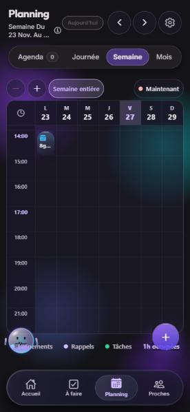
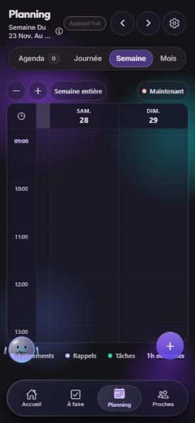
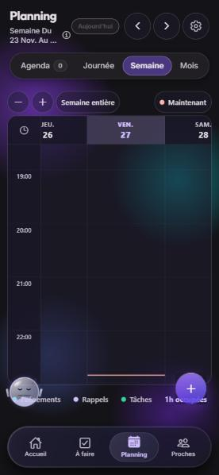

# FICHE OPÉRATOIRE N° 047 — La nouvelle vue Semaine du Planning

Projet : **Junix Pulse** · Date : 28 novembre 2026 · Suite de : [FICHE 046](FICHE-046-secrets-de-pulse.md)

---

## 1. Objectif

Le chantier n° 13 (étude 001, 16.12 ; maquette validée) :

| Ta demande | Ce que fait cette fiche |
|---|---|
| en se déplaçant, on perd les jours et les heures | la **ligne des jours reste en haut** et la **colonne des heures reste à gauche** : seule la grille défile, dans son cadre |
| zoomer et dézoomer | **pincer à deux doigts**, ou les boutons **− / +** (4 niveaux) |
| un élément du samedi à 20 h est long à atteindre | **« Semaine entière »** : les 7 jours dans l'écran ; toucher un jour l'amène au milieu (et zoome si la semaine entière était montrée) |
| revenir à aujourd'hui | la semaine **s'ouvre sur maintenant**, une **ligne rouge** marque l'heure, **« Maintenant »** y ramène |
| quelque chose qui simplifie | le bandeau **« Cette semaine »** : ce qui vient, en pastilles ; en toucher une amène à sa case, qui s'allume un instant |
| (ce qui existait) | les heures s'étendent aux éléments tôt ou tard (et à l'heure actuelle), glisser une carte la déplace, le sélecteur de semaine reste |

| | |
|---|---|
|  |  |
| *Figure 47-1 — « Semaine entière » : les 7 jours, la colonne des heures à gauche* | *Figure 47-2 — Zoomé, défilé jusqu'à samedi : les heures restent* |
|  | |
| *Figure 47-3 — « Maintenant » : vendredi, la ligne rouge à 22 h 47* | |

*Captures réelles (web, 360 px).*

## 2. État de départ

| À vérifier | Comment | Résultat attendu |
|---|---|---|
| La fiche 046 est appliquée | `git status` | ses fichiers |
| Tout passe | `npx jest` | `Tests: 2398 passed` |

## 3. Matériel

Rien de nouveau : `react-native-reanimated` et `react-native-gesture-handler` sont déjà là.

## 4. Hypothèses

- En vue Semaine, **la page ne défile plus** : la grille remplit l'écran et défile dans son cadre ; tirer vers le bas sur la grille rafraîchit toujours.
- La ligne des jours et la colonne des heures suivent le défilement **sur le fil de l'interface** (Reanimated) : pas de retard.
- Le zoom garde au milieu ce qui était au milieu.
- Le bandeau ne montre que les moments et les rappels (pas les blocs de fond), et dans la semaine en cours seulement ce qui reste à venir.

## 5. Carte de l'intervention

| Fichier | Action |
|---|---|
| `domain/rules/week-view-rules.ts` (**nouveau**) | les niveaux de zoom, la taille des cases, la cible d'un saut, le bandeau |
| `components/schedule/WeeklyTimetableGrid.tsx` | le cadre fixe, le zoom, « Maintenant », la ligne rouge, le bandeau |
| `app/(tabs)/calendar.tsx` | la vue Semaine remplit la page |
| i18n, `jest.setup.js` | les textes ; les outils de défilement simulés pour les tests |
| `__tests__/week-view.test.ts` (**nouveau**) | le test |

## 6. Sauvegarde

`git status` (fiche 046 appliquée, hors `docs/motion/`). Aucune migration.

## 7. Pas à pas

Le plus simple : `node docs/fiches/outils/appliquer-fiche-047.js .` (après la fiche 046) fait toutes les étapes ci-dessous ; puis l'APK (fiche 003).

### Étape 1 — La règle de la Semaine

**Pourquoi** : `week-view-rules.ts` calcule sans rien dessiner : les 4 niveaux de zoom (0 = « Semaine entière », 2 = la taille d'avant), le niveau après un pincement (`zoomAfterPinch`), la largeur d'un jour et la hauteur d'une heure (`weekSizes`), où faire défiler pour qu'un jour et une heure soient en vue sans dépasser les bords (`scrollTargetFor`), et les pastilles du bandeau dans l'ordre de la semaine (`weekBandItems`).

Repère (Ctrl+F) : la première ligne de chaque bloc « Chercher ». Le script `appliquer-fiche-047.js` fait tous ces changements d'un coup, et refuse d'écrire si un bloc ne se trouve pas exactement une fois.

#### `src/domain/rules/week-view-rules.ts`

Fichier nouveau, en entier :

<!-- bloc: new-week-view-rules -->

```ts
/**
 * The Week view of the Planning (study 001, 16.12; sheet 047): the zoom, where to scroll for
 * « Maintenant » or for an item, and the items of the « Cette semaine » band. Pure: the sizes of
 * the screen and the items are given by the caller.
 */

/** A zoom level: the width of a day and the height of an hour. 0 is « Semaine entière ». */
export interface WeekZoom {
  /** null: the 7 days fit the width of the grid. */
  dayWidth: number | null;
  hourHeight: number;
}

export const WEEK_ZOOM_LEVELS: readonly WeekZoom[] = [
  { dayWidth: null, hourHeight: 48 },
  { dayWidth: 96, hourHeight: 64 },
  // The size of before (sheet 028): two GlowCards side by side stay readable
  { dayWidth: 128, hourHeight: 88 },
  { dayWidth: 176, hourHeight: 112 },
];

/** The level the grid opens on: the size of before. */
export const DEFAULT_WEEK_ZOOM = 2;
/** « Semaine entière ». */
export const FIT_WEEK_ZOOM = 0;

/** A pinch spread this much (or more) zooms in one level; pinched this much, zooms out one. */
export const PINCH_IN_SCALE = 1.15;
export const PINCH_OUT_SCALE = 0.87;

export function clampZoom(level: number): number {
  return Math.max(0, Math.min(WEEK_ZOOM_LEVELS.length - 1, level));
}

/** The level after a pinch of this scale (1 = no change). */
export function zoomAfterPinch(level: number, scale: number): number {
  if (scale >= PINCH_IN_SCALE) return clampZoom(level + 1);
  if (scale <= PINCH_OUT_SCALE) return clampZoom(level - 1);
  return level;
}

/** The width of a day and the height of an hour at this level, for a grid of this width (the days' part). */
export function weekSizes(level: number, daysAreaWidth: number, dayCount = 7): { dayWidth: number; hourHeight: number } {
  const zoom = WEEK_ZOOM_LEVELS[clampZoom(level)];
  const fit = Math.max(32, Math.floor(daysAreaWidth / dayCount));
  return { dayWidth: zoom.dayWidth ?? fit, hourHeight: zoom.hourHeight };
}

/**
 * Where to scroll so that a day and a time sit in view: the day centred when it can be, the time
 * a third down the visible height. Never below 0 nor past the end.
 */
export function scrollTargetFor({
  dayIndex,
  minutes,
  startHour,
  dayWidth,
  hourHeight,
  dayCount = 7,
  totalHours,
  viewport,
}: {
  dayIndex: number;
  minutes: number;
  startHour: number;
  dayWidth: number;
  hourHeight: number;
  dayCount?: number;
  totalHours: number;
  /** The visible part of the days' area. */
  viewport: { width: number; height: number };
}): { x: number; y: number } {
  const maxX = Math.max(0, dayCount * dayWidth - viewport.width);
  const maxY = Math.max(0, totalHours * hourHeight - viewport.height);
  const x = dayIndex * dayWidth - (viewport.width - dayWidth) / 2;
  const y = ((minutes - startHour * 60) / 60) * hourHeight - viewport.height / 3;
  return { x: Math.round(Math.max(0, Math.min(maxX, x))), y: Math.round(Math.max(0, Math.min(maxY, y))) };
}

export interface WeekBandItem {
  id: string;
  label: string;
  /** Index of its day in the shown week (0 to 6). */
  dayIndex: number;
  /** Minutes from midnight. */
  minutes: number;
  startTime: string;
}

/**
 * The items of the « Cette semaine » band: in the order of the week, by day then by time; in the
 * current week, only what is still to come (from the current hour). At most `limit`.
 */
export function weekBandItems(
  items: readonly WeekBandItem[],
  { todayIndex, nowMinutes, limit = 12 }: { todayIndex: number | null; nowMinutes: number; limit?: number }
): WeekBandItem[] {
  return items
    .filter(item => todayIndex === null || item.dayIndex > todayIndex || (item.dayIndex === todayIndex && item.minutes >= nowMinutes - 59))
    .slice()
    .sort((a, b) => a.dayIndex - b.dayIndex || a.minutes - b.minutes)
    .slice(0, limit);
}
```

#### `src/__tests__/week-view.test.ts`

Fichier nouveau, en entier :

<!-- bloc: new-week-view-test -->

```ts
import {
  DEFAULT_WEEK_ZOOM,
  FIT_WEEK_ZOOM,
  WEEK_ZOOM_LEVELS,
  clampZoom,
  scrollTargetFor,
  weekBandItems,
  weekSizes,
  zoomAfterPinch,
} from '../domain/rules/week-view-rules';

describe('the Week view (sheet 047)', () => {
  it('opens at the size of before, and « Semaine entière » fits the 7 days', () => {
    expect(weekSizes(DEFAULT_WEEK_ZOOM, 300)).toEqual({ dayWidth: 128, hourHeight: 88 });
    expect(weekSizes(FIT_WEEK_ZOOM, 280).dayWidth).toBe(40);
    // Never thinner than a finger's tip, even on a narrow screen
    expect(weekSizes(FIT_WEEK_ZOOM, 100).dayWidth).toBe(32);
  });

  it('zooms one level per pinch, within its bounds', () => {
    expect(zoomAfterPinch(2, 1.4)).toBe(3);
    expect(zoomAfterPinch(2, 0.6)).toBe(1);
    expect(zoomAfterPinch(2, 1.05)).toBe(2);
    expect(zoomAfterPinch(WEEK_ZOOM_LEVELS.length - 1, 2)).toBe(WEEK_ZOOM_LEVELS.length - 1);
    expect(zoomAfterPinch(0, 0.5)).toBe(0);
    expect(clampZoom(-3)).toBe(0);
  });

  it('brings a day and a time into view, without going past the edges', () => {
    const base = { startHour: 7, dayWidth: 128, hourHeight: 88, totalHours: 15, viewport: { width: 280, height: 440 } };
    // Friday 18:00: the day centred, the hour a third down
    expect(scrollTargetFor({ ...base, dayIndex: 4, minutes: 18 * 60 })).toEqual({ x: 436, y: 821 });
    // Monday 7:00: at the very start
    expect(scrollTargetFor({ ...base, dayIndex: 0, minutes: 7 * 60 })).toEqual({ x: 0, y: 0 });
    // Sunday 23:00: at the very end
    expect(scrollTargetFor({ ...base, dayIndex: 6, minutes: 23 * 60 })).toEqual({ x: 7 * 128 - 280, y: 15 * 88 - 440 });
  });

  it('lists the band in week order, and in the current week only what is still to come', () => {
    const items = [
      { id: 'sat', label: 'Tâche du soir', dayIndex: 5, minutes: 20 * 60, startTime: '20:00' },
      { id: 'mon', label: 'Réunion', dayIndex: 0, minutes: 9 * 60, startTime: '09:00' },
      { id: 'thuLate', label: 'Appeler Zoé', dayIndex: 3, minutes: 19 * 60, startTime: '19:00' },
      { id: 'thuEarly', label: 'Déjeuner', dayIndex: 3, minutes: 12 * 60, startTime: '12:00' },
    ];
    expect(weekBandItems(items, { todayIndex: null, nowMinutes: 0 }).map(i => i.id)).toEqual(['mon', 'thuEarly', 'thuLate', 'sat']);
    // Thursday 18:30: Monday and lunch are behind
    expect(weekBandItems(items, { todayIndex: 3, nowMinutes: 18 * 60 + 30 }).map(i => i.id)).toEqual(['thuLate', 'sat']);
    expect(weekBandItems(items, { todayIndex: null, nowMinutes: 0, limit: 2 })).toHaveLength(2);
  });
});
```


### Étape 2 — Le cadre fixe, le zoom, « Maintenant » et le bandeau

**Pourquoi** : La grille a maintenant **son propre cadre** : un coin fixe, la ligne des jours dans une bande qui coupe ce qui dépasse, la colonne des heures pareil, et au milieu deux défilements (vertical, puis de côté). Chaque défilement met sa position dans une valeur partagée (`useAnimatedScrollHandler`) ; la ligne des jours se décale de cette valeur de côté, la colonne des heures de cette valeur de haut en bas (`useAnimatedStyle`) : elles suivent sans retard. Le pincement (`usePinchGesture`) et − / + changent le niveau ; le milieu est gardé. « Maintenant » et l'ouverture font défiler jusqu'à aujourd'hui à cette heure (`scrollTo` sur le fil de l'interface) ; une ligne rouge marque l'heure. Le bandeau montre ce qui vient ; une pastille fait défiler jusqu'à sa case et l'entoure un instant. Les cartes se déplacent au pas des nouvelles tailles.

Repère (Ctrl+F) : la première ligne de chaque bloc « Chercher ». Le script `appliquer-fiche-047.js` fait tous ces changements d'un coup, et refuse d'écrire si un bloc ne se trouve pas exactement une fois.

#### `src/components/schedule/WeeklyTimetableGrid.tsx`


Changement 1 sur 12. Chercher :

<!-- bloc: weeklytimetablegrid-1-avant -->

```tsx
 * - Carte IA "Junix Pulse IA" avec score de rythme et zones tampons.
 */

import { useMemo, useState } from 'react';
import {
  View,
  Text,
  TouchableOpacity,
  StyleSheet,
} from 'react-native';
// The ScrollView of the gestures: a scroll cancels the tap of a card under the finger (sheet 031)
import { ScrollView } from 'react-native-gesture-handler';
import { Ionicons } from '@expo/vector-icons';
import { format, isToday } from 'date-fns';
import { useDateLocale, useT } from '@/i18n';
```

Remplacer par :

<!-- bloc: weeklytimetablegrid-1-apres -->

```tsx
 * - Carte IA "Junix Pulse IA" avec score de rythme et zones tampons.
 */

import { useCallback, useEffect, useMemo, useRef, useState, type ReactElement } from 'react';
import {
  View,
  Text,
  TouchableOpacity,
  StyleSheet,
  type LayoutChangeEvent,
  type RefreshControlProps,
} from 'react-native';
// The ScrollView of the gestures: a scroll cancels the tap of a card under the finger (sheet 031)
import { GestureDetector, ScrollView, usePinchGesture } from 'react-native-gesture-handler';
import Animated, {
  runOnJS,
  runOnUI,
  scrollTo,
  useAnimatedRef,
  useAnimatedScrollHandler,
  useAnimatedStyle,
  useSharedValue,
} from 'react-native-reanimated';
import { Ionicons } from '@expo/vector-icons';
import { format, isToday } from 'date-fns';
import { useDateLocale, useT } from '@/i18n';
```

Changement 2 sur 12. Chercher :

<!-- bloc: weeklytimetablegrid-2-avant -->

```tsx
import { eventAccent, planningLook, taskAccent, type PlanningLook } from '@/constants/planning-look';
import { columnsForOffset, MIN_CARD_HEIGHT, minutesForOffset, SNAP_MINUTES } from '@/domain/rules/planning-move-rules';
import { withAlpha } from '@/utils/color';

export interface WeeklyTimetableGridProps {
  blocks: PlanningBlock[];
```

Remplacer par :

<!-- bloc: weeklytimetablegrid-2-apres -->

```tsx
import { eventAccent, planningLook, taskAccent, type PlanningLook } from '@/constants/planning-look';
import { columnsForOffset, MIN_CARD_HEIGHT, minutesForOffset, SNAP_MINUTES } from '@/domain/rules/planning-move-rules';
import { withAlpha } from '@/utils/color';
import {
  DEFAULT_WEEK_ZOOM,
  FIT_WEEK_ZOOM,
  WEEK_ZOOM_LEVELS,
  clampZoom,
  scrollTargetFor,
  weekBandItems,
  weekSizes,
  zoomAfterPinch,
} from '@/domain/rules/week-view-rules';

// The gestures' ScrollView, driven on the UI thread: the days and the hours follow it (sheet 047)
const AnimatedScrollView = Animated.createAnimatedComponent(ScrollView);

export interface WeeklyTimetableGridProps {
  blocks: PlanningBlock[];
```

Changement 3 sur 12. Chercher :

<!-- bloc: weeklytimetablegrid-3-avant -->

```tsx
  step?: number;
  /** The look of each moment and reminder, by id: the GlowCard and the colours of the Day view (sheet 028). */
  looks?: Readonly<Record<string, PlanningLook>>;
}

const DEFAULT_START_HOUR = 7;   // 07:00 par défaut
```

Remplacer par :

<!-- bloc: weeklytimetablegrid-3-apres -->

```tsx
  step?: number;
  /** The look of each moment and reminder, by id: the GlowCard and the colours of the Day view (sheet 028). */
  looks?: Readonly<Record<string, PlanningLook>>;
  /** Pull to refresh, on the grid's own vertical scroll (sheet 047: the page no longer scrolls). */
  refreshControl?: ReactElement<RefreshControlProps>;
}

const DEFAULT_START_HOUR = 7;   // 07:00 par défaut
```

Changement 4 sur 12. Chercher :

<!-- bloc: weeklytimetablegrid-4-avant -->

```tsx
const TIME_COL_WIDTH = 54;
/** Under this width (three cards in a day) a card keeps its icon and its title only. */
const TINY_CARD_WIDTH = 72;
// 128 points a day (sheet 028): two GlowCards side by side stay readable; the grid scrolls sideways
const DAY_COL_WIDTH = 128;

const DAYS_DEFINITION = [
  { num: 1, label: 'LUN', full: 'Lundi', dateNum: '01' },
```

Remplacer par :

<!-- bloc: weeklytimetablegrid-4-apres -->

```tsx
const TIME_COL_WIDTH = 54;
/** Under this width (three cards in a day) a card keeps its icon and its title only. */
const TINY_CARD_WIDTH = 72;
// The width of a day comes from the zoom (sheet 047): see WEEK_ZOOM_LEVELS

const DAYS_DEFINITION = [
  { num: 1, label: 'LUN', full: 'Lundi', dateNum: '01' },
```

Changement 5 sur 12. Chercher :

<!-- bloc: weeklytimetablegrid-5-avant -->

```tsx
function layoutForegroundBlocks(
  blocks: PlanningBlock[],
  columnWidth: number,
  startHour: number = DEFAULT_START_HOUR
): PositionedForegroundBlock[] {
  if (blocks.length === 0) return [];

```

Remplacer par :

<!-- bloc: weeklytimetablegrid-5-apres -->

```tsx
function layoutForegroundBlocks(
  blocks: PlanningBlock[],
  columnWidth: number,
  startHour: number = DEFAULT_START_HOUR,
  hourHeight: number = HOUR_HEIGHT
): PositionedForegroundBlock[] {
  if (blocks.length === 0) return [];

```

Changement 6 sur 12. Chercher :

<!-- bloc: weeklytimetablegrid-6-avant -->

```tsx
      const leftPx = 2 + colIndex * subColWidth;
      const widthPx = Math.max(20, subColWidth - 2);

      const topPx = ((a.item.startMin - startHour * 60) / 60) * HOUR_HEIGHT;
      const heightPx = (a.item.durationMin / 60) * HOUR_HEIGHT;
      const clampedTop = Math.max(0, topPx);
      const clampedHeight = Math.max(MIN_CARD_HEIGHT, heightPx - 2);

```

Remplacer par :

<!-- bloc: weeklytimetablegrid-6-apres -->

```tsx
      const leftPx = 2 + colIndex * subColWidth;
      const widthPx = Math.max(20, subColWidth - 2);

      const topPx = ((a.item.startMin - startHour * 60) / 60) * hourHeight;
      const heightPx = (a.item.durationMin / 60) * hourHeight;
      const clampedTop = Math.max(0, topPx);
      const clampedHeight = Math.max(MIN_CARD_HEIGHT, heightPx - 2);

```

Changement 7 sur 12. Chercher :

<!-- bloc: weeklytimetablegrid-7-avant -->

```tsx
  onLift,
  step = SNAP_MINUTES,
  looks,
}: WeeklyTimetableGridProps) {
  const { palette, isDark } = useTheme();
  const styles = useThemedStyles(makeTimetableStyles);
```

Remplacer par :

<!-- bloc: weeklytimetablegrid-7-apres -->

```tsx
  onLift,
  step = SNAP_MINUTES,
  looks,
  refreshControl,
}: WeeklyTimetableGridProps) {
  const { palette, isDark } = useTheme();
  const styles = useThemedStyles(makeTimetableStyles);
```

Changement 8 sur 12. Chercher :

<!-- bloc: weeklytimetablegrid-8-avant -->

```tsx
      if (sH < minH) minH = Math.max(0, sH);
      if (eH > maxH) maxH = Math.min(24, eH);
    });

    return {
      startHour: minH,
      endHour: maxH,
      totalHours: Math.max(1, maxH - minH),
    };
  }, [blocks]);

  // Définition dynamique des 7 jours de la semaine
  const displayedDays = useMemo(() => {
```

Remplacer par :

<!-- bloc: weeklytimetablegrid-8-apres -->

```tsx
      if (sH < minH) minH = Math.max(0, sH);
      if (eH > maxH) maxH = Math.min(24, eH);
    });
    // This week: the current hour is in the grid, so « Maintenant » shows it (sheet 047)
    if (weekDays?.some(day => isToday(day))) {
      const hour = new Date().getHours();
      if (hour < minH) minH = hour;
      if (hour + 1 > maxH) maxH = Math.min(24, hour + 1);
    }

    return {
      startHour: minH,
      endHour: maxH,
      totalHours: Math.max(1, maxH - minH),
    };
  }, [blocks, weekDays]);

  // Définition dynamique des 7 jours de la semaine
  const displayedDays = useMemo(() => {
```

Changement 9 sur 12. Chercher :

<!-- bloc: weeklytimetablegrid-9-avant -->

```tsx
    }
  };

  const gridContentWidth = TIME_COL_WIDTH + displayedDays.length * DAY_COL_WIDTH;

  return (
    <View style={styles.wrapper}>
      {/* ─── Conteneur principal de la Grille Matricielle 7J ────────────────────── */}
      <View style={styles.gridCard}>
        <ScrollView
          horizontal
          scrollEnabled={!lifted}
          showsHorizontalScrollIndicator={false}
          contentContainerStyle={{ minWidth: gridContentWidth }}
        >
          <View style={{ width: gridContentWidth }}>
            {/* Ligne d'en-tête collante des 7 jours */}
            <View style={styles.dayHeaderRow}>
              {/* Coin haut-gauche icône horloge */}
              <View style={[styles.cornerCell, { width: TIME_COL_WIDTH }]}>
                <Ionicons name="time-outline" size={16} color={palette.onSurface.variant} />
              </View>

              {/* Colonnes des jours (avec mise en avant du jour d'aujourd'hui) */}
              {displayedDays.map(d => {
                return (
                  <View
                    key={d.num}
                    style={[
                      styles.dayHeaderCell,
                      { width: DAY_COL_WIDTH },
                      d.isCurrentDay && styles.dayHeaderCellActive,
                    ]}
                  >
                    <Text
                      style={[
                        styles.dayHeaderName,
                        d.isCurrentDay && { color: palette.primary.default, fontWeight: '800' },
                      ]}
                    >
                      {d.label}
                    </Text>
                    <Text
                      style={[
                        styles.dayHeaderDate,
                        d.isCurrentDay && { color: palette.primary.default, fontWeight: '800' },
                      ]}
                    >
                      {d.dateNum}
                    </Text>
                  </View>
                );
              })}
            </View>

            {/* Ligne facultative "Tâches à faire dans la journée" (All-day) */}
            {hasAnyTasks && (
              <View style={styles.allDayRow}>
                <View style={[styles.allDayGutter, { width: TIME_COL_WIDTH }]}>
                  <Ionicons name="checkbox-outline" size={13} color={palette.tertiary.default} />
                  <Text style={styles.allDayGutterText}>{t('tab.tasks')}</Text>
                </View>
                {displayedDays.map(d => {
                  const count = tasksCountByDay?.[d.num] ?? 0;
                  return (
                    <View key={d.num} style={[styles.allDayCell, { width: DAY_COL_WIDTH }]}>
                      {count > 0 ? (
                        <TouchableOpacity
                          style={styles.allDayTaskPill}
                          onPress={() => onPressTasksDay ? onPressTasksDay(d.num) : onAddBlock(d.num)}
                          activeOpacity={0.75}
                          accessibilityLabel={t('weekGrid.tasksA11y', { count })}
                        >
                          <Text style={styles.allDayTaskPillText} numberOfLines={1}>
                            {t(count > 1 ? 'weekGrid.taskMany' : 'weekGrid.taskOne', { count })}
                          </Text>
                        </TouchableOpacity>
                      ) : null}
                    </View>
                  );
                })}
              </View>
            )}

            {/* Corps de la Grille : Colonne Heures + Colonnes Journées */}
            <View style={styles.gridBody}>
              {/* Colonne latérale gauche : Marqueurs startHour à endHour */}
              <View style={[styles.timeGutter, { width: TIME_COL_WIDTH }]}>
                {Array.from({ length: totalHours }, (_, i) => {
                  const hour = startHour + i;
                  const isHighlight = hour === 9 || hour === 14 || hour === 17;
                  return (
                    <View key={hour} style={[styles.timeCell, { height: HOUR_HEIGHT }]}>
                      <Text
                        style={[
                          styles.timeLabel,
                          isHighlight && { color: palette.primary.default, fontWeight: '700' },
                        ]}
                      >
                        {String(hour).padStart(2, '0')}:00
                      </Text>
                    </View>
                  );
                })}
              </View>

              {/* Zone des colonnes de jours avec les lignes horizontales de fond */}
              <View style={[styles.daysContainer, { width: displayedDays.length * DAY_COL_WIDTH }]}>
                {/* Lignes de repère horizontales (une par tranche horaire) */}
                <View style={StyleSheet.absoluteFill} pointerEvents="none">
                  {Array.from({ length: totalHours }, (_, i) => (
                    <View
                      key={i}
                      style={[
                        styles.hourHorizontalLine,
                        { height: HOUR_HEIGHT },
                        (i === 2 || i === 3) && { backgroundColor: isDark ? 'rgba(208,188,255,0.03)' : 'rgba(107,70,193,0.02)' },
                      ]}
                    />
                  ))}
                </View>

                {/* Colonnes par jour */}
                <View style={styles.columnsRow}>
                  {displayedDays.map(d => {
                    const dayBlocks = blocks.filter(b => b.dayOfWeek === d.num);
                    const backgroundBlocks = dayBlocks.filter(
                      b => b.scheduleId !== 'event' && b.scheduleId !== 'reminder' && b.scheduleId !== 'task'
                    );
                    // Moments and reminders together, side by side when they meet (sheet 028)
                    const foregroundBlocks = dayBlocks.filter(
                      b => b.scheduleId === 'event' || b.scheduleId === 'task' || b.scheduleId === 'reminder'
                    );
                    const positionedForeground = layoutForegroundBlocks(foregroundBlocks, DAY_COL_WIDTH, startHour);

                    return (
                      <View
                        key={d.num}
                        style={[
                          styles.dayColumn,
                          { width: DAY_COL_WIDTH, height: totalHours * HOUR_HEIGHT },
                        ]}
                      >
                        {/* Clic rapide sur la colonne pour ajouter un bloc */}
                        <TouchableOpacity
                          style={StyleSheet.absoluteFill}
                          activeOpacity={0.9}
                          onPress={() => onAddBlock(d.num, '09:00')}
                          accessibilityLabel={t('weekGrid.addBlock', { day: d.full })}
                        />

                        {/* 1. LAYER 0 : Blocs de vie récurrents (Fond contextuel en filigrane) */}
                        {backgroundBlocks.map((block, bIdx) => {
                          const startMin = timeToMinutes(block.startTime);
                          const endMin = timeToMinutes(block.endTime);
                          const durationMin = Math.max(15, endMin - startMin);
                          const topPx = ((startMin - startHour * 60) / 60) * HOUR_HEIGHT;
                          const heightPx = (durationMin / 60) * HOUR_HEIGHT;
                          const clampedTop = Math.max(0, topPx);
                          const clampedHeight = Math.max(22, heightPx - 2);
                          const config = getBlockStyleConfig(block.type);

                          return (
                            <TouchableOpacity
                              key={`bg-${block.id}-${d.num}-${bIdx}`}
                              style={[
                                styles.backgroundBlockCard,
                                {
                                  top: clampedTop + 1,
                                  height: clampedHeight,
                                  backgroundColor: config.bg,
                                  borderColor: config.border + '55',
                                },
                              ]}
                              activeOpacity={0.85}
                              onPress={() => onSelectBlock ? onSelectBlock(block) : onAddBlock(d.num)}
                              onLongPress={() => onDeleteBlock(block.id, block.label)}
                              accessibilityRole="button"
                              accessibilityLabel={t('weekGrid.blockA11y', { label: block.label, start: block.startTime, end: block.endTime })}
                            >
                              <View style={styles.backgroundBlockHeader}>
                                <Ionicons name={config.icon as any} size={9} color={config.accent} style={{ opacity: 0.8 }} />
                                <Text style={[styles.backgroundBlockTitle, { color: config.text }]} numberOfLines={1}>
                                  {block.label}
                                </Text>
                              </View>
                            </TouchableOpacity>
                          );
                        })}

                        {/* 2. LAYER 1 : moments and reminders as GlowCards, side by side (sheet 028) */}
                        {positionedForeground.map((item, itemIdx) => {
                          const { block } = item;
                          const isReminder = block.scheduleId === 'reminder';
                          const look = looks?.[block.id] ?? planningLook(palette, isReminder ? 'reminder' : 'event');
                          return (
                            <DraggableBlock
                              key={`fg-${block.id}-${d.num}-${item.colIndex}-${itemIdx}`}
                              style={[styles.blockBox, { top: item.topPx + 1, height: item.heightPx, left: item.leftPx, width: item.widthPx }]}
                              onPress={() => onSelectBlock ? onSelectBlock(block) : onAddBlock(d.num)}
                              movable={!!onMoveBlock && (block.scheduleId === 'event' || isReminder)}
                              stepY={(HOUR_HEIGHT * step) / 60}
                              stepX={DAY_COL_WIDTH}
                              onLift={lift}
                              onDrop={drop => onMoveBlock?.(block, minutesForOffset(drop.dy, HOUR_HEIGHT, step), columnsForOffset(drop.dx, DAY_COL_WIDTH))}
                              onMoveBy={(minutes, days) => onMoveBlock?.(block, Math.sign(minutes) * step, days)}
                              accessibilityLabel={
                                isReminder
                                  ? t('weekGrid.reminderA11y', { label: block.label, time: block.startTime })
                                  : t('weekGrid.blockA11y', { label: block.label, start: block.startTime, end: block.endTime })
                              }
                            >
                              <PlanningCard
                                look={look}
                                title={block.label}
                                time={isReminder && !block.fillsTime ? block.startTime : `${block.startTime} – ${block.endTime}`}
                                height={item.heightPx}
                                narrow
                                tiny={item.widthPx < TINY_CARD_WIDTH}
                                index={itemIdx}
                              />
                            </DraggableBlock>
                          );
                        })}
                      </View>
                    );
                  })}
                </View>
              </View>
            </View>
          </View>
        </ScrollView>
      </View>

      {/* ─── Synthèse hebdomadaire compacte & sobre ─────────────────────────── */}
```

Remplacer par :

<!-- bloc: weeklytimetablegrid-9-apres -->

```tsx
    }
  };

  // ─── The frame (sheet 047): the days' row and the hours' column stay in view ─────────────
  const [zoom, setZoom] = useState(DEFAULT_WEEK_ZOOM);
  // The visible part of the days' area, measured
  const [frame, setFrame] = useState({ width: 0, height: 0 });
  const { dayWidth, hourHeight } = weekSizes(zoom, frame.width, displayedDays.length);
  const daysWidth = displayedDays.length * dayWidth;
  const gridHeight = totalHours * hourHeight;
  const todayIndex = displayedDays.findIndex(d => d.isCurrentDay);
  const now = new Date();
  const nowMinutes = now.getHours() * 60 + now.getMinutes();

  const scrollX = useSharedValue(0);
  const scrollY = useSharedValue(0);
  const xRef = useAnimatedRef<Animated.ScrollView>();
  const yRef = useAnimatedRef<Animated.ScrollView>();
  const onScrollX = useAnimatedScrollHandler(event => {
    scrollX.value = event.contentOffset.x;
  });
  const onScrollY = useAnimatedScrollHandler(event => {
    scrollY.value = event.contentOffset.y;
  });
  const daysRowStyle = useAnimatedStyle(() => ({ transform: [{ translateX: -scrollX.value }] }));
  const hoursColumnStyle = useAnimatedStyle(() => ({ transform: [{ translateY: -scrollY.value }] }));

  const scrollToPoint = useCallback(
    (x: number, y: number, animated = true) => {
      runOnUI(() => {
        'worklet';
        scrollTo(xRef, x, 0, animated);
        scrollTo(yRef, 0, y, animated);
      })();
    },
    [xRef, yRef]
  );

  /** A day and a time brought into view. */
  const goTo = useCallback(
    (dayIndex: number, minutes: number, animated = true) => {
      if (frame.width === 0) return;
      const target = scrollTargetFor({
        dayIndex,
        minutes,
        startHour,
        dayWidth,
        hourHeight,
        dayCount: displayedDays.length,
        totalHours,
        viewport: frame,
      });
      scrollToPoint(target.x, target.y, animated);
    },
    [frame, startHour, dayWidth, hourHeight, displayedDays.length, totalHours, scrollToPoint]
  );

  // The week opens on now (today, at this hour), once the frame is measured
  const openedRef = useRef(false);
  useEffect(() => {
    if (openedRef.current || frame.width === 0) return;
    openedRef.current = true;
    if (todayIndex >= 0) goTo(todayIndex, nowMinutes, false);
    // Only when first measured: later, the person moves freely
    // eslint-disable-next-line react-hooks/exhaustive-deps
  }, [frame.width]);

  // A zoom keeps the middle of what was in view
  const zoomCentreRef = useRef<{ fx: number; fy: number } | null>(null);
  const applyZoom = useCallback(
    (next: number) => {
      const level = clampZoom(next);
      if (level === zoom || frame.width === 0) return;
      zoomCentreRef.current = {
        fx: (scrollX.value + frame.width / 2) / Math.max(1, daysWidth),
        fy: (scrollY.value + frame.height / 2) / Math.max(1, gridHeight),
      };
      setZoom(level);
    },
    [zoom, frame, daysWidth, gridHeight, scrollX, scrollY]
  );
  useEffect(() => {
    const centre = zoomCentreRef.current;
    if (!centre) return;
    zoomCentreRef.current = null;
    const x = Math.max(0, Math.min(daysWidth - frame.width, centre.fx * daysWidth - frame.width / 2));
    const y = Math.max(0, Math.min(gridHeight - frame.height, centre.fy * gridHeight - frame.height / 2));
    scrollToPoint(x, y, false);
  }, [zoom, daysWidth, gridHeight, frame, scrollToPoint]);

  // Two fingers: spread to zoom in, pinch to zoom out
  const pinchScale = useSharedValue(1);
  const pinchEnded = useCallback((scale: number) => applyZoom(zoomAfterPinch(zoom, scale)), [applyZoom, zoom]);
  const pinch = usePinchGesture({
    onUpdate: event => {
      'worklet';
      pinchScale.value = event.scale;
    },
    onDeactivate: () => {
      'worklet';
      runOnJS(pinchEnded)(pinchScale.value);
      pinchScale.value = 1;
    },
  });

  // The « Cette semaine » band: what is coming, a touch away
  const bandItems = useMemo(
    () =>
      weekBandItems(
        blocks
          .filter(b => b.scheduleId === 'event' || b.scheduleId === 'reminder')
          .map(b => ({
            id: b.id,
            label: b.label,
            dayIndex: displayedDays.findIndex(d => d.num === b.dayOfWeek),
            minutes: timeToMinutes(b.startTime),
            startTime: b.startTime,
          }))
          .filter(item => item.dayIndex >= 0),
        { todayIndex: todayIndex >= 0 ? todayIndex : null, nowMinutes }
      ),
    // nowMinutes moves each minute; the band is made again with the blocks
    // eslint-disable-next-line react-hooks/exhaustive-deps
    [blocks, displayedDays, todayIndex]
  );
  // The card reached from the band shines a moment
  const [flashId, setFlashId] = useState<string | null>(null);
  useEffect(() => {
    if (!flashId) return;
    const timer = setTimeout(() => setFlashId(null), 1400);
    return () => clearTimeout(timer);
  }, [flashId]);

  const onFrameLayout = (event: LayoutChangeEvent) => {
    const { width, height } = event.nativeEvent.layout;
    setFrame(current => (Math.abs(current.width - width) < 1 && Math.abs(current.height - height) < 1 ? current : { width, height }));
  };

  return (
    <View style={styles.wrapper}>
      {/* ─── Zoom, « Semaine entière » and « Maintenant » (sheet 047) ─────────────────── */}
      <View style={styles.toolbar}>
        <TouchableOpacity
          style={styles.toolButton}
          onPress={() => applyZoom(zoom - 1)}
          disabled={zoom === 0}
          hitSlop={6}
          accessibilityRole="button"
          accessibilityLabel={t('weekGrid.zoomOut')}
          testID="week-zoom-out"
        >
          <Ionicons name="remove" size={18} color={zoom === 0 ? palette.onSurface.disabled : palette.onSurface.primary} />
        </TouchableOpacity>
        <TouchableOpacity
          style={styles.toolButton}
          onPress={() => applyZoom(zoom + 1)}
          disabled={zoom === WEEK_ZOOM_LEVELS.length - 1}
          hitSlop={6}
          accessibilityRole="button"
          accessibilityLabel={t('weekGrid.zoomIn')}
          testID="week-zoom-in"
        >
          <Ionicons name="add" size={18} color={zoom === WEEK_ZOOM_LEVELS.length - 1 ? palette.onSurface.disabled : palette.onSurface.primary} />
        </TouchableOpacity>
        <TouchableOpacity
          style={[styles.toolPill, zoom === FIT_WEEK_ZOOM && styles.toolPillActive]}
          onPress={() => applyZoom(FIT_WEEK_ZOOM)}
          accessibilityRole="button"
          accessibilityState={{ selected: zoom === FIT_WEEK_ZOOM }}
          testID="week-fit"
        >
          <Text style={[styles.toolPillText, zoom === FIT_WEEK_ZOOM && styles.toolPillTextActive]}>{t('weekGrid.fitWeek')}</Text>
        </TouchableOpacity>
        <View style={{ flex: 1 }} />
        {todayIndex >= 0 ? (
          <TouchableOpacity
            style={styles.toolPill}
            onPress={() => goTo(todayIndex, nowMinutes)}
            accessibilityRole="button"
            testID="week-now"
          >
            <View style={[styles.nowDot, { backgroundColor: palette.error.default }]} />
            <Text style={styles.toolPillText}>{t('weekGrid.now')}</Text>
          </TouchableOpacity>
        ) : null}
      </View>

      {/* ─── « Cette semaine »: a touch goes to the card (sheet 047) ─────────────────── */}
      {bandItems.length > 0 ? (
        <ScrollView horizontal showsHorizontalScrollIndicator={false} contentContainerStyle={styles.band} accessibilityLabel={t('weekGrid.thisWeek')}>
          {bandItems.map(item => {
            const color = (looks?.[item.id] ?? planningLook(palette, 'event')).color;
            const day = displayedDays[item.dayIndex];
            return (
              <TouchableOpacity
                key={item.id}
                style={styles.bandChip}
                onPress={() => {
                  goTo(item.dayIndex, item.minutes);
                  setFlashId(item.id);
                }}
                accessibilityRole="button"
                accessibilityLabel={t('weekGrid.jumpA11y', { label: item.label, day: day.full, time: item.startTime })}
              >
                <View style={styles.bandChipTop}>
                  <View style={[styles.bandDot, { backgroundColor: color }]} />
                  <Text style={styles.bandWhen}>{`${day.label} ${item.startTime}`}</Text>
                </View>
                <Text style={styles.bandLabel} numberOfLines={1}>
                  {item.label}
                </Text>
              </TouchableOpacity>
            );
          })}
        </ScrollView>
      ) : null}

      {/* ─── The grid: a fixed corner, the days that follow sideways, the hours that follow down ─── */}
      <View style={styles.gridCard}>
        <View style={styles.headRow}>
          <View style={[styles.cornerCell, { width: TIME_COL_WIDTH }]}>
            <Ionicons name="time-outline" size={16} color={palette.onSurface.variant} />
          </View>
          <View style={styles.headClip}>
            <Animated.View style={[{ width: daysWidth }, daysRowStyle]}>
              <View style={styles.dayHeaderRow}>
                {displayedDays.map((d, index) => (
                  <TouchableOpacity
                    key={d.num}
                    style={[styles.dayHeaderCell, { width: dayWidth }, d.isCurrentDay && styles.dayHeaderCellActive]}
                    // A day touched: it comes into view, zoomed in if the whole week was shown
                    onPress={() => {
                      if (zoom === FIT_WEEK_ZOOM) applyZoom(DEFAULT_WEEK_ZOOM);
                      goTo(index, d.isCurrentDay ? nowMinutes : startHour * 60 + 60);
                    }}
                    accessibilityRole="button"
                    accessibilityLabel={d.full}
                  >
                    <Text style={[styles.dayHeaderName, d.isCurrentDay && { color: palette.primary.default, fontWeight: '800' }]} numberOfLines={1}>
                      {dayWidth < 48 ? d.label.slice(0, 1) : d.label}
                    </Text>
                    <Text style={[styles.dayHeaderDate, d.isCurrentDay && { color: palette.primary.default, fontWeight: '800' }]}>
                      {d.dateNum}
                    </Text>
                  </TouchableOpacity>
                ))}
              </View>
              {/* The tasks of each day, under its name */}
              {hasAnyTasks && (
                <View style={styles.allDayRow}>
                  {displayedDays.map(d => {
                    const count = tasksCountByDay?.[d.num] ?? 0;
                    return (
                      <View key={d.num} style={[styles.allDayCell, { width: dayWidth }]}>
                        {count > 0 ? (
                          <TouchableOpacity
                            style={styles.allDayTaskPill}
                            onPress={() => onPressTasksDay ? onPressTasksDay(d.num) : onAddBlock(d.num)}
                            activeOpacity={0.75}
                            accessibilityLabel={t('weekGrid.tasksA11y', { count })}
                          >
                            <Text style={styles.allDayTaskPillText} numberOfLines={1}>
                              {dayWidth < 64 ? String(count) : t(count > 1 ? 'weekGrid.taskMany' : 'weekGrid.taskOne', { count })}
                            </Text>
                          </TouchableOpacity>
                        ) : null}
                      </View>
                    );
                  })}
                </View>
              )}
            </Animated.View>
          </View>
        </View>

        <View style={styles.bodyRow}>
          {/* The hours, following the vertical scroll */}
          <View style={[styles.timeGutter, styles.gutterClip, { width: TIME_COL_WIDTH }]}>
            <Animated.View style={hoursColumnStyle}>
              {Array.from({ length: totalHours }, (_, i) => {
                const hour = startHour + i;
                const isHighlight = hour === 9 || hour === 14 || hour === 17;
                return (
                  <View key={hour} style={[styles.timeCell, { height: hourHeight }]}>
                    <Text style={[styles.timeLabel, isHighlight && { color: palette.primary.default, fontWeight: '700' }]}>
                      {String(hour).padStart(2, '0')}:00
                    </Text>
                  </View>
                );
              })}
            </Animated.View>
          </View>

          <GestureDetector gesture={pinch}>
            <View style={styles.daysViewport} onLayout={onFrameLayout} collapsable={false}>
              <AnimatedScrollView
                ref={yRef}
                onScroll={onScrollY}
                scrollEventThrottle={16}
                scrollEnabled={!lifted}
                showsVerticalScrollIndicator={false}
                refreshControl={refreshControl}
                nestedScrollEnabled
              >
                <AnimatedScrollView
                  ref={xRef}
                  horizontal
                  onScroll={onScrollX}
                  scrollEventThrottle={16}
                  scrollEnabled={!lifted}
                  showsHorizontalScrollIndicator={false}
                  nestedScrollEnabled
                >
                  <View style={[styles.daysContainer, { width: daysWidth, height: gridHeight }]}>
                    {/* The hour lines */}
                    <View style={StyleSheet.absoluteFill} pointerEvents="none">
                      {Array.from({ length: totalHours }, (_, i) => (
                        <View key={i} style={[styles.hourHorizontalLine, { height: hourHeight }]} />
                      ))}
                    </View>

                    <View style={styles.columnsRow}>
                      {displayedDays.map(d => {
                        const dayBlocks = blocks.filter(b => b.dayOfWeek === d.num);
                        const backgroundBlocks = dayBlocks.filter(
                          b => b.scheduleId !== 'event' && b.scheduleId !== 'reminder' && b.scheduleId !== 'task'
                        );
                        // Moments and reminders together, side by side when they meet (sheet 028)
                        const foregroundBlocks = dayBlocks.filter(
                          b => b.scheduleId === 'event' || b.scheduleId === 'task' || b.scheduleId === 'reminder'
                        );
                        const positionedForeground = layoutForegroundBlocks(foregroundBlocks, dayWidth, startHour, hourHeight);

                        return (
                          <View key={d.num} style={[styles.dayColumn, { width: dayWidth, height: gridHeight }]}>
                            {/* A touch on the column adds something */}
                            <TouchableOpacity
                              style={StyleSheet.absoluteFill}
                              activeOpacity={0.9}
                              onPress={() => onAddBlock(d.num, '09:00')}
                              accessibilityLabel={t('weekGrid.addBlock', { day: d.full })}
                            />

                            {/* The life blocks behind (sheet 028) */}
                            {backgroundBlocks.map((block, bIdx) => {
                              const startMin = timeToMinutes(block.startTime);
                              const endMin = timeToMinutes(block.endTime);
                              const durationMin = Math.max(15, endMin - startMin);
                              const topPx = ((startMin - startHour * 60) / 60) * hourHeight;
                              const heightPx = (durationMin / 60) * hourHeight;
                              const config = getBlockStyleConfig(block.type);
                              return (
                                <TouchableOpacity
                                  key={`bg-${block.id}-${d.num}-${bIdx}`}
                                  style={[
                                    styles.backgroundBlockCard,
                                    {
                                      top: Math.max(0, topPx) + 1,
                                      height: Math.max(22, heightPx - 2),
                                      backgroundColor: config.bg,
                                      borderColor: config.border + '55',
                                    },
                                  ]}
                                  activeOpacity={0.85}
                                  onPress={() => onSelectBlock ? onSelectBlock(block) : onAddBlock(d.num)}
                                  onLongPress={() => onDeleteBlock(block.id, block.label)}
                                  accessibilityRole="button"
                                  accessibilityLabel={t('weekGrid.blockA11y', { label: block.label, start: block.startTime, end: block.endTime })}
                                >
                                  <View style={styles.backgroundBlockHeader}>
                                    <Ionicons name={config.icon as any} size={9} color={config.accent} style={{ opacity: 0.8 }} />
                                    <Text style={[styles.backgroundBlockTitle, { color: config.text }]} numberOfLines={1}>
                                      {block.label}
                                    </Text>
                                  </View>
                                </TouchableOpacity>
                              );
                            })}

                            {/* Moments and reminders as GlowCards, side by side (sheet 028) */}
                            {positionedForeground.map((item, itemIdx) => {
                              const { block } = item;
                              const isReminder = block.scheduleId === 'reminder';
                              const look = looks?.[block.id] ?? planningLook(palette, isReminder ? 'reminder' : 'event');
                              return (
                                <DraggableBlock
                                  key={`fg-${block.id}-${d.num}-${item.colIndex}-${itemIdx}`}
                                  style={[
                                    styles.blockBox,
                                    { top: item.topPx + 1, height: item.heightPx, left: item.leftPx, width: item.widthPx },
                                    // Reached from the band: it shines a moment
                                    flashId === block.id && { borderWidth: 2, borderColor: palette.onSurface.primary, borderRadius: Radius.md },
                                  ]}
                                  onPress={() => onSelectBlock ? onSelectBlock(block) : onAddBlock(d.num)}
                                  movable={!!onMoveBlock && (block.scheduleId === 'event' || isReminder)}
                                  stepY={(hourHeight * step) / 60}
                                  stepX={dayWidth}
                                  onLift={lift}
                                  onDrop={drop => onMoveBlock?.(block, minutesForOffset(drop.dy, hourHeight, step), columnsForOffset(drop.dx, dayWidth))}
                                  onMoveBy={(minutes, days) => onMoveBlock?.(block, Math.sign(minutes) * step, days)}
                                  accessibilityLabel={
                                    isReminder
                                      ? t('weekGrid.reminderA11y', { label: block.label, time: block.startTime })
                                      : t('weekGrid.blockA11y', { label: block.label, start: block.startTime, end: block.endTime })
                                  }
                                >
                                  <PlanningCard
                                    look={look}
                                    title={block.label}
                                    time={isReminder && !block.fillsTime ? block.startTime : `${block.startTime} – ${block.endTime}`}
                                    height={item.heightPx}
                                    narrow
                                    tiny={item.widthPx < TINY_CARD_WIDTH}
                                    index={itemIdx}
                                  />
                                </DraggableBlock>
                              );
                            })}

                            {/* Now: a red line across today */}
                            {d.isCurrentDay && nowMinutes >= startHour * 60 && nowMinutes <= (startHour + totalHours) * 60 ? (
                              <View
                                pointerEvents="none"
                                style={[styles.nowLine, { top: ((nowMinutes - startHour * 60) / 60) * hourHeight, backgroundColor: palette.error.default }]}
                              />
                            ) : null}
                          </View>
                        );
                      })}
                    </View>
                  </View>
                </AnimatedScrollView>
              </AnimatedScrollView>
            </View>
          </GestureDetector>
        </View>
      </View>

      {/* ─── Synthèse hebdomadaire compacte & sobre ─────────────────────────── */}
```

Changement 10 sur 12. Chercher :

<!-- bloc: weeklytimetablegrid-10-avant -->

```tsx
  const faintLine = isDark ? 'rgba(255, 255, 255, 0.05)' : 'rgba(76, 52, 120, 0.07)';

  return StyleSheet.create({
    wrapper: {
      paddingHorizontal: Spacing.md,
      paddingTop: Spacing.sm,
      paddingBottom: 40,
    },
    blockBox: {
      position: 'absolute',
```

Remplacer par :

<!-- bloc: weeklytimetablegrid-10-apres -->

```tsx
  const faintLine = isDark ? 'rgba(255, 255, 255, 0.05)' : 'rgba(76, 52, 120, 0.07)';

  return StyleSheet.create({
    // The view fills the page (sheet 047): the grid scrolls inside its frame, not the page
    wrapper: {
      flex: 1,
      paddingHorizontal: Spacing.md,
      paddingTop: Spacing.sm,
    },
    toolbar: {
      flexDirection: 'row',
      alignItems: 'center',
      gap: Spacing.xs,
      marginBottom: Spacing.xs,
    },
    toolButton: {
      width: 36,
      height: 36,
      borderRadius: 18,
      alignItems: 'center',
      justifyContent: 'center',
      backgroundColor: theme.glass.control.backgroundColor,
      borderWidth: 1,
      borderColor: theme.glass.control.borderColor,
    },
    toolPill: {
      flexDirection: 'row',
      alignItems: 'center',
      gap: 6,
      minHeight: 36,
      paddingHorizontal: Spacing.sm,
      borderRadius: 18,
      backgroundColor: theme.glass.control.backgroundColor,
      borderWidth: 1,
      borderColor: theme.glass.control.borderColor,
    },
    toolPillActive: {
      backgroundColor: theme.glass.controlActive,
      borderColor: theme.primary.default,
    },
    toolPillText: {
      fontSize: 12,
      fontWeight: '600',
      color: theme.onSurface.primary,
    },
    toolPillTextActive: {
      color: theme.primary.default,
    },
    nowDot: {
      width: 8,
      height: 8,
      borderRadius: 4,
    },
    band: {
      gap: Spacing.xs,
      paddingBottom: Spacing.xs,
    },
    bandChip: {
      maxWidth: 150,
      minHeight: 44,
      justifyContent: 'center',
      paddingHorizontal: Spacing.sm,
      paddingVertical: 4,
      borderRadius: Radius.md,
      backgroundColor: theme.glass.control.backgroundColor,
      borderWidth: 1,
      borderColor: theme.glass.control.borderColor,
    },
    bandChipTop: {
      flexDirection: 'row',
      alignItems: 'center',
      gap: 4,
    },
    bandDot: {
      width: 6,
      height: 6,
      borderRadius: 3,
    },
    bandWhen: {
      fontSize: 10,
      fontWeight: '600',
      color: theme.onSurface.variant,
    },
    bandLabel: {
      fontSize: 12,
      fontWeight: '700',
      color: theme.onSurface.primary,
    },
    headRow: {
      flexDirection: 'row',
      backgroundColor: theme.glass.nav.backgroundColor,
      borderBottomWidth: 1,
      borderBottomColor: line,
      zIndex: 2,
    },
    headClip: {
      flex: 1,
      overflow: 'hidden',
    },
    bodyRow: {
      flex: 1,
      flexDirection: 'row',
    },
    gutterClip: {
      overflow: 'hidden',
      zIndex: 2,
    },
    daysViewport: {
      flex: 1,
    },
    nowLine: {
      position: 'absolute',
      left: 0,
      right: 0,
      height: 2,
      zIndex: 4,
    },
    blockBox: {
      position: 'absolute',
```

Changement 11 sur 12. Chercher :

<!-- bloc: weeklytimetablegrid-11-avant -->

```tsx
      fontWeight: '700',
    },
    gridCard: {
      borderRadius: Radius.lg,
      backgroundColor: theme.glass.card.backgroundColor,
      borderWidth: 1,
```

Remplacer par :

<!-- bloc: weeklytimetablegrid-11-apres -->

```tsx
      fontWeight: '700',
    },
    gridCard: {
      flex: 1,
      borderRadius: Radius.lg,
      backgroundColor: theme.glass.card.backgroundColor,
      borderWidth: 1,
```

Changement 12 sur 12. Chercher :

<!-- bloc: weeklytimetablegrid-12-avant -->

```tsx
    },
    dayHeaderRow: {
      flexDirection: 'row',
      backgroundColor: theme.glass.nav.backgroundColor,
      borderBottomWidth: 1,
      borderBottomColor: line,
    },
    cornerCell: {
      alignItems: 'center',
```

Remplacer par :

<!-- bloc: weeklytimetablegrid-12-apres -->

```tsx
    },
    dayHeaderRow: {
      flexDirection: 'row',
    },
    cornerCell: {
      alignItems: 'center',
```

#### `src/i18n/messages-rest-fr.ts`


Changement 1 sur 1. Chercher :

<!-- bloc: messages-rest-fr-1-avant -->

```ts
  'onb.notif.denied': 'D’accord. Vos rappels resteront visibles dans l’appli ; vous pourrez changer d’avis dans les Paramètres.',
  'onb.notif.start': 'C’est parti',
  'tour.replayA11y': 'Revoir la visite de cet écran',
  'settingsScreen.glass': 'Effet verre',
  'settingsScreen.glassHelp': 'Cartes et barres translucides. Coupé : fond plein, plus lisible.',
  'settingsScreen.briefings': 'Horaires des briefings',
```

Remplacer par :

<!-- bloc: messages-rest-fr-1-apres -->

```ts
  'onb.notif.denied': 'D’accord. Vos rappels resteront visibles dans l’appli ; vous pourrez changer d’avis dans les Paramètres.',
  'onb.notif.start': 'C’est parti',
  'tour.replayA11y': 'Revoir la visite de cet écran',
  'weekGrid.zoomIn': 'Zoomer',
  'weekGrid.zoomOut': 'Dézoomer',
  'weekGrid.fitWeek': 'Semaine entière',
  'weekGrid.now': 'Maintenant',
  'weekGrid.thisWeek': 'Cette semaine',
  'weekGrid.jumpA11y': '{label}, {day} à {time} : aller à sa case',
  'settingsScreen.glass': 'Effet verre',
  'settingsScreen.glassHelp': 'Cartes et barres translucides. Coupé : fond plein, plus lisible.',
  'settingsScreen.briefings': 'Horaires des briefings',
```

#### `src/i18n/messages-rest-en.ts`


Changement 1 sur 1. Chercher :

<!-- bloc: messages-rest-en-1-avant -->

```ts
  'onb.notif.denied': 'All right. Your reminders stay visible in the app; you can change your mind in the Settings.',
  'onb.notif.start': 'Let’s go',
  'tour.replayA11y': 'See the tour of this screen again',
  'settingsScreen.glass': 'Glass effect',
  'settingsScreen.glassHelp': 'See-through cards and bars. Off: plain background, easier to read.',
  'settingsScreen.briefings': 'Briefing times',
```

Remplacer par :

<!-- bloc: messages-rest-en-1-apres -->

```ts
  'onb.notif.denied': 'All right. Your reminders stay visible in the app; you can change your mind in the Settings.',
  'onb.notif.start': 'Let’s go',
  'tour.replayA11y': 'See the tour of this screen again',
  'weekGrid.zoomIn': 'Zoom in',
  'weekGrid.zoomOut': 'Zoom out',
  'weekGrid.fitWeek': 'Whole week',
  'weekGrid.now': 'Now',
  'weekGrid.thisWeek': 'This week',
  'weekGrid.jumpA11y': '{label}, {day} at {time}: go to its slot',
  'settingsScreen.glass': 'Glass effect',
  'settingsScreen.glassHelp': 'See-through cards and bars. Off: plain background, easier to read.',
  'settingsScreen.briefings': 'Briefing times',
```


### Étape 3 — La page du Planning, et les tests

**Pourquoi** : En vue Semaine, la page ne défile plus : un simple cadre qui remplit l'écran au-dessus de la barre du bas ; le « tirer pour rafraîchir » passe sur la grille. Le faux Reanimated des tests (`jest.setup.js`) apprend `useAnimatedRef`, `useAnimatedScrollHandler`, `runOnUI` et `scrollTo`.

Repère (Ctrl+F) : la première ligne de chaque bloc « Chercher ». Le script `appliquer-fiche-047.js` fait tous ces changements d'un coup, et refuse d'écrire si un bloc ne se trouve pas exactement une fois.

#### `src/app/(tabs)/calendar.tsx`


Changement 1 sur 4. Chercher :

<!-- bloc: calendar-1-avant -->

```tsx
  // The Month view: the things of the month shown, and that month, apart from the chosen day (sheet 027)
  const [monthItems, setMonthItems] = useState<MonthItem[]>([]);
  const [shownMonth, setShownMonth] = useState<Date>(() => new Date());
  const [weekLifted, setWeekLifted] = useState(false);

  // Semaine courante basée sur la date sélectionnée
  const weekStart = startOfWeek(selectedDate, { weekStartsOn });
```

Remplacer par :

<!-- bloc: calendar-1-apres -->

```tsx
  // The Month view: the things of the month shown, and that month, apart from the chosen day (sheet 027)
  const [monthItems, setMonthItems] = useState<MonthItem[]>([]);
  const [shownMonth, setShownMonth] = useState<Date>(() => new Date());

  // Semaine courante basée sur la date sélectionnée
  const weekStart = startOfWeek(selectedDate, { weekStartsOn });
```

Changement 2 sur 4. Chercher :

<!-- bloc: calendar-2-avant -->

```tsx

      {/* Rendu conditionnel selon le mode choisi */}
      {viewMode === 'week' ? (
        <ScrollView
          scrollEnabled={!weekLifted}
          contentContainerStyle={{ paddingBottom: TAB_BAR_TOTAL_HEIGHT + 104 }}
          refreshControl={
            <RefreshControl refreshing={refreshing} onRefresh={onRefresh} tintColor={theme.primary.default} />
          }
          showsVerticalScrollIndicator={false}
        >
          <WeeklyTimetableGrid
            step={prefs.dragStep}
            looks={weekLooks}
            blocks={allWeeklyBlocks}
```

Remplacer par :

<!-- bloc: calendar-2-apres -->

```tsx

      {/* Rendu conditionnel selon le mode choisi */}
      {viewMode === 'week' ? (
        // The Week fills the page (sheet 047): its grid scrolls inside, the days and hours stay in view
        <View style={{ flex: 1, paddingBottom: TAB_BAR_TOTAL_HEIGHT + 8 }}>
          <WeeklyTimetableGrid
            refreshControl={<RefreshControl refreshing={refreshing} onRefresh={onRefresh} tintColor={theme.primary.default} />}
            step={prefs.dragStep}
            looks={weekLooks}
            blocks={allWeeklyBlocks}
```

Changement 3 sur 4. Chercher :

<!-- bloc: calendar-3-avant -->

```tsx
              setShowActionModal(true);
            }}
            onDeleteBlock={(id, label) => handleDeleteWeeklyBlock(id, label)}
            onLift={setWeekLifted}
            onMoveBlock={(block, minutes, days) => {
              const event = weekEventsById.get(block.id);
              const reminder = weekRemindersById.get(block.id);
```

Remplacer par :

<!-- bloc: calendar-3-apres -->

```tsx
              setShowActionModal(true);
            }}
            onDeleteBlock={(id, label) => handleDeleteWeeklyBlock(id, label)}
            onMoveBlock={(block, minutes, days) => {
              const event = weekEventsById.get(block.id);
              const reminder = weekRemindersById.get(block.id);
```

Changement 4 sur 4. Chercher :

<!-- bloc: calendar-4-avant -->

```tsx
              }
            }}
          />
        </ScrollView>
      ) : viewMode === 'month' ? (
        <MonthView
          weekStart={weekStartsOn}
```

Remplacer par :

<!-- bloc: calendar-4-apres -->

```tsx
              }
            }}
          />
        </View>
      ) : viewMode === 'month' ? (
        <MonthView
          weekStart={weekStartsOn}
```

#### `jest.setup.js`


Changement 1 sur 1. Chercher :

<!-- bloc: jest-setup-1-avant -->

```js
    useComposedEventHandler: () => undefined,
    useEvent: () => undefined,
    isSharedValue: () => false,
    // Animated components
    View,
  };
```

Remplacer par :

<!-- bloc: jest-setup-1-apres -->

```js
    useComposedEventHandler: () => undefined,
    useEvent: () => undefined,
    isSharedValue: () => false,
    // The Week view scrolls its grid on the UI thread (sheet 047)
    useAnimatedRef: () => ({ current: null }),
    useAnimatedScrollHandler: () => undefined,
    runOnUI: (fn) => fn,
    scrollTo: () => {},
    // Animated components
    View,
  };
```


## 8. Test final

| Contrôle | Résultat attendu |
|---|---|
| `npx jest` | tout passe, dont « the Week view » |
| Planning → Semaine | s'ouvre sur aujourd'hui, à l'heure actuelle ; une ligne rouge |
| Glisser la grille vers le haut, puis de côté | les jours restent en haut, les heures à gauche |
| « Semaine entière » | les 7 jours dans l'écran ; − grisé |
| + deux fois | les cases grandissent, le milieu reste au milieu |
| **Téléphone** : pincer à deux doigts | écarter zoome, pincer dézoome |
| Toucher un jour | il vient au milieu |
| Une pastille de « Cette semaine » | la grille va à sa case, qui s'allume |
| Garder le doigt sur une carte, la glisser | elle change d'heure ou de jour, au pas choisi |

## 9. Dépannage

| Symptôme | Cause | Remède |
|---|---|---|
| Pas de ligne rouge | l'heure est hors de la grille, ou la semaine n'est pas celle d'aujourd'hui | la grille s'étend à l'heure actuelle dans la semaine en cours |
| Test « useAnimatedRef is not a function » | le faux Reanimated des tests ne le connaissait pas | `jest.setup.js` : `useAnimatedRef`, `useAnimatedScrollHandler`, `runOnUI`, `scrollTo` |
| Le pincement ne fait rien sur le web | un ordinateur n'a pas deux doigts | les boutons − / + |

## 10. Retour en arrière

`git checkout -- <fichiers de la section 5>`, supprimer les 2 fichiers nouveaux.

## 11. Lexique

| Mot | En une phrase |
|---|---|
| En-tête collant | une ligne qui reste visible pendant que le reste défile |
| Fil de l'interface (UI thread) | la partie du téléphone qui dessine : y faire suivre les jours évite tout décalage |
| Pincer (pinch) | écarter ou rapprocher deux doigts pour zoomer |

## 12. Et après

1. Commit des fiches 044 à 047, push, tutoriel, APK, essai sur le téléphone.
2. Ensuite : le n° 10 (compte, synchronisation, partage par lien), après une décision sur l'hébergement ; puis le code en français, puis le tutoriel de A à Z.

## Compte rendu d'exécution (28 novembre 2026)

- Lu avant d'écrire : la grille Semaine (un seul défilement de côté ; c'était la page qui défilait de haut en bas, d'où les jours et les heures perdus), le déplacement des cartes (pas et colonnes), la plage d'heures automatique.
- Appliquée à partir des blocs de cette fiche (`appliquer-fiche-047.js`), rejouée sur une copie à l'état de la fiche 046 : identique (7 fichiers).
- Tests : `Test Suites: 114 passed`, `Tests: 2402 passed` ; tsc et eslint sans erreur.
- Écarts corrigés en route : à 22 h 47, l'heure actuelle tombait hors de la grille (elle s'arrêtait à 22 h) : la grille s'étend maintenant à l'heure actuelle dans la semaine en cours ; deux noms devenus inutiles retirés ; le faux Reanimated des tests complété.
- **Vérifié sur le web (360 px)** : l'ouverture sur aujourd'hui ; « Semaine entière » ; le défilement vertical (jours fixes) et de côté (heures fixes) ; + et − ; « Maintenant » et la ligne rouge ; la semaine suivante (vide, sans « Maintenant »).
- **Pas vérifié** : le pincement (il faut deux doigts : téléphone), le bandeau à l'écran (aucun élément à venir dans les semaines vues ; vérifié par le test), le glisser d'une carte avec les nouvelles tailles. Rien n'est encore enregistré dans git.
